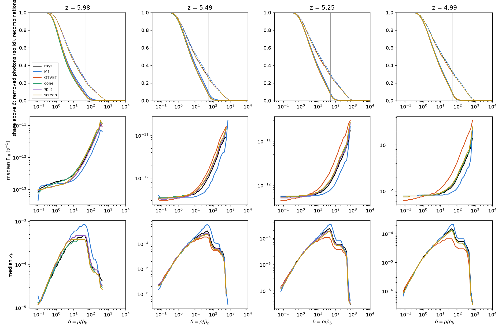
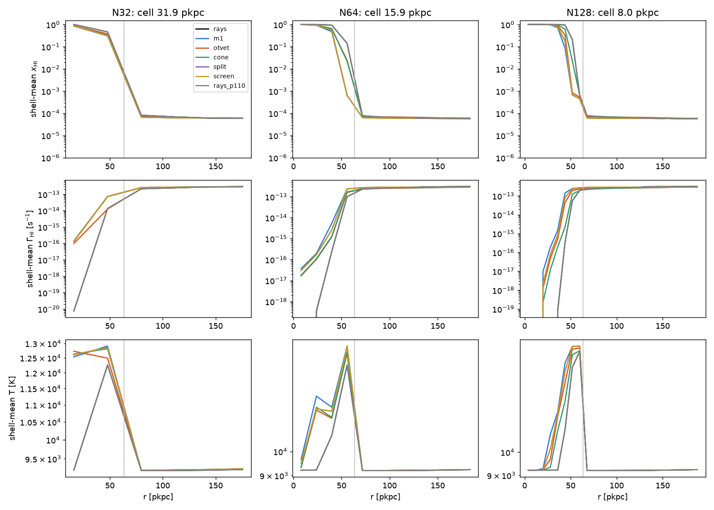

# Why the closures do not change the mean Γ_HI after overlap: the photon sink by density

*Branch `absorbers-wu21`, 2026-11-06. For the paper's §5 ("IGM statistics
the same for every method"). Tool: `tools/analysis/absorber_budget.py`
(self-test `absorber_budget_selftest`, ctest label `analysis`); job
`tools/hyak/absorber_budget.slurm`; outputs `$RUNS/absorbers_wu21/`
(`budget.txt`, `budget.json`, `absorbers.txt`, `absorber_budget.png`);
figure copied to `docs/figures/absorbers_closures.png`.*

## 1. The question

Wu, McQuinn & Eisenstein 2021 (JCAP 02, 042; `docs/otvet_closure_literature.md`
§1, read through a summarising tool) find that the moment closures
over-ionise self-shielding absorbers: in a spherical r⁻² absorber in a
uniform background the recombination rate is about 1.3× the exact one with
OTVET and 1.4× with M1, so at fixed emissivity the moment methods' Γ_HI is
about 0.4× the exact one and the effective mean free path is biased. In the
uniform 512³ suite (40 Mpc/h, 78 kpc/h cells, `docs/rt_suite_512.md`)
nothing like this shows: the median Γ of the ionised cells agrees between
the rays and every moment method to ≤ 10 % from z = 12 to 5 (§5 there), and
so do Γ, λ_mfp and ⟨F⟩ at z = 5–6 (§7). Three hypotheses, not exclusive:

* **H1, resolution.** With 78 kpc/h cells the Lyman-limit systems are
  under-resolved (λ_mfp is 3.5–5× the observed in every run, the rays
  included), so the absorbers hold too small a share of the photon sink
  for the closure to matter.
* **H2, the dense-gas rule.** The suite ran on 2026-10-21/22 with the
  original `photo_cell` rule: in a cell denser than 50× the mean only
  x = min(exp(−(δ − 50)/50), 1) of the photons its photoionisations use
  are removed from the radiation (0.37 at δ = 100, 0.02 at δ = 250), so
  the densest gas neither consumes nor shields. P11
  (`photon_consume_dense`, part of `legacy_physics = 0` since 2026-10-28,
  `docs/port_notes.md` §5b) makes x = 1.
* **H3, the sink is elsewhere.** If the photons go mostly to the diffuse
  IGM's recombinations, to redshifting out of the groups and to the light
  horizon at the reduced ĉ, the absorbers do not set ⟨Γ⟩ whatever the
  closure.

## 2. Phase 1: the existing snapshots

### 2.1 What is measured

The snapshots at z ≈ 5.98, 5.49, 5.25 and 4.99 (the zdata1 outputs
`run/step_{0078,0088,0093,0099}`, the moment runs' nearest within 0.03) of
`reion512_rays` (case B, the reference), `_m1`, `_otvet`, `_otvet_cone`,
`_otvet_split` and `_otvet_screen`, with Γ from `gammaHI_avg` (the
substep-averaged rate of the step the snapshot ends; the gas is the state
at the end of the step). Per cell, with the code's units and rate functions
(`cosmology.cpp` `calc_sim_var`, `rt_rates.cpp`, `kernels/rt_cell.hpp`):

| quantity | expression |
|---|---|
| hydrogen, electrons | n_H = δ ⟨n_H⟩, n_HI = x_HI n_H, n_e = n_HII + n_He (x_HeII + 2 x_HeIII) |
| photoionisations P | Γ_HI n_HI V [s⁻¹] |
| photons removed X | x(δ) P, x = min(exp(−(δ − 50)/50), 1): the suite's rule; P11 makes X = P |
| recombinations R | α_B(T) n_e n_HII V, the HII case-B fit of `rt_rates.cpp` at the code's 0.01 dex table nodes, log-linear between them (P9) |

binned in log δ (0.1 dex) and log x_HI (0.25 dex), with histograms of
log Γ and log x_HI per δ bin for the medians. The box totals are compared
with the sources' emission rate ṅ = 0.2 × 10^25.2 × Luv × V_box
(`igm_stats.py`, Luv of the step's `stats.txt`) and with the code's own
photon budget: the moment runs write " Moments : in flight, injected,
absorbed, lost" to `Log/ray.log` after every hydro step (cumulative, in
photons per hydrogen atom of a mean-density cell; `absorbed` is what
`photo_cell` took out of the field, i.e. X, and `lost` the photons
redshifted below 13.6 eV), the rays keep only the photons in flight
(`ngam_rays_total` of `stats.txt`), so their absorbed + lost is the
emission minus the change in flight.

The absorbers (the rays at z = 5.49 and 4.99): 6-connected components of
x_HI > 0.5 on the periodic grid, their sizes and the largest HI column
through each along a grid line of each axis (N_HI = Σ n_HI Δx over the
component's cells on that line), the number above the Lyman limit
(N_HI > 1.6×10¹⁷ cm⁻²), and the share of the volume-averaged 912 Å
opacity ⟨σ n_HI⟩ in cells whose own τ_912 = σ n_HI Δx exceeds 1.

### 2.2 H2 confirmed: the suite ran with the original rule

The runs' `params.txt` has no `photon_consume_dense` line and
`legacy_physics = 0`; the binary `$RUNS/rt_suite512_bin/radhydro_interp`
(built 2026-10-21 09:48 from the pre-move `rt-suite-512`, its README; the
commit id `df3f26a` of `docs/STATUS.md` is from the archived repository)
contains no `photon_consume_dense` string at all (`strings | grep` finds
none, against three for `photon_conserve`): the key did not exist in that
build, so `photo_cell` used x(δ). The same binary built today would make
x = 1 in production (P11 under `legacy_physics = 0`).

## 3. Results

The full tables are `$RUNS/absorbers_wu21/budget.txt`; the figure:

*Top: the share of the removed photons (solid) and of the recombinations
(dashed) in cells above δ; the vertical line is `rho_source` = 50.
Middle and bottom: the median Γ_HI and x_HI against δ. Columns z = 5.98,
5.49, 5.25, 4.99; black the rays, colours the moment methods.*

### 3.1 The photon budget of a hydro step (H3)

Per hydro step, as fractions of the emitted photons ṅ Δt (the moment
runs' `ray.log` counters; the rays from `ngam_rays_total`; the per-cell
X Δt is the end-of-step estimate):

| z | run | absorbed (code) | lost to redshift (code) | into the reservoir | in flight / ṅ Δt | X Δt / absorbed |
|---|---|---|---|---|---|---|
| 5.98 | rays | 0.89 (abs. + lost) | – | 0.11 | 2.2 | – |
| | M1 / OTVET / cone / split / screen | 0.89 / 0.88 / 0.88 / 0.88 / 0.87 | 0.008–0.010 | 0.10–0.13 | 1.7–2.1 | 0.50–0.52 |
| 5.49 | rays | 0.38 (abs. + lost) | – | 0.62 | 5.1 | – |
| | moments | 0.30–0.34 | 0.024–0.026 | 0.64–0.67 | 5.0–5.3 | 0.77–0.86 |
| 5.25 | rays | 0.30 (abs. + lost) | – | 0.70 | 8.5 | – |
| | moments | 0.26 | 0.038–0.040 | 0.70 | 8.3–8.7 | 0.87–0.88 |
| 4.99 | rays | 0.28 (abs. + lost) | – | 0.72 | 12.0 | – |
| | moments | 0.22 | 0.055–0.056 | 0.72 | 11.9–12.1 | 0.88 |

- **After overlap only a fifth to a quarter of a step's emission is
  absorbed in that step**; 4–6 % redshifts below 13.6 eV and 70 % goes
  into the photons in flight, whose stock is 12 steps' emission at
  z = 5. The reservoir n_γ ≈ ṅ λ/ĉ grows because λ_mfp grows (15 → 28
  pMpc from z = 5.5 to 5.25 at 3.5–5× the observed, §7 of the suite
  report) while ĉ Δt is 1.9 pMpc per step at 0.5c: a photon emitted at
  z = 5 is absorbed over the next ≈ 15 steps. The mean Γ is σ ĉ n_γ of
  this reservoir, which every method fills from the same ṅ and drains at
  the same rate as long as its opacity is the same. **The rays and the
  moment methods agree on every column to 0.01–0.03**, including the
  reservoir and its growth.
- At z = 5.98 (x_V = 0.88) 88 % is absorbed within the step, almost all
  of it in the I-fronts of the last neutral islands: the end-of-step
  estimate X Δt recovers only half of the code's absorption there (the
  front cells end the step ionised, with a small x_HI and a step-averaged
  Γ that misses the photons that ionised them), against 88 % after
  overlap. The by-density fractions below are of the estimate; the
  missing front absorption sits in the islands, at low δ.
- The estimate's shortfall after overlap (12 %) is the same for every
  method, so the method ratios below are unaffected.

### 3.2 Where the removed photons and the recombinations are, by density (H2)

Fractions of the box total (the rays; the moment methods in brackets as
the range over M1, OTVET, cone, split, screen):

| z | X(δ > 10) | X(δ > 50) | X(δ > 100) | P(δ > 50) | R(δ > 10) | R(δ > 50) | R(δ > 100) | fV(δ > 50) | (P − X)/ṅ |
|---|---|---|---|---|---|---|---|---|---|
| 5.98 | 25 % (24–28) | 4.4 % (4.2–7.1) | 0.6 % (0.7–2.1) | 12 % (14–30) | 44 % (42–45) | 21 % (20–22) | 14 % (13–14) | 0.012 % | 0.04 (0.05–0.15) |
| 5.49 | 34 % (34–38) | 5.9 % (5.8–8.5) | 0.7 % (0.7–2.0) | 15 % (15–31) | 48 % (47–50) | 25 % (25–27) | 18 % (17–19) | 0.018 % | 0.03 (0.03–0.09) |
| 5.25 | 35 % (34–37) | 5.9 % (5.9–7.1) | 0.6 % (0.7–1.0) | 14 % (15–22) | 50 % (49–52) | 28 % (27–29) | 20 % (19–21) | 0.022 % | 0.02 (0.02–0.04) |
| 4.99 | 35 % (35–36) | 5.8 % (6.0–6.4) | 0.7 % (0.8–1.1) | 15 % (16–18) | 53 % (51–54) | 30 % (29–32) | 22 % (22–23) | 0.027 % | 0.02 (0.02–0.03) |

and by neutral fraction: cells with x_HI > 0.1 hold 22 % of the removed
photons at z = 5.98 (the islands' fronts), 0.9 % at z = 5.49 and none
after overlap; x_HI > 0.5 holds 9 % at z = 5.98 and 0.4 % at 5.49, while
their recombinations are 1.3 % and 0.5 % (the rays; M1 5 % and 4 %).

- **The dense gas is a recombination sink that does not pay for itself
  under the suite's rule.** Cells above δ = 50 are 0.01–0.03 % of the
  volume (16 000–36 000 cells) but host 21–30 % of all recombinations
  (14–22 % above δ = 100), and they remove 4–6 % of the photons; the
  photoionisations there (P) are 12–15 % of the box's for the rays. The
  rest of the sink is diffuse: half of the recombinations are at δ < 10
  (δ < 10 holds 56 % of R at z = 5.98, 47 % at 4.99) and 65–75 % of the
  removed photons; the median density of the removed photons is δ ≈ 5,
  of the recombinations δ ≈ 10–13.
- **With P11 (x = 1) the budget would change by (P − X)/ṅ:** 2–4 % of
  the emission for the rays, but 15 % for M1, 7 % for OTVET and split,
  6 % for the cone and 5 % for screen at z = 5.98, converging to 2–3 %
  for all after overlap. M1 photoionises 2.5× more in δ > 50 than the
  rays before overlap (30 % of its P against 12 %; 4.7× the rays' P in
  the 100–300 bin) because its diffusive flux fills the dense cells near
  the sources without being consumed there; the rule turns those into
  free ionisations. **So H2 is real: the suite's rule hid the moment
  methods' over-ionisation of the dense gas from the photon budget**,
  and it would have been a 5–11 % difference in the effective emissivity
  between M1 and the rays at z ≈ 6 (and ≤ 1 % at z ≤ 5.25) with P11 on,
  not Wu's 30–40 %.
- The dense cells are the source cells and their neighbours: the median
  Γ at δ = 1000 is 1.4–7×10⁻¹¹ s⁻¹ (30–100× the mean) and the median
  x_HI there 1–3×10⁻⁷. None of them self-shields (§3.4).

### 3.3 Wu's mechanism at this resolution

The recombination rate of each moment method relative to the rays, in
bins of δ (the rays' share of all recombinations in the bin at z = 4.99:
16, 15, 13, 9, 0.3 %):

| z | run | 10–30 | 30–100 | 100–300 | 300–1000 | > 1000 |
|---|---|---|---|---|---|---|
| 5.98 | M1 | 1.05 | 1.11 | 1.05 | 1.04 | 0.51 |
| | OTVET / split | 1.02 | 1.02 | 1.01 | 1.00 | 0.49 |
| | cone / screen | 0.99 | 0.97 / 0.95 | 0.96 / 0.94 | 0.98 / 0.95 | 0.49 |
| 5.49 | M1 | 1.03 | 1.12 | 1.12 | 1.07 | 0.98 |
| | OTVET / split | 0.99 / 1.00 | 0.94 / 0.97 | 0.95 / 0.98 | 0.98 / 0.99 | 0.99 |
| | cone / screen | 0.98 | 0.96 / 0.95 | 0.97 / 0.95 | 0.97 / 0.95 | 0.97 |
| 5.25 | M1 | 1.02 | 1.08 | 1.11 | 1.09 | 1.00 |
| | OTVET / split | 0.97 / 0.99 | 0.91 / 0.97 | 0.95 / 0.99 | 0.96 / 0.99 | 0.84 / 0.91 |
| | cone / screen | 0.98 | 0.97 / 0.96 | 0.99 / 0.98 | 0.97 / 0.96 | 0.85 |
| 4.99 | M1 | 1.01 | 1.05 | 1.06 | 1.07 | 1.07 |
| | OTVET | 0.96 | 0.91 | 0.96 | 0.93 | 0.89 |
| | cone / screen | 0.98 | 0.97 | 0.99 | 0.97 / 0.95 | 0.85 / 1.04 |

- **M1 recombines 5–12 % more than the rays in the gas between δ = 30
  and 1000** at every redshift, the sign Wu+21 predict (the two-moment
  closure diffuses radiation into the dense gas that the rays shadow),
  but a quarter to a third of their 1.4× for a resolved r⁻² absorber.
  The excess sits on 30–45 % of the recombination sink (the δ > 30
  bins), so it is a 2–4 % excess in the box's recombination rate, which
  matches the 2–5 % by which M1's R/ṅ exceeds the rays' (0.417 vs 0.405
  at z = 5.98, 0.278 vs 0.273 at 4.99). In Γ this is invisible at the
  10 % level of the suite's comparison.
- **The OTVET family recombines 3–9 % less than the rays in the same
  bins** (thin OTVET the least, screen next, the cone and split within
  3 %): the optically thin tensor keeps the proximity zones and the
  after-overlap patches around the source clusters (§5 of the suite
  report), which over-ionise the dense gas instead of letting it
  recombine; the opposite sign to Wu's M1 case and to their OTVET
  estimate, because their OTVET absorber is far from any source, while
  here the dense cells *are* the source neighbourhoods.
- Above δ = 1000 (0.01–0.3 % of the sink; the source cells and their
  neighbours) the moment methods recombine half as much as the rays at
  z = 5.98 and 0.85–1.07× after overlap; too small a share to matter and
  not analysed further.
- The x_HI(δ) curves (figure, bottom) show the rule itself: the median
  x_HI rises with δ up to δ ≈ 30–50 as photoionisation equilibrium
  requires, then *falls* by an order of magnitude above `rho_source`,
  where the cells ionise without consuming photons and sit next to the
  sources. In every method the gas above 50× the mean is more ionised
  than the gas at 30×.

### 3.4 How resolved the absorbers are (H1)

The rays' snapshots (`absorbers.txt`; the cell is 17–19 pkpc proper):

| z | cells with x_HI > 0.5 | components | sizes | peak N_HI per component | opacity share: neutral cells / τ_912 > 1 cells (count) | 1/(σ⟨n_HI⟩) |
|---|---|---|---|---|---|---|
| 5.49 | 290 256 (0.22 % of the volume) | 65 | median 1, three of 10⁵–2.9×10⁵ cells (the last islands) | median 6.5×10¹⁸, max 3.9×10²⁰ cm⁻²; all 65 above 1.6×10¹⁷ on all three axes | 89 % / 95 % (321 355 cells) | 0.69 pMpc |
| 4.99 | 2 | 2 | single cells | 6–7×10²⁰ cm⁻² | 10 % / 28 % (16 cells) | 31 pMpc |

and for the other methods at z = 4.99 the τ_912 > 1 cells are 5 (OTVET),
11 (screen), 13 (cone) and 233 (M1; 84 % of its opacity: M1 leaves a few
hundred dense cells it cannot ionise, the cells with P(x_HI > 0.1) = 1.9 %
of its photoionisations), against 16 for the rays.

- **There is no population of self-shielding absorbers in any run.**
  Before overlap the "absorbers" of x_HI > 0.5 are the last neutral
  islands of the IGM at low density (three of 10⁵ cells each hold
  almost all of the 290 000 neutral cells at z = 5.49) with 62 small
  fragments at their edges; every one is a Lyman-limit column because a
  neutral cell at the mean density already has N_HI = n_H Δx ≈ 2×10¹⁸
  cm⁻². After overlap 2 cells of 1.3×10⁸ are neutral and 16 have
  τ_912 > 1 (5–13 in the OTVET family). No dense cell self-shields: the
  median x_HI at δ = 100–1000 is 10⁻⁵–10⁻⁷ (§3.2), the self-shielding
  density δ_ss, defined as where the median x_HI reaches 0.5, does not
  exist in any snapshot.
- **The 912 Å opacity after overlap is the residual neutral fraction of
  the ionised gas**, 70 % of it in cells with τ_912 < 1 (the diffuse IGM
  in photoionisation equilibrium at the local Γ) and 28 % in 16 cells
  that a random sightline almost never crosses: hence λ_mfp from the
  sightlines (28 pMpc at z = 5.25, §7 of the suite report) equals
  1/(σ⟨n_HI⟩) = 31 pMpc at z = 4.99, as for a uniform absorber, and is
  3.5–5× the observed. The missing opacity is the Lyman-limit systems
  (N_HI = 10¹⁷–10²⁰ over 1–10 pkpc, δ = 10²–10³ at these redshifts):
  at 17–19 pkpc per cell a 10²–10³ overdensity is smeared over a cell
  of 2–4×10⁻⁴ cm⁻³ and ionised through by Γ ≈ 10⁻¹²; the cell's HI
  column at x_HI = 10⁻⁴ is 10¹⁵–10¹⁶ cm⁻², two orders below the Lyman
  limit, and under the suite's rule it does not even consume the
  photons that keep it ionised.
- So the quantity Wu+21's mechanism acts on, the recombination rate
  of self-shielding absorbers that the closure over-ionises, is not in
  the simulation: what the dense cells do is recombine as optically
  thin gas at the local Γ (21–30 % of the box's recombinations, §3.2),
  which every method computes alike to 5–12 %.

### 3.5 Which hypotheses the numbers support

| | supported? | the fractions |
|---|---|---|
| **H1** resolution | **yes, decisive** | no self-shielding cell in any run; 2 neutral cells and 16 cells with τ_912 > 1 at z = 4.99 in 1.3×10⁸; 70 % of the 912 Å opacity in τ < 1 cells; λ_mfp = 1/(σ⟨n_HI⟩) |
| **H2** the dense-gas rule | **yes, as a hidden difference** | δ > 50 removes 4–6 % of the photons but hosts 21–30 % of the recombinations and 12–30 % of the photoionisations; with P11 the methods' effective emissivities would differ by 5–11 % (M1 vs rays) at z ≈ 6 and ≤ 1 % after overlap |
| **H3** the sink is elsewhere | **yes** | the sink is half diffuse (δ < 10: 47–56 % of R, 65–75 % of X); after overlap 70 % of a step's emission goes into the in-flight reservoir (12 steps' emission at z = 5), 4–6 % redshifts away, 22–28 % is absorbed; every method agrees on this budget to 0.01–0.03 |

The mean Γ after overlap is σ ĉ n_γ with n_γ the reservoir, filled by the
same ṅ and drained by the same diffuse opacity in every method; the
closures differ in the 20–30 % of the sink above δ = 50 by 5–12 %, i.e.
2–4 % of the total, and that only in the recombinations, since under the
suite's rule the photons those cells use are not removed. Wu+21's
1.3–1.4× needs a resolved, self-shielding r⁻² absorber, of which the
suite has none; whether it appears at a resolution where the absorbers
exist is Phase 2.

## 4. Phase 2: the controlled tests (proposed 2026-11-06; (a) and (c) launched the same day on the user's decision, (b) not)

Nothing below has been launched. Costs from `docs/rt_suite_512.md` §3 (one
whole cpu-g2 node per run: the rays 24 h at 512³/40 Mpc/h, the moment
methods 10 h, of which the 2048³-mesh PM 1.6–1.9 h and the I/O 0.5–4.4 h)
and from the 256³ precheck grid of `docs/STATUS.md` (2026-10-19: 256³ gas,
512³ particles, 20 Mpc/h, `pm_refine = 2`, the rays with the ĉ schedule,
1.6–2.9 h per run on one node, ≈ 13 GB each without a checkpoint).

### (a) H2 at the suite's resolution: 256³ in 20 Mpc/h, P11 on and off

The precheck configuration (`tools/hyak/rt_suite512.sh precheck`: 256³
gas, 512³ particles, 20 Mpc/h, seed 7 with the 256³ large-scale phases,
`pm_refine = 2`, the Sheth–Tormen table, f6 = 0.11, the continuous ĉ
schedule; the same 78 kpc/h cell and the same 1.3×10⁸ M☉ FoF floor as the
suite, so the same source population per volume) with the rays, M1 and the
cone, each with `photon_consume_dense = 1` and `= 0` (explicit keys, the
current `main` binary; `make_production.py --photon-consume-dense`). Six
runs; the ICs exist (`$RUNS/rt512cal256/ics`).

| | per run | the six |
|---|---|---|
| wall (one cpu-g2 node each) | rays 1.6–2.9 h (the precheck grid), M1/cone ≈ 1–1.3 h (2.4× cheaper RT, §3 of the suite report) | ≈ 9–10 node-hours |
| disk | ≈ 13 GB without a checkpoint, +16 GB with the last one kept | ≈ 0.1–0.2 TB |

What it answers: with x = 1 the dense gas consumes what it ionises, so
the method difference in P(δ > 50) (12 % of the rays' photoionisations
against 30 % of M1's at z = 5.98, 15–18 % after overlap) becomes a
difference in the photon budget. The expectation from §3.2 is a
4–11 % lower ṅ_eff for M1 than for the rays at z ≈ 6 and ≤ 1 % after
overlap, visible in Γ and z99; and the post-processing of this report on
the P11 runs gives the sink fractions with the shielding switched on
(whether any cell self-shields at 78 kpc/h once the dense cells absorb).
Also P11's own effect on the history at fixed f6 (the pending f_esc
recalibration of `docs/production_run.md` §8) comes free from the rays
pair.

### (b) H1: 512³ in 20 Mpc/h (39 kpc/h cells), P11 on

The rays, M1 and the cone at twice the suite's resolution in the same
20 Mpc/h volume as (a), so (a) with P11 is its own resolution control.
Sources: keep the **particle mass** of the suite (512³ particles in
20 Mpc/h = 1024³ in 40 Mpc/h, `--ndm 512`, `pm_refine = 2` → a 1024³ PM
mesh), so the FoF floor stays 1.3×10⁸ M☉ and the Sheth–Tormen L(M) gives
the suite's luminosity density; the finer gas cells raise the
recombination clumping, which moves z99 later (not retuned: f6 = 0.11 is
the suite's), or a 1-h 256³/10 Mpc/h precheck first if z99 must stay at
5.5. Not 1024³ particles in 20 Mpc/h: that lowers the floor to 1.6×10⁷ M☉
and re-creates the first launch's problem (§1b of the suite report).

| | per run | the three |
|---|---|---|
| RT substeps | the cell halves, so nstep_rt doubles at every ĉ: ≈ 10 600 substeps at 512³ | |
| wall | rays ≈ 2× the suite's RT (16 h → 32 h) + hydro (2× the steps) + a cheaper 1024³ PM: ≈ 40 h; M1/cone ≈ 16 h | ≈ 70–75 node-hours, 3 nodes for 2 days |
| memory | ≈ 200 GB (the suite's 370–480 GB less the 275 GB of the 2048³ PM) | |
| disk | ≈ 105 GB each without a checkpoint (the suite's per-run size), ≈ 130 GB with one | ≈ 0.35–0.4 TB |

What it answers: whether any cell self-shields and whether the τ_912 > 1
cells become a population (hundreds to thousands rather than 16–48), i.e.
whether the absorbers begin to be resolved; and the method ratios of the
recombination rate in δ > 100 at twice the resolution. The published
convergence of λ_mfp needs ≲ 10 kpc/h cells (`docs/fesc_evolution.md`
§6), so 39 kpc/h is a trend point, not convergence; the AMR
(`fesc512_b2.5_amr`, 19.5 kpc/h on two levels) is the cheaper way to go
further, but only the rays run on the levels so far.

### (c) Wu+21's own §4 problem: one self-shielding absorber

Wu's setup is a spherical r⁻² absorber in a **uniform** background of
Γ(∞) = 5×10⁻¹³ s⁻¹. The plane-parallel mode (`docs/plane_parallel.md`)
gives such a background but is implemented for the rays only
(`plane_parallel.cpp`: "plane_parallel = 1 is implemented for rt_method =
rays only"), so the exact problem needs the moment RT to accept the
face injection (photons with F = ĉ n along +x on the x = 0 plane every
substep, the far face a sink): a code item of about a day, with tests.

The cheap substitute that needs no code: `rt_driver` with
`rt_method = rays | m1 | otvet` (and the closures) on a 64³ problem
(`tests/problems/*`: `gas.bin` (9, N, N, N) and `sources.txt`), one r⁻²
absorber of 10–20 cells radius at the centre, ionised uniform gas around
it, and the illumination from 6 or 26 bright sources on the box faces (a
crude uniform background) or one point source: compare the recombination
rate inside the absorber, its ionised fraction profile and the Γ behind
it between the methods against the rays with 10³–10⁴ rays per source. A
run is seconds to minutes on one core, the set an hour; it checks that
the code reproduces Wu's 1.3–1.4× when the absorber is resolved (10–20
cells across) and how fast the excess vanishes when the absorber is 1–2
cells, which is the suite's case (§3.4). With the plane-parallel moment
injection it becomes Wu's problem exactly.

### Recommendation

(c)-cheap first (an hour, no code): it tests the mechanism and its
resolution dependence directly. Then (a) (10 node-hours) to see P11 and
the closure together at the suite's resolution, since the suite's rule is
what hid Wu's mechanism in the budget. (b) only if (a) shows the
closure matters once the dense gas consumes photons, as a trend point
before investing in the moment methods on the AMR levels.

## 5. Phase 2 (c): one self-shielding absorber with every method (done 2026-11-06)

`tools/analysis/absorber_single.py` and `tools/hyak/absorber_single.slurm`
(outputs `$RUNS/absorbers_wu21/single/`, the last two steps of every run
kept): an r⁻² absorber, δ = 100 inside r_c = 20 pkpc and 100 (r_c/r)²
outside, cut at δ = 10 (r_t = 63 pkpc), neutral at 10⁴ K, at the centre
of a periodic 5 Mpc/h box at z = 6 otherwise at the mean density, ionised
(x_HI = 10⁻⁴) and at 10⁴ K; 64 equal sources on a 4³ lattice, the
absorber equidistant (221 pkpc) from the 8 nearest; `apps/rt_driver`
(the gas static, the RT physics as in production: `legacy_rt =
legacy_physics = 0`, so P11 on, `ray_rotate = 3`, ĉ = c), 60 steps of
1.01 Myr. The sources' Luv is set per resolution so that the rays give
Γ_HI = 5×10⁻¹³ s⁻¹ (Wu+21's Γ(∞)) in the shell r_t < r ≤ 2 r_t of the
same box without the absorber, read at the same step (in the periodic
box the background keeps rising while the images within a mean free
path, ≈ 8 box lengths, arrive, 3–4 % per step at step 60; both the
calibration and the measurement are taken there). The absorber's
recombinations if fully ionised would be about half the photons entering
r_t, its core density 6.5×10⁻³ cm⁻³ is above the self-shielding density
at this Γ, and its recombination time is 19 Myr. Three resolutions of the
same physical absorber: N = 32, 64, 128 (31.9, 15.9, 8.0 pkpc cells; the
suite's 78 kpc/h cell is the 16 pkpc one), r_t = 2, 4, 8 cells.

*Shell-mean x_HI, Γ_HI and T against the distance from the absorber's
centre at the last step; the vertical line is r_t. Black the rays, grey
the rays under the suite's dense-gas rule (`photon_consume_dense = 0`),
colours the moment methods.*

| N (cell) | quantity | rays | M1 | OTVET | cone | split | screen |
|---|---|---|---|---|---|---|---|
| 32 (31.9 pkpc) | R(< r_t) / rays | 1 | **2.00** | 1.56 | 1.81 | 1.87 | 1.87 |
| | M_HI(< r_t) / rays | 1 | 0.73 | 0.83 | 0.77 | 0.76 | 0.76 |
| | r(x_HI = ½) [pkpc] | 45.8 | 36.5 | 40.0 | 37.8 | 37.4 | 37.4 |
| | Γ at the rim [10⁻¹³] | 2.38 | 2.70 | 2.45 | 2.66 | 2.70 | 2.70 |
| 64 (15.9 pkpc) | R(< r_t) / rays | 1 | **2.08** | 1.65 | 1.67 | 1.90 | 1.90 |
| | M_HI(< r_t) / rays | 1 | 0.69 | 0.79 | 0.78 | 0.72 | 0.72 |
| | r(x_HI = ½) [pkpc] | 48.7 | 39.2 | 43.6 | 43.5 | 41.3 | 41.4 |
| | Γ at the rim [10⁻¹³] | 2.44 | 2.74 | 2.40 | 2.51 | 2.78 | 2.78 |
| 128 (8.0 pkpc) | R(< r_t) / rays | 1 | **2.27** | 1.75 | **1.39** | 2.03 | 2.02 |
| | M_HI(< r_t) / rays | 1 | 0.68 | 0.78 | 0.87 | 0.72 | 0.72 |
| | r(x_HI = ½) [pkpc] | 48.7 | 38.6 | 41.5 | 45.4 | 39.7 | 39.8 |
| | Γ at the rim [10⁻¹³] | 2.40 | 2.81 | 2.48 | 2.25 | 2.85 | 2.85 |

*(R: the case-B recombination rate inside r_t; M_HI: the HI mass inside
r_t; the rim: r_t < r ≤ r_t + 2 cells. The rays with the suite's rule
(`photon_consume_dense = 0`) are identical to the rays with P11 in every
number: the neutral core has no photoionisations to discount.)*

- **Wu+21's mechanism is reproduced, and it is larger than their 1.3–1.4×
  for this absorber.** The rays leave the inner 46–49 pkpc neutral with
  Γ = 0 inside (a shadow: no photon reaches the core); every moment
  method's Γ decays smoothly into the absorber instead (the middle row:
  10⁻¹⁷–10⁻¹⁵ s⁻¹ at 20–40 pkpc against 0 for the rays), ionises it to
  a smaller radius (37–45 pkpc) and recombines **2.0–2.3× (M1), 1.6–1.75×
  (OTVET thin), 1.9–2.0× (split, screen) and 1.8 → 1.4× (cone)** as much
  inside r_t, with 13–32 % less HI. The methods' Γ at the rim is also
  higher than the rays' by 12–17 % (M1, split, screen): they do not cast
  the shadow that halves the rays' Γ in the shell around the absorber
  relative to the empty box (2.4 against 5×10⁻¹³).
- **The resolution trend separates the closures.** From 2 to 8 cells
  across r_t, M1's excess grows (2.0 → 2.27) as the ionised skin it
  creates is resolved, thin OTVET's too (1.56 → 1.75), split and screen
  stay at 1.9–2.0, and **the cone's falls from 1.81 to 1.39**: its
  HI-attenuated tensor is the only closure that sees the absorber's
  column and turns the flux away from it, and it converges toward the
  rays as the absorber is resolved. At the suite's cell (16 pkpc, the
  middle column) no closure is better than 1.65×.
- **This is the effect the suite cannot show** (§3): it needs a
  self-shielded core with an ionised skin, which the suite's cells never
  contain. Where it would act, the recombinations of such absorbers, is
  outside the simulation at 78 kpc/h.
- The first try (`single_try1_summary/`: δ_c = 1000, r_c = 5 pkpc, ĉ =
  0.3c, 40 Myr, the calibration on the centre cell without `ray_rotate`)
  stayed neutral out to r_t at every resolution and had the rays of the
  8 symmetric sources focusing on the centre cell (Γ there 2–6× the box
  mean, growing with N: the B16 quirk); it is kept only as the record of
  what was changed. Its ratios were of the same kind (M1 1.4–2.1×, the
  cone 0.8× at N = 128).
