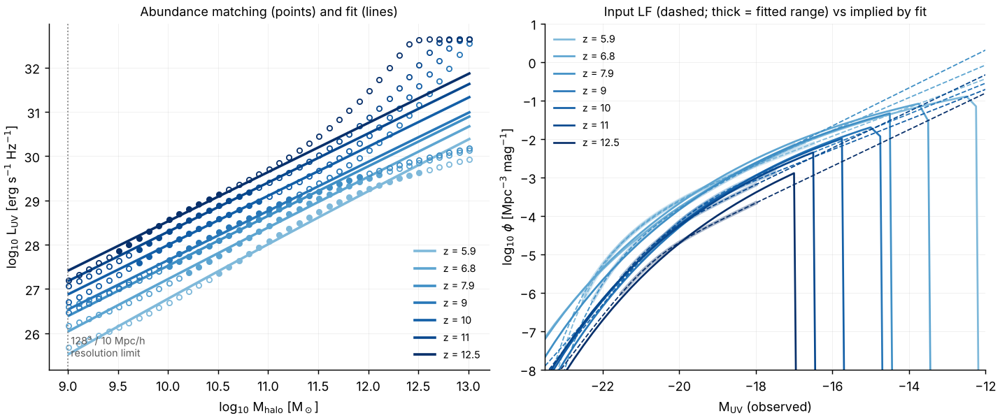
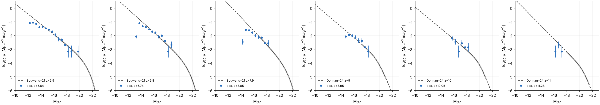
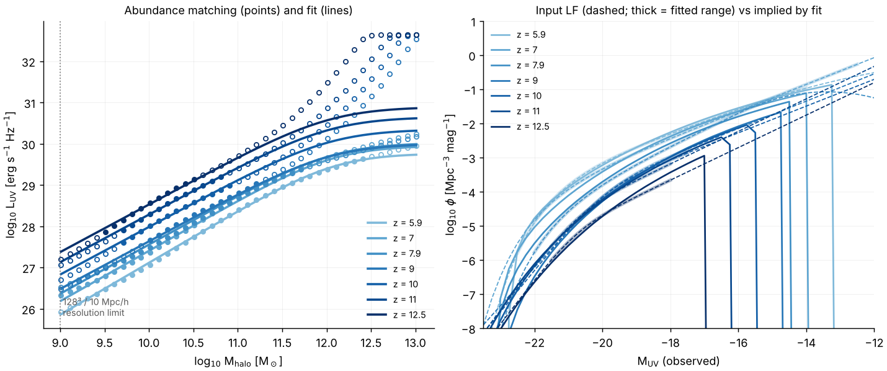
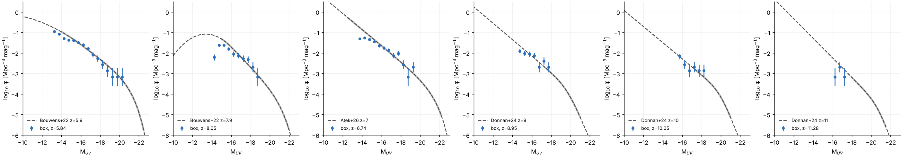

# Abundance-matched UV sources

*Status (2026-10-09):* all LF parameters are read from the papers (§5).
§3 and §3b describe earlier drafts; the current fit is in §3c.

This is a third source model, `sfr_model = abundance`, beside the
reconstructed Trac & Cen model (`global`, the default) and `dynamical`
(`docs/halos_and_sources.md` §3). Selecting it changes nothing else: the
existing models are bit-identical to before.

## 1. Method

1. **Observed LFs** (`data/uv_lf/lf_params.txt`): one Schechter or
   double-power-law fit per (redshift, paper), with the magnitude range the
   data constrain and a weight. φ* is in the observers' Mpc⁻³ mag⁻¹ (h = 0.7).
2. **Matching** (`abundance_match`, `include/radray/abundance_matching.hpp`):
   at each LF redshift, M_UV(M_halo) from n_halo(>M) = n_gal(<M_UV).
   * **Production (user decision 2026-10-11): n_halo is Sheth–Tormen
     refit to the well-resolved FoF halos** of the 40 Mpc/h 1024³ run
     (A = 0.3458, a = 0.6164, p = 0.3; `data/hmf/st_fof_40mpc_1024.txt`,
     `am_fit --hmf st --st-params 0.345835,0.616383,0.3`, parameters
     `data/uv_lf/am_params_st_fof.txt`; `docs/pm_refine.md` §6). The
     L_UV(M) relation is the same for every box and resolution; halos
     below a box's resolution are missing faint sources.
   * Before (2026-10-09 to 2026-10-11): n_halo was the simulated FoF mass
     function, so the box's own UV LF matched the observed one by
     construction down to the resolution limit (below; kept as an option).
     * `tools/analysis/fit_fof_hmf.py` fits the FoF catalogs of a
       no-source run (`docs/hmf_validation.md`) as Sheth–Tormen times
       R(N, z) = r∞ / (1 + (N/N_c)^−p), with N_c = N_c0((1+z)/7)^q.
       Below 20 particles R = 0.
     * The fit uses a Poisson likelihood over all catalogs, including the
       empty one at z = 12.6.
     * For 128³ / 10 Mpc/h it gives r∞ = 2.27, p = 0.64, N_c0 = 237,
       q = 2.53 (`data/hmf/fof_128_10mpc.txt`). It reproduces the halo
       totals of every catalog to within Poisson noise.
     * Use `am_fit --hmf st --sim-hmf data/hmf/fof_128_10mpc.txt`. The
       correction is resolution-specific: refit it from a no-source run
       at each N.
     * Fits so far: `fof_128_10mpc` (m_p = 5.1e7 M☉: 128³/10 Mpc/h and
       512³/40 Mpc/h), `fof_256_10mpc` (6.4e6 M☉) and `fof_1024_40mpc_r2`
       (6.4e6 M☉, 40 Mpc/h with pm_refine = 2, the parameters
       `data/uv_lf/am_params_1024_40mpc_r2.txt`; `docs/pm_refine.md` §6,
       which also shows that this R(N, z) form overshoots FoF/ST above
       ~10^10 M☉).
   * Otherwise n_halo comes from the analytic Tinker et al. 2008
     (Δ = 200m) or Sheth–Tormen mass function, in the simulation cosmology
     (cosmo_parameters.f90: Ωm = 0.27, h = 0.7, σ8 = 0.8, n = 0.96), BBKS
     transfer function.
   * The small cosmology difference from the observers' (Ωm = 0.3, h = 0.7) is
     ignored. It is a few percent in volume.
   * No scatter in L at fixed M, and no duty cycle.
   * Optional dust correction to intrinsic L: Meurer et al. 1999
     IRX–β, A_UV = 4.43 + 1.99 β with a linear β(M_UV). It is off by default
     (§4).
   * L_ν = 4π(10 pc)² 10^(−0.4(M_AB + 48.60)), i.e. M_UV = 51.595 − 2.5 log L.
3. **Smooth fit** (`fit_luv_model`, Nelder–Mead in log L, with a penalty
   that keeps L increasing in M):
   * The shape uses the matched points from the entry's bright limit down to
     `--extend-faint` (default M_UV = −12). This extrapolates the observed
     faint end to the halos the simulation resolves (user decision).
   * The model is:

   ```
   L_UV(M, z) = 2 L_p / ((M/M_p)^-a + (M/M_p)^-b),   x = clamp(z, z_lo, z_hi) - z0
   log10 L_p = l0 + l1 x + l2 x²,   a = a0 + a1 x,   log10 M_p = m0 + m1 x,   b
   ```

   M is in M☉ and L in erg/s/Hz.
   * **The shape is fitted to the z ≤ 9 LFs only** (entries with
     z ≤ `--shape-zmax`, default 9.5). z is clamped to their range
     [z_lo, z_hi].
   * **Above z_hi only the normalisation changes**
     (`fit_highz_norm`): one offset in log L per JWST redshift. It is the
     weighted mean residual of the matched points inside that entry's
     magnitude range, which should be the luminous galaxies actually
     observed. The offset rises linearly from 0 at z_hi through the knots
     (`am_norm_z`, `am_norm_dl`).
   * **Beyond the last knot, L(M) is held fixed.** By then the halos are
     disappearing anyway (user decision, 2026-10-08).
4. **Ionising photons.** The RT emits `fResc * pop2_init * L` photons per
   second. That is a fixed 0.2 × 10^25.2 photons per erg/Hz, split over 5
   groups (cosmo_parameters.f90). The source model stores, for each halo:
   * `L = L_UV × (ξ_ion / Σ pop2_init) × (f_esc / fResc)`, so
     N_ion,esc = f_esc ξ_ion L_UV exactly, without touching the RT or its
     spectrum;
   * `sfr = L_UV / l_per_sfr`, with the default 8×10²⁷ (Madau et al. 1998,
     Salpeter). It only drives the metal injection and the
     `sfr > sfr_min` gate of `calc_halo`;
   * `mstar = min(sfr × t_age, f_b M)`, informational only.

   ξ_ion and f_esc are degenerate: only f_esc ξ_ion enters the RT, and f_esc
   is calibrated to τ_es. ξ_ion matters only for quoting f_esc.
   * **Production uses a JWST-era ξ_ion:** `xi_ion = 25.38` (user decision,
     2026-10-08; §5).
   * The code default stays 25.2, which equals the original's
     `pop2_init`.
   * The LFs are not dust-corrected (user decision), so L_UV is the observed
     UV. The ξ_ion measurement is per intrinsic UV, but the difference is
     small for the faint, blue galaxies that dominate the box.

## 2. Usage

```
build/am_fit --lf data/uv_lf/lf_params.txt --out am_out [--hmf st|tinker] \
             [--extend-faint -13] [--dust 1 --beta0 -2.0 --dbeta -0.1] \
             [--free l0,l1,...] [--set am_b=0.3] [--only-confirmed]
python3 tools/analysis/plot_am.py am_out          # am_out/am_fit.png
```

`am_out/am_params.txt` holds `params.txt` lines (`sfr_model = abundance`,
`am_l0 … am_b`, `am_z0`, `am_zlo`, `am_zhi`), to which `xi_ion` (log10)
and `f_esc` are added for a run. `am_out/lf_check.txt` lists the input LF
against the LF the fit implies.

| key | default | meaning |
|---|---|---|
| `sfr_model` | `global` | `abundance` selects this model |
| `am_l0 … am_b` | see `LuvModel` | fit parameters (from `am_fit`) |
| `am_z0`, `am_zlo`, `am_zhi` | 8, 0, ∞ | pivot and clamp of the shape's z dependence |
| `am_norm_z`, `am_norm_dl` | empty | high-z normalisation knots (comma lists) |
| `xi_ion` | 25.2 | log10 ξ_ion, photons s⁻¹ / (erg s⁻¹ Hz⁻¹); production: 25.38 |
| `f_esc` | 0.2 (`fResc`) | escape fraction (calibrated to τ_es, step 4) |
| `l_per_sfr` | 8e27 | L_UV per M☉/yr (metals only) |
| `tvir_min`, `m_min` | 1e4 K, 0 | halos below do not emit (as for the other models) |

## 3. Draft fit

The fit uses:
* Bouwens+21 at z = 5.9, 6.8 and 7.9, unconfirmed;
* Donnan+24 at z = 9 for the shape, and at z = 10, 11 and 12.5 for the
  normalisation;
* the Tinker mass function, with the faint end extended to −12.


* **Shape:** the rms is 0.09 dex in log L. The high-mass slope b runs into
  its bound of 0, so L is flat above M_p ≈ 10^11.4–12 M☉. This only removes
  galaxies brighter than M_UV ≈ −22, and a 10 Mpc/h box has no such
  halos.
* **High-z normalisation:** +0.41, +0.71 and +0.96 dex at z = 10, 11 and
  12.5, relative to the z = 9 relation. This is the slow evolution of the
  bright end that JWST finds. With Sheth–Tormen it is +0.38, +0.66 and
  +0.88. Because the shape is fixed, the boost also applies to faint
  halos. At z ≥ 10 they are about 0.4 dex brighter than the matched points
  from Donnan's own faint-end slope would give (left panel).
* **Resolution-limit halos** (10⁹ M☉, 20 particles at 128³ in 10 Mpc/h):

  | z | M_UV, Tinker | M_UV, Sheth–Tormen |
  |---|---|---|
  | 6 | −12.6 | −12.2 |
  | 8 | −14.4 | −13.9 |
  | 10 | −15.5 | −14.9 |
  | 12 | −16.7 | −16.0 |

  These are fainter than the blank-field data, so the faint-end slope of the
  z ≤ 9 LFs, which fixes the shape at all redshifts, matters most.
  Lensing-field LFs reach M_UV ≈ −13 to −15.
* **Tinker vs Sheth–Tormen:** Tinker et al. calibrated their z-evolution
  only to z ≈ 2.5. Extrapolated to z = 7, it gives 1.5–4.5× fewer halos than
  Sheth–Tormen at 10⁹–10¹¹ M☉. The step-2 comparison with the simulated FoF
  mass function will show which is closer. `--tinker-zmax` freezes the
  evolution if needed.

## 3b. Matching to the simulated halos (production)

```
python3 tools/analysis/fit_fof_hmf.py runs/hmf128/run/halos --box 10 --N 128 --out data/hmf/fof_128_10mpc.txt
build/am_fit --lf data/uv_lf/lf_params.txt --hmf st --sim-hmf data/hmf/fof_128_10mpc.txt --out runs/am_sim
python3 tools/analysis/box_lf.py runs/hmf128/run/halos runs/am_sim/am_params.txt data/uv_lf/lf_params.txt --box 10 --N 128
```




**Fit quality.** The rms is 0.07 dex in log L. The z > 9.5 normalisation
is +0.34, +0.64 and +0.88 dex at z = 10, 11 and 12.5.

**The box's LF against the observed LFs** (the FoF catalogs of the
no-source run with this L(M)):
* It is now 0.8–1.3× the observed LF over the observed range at z ≈ 6–7
  and 9. With Tinker it was 1.3–2× brighter than −16.
* The faintest bins, near 20 particles, are incomplete by construction.
* At z ≈ 8 the box is about 0.5× the Bouwens+21 z = 7.9 row at −15 to −16.
  The smooth L(M, z) cannot follow that row's steeper faint end
  (α = −2.23, against −2.06 at z = 6.8 and −2.00 for Donnan at z = 9).
  This row is to be replaced by JWST-era LFs.

## 3c. Current fit (all LFs from the papers; production)

This uses the simulated FoF mass function at 128³ / 10 Mpc/h. The fitted
parameters are in `data/uv_lf/am_params_128_10mpc.txt`.

```
build/am_fit --lf data/uv_lf/lf_params.txt --hmf st --sim-hmf data/hmf/fof_128_10mpc.txt --out runs/am
```




* **Shape fit:** rms 0.053 dex in log L.
* **Halos at the resolution limit** (10⁹ M☉) have M_UV = −13.1, −14.4,
  −15.5 and −16.6 at z = 6, 8, 10 and 12.
* **Box LF against the observed LFs:**
  * 0.8–1.2× brightward of M_UV ≈ −15, at z = 6, 7, 9 and 10;
  * 0.6× at z = 7.9 from −16.5 to −15;
  * 0.3–0.7× within about 1.5 mag of the resolution limit. Here the smooth
    L(M, z) and the FoF-correction fit do not follow the 20–60-particle
    edge exactly.
* **f_esc = 0.5** (128³, 0.01c): τ_es = 0.0516, x_V = 0.5 at z = 6.72,
  and x_M = 0.967 at the end (z ≈ 5.3).

## 4. Decisions

**Decided (user, 2026-10-08):**
* **Shape and normalisation.** The shape of L_UV(M) comes from the
  lower-redshift LFs (z ≤ 9). At z > 9.5 only the normalisation is fitted,
  to the luminous galaxies JWST observes.
* **Faint end:** extrapolate it when matching (`--extend-faint -12`).
* **Mass function:** match to the **simulated FoF halos** (2026-10-09; it
  replaces the earlier choice of Tinker). The result is in §3b.
* **Dust:** no correction.
* **ξ_ion:** a JWST-era value, log ξ_ion = 25.38 (§5).
* **Beyond the data:** L(M) is held fixed above the highest LF redshift.
* **LFs:** prefer recent JWST LFs to Bouwens+21. At z ≥ 9 this is
  Donnan+24 (paper supplied).

**Still open:** the z ≈ 6–8 LFs (JWST-era papers to come from the user;
Bouwens+21 is unconfirmed until then).

## 5. Parameters used, with provenance

**UV LFs (`data/uv_lf/lf_params.txt`).** Since 2026-10-09 every row is
read from the papers, from PDFs the user supplied. Earlier drafts used
Bouwens+21 values from memory. Two of them were **wrong**: φ* at z ≈ 5.9
is 0.51×10⁻³, not 0.19×10⁻³, and at z ≈ 6.8 it is 0.19×10⁻³, not 0.12×10⁻³.

Rows used in the fit:

| z | source | form | M* | φ* (Mpc⁻³ mag⁻¹) | α | β or δ | observed range | use |
|---|---|---|---|---|---|---|---|---|
| 5.9 | Bouwens+22, ApJ 940, 55, Table 2 (HFF + blank, fiducial) | Schechter, curved | −20.87 | 0.57×10⁻³ | −1.87 | δ = 0.05 | −22.5 to −14 | shape |
| 7.0 | Atek+26 (GLIMPSE), arXiv:2604.23823, Table 2 (JWST lensed + B21 bright bins) | Schechter | −21.29 | 10^−3.68 | −1.98 | — | −22.2 to −12.5 | shape |
| 7.9 | Bouwens+22, Table 2 | Schechter, curved | −20.90 | 0.096×10⁻³ | −2.20 | δ = 0.23 | −22 to −15 | shape |
| 9.0 | Donnan+24, MNRAS 533, 3222, Table 3 | DPL | −19.70 | 23.5×10⁻⁵ | −2.00 | −3.81 | −21 to −17.3 | shape |
| 10.0 | Donnan+24 | DPL | −19.98 | 14.5×10⁻⁵ | −1.98 | −4.05 (fixed) | −21 to −17.3 | normalisation |
| 11.0 | Donnan+24 | DPL | −20.73 | 3.27×10⁻⁵ | −2.19 | −4.29 | −21.5 to −18 | normalisation |
| 12.5 | Donnan+24 | DPL | −20.82 | 0.99×10⁻⁵ | −2.19 (fixed) | −4.29 (fixed) | −21.5 to −18 | normalisation |

* **Curvature.** Bouwens+22 multiply the Schechter function by
  10^(−0.4δ(M+16)²) faintward of −16 (their §3.2). The `schechter_curv`
  form implements this. Their δ is consistent with 0 at z ≈ 6–8; turn-overs
  are excluded brightward of −14.3 to −15.2.
* **GLIMPSE** finds no turnover down to M_UV = −12.3 at z ≈ 7.

**Cross-checks** (weight 0, in the data file):
* Bouwens+21 Table 5, at z = 5.9–10.2;
* Bouwens+22 at z = 6.8, superseded by GLIMPSE;
* Atek+18 Table 3, at z ≈ 6;
* Bowler+20 Table 7, DPL at z = 8 and 9;
* Whitler+25 Table 6, JADES DPL at z ≈ 8.5–12 and 12–16;
* Donnan+24 at z = 14.5.

**Read but not entered:**
* Ma 2026 (UNCOVER, one lensing field; a faint-range-only fit);
* Goolsby 2026, which refits α only (−1.92, −2.14, −1.74 at z = 6, 7, 8,
  consistent with the rows used);
* McLeod+24 (its Table 5 was not extractable);
* Harikane+22 (z ≈ 4–7 bright end, not needed for this box).

**Other published constants** (from memory and unconfirmed, except where marked):

| constant | value | source |
|---|---|---|
| Tinker HMF, Δ = 200m | A0 = 0.186, a0 = 1.47, b0 = 2.57, c = 1.19; A ∝ (1+z)^−0.14, a ∝ (1+z)^−0.06, b ∝ (1+z)^−α, log α = −(0.75/log(Δ/75))^1.2 | Tinker et al. 2008, ApJ 688, 709 |
| Sheth–Tormen | A = 0.3222, a = 0.707, p = 0.3 | Sheth & Tormen 1999 (already in the code) |
| IRX–β | A_UV = 4.43 + 1.99 β | Meurer, Heckman & Calzetti 1999 |
| L_UV / SFR | 8.0×10²⁷ erg/s/Hz per M☉/yr | Madau, Pozzetti & Dickinson 1998 (already in the code) |
| ξ_ion (code default) | 10^25.2 Hz/erg | Robertson et al. 2013; equals the original's `pop2_init` |
| ξ_ion (production) | 10^25.38 Hz/erg | **confirmed**: median log ξ_ion,0 = 25.38 of the z > 4.64 galaxies in the JADES+CEERS NIRSpec sample, Pahl et al. 2025, ApJ 981, 134 (arXiv:2407.03399) |
| ξ_ion(z), alternative | log ξ_ion = 0.06 z + 24.82, i.e. 25.18 at z = 6 and 25.42 at z = 10 | 761 NIRSpec galaxies at z = 4–10: Llerena et al. 2025, A&A (arXiv:2412.01358). Snippet; attribution from memory |

## 6. Tests

`tests/test_abundance_matching.cpp` (CTest `abundance_matching`) checks:
* the AB conversion;
* the LF integrals;
* the abundance identity at every matched point;
* that `model_lf` integrates back to the halo abundance;
* recovery of known fit parameters;
* the Tinker mass function against Sheth–Tormen and its z freeze;
* the source model: `L`, `sfr`, the f_esc and ξ_ion scalings, the z clamp
  and the `params.txt` keys.
