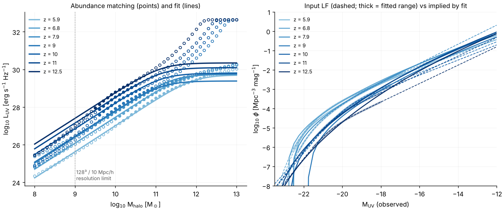

# Abundance-matched UV sources

*Status (2026-10-08): **draft**.*
* The code is in place and tested.
* The z ≥ 9 LFs (Donnan et al. 2024) are read from the paper.
* The z ≈ 6–8 rows (Bouwens et al. 2021) are still unconfirmed, and may be
  replaced by JWST-era LFs from papers the user will supply.

This is a third source model, `sfr_model = abundance`, beside the
reconstructed Trac & Cen model (`global`, the default) and `dynamical`
(`docs/halos_and_sources.md` §3). Selecting it changes nothing else: the
existing models are bit-identical to before.

## 1. Method

1. **Observed LFs** (`data/uv_lf/lf_params.txt`): one Schechter or
   double-power-law fit per (redshift, paper), with the magnitude range the
   data constrain and a weight. φ* is in the observers' Mpc⁻³ mag⁻¹ (h = 0.7).
2. **Matching** (`abundance_match`, `include/radray/abundance_matching.hpp`):
   at each LF redshift, M_UV(M_halo) from n_halo(>M) = n_gal(<M_UV).
   * n_halo comes from the analytic Tinker et al. 2008 (Δ = 200m; default,
     user choice) or Sheth–Tormen mass function, in the simulation cosmology
     (cosmo_parameters.f90: Ωm = 0.27, h = 0.7, σ8 = 0.8, n = 0.96), BBKS
     transfer function.
   * The small cosmology difference from the observers' (Ωm = 0.3, h = 0.7) is
     ignored. It is a few percent in volume.
   * No scatter in L at fixed M, and no duty cycle.
   * Optional dust correction to intrinsic L: Meurer et al. 1999
     IRX–β, A_UV = 4.43 + 1.99 β with a linear β(M_UV). It is off by default
     (§4).
   * L_ν = 4π(10 pc)² 10^(−0.4(M_AB + 48.60)), i.e. M_UV = 51.595 − 2.5 log L.
3. **Smooth fit** (`fit_luv_model`, Nelder–Mead in log L, with a penalty
   that keeps L increasing in M):
   * The shape uses the matched points from the entry's bright limit down to
     `--extend-faint` (default M_UV = −12). This extrapolates the observed
     faint end to the halos the simulation resolves (user decision).
   * The model is:

   ```
   L_UV(M, z) = 2 L_p / ((M/M_p)^-a + (M/M_p)^-b),   x = clamp(z, z_lo, z_hi) - z0
   log10 L_p = l0 + l1 x + l2 x²,   a = a0 + a1 x,   log10 M_p = m0 + m1 x,   b
   ```

   M is in M☉ and L in erg/s/Hz.
   * **The shape is fitted to the z ≤ 9 LFs only** (entries with
     z ≤ `--shape-zmax`, default 9.5). z is clamped to their range
     [z_lo, z_hi].
   * **Above z_hi only the normalisation changes**
     (`fit_highz_norm`): one offset in log L per JWST redshift. It is the
     weighted mean residual of the matched points inside that entry's
     magnitude range, which should be the luminous galaxies actually
     observed. The offset rises linearly from 0 at z_hi through the knots
     (`am_norm_z`, `am_norm_dl`).
   * **Beyond the last knot, L(M) is held fixed.** By then the halos are
     disappearing anyway (user decision, 2026-10-08).
4. **Ionising photons.** The RT emits `fResc * pop2_init * L` photons per
   second. That is a fixed 0.2 × 10^25.2 photons per erg/Hz, split over 5
   groups (cosmo_parameters.f90). The source model stores, for each halo:
   * `L = L_UV × (ξ_ion / Σ pop2_init) × (f_esc / fResc)`, so
     N_ion,esc = f_esc ξ_ion L_UV exactly, without touching the RT or its
     spectrum;
   * `sfr = L_UV / l_per_sfr`, with the default 8×10²⁷ (Madau et al. 1998,
     Salpeter). It only drives the metal injection and the
     `sfr > sfr_min` gate of `calc_halo`;
   * `mstar = min(sfr × t_age, f_b M)`, informational only.

   ξ_ion and f_esc are degenerate: only f_esc ξ_ion enters the RT, and f_esc
   is calibrated to τ_es. ξ_ion matters only for quoting f_esc.
   * **Production uses a JWST-era ξ_ion:** `xi_ion = 25.38` (user decision,
     2026-10-08; §5).
   * The code default stays 25.2, which equals the original's
     `pop2_init`.
   * The LFs are not dust-corrected (user decision), so L_UV is the observed
     UV. The ξ_ion measurement is per intrinsic UV, but the difference is
     small for the faint, blue galaxies that dominate the box.

## 2. Usage

```
build/am_fit --lf data/uv_lf/lf_params.txt --out am_out [--hmf st|tinker] \
             [--extend-faint -13] [--dust 1 --beta0 -2.0 --dbeta -0.1] \
             [--free l0,l1,...] [--set am_b=0.3] [--only-confirmed]
python3 tools/analysis/plot_am.py am_out          # am_out/am_fit.png
```

`am_out/am_params.txt` holds `params.txt` lines (`sfr_model = abundance`,
`am_l0 … am_b`, `am_z0`, `am_zlo`, `am_zhi`), to which `xi_ion` (log10)
and `f_esc` are added for a run. `am_out/lf_check.txt` lists the input LF
against the LF the fit implies.

| key | default | meaning |
|---|---|---|
| `sfr_model` | `global` | `abundance` selects this model |
| `am_l0 … am_b` | see `LuvModel` | fit parameters (from `am_fit`) |
| `am_z0`, `am_zlo`, `am_zhi` | 8, 0, ∞ | pivot and clamp of the shape's z dependence |
| `am_norm_z`, `am_norm_dl` | empty | high-z normalisation knots (comma lists) |
| `xi_ion` | 25.2 | log10 ξ_ion, photons s⁻¹ / (erg s⁻¹ Hz⁻¹); production: 25.38 |
| `f_esc` | 0.2 (`fResc`) | escape fraction (calibrated to τ_es, step 4) |
| `l_per_sfr` | 8e27 | L_UV per M☉/yr (metals only) |
| `tvir_min`, `m_min` | 1e4 K, 0 | halos below do not emit (as for the other models) |

## 3. Draft fit

The fit uses:
* Bouwens+21 at z = 5.9, 6.8 and 7.9, unconfirmed;
* Donnan+24 at z = 9 for the shape, and at z = 10, 11 and 12.5 for the
  normalisation;
* the Tinker mass function, with the faint end extended to −12.



* **Shape:** the rms is 0.09 dex in log L. The high-mass slope b runs into
  its bound of 0, so L is flat above M_p ≈ 10^11.4–12 M☉. This only removes
  galaxies brighter than M_UV ≈ −22, and a 10 Mpc/h box has no such
  halos.
* **High-z normalisation:** +0.41, +0.71 and +0.96 dex at z = 10, 11 and
  12.5, relative to the z = 9 relation. This is the slow evolution of the
  bright end that JWST finds. With Sheth–Tormen it is +0.38, +0.66 and
  +0.88. Because the shape is fixed, the boost also applies to faint
  halos. At z ≥ 10 they are about 0.4 dex brighter than the matched points
  from Donnan's own faint-end slope would give (left panel).
* **Resolution-limit halos** (10⁹ M☉, 20 particles at 128³ in 10 Mpc/h):

  | z | M_UV, Tinker | M_UV, Sheth–Tormen |
  |---|---|---|
  | 6 | −12.6 | −12.2 |
  | 8 | −14.4 | −13.9 |
  | 10 | −15.5 | −14.9 |
  | 12 | −16.7 | −16.0 |

  These are fainter than the blank-field data, so the faint-end slope of the
  z ≤ 9 LFs, which fixes the shape at all redshifts, matters most.
  Lensing-field LFs reach M_UV ≈ −13 to −15.
* **Tinker vs Sheth–Tormen:** Tinker et al. calibrated their z-evolution
  only to z ≈ 2.5. Extrapolated to z = 7, it gives 1.5–4.5× fewer halos than
  Sheth–Tormen at 10⁹–10¹¹ M☉. The step-2 comparison with the simulated FoF
  mass function will show which is closer. `--tinker-zmax` freezes the
  evolution if needed.

## 4. Decisions

**Decided (user, 2026-10-08):**
* **Shape and normalisation.** The shape of L_UV(M) comes from the
  lower-redshift LFs (z ≤ 9). At z > 9.5 only the normalisation is fitted,
  to the luminous galaxies JWST observes.
* **Faint end:** extrapolate it when matching (`--extend-faint -12`).
* **Mass function:** Tinker.
* **Dust:** no correction.
* **ξ_ion:** a JWST-era value, log ξ_ion = 25.38 (§5).
* **Beyond the data:** L(M) is held fixed above the highest LF redshift.
* **LFs:** prefer recent JWST LFs to Bouwens+21. At z ≥ 9 this is
  Donnan+24 (paper supplied).

**Still open:** the z ≈ 6–8 LFs (JWST-era papers to come from the user;
Bouwens+21 is unconfirmed until then).

## 5. Parameters used, with provenance

The cloud sessions cannot reach arXiv, ADS or the journals. "Snippet" means
the number appeared in a quoted search-result excerpt of the paper; "memory"
means recalled, not verified. **All need confirmation.**

**UV LFs (`data/uv_lf/lf_params.txt`).**

Donnan et al. 2024, MNRAS 533, 3222 (arXiv:2403.03171v3), Table 3, double
power law. **Confirmed**: read from the user-supplied PDF. * marks a
parameter fixed in their fit.

| z | φ* (10⁻⁵ Mpc⁻³ mag⁻¹) | M* | α | β | fitted M_UV range | use |
|---|---|---|---|---|---|---|
| 9 | 23.5 ± 39.2 | −19.70 ± 0.96 | −2.00 ± 0.47 | −3.81 ± 0.49 | −21.0 to −17.3 | shape |
| 10 | 14.5 ± 16.4 | −19.98 ± 0.61 | −1.98 ± 0.40 | −4.05* | −21.0 to −17.3 | normalisation |
| 11 | 3.27 ± 9.86 | −20.73 ± 1.61 | −2.19 ± 0.69 | −4.29 ± 1.30 | −21.5 to −18.0 | normalisation |
| 12.5 | 0.99 ± 0.99 | −20.82 ± 0.71 | −2.19* | −4.29* | −21.5 to −18.0 | normalisation |
| 14.5 | 0.18 ± 0.28 | −20.82* | −2.19* | −4.29* | one bin, about 1.3 galaxies | not used (weight 0) |

Their evolving parametrisation (eqs. 3–6, used as a redshift prior for
z ≥ 7) is:
* M* = −20.95 + 0.11z;
* φ* = 10^(−0.14z − 2.36);
* α = −2.04×10⁻⁴ z − 2.1;
* β = 0.138z − 5.13.

It is not used.

Bouwens et al. 2021, AJ 162, 47 (arXiv:2102.07775), Schechter fits. The
z = 8.9 and 10.2 rows are kept at weight 0, superseded by Donnan+24:

| ⟨z⟩ | M* | φ* (10⁻³ Mpc⁻³) | α | provenance |
|---|---|---|---|---|
| 5.9 | −20.93 ± 0.09 | 0.19 (+0.05/−0.04) | −1.93 ± 0.04 | memory |
| 6.8 | −21.15 ± 0.13 | 0.12 | −2.06 ± 0.05 | memory |
| 7.9 | −20.93 ± 0.28 | 0.09 (+0.09/−0.05) | −2.23 ± 0.20 | snippet |
| 8.9 | −21.15 (fixed) | 0.021 (+0.014/−0.009) | −2.33 ± 0.19 | snippet |
| 10.2 | −21.19 (fixed) | 0.0042 (+0.0045/−0.0022) | −2.38 | M*, φ*: snippet (Oesch et al. 2018 row); α: memory |

The Bouwens+21 evolving fit was partly seen in snippets and is not used:
M* = −21.03 − 0.04(z−6), α = −1.94 − 0.11(z−6),
φ* = 0.40×10⁻³ × 10^(−0.33(z−6) − 0.024(z−6)²).

Other JWST LFs (not entered) are listed in the data file.

**Other published constants (from memory, unconfirmed):**

| constant | value | source |
|---|---|---|
| Tinker HMF, Δ = 200m | A0 = 0.186, a0 = 1.47, b0 = 2.57, c = 1.19; A ∝ (1+z)^−0.14, a ∝ (1+z)^−0.06, b ∝ (1+z)^−α, log α = −(0.75/log(Δ/75))^1.2 | Tinker et al. 2008, ApJ 688, 709 |
| Sheth–Tormen | A = 0.3222, a = 0.707, p = 0.3 | Sheth & Tormen 1999 (already in the code) |
| IRX–β | A_UV = 4.43 + 1.99 β | Meurer, Heckman & Calzetti 1999 |
| L_UV / SFR | 8.0×10²⁷ erg/s/Hz per M☉/yr | Madau, Pozzetti & Dickinson 1998 (already in the code) |
| ξ_ion (code default) | 10^25.2 Hz/erg | Robertson et al. 2013; equals the original's `pop2_init` |
| ξ_ion (production) | 10^25.38 Hz/erg | median log ξ_ion,0 of the z > 4.64 galaxies in a CEERS+JADES NIRSpec sample: Pahl et al. 2025, ApJ (arXiv:2407.03399). Snippet; author attribution from memory |
| ξ_ion(z), alternative | log ξ_ion = 0.06 z + 24.82, i.e. 25.18 at z = 6 and 25.42 at z = 10 | 761 NIRSpec galaxies at z = 4–10: Llerena et al. 2025, A&A (arXiv:2412.01358). Snippet; attribution from memory |

## 6. Tests

`tests/test_abundance_matching.cpp` (CTest `abundance_matching`) checks:
* the AB conversion;
* the LF integrals;
* the abundance identity at every matched point;
* that `model_lf` integrates back to the halo abundance;
* recovery of known fit parameters;
* the Tinker mass function against Sheth–Tormen and its z freeze;
* the source model: `L`, `sfr`, the f_esc and ξ_ion scalings, the z clamp
  and the `params.txt` keys.
