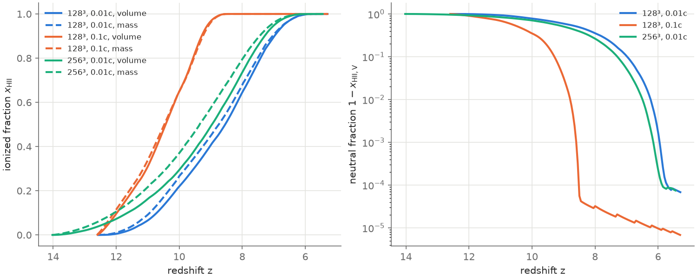
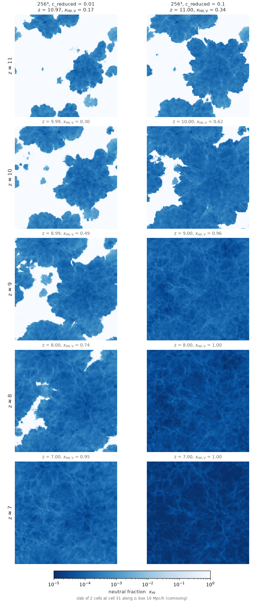
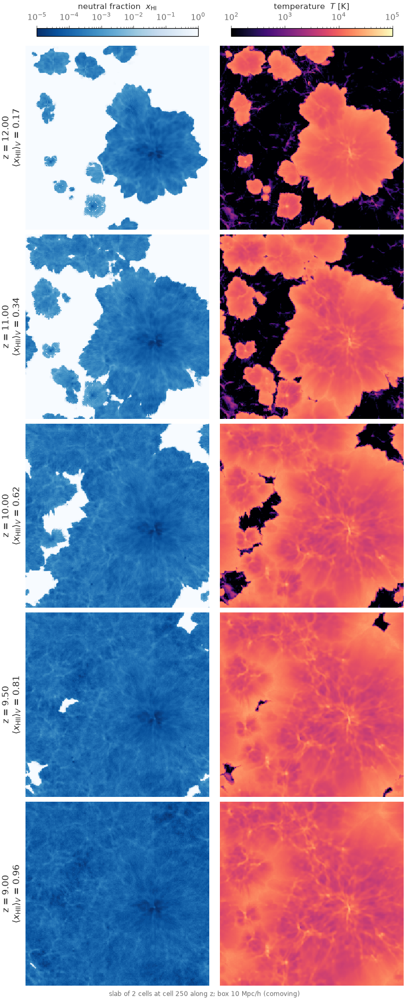
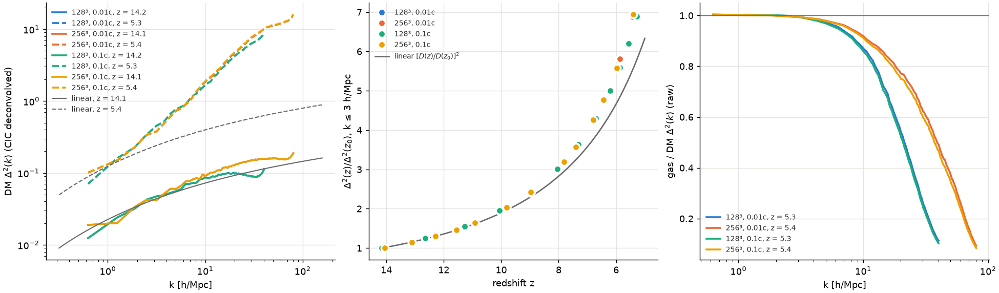

# Running on UW Hyak `klone`

*Written 2026-10-08 by the "Cluster setup" thread (docs/ROADMAP.md §8).
Account `astro`, partition `cpu-g2`. Everything here was measured on
klone; nothing in this thread changed the physics.*

## 1. The machine

| | |
|---|---|
| Nodes | `cpu-g2`: AMD EPYC 9654 (Genoa, Zen 4), 2 sockets × 96 cores, 1 thread per core, 1.5 TB; 2 NUMA nodes (NPS1: cores 0–95 and 96–191), 32 MB L3 per CCD |
| astro share | 992 `cpu-g2` cores and 7.8 TB of memory (about 5 nodes), shared with the rest of the group; 64-core `cpu-g2-mem2x`; 40 `compute-bigmem` cores (`hyakalloc`) |
| OS | Rocky Linux 8.10, glibc 2.28, system gcc 8.5 |
| Limits | no maximum time, but the **default is 1 hour** (always pass `--time`); maintenance reservations (e.g. 2026-10-13 09:00 – 10-14 09:00 on all `n*` nodes) block jobs whose time limit crosses them |
| Disk | `/gscratch/astro` (GPFS, 39 TB, 5.3 TB free on 2026-10-08, shared by the group); `$HOME` has 10 GB: keep nothing big there |

**Whole nodes.** `--exclusive --mem=0` asks for the whole 1.5 TB and waits
on `AssocGrpMemLimit` whenever the group's other jobs hold more than
6.3 TB (they held 6.6 TB on 2026-10-08). Use `--exclusive --mem=256G`:
the job still gets the whole node. A whole idle node can take a while to
come free (other users' jobs share the nodes); the scaling jobs below waited
0–30 min.

## 2. Software

| what | version | where |
|---|---|---|
| C++ / Fortran | gcc, g++, gfortran **13.2.0** | module `gcc/13.2.0` |
| FFTW | 3.3.10, single precision, **SSE2 codelets only** (`--enable-float --enable-sse2`), static | built in user space: `/gscratch/astro/mcquinn/sw/fftw-3.3.10-float` |
| CMake | 4.4.4 | conda env |
| Python | 3.12.15, numpy 2.5.3, matplotlib 3.11.2, scipy 1.18.1, healpy 1.20.1 | conda env `/gscratch/astro/mcquinn/sw/conda-envs/radray` (conda-forge, Miniforge 25.9.1 from `/mmfs1/sw/miniforge3`) |
| ffmpeg | 9.0.2 | the same conda env |
| MPI (AMReX backend) | OpenMPI 4.1.6, UCX 1.16.0, over InfiniBand (`mlx5_0`) | module `ompi/4.1.6-2`, loaded by the AMReX scripts through `radray_module_load`; **across nodes the scripts also call `radray_ucx_eager`** (`UCX_RNDV_THRESH=8m UCX_ZCOPY_THRESH=inf`): with the module's defaults UCX's rendezvous path makes AMReX's `FillBoundary` 10× slower on 2 and 4 nodes than on one (`docs/stage_e_hydro.md` §5); eager below 8 MB fixes the hydro and makes the 512³ RT 15 % faster, eager for everything would make the RT slower (`docs/stage_d.md` §4.4) |

Why not the modules:
* `fftw/3.3.10` (and the contributed FFTW modules) are double precision only.
* Every `cmake/*` module `depends_on` an older gcc (`cmake/3.25.1` →
  `gcc/11.2.0`) and swaps gcc 13 out, so CMake comes from conda.
* There is no system python3 with numpy (Rocky's is 3.6).

**FFTW must be SSE2-only.** `FFTW_ESTIMATE` plans pick different codelets
with different SIMD sets, and the stored PM/hydro references are only
reproduced by an SSE2-only build. Measured on a `cpu-g2` node with the 16
PM/hydro stored-reference tests (old `main`, 2026-10-08):

| FFTW build | stored-reference tests passed |
|---|---|
| 3.3.10 `--enable-sse2` | 16/16 |
| 3.3.8 `--enable-sse2` | 16/16 |
| 3.3.10 `--enable-avx2` | 11/16 (`hydro_ref_sod_{x,y,z}`, `hydro_ref_random3d{,_freeze}` fail) |
| 3.3.8 `--enable-avx2` | 11/16 (same) |
| 3.3.10 Debian's configure flags | 11/16 (same) |
| 3.3.10 no SIMD | 10/16 |

The live Fortran-vs-C++ tests pass with any of them (both sides use the same
FFTW). The code links only the serial `libfftw3f` (the FFTs are a small part
of the PM step), so `--enable-openmp` is not needed.

`tools/hyak/env.sh` sets all of this up (module, conda env, `CMAKE_PREFIX_PATH`,
and `FFTW_INC`/`FFTW_LIB` for the harness Makefiles). `tools/hyak/setup_sw.sh`
installs it from scratch for another user (`sbatch tools/hyak/setup_sw.sh`,
about 10 min).

## 3. Build and test

Always on a compute node:

```
cd /gscratch/astro/$USER/NewRadHydroCode
sbatch tools/hyak/build_hyak.sh                     # build/ + fast suite, 32 cores, ~10 min
# or interactively
salloc -A astro -p cpu-g2 -c 32 --mem=64G --time=2:00:00
tools/hyak/build_hyak.sh
# nightly suite in its own build directory
sbatch --time=24:00:00 --export=ALL,CMAKE_EXTRA=-DRADRAY_NIGHTLY_TESTS=ON,CTEST_LABELS=nightly,CTEST_JOBS=8 \
       tools/hyak/build_hyak.sh $PWD/build-nightly
```

`build_hyak.sh` sources `env.sh`, sets `ulimit -s unlimited` (the RT harness
needs it) and builds with the default flags only (`-O2`, `-ffp-contract=off`,
no fast-math, no `-march`).

### Test results on klone (2026-10-08, `main` at d3651cb + this branch)

| suite | result |
|---|---|
| fast (`-LE "long\|nightly"`) | **72/80 passed, 8 failed** (below) |
| nightly (`-DRADRAY_NIGHTLY_TESTS=ON -L nightly`) | **12/12 passed** (the four ~5-min full-loop references, the live pool-guard comparison, the seven full hydro-suite tiers; 27 min with 8 in parallel) |
| `long` label | no test carried it: `ctest -L long` selected nothing (fixed on `main` 2026-10-09: CLAUDE.md and README now use the `nightly` label) |
| skipped | none (`healpix_vs_healpy` runs: healpy is in the env) |

The 8 failures are all RT stored references (`tests/problems`, compared with
`reference/harness/outputs*`):
`ref_lognormal_16src`, `ref_legacy0_lognormal_16src`,
`ref_fixed_lognormal_16src` and their `_smallbuf` variants,
`ref_c01_uniform_8src` and `ref_c01_lognormal_16src_smallbuf`.

**They are a platform difference of the stored references, not a C++ error.**
The gfortran RT harness built here (`reference/harness`, gfortran 13.2.0)
reproduces exactly the same differences, and the C++ agrees with it byte for
byte everywhere:

| configuration (5 RT problems; 2 for c = 0.1) | live gfortran vs C++ | live gfortran vs stored reference | C++ 1 vs 16 threads |
|---|---|---|---|
| legacy | 5/5 identical | lognormal_16src{,_smallbuf} differ | identical |
| legacy_rt = 0 | 5/5 identical | lognormal_16src{,_smallbuf} differ | identical |
| legacy_rt = legacy_physics = 0 | 5/5 identical | lognormal_16src{,_smallbuf} differ | identical |
| c_reduced = 0.1, fixed flags | 2/2 identical | both differ | identical |

What differs (the same for gfortran and the C++):
* the double-precision sums in `rt_stats.txt` (`nion`, `nrec`, `lambda`,
  `ncol`), by one unit in the last place (relative 1–3e-16);
* in the `legacy_physics = 0` and `c_reduced = 0.1` cases also 2–10 cells
  of `ngam`/`fgam` at the last step, where one side has a ray of
  ≈ 1e-20 photons (fgam ≈ 2e-16) and the other has none: a ray at the
  removal threshold;
* every gas field (x_HI, x_HeI, x_HeII, T, ρ, Γ, Λ, τ) is byte-identical.

The stored references were made on Ubuntu 24.04 (glibc 2.39, gfortran 13.3);
klone has glibc 2.28 and gcc 13.2.0. Only the shared run-time libraries
(libm) are common to both codes, so libm's double-precision `exp`/`log`/`pow`
are the likely cause (not verified function by function). The references were
not regenerated (CLAUDE.md). The PM, hydro and full-loop stored references
(fast and nightly) all pass here. Reproduce with the job in
`/gscratch/astro/mcquinn/logs/rt_live.sh`; its output is in
`/gscratch/astro/mcquinn/work/rt_live/summary.txt`.

### Test results on klone (2026-10-10, `main` at 6dab3d1, after PR #20)

Built by the production-256 thread from the worktree
`/gscratch/astro/mcquinn/radhydro/prod256-worktree` (logs in
`/gscratch/astro/mcquinn/radhydro/logs/prod256/`):

| suite | result |
|---|---|
| fast (`-LE "long\|nightly"`, job 41705708, 32 cores) | **94/104 passed, 10 failed**: the 8 RT stored references above plus `ray_dump_legacy_lognormal_16src_smallbuf` and `ray_dump_fixed_lognormal_16src_smallbuf`, which compare against the same references (the "known 10" of STATUS) |
| nightly (`-DRADRAY_NIGHTLY_TESTS=ON -L nightly`, job 41705709, 8 parallel) | **20/20 passed** in 58 min: the four full-loop references, the live pool-guard comparison, `recomb_stromgren`, and the 14 full hydro-suite tiers of both schemes (the longest, `hydro_suite_full_unsplit_sedov`, 43 min) |

The same `build_hyak.sh` job must be submitted with `sbatch` from the
repository root (it reads `SLURM_SUBMIT_DIR`); `sbatch --chdir` does not
work. The job's exit status is ctest's, so Slurm reported the fast suite as
FAILED whenever the 10 platform failures were present.

**Since 2026-10-12 (user decision) these 10 tests carry the label
`platform_ref`** and `build_hyak.sh` leaves them out of its fast set
(`-LE "long|nightly|platform_ref"`), so a green job means no new failures.
They stay in CI (Ubuntu 24.04, where the references were made).
`CTEST_LABELS=platform_ref` runs just them, e.g. to confirm the
differences are still only the ones described above. On klone, the
bitwise check of the RT is the live gfortran harness built there.

## 4. Where things live

```
/gscratch/astro/mcquinn/
  NewRadHydroCode/            the repository (`main`); build/, build-nightly/, build-znver4/
  radhydro/                   worktrees (prod256-worktree, main-worktree, spike-worktree), runs/, logs/ (moved here 2026-10-09)
  sw/                         fftw-3.3.10-float, conda-envs/radray, conda-pkgs, src, fftw-variants (the SIMD test)
  radhydro/runs/              production problems (params.txt, ics/, run/, run.log)
    reion128/                 128³, 0.01c (all checkpoints kept)
    reion128_c01/             128³, 0.1c (ics -> ../reion128/ics)
    reion256/                 256³, 0.01c
    reion256_c01/             256³, 0.1c, movie (ics -> ../reion256/ics)
    scaling128/, scaling256/, scaling128_znver4/   scaling-test outputs (t<threads>/, scaling.txt)
  logs/                       Slurm logs of every job of this thread
  work/rt_live/               live RT harness comparison
  spike/                      framework-spike builds and results (branch framework-spike)
```

## 5. Submitting and restarting a run

```
source tools/hyak/env.sh
python3 tools/production/make_production.py /gscratch/astro/$USER/radhydro/runs/reion128 --N 128   # ICs + params.txt, < 1 min
# shared node, 32 threads
sbatch --export=ALL,PROB=/gscratch/astro/$USER/radhydro/runs/reion128 tools/hyak/reion_production.slurm
# whole node
sbatch --exclusive -c 192 --mem=256G --export=ALL,PROB=...,THREADS=192 tools/hyak/reion_production.slurm
```

The AMReX backends over several nodes (`make_production.py --backend
amrex` writes `rt_backend = amrex` and the rest of the backend configuration
into `params.txt`; `docs/stage_e_state.md`; a build from
`tools/hyak/build_amrex.sh`):

```
python3 tools/production/make_production.py $R/reion512 --N 512 --box 40 --backend amrex ...
sbatch --exclusive --nodes=4 --ntasks=96 --cpus-per-task=8 --mem=1400G --time=2-00:00:00 \
       --export=ALL,PROB=$R/reion512,EXE=build-amrex/radhydro,POST=sbatch tools/hyak/reion_production.slurm
```

`reion_production.slurm`:
* sources `env.sh`, sets `OMP_PLACES=cores OMP_PROC_BIND=close` and
  `ulimit -s unlimited`; when `params.txt` has `rt_backend = amrex` it loads
  the MPI module, sets the UCX eager threshold (`radray_ucx_eager`) and
  launches `RANKS` (the job's `--ntasks`) ranks of `THREADS` (the job's
  `--cpus-per-task`) threads with `srun --cpu-bind=cores
  --kill-on-bad-exit=1`, in the run directory (a hung run's SIGTERM
  backtraces land there);
* runs under `/usr/bin/time -v` (wall time and peak RSS in `$PROB/run.log`);
* **restarts automatically**: if `$PROB/run/restart/checkpoint.bin` (or, with
  `restart_keep_latest = 0`, the newest `checkpoint_NNNN.bin`) exists it
  passes `--restart`. Resubmitting the same command continues the run bit
  for bit; `--requeue` makes it safe on `ckpt`. When the run reaches the last
  `zdata1` it writes `$PROB/run/DONE`, and later submissions exit at once;
* has a 4-day limit. For longer runs chain jobs:
  `sbatch --dependency=afterany:<jobid> ...` with the same arguments;
* after every successful run or leg (exit 0) runs the post-processing,
  `tools/hyak/reion_post.slurm` (stills, `reion.py`, `make_movie.py`).
  `POST=1` (default) runs it in the same job; `POST=0` skips it;
  `POST=sbatch` submits it as a separate 16-core job (`POST_CPUS`,
  `POST_MEM`, log `POST_OUT`, default `$PROB/post-%j.out`) and frees the big
  node at once. Example: `--export=ALL,PROB=...,THREADS=192,POST=sbatch`.

To change a parameter for one run (c_reduced, restart_every, …), make a second
problem directory with its own `params.txt` and a symlink to the same `ics/`
(as `reion128_c01`) rather than `EXTRA="--set …"`, so that every restart sees
the same parameters.

Checkpoints: 0.5 GB (128³, no rays) to 2.5 GB (128³ with 22M rays), 12–17 GB
at 256³ with 90–160M rays; the atomic rewrite needs twice that. At 256³ the
checkpoint writes are a third of the wall time (§7): use `restart_every = 2`
or more.

**Scaling test:** `tools/hyak/scaling_test.slurm` restarts one checkpoint
for one hydro step (`run_steps = 1`, new in this branch) with each thread
count, checks that every output file is byte-identical to the first thread
count and prints the tables of §6 (`tools/hyak/scaling_table.py`):

```
sbatch --time=4:00:00 --export=ALL,PROB=$R/reion128,CK=$R/reion128/run/restart/checkpoint_0024.bin,OUT=$R/scaling128 \
       tools/hyak/scaling_test.slurm             # THREADS="1 8 24 48 96 192", LAUNCH="numactl --interleave=all", EXE=...
```

## 6. OpenMP scaling on an idle node

Whole `cpu-g2` node (`--exclusive`; `ps` during the 256³ test showed
nothing else running), `OMP_PLACES=cores OMP_PROC_BIND=close`, default build.
One hydro step restarted from a checkpoint of the production configuration
(`make_production.py`: 10 Mpc/h, c_reduced = 0.01, nray_max_factor = 16,
`legacy_rt = legacy_physics = 0`, `deterministic_parallel`,
`rt_substep_carry`), late in reionization when the ray count is large. The
times are wall-clock seconds for that step. The RT rows are the RT phase
timers summed over the substeps of the step; `io` is the output of the step
(field files at a `zdata1` redshift), not a checkpoint (`restart_every = 0`
in the test).

**Byte-identical outputs:** in both tests every output file of every thread
count (15 files: the DM particles, the gas u/v/w and the RT grid of the
data-1 output, P(k), the six step field files and `stats.txt`, and the
hydro and ray logs; only `timing.txt` is excluded) is identical to the 1-thread run (`identical.txt`).

### 128³: checkpoint of step 24 (z = 7.30, 17.1M rays), step 25 to z = 6.70 (job 41629994, node n3452)

step ending at z = 6.7039, 19 RT substeps, 19.15M live rays at the end; peak RSS 2.4, 2.6, 2.9, 3.2, 3.7, 4.0 GB

| component | 1 thr [s] | 8 thr [s] | 24 thr [s] | 48 thr [s] | 96 thr [s] | 192 thr [s] | speedup 8 | speedup 24 | speedup 48 | speedup 96 | speedup 192 |
|---|---|---|---|---|---|---|---|---|---|---|---|
| prep | 0.05 | 0.01 | 0.01 | 0.00 | 0.00 | 0.00 | 4.4 | 10.6 | 17.7 | 26.5 | 53.0 |
| calc_rt_1 | 0.37 | 0.15 | 0.07 | 0.04 | 0.04 | 0.04 | 2.5 | 5.7 | 9.2 | 10.3 | 9.0 |
| calc_ray_1 | 10.95 | 1.41 | 0.49 | 0.26 | 0.22 | 0.56 | 7.8 | 22.3 | 41.8 | 50.0 | 19.5 |
| ray_tracing_1 | 165.42 | 21.18 | 8.08 | 4.77 | 3.13 | 2.89 | 7.8 | 20.5 | 34.7 | 52.8 | 57.3 |
| radiative_physics | 47.36 | 6.64 | 3.07 | 1.77 | 1.36 | 1.06 | 7.1 | 15.4 | 26.8 | 34.8 | 44.8 |
| ray_tracing_3 | 151.82 | 19.49 | 7.34 | 4.34 | 2.87 | 2.63 | 7.8 | 20.7 | 34.9 | 53.0 | 57.7 |
| sync | 0.08 | 0.07 | 0.03 | 0.02 | 0.03 | 0.07 | 1.1 | 2.6 | 4.2 | 2.7 | 1.2 |
| post_rt | 21.35 | 2.90 | 0.97 | 0.49 | 0.26 | 0.15 | 7.4 | 22.0 | 43.3 | 81.2 | 141.4 |
| hydro | 4.36 | 0.74 | 0.31 | 0.18 | 0.12 | 0.12 | 5.9 | 14.3 | 23.9 | 35.7 | 37.8 |
| pm | 0.74 | 0.13 | 0.09 | 0.07 | 0.07 | 0.07 | 5.5 | 8.2 | 10.3 | 11.0 | 10.1 |
| FoF + sources | 0.68 | 0.17 | 0.13 | 0.12 | 0.11 | 0.12 | 4.1 | 5.3 | 5.8 | 6.0 | 5.6 |
| RT total | 397.39 | 51.85 | 20.04 | 11.70 | 7.91 | 7.40 | 7.7 | 19.8 | 34.0 | 50.3 | 53.7 |
| summaries | 0.36 | 0.10 | 0.09 | 0.09 | 0.09 | 0.08 | 3.6 | 4.0 | 4.1 | 3.9 | 4.3 |
| io | 2.16 | 2.03 | 2.01 | 2.02 | 2.06 | 2.52 | 1.1 | 1.1 | 1.1 | 1.0 | 0.9 |
| step total | 405.70 | 55.02 | 22.67 | 14.18 | 10.36 | 10.31 | 7.4 | 17.9 | 28.6 | 39.2 | 39.4 |

| threads | step [s] | speedup | efficiency | RT speedup |
|---|---|---|---|---|
| 1 | 405.7 | 1.0 | 1.00 | 1.0 |
| 8 | 55.0 | 7.4 | 0.92 | 7.7 |
| 24 | 22.7 | 17.9 | 0.75 | 19.8 |
| 48 | 14.2 | 28.6 | 0.60 | 34.0 |
| 96 | 10.4 | 39.2 | 0.41 | 50.3 |
| 192 | 10.3 | 39.4 | 0.20 | 53.7 |

### 256³: checkpoint of step 30 (z = 8.09, 135.6M rays), step 31 to z = 7.82 (job 41631158, node n3475)

step ending at z = 7.8202, 15 RT substeps, 139.59M live rays at the end; peak RSS 17.9, 18.0, 18.1, 18.1, 20.0, 21.2 GB

| component | 1 thr [s] | 8 thr [s] | 24 thr [s] | 48 thr [s] | 96 thr [s] | 192 thr [s] | speedup 8 | speedup 24 | speedup 48 | speedup 96 | speedup 192 |
|---|---|---|---|---|---|---|---|---|---|---|---|
| prep | 0.43 | 0.06 | 0.03 | 0.02 | 0.01 | 0.01 | 7.7 | 13.7 | 26.6 | 42.6 | 85.2 |
| calc_rt_1 | 3.52 | 0.87 | 0.34 | 0.23 | 0.19 | 0.19 | 4.1 | 10.2 | 15.1 | 18.9 | 18.1 |
| calc_ray_1 | 66.70 | 8.45 | 2.91 | 1.53 | 0.98 | 0.72 | 7.9 | 22.9 | 43.7 | 67.7 | 92.0 |
| ray_tracing_1 | 1011.49 | 127.36 | 43.22 | 22.44 | 12.92 | 8.72 | 7.9 | 23.4 | 45.1 | 78.3 | 116.0 |
| radiative_physics | 268.87 | 37.65 | 16.33 | 11.01 | 7.89 | 6.79 | 7.1 | 16.5 | 24.4 | 34.1 | 39.6 |
| ray_tracing_3 | 935.60 | 118.07 | 39.87 | 20.69 | 11.88 | 8.18 | 7.9 | 23.5 | 45.2 | 78.8 | 114.4 |
| sync | 0.52 | 0.46 | 0.17 | 0.10 | 0.08 | 0.14 | 1.1 | 3.1 | 5.2 | 6.1 | 3.6 |
| post_rt | 153.95 | 22.00 | 7.56 | 3.88 | 2.07 | 1.18 | 7.0 | 20.4 | 39.7 | 74.4 | 130.8 |
| hydro | 33.78 | 5.99 | 2.29 | 1.28 | 0.69 | 0.42 | 5.6 | 14.7 | 26.3 | 49.0 | 79.8 |
| pm | 6.09 | 1.18 | 0.75 | 0.58 | 0.48 | 0.52 | 5.2 | 8.2 | 10.4 | 12.6 | 11.7 |
| FoF + sources | 5.76 | 1.38 | 0.97 | 0.84 | 0.78 | 0.79 | 4.2 | 5.9 | 6.9 | 7.4 | 7.3 |
| RT total | 2441.06 | 314.92 | 110.42 | 59.89 | 36.02 | 25.93 | 7.8 | 22.1 | 40.8 | 67.8 | 94.1 |
| summaries | 2.91 | 0.78 | 0.64 | 0.67 | 0.69 | 0.69 | 3.7 | 4.6 | 4.3 | 4.2 | 4.2 |
| io | 17.21 | 16.27 | 16.11 | 16.07 | 16.17 | 19.67 | 1.1 | 1.1 | 1.1 | 1.1 | 0.9 |
| step total | 2506.81 | 340.53 | 131.18 | 79.34 | 54.84 | 48.03 | 7.4 | 19.1 | 31.6 | 45.7 | 52.2 |

| threads | step [s] | speedup | efficiency | RT speedup |
|---|---|---|---|---|
| 1 | 2506.8 | 1.0 | 1.00 | 1.0 |
| 8 | 340.5 | 7.4 | 0.92 | 7.8 |
| 24 | 131.2 | 19.1 | 0.80 | 22.1 |
| 48 | 79.3 | 31.6 | 0.66 | 40.8 |
| 96 | 54.8 | 45.7 | 0.48 | 67.8 |
| 192 | 48.0 | 52.2 | 0.27 | 94.1 |

### What limits the scaling

* **Ray tracing** (`ray_tracing_1`, `ray_tracing_3`, `calc_ray_1`,
  `post_rt`): the colour-swept 8³-cell domains (docs/parallel.md §3) give
  512 domains per colour at 128³ and 4096 at 256³. At 128³ the ray tracing
  reaches 53× on 96 threads and only 57× on 192 (2.7 domains per thread
  per colour: load imbalance); at 256³ it keeps scaling, 78× on 96 and
  **116× on 192 threads**. This is the expected signature: the flattening at
  128³ is the domain count, not the node.
* **`radiative_physics`** (per-cell chemistry and heating, a memory-bound
  sweep over all cells) reaches 35–45×: it is the largest RT phase at
  192 threads at 128³ and the second largest at 256³.
* **PM** (serial FFTW: the FFTs do not use threads), **FoF + sources** and the
  summaries stop at 5–12×; at 256³ they cost 2 s per step on 192 threads,
  small next to the RT but they bound the speedup of steps without RT.
* **IO** does not scale (GPFS): 2 s (128³) and 16–20 s (256³) per output
  step, plus the checkpoints (§7).
* **NUMA:** 192 threads were never slower than 96 (2 NUMA nodes, NPS1), so
  `numactl --interleave=all` was not needed and not tried. Peak RSS grows
  with the thread count (per-thread ray buffers): 2.4 → 4.0 GB at 128³,
  17.9 → 21.2 GB at 256³.

In short: at 128³ use 96 threads (192 gives the same time); at 256³ use the
whole node, 192 threads (RT 94×, step 52× including its output).

### `-march=znver4` (optional; not the default)

A second build with `-DCMAKE_CXX_FLAGS=-march=znver4` (CMakeLists.txt still
adds `-ffp-contract=off -fno-fast-math`) in `build-znver4/`:

* **Fast suite:** the same 72/80 as the default build, with the same 8
  platform failures of §3. Every output file of every test (e2e, RT, PM,
  hydro, full loop, live Fortran comparisons, thread tests; about 10,000
  files) is byte-identical to the default build's, except the restart
  tests' checkpoint files, which differ in one byte: the 6 padding bytes
  after the two `bool`s of `DriverState` (`include/radray/checkpoint.hpp`),
  written raw by `o.pod(d)` and so uninitialised memory. That is a
  reproducibility wart of the checkpoint format, not a znver4 effect
  (restarts read the fields, not the padding; the restart tests pass).
* **The 128³ scaling step** (same checkpoint; job 41634157 on another idle
  node) gives byte-identical outputs to the default build at 1, 24, 96 and
  192 threads, and is **about 3% faster**:

  | threads | default [s] | znver4 [s] |
  |---|---|---|
  | 1 | 405.7 | 392.5 |
  | 24 | 22.7 | 21.9 |
  | 96 | 10.4 | 10.1 |
  | 192 | 10.3 | 10.1 |

  The gain is the size of node-to-node variation, so it is not worth a
  second build configuration. Keep the default build.

## 7. Runs

All four runs: `tools/production/make_production.py` (10 Mpc/h, Ngas = Ndm = N,
Zel'dovich ICs at z = 100, seed 7, FoF ≥ 20 particles, the current
**global SFR source model**, nray_max_factor = 16, `legacy_rt =
legacy_physics = 0`, `deterministic_parallel`, `rt_substep_carry`, movie
frames of fHI and T every Δz = 0.05), to z = 5.27 (128³) or 5.43 (256³).
The two c_reduced values of each N share the ICs. Wall time and peak RSS are
from `/usr/bin/time -v` (sacct agrees to 1%). The pool guard never acted in
any run.

| run | node, threads | wall time | RT / hydro / PM / FoF / IO [s] | RT substeps | rays at the end (max) | peak RSS | disk |
|---|---|---|---|---|---|---|---|
| 128³, 0.01c (`reion128`) | shared, 32 | **3 min 08 s** | 132 / 9.0 / 3.1 / 1.6 / 26 | 190 (from z = 12.6) | 22.2M (0.66 Nray_max) | 3.46 GB | 36 GB (29 checkpoints kept) |
| 128³, 0.1c (`reion128_c01`) | shared, 48 | **16 min 18 s** | 923 / 5.5 / 2.5 / 1.3 / 23 | 1900 | 17.1M (0.51) | 3.22 GB | 11 GB |
| 256³, 0.01c (`reion256`) | shared, 96 | **26 min 17 s** | 889 / 33 / 25 / 25 / 480 | 404 (from z = 13.1) | 157.9M (0.59) | 23.1 GB | 309 GB (checkpoints every 2 steps, all kept) |
| 256³, 0.1c (`reion256_c01`) | **whole node, 192** | **1 h 32 min** | 5039 / 20 / 21 / 23 / 387 | 4064 | 131.1M (0.49) | 27.0 GB | 51 GB: 25 GB of movie (192 frames), 15.8 GB final checkpoint |

* The first three ran on shared nodes (other jobs on the node), so their
  times are upper bounds. Even so, the 128³, 0.01c run took 3 minutes against
  69 minutes on the old 4-core VM.
* At 256³ the Courant/PM limit binds earlier: 46 hydro steps against 29 at
  128³. The RT starts at z = 13.1 (first FoF halo at 256³) against 12.6.
* **Checkpoints dominate the IO at 256³:** 12–17 GB each. With
  `restart_every = 2` the 0.01c run spent 480 s of its 1577 s writing them.
  At 0.1c the IO share is 7%.
* Ray history (256³, 0.1c; step, z, rays): 20, 13.1, 45M; 23, 10.9, 93M;
  26, 9.4, 120M; 29, 8.3, 126M; 35, 7.0, 125M; 41, 6.0, 130M; 46, 5.4,
  131M. The population saturates at 0.45–0.5 Nray_max once the box is
  ionised. At 0.01c it keeps rising, to 0.59 Nray_max at z ≈ 5.9. All the
  per-step numbers are in `run/timing.txt`.

**Where they are** (`/gscratch/astro/mcquinn/radhydro/runs/`; the older root `runs/` was moved there on 2026-10-09): each `<run>/run/` holds
`timing.txt`, `step_NNNN/` (stats and fields at the zdata1 outputs),
`movie/` (frames and `frames.txt`), `RT/`, `Gas/`, `DM/`, `Pk/`, `Log/`,
`restart/` and `DONE`, plus `<run>/run.log`. The 256³, 0.1c final checkpoint
is `reion256_c01/run/restart/checkpoint.bin` (z = 5.43). The 256³, 0.01c
checkpoints from every second step are in `reion256/run/restart/` (309 GB;
prune them when they are no longer needed). The scaling checkpoint is
`reion256/ck_scaling_0030.bin`.

### Slow light: c_reduced = 0.01 against 0.1

`tools/analysis/reion_history.py` (x_HII from `movie/frames.txt`, τ_es with
HeII following HII and HeIII at z < 3; the code's cosmology):



| run | weighting | z(10%) | z(25%) | z(50%) | z(75%) | z(90%) | z(99%) | z(99.9%) | tau_es |
|---|---|---|---|---|---|---|---|---|---|
| 128³, 0.01c | V | 10.71 | 9.81 | 8.54 | 7.60 | 6.98 | 6.24 | 5.95 | 0.0686 |
| 128³, 0.01c | M | 10.94 | 10.07 | 8.75 | 7.71 | 7.04 | 6.22 | 5.90 | |
| 128³, 0.1c | V | 11.98 | 11.24 | 10.43 | 9.69 | 9.29 | 8.79 | 8.60 | 0.0869 |
| 128³, 0.1c | M | 12.07 | 11.34 | 10.47 | 9.67 | 9.25 | 8.77 | 8.57 | |
| 256³, 0.01c | V | 11.65 | 10.29 | 8.96 | 7.94 | 7.29 | 6.49 | 6.15 | 0.0761 |
| 256³, 0.01c | M | 12.06 | 10.75 | 9.35 | 8.20 | 7.45 | 6.55 | 6.16 | |
| 256³, 0.1c | V | 12.64 | 11.48 | 10.38 | 9.66 | 9.25 | 8.83 | 8.65 | 0.0904 |
| 256³, 0.1c | M | 12.89 | 11.76 | 10.56 | 9.75 | 9.29 | 8.82 | 8.64 | |

| run | weighting | z = 10 | z = 9 | z = 8 | z = 7.5 | z = 7 | z = 6.5 | z = 6 | z = 5.5 |
|---|---|---|---|---|---|---|---|---|---|
| 128³, 0.01c | V | 0.219 | 0.406 | 0.645 | 0.779 | 0.896 | 0.970 | 0.998 | 1.000 |
| 128³, 0.01c | M | 0.266 | 0.449 | 0.679 | 0.803 | 0.907 | 0.971 | 0.998 | 1.000 |
| 128³, 0.1c | V | 0.649 | 0.967 | 1.000 | 1.000 | 1.000 | 1.000 | 1.000 | 1.000 |
| 128³, 0.1c | M | 0.649 | 0.961 | 1.000 | 1.000 | 1.000 | 1.000 | 1.000 | 1.000 |
| 256³, 0.01c | V | 0.294 | 0.491 | 0.735 | 0.857 | 0.948 | 0.990 | 1.000 | 1.000 |
| 256³, 0.01c | M | 0.370 | 0.574 | 0.795 | 0.892 | 0.961 | 0.992 | 1.000 | 1.000 |
| 256³, 0.1c | V | 0.622 | 0.965 | 1.000 | 1.000 | 1.000 | 1.000 | 1.000 | 1.000 |
| 256³, 0.1c | M | 0.666 | 0.966 | 1.000 | 1.000 | 1.000 | 1.000 | 1.000 | 1.000 |

* **Light travel at 0.01c delays reionization by Δz ≈ 2–2.5.** At 128³,
  x_HII,V reaches 50% at z = 8.5 instead of 10.4 and 99% at z = 6.2 instead
  of 8.8. At 256³ the numbers are 9.0 against 10.4 and 6.5 against 8.8.
  τ_es is 0.069–0.076 at 0.01c and 0.087–0.090 at 0.1c, a 20% bias.
  docs/production_run.md §1 called this "delayed"; it is a large effect, not
  a small correction.
* **128³ against 256³ is not a resolution test.** `make_ics.py` draws
  different phases for different N with the same seed (see the power
  spectra below:
  the fundamental mode is 0.78× linear at 128³ and 1.17× at 256³), so the
  two N are different realisations of a 10 Mpc/h box. Their histories
  (z(50%) = 10.43 and 10.38 at 0.1c, 8.54 and 8.96 at 0.01c) mix resolution
  and cosmic variance. The 0.01c against 0.1c comparison at each N uses the
  same ICs and is clean.
* The ionized fraction at 0.1c drops from 10% to 99% over Δz ≈ 3.2–3.8; at 0.01c
  over Δz ≈ 4.5–5.2. The 0.01c x_HII,V also lags x_HII,M by more (light
  reaches the dense regions near sources first).
* **Images** (`tools/movies/compare_stills.py`, `tools/movies/stills.py`):
  neutral-fraction slabs of the two 256³ runs at the same redshifts, and the
  256³, 0.1c run's x_HI and T. At 0.1c the bubbles overlap by z ≈ 9; at 0.01c
  neutral regions survive to z ≈ 8. Faint radial spokes inside bubbles and
  "+"-shaped crosses on young bubbles (the grid-aligned artifacts of
  STATUS "Next", B16 on the `movies` branch) are visible at both c; this
  thread did not investigate them. Every run also has per-redshift stills in
  `<run>/run/stills/`; the 128³ comparison is `figures/hyak_slowlight_128.png`.

  

  

* Whether 0.1c is converged needs a 0.3c or 1c run (at 128³: under an hour
  or a few hours on a whole node, scaling from the 0.1c run).
* With the global SFR model both c values reionize too early: τ_es = 0.07–0.09
  against Planck's 0.054. That is the source calibration (not yet done), not
  the RT.

### Power spectra and linear growth

`tools/analysis/pk_growth.py` on the `Pk/` outputs (13 per run, z = 14.1 →
5.4; DM Δ² with the CIC window deconvolved, gas Δ² raw):



* **Linear growth of the fundamental mode** (k = 0.63 h/Mpc, Δ² ≈ 0.04 at
  z = 5.4), relative to z = 14.1 and divided by linear theory's
  [D(z)/D(z₀)]² (full growth, `pmcosmo.Growth`): 0.999 at z = 12.3, 0.995 at
  z = 9, **0.980–0.981 at z = 5.3–5.4**. The same at 128³ and 256³ and at both
  c (DM only), so it is not resolution. A steady 2% deficit in power (1% in
  amplitude) over z = 14 → 5.4 is small but not zero. Candidates, not
  checked: the few large PM steps (da/a up to 0.1), or the D(a) convention
  of the check against the code's expansion (e.g. Ω_r). The next bins
  (k = 1.3–2.5) grow faster than linear (1.15–1.46 by z = 5.4): nonlinear
  growth at Δ² ≈ 0.2–0.5, as expected.
* **Amplitude against the IC linear theory** at z = 14: within cosmic
  variance (0.77–1.4 at k ≤ 20 h/Mpc, a few modes per bin in a 10 Mpc/h
  box). The fundamental is 0.78× linear at 128³ and 1.17× at 256³: **the
  ICs of the two N are different realisations**.
* **Gas against DM:** the gas follows the DM to k ≈ 3 h/Mpc at all z. At
  k = 20 h/Mpc the gas/DM ratio falls from 0.91 (256³, z = 14) to 0.77 at
  z = 5.4 for 0.01c and to 0.75 for 0.1c, which ionized earlier (more pressure
  smoothing after photoheating, as expected; the same ordering at 128³).
  Part of the deficit is already there at z = 14 before any RT (0.91 at
  256³, 0.76 at 128³ at k = 20, a quarter and half of the Nyquist k):
  the gas is a cell field, the DM a CIC deposit, and the pre-reionization
  gas is spuriously heated by the hydro scheme (STATUS, hydro suite), so
  the small-scale gas power is not a clean physical number here.
* The DM spectra of the 0.01c and 0.1c runs of each N agree to < 2% at
  k ≤ 20 h/Mpc (the back-reaction of the gas).

## 8. Recommendations for the next runs

1. **Thread count and node.** Use a **whole node** (`--exclusive -c 192
   --mem=256G`) with **192 threads at 256³**: RT 94× over one core. At
   **128³ use 96 threads**: 192 gives the same time, so two 128³ runs can share
   a node, or one run can share a node with other jobs at 96 cores. Below 128³
   (512 domains per colour) more than 96 threads does not help. Always
   `OMP_PLACES=cores OMP_PROC_BIND=close`; `numactl` is not needed.
2. **Memory:** 128³ needs 4 GB, 256³ 27 GB (the pool guard caps the rays at
   0.9 Nray_max ≈ 21 GB at 256³). `--mem=64G` covers both. At 256³ the
   memory is far below the node's 1.5 TB, so 384³ (Nray_max = 0.9 G rays,
   ≈ 60 GB of rays at 0.75 Nray_max) also fits on one node.
3. **Cost for planning** (whole node, 192 threads, current source model):
   128³ 0.01c ≈ 2–3 min, 0.1c ≈ 15 min; 256³ 0.01c ≈ 15–25 min, 0.1c ≈
   1.5 h, 1c ≈ 15 h (4 × 10⁴ substeps). The RT cost per substep at 256³ is
   1.2 s at 120–130M rays on 192 threads (5039 s / 4064 substeps).
4. **c_reduced.** At these costs there is no reason to run 0.01c: it delays
   reionization by Δz ≈ 2–2.5 (§7). Use **0.1c** at 256³ as the baseline, and
   check its convergence with one 0.3c or 1c run at 128³.
5. **Checkpoints:** 16 GB at 256³. Use `restart_every = 4` or more for 0.01c
   (the run is 25 minutes), and keep `restart_keep_latest = 1` unless a
   specific checkpoint is needed. The default `--time` is 1 hour: always
   set it, keep it under the next maintenance window, and chain jobs with
   `--dependency=afterany`.
6. **Build:** the default flags. `-march=znver4` gives the same answers and
   only about 3% (§6).
7. **Tests on klone:** expect the 8 RT stored-reference failures of §3 until
   the references are regenerated or the comparison is made platform-
   independent (a user decision; CLAUDE.md forbids regenerating them on a
   whim). All live Fortran-vs-C++ comparisons pass byte for byte.
