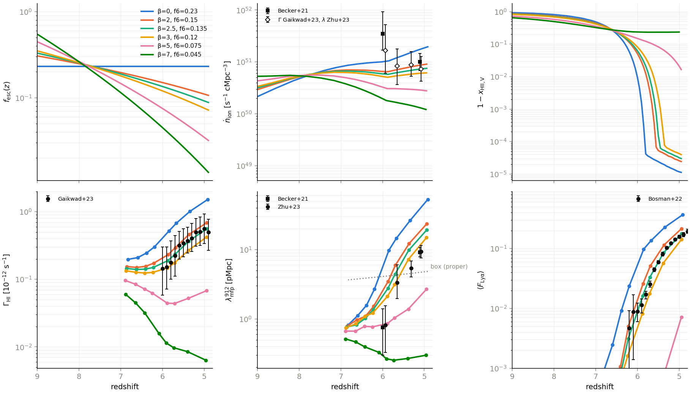

# A falling escape fraction: Γ_HI, the Lyα forest and the mean free path at z = 5–6

*Thread `fesc-evolution` (2026-10-14). Decisions: `docs/PLAN.md`, "f_esc
evolution thread". Parameter changes only; no code was changed.*

## 1. Why

The 40 Mpc/h, 512³ ray run `reion512_rays` (f_esc = 0.23, constant) has an
emissivity at or below the observational estimates. After overlap it is
still too ionized (`docs/rt_methods_512.md` §7, `docs/otvet_closure.md` §7):

| z | Γ_HI [10⁻¹² s⁻¹], sim / Gaikwad+23 | λ_mfp [pMpc], sim / Becker+21, Zhu+23 | log ṅ_ion, sim / Becker+21 | A (Bosman+22 ⟨F⟩) |
|---|---|---|---|---|
| 5.91 | 0.49 / 0.15 (3.3×) | 7.0 / 1.0 | 51.00 / 51.48 | 3.5 |
| 5.44 | 0.91 / 0.36 (2.5×) | 23.4 / 4.6 | 51.14 / 51.20 | 3.1 |
| 4.98 | 1.41 / 0.54 (2.6×) | 49.5 / — | 51.28 / — | 3.1 |

Reionization ends at z99 = 5.82 (z50 = 6.96). Γ is high because λ is ≈ 5×
too long: the sinks that set λ are unresolved at this resolution. This
thread undershoots ε on purpose, so that Γ and the forest opacity come out
about right. Reionization is allowed to end later (z ≈ 5.3–5.5, as the
forest prefers), which lowers Γ and λ further. It also measures how much
of λ's excess ε alone removes.

## 2. The model

The abundance-matched sources already carry it (`src/halo_sources.cpp`
`f_esc_at`, `include/radray/halo_sources.hpp`, branch `fesc-z`):

  f_esc(z) = min(f_esc_max, f6 ((1+z)/(1+z0))^β),

with `f_esc` = f6, `f_esc_beta` = β, `f_esc_z0` = z0 and `f_esc_max`
(default 1). **`f_esc_z0` is the pivot redshift, default 6**, so f6 is the
escape fraction at z = 6. β = 0 (the default) is the constant f_esc
exactly. The source luminosity carries f_esc(z) at every hydro step, so
`stats.txt` `Luv` and the ṅ_ion of `igm_stats.py` include it.

## 3. Calibration at 256³

**Base: `otvcl256`.** This is the 20 Mpc/h, 256³ ray run of the OTVET-closure
thread. It has the 512³ run's cell size and mass resolution and the
production settings (`legacy_rt = legacy_physics = 0`, unsplit hydro,
c_reduced = 0.2, case A + recombination radiation with
`recomb_rad_cell_onspot = 1`, `redshift_per_distance`, abundance-matched
sources with log ξ_ion = 25.38, ICs seed 7). Its f_esc is 0.23, so it is
the β = 0 point. After overlap its IGM is close to the 512³ run's (z = 5.4:
Γ 0.94 against 0.91, λ 23.5 against 23.4 pMpc, ⟨F⟩ 0.21 against 0.21);
it ends reionization 0.18 earlier (z99 = 6.00 against 5.82).

Every grid run is `otvcl256` with only the source lines changed (`f_esc`,
`f_esc_beta`, `f_esc_z0 = 6`) and `tensor_dump` (an output-only
diagnostic) dropped: `tools/hyak/fesc_runs.sh`. Each run takes 2.7 h on a
whole cpu-g2 node (192 threads). IGM statistics come from
`tools/hyak/igm_diag.slurm` (`igm_stats.py`, 8192 sightlines and skewers).
The tables come from `tools/analysis/fesc_summary.py`, which interpolates
each quantity to fixed z between the bracketing snapshots.

**Choosing f6.** The brief asks for f6 such that z50 stays near 7. f6 was
set from a one-zone model, dQ/dt = f(z) ṅ₀(z)/n̄_H − C α_B n̄_e Q, driven
by `otvcl256`'s own intrinsic emissivity and fitted to its history (C ≈ 4.3
reproduces z50 = 7.04 and z99 = 6.0). For z50 = 7 it gave f6 = 0.15, 0.12,
0.075 and 0.046 for β = 2, 3, 5 and 7. It also predicted that β ≥ 4 does
not finish reionizing by z = 5 at that z50. So β = 2 was added to the
requested grid (β = 3, 5, 7) at the outset. The model underrates the early
photons (the clumping is lower before overlap): the runs' z50 came out
earlier than 7, increasingly with β. β = 5 and 7 were not rerun at a lower
f6. They already do not finish by z = 5, and a lower f6 only delays them
further.

*Top: f_esc(z), the escaped ṅ_ion with Becker+21 and the Gaikwad Γ +
Zhu λ estimate, and the neutral fraction 1 − x_HII,V. Bottom: Γ_HI (cells
with x_HI < 10⁻²) with Gaikwad+23, λ_mfp (exponential fit from ionized
starts) with Becker+21 and Zhu+23, and ⟨F_Lyα⟩ with Bosman+22. Tables:
[`figures/fesc_evolution_256.md`](figures/fesc_evolution_256.md);
`igm_plot.py` table [`figures/fesc_evolution_256_igm.txt`](figures/fesc_evolution_256_igm.txt).*

**Sources** (f_esc and log ṅ_ion [s⁻¹ cMpc⁻³]):

| β, f6 | f(z=10) | f(7) | f(6) | f(5.4) | f(5) | ṅ(5.9) | ṅ(5.4) | ṅ(5.1) |
|---|---|---|---|---|---|---|---|---|
| 0, 0.23 | 0.230 | 0.230 | 0.230 | 0.230 | 0.230 | 51.01 | 51.16 | 51.24 |
| 2, 0.15 | 0.370 | 0.196 | 0.150 | 0.125 | 0.110 | 50.81 | 50.89 | 50.94 |
| 2.5, 0.135 | 0.418 | 0.189 | 0.135 | 0.108 | 0.092 | 50.76 | 50.83 | 50.86 |
| 3, 0.12 | 0.466 | 0.179 | 0.120 | 0.092 | 0.076 | 50.71 | 50.76 | 50.78 |
| 5, 0.075 | 0.719 | 0.146 | 0.075 | 0.048 | 0.035 | 50.49 | 50.47 | 50.46 |
| 7, 0.045 | 1 (cap) | 0.115 | 0.045 | 0.024 | 0.015 | 50.25 | 50.17 | 50.12 |
| Becker+21 | | | | | | 51.48 | 51.20 | |

The abundance-matched intrinsic emissivity rises by 2× from z = 6 to 5
(`am_zlo = 5.9`). With β ≈ 2.5 the escaped ṅ is nearly flat, at ≈ 10^50.8,
over z = 5–6: 0.4–0.7 dex below Becker+21, as intended.

**Reionization history** (volume-weighted; τ_es with x = 1 below the last
frame, Planck 2018: 0.054 ± 0.007):

| β, f6 | z10 | z25 | z50 | z75 | z90 | z99 | z99.9 | x_V(z = 5) | τ_es |
|---|---|---|---|---|---|---|---|---|---|
| 0, 0.23 | 8.69 | 7.75 | 7.04 | 6.57 | 6.29 | 6.00 | 5.88 | 1 | 0.0541 |
| 2, 0.15 | 9.55 | 8.09 | 7.16 | 6.54 | 6.16 | 5.78 | 5.63 | 1 | 0.0566 |
| 2.5, 0.135 | 9.88 | 8.25 | 7.22 | 6.55 | 6.13 | 5.71 | 5.56 | 1 | 0.0576 |
| 3, 0.12 | 10.15 | 8.39 | 7.27 | 6.53 | 6.07 | 5.61 | 5.45 | 1 | 0.0584 |
| 5, 0.075 | 10.84 | 9.31 | 7.63 | 6.55 | 5.63 | — | — | 0.984 | 0.0617* |
| 7, 0.045 | 10.86 | 9.77 | 8.04 | 6.33 | — | — | — | 0.766 | 0.0624* |

\*An upper limit: the box is not ionized at the last frame, and τ_es
assumes it is.

- A steeper β starts reionization earlier and ends it later: z10 moves
  from 8.7 to 10.2 (β = 3) while z75 stays at 6.55. The history is longer,
  not shifted.
- τ_es rises with β (more electrons at z > 8): +0.5σ from Planck at
  β = 2.5. All the runs that finish are within 1σ.

**IGM against the data** (ratio to the data in brackets: Gaikwad+23 Γ,
Becker+21/Zhu+23 λ pooled, Bosman+22 ⟨F⟩; A is the τ rescaling that
matches Bosman's ⟨F⟩, defined after overlap):

| z | β, f6 | x_V | Γ_HI [10⁻¹²] | λ_mfp [pMpc] | ⟨F⟩ | A |
|---|---|---|---|---|---|---|
| 5.9 | 0, 0.23 | 0.998 | 0.476 (3.2×) | 8.0 (7.4×) | 0.079 (6.9×) | 3.46 |
| | 2, 0.15 | 0.972 | 0.225 (1.5×) | 3.2 (3.0×) | 0.022 (1.9×) | — |
| | 2.5, 0.135 | 0.961 | 0.185 (1.2×) | 2.6 (2.4×) | 0.014 (1.2×) | — |
| | 3, 0.12 | 0.943 | 0.146 (0.97×) | 2.1 (1.9×) | 0.008 (0.7×) | — |
| 5.7 | 0, 0.23 | 1.000 | 0.646 (2.9×) | 13.5 (4.7×) | 0.129 (5.0×) | 3.41 |
| | 2, 0.15 | 0.997 | 0.292 (1.3×) | 5.8 (2.0×) | 0.049 (1.9×) | 1.51 |
| | 2.5, 0.135 | 0.992 | 0.234 (1.05×) | 4.4 (1.5×) | 0.033 (1.3×) | 1.17 |
| | 3, 0.12 | 0.979 | 0.177 (0.79×) | 3.2 (1.1×) | 0.018 (0.7×) | 0.82 |
| 5.4 | 0, 0.23 | 1 | 0.944 (2.5×) | 23.5 (4.8×) | 0.208 (2.6×) | 2.82 |
| | 2, 0.15 | 1 | 0.440 (1.2×) | 11.2 (2.3×) | 0.104 (1.3×) | 1.30 |
| | 2.5, 0.135 | 1 | 0.353 (0.95×) | 9.1 (1.9×) | 0.078 (1.0×) | 1.00 |
| | 3, 0.12 | 1 | 0.261 (0.70×) | 6.9 (1.4×) | 0.053 (0.7×) | 0.73 |
| 5.1 | 0, 0.23 | 1 | 1.277 (2.5×) | 38.9 (4.3×) | 0.298 (2.1×) | 2.96 |
| | 2, 0.15 | 1 | 0.592 (1.2×) | 18.3 (2.0×) | 0.170 (1.2×) | 1.34 |
| | 2.5, 0.135 | 1 | 0.478 (0.94×) | 14.9 (1.6×) | 0.135 (0.9×) | 1.05 |
| | 3, 0.12 | 1 | 0.359 (0.71×) | 11.5 (1.3×) | 0.102 (0.7×) | 0.80 |

β = 5 and 7 are far too opaque: Γ is 0.1–0.3× and 0.01–0.07× the data,
and ⟨F⟩ ≈ 0.

- **β = 2 and β = 3 bracket the data**, and β = 2.5 lies on it: Γ at
  0.94–1.05× Gaikwad at z = 5.1–5.7 (1.2× at 5.9), ⟨F⟩ at 0.9–1.3×,
  A = 1.0–1.2.
- **λ falls almost as fast as Γ.** Across the four runs that finish,
  log λ against log Γ at fixed z has slope 0.95 (z = 5.4: Γ ÷3.6 and λ ÷3.4
  from β = 0 to 3; z = 5.1: the same). That is the optically thin
  limit (x_HI ∝ 1/Γ in absorbers that do not self-shield), steeper than
  the λ ∝ Γ^0.5–0.7 of resolved self-shielding systems. Part of it is the
  timing: a later end leaves less time after overlap for the relic
  structure to be ionized away.
- So ε alone removes most of λ's excess at this resolution: from 4.3–7.4×
  at β = 0 to 1.5–2.4× at β = 2.5 and 1.1–1.9× at β = 3. At z = 5.3–5.7,
  β = 3 lies within the Zhu+23 errors.

**Choice for 512³: β = 2.5, f6 = 0.135.** It was picked between the β = 2
and 3 points by log interpolation of A (and confirmed by the 256³ run at
those values above). Its z99 = 5.71 at 256³ should become ≈ 5.5 at 512³,
since the 40 Mpc/h box ends 0.18 later at fixed f_esc. That is the late end
of the 5.3–5.5 target. β = 3 would end at ≈ 5.4 but leaves Γ and ⟨F⟩ 30 %
low. β = 2 ends at ≈ 5.6 with Γ 1.2–1.5× high.

## 4. 512³

*(in progress)*
