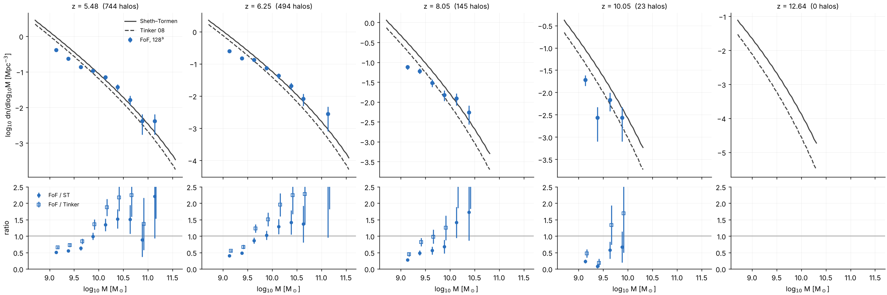
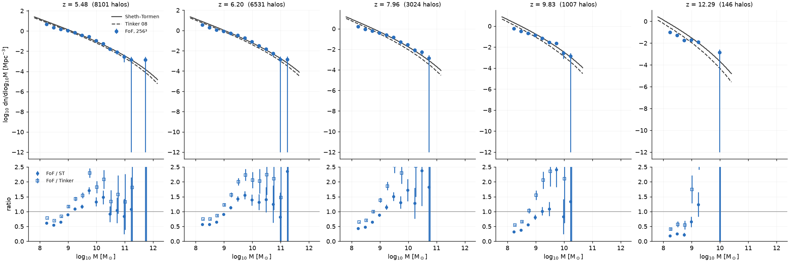

# Halo mass function at production resolution

*2026-10-09, step 2 of the production-run thread.*

## Run

* **Setup:** `tools/production/make_production.py runs/hmf128 --N 128`, the
  production configuration. That is box 10 Mpc/h, Ngas = Ndm = 128,
  Zel'dovich ICs at z = 100 with seed 7, and on-the-fly FoF with b = 0.2
  and ≥ 20 particles.
* **No sources:** `tvir_min = 1e30`, so the RT never runs and this is
  gravity plus adiabatic hydro.
* **Catalogs:** `write_catalogs` writes one at every hydro step from
  z = 15. There are 10 catalogs, z = 12.6 to 5.5.
* **Cost:** 2 min on 4 threads, 0.86 GB.
* **Particle mass:** 5.10×10⁷ M☉; the DM particles carry all the matter.
  20 particles are 1.02×10⁹ M☉.

```
python3 tools/production/make_production.py runs/hmf128 --N 128
cat >> runs/hmf128/params.txt <<X
tvir_min = 1e30
write_catalogs = runs/hmf128/run/halos
restart_every = 0
movie_dz = 0
X
OMP_NUM_THREADS=4 build/radhydro runs/hmf128 runs/hmf128/run --quiet
python3 tools/analysis/hmf_compare.py runs/hmf128/run/halos --box 10 --N 128 --z 5.5 6.25 8 10 12.6
```

`apps/hmf_table` gives the analytic mass functions, from the same code as
the abundance matching (`mass_function.hpp`). They use the simulation
cosmology, a BBKS transfer function, and Tinker et al. 2008 with Δ = 200m
and its z-evolution extrapolated.

## Result



The table is in `figures/hmf_128_10mpc.txt`.

* **Above about 100 particles (M ≳ 5×10⁹ M☉), FoF agrees with
  Sheth–Tormen** at z ≈ 5.5–8: FoF/ST = 1.0–1.5, within Poisson errors.
  * It is 1.3–2.2× above Tinker. This is the usual FoF (b = 0.2) vs SO
    (Δ = 200m) mass offset, plus Tinker's z-evolution extrapolated beyond
    its calibration (z ≲ 2.5).
* **Below about 100 particles the counts fall short of ST.**

  | particles | FoF/ST, z = 5.5 | FoF/ST, z = 6.2 | FoF/ST, z = 8 | FoF/ST, z = 10 |
  |---|---|---|---|---|
  | 20–35 | 0.50 | 0.40 | 0.28 | 0.23 |
  | 35–60 | 0.55 | 0.48 | 0.49 | (noisy) |
  | 60–110 | 0.63 | 0.86 | 0.56 | 0.6 |

  * The Warren et al. (2006) low-N FoF correction makes this worse, since
    it lowers the masses.
  * The deficit is the PM force resolution. The PM mesh has one cell per
    mean particle spacing (Ngas = Ndm), which softens small halos.
  * Zel'dovich ICs add to it: their transients suppress rare early halos
    most, which is why the deficit grows with z.
* **No halos at z = 12.6,** where ST predicts a few dozen above 10⁹ M☉.
  The first FoF halo, and so the first source, forms at z ≈ 11.3.

## Consequences

1. **The halo counts are reliable from about 100 particles (5×10⁹ M☉).**
   Below that the simulation has 2–4× fewer halos than the analytic HMFs,
   increasingly at high z.
2. **Abundance matching against an analytic HMF** (Tinker, the user's
   choice) assigns L(M) as if every halo existed. So the box's own UV LF:
   * falls below the observed LF at the faint end (M_UV ≳ −15 at z ≈ 8),
     because of the missing low-mass halos;
   * rises above it for M ≳ 5×10⁹ M☉ by the FoF/Tinker ratio, 1.3–2.2.

   Matching instead to the **simulated** FoF mass function would make the
   box's LF equal the observed LF by construction, down to the resolution
   limit. This is a user decision, and the options are being put to the
   user. Either way f_esc is calibrated to τ_es, which absorbs an overall
   offset.
3. **The late first halos delay the onset of the RT.** This adds to the
   biases from 0.01c and the missing sub-grid sources.
4. **Possible improvements (not done):**
   * 2LPT ICs, or a higher start redshift;
   * a finer PM mesh (Ngas = 2 Ndm, the original's ratio, at more cost in
     hydro and RT);
   * Ndm > N.

## 256³ (production-256 thread, 2026-10-10)

The same check at the production resolution, on klone
(`/gscratch/astro/mcquinn/radhydro/runs/hmf256`, job 41705710, 96 threads
on a shared node: **2 min 15 s, 7.5 GB**). Setup as above with
`make_production.py --N 256 --movie-dz 0 --restart-every 0`, the ICs of
`reion256` (seed 7), `tvir_min = 1e30`, `write_catalogs`. 24 catalogs,
z = 13.1 to 5.48. Particle mass 6.38×10⁶ M☉, so 20 particles are
1.28×10⁸ M☉ and 100 particles 6.4×10⁸ M☉. The first FoF halo forms at
z ≈ 13.1 (the RT of the 256³ runs starts there, `docs/cluster.md` §7).

```
python3 tools/analysis/hmf_compare.py $RUNS/hmf256/run/halos --box 10 --N 256 --z 5.5 6.25 8 10 12.6
python3 tools/analysis/fit_fof_hmf.py $RUNS/hmf256/run/halos --box 10 --N 256 --out data/hmf/fof_256_10mpc.txt
build/am_fit --lf data/uv_lf/lf_params.txt --hmf st --sim-hmf data/hmf/fof_256_10mpc.txt --out am
```



The table is in `figures/hmf_256_10mpc.txt`. FoF/ST per mass bin (bins
with ≥ 10 halos; the particle count is the bin centre):

| log M [M☉] | particles | z = 5.5 | z = 6.2 | z = 8.0 | z = 9.8 | z = 12.3 |
|---|---|---|---|---|---|---|
| 8.23 | 27 | 0.61 | 0.57 | 0.44 | 0.32 | 0.19 |
| 8.48 | 47 | 0.54 | 0.56 | 0.47 | 0.37 | 0.25 |
| 8.73 | 84 | 0.65 | 0.65 | 0.65 | 0.56 | 0.22 |
| 8.98 | 150 | 0.90 | 0.90 | 0.88 | 0.81 | 0.65 |
| 9.23 | 266 | 1.09 | 1.13 | 1.15 | 1.01 | (9 halos: 1.24) |
| 9.48 | 473 | 1.17 | 1.43 | 1.51 | 1.09 | |
| 9.73 | 841 | 1.71 | 1.55 | 1.30 | 2.40 | |
| 9.98 | 1500 | 1.33 | 1.39 | 1.72 | | |
| 10.2–10.5 | 2700–4700 | 1.5, 0.9 | 1.3, 1.4 | 1.3 | | |

* **The same picture as at 128³, in particle number.** Above about
  100–150 particles (M ≳ 10⁹ M☉) FoF is 1.0–1.7× Sheth–Tormen and
  1.3–2.3× Tinker at z ≤ 10; below 100 particles there is a deficit that
  grows with z (0.6 at z = 5.5, 0.2–0.3 at z = 12.3 in the 20–35 particle
  bin). So the PM force resolution sets the deficit in particle number,
  not in mass: the 256³ box resolves halos down to 10⁹ M☉ where the
  128³ box needed 5×10⁹ M☉.
* **At high mass FoF sits above ST**, by 1.3–1.7 at 10^9.5–10^10.3 M☉
  (the b = 0.2 FoF against the ST calibration, plus cosmic variance in a
  10 Mpc/h box); the counts above 10^10.4 are 1–12 per bin.
* **The fit** (`data/hmf/fof_256_10mpc.txt`): r∞ = 5.03, p = 0.336,
  N_c0 = 13 278, q = 2.64. It reproduces the total counts of all 24
  catalogs to within Poisson noise (8101 against 8554 at z = 5.48, 1007
  against 1071 at z = 9.8, 73 against 123 at z = 13.1) and the ratios of
  the table to within 30% up to 10^10 M☉. Its form is a slowly rising
  power law here (p = 0.34 against 0.64 at 128³), so it extrapolates to
  R = 1.9–2.2 at 10^10.2–10^10.5 M☉ at z ≈ 6, where the measured ratio is
  0.9–1.5 from 10–40 halos, and to r∞ = 5 far beyond the box's halos. The
  abundance matching uses it up to the brightest halos, so the matched
  L(M) at M ≳ 10^10.3 M☉ corresponds to a halo density 1.5× too high,
  i.e. the few brightest sources (M_UV ≲ −19 at z ≈ 6) are 0.2–0.3 mag
  too faint. f_esc is calibrated to τ_es, which absorbs the overall
  normalisation; the shape error is confined to the handful of most
  massive halos.
* **Abundance matching at 256³** (`data/uv_lf/am_params_256_10mpc.txt`,
  rms 0.063 dex over 128 points; 128³: 0.053 dex): M_UV(10⁹ M☉) = −12.5
  at z = 6 and −13.6 at z = 8; M_UV(10¹⁰ M☉) = −15.8 and −16.9;
  M_UV(10¹¹ M☉) = −19.0 and −20.1. The 256³ L(M) is steeper at low mass
  than the 128³ one (a₀ = 1.33 against 1.19) because the 256³ box
  resolves, and must populate, the 10⁸–10⁹ M☉ halos that the 128³ fit
  had to assign to its 10⁹–10^9.5 M☉ halos.
