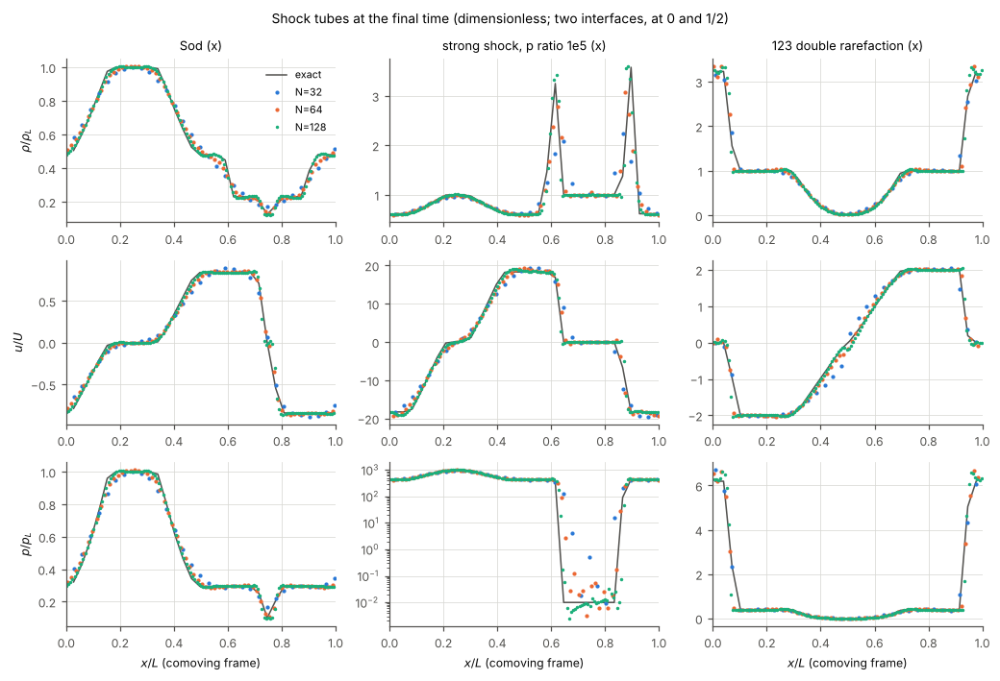
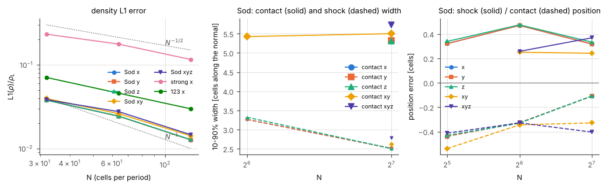
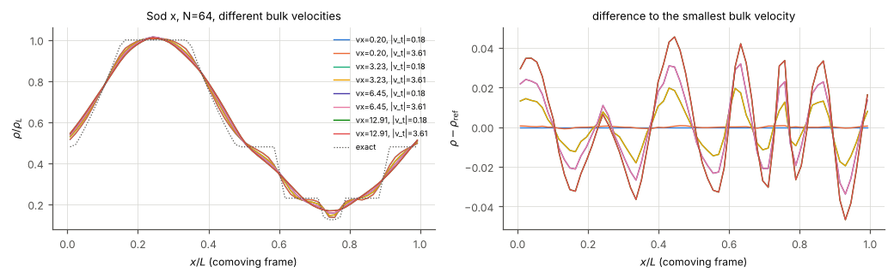
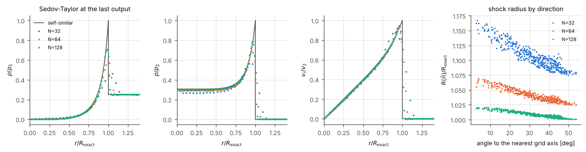
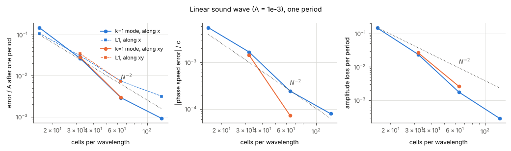
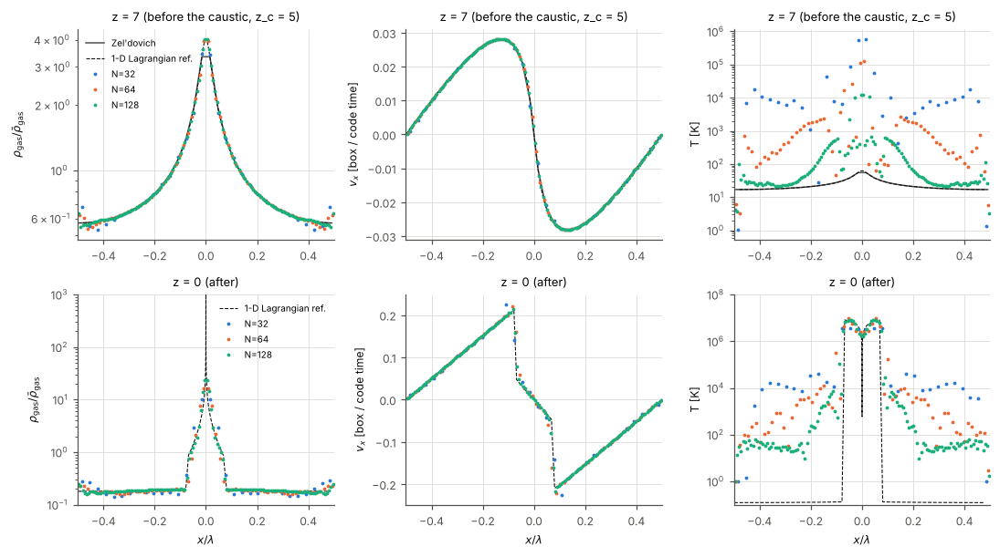
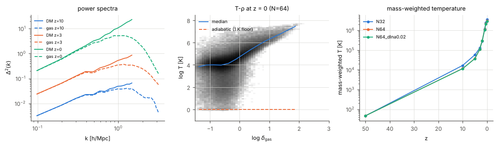
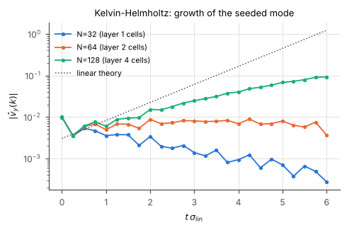

# Hydro accuracy test suite

Physics tests of the C++ hydro solver (`src/hydro.cpp`, the bit-for-bit port
of `hydro_tools.f90 -DMF`, see `docs/port_notes_hydro.md`) against exact
solutions and an independent reference. This is **not** a Fortran comparison:
it measures how accurate the moving-frame (MF) TVD scheme is, and where it is
not. The solver was not modified for any of these tests.

Contents: 1. how the tests are run; 2. shock tubes; 3. Galilean invariance;
4. Sedov-Taylor; 5. sound waves; 6. Zel'dovich pancake; 7. adiabatic
cosmological box (and Santa Barbara); 8. Kelvin-Helmholtz; 9. summary of the
scheme's weaknesses; 10. timings; 11. files and CTest; 12. the unsplit
scheme (`hydro_scheme = unsplit`) on the same tests.

**Two schemes.** §2–§10 are the legacy scheme (the default). Since the
hydro solver thread (2026-10-09) the suite also runs the unsplit
MUSCL-Hancock + HLLC scheme with the dual-energy formulation
(`--scheme unsplit`, `docs/hydro_unsplit.md`); §12 summarises its results
test by test next to the legacy numbers, and `docs/hydro_unsplit.md` §6 has
the full tables.

## 1. Set-up

**Driver.** `tests/hydro_suite/suite_driver.cpp` (`hydro_suite_driver`)
calls the unmodified library in the order of `apps/hydro_driver`
(`mode = hydro`: `calc_sim_var`, time step, `radhydro_hydro_step`,
`summarize_gas`) or of `apps/radhydro` without radiative transfer
(`mode = cosmo`: the six sweeps around `particle_mesh`, `summarize_dm`,
`summarize_gas`). It differs from those apps only in driver-level choices:

* the time step is the code's Courant step `dt = 2*dt_gas_factor/cmax_gas`
  (hydro) or the original `min(Courant, PM)` step with the `ra_max` limit
  (cosmo), **shortened only to land exactly on the requested output times**
  (`t_out`, `z_out`); a test-only `dlna_max` (cosmo) additionally caps
  da/a, used for one time-step convergence check; `courant` scales the step
  (default 1, used only for one diagnostic run in §3);
* the initial gas state is read complete (`u_gas.bin` with the thermal
  energy, optional `w_gas.bin`, `v_gas.bin`), rather than through
  `read_init_conditions` (which sets T = T_min);
* no RT, no sources: the gas is adiabatic (the 1 K floor of `check_temp`
  stays active).

**Non-cosmological limit.** In the code's supercomoving variables the hydro
equations contain no expansion terms for gamma = 5/3, so the code time
t = Σ dt_sim *is* the Newtonian time of a test problem, whatever a(t) does.
Only the 1 K floor and `c_limit` see the scale factor. Hydro-only tests start
at z = 1000 (tubes) or 10^4–10^5 (sound, Sedov, KH) to have enough code time
before a → ∞ (τ(∞) − τ(a) = 3/√a in matter domination). A Sod run started at
z = 10 instead of z = 1000 gives bit-identical profiles (checked).

**Units.** Lengths in cells, velocities in cells per code time, densities in
units of the mean matter density (mean gas density 1/6). Every problem is
given in dimensionless form in `generate.py`; the tables quote dimensionless
errors (e.g. ρ/ρ_L).

**Quirk H1 — every problem carries a bulk velocity.** With a pencil whose
grid velocity is exactly zero, the MF `advect` (and `euler` without any
signal speed) never terminates; the C++ throws (port notes H1). A 1-D tube at
rest has such pencils in every transverse direction, and even in the tube
direction at t = 0. All tubes, sound waves, the Sedov blast and the KH layer
therefore move with a uniform bulk velocity with three non-zero components,
and the pancake has a bulk velocity in y and z (the same for gas and DM).
Analyses are done in the comoving frame. The suite verifies that a Sod tube
with v_bulk,x = 0 does stop with the H1 error (`galilean` test).

**Tiers.** `run_suite.py <test> --tier quick|full`. The quick tier (small
grids) is CTest label `hydro_suite`; the full tier (everything in this
document) is label `nightly`. Results of the full tier are stored in
`tests/hydro_suite/results/*_full.json`; `analyze.py figures` redraws the
figures `docs/figures/hydro_suite_*.png` from them.

## 2. Shock tubes

Periodic box, two interfaces (ξ = x/L = 0: R|L and 1/2: L|R), both exact
Riemann problems are valid until their waves meet; L1 errors are over the
whole period, normalised by ρ_L, c_L and p_L (rows "main": only the
[1/4, 3/4) region of the L|R problem). Cell averages of the exact solution are
compared (sub-sampled over each cell). Positions are the 50 % crossings of the
density jumps measured identically on the numerical and the cell-averaged
exact profile, in cells along the tube normal (+ = ahead). Tubes along x, y,
z use the same bulk velocity rotated with the tube ((0.25, −0.15, 0.1) for x);
the diagonals (1,1,0) and (1,1,1) use (0.25, −0.15, 0.1). Code time scales
with N, so every N reaches the same dimensionless time (Sod t = 0.12 L/U,
U = c_L/√γ, i.e. c_L = 2 cells per code time).



### Sod (ρ, p) = (1, 1) | (0.125, 0.1), γ = 5/3

| tube | N | steps | L1 ρ | L1 u | L1 p | shock [cells] | contact [cells] | rarefaction mid [cells] | contact width 10–90 % | shock width |
|---|---|---|---|---|---|---|---|---|---|---|
| x | 32 | 6 | 0.0378 | 0.0401 | 0.0323 | +0.32 | −0.44 | +0.27 | – | – |
| x | 64 | 12 | 0.0243 | 0.0280 | 0.0203 | +0.47 | −0.33 | +0.24 | – | 3.3 |
| x | 128 | 23 | 0.0127 | 0.0148 | 0.0106 | +0.32 | −0.11 | +0.31 | 5.3 | 2.5 |
| y | 128 | 23 | 0.0127 | 0.0148 | 0.0106 | +0.32 | −0.11 | +0.31 | 5.3 | 2.5 |
| z | 128 | 29 | 0.0128 | 0.0148 | 0.0107 | +0.33 | −0.11 | +0.32 | 5.3 | 2.5 |
| (1,1,0) | 128 | 16 | 0.0142 | 0.0148 | 0.0116 | +0.24 | −0.33 | +0.32 | 5.5 | 2.6 |
| (1,1,1) | 128 | 15 | 0.0146 | 0.0153 | 0.0122 | +0.37 | −0.40 | +0.39 | 5.7 | 2.8 |

(y and z at N = 32/64 equal x to the digits shown. Widths at N ≤ 64 are not
defined because the plateaus are too short at this time.)

**Convergence orders** (L1, fit over N = 32, 64, 128): Sod x/y 0.79 (ρ),
0.72 (u), 0.80 (p); z 0.78/0.72/0.79; (1,1,0) 0.74/0.78/0.84;
(1,1,1) 0.69/0.78/0.84. The shock is captured in 2.5 cells (10–90 %), the
contact is spread over 5.3 cells and its width does **not** grow between
N = 64 and 128 at fixed dimensionless time (so it is ~5 cells, not a fixed
fraction of the box): no artificial compression of the contact, but no
spreading either. Positions are good to ±0.5 cells at every resolution (the
shock leads by about 0.3 cells, the contact lags by 0.1–0.4 cells).
Overshoots are below 0.6 % (no oscillations at the shock).

**Typical for a second-order TVD scheme?** Yes. L1(ρ) ≈ 1.3 % at 128 cells
and orders 0.7–0.85 are what MUSCL/TVD codes with a minmod/van Leer limiter
give for Sod (the discontinuities limit the order to 1 for shocks and ≈ 2/3
for contacts, e.g. Toro 2009 §14; Stone et al. 2008 Athena tests). The
contact width of ~5 cells is on the diffusive side (PPM with steepening: 2–3
cells; plain MUSCL-minmod: 4–6).

**Orientation (H2).** x and y tubes agree to 3e-7 (round-off) at every N.
z tubes differ from x: max |Δρ|/ρ_L = 4.4e-4, 8.7e-4, 9.7e-4 and max |Δu|/U
= 4.7e-3, 4.7e-3, 8.2e-3 at N = 32, 64, 128 (L1 2e-4) — small next to the
truncation error (1–4 %), but systematic: the frame velocity is smoothed
along the last sweep only, so the z sweep sees a different grid velocity
and `cmax_gas` differs (z needs 8/15/29 steps instead of 6/12/23). Diagonal
tubes are 10–15 % less accurate than axis-aligned ones at the same N (per
cell along the normal), as expected for dimensionally split schemes.

**Conservation.** Mass to 1e-8 (float32); lab-frame energy drifts by −0.8e-4
to −3.4e-4 and momentum by ≤ 4e-5 (H9: the frame source terms are not in
conservation form).

### Strong shock (ρ, p) = (1, 1000) | (1, 0.01), pressure ratio 1e5

| N | steps | L1 ρ | L1 u | L1 p | shock [cells] | min p (exact 0.01) | peak ρ/ρ_post | transverse spread |
|---|---|---|---|---|---|---|---|---|
| 32 | 7 | 0.232 | 0.037 | 0.036 | – | 0.019 | 0.56 | 1e-7 |
| 64 | 14 | 0.177 | 0.023 | 0.022 | −0.47 | 0.0031 | 0.77 | 5e-5 |
| 128 | 27 | 0.116 | 0.012 | 0.012 | +0.82 | 0.0025 | 0.90 | **3.1e-2** |

Orders 0.50 (ρ), 0.81 (u), 0.80 (p). The thin shocked shell (Δx = 0.03 L)
is under-resolved, hence the slow density convergence — normal for this
problem (Toro test 3). Two weaknesses: (i) the cold pre-shock gas
(Mach ≈ 140) is not kept at p_R: at N = 32 the pressure ahead of the shock
is 2–100 × p_R, at N ≥ 64 it undershoots to 0.25 p_R (spurious heating and
cooling of cold gas, see §6); (ii) at N = 128 the planar symmetry breaks:
the profile differs by 3 % across the tube (it stays 1e-7 for Sod and 123).
A planar strong shock aligned with the grid is a classic trigger of the
odd-even decoupling / carbuncle instability of low-dissipation Riemann
solvers; here it is seeded by float32 round-off.

### 123 problem (ρ, u, p) = (1, −2, 0.4) | (1, 2, 0.4) (double rarefaction)

| N | steps | L1 ρ | L1 u | L1 p | "main" L1 ρ / u / p | min ρ (exact 0.0062) | min p (exact 8.3e-5) |
|---|---|---|---|---|---|---|---|
| 32 | 6 | 0.071 | 0.169 | 0.252 | 0.058 / 0.25 / 0.098 | 0.035 | 6.5e-3 |
| 64 | 10 | 0.046 | 0.077 | 0.196 | 0.032 / 0.10 / 0.055 | 0.017 | 2.6e-3 |
| 128 | 20 | 0.030 | 0.047 | 0.155 | 0.018 / 0.054 / 0.032 | 0.015 | 2.3e-3 |

**Positivity holds**: density and pressure stay positive at all N (the
near-vacuum region is below `Dgas_frz`, so the freeze branch is active there).
As usual for this test the centre is too dense (2.4×) and far too hot (p 28×
too high at N = 128): the familiar spurious internal-energy spike of
conservative schemes at a double rarefaction. The whole-period L1(p) is
dominated by the other interface, where the colliding streams form two strong
shocks (the "main" region converges at order 0.8–1.1). Energy drifts by −3e-3
(N = 128) to −1e-2 (N = 32), the largest of the tubes (H9).



## 3. Galilean invariance

Sod along x at N = 64 with bulk velocities v_x = (1/64, 1/4, 1/2, 1)·L/t_end
(the profile is carried through 1, 16, 32, 64 cells) and transverse bulk
|v_⊥| = 0.18 or 3.6:

| v_x [cells/time] | shift [cells] | steps | L1 ρ vs exact | max \|Δρ\| vs v_x = 0.2 | L1 \|Δρ\| |
|---|---|---|---|---|---|
| 0.20 | 1 | 12 | 0.0235 | – | – |
| 3.23 | 16 | 23 | 0.0315 | 0.020 | 0.0091 |
| 6.46 | 32 | 39 | 0.0377 | 0.034 | 0.0158 |
| 12.9 | 64 | 71 | 0.0443 | 0.047 | 0.0222 |

The transverse bulk velocity makes no difference (≤ 9e-4). The bulk velocity
along the tube does: the error grows with the distance the profile is
advected through the grid, from 2.4 % to 4.4 % for one box length. Running
the v_x = 0.2 case with the same number of steps as the v_x = 12.9 case
(`courant = 0.155`, 72 steps) gives L1 = 0.0233, so the loss is advection
error, not the smaller time step: the profile is smoothed and its short
wavelengths fall behind (Fourier modes 1, 2, 3 of the profile lag the exact
solution by 0.05, 0.16, 0.38 cells after 64 cells of advection, against
0.00, −0.01, 0.03 for 1 cell) — the dissipation and dispersion of the
second-order advection operator. The moving frame follows the flow
(after the first sweep v_gas equals the gas velocity to 1e-9), but the gas
is still advected relative to the *grid* by `advect` with the same TVD
operator, so an Eulerian grid code is not Galilean invariant; the size of
the effect is comparable to what Robertson et al. (2010, MNRAS 401, 2463)
report for Eulerian AMR codes. Two consequences of the code's bookkeeping:

* `cmax_gas` includes max |v_lab| (the "freezing speed" term c1 of
  `summarize_gas`), so the Courant step shrinks with the bulk speed even
  though the MF advection is sub-cycled: 6 × more steps for v_x = 12.9 at
  the same accuracy cost. (In cosmological runs this term makes the Courant
  step depend on peculiar velocities, not on sound speeds.)
* **H1** is confirmed: with v_bulk,x = 0 the run stops with
  "advect: grid velocity of a whole pencil is exactly zero".



## 4. Sedov-Taylor blast wave (3-D)

Energy E in a Gaussian (σ = 1 cell) at a cell centre, uniform ρ0 = 1/6,
background sound speed chosen for a final shock Mach number 40, bulk
velocity (0.11, 0.07, 0.05) × final shock speed (H1). E scales with N so that
R(t_end = 10) = 0.35 N. Reference: the self-similar solution (Kamm & Timmes
2007 closed form; ξ0 = 1.15167 and mass check 1.0000000 reproduced).
Shock radius per direction = outermost crossing of (ρ0 + ρ_max,ray)/2 along
400 Fibonacci directions; L1 inside 1.2 R over all cells, normalised by the
post-shock values ρ2, p2, v2.

| N | steps | R/R_exact − 1 at t = 1.25 / 2.5 / 5 / 10 | R ∝ t^α | aniso rms | R_axes/R_diag − 1 | peak ρ/ρ2 | L1 ρ / p / v (t = 10) | ΔE (lab) |
|---|---|---|---|---|---|---|---|---|
| 32 | 23 | +25 % / +19 % / +14.5 % / +10.7 % | 0.341 | 1.85 % | +7.7 % | 0.46 | 0.087 / 0.093 / 0.133 | −0.86 % |
| 64 | 70 | +12.3 / +8.7 / +6.1 / +4.1 % | 0.364 | 0.98 % | +3.9 % | 0.58 | 0.051 / 0.051 / 0.065 | −2.4 % |
| 128 | 207 | +5.0 / +3.3 / +2.0 / +0.9 % | 0.381 | 0.50 % | +1.9 % | 0.71 | 0.020 / 0.025 / 0.028 | −4.9 % |

Orders (t = 10): L1 ρ 1.07, p 0.95, v 1.13; radius error 1.8; anisotropy 0.95.

* **Radius.** The shock runs ahead of the self-similar solution early on
  (finite initial blob, smeared shock: the midpoint criterion sits outside
  the true front when the peak is only 0.5 ρ2) and converges to it: +0.9 % at
  N = 128 (R = 45 cells). The power law index approaches 0.4 from below.
* **Profiles.** Pressure and velocity follow the solution well inside
  0.8 R; the density peak is clipped (0.46, 0.58, 0.71 of 4 ρ0) — normal
  for a shock-capturing scheme at R = 11–45 cells.
* **Sphericity.** The blast is slightly cubic: the shock is ahead along the
  grid axes and behind along the diagonals by 7.7 %, 3.9 %, 1.9 %
  (first order, rms 1.85 % → 0.50 %). On top of that, the six axis
  directions differ by up to 2 % (N = 32) / 0.25 % (N = 128): the ±x, ±y,
  ±z asymmetry from the sweep order and the bulk velocity (H2). Diagonals
  agree among themselves to 0.1 %.
* **Energy.** The lab-frame total energy is **not conserved**: −0.9 %,
  −2.4 %, −4.9 % by t = 10, growing with N (more steps). This is H9
  (the MF frame terms are not in conservation form) amplified in the hot,
  low-density interior, where cells fall below `Dgas_frz` and the
  `c_limit`/freeze branches smooth them (H13). R ∝ E^{1/5}, so a 5 % loss
  only costs 1 % in radius, but it is a real defect: a conservative
  finite-volume scheme conserves this to round-off.



## 5. Linear sound waves

Travelling wave along x (and along (1,1,0)), one wavelength per box,
amplitude A = 1e-3 (δρ/ρ), c0 = 2 cells per code time, bulk (0.2, 0.3,
−0.25), run for one period, eight outputs. The phase speed comes from a fit
of the phase of the k = 1 Fourier mode of ρ, the damping from its amplitude;
"k = 1 error" is |F_num − F_exact|/A for that mode (amplitude and phase
together); L1 compares the full profile with the linear solution.

| N (cells / λ) | steps | phase speed error | amplitude loss / period | k = 1 error / A | L1 / A |
|---|---|---|---|---|---|
| 16 | 24 | +5.6e-3 | 0.146 | 0.149 | 0.108 |
| 32 | 40 | +1.7e-3 | 0.024 | 0.027 | 0.031 |
| 64 | 72 | +2.4e-4 | 1.8e-3 | 2.9e-3 | 7.4e-3 |
| 128 | 136 | +7.9e-5 | 2.9e-4 | 9.1e-4 | 3.2e-3 |
| (1,1,0), 32 | 24 | +1.4e-3 | 0.027 | 0.028 | 0.035 |
| (1,1,0), 64 | 48 | +7.3e-5 | 2.6e-3 | 3.0e-3 | 7.3e-3 |

Orders (16–128): phase speed 2.1, damping 3.1, k = 1 error 2.5 (1.7 between
64 and 128); L1 1.7. **Smooth flow converges at second order**, the
amplitude error even faster: the scheme is dispersive (waves slightly too
fast, +0.17 % at 32 cells per wavelength) and dissipative mostly at the
grid scale. At N = 16 a wave loses 15 % per period — the familiar
"~16 cells per wavelength minimum" of second-order TVD schemes (the limiter
clips the extrema). The L1 error at N = 128 is not truncation but the
second harmonic generated by the physical steepening of an A = 1e-3 wave
(≈ (γ+1)/4·kA·x ~ 3e-3 after one period) — a test at A = 1e-4 instead hits
the float32 storage floor (state noise ~1e-6 relative, i.e. 1 % of the
signal after 136 steps), which is why A = 1e-3 is used. The diagonal wave
behaves like the axis-aligned one at the same number of cells per box
(it has √2 fewer cells per wavelength along the normal, but more sample
points per wavelength). Lab-frame energy is conserved to 1e-7 for this
smooth flow.



## 6. Zel'dovich pancake with gas and dark matter

**Set-up** (after Bryan et al. 1995, ApJS 100, 269): one sinusoidal mode
along x, wavelength λ = box = 32 Mpc/h (Bryan et al.: 64 Mpc with h = 0.5),
caustic at z_c = 5, start z_i = 50, gas and DM on the exact Zel'dovich
growing mode (Ndm = Ngas, PM gravity from `pm_tools`), bulk velocity in y
and z (5 % of the peak infall speed, H1). Differences from Bryan et al.: the
cosmology is the code's compile-time ΛCDM (Ω_m = 0.27, Ω_b/Ω_m = 1/6, not
Ω = 1 baryons), so the dark matter drives the collapse and the growth factor
is the ΛCDM one; and T_i = 1000 K instead of 100 K (with 100 K the gas falls
below the code's 1 K floor before the caustic; the dynamics do not depend on
T_i, see the T_i = 10^4 K run). Time step: the original Courant/PM/ra_max
step capped at da/a ≤ 0.02 (205 steps to z = 0).

**References.** Before the caustic: the exact Zel'dovich solution for ρ and
v, and T = T_i (a_i/a)^2 (ρ/ρ̄)^{2/3} (adiabatic). After: a 1-D Lagrangian
hydro + sheet-gravity code (`pancake_ref1d.py`, 2048 gas zones and 2048 DM
sheets, von Neumann–Richtmyer viscosity with a shock switch so that the cold
infall stays exactly adiabatic). Its shock position converges at first order
(0.0769, 0.0737, 0.0720 λ at z = 0 for 512, 1024, 2048 zones; extrapolated
0.070 ± 0.002 λ), its peak temperatures to 1 %.



**Before the caustic (density and velocity: excellent).**

| N | z | L1 ρ/ρ_ZA − 1 | L1 v / v_max | median T/T_adiabatic | L1 \|T/T_ad − 1\| |
|---|---|---|---|---|---|
| 32 | 20 / 10 / 7 | 0.009 / 0.026 / 0.031 | 0.011 / 0.007 / 0.011 | 7.5 / 85 / 400 | 9.6 / 190 / 1100 |
| 64 | 20 / 10 / 7 | 0.005 / 0.009 / 0.016 | 0.003 / 0.002 / 0.003 | 1.3 / 7.0 / 20 | 0.65 / 14 / 112 |
| 128 | 20 / 10 / 7 | 0.003 / 0.005 / 0.007 | 0.001 / 0.0006 / 0.0008 | 1.01 / 1.25 / 2.0 | 0.05 / 0.75 / 10 |
| 64, T_i = 10^4 K | 20 / 10 / 7 | 0.005 / 0.009 / 0.016 | 0.003 / 0.002 / 0.003 | 1.03 / 1.55 / 3.3 | 0.11 / 1.5 / 11 |

**Entropy is not conserved in the cold, supersonic infall.** The density
and velocity converge at first-to-second order, but the temperature of the
infalling gas is far too high: at N = 64 the median T is 7 × (z = 10) and
20 × (z = 7) the adiabatic value, maxima reach 10^5 K where the reference
has 60 K. The spurious heating is an absolute energy error — the T_i = 1000 K
and 10^4 K runs have the same excess temperature in Kelvin, so the relative
error scales as Mach² — and it falls steeply with resolution (median T/T_ad
at z = 10: 85, 7.0, 1.25 for N = 32, 64, 128, i.e. ∝ N^{-3.5}), consistent
with a dissipation ∝ (v − v_grid)² where the frame is a Gaussian smoothing
over rmf = 8 cells: the relative velocity of a mode of wavelength λ scales as
(rmf/λ)², its kinetic energy as (rmf/λ)^4. The entropy of the cold gas is
therefore only reliable when the flow is smooth on scales ≫ 8 cells (here
λ = 128 cells). This is the well-known high-Mach-number weakness of total-
energy schemes, which the MF formulation was designed to reduce (Trac & Pen
2004); it reduces it, but does not remove it, and there is no entropy/dual-
energy fallback. (The density at the void centre, x = ±λ/2, also shows a
one-cell feature where the infall velocity changes sign.)

**After the caustic (shock and hot gas: good).**

| N | z | shock half-width [cells] (ref) | error [cells] | T_max [K] (ref) | ρ_max/ρ̄ (ref) |
|---|---|---|---|---|---|
| 64 | 2 | 2.95 (2.45) | +0.49 | 1.2e7 (2.7e7) | 14 (3.0e4) |
| 64 | 0 | 4.72 (4.61) | +0.11 | 9.6e6 (8.2e6) | 16 (6.0e4) |
| 128 | 2 | 4.95 (4.90) | +0.05 | 2.2e7 (2.7e7) | 19 (3.0e4) |
| 128 | 1 | 7.92 (7.48) | +0.44 | 2.2e7 (1.9e7) | 21 (4.0e4) |
| 128 | 0 | 9.72 (9.22) | +0.50 | 8.0e6 (8.2e6) | 24 (6.0e4) |

The accretion shocks (located where T first exceeds 10 % of T_max, walking in
from the void; identical rule for the reference) are within 0.5 cells of the
reference at z ≤ 2 (+5 % at z = 0 for N = 128, of which ~3 % is the
reference's own uncertainty), the post-shock temperature plateau of
~10^7 K is reproduced (within 15 % at z ≤ 1), and the velocity jump is
sharp (2 cells). The central density spike of the reference (cold gas
compressed adiabatically at the first shell crossing, ρ ~ 10^4–10^5 ρ̄ in an
unresolved zone) is of course not resolved; the code's central density (14–24
ρ̄) and the central temperature dip are set by the cell size, as in the
grid codes of Bryan et al. **Entropy away from the shock** (|x| > x_shock + 3
cells): the median K/K_init − 1 in the unshocked infall is 1.1–1.8 at N = 128
for z = 4–3, but 7 by z = 2 and 300 by z = 0 (N = 128) and 10^3–10^4 at
N = 64 — the same spurious heating as above, now also from the strong
infall onto the shocks. Pre-shock gas temperatures in the voids are
30–10^4 K instead of the 0.02–1 K of the reference (1 K floor of the code).

**Symmetry.** The plane-parallel symmetry is broken at the 0.3 % (z = 10)
to 2 % (around z_c) level in gas density, with the DM sheets uniform to
5e-5 cells; round-off seeds grow in the cold converging flow (same origin as
the strong-shock asymmetry of §2).

## 7. Adiabatic cosmological box

Ngas = 64, Ndm = 32 (the production ratio), box 64 Mpc/h (the Santa Barbara
box size), Zel'dovich ICs from `tools/ics/make_ics.py` (Eisenstein-Hu P(k),
σ8 = 0.8, seed 7) at z = 50, gas following the DM, T_i = 47 K (CMB-decoupled
adiabat), no RT and no cooling, to z = 0. Two time-step choices: the
original (da/a ≤ 1/9: 42 steps) and da/a ≤ 0.02 (202 steps); plus N = 32.

| run | z | T_mw [K] | T_vw [K] | median T [K] | adiabatic T(δ = 1) | f_mass(T > 1e5 K) | P_dm/P_lin (k_min) | P_gas/P_dm (k = 0.1, 0.2, 0.3 h/Mpc) |
|---|---|---|---|---|---|---|---|---|
| N64 (orig. step) | 10 | 1.2e4 | 1.0e4 | 6.5e3 | 2.2 | 0.004 | 1.00 | 1.00 0.99 0.98 |
| | 3 | 1.1e5 | 4.6e4 | 2.3e4 | 0.29 | 0.23 | 1.00 | 1.00 0.98 0.96 |
| | 1 | 1.1e6 | 1.5e5 | 3.0e4 | 0.07 | 0.54 | 0.97 | 1.00 0.98 0.95 |
| | 0 | 3.0e6 | 2.4e5 | 1.9e4 | 0.02 | 0.67 | 0.93 | 0.99 0.96 0.93 |
| N64, da/a ≤ 0.02 | 0 | 2.9e6 | 2.4e5 | 1.8e4 | 0.02 | 0.67 | 0.92 | 0.99 0.96 0.93 |
| N32 (orig. step) | 0 | 3.5e6 | 4.0e5 | 5.4e4 | 0.02 | 0.69 | 1.20 | 0.95 0.88 0.82 |

* **Power spectra.** The DM grows as linear theory on the box scale
  (P_dm/P_lin = 1.00 at z ≥ 3; the 0.93 at z = 0 is cosmic variance of the
  4 lowest modes plus non-linear coupling in a 64 Mpc/h box). The gas traces
  the DM to 1–4 % for k ≤ 0.3 h/Mpc and is suppressed above k ≈ 1 h/Mpc
  (pressure plus the hydro grid's smoothing: the DM spectrum is
  CIC-deconvolved, the gas one is not), as it should.
* **Mass-weighted temperature.** 1.1e5 K at z = 3, 1.1e6 K at z = 1,
  3.0e6 K at z = 0, insensitive to the time step (1 % for 5 × more steps) and
  to resolution at z = 0 (N = 32: 3.5e6 K). This is in the range of
  non-radiative ΛCDM simulations, which reach ~10^6–10^7 K mass-weighted at
  z = 0 from shock heating in groups, filaments and clusters (e.g. Cen &
  Ostriker 1999, 2006; Davé et al. 2001; the shock-heated fraction here,
  67 % above 1e5 K, is high because there is no cooling).
* **T–ρ relation and the cold IGM.** Above δ ≈ 1 the relation is the shock-
  heated branch, log T rising from 10^4 to 10^7.5 K at δ = 100 (figure).
  **Below δ ≈ 1 it is wrong**: the median temperature of underdense gas is
  ~10^4 K at every redshift (6.5e3 K already at z = 10, where δ_max = 3.5 and
  nothing has been shock heated), against an adiabatic 0.02–2 K. This is the
  spurious heating of cold supersonic flows of §6, now driven by the
  small-scale velocity field at the grid scale, so it does not converge with
  N (median T at z = 10: 7.8e3 K at N = 32, 6.5e3 K at N = 64). In
  reionization runs photoheating overwrites this before the gas matters
  (T ≈ 10^4 K), but **pre-reionization gas temperatures (Jeans/filtering
  mass, 21-cm spin temperature, the T–ρ relation before RT) are not
  trustworthy** with this scheme.



**Santa Barbara cluster (Frenk et al. 1999): not feasible here.** The SB
comparison needs (i) its specific constrained initial conditions and an
Ω = 1, h = 0.5, Ω_b = 0.1, σ8 = 0.9 cosmology — the code's cosmology is
fixed at compile time (cosmo_parameters.f90) and changing it would change
the solver build; (ii) a resolved cluster: its virial radius (2.7 Mpc) is
2.7 cells at 64^3 in a 64 Mpc box, and grid codes in Frenk et al. used
256^3–512^3 (or AMR) to resolve the entropy core. A 256^3 adiabatic run fits
the memory of this machine (~4 GB) but costs ~60 s per hydro step on one core
(~3 h for 200 steps) without the right ICs and cosmology, so it would not be
a comparison with the SB results. Qualitatively, the box above produces
cluster-scale objects at z = 0 with T ~ 10^7–10^7.5 K, the regime of the SB
cluster (virial temperature of several 10^7 K), but no profile comparison is
possible.

## 8. Kelvin-Helmholtz instability

Two shear layers v_x = ±ΔU/2 (tanh profile, half-width a = N/32 cells) at
y = N/4 and 3N/4, uniform density and pressure, ΔU = 1, c0 = 2 (Mach 0.5
across the layer), seeded with a v_y perturbation of amplitude 1e-2 ΔU and
two wavelengths per box (k a = 0.39); bulk (0.13, 0.07, 0.11) (H1). The
reference is the linear growth rate of the tanh layer from the
incompressible Rayleigh equation (solved numerically; σ = 0.48 kΔU/2, cf.
Michalke 1964); compressibility at this Mach number lowers it by roughly
10–20 %. Run for six linear e-folding times.

| N | layer half-width [cells] | steps | measured σ / σ_lin | wall |
|---|---|---|---|---|
| 32 | 1 | 144 | decays (−0.46) | 20 s |
| 64 | 2 | 264 | ≈ 0 (−0.06) | 309 s |
| 128 | 4 | 528 | 0.51 | 5381 s |



**The KH instability needs ≳ 4 cells across the shear layer.** At 1–2 cells
the numerical viscosity of the scheme widens the layer faster than the
mode grows (the mode decays at N = 32 and stays flat at N = 64); at 4 cells
it grows, at half the incompressible linear rate. Second-order grid codes
typically reach 70–90 % of the linear rate with 4–8 cells across the layer
(e.g. the KH comparisons of Robertson et al. 2010; McNally et al. 2012,
ApJS 201, 18), so the scheme is on the diffusive side here too, consistent
with its 5-cell contacts. A converged growth rate would need N ≥ 256 (8+
cells per layer), which at ~1000 steps of 16.8M cells is beyond this
machine's budget for an optional test (≈ 1–2 days single-threaded).

## 9. Where the scheme performs poorly (summary)

*Status (2026-10-09): item 1 is fixed by the unsplit scheme with dual energy
behind `hydro_scheme = unsplit` (`docs/hydro_unsplit.md`, §12 below), which
also removes items 2, 4 (exactly), 7 and 8, halves 3, and improves 5 and
6 in absolute terms. The legacy scheme and these numbers are unchanged.*

1. **Spurious heating of cold, supersonic gas** (§6, §7, §2 strong shock):
   the dominant defect. Entropy of cold gas in converging or shearing flows
   is not conserved; errors scale ∝ Mach² and fall steeply with resolution
   only when the flow is smooth on scales ≫ rmf = 8 cells. In the cosmological
   box the underdense IGM sits at ~10^4 K instead of a few K. *Fixed with
   `hydro_scheme = unsplit`: pancake infall median T/T_adiabatic 1.000 at
   every N, box median 2–9 K at z = 10.*
2. **Energy (and momentum) non-conservation (H9):** −0.01 to −0.3 % in
   tubes, −1 % (123), up to −5 % in the Sedov blast; momentum ≤ 2e-4.
3. **Contact smearing:** ~5 cells (10–90 %), not growing with time, typical
   of a TVD scheme without contact steepening.
4. **Orientation dependence (H2):** z-aligned problems differ from x/y ones
   by ~1e-3 (tubes) and the Sedov blast is 1.9 % (N = 128) – 7.7 % (N = 32)
   faster along the axes than the diagonals; diagonal tubes are 10–15 % less
   accurate. All converge at first order.
5. **Shear layers** need ≳ 4 cells to go Kelvin-Helmholtz unstable at all,
   and then grow at half the linear rate (§8).
6. **Galilean non-invariance:** +90 % L1 for a profile advected through one
   box length; the Courant step includes |v_lab|.
7. **Symmetry breaking** of grid-aligned strong shocks (3 % at N = 128) and
   of the cold pancake (1–2 %).
8. **H1:** problems with exactly zero velocity in any direction cannot be
   run at all.

Good: shock positions (±0.5 cell), shock width (2.5 cells), no post-shock
oscillations, positivity in the 123 problem, Sedov radius (0.9 % at
R = 45 cells), linear-theory growth of gas and DM, post-caustic pancake
structure, smooth-flow convergence (second order for sound waves).

## 10. Timings

Wall times on the 4-core machine, one thread per run, two or three runs at a
time while another agent ran OpenMP jobs (load 4–17), so per-step times are
upper bounds by up to ~2×.

| run | N | steps | wall [s] | s / step | µs / cell / sweep |
|---|---|---|---|---|---|
| Sod x | 32 / 64 / 128 | 6 / 12 / 23 | 1 / 15 / 267 | 0.14 / 1.3 / 11.6 | 0.69 / 0.81 / 0.92 |
| strong shock x | 128 | 27 | 378 | 14.0 | 1.11 |
| 123 x | 128 | 20 | 263 | 13.1 | 1.04 |
| Sedov | 32 / 64 / 128 | 23 / 70 / 207 | 7 / 103 / 1816 | 0.29 / 1.5 / 8.8 | 1.5 / 0.93 / 0.70 |
| sound x | 16 / 32 / 64 / 128 | 24 / 40 / 72 / 136 | 0.4 / 6 / 117 / 1435 | 0.02 / 0.14 / 1.6 / 10.6 | 0.76 / 0.71 / 1.03 / 0.84 |
| pancake (hydro + PM, Ndm = N) | 32 / 64 / 128 | 205 | 48 / 802 / 2289 | 0.24 / 3.9 / 11.2 | 1.2 / 2.5 / 0.89 |
| cosmological box (Ndm = N/2), da/a ≤ 1/9 | 64 | 42 | 71 | 1.7 | 1.08 |
| cosmological box, da/a ≤ 0.02 | 32 / 64 | 39 / 202 | 9 / 271 | 0.23 / 1.34 | 1.2 / 0.85 |
| KH | 32 / 64 / 128 | 144 / 264 / 528 | 20 / 309 / 5381 | 0.14 / 1.2 / 10.2 | 0.7 / 0.73 / 0.81 |

Per-step times include the output writes and the analysis-side I/O of the
driver. The cost is 0.7–1.1 µs per cell per sweep (6 sweeps per step) under
load; docs/port_notes_hydro.md quotes 0.3 µs on an idle machine at N = 32
and docs/full_run.md 0.6 µs at N = 64–128. The PM costs 5–15 % on top
(pancake with Ndm = N). Total CPU time of the full tier: about 5 h (single
thread per run), of which KH N = 128 is 1.5 h.

## 11. Files and CTest

```
tests/hydro_suite/
  suite_driver.cpp     hydro_suite_driver (target in tests/hydro_suite/CMakeLists.txt)
  generate.py          problem generators (tubes, Sedov, sound, KH)
  cosmo_gen.py         pancake and cosmological box generators, code units
  hs_common.py         IO, exact Riemann solver, Sedov solution
  pancake_ref1d.py     1-D Lagrangian pancake reference
  analyze.py           analysis per test and the figures (analyze.py figures)
  run_suite.py         runner (+ tests_extra.py sections), --tier quick|full
  tolerances.py        pass/fail limits (from the measured values + margin)
  results/*_full.json  results of the full tier (the numbers above)
```

* `ctest -L hydro_suite`: `hydro_suite_{tubes,galilean,sedov,sound,pancake,
  cosmobox,kh}`, quick tier (N ≤ 64), about 6 min in total (measured with two
  jobs in parallel; each test passes with the tolerances above), and the
  same for the unsplit scheme as `hydro_suite_unsplit_*` (its own
  tolerances, `check_*_unsplit`).
* `ctest -L nightly`: `hydro_suite_full_*` and `hydro_suite_full_unsplit_*`,
  the full tier (~3 h per scheme). They pass `--clean`, which removes each
  test's problem and run directories once it is analysed: kept, the runs
  are ~7 GB per scheme (KH and the pancake ~2 GB each), more than the CI
  runner's disk. The results JSON stays.
* By hand: `python3 tests/hydro_suite/run_suite.py all --tier full
  [--scheme unsplit]` then `python3 tests/hydro_suite/analyze.py figures
  [results_dir figure_dir full unsplit]` (figures
  `hydro_suite_*_unsplit.png`). `hs_common.read_state` takes the pressure
  from `e_gas.bin` (the dual-energy field) when the driver wrote it.

The tolerances (`tolerances.py`) are the measured values with a 25–50 %
margin (or a band around a measured value); known defects (energy drift,
symmetry breaking) are regression guards, the spurious heating of cold gas is
documented but not tested against physics.

## 12. The unsplit scheme on the same tests (summary)

`hydro_scheme = unsplit` (`docs/hydro_unsplit.md`; full tables in its §6,
quirks U1–U6 in its §7). Same problems, references, analysis and tiers;
numbers from `results/*_full_unsplit.json`, legacy from `results/*_full.json`.

| test | legacy | unsplit | verdict |
|---|---|---|---|
| Sod tubes (§2), N = 128 | L1 ρ 0.0127, order 0.79; contact 5.3 cells, shock 2.5; z tube differs by 10⁻³ | L1 ρ 0.0060, order 0.96; contact 3.4, shock 2.3; x = y = z to the bit, spread 0 | better |
| Strong shock, N = 128 | L1 ρ 0.116; pre-shock p 0.25 p_R; symmetry broken at 3 % | L1 ρ 0.082; pre-shock p = p_R exactly; symmetry exact; energy −1.6×10⁻⁴ (U4) | better |
| 123 problem, N = 128 | L1 ρ/u/p 0.030/0.047/0.155 | 0.018/0.021/0.053; positive | better |
| Galilean (§3), N = 64, 1 → 64 cells | L1 0.0235 → 0.0443 (×1.9) | 0.0114 → 0.0283 (×2.5); transverse-speed effect 1.0×10⁻² (U3); zero-velocity tube runs (no H1) | better in absolute terms, degrades faster |
| Sedov (§4), N = 128 | R +0.9 %, aniso 0.50 %, L1 ρ 0.020, energy −4.9 % | R +1.5 %, aniso 0.37 %, L1 ρ 0.025, energy −0.6 % (U4) | better at N ≤ 64, slightly worse at 128 (slower convergence); 1 % radius target missed by 0.5 % (met at 256³: +0.6 % vs legacy −1.1 %, `hydro_unsplit.md` §6 convergence checks) |
| Sound waves (§5) | k = 1 order 2.5; 15 % loss per period at 16 cells/λ | order 2.3; 6 % loss; same phase error | better |
| Pancake (§6), infall median T/T_ad at N = 64, z = 10/7 | 7.0 / 20 | 1.000 / 1.001 (every N, z); centre cells hot near the caustic (U2) | fixed |
| Pancake, post-caustic | shock within 0.5 cells, entropy of the infall off by 1–300 | shock within 1.15 cells at N = 128 (wall-heating spike confuses the detector at N = 64), entropy 10⁻⁴, symmetry 10⁻⁴ | better (entropy), equal (shock) |
| Cosmological box (§7), N = 64, z = 10 | median T 6.5×10³ K, underdense gas at 10⁴ K | median 8.8 K (2.1 K with da/a ≤ 0.02), underdense at 2 K; P_gas/P_dm unchanged | fixed; cold gas warms slowly with the original time step (see the doc) |
| Kelvin–Helmholtz (§8) | decays at N = 32, ≈ 0 at 64, 0.51 of linear at N = 128 | 0.40, 0.79, 0.91 of linear at N = 32, 64, 128 | better (grows at 1 cell per layer) |
| Energy conservation | −10⁻⁴ to −5 % (H9) | round-off, except the U4 leak in cold Mach ≫ 1 gas ahead of strong shocks (≤ 0.6 %) | better |
| Orientation / symmetry (H2) | 10⁻³ tubes, 2–8 % Sedov axes/diag, 0.3–2 % pancake | exact for 1-D problems; Sedov 10 % (N = 32) to 1.1 % (128); pancake 10⁻⁴ | better except Sedov at N = 32 (U6) |
| Cost | 6 sweeps per step, 0.6–0.9 µs/cell/sweep | 2–4 substeps per step, see the doc §9 | |
