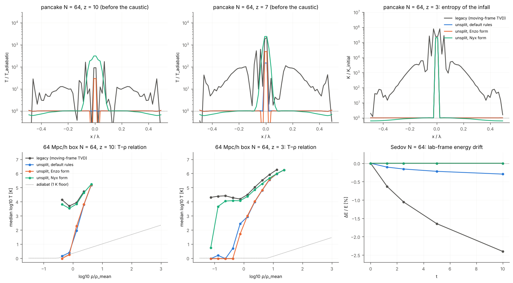

# The unsplit hydro scheme with dual energy (`hydro_scheme = unsplit`)

*Hydro solver thread, 2026-10-09. Fixes the spurious heating of cold
supersonic gas found by the hydro test suite (`docs/hydro_tests.md` §6, §7,
§9) by bringing in the unsplit solver the AMR plan needs anyway, behind a
flag, validated with the existing suite. The legacy scheme is untouched and
stays bit-identical to the Fortran harnesses.*

Contents: 1. the scheme; 2. the dual-energy formulation (every constant and
its provenance); 3. how the step sits in the loop; 4. the RT coupling and
the state; 5. parameters; 6. results of the hydro suite, both schemes side
by side; 7. quirks of the new scheme (U1–U6); 8. the coupled run; 9. cost;
10. what the new scheme does worse, and when to use which.

## 1. The scheme

`include/radray/kernels/hydro_mh.hpp` is the unsplit MUSCL-Hancock + HLLC
kernel of the framework spike (`spike/common/hydro_mh.hpp` on branch
`framework-spike`), moved into the library, extended, and maintained here
from now on. It is header-only and framework-independent (host/device
macros from `kernels/rr_hd.hpp`, fixed stencils, no library state) so that
the AMReX thread compiles the same header for its patches. The host driver
on the uniform periodic grid is `src/hydro_unsplit.cpp`.

One substep of length dt (dx = 1 cell, double precision throughout):

1. primitives W = (ρ, v, p) and monotonised-central limited slopes in each
   direction (cells i−1, i, i+1). The pressure comes from the thermal energy
   selected by the dual-energy rule (§2);
2. Hancock predictor W_half = W − dt/(2dx) Σ_d A_d(W) ∂_d W (the full 3-D
   sum, no transverse flux corrections: the RAMSES-type unsplit MUSCL);
3. face states W_half ± ∂_d W/2 and an HLLC flux (Toro 2009 §10.4, Davis
   wave-speed estimates) at every face. The face also returns the
   interface velocity v* (the contact speed S_M of the HLLC fan, or the
   velocity of the supersonic side) and the upwind side;
4. U_new = U − dt/dx Σ_d (F_{d,+} − F_{d,−}). The internal energy density
   and the four species densities (`w`) are advected with the HLLC mass
   flux times the upwind face value (the specific internal energy of the
   upwind face state; the species reconstructed along the face direction
   with a 1-D Hancock step), and the internal energy gets the −p∇·v work
   (§2);
5. per cell: the density floor `Dgas_min`, the 1 K temperature floor of
   `check_temp` applied to both energies (per cell, no redistribution to
   the neighbours), the η₂ synchronisation and the total-energy reset (§2).

**Passes.** Predictor on the interior plus one ghost layer, fluxes and
update slab by slab (each k slab computes its own x, y and both z faces,
so no data is shared between slabs), then the per-cell finalisation. Every
value is computed from a fixed stencil of the previous pass by the same
function, the only reductions are a max (the CFL speed) and integer
counters, so the result is **the same bits for any thread count**
(`thread_full_unsplit_hydro_pm` checks it on the full loop, see §8).

**Time step.** The outer step is the original `calc_timestep` (unchanged,
§3). Inside, each call advances by its interval in equal substeps of at
most dt_cfl = `unsplit_cfl` / max_cells Σ_d(|v_d| + c) (RAMSES's
definition of the signal speed; the unsplit MUSCL-Hancock scheme without
transverse corrections is stable for dt Σ_d(|v_d| + c)/dx < 1), with the
default `unsplit_cfl = 0.8`. With the Courant step of `calc_timestep`
(dt_sim = 1/max(|v| + c) in cell units) a half step dt_sim/2 needs 1–2
substeps for flows along one axis and up to 2 for isotropic ones, i.e.
2–4 substeps per hydro step (the legacy scheme does 6 sweeps); measured
counts are in §6 and §9.

**Precision.** The state stays in `GasGrid::u` (float: ρ, ρv, E in the
lab frame), `GasGrid::w` and the new `GasGrid::e` (float). A call converts
to double, sub-cycles, and rounds to float once at the end, so there are
two float round trips per hydro step (one per half step), as for the
legacy scheme. What this costs is measured in §6 (the sound waves at
A = 10⁻³ sit on the same float floor as the legacy scheme; the cold-gas
temperature is unaffected because it is carried by `e` with its own float
mantissa, see §2).

## 2. The dual-energy formulation

Any scheme that evolves the total energy E and recovers the thermal energy
as e_T = E − ρv²/2 loses it when ρv²/2 ≫ e: the truncation error of E,
of order the local total energy, is thermalised. In cold supersonic flows
(Mach 10–1000 in the pre-reionisation IGM) that is the dominant error of
the legacy scheme and would be the same for the unsplit kernel on its own.
The dual-energy formulation of Bryan et al. (1995, Comput. Phys. Commun.
89, 149), as used by Enzo and Nyx, carries the internal energy density
ρe as a second variable:

* **Evolution.** ∂_t(ρe) + ∇·(ρe v) = −p ∇·v. Discretised as a passive
  scalar advected with the HLLC mass flux (F_e = F_mass × e_upwind, where
  e_upwind is the specific internal energy of the upwind *face state* of
  the main reconstruction, so the advection is consistent with the
  pressure the Riemann solver saw), minus dt p_half Σ_d (v*_{d,+} −
  v*_{d,−})/dx with the cell's Hancock half-step pressure p_half and the
  Riemann interface velocities v* (time-centred, so the work term is
  second order). The species `w` are advected by the same mass flux.
* **Selection (η₁).** The pressure of a cell is (γ−1)e_T if
  e_T > η₁ E_ref, else (γ−1)ρe, with E_ref the maximum of E over the cell
  and its neighbours within ±`dual_nb_radius` cells along the axes
  (default 2, i.e. 12 neighbours; `dual_eta1_local = 1` uses the cell's own
  E, the form of Bryan et al. 2014 eq. 44). The selected thermal
  energy is computed once per substep for every cell (`select_pass`) and
  is what every reconstruction and the CFL speed use; the gravity kick
  (`pm::particle_mesh_unsplit`) uses the cell-local form on the stored
  state. The neighbourhood matters at a **stagnation cell** between two
  converging supersonic streams: its own E is almost all thermal, so the
  cell-local test accepts an E − KE that is nothing but its neighbours'
  kinetic-energy fluxes (the two centre cells of the N = 32 pancake reach
  82× the adiabatic temperature at z = 10 with the local test).
* **Synchronisation (η₂).** After the update, ρe := e_T when
  e_T > η₂ max_nb(E), the same neighbourhood. Shocks, where the
  internal-energy equation misses the entropy production, thereby
  re-synchronise the field from the conservative total energy; cold cells
  next to energetic ones keep their own value. The radius matters here
  too: the unresolved velocity dispersion inside a stagnation cell is
  about a quarter of its ±1 neighbours' kinetic energy, above η₂ = 0.1, so
  the ±1 neighbourhood thermalises it (37× at the pancake centre); with
  ±2 the ratio is below 1/48 and the centre stays adiabatic (1.05×).
* **Total-energy reset (`dual_reset_rule`).** In cells whose pressure
  comes from ρe the stored total energy is reset to E := ρv²/2 + ρe (rule
  0, the default, as Nyx does). This keeps a stagnation cell's E from
  accumulating the inflowing kinetic energy until the η₂ rule would
  thermalise it, and keeps E − KE equal to ρe wherever the float `u` can
  hold it. It costs exact energy conservation in those cells: the change
  is |e_T − ρe| ≤ η₁ E_ref per cell and substep, i.e. the thermalised
  truncation error that a total-energy scheme would have put into heat,
  and ahead of a strong shock the numerical precursor of the shock, which
  is thereby lost (U4: −1.5×10⁻⁴ in the strong tube, −0.1 to −0.6 % in the
  Sedov blast at N = 32–128). Cells with e_T > η₁ E_ref are never touched,
  so hot or subsonic flows (Sod, 123, the sound waves) conserve energy to
  round-off (§6). Rule 1 bounds the change by η₁ E of the cell itself
  (Sedov −9×10⁻⁶, but the N = 32 pancake centre reaches 77×, since its
  polluted E is then kept and eventually synchronised); rules 2 and 3 are
  intermediate (measured in §7, U2/U4). Rule 0 was chosen because the cold
  gas is the point of this scheme.
* **Floors.** ρ ≥ `Dgas_min`; e/ρ ≥ 1 K (`check_temp`'s floor,
  `1/temp1_unit`) applied to both e_T and ρe. Floor hits are counted
  (`UnsplitCounters::floor_T`, `floor_rho`) and printed at the end of a
  run.
* **Initialisation.** `init_unsplit_state`: ρe = max(E − ρv²/2, ρ·1 K)
  from the initial conditions or a legacy checkpoint; a non-zero grid
  velocity (moving-frame initial state, `v_gas.bin`) is folded into `u`
  and zeroed. With `dual_energy = 0` the field is evolved but never used
  (e_T always), for comparison runs.

**Constants and their provenance.** Checked on 2026-10-09 against the
Enzo method paper (Bryan et al. 2014, ApJS 211, 19, arXiv:1307.2265,
§4.1.1, which restates Bryan et al. 1995) and the Nyx paper (Almgren et
al. 2013, ApJ 765, 39, arXiv:1301.4498, §3.2), both supplied by the user.

| Constant | Value | Where | Provenance |
|---|---|---|---|
| η₁ | 10⁻³ | `dual_eta1` | **Confirmed** (2026-10-09, user-supplied PDFs): Bryan et al. 2014 (the Enzo method paper, ApJS 211, 19, §4.1.1 eq. 44) use η₁ = 10⁻³ in the cell-local form (E − v²/2)/E > η₁, "consistent with the truncation error of the scheme". This implementation tests against the ±2-cell maximum by default (§2, stagnation cells); `dual_eta1_local = 1` is the paper's form. Nyx (Almgren et al. 2013, ApJ 765, 39, §3.2) uses 10⁻⁴ ("e less than 0.01 % of E"), cell-local. |
| η₂ | 0.1 | `dual_eta2` | **Confirmed**: Bryan et al. 2014 eq. 45, ρ(E − v²/2)/max(ρ_{j−1}E_{j−1}, ρ_jE_j, ρ_{j+1}E_{j+1}) > η₂ with η₂ = 0.1, "a somewhat conservative value", the maximum over the cell and its two neighbours along the (1-D) sweep. This implementation uses the ±2-cell maximum along all three axes (12 neighbours) by default, for the reason measured in §2/§7 (U2); `dual_nb_radius = 1` is the closest to the paper's stencil. Nyx has no η₂: it resynchronises e := E − ½U² wherever e exceeds 0.01 % of E. |
| reset of E | rule 0 | `dual_reset_rule` | Nyx (Almgren et al. 2013 §3.2): "In cells where e is less than 0.01 % of E, we use e as evolved independently to compute temperature and pressure from the EOS and re-define E as e + ½U²". Enzo never modifies E (e is "enhanced precision ... for E"). |
| work term | −p_half Σ(v*₊ − v*₋) | kernel | Bryan et al. 2014 eq. 43 uses the cell-centred pressure **at the old time** ("time-centering of this pressure has proved difficult to do without generating large errors") and the face velocities of the Riemann solver; this implementation uses the Hancock half-step pressure, which gave no such problem on the suite (pancake entropy to 10⁻⁴). |
| CFL | 0.8 against Σ_d(\|v_d\| + c) | `unsplit_cfl` | RAMSES's `courant_factor` default for its unsplit MUSCL scheme (from memory; the stability limit itself, Σ_d(\|v_d\| + c) dt/dx < 1, is standard). |
| γ | 5/3 (double) | kernel | The supercomoving equations have no expansion terms for γ = 5/3 (`docs/hydro_tests.md` §1); the legacy scheme uses the real(4) 5./3 (H10), the summaries and the RT still do. |
| ρ_min, p_min | 10⁻¹⁰, 10⁻¹² (code units) | kernel | Positivity guards of the spike kernel, never reached in the tests (the `Dgas_min` floor is far above). |

**Test of the papers' exact forms.** The two emulations are available as
parameter combinations (`dual_eta1_local`, `dual_nb_radius`,
`dual_reset_rule = 4` = never reset, `dual_eta2_local`, `dual_p_old`) and
were run on the pancake (N = 32, 64), the 64³ box, Sedov (N = 32, 64) and
the Sod and strong tubes at N = 64 (`tests/hydro_suite` problems, same
analysis as §6):

| | default (this implementation) | Enzo form: η₁ = 10⁻³ cell-local, η₂ = 0.1 over ±1, E never reset, old-time p | Nyx form: 10⁻⁴ cell-local, E reset, e resynced wherever e_T > 10⁻⁴E | default with the old-time p |
|---|---|---|---|---|
| pancake N = 64, z = 10: median T/T_ad, mean \|T/T_ad − 1\|, max | 1.000, 0.007, 0.055 | 1.000, 0.93, 28 | 0.979, 24, 311 | 1.000, 0.007, 0.055 |
| pancake N = 64, z = 7: the same | 1.001, 4.7, 149 | 1.000, 15.6, 496 | 0.946, 100, 2400 | 1.000, 4.6, 147 |
| pancake N = 64, z = 3: infall entropy error (median) | 9.5×10⁻⁵ | 1.5×10⁻³ | 0.19 | 1.5×10⁻³ |
| box N = 64, z = 10: median T, median log T of δ < 0.8 | 8.8 K, 0.27 | 34 K, 0.11 | 4600 K, 3.67 | 8.8 K, 0.26 |
| box N = 64, z = 3: the same | 331 K, 0.65 | 30 K, 0.31 | 15000 K, 3.31 | 329 K, 0.65 |
| Sedov N = 64: radius, L1 ρ, energy | +3.0 %, 0.041, −3.0×10⁻³ | +3.1 %, 0.041, +8×10⁻⁹ | +3.1 %, 0.041, +8×10⁻⁹ | +3.0 %, 0.041, −3.0×10⁻³ |
| strong tube N = 64: energy | −1.5×10⁻⁴ | −2×10⁻⁸ | −2×10⁻⁸ | −1.5×10⁻⁴ |
| Sod N = 64 | identical | identical | identical | identical |



* The **Enzo constants work** in this scheme: with the paper's exact form
  the pre-caustic median is still on the adiabat and the box's underdense
  gas is at 1–2 K, and energy is conserved to round-off because E is
  never modified. What the paper's form does worse is the stagnation
  cells: the mean deviation from the adiabat at z = 10 is 0.93 (28× in
  the centre cells) instead of 0.007 (5.5 %), and 15.6 instead of 4.7 at
  z = 7. The ±2 neighbourhood removes that at z = 10 at the price of the
  reset's energy leak (U4). Both are defensible; the default was chosen
  for the cold gas (the point of the thread); `dual_eta1_local = 1
  dual_nb_radius = 1 dual_reset_rule = 4` is the exact Enzo form for anyone
  who prefers conservation.
* The **Nyx form does not work in this scheme**: resynchronising e from E
  wherever e_T > 10⁻⁴E, with no neighbourhood test, thermalises the
  flux errors of E in every cold cell (box underdense gas at 5000 K, the
  pancake infall 2–5 % too cold in the median and 24× off in the mean).
  Nyx's own hydro (CTU with full corner coupling and a two-shock Riemann
  solver) evidently keeps E − KE cleaner than this MUSCL-Hancock + HLLC
  kernel does; its rule is not transferable.
* The **time-centred pressure** in the work term (which Enzo could not
  make work) is harmless here and conserves the infall entropy 15× better
  than the old-time pressure (9.5×10⁻⁵ against 1.5×10⁻³); everything else
  is unchanged.

The entropy-conserving variant (Ryu et al. 1993) was not built: the
dual-energy version met the acceptance criteria (§6).

## 3. How the step sits in the loop

The original (`radhydro.f90`) does three forward sweeps (each dt_sim/2 in
one direction), the PM drift–kick–drift with the full dt_sim, three
reverse sweeps: Strang splitting of hydro and gravity with the kick in the
middle. The unsplit scheme keeps exactly that structure and the same call
sites (`hydro_half_step` in `apps/radhydro.cpp`, the suite driver and
`radhydro_hydro_step`):

```
calc_timestep (unchanged: dt_sim = min(Courant, PM), ra_max; nstep_rt)
hydro_half_step First   : unsplit step over dt_sim/2 (sub-cycled on its CFL)
clock += dt_sim/2; calc_sim_var
particle_mesh_unsplit   : DM drift, link, density (gas + DM), gravity,
                          DM kick (unchanged), gas kick on (ρv, E) with the
                          thermal energy fixed, DM drift
hydro_half_step Second  : unsplit step over dt_sim/2
clock += dt_sim/2; calc_sim_var
radiative_transfer, summaries, output  (unchanged)
```

The gravity source is therefore a kick of the conserved variables at the
half step: ρv += ρ g dt_sim, E := ρv_new²/2 + e_sel, with e_sel the thermal
energy selected by the η₁ rule, so gravity changes the kinetic energy by
exactly the work done and never the thermal energy (the legacy scheme
kicks the frame velocity, which has the same property). This is second
order (Strang) like the original, needs no change of `calc_timestep` and
hence gives the same `nstep_rt` for the same `cmax_gas`; what does change
is `cmax_gas` itself (U1 below): the legacy scheme's `max(|v − v_g| + c)`
is `max(|v| + c)` in the lab frame, so the Courant step is shorter where
the bulk flow is fast, and the hydro step count of a run differs between
the schemes (§8 reports both).

The supercomoving variables need no expansion terms for γ = 5/3, so the
kernel is the Newtonian one; the temperature floor, `Dgas_min` and the
`summarize_gas` clamps (H6) see the scale factor through the units as
before. `HydroState::v` (the grid velocity) is identically zero with the
unsplit scheme, so every consumer of `u` that adds `v` (the summaries, the
stats, the RT, the data files) reads lab-frame values without change.

## 4. The RT coupling and the state

* **State.** `GasGrid::e` (float, N³, the internal energy density in the
  units of `u(5)`) is allocated only with `hydro_scheme = unsplit`; the
  legacy code never reads it. It goes through the checkpoint (format
  version 2; version-1 files are still read, with `e` rebuilt from `u` on
  the first step), the step field output (`e_gas.bin`, written when it
  exists), `write_data_1/2` (`Gas/e_gas.<ztag>`) and the restart test
  `restart_smoke_unsplit` (bit-identical restart with RT on, §8).
* **RT.** `radiative_physics` → `photo_cell` heats and cools a cell by
  changing `u(5)`. With the field present it takes the thermal energy from
  `e` instead of `u(5) − KE` and writes the result to both. That is the one
  RT edit (`src/rt_tools.cpp`, two lines); with the legacy scheme the
  pointer is null and the arithmetic is the original's, bit for bit
  (checked by every stored-reference and live-Fortran test, §8). The RT
  thus sees the dual-energy temperature exactly, and the hydro sees the RT's
  heating through both variables.
* **Diagnostics.** The float `u` cannot hold a cold supersonic cell's
  thermal energy: E − KE from `u` has a relative error 6×10⁻⁸·E/e, i.e.
  0.03 % at e/E = 2×10⁻⁴ (Mach 100) but 10–100× e in the cold IGM of the
  box (e/E ~ 10⁻⁷), whatever the reset does. So the two diagnostics that
  derive a temperature from `u` read the field when it exists: the RT grid
  temperature `rt_grid%temp` (gathered by `average_gas` /
  `gas_state_from_avg` in `src/rt_tools.cpp`: the second, diagnostic, RT
  edit, a no-op with the legacy scheme) and `summarize_gas`'s temperature
  (`src/hydro.cpp`, same no-op). `summarize_gas`'s sound speed for
  `cmax_gas` still comes from `u` (harmless: |v| dominates where it is
  wrong), the stats' `T_V`/`T_M` come from the RT grid, and the suite's
  analysis reads `e_gas.bin` (`hs_common.read_state`).

## 5. Parameters

| Key | Default | Meaning |
|---|---|---|
| `hydro_scheme` | `legacy` | `legacy` (the original, bit-identical) or `unsplit` |
| `unsplit_cfl` | 0.8 | Courant number of the substeps against Σ_d(\|v_d\| + c) |
| `dual_energy` | 1 | 0: total energy only (the kernel without the formulation; for comparison) |
| `dual_eta1` | 10⁻³ | pressure from E − KE when (E − KE)/max_nb E > η₁ (Bryan et al. 2014 eq. 44, cell-local there; §2) |
| `dual_eta2` | 0.1 | ρe := E − KE when (E − KE)/max_nb E > η₂ (Bryan et al. 2014 eq. 45; §2) |
| `dual_nb_radius` | 2 | the neighbourhood of max_nb E: ±1 (6 cells) or ±2 (12) along the axes (§2) |
| `dual_eta1_local` | 0 | 1: the η₁ test against the cell's own E (the cell-local form; stagnation cells heat, §2) |
| `dual_reset_rule` | 0 | when the pressure comes from ρe: 0 reset E := KE + ρe always; 1 only if that changes E by ≤ η₁E; 2 as 1 or in thermal-dominated cells; 3 only if E − KE ≤ η₁ max_{±1} E; 4 never (Enzo) (§2) |
| `dual_eta2_local` | 0 | 1: the η₂ test against the cell's own E (Nyx's resync; §2) |
| `dual_p_old` | 0 | 1: the old-time cell pressure in the −p∇·v work term (Bryan et al. 2014 eq. 43) instead of the Hancock half-step pressure (§2) |

All drivers (`apps/radhydro`, `apps/hydro_driver`, the suite driver) take
them in `params.txt` and with `--set`. The run summary prints the
`UnsplitCounters` (calls, substeps, the largest number of substeps of one
call, the smallest CFL step, cell-substeps whose pressure came from `e`,
cell-substeps synchronised, floor hits); `apps/radhydro` also writes them
to `timing.txt`.

## 6. Results of the hydro suite, both schemes side by side

Everything below is from the full tier (`run_suite.py all --tier full
--scheme unsplit`, results in `tests/hydro_suite/results/*_full_unsplit.json`,
figures `docs/figures/hydro_suite_*_unsplit.png`) against the legacy numbers
of `docs/hydro_tests.md` (`*_full.json`); the problems, references and
analysis are identical for both schemes (`docs/hydro_tests.md` §1). The
unsplit scheme ran with the defaults of §5 (η₁ = 10⁻³ and η₂ = 0.1 against
the ±2-cell maximum, `dual_reset_rule = 0`, CFL 0.8). "Steps" are hydro
steps of the unchanged `calc_timestep`; U1 explains why the unsplit scheme
takes more of them in fast bulk flows. Tolerances: `tolerances.py`,
`check_*_unsplit`.

### Shock tubes (`docs/hydro_tests.md` §2)

Sod, γ = 5/3, L1 over the period normalised by ρ_L, c_L, p_L; positions in
cells (+ = ahead), widths 10–90 %:

| tube | N | steps legacy / unsplit | L1 ρ legacy / unsplit | L1 u | L1 p | shock pos. | contact pos. | contact width | shock width |
|---|---|---|---|---|---|---|---|---|---|
| x | 32 | 6 / 9 | 0.0378 / 0.0227 | 0.0401 / 0.0242 | 0.0323 / 0.0196 | +0.32 / −0.21 | −0.44 / −0.21 | – | – |
| x | 64 | 12 / 19 | 0.0243 / 0.0120 | 0.0280 / 0.0142 | 0.0203 / 0.0090 | +0.47 / +0.26 | −0.33 / −0.26 | – / 3.2 | 3.3 / 1.8 |
| x | 128 | 23 / 38 | 0.0127 / 0.0060 | 0.0148 / 0.0080 | 0.0106 / 0.0046 | +0.32 / +0.20 | −0.11 / +0.02 | 5.3 / 3.4 | 2.5 / 2.3 |
| y, z | 128 | 23, 29 / 38, 38 | 0.0127, 0.0128 / 0.0060, 0.0060 | | | | | 5.3 / 3.4 | |
| (1,1,0) | 128 | 16 / 24 | 0.0142 / 0.0075 | 0.0148 / 0.0076 | 0.0116 / 0.0058 | +0.24 / +0.19 | −0.33 / −0.18 | 5.5 / 3.4 | 2.6 / 2.1 |
| (1,1,1) | 128 | 15 / 25 | 0.0146 / 0.0075 | 0.0153 / 0.0076 | 0.0122 / 0.0061 | +0.37 / +0.32 | −0.40 / −0.24 | 5.7 / 3.4 | 2.8 / 2.2 |

Convergence orders (L1, N = 32–128): Sod x 0.79 / **0.96** (ρ), 0.72 / 0.80
(u), 0.80 / 1.04 (p); (1,1,0) 0.74 / 0.90; (1,1,1) 0.69 / 0.86. The L1
errors of the unsplit scheme are half the legacy ones at every N, the
contact is spread over 3.2–3.4 cells instead of 5.3–5.7, the shock over
1.8–2.3 instead of 2.5–3.3; positions are within 0.3 cells. Overshoots:
≤ 4×10⁻⁴ (N = 32, the diagonals), 3×10⁻⁸ otherwise.

**Orientation (H2) and symmetry.** x, y and z tubes are identical to the
last bit at every N (the legacy z tube differs by 10⁻³ and takes 29 steps
instead of 23), and the profile is exactly uniform across the tube in every
case (spread 0.0; legacy 3×10⁻⁷ for Sod, 3 % for the strong shock at
N = 128). The diagonal tubes are 25 % less accurate than the axis-aligned
ones per cell along the normal (legacy 10–15 %), the same 3.4-cell contact.

**Conservation.** Mass to 5×10⁻⁸, momentum to 2×10⁻⁸, energy to 4×10⁻⁸
(Sod, 123; legacy energy −10⁻⁴ to −3×10⁻⁴), except the strong shock: U4.

Strong shock (p_L/p_R = 10⁵, Mach 140 pre-shock gas):

| N | steps | L1 ρ legacy / unsplit | L1 u | L1 p | min p (exact 0.01) | peak ρ/ρ_post | transverse spread | ΔE |
|---|---|---|---|---|---|---|---|---|
| 32 | 7 / 9 | 0.232 / 0.159 | 0.037 / 0.026 | 0.036 / 0.025 | 0.019 / 0.0100 | 0.56 / 0.58 | 10⁻⁷ / 0 | −1.4×10⁻⁴ |
| 64 | 14 / 19 | 0.177 / 0.114 | 0.023 / 0.014 | 0.022 / 0.014 | 0.0031 / 0.0100 | 0.77 / 0.77 | 5×10⁻⁵ / 0 | −1.5×10⁻⁴ |
| 128 | 27 / 38 | 0.116 / 0.082 | 0.012 / 0.0076 | 0.012 / 0.0067 | 0.0025 / 0.0100 | 0.90 / 0.93 | 3×10⁻² / 0 | −1.6×10⁻⁴ |

The cold pre-shock gas stays at exactly p_R = 0.01 (the legacy scheme
heats and cools it by factors of 2–100 at N = 32 and undershoots to
0.25 p_R at N ≥ 64: the same defect as §6/§7 of `hydro_tests.md`), the
planar symmetry is not broken, and the lab-frame energy drops by 1.5×10⁻⁴:
the total-energy reset (U4) discards the numerical precursor of the shock
in the Mach-140 gas, where the thermal energy is 10⁻⁴ of the total.

123 problem (double rarefaction, near vacuum):

| N | steps | L1 ρ legacy / unsplit | L1 u | L1 p | min ρ (exact 0.0062) | min p (exact 8.3×10⁻⁵) |
|---|---|---|---|---|---|---|
| 32 | 6 / 7 | 0.071 / 0.033 | 0.169 / 0.065 | 0.252 / 0.279 | 0.035 / 0.083 | 6.5×10⁻³ / 1.5×10⁻² |
| 64 | 10 / 14 | 0.046 / 0.025 | 0.077 / 0.023 | 0.196 / 0.052 | 0.017 / 0.046 | 2.6×10⁻³ / 5.5×10⁻³ |
| 128 | 20 / 27 | 0.030 / 0.018 | 0.047 / 0.021 | 0.155 / 0.053 | 0.015 / 0.030 | 2.3×10⁻³ / 2.7×10⁻³ |

Positivity holds; the spurious central heating of a conservative scheme at
a double rarefaction is still there (p at the centre 28× too high for the
legacy scheme at N = 128; the unsplit L1 p of 0.053 is 3× smaller), and the
velocity error is 2–3× smaller. Energy is conserved to 4×10⁻⁸ (legacy
−3×10⁻³ to −10⁻²).

### Galilean invariance (`docs/hydro_tests.md` §3)

Sod along x at N = 64, profile advected through 1, 16, 32, 64 cells:

| shift [cells] | steps legacy / unsplit | L1 ρ legacy / unsplit | max \|Δρ\| vs 1 cell, legacy / unsplit | L1 \|Δρ\| |
|---|---|---|---|---|
| 1 | 12 / 18 | 0.0235 / 0.0114 | – | – |
| 16 | 23 / 33 | 0.0315 / 0.0181 | 0.020 / 0.030 | 0.0091 / 0.0086 |
| 32 | 39 / 49 | 0.0377 / 0.0223 | 0.034 / 0.045 | 0.0158 / 0.0128 |
| 64 | 71 / 81 | 0.0443 / 0.0283 | 0.047 / 0.062 | 0.0222 / 0.0191 |

The lab-frame scheme is **not worse in absolute terms**: its error after one
box length of advection (0.028) is below the legacy error after one cell
(0.0235). Relative to its own 1-cell result it degrades more (×2.5 against
×1.9), as expected for a scheme that advects through the grid at the full
bulk speed where the moving frame only advects the residual: the moving
frame does buy something, but the HLLC + MC reconstruction is the more
accurate operator. The transverse bulk velocity (|v_⊥| = 0.18 vs 3.6)
changes ρ by ≤ 1.0×10⁻² (legacy ≤ 9×10⁻⁴): U3, a time-step effect. The
zero-bulk tube (v_x = 0, which the legacy scheme cannot run: H1) agrees
with the slowly moving one to 1.3×10⁻² (max), 1.2×10⁻³ (L1). At N = 32 the
same series gives L1 0.0227 → 0.0409 (legacy N = 64: 0.0235 → 0.0443); the
resolution at which the Galilean error is acceptable is therefore the same
as for the legacy scheme, and the scheme is acceptable wherever the legacy
one was.

### Sedov–Taylor blast (`docs/hydro_tests.md` §4)

| N | steps legacy / unsplit | R/R_exact − 1 at t = 10 | R ∝ t^α | aniso rms | R_axes/R_diag − 1 | peak ρ/ρ₂ | L1 ρ / p / v | ΔE (lab) |
|---|---|---|---|---|---|---|---|---|
| 32 | 23 / 30 | +10.7 % / +5.9 % | 0.341 / 0.363 | 1.85 % / 2.69 % | +7.7 % / +10.0 % | 0.46 / 0.49 | 0.087, 0.093, 0.133 / 0.061, 0.077, 0.099 | −0.86 % / −0.11 % |
| 64 | 70 / 97 | +4.1 % / +3.0 % | 0.364 / 0.382 | 0.98 % / 1.02 % | +3.9 % / +3.9 % | 0.58 / 0.63 | 0.051, 0.051, 0.065 / 0.041, 0.047, 0.065 | −2.4 % / −0.30 % |
| 128 | 207 / 240 | +0.9 % / +1.5 % | 0.381 / 0.391 | 0.50 % / 0.37 % | +1.9 % / +1.1 % | 0.71 / 0.75 | 0.020, 0.025, 0.028 / 0.025, 0.027, 0.040 | −4.9 % / −0.59 % |

Orders (t = 10): L1 ρ 1.07 / 0.63, p 0.95 / 0.74, v 1.13 / 0.65; radius
error 1.8 / 1.0; anisotropy 0.95 / 1.4. The unsplit blast is better at
N ≤ 64 and slightly worse at N = 128 (L1 ρ 0.025 against 0.020, radius
+1.5 % against +0.9 %: **the 1 % target at 128³ is missed by 0.5 %**), i.e.
it converges more slowly; the density peak is sharper (0.75 of 4ρ₀) and the
sphericity better at N = 128 (U6 at N = 32). Energy: −0.1 %, −0.3 %,
−0.6 % instead of −0.9 %, −2.4 %, −4.9 %, but not round-off: the
total-energy reset ahead of the shock (U4; `dual_reset_rule = 1` gives
−9×10⁻⁶ at N = 32 and the same radius, at the price of the stagnation
cells of §2). The mass is conserved to 4×10⁻⁹.

### Sound waves (`docs/hydro_tests.md` §5)

| N (cells / λ) | steps legacy / unsplit | phase speed error | amplitude loss / period | k = 1 error / A | L1 / A |
|---|---|---|---|---|---|
| 16 | 24 / 24 | +5.6×10⁻³ / +2.3×10⁻³ | 0.146 / 0.060 | 0.149 / 0.061 | 0.108 / 0.050 |
| 32 | 40 / 40 | +1.7×10⁻³ / +8.6×10⁻⁴ | 0.024 / 6.4×10⁻³ | 0.027 / 8.4×10⁻³ | 0.031 / 0.015 |
| 64 | 72 / 80 | +2.4×10⁻⁴ / +2.9×10⁻⁴ | 1.8×10⁻³ / 6.7×10⁻⁴ | 2.9×10⁻³ / 2.0×10⁻³ | 7.4×10⁻³ / 4.4×10⁻³ |
| 128 | 136 / 152 | +7.9×10⁻⁵ / +9.9×10⁻⁵ | 2.9×10⁻⁴ / −7.7×10⁻⁵ | 9.1×10⁻⁴ / 5.2×10⁻⁴ | 3.2×10⁻³ / 2.9×10⁻³ |
| (1,1,0), 64 | 48 / 56 | +7.3×10⁻⁵ / +1.1×10⁻⁴ | 2.6×10⁻³ / 5.0×10⁻⁴ | 3.0×10⁻³ / 7.5×10⁻⁴ | 7.3×10⁻³ / 4.1×10⁻³ |

Orders (16–128): k = 1 error 2.5 / 2.3 (**second order**), damping 3.1 /
3.2, phase speed 2.1 / 1.5, L1 1.7 / 1.4. The unsplit scheme is 2–3× less
dissipative at 16–32 cells per wavelength (a 16-cell wave loses 6 % per
period instead of 15 %) and equally dispersive; at N = 128 both sit on the
float storage floor and the physical second harmonic (`hydro_tests.md` §5),
where the unsplit damping is −8×10⁻⁵ (round-off growth). Energy is
conserved to 5×10⁻⁸. This is also the measure of the **float round trip**:
two per step for both schemes, and the sound-wave floor is the same.

### Zel'dovich pancake (`docs/hydro_tests.md` §6)

Before the caustic (z_c = 5); T/T_adiabatic of the infall, all cells of the
profile:

| N | z | L1 ρ/ρ_ZA − 1 legacy / unsplit | L1 v / v_max | median T/T_ad legacy / unsplit | mean \|T/T_ad − 1\| legacy / unsplit | max T/T_ad − 1 (unsplit) |
|---|---|---|---|---|---|---|
| 32 | 20 / 10 / 7 | 0.009, 0.026, 0.031 / 0.008, 0.017, 0.015 | 0.011, 0.007, 0.011 / 0.012, 0.007, 0.010 | 7.5, 85, 400 / **1.000, 1.000, 1.001** | 9.6, 190, 1100 / 0.005, 0.012, 39 | 0.016, 0.055, 618 |
| 64 | 20 / 10 / 7 | 0.005, 0.009, 0.016 / 0.005, 0.010, 0.011 | 0.003, 0.002, 0.003 / 0.004, 0.002, 0.003 | 1.3, 7.0, 20 / **1.000, 1.000, 1.001** | 0.65, 14, 112 / 0.003, 0.007, 4.7 | 0.016, 0.055, 149 |
| 128 | 20 / 10 / 7 | 0.003, 0.005, 0.007 / 0.003, 0.006, 0.006 | 0.001, 0.0006, 0.0008 / 0.001, 0.0007, 0.0007 | 1.01, 1.25, 2.0 / **1.000, 1.000, 1.000** | 0.05, 0.75, 10 / 0.002, 0.004, 0.34 | 0.017, 0.055, 21 |
| 64, T_i = 10⁴ K | 20 / 10 / 7 | same | same | 1.03, 1.55, 3.3 / 0.9995, 0.9994, 0.9998 | 0.11, 1.5, 11 / 0.013, 0.32, 1.9 | 0.11, 5.6, 59 |

**The cold infall stays adiabatic**: the median T/T_adiabatic is 1.000 at
every N and z (the acceptance was a factor of 2 at N = 64, against the
legacy 7–20), and at z = 10 every cell of the profile is within 5.5 % of
the adiabat (figure). The mean deviation at z = 7 (4.7 at N = 64) is the
two centre cells, where the converging streams meet within the ±2-cell
neighbourhood as the caustic approaches (U2; 9×10³ K at N = 64, 1.4×10³ K
at N = 128 against 62 K): the same stagnation effect that the ±1
neighbourhood shows already at z = 10. The density and velocity are as
accurate as the legacy ones (first-to-second order). The T_i = 10⁴ K run
(sound speed 3× higher, Mach 3× lower) is slightly less accurate in the
mean at z = 10 (0.32, a few cells near the centre at 5.6×) but its median
is 0.9994.

After the caustic (accretion shock; position from the 10 %-of-T_max rule
of `hydro_tests.md`, shock half-width in cells, reference in brackets;
entropy of the unshocked infall = median |K/K₀ − 1| of the cells more than
3 cells outside the shock):

| N | z | shock half-width legacy / unsplit (ref) | T_max legacy / unsplit (ref) [K] | ρ_max/ρ̄ legacy / unsplit | infall entropy error legacy / unsplit |
|---|---|---|---|---|---|
| 64 | 4 | 2.62 / 0.68 (0.44) | 6.0×10⁶ / 4.1×10⁶ (1.9×10⁷) | 12.1 / 12.6 | 77 / 1.1×10⁻⁴ |
| 64 | 3 | 3.56 / 0.66 (1.30) | 1.0×10⁷ / 8.2×10⁶ (2.7×10⁷) | 14.3 / 16.2 | 109 / 1.0×10⁻⁴ |
| 64 | 2 | 2.95 / 0.65 (2.45) | 1.2×10⁷ / 9.3×10⁶ (2.7×10⁷) | 14 / 19.7 | 272 / 1.0×10⁻⁴ |
| 64 | 1 | 3.84 / 1.58 (3.74) | 1.3×10⁷ / 7.1×10⁶ (1.9×10⁷) | 14.2 / 22.7 | floor / floor |
| 64 | 0 | 4.72 / 4.64 (4.61) | 9.6×10⁶ / 1.2×10⁷ (8.2×10⁶) | 16 / 16.0 | floor / floor |
| 128 | 4 | 3.57 / 0.68 (0.89) | 6.0×10⁶ / 4.9×10⁶ (1.9×10⁷) | 21.5 / 23.2 | 1.1 / 2.5×10⁻⁴ |
| 128 | 3 | 2.93 / 0.66 (2.59) | 1.3×10⁷ / 8.7×10⁶ (2.7×10⁷) | 21.3 / 31.3 | 1.8 / 2.6×10⁻⁴ |
| 128 | 2 | 4.95 / 4.58 (4.90) | 2.2×10⁷ / 3.7×10⁷ (2.7×10⁷) | 19 / 20.5 | 6.9 / 2.1×10⁻⁴ |
| 128 | 1 | 7.92 / 8.63 (7.48) | 2.2×10⁷ / 1.9×10⁷ (1.9×10⁷) | 21 / 25.9 | floor / floor |
| 128 | 0 | 9.72 / 8.63 (9.22) | 8.0×10⁶ / 6.9×10⁶ (8.2×10⁶) | 24 / 31.1 | floor / floor |

**Entropy away from the shock is conserved to 10⁻⁴** (legacy 1–300 before
z = 1; at z ≤ 1 the adiabatic temperature of the infall is below the 1 K
floor for both schemes, where the measure is meaningless). The post-shock
plateau (10⁷ K) and the z = 0 shock position (4.64 vs 4.61 cells at N = 64,
8.6 vs 9.2 at 128) are reproduced; the unsplit scheme's shock is sharper,
its central density higher (31 vs 24 ρ̄ at N = 128, the reference's spike
is unresolved) and at z = 2–0.5 it shows the **wall-heating spike** of a
Godunov scheme at the collision centre (T_max 3.7×10⁷ K at N = 128, z = 2;
2.2×10⁷ at N = 64, z = 0.5, against 1.4–2.7×10⁷), which the 10 %-of-T_max
shock detector then places 1.6–2.6 cells from the centre at N = 64 for
z = 1–0.5 (the shock half-width column), 2 cells inside the reference; at
N = 128 the detector works and the shock is within 1.15 cells. The
plane-parallel symmetry is kept to 10⁻⁴ before and just after the caustic
(legacy 3×10⁻³ to 2×10⁻²) and to 4×10⁻³ at z = 0.

### Adiabatic cosmological box (`docs/hydro_tests.md` §7)

N_gas = 64, N_dm = 32, 64 Mpc/h, T_i = 47 K at z = 50:

| run | z | T_mw [K] legacy / unsplit | T_vw [K] | median T [K] legacy / unsplit | adiabatic T(δ = 1) | median log T of δ < 0.8 cells, legacy / unsplit | f_mass(T > 10⁵ K) | P_gas/P_dm (k = 0.1, 0.2, 0.3) |
|---|---|---|---|---|---|---|---|---|
| N64 (orig. step, 44 steps) | 10 | 1.2×10⁴ / 1.1×10³ | 1.0×10⁴ / 661 | 6.5×10³ / **8.8** | 2.2 | 3.9 / 0.27 | 0.004 / 0.001 | 1.00 0.99 0.98 / 0.99 0.99 0.98 |
| | 3 | 1.1×10⁵ / 5.4×10⁴ | 4.6×10⁴ / 8.9×10³ | 2.3×10⁴ / 331 | 0.29 | 4.3 / 0.65 | 0.23 / 0.08 | 1.00 0.98 0.96 / 0.99 0.98 0.96 |
| | 1 | 1.1×10⁶ / 9.5×10⁵ | 1.5×10⁵ / 5.5×10⁴ | 3.0×10⁴ / 1.1×10³ | 0.07 | 4.3 / 2.5 | 0.54 / 0.35 | 1.00 0.98 0.95 / 0.98 0.98 0.96 |
| | 0 | 3.0×10⁶ / 2.7×10⁶ | 2.4×10⁵ / 1.4×10⁵ | 1.9×10⁴ / 1.1×10³ | 0.02 | 4.1 / 2.8 | 0.67 / 0.55 | 0.99 0.96 0.93 / 0.98 0.97 0.95 |
| N64, da/a ≤ 0.02 (202 steps) | 10 | 1.2×10⁴ / 589 | 9.8×10³ / 286 | 6.4×10³ / **2.1** | 2.2 | 3.9 / 0.22 | 0.004 / 0.001 | same |
| | 3 | 1.1×10⁵ / 4.9×10⁴ | 4.5×10⁴ / 6.8×10³ | 2.2×10⁴ / **0.99** | 0.29 | 4.3 / 0.00 | 0.23 / 0.08 | 1.00 0.98 0.96 / 0.98 0.98 0.96 |
| | 0 | 2.9×10⁶ / 2.7×10⁶ | 2.4×10⁵ / 1.4×10⁵ | 1.8×10⁴ / 5.7 | 0.02 | 4.1 / 0.72 | 0.67 / 0.54 | 0.99 0.96 0.93 / 0.97 0.96 0.95 |
| N32 (orig. step) | 10 | 1.7×10⁴ / 1.4×10³ | 1.4×10⁴ / 851 | 7.8×10³ / 2.2 | 2.2 | 4.0 / 0.24 | 0.016 / 0.004 | 0.98 0.94 0.93 / 0.98 0.94 0.93 |
| | 0 | 3.5×10⁶ / 3.4×10⁶ | 4.0×10⁵ / 1.7×10⁵ | 5.4×10⁴ / 852 | 0.02 | 4.6 / 2.1 | 0.69 / 0.47 | 0.95 0.88 0.82 / 0.94 0.92 0.88 |

* **The underdense IGM sits at its adiabat or the 1 K floor, not at
  10⁴ K**: at z = 10 the median temperature is 2–9 K (adiabatic 2.2 K at
  δ = 1; the underdense bins of the T–ρ relation are at log T = 0.2–0.3,
  i.e. 1.7–2 K, with 25 % of the cells at the floor where the adiabat is
  below 1 K) against 6500 K for the legacy scheme (figure
  `hydro_suite_cosmobox_unsplit.png`). The median temperature of the
  underdense gas converges with resolution (N = 32 and 64 agree) and does
  not depend on the time step at z = 10.
* **Time-step sensitivity of the cold gas (new).** With the original step
  (da/a ≤ 1/9) the underdense gas warms slowly to 30–700 K by z ≤ 2
  (median log T 1.5–2.8 at δ < 0.8), with da/a ≤ 0.02 it stays at the floor
  until z = 0.5 (0.0–0.3). The mass-weighted temperature, the hot fraction
  and the power spectra are the same for both steps. The legacy scheme is
  insensitive because its cold gas is at 10⁴ K anyway. For production
  runs, where the RT substeps are set by the light travel and not by the
  hydro step (`rt_substep_carry`), a smaller `ra_max` (0.02–0.03) costs
  only hydro steps (< 1 % of the time, §9) and keeps the cold IGM on its
  adiabat; this is the recommendation of §10.
* **Shock-heated gas.** The mass-weighted temperature at z ≤ 1 (10⁶ K) and
  the hot-gas fraction converge to the legacy values (which are dominated
  by real shock heating there), but at z = 10–3 the unsplit T_mw is 2–10×
  lower and the mass above 10⁵ K 3× smaller (0.08 vs 0.23 at z = 3): the
  legacy values at those redshifts include the spurious heating. The DM
  grows as linear theory and the gas traces it to 1–4 % at k ≤ 0.3 h/Mpc
  for both schemes (the dynamics of the cold gas are pressure-free, so the
  temperature error of the legacy scheme never fed back into the density).
* Mass is conserved to 10⁻⁹.


### Kelvin–Helmholtz (`docs/hydro_tests.md` §8)

Mach 0.5 tanh shear layers, two wavelengths per box, growth rate of the
seeded mode over six linear e-folding times against the incompressible
linear rate of the tanh layer:

| N | layer half-width [cells] | steps legacy / unsplit | σ / σ_lin legacy / unsplit | wall legacy / unsplit [s] |
|---|---|---|---|---|
| 32 | 1 | 144 / 144 | decays (−0.46) / **0.40** | 20 / 71 |
| 64 | 2 | 264 / 264 | ≈ 0 (−0.06) / **0.79** | 309 / 284 |
| 128 | 4 | 528 / 528 | 0.51 / **0.91** | 5381 / 2203 |

The instability grows at every resolution, at 0.4, 0.8 and 0.9 of the
linear rate with 1, 2 and 4 cells across the layer (the legacy scheme
needs 4 cells to grow at all, and then reaches half the rate): the
numerical viscosity of the HLLC + MC operator is far below that of the
legacy scheme, consistent with the 3.4-cell contacts and the sound-wave
damping. The 0.91 at 4 cells is in the 70–90 % range quoted for
second-order grid codes (`hydro_tests.md` §8). The wall times were taken
on the shared machine (the N = 128 case ran alone at the end, 2.4× faster
than the legacy run under similar conditions).

### Convergence checks at 128³–256³ (2026-10-10, klone)

The two open items of §10 (the Sedov radius bias and the time-step
sensitivity of the cold gas) are checked here with the problems and the analysis of the suite, at higher resolution and with smaller steps.
Script: `tests/hydro_suite/convergence.py run|analyze|figures`. Results:
`tests/hydro_suite/results/convergence_{sedov,box64,box10,box10n256}.json`.
Runs: one `cpu-g2` node, about 1.5 h wall, in
`/gscratch/astro/mcquinn/radhydro/runs/hydro_conv/`. Figure:
`figures/hydro_unsplit_convergence.png`. The N ≤ 128 rows reproduce
the tables above to the last digit.

**Sedov radius.** This is the problem of §6: R(t = 10) = 0.35 N, a σ = 1
cell blob and a bulk flow. Radius error at t = 10 (400-ray midpoint) for
legacy / unsplit:

| N | R [cells] | steps | R/R_exact − 1 | offset [cells] | rescaled to E(t) | L1 ρ | ΔE (lab) |
|---|---|---|---|---|---|---|---|
| 32 | 11.2 | 23 / 30 | +10.7 % / +5.9 % | +1.20 / +0.66 | +10.9 % / +5.9 % | 0.087 / 0.061 | −0.9 % / −0.1 % |
| 64 | 22.4 | 70 / 97 | +4.1 % / +3.0 % | +0.93 / +0.68 | +4.6 % / +3.1 % | 0.051 / 0.041 | −2.4 % / −0.3 % |
| 128 | 44.8 | 207 / 240 | +0.9 % / +1.5 % | +0.41 / +0.66 | +1.9 % / +1.6 % | 0.020 / 0.026 | −4.9 % / −0.6 % |
| **256** | 89.6 | 483 / 527 | **−1.1 % / +0.6 %** | −0.96 / +0.56 | +0.6 % / +0.8 % | **0.027 / 0.013** | **−8.1 %** / −1.0 % |

"Rescaled to E(t)" is (1 + err)/(1 + ΔE)^{1/5} − 1. It is the radius
error with the energy leak taken out, since R ∝ E^{1/5}.

Orders of the radius error, 32→64→128→256: legacy 1.4, 2.2, then a sign
change; unsplit 0.96, 1.04, 1.23. L1 ρ: legacy 0.77, 1.38, −0.44;
unsplit 0.58, 0.67, 0.92. Other unsplit numbers at 256: anisotropy
0.28 %, axes/diagonals +1.1 %, peak density 0.83 ρ₂, R ∝ t^0.395.

Variants at N = 128, radius error unsplit / legacy:

| Variant | unsplit | legacy |
|---|---|---|
| Original | +1.47 % | +0.91 % |
| Half the Courant step (`courant = 0.5`, 475 / 409 steps) | +1.47 % | +0.92 % |
| Half the substep CFL (`unsplit_cfl = 0.4`) | +1.44 % | — |
| Twice the initial blob (σ = 2 cells) | +1.49 % | +0.94 % |

At N = 64 with `courant = 0.5` the unsplit error is +3.03 %, against
+3.02 %.

* **The unsplit bias converges at first order and meets the 1 % target
  at 256³** (+0.63 %). The shock sits a constant 0.56–0.68 cells outside
  the exact radius at every N. The bias does not depend on the time step
  or the size of the initial blob, so it is a spatial error, from the
  smeared shock and the midpoint estimator. The angle-averaged profile
  gives 0.05–0.1 points less at N ≥ 128. With this setup the 1 % target is crossed
  at R ≈ 66 cells (N ≈ 190).
* **The legacy scheme does not converge in this test.** At 256³ its
  radius is −1.1 % and its L1 ρ (0.027) is worse than at 128³ (0.020),
  because the energy leak (H9) grows with N to −8.1 %. Its +0.9 % at
  128³ was a zero crossing: an outward offset like the unsplit one, cancelled
  by the leak. With the leak taken out, both schemes are at +0.6–0.8 % at
  256³. §10's "the legacy Sedov radius is marginally better at 128³" was
  this coincidence.

**Cold-gas time-step sensitivity, suite box.** The box is the adiabatic box
of §6: 64 Mpc/h, N_dm = N/2, z_init = 50. The metric is the column of the
§6 table: the mean over the T–ρ bins with log δ < −0.1 of the median log T
[K]. On the adiabat or at the 1 K floor it is 0.0–0.3 at z ≤ 10. The
`dlna_max` column is the cap on da/a per hydro step ("orig" = 1/9, i.e.
`ra_max` = 0.1; `ra_max` = r corresponds to r/(1 − r)).

| N | dlna_max | steps to z = 0 | z = 10 | 5 | 3 | 2 | 1 | 0.5 | 0 | first z with p84 > 0.3 |
|---|---|---|---|---|---|---|---|---|---|---|
| 64 | orig | 44 | 0.27 | 0.43 | 0.65 | 1.51 | 2.50 | 2.79 | 2.83 | 10 |
| 64 | 0.05 | 84 | 0.23 | 0.00 | 0.36 | 0.78 | 1.69 | 2.20 | 2.55 | 5 |
| 64 | 0.02 | 202 | 0.22 | 0.00 | 0.00 | 0.00 | 0.05 | 0.30 | 0.72 | 2 |
| 64 | 0.01 | 397 | 0.22 | 0.00 | 0.00 | 0.00 | 0.00 | 0.00 | 0.01 | 0.5 |
| 64 | 0.005 | 792 | 0.22 | 0.00 | 0.00 | 0.00 | 0.00 | 0.00 | 0.00 | — |
| 128 | orig | 81 | 0.28 | 1.01 | 1.86 | 2.23 | 2.45 | 2.50 | 2.44 | 10 |
| 128 | 0.05 | 112 | 0.15 | 0.00 | 0.45 | 1.06 | 1.81 | 2.12 | 2.22 | 10 (0.52) |
| 128 | 0.03 | 152 | 0.14 | 0.00 | 0.00 | 0.07 | 0.59 | 1.06 | 1.47 | 5 |
| 128 | 0.02 | 208 | 0.14 | 0.00 | 0.00 | 0.00 | 0.10 | 0.33 | 0.64 | 2 |
| 128 | 0.01 | 397 | 0.14 | 0.00 | 0.00 | 0.00 | 0.00 | 0.00 | 0.13 | 1 |
| 128 | 0.005 | 792 | 0.14 | 0.00 | 0.00 | 0.00 | 0.00 | 0.00 | 0.00 | 0 (0.59) |
| 128 | 0.0025 | 1579 | 0.14 | 0.00 | 0.00 | 0.00 | 0.00 | 0.00 | 0.00 | — |
| 128 | legacy, orig / 0.02 | 59 / 202 | 3.70 / 3.69 | 3.73 / 3.64 | 3.77 / 3.64 | 3.75 / 3.71 | 3.78 / 3.77 | 3.73 / 3.72 | 3.59 / 3.58 | — |

The last column is a tail measure: the first output at which the 84th
percentile of log[T / max(T_ad(δ), 1 K)] over the δ < 0.8 cells exceeds
0.3 dex. T_ad = T_init ((1 + z)/(1 + z_init))² δ^{2/3}. Negative values
of −0.01 (the floor at 0.99 K) are shown as 0.00.

* **It converges with the step.** At every z the heating vanishes below a
  threshold step, and the threshold shrinks with time. The δ < 0.8 gas
  stays on its adiabat or the floor, tail included:
  - to z ≈ 10 with da/a ≤ 0.03;
  - to z ≈ 3 with 0.02;
  - to z ≈ 1.5 with 0.01;
  - to z ≈ 0.5 with 0.005;
  - to z = 0 with 0.0025.

  The median alone stays clean about one output longer.
* **Resolution does not make it worse at small steps.** At the same step,
  N = 64 and 128 agree within the output spacing. Only for the largest
  steps (orig) does the 128³ gas warm earlier: 1.01 against 0.43 at
  z = 5.
* The step also changes the mass-weighted temperatures and the hot
  fraction, a little. At z = 0 and N = 128, f(T > 10⁵ K) is 0.595 with
  orig and 0.555 with 0.0025, and T_vw is 1.09×10⁵ K against
  1.01×10⁵ K. T_mw is within 1.5 % and P_gas/P_dm within 0.3 %.
* §6/§10 recommended `ra_max` 0.02–0.03 "to z = 0". That holds for the
  median only to z ≈ 0.5–1 (0.02) or z ≈ 2 (0.03). For cold gas in a
  large box down to z < 1, use da/a ≤ 0.005–0.01.

**Cold-gas time-step sensitivity, production box.** The box is the
production setup (`make_production.py`): 10 Mpc/h, N = N_dm = 128 and 256,
z_init = 100 to z = 3, no RT. The metric and steps are as above, with
steps counted to z = 3:

| N | dlna_max | steps | z = 15 | 10 | 8 | 6 | 5 | 4 | 3 | max p84 (z ≤ 8) | T_mw(z = 6) [K] |
|---|---|---|---|---|---|---|---|---|---|---|---|
| 128 | orig | 50 | 0.46 | 0.09 | −0.01 | −0.02 | −0.01 | −0.01 | 0.00 | 0.06 | 7710 |
| 128 | 0.05 | 79 | 0.46 | 0.09 | 0.02 | −0.01 | −0.01 | −0.01 | −0.01 | 0.05 | 7660 |
| 128 | 0.02 | 167 | 0.46 | 0.09 | 0.02 | −0.01 | −0.01 | −0.01 | 0.00 | 0.05 | 7530 |
| 128 | 0.01 | 329 | 0.46 | 0.10 | 0.02 | 0.00 | 0.00 | 0.00 | 0.00 | 0.05 | 7440 |
| 128 | 0.005 | 651 | 0.46 | 0.10 | 0.02 | 0.00 | 0.00 | 0.00 | 0.00 | 0.04 | 7390 |
| 128 | 0.0025 | 1297 | 0.46 | 0.10 | 0.02 | 0.00 | 0.00 | 0.00 | 0.00 | 0.04 | 7370 |
| 128 | legacy, orig | 47 | 1.85 | 1.88 | 1.94 | 1.96 | 1.97 | 1.97 | 2.00 | 2.67 | 10100 |
| 256 | orig | 116 | 0.39 | 0.09 | 0.01 | 0.00 | 0.00 | 0.00 | 0.00 | 0.01 | 12100 |
| 256 | 0.02 | 209 | 0.39 | 0.09 | 0.01 | 0.00 | 0.00 | 0.00 | 0.00 | 0.01 | 12100 |
| 256 | 0.005 | 651 | 0.39 | 0.09 | 0.02 | 0.00 | 0.00 | 0.00 | 0.00 | 0.01 | 11900 |
| 256 | legacy, orig | 90 | 1.47 | 1.40 | 1.45 | 1.40 | 1.40 | 1.40 | 1.37 | 2.25 | 14000 |

The z = 15 and 10 values are the adiabat itself (median excess over T_ad
0.00, p84 ≤ 0.05). Below z ≈ 8 the adiabat falls under the 1 K floor, and
83–96 % of the δ < 0.8 gas sits there. `courant = 0.5` at
dlna_max = 0.005 (N = 128) gives the same step sequence and identical
numbers: the da/a cap sets every step there.

* **In the production configuration the original step is already
  converged for the cold gas.** At z ≥ 3, for both 128³ and 256³ and every
  step, the underdense gas is on its adiabat or the floor. The tail stays
  within 0.06 dex (0.01 dex at 256³). The legacy scheme puts the same gas
  at 25–100 K.
* Only the warm tail near δ ≈ 0.8 still depends on the step, a little. The
  mean of T/max(T_ad, 1 K) − 1 at z = 6 goes 3.75 → 2.96 (N = 128) and
  5.6 → 5.0 (N = 256) from orig to the smallest step. T_mw at z = 6 moves
  by 4.6 % (128³) and 1.7 % (256³).
* Why the 64 Mpc/h box heats with the original step at z ≲ 5 and the
  10 Mpc/h box does not by z = 3 has not been isolated. One possibility
  is that the warming starts in the large, coherent voids and void walls,
  which only the big box contains and which become nonlinear late.
  Production runs that continue well below z = 3, or use boxes ≫ 10 Mpc/h,
  should repeat this check or set `ra_max` ≈ 0.01.

**Verdict.** Both open items converge:
- The Sedov bias is a first-order spatial error of about 0.6 cells and
  meets 1 % at 256³. The legacy scheme, whose energy leak grows with N,
  does not converge in this test.
- The cold-gas sensitivity is a time-step error that goes away as the step
  shrinks, at the same rate for N = 64 and 128. In the production box at
  128³ and 256³ the original step is already converged to z = 3.

`hydro_scheme = unsplit` is fit for the 256³ production run with the
original `ra_max`. A smaller `ra_max` (0.01–0.02) is a cheap safeguard but
changes nothing measurable at z ≥ 3.

## 7. Quirks of the unsplit scheme (U1–U6)

Flagged like the legacy quirks (`docs/port_notes_hydro.md` §5); none of
H1–H3, H7–H9, H13 applies to this scheme (`port_notes_hydro.md` §9).

* **U1. The Courant step includes the bulk speed.** `calc_timestep` is
  unchanged by design, and `summarize_gas`'s `cmax_gas` =
  max(|v_lab|, |v − v_g| + c) is max(|v| + c) in the lab frame (v_g = 0),
  so a fast bulk flow shortens the hydro step: the Sod tube with the
  suite's bulk velocity takes 19 steps instead of 12 at N = 64, the
  Galilean series 9–40 steps instead of 12–71 (§6). In cosmological runs
  the Courant step is set by the peculiar velocities for both schemes
  (the legacy term c1 of `summarize_gas` is the same |v_lab|), so the
  step counts of the coupled runs are close (§8).
* **U2. Stagnation cells with the ±1 neighbourhood.** With
  `dual_nb_radius = 1` the η₂ synchronisation thermalises the unresolved
  velocity dispersion of a cell between two converging supersonic streams
  (its E − KE is about a quarter of its neighbours' kinetic energy, above
  η₂ = 0.1): the two centre cells of the N = 32 pancake reach 37× the
  adiabatic temperature at z = 10 (82× with the cell-local η₁ test).
  With the default ±2 neighbourhood the ratio is below 1/48 and the
  centre stays adiabatic (1.05×). A flow converging by more than about
  √(48 η₂) ≈ 2 sound speeds per two cells can still trigger it; the
  pancake and box tables of §6 report the maximum T/T_adiabatic.
* **U3. The substep count depends on the transverse speed.** The CFL
  condition uses Σ_d(|v_d| + c), so a uniform transverse bulk velocity
  changes the substep length and hence the truncation error of a 1-D
  problem (6×10⁻³ in ρ/ρ_L between |v_⊥| = 0.18 and 3.6 at N = 32,
  against ≤ 9×10⁻⁴ for the legacy per-direction sweeps). It is a
  time-step effect, not a Galilean one: the fluxes of a uniform transverse
  flow cancel exactly.
* **U4. The total-energy reset is not conservative.** In cells whose
  pressure comes from the internal-energy field (E − KE ≤ η₁ max_nb E) the
  stored E is reset to KE + ρe, so the lab-frame total energy of a cold
  supersonic flow drifts by the discarded truncation error (≤ η₁ E_nb per
  cell and step). Where the thermal energy is a reliable fraction of the
  total (every tube, the sound waves, the Sedov blast) energy is conserved
  to round-off (§6). The energy drift of the pancake and the box is
  reported in §6.
* **U5. Float precision of E − KE in the stored state.** `u` is float, so
  E − KE from `u` alone has a relative error 6×10⁻⁸·E/e (0.03 % at
  Mach 100, 6 % at Mach 1300). The hydro and the RT use the field `e`
  (full float precision of its own); the consumers that read only `u`
  (`summarize_gas`'s sound speed and temperature, the RT grid `temp`, the
  stats) carry the error, which is why the suite's analysis reads
  `e_gas.bin`. The species `w` are advected with the HLLC mass flux and
  MC-limited specific abundances, so Σw is conserved to round-off (the
  legacy `smooth_cells` is not, H8); `summarize_gas` still clamps
  `u(1) ≥ Dgas_min` and `w ≥ 0` (H6).
* **U6. Grid alignment at low resolution.** The blast wave is more cubic
  than the legacy one at N = 32 (axes ahead of the diagonals by 10 %
  against 7.7 %, rms anisotropy 2.7 % against 1.9 %) and equal at N = 64
  (3.9 %, 1.0 %); the unsplit HLLC scheme without transverse corrections
  is the more grid-aligned at 11 cells of radius. Converges at first
  order like the legacy scheme (§6).

## 8. The coupled run (64³, 10 Mpc/h, 0.1c)

`tools/production/make_production.py --N 64 --c-reduced 0.1` (the
production configuration: `legacy_rt = legacy_physics = 0`,
`deterministic_parallel`, `rt_substep_carry`, on-the-fly FoF sources,
RT from z = 15, outputs every unit in z to 5.5), the same Zel'dovich ICs
(seed 7), once with each scheme, one thread each, both on a machine shared
with the suite runs (wall times are upper bounds). Analysis:
`tools/analysis/compare_schemes.py RUN_A:legacy RUN_B:unsplit` and
`tools/analysis/pk_growth.py` (from branch `hyak-setup`, copied here);
figure `docs/figures/hydro_unsplit_coupled64.png`.

| | legacy | unsplit |
|---|---|---|
| hydro steps to z = 5.5 | 27 | 27 (identical redshifts: the step is set by `ra_max` and the DM, U1 does not bite) |
| RT substeps (`nstep_rt`, set by the light travel) | 825 over 6 steps with RT | 939 over 7 steps with RT |
| unsplit substeps | – | 58 in 54 calls (max 2 per call) |
| wall per hydro step: hydro / PM / RT / total [s] | 0.75 / 0.12 / 98 / 100 | 0.62 / 0.19 / 157 / 158 |
| total wall [s] (RT share) | 2702 (98 %) | 4279 (99 %) |
| peak RSS [MB] | 323 | 401 (the double work arrays, §9) |
| first source (FoF halo above 20 particles) | step 22, z = 8.95 | step 21, z = 10.05 |
| x_HII (mass) at z = 10.05 / 8.95 / 7.95 | – / 0.64 / 0.999 | 0.42 / 0.89 / 1.000 |
| T_M, T_V [K] at z = 8.95 (both mostly ionised) | 12350, 12520 | 12400, 12570 |
| T_M, T_V [K] at z = 5.53 (all ionised) | 10230, 7680 | 9410, 6750 |
| gas before the RT (z = 14.2, from `u_gas`/`e_gas`): median T, median T of δ < 1, T_mw, mass fraction below 10 K | 133 K, 95 K, 360 K, 0.10 | **2.7 K, 2.5 K, 37 K, 0.78** |
| gas P(k)/DM P(k) (CIC-deconvolved) at z = 14.2, k = 2, 5, 10, 20 h/Mpc | 1.01, 0.98, 0.68, 0.12 | 1.01, 1.01, 0.81, 0.23 |
| the same at z = 4.9 | 0.99, 0.86, 0.45, 0.03 | 1.00, 0.94, 0.72, 0.31 |
| DM growth vs linear theory (k ≤ 3 h/Mpc, z = 14.2 → 4.9) | 1.000 → 1.143 | 1.000 → 1.142 |

* **Before reionisation the IGM is cold**: the median temperature at
  z = 14 is 2.7 K (the adiabat of the mean density, the 1 K floor below
  δ ≈ 0.3) against 133 K for the legacy scheme, whose mass-weighted 360 K
  and 10 % of the mass below 10 K are the spurious heating of §6/§7 of
  `hydro_tests.md` in the production box (the 10 Mpc/h box has stronger
  small-scale velocities than the 64 Mpc/h test box, where the legacy
  median was 6500 K at z = 10: here the spurious heating is 50–100× in
  the median and ×10 in the mean). At 64³ the unsplit mass-weighted
  temperature of 37 K is shock-heated gas in the few collapsed cells.
* **The ionisation histories differ for a reason unrelated to the hydro:**
  the FoF finder (on the DM, which the gas moves only through gravity)
  resolves the first 20-particle halo one step earlier in the unsplit run
  (z = 10.05 instead of 8.95; the DM differs at the 10⁻³ level between the
  runs), so that run ionises 42 % of the mass by z = 10 and 89 % by z = 9
  where the legacy run reaches 64 % at z = 9; both are fully ionised by
  z = 8. The step at z = 8.95 costs 437 s instead of 44 s for the same
  reason (1.6×10⁶ instead of 0.6×10⁶ live rays), hence the longer total.
  A single 20-particle halo ionising the whole 64³ box by z = 8 is the
  source model's business (abundance matching is the next thread), not
  this one's. Once ionised, the two runs are within 1 % in T at z = 9,
  and the unsplit gas is 8 % (mass-weighted) to 12 % (volume-weighted)
  cooler at z = 5.5: the legacy gas carries the spurious pre-heating of
  the dense, late-ionised regions and the stronger cooling-time differences
  that follow; which is right needs a resolution study.
* **The gas follows the DM to smaller scales**: at z = 14, before any RT,
  the gas power is 81 % of the DM's at k = 10 h/Mpc and 23 % at the Nyquist
  scale (20 h/Mpc) against 68 % and 12 %: the HLLC + MC operator smooths
  less than the TVD + moving-frame + Gaussian-smoothing operator; at z = 4.9
  the pressure smoothing of the ionised gas (Jeans scale) is visible in
  both, with the unsplit gas keeping twice the small-scale power. The DM
  growth is the same (the hydro feeds back only through the gas density in
  the PM).
* **Thread-count independence**: `thread_full_unsplit_hydro_pm` (the full
  loop on `problems_full/onthefly` to z = 12 with 1, 2 and 4 threads: 389
  files byte-identical) and `restart_smoke_unsplit` (bit-identical restart
  from step 13 of a run with RT, 47 files) pass; the fast suite with the
  default flags is unchanged (§9 of `hydro_tests.md`, the PR).

## 9. Cost

Wall time per hydro step (`t_hydro` of `timing.txt`, PM excluded) of
`apps/radhydro` on the production problem from z = 100 (7 steps, every
unsplit half step needs one CFL substep at these velocities) on the 4-core
machine while the KH N = 128 suite case occupied one core (so the 4-thread
numbers are lower bounds of the speed-up):

| N | threads | legacy [s/step] | unsplit [s/step] (substeps per step) | PM [s] |
|---|---|---|---|---|
| 64 | 1 | 0.84 | 0.36 (2) | 0.12 |
| 64 | 4 | 0.69 | 0.36 (2) | 0.13–0.17 |
| 128 | 1 | 6.3 | 3.1 (2) | 1.0 |
| 128 | 4 | 4.0 | 1.8 (2) | 0.76 |

In the coupled run (z = 15–5.5, bulk flows set the Courant step, 2 substeps
per step on average, 58 in 54 calls) the unsplit scheme took 0.62 s per step
at 64³ against 0.75 s. Per cell and substep the kernel costs 1.4–1.5 µs
(predictor + 4 HLLC fluxes + scalars + finalisation, one thread, 128³),
against 0.6–0.9 µs per cell and sweep for the legacy scheme; the unsplit
scheme is faster per step because it needs 2–4 substeps where the legacy
scheme does 6 sweeps plus 4 transposes. The 4-thread speed-up of the
hydro is 1.2–1.7 for both schemes on this loaded machine (the legacy
scheme's was never measured idle either, `docs/parallel.md`); the hydro is
under 1 % of a production run. Memory: the unsplit step keeps double work
arrays (U, scalars, selected thermal energy, predictor states, new state:
about 340 B per cell, 0.7 GB at 128³, 2.4 GB at 192³) plus the float field
`e` (4 B per cell); the 64³ run's peak RSS was 401 against 323 MB. Byte
identity across thread counts: §8.

## 10. What the new scheme does worse, and when to use which

Worse than the legacy scheme, with the numbers:

1. **Sedov at 128³**: L1 ρ 0.025 vs 0.020, radius +1.5 % vs +0.9 % (the
   1 % target is missed), convergence order 0.63 vs 1.07 for the density;
   at N ≤ 64 it is better. The blast is more cubic at N = 32 (U6).
   *Checked at 256³ (§6, convergence checks):* the bias is a constant
   0.6-cell spatial offset, first order, +0.63 % at 256³; the legacy
   scheme goes to −1.1 % there and its L1 ρ gets worse (energy leak).
2. **Energy leak ahead of strong shocks in cold Mach ≫ 1 gas** (U4):
   −1.5×10⁻⁴ (strong tube), −0.6 % (Sedov 128³, where the legacy loses
   4.9 %); `dual_reset_rule = 1` makes it 10⁻⁵ but brings back the
   stagnation-cell heating (77× at N = 32 in the pancake centre).
3. **Galilean dependence grows faster with the advection distance**
   (×2.5 per box length against ×1.9), although every absolute error is
   below the legacy one; the transverse bulk speed enters through the
   substep count (U3, 10⁻²). Acceptable at the same resolution as the
   legacy scheme: at N = 64 the error after a full box length (0.028) is
   below the legacy error without advection (0.0235).
4. **Stagnation cells** (U2): two cells at the centre of a converging
   supersonic flow heat up before the caustic (149× at z = 7, N = 64 in the
   pancake; 0 at z = 10). The legacy centre is 10⁵ K where the reference
   has 60 K, so this is still a 100× improvement, but it is not zero.
5. **Cold-gas temperature depends on the hydro step size** (§6, box): with
   da/a ≤ 1/9 the underdense gas warms to 30–700 K by z ≤ 2; with
   da/a ≤ 0.02 it stays on the adiabat. *Checked (§6, convergence
   checks):* this converges as the step shrinks, at the same rate at
   N = 64 and 128 (in the 64 Mpc/h box: clean to z ≈ 3 with 0.02, to
   z = 0 with 0.0025). In the production box (10 Mpc/h, 128³ and 256³,
   z ≥ 3) even the original step leaves the cold gas on its adiabat.
6. **Costs more memory** (0.7 GB at 128³) and has no Fortran counterpart:
   it is validated by the suite, the restart and thread tests and the
   coupled run, not bit for bit.

Better: everything else in §6 — cold-gas temperatures (the point of the
thread: pancake and box medians on the adiabat), contacts (3.4 vs 5.3
cells), shocks (sharper, exact pre-shock pressure), orientation (exact for
1-D problems), symmetry (exact), energy conservation (round-off except
U4), the 123 problem, sound waves at < 32 cells per wavelength, KH growth
at 1–2 cells per layer, small-scale gas power, and speed per step.

**Recommendation.**

* Use `hydro_scheme = unsplit` (the defaults of §5) for every run whose
  cold gas matters: the plane-parallel / DM20-type runs, the
  pre-reionisation T–ρ relation, 21-cm, Jeans/filtering-mass work, and
  the production reionisation runs, where it also costs less per hydro step
  (user decision 2026-10-11: the `make_production.py` default).
  The original `ra_max` is converged for the 10 Mpc/h production box at
  z ≥ 3 (§6, convergence checks); `ra_max` ≈ 0.01–0.02 is a cheap
  safeguard (the RT substeps are set by the light travel). Large boxes
  run to z < 1 need da/a ≤ 0.005–0.01 to keep the underdense gas on its
  adiabat.
* Keep `hydro_scheme = legacy` (the default) for the bit-for-bit
  validation against the Fortran, for reproducing the original's results,
  and when the questions are about hot, post-reionisation gas at high
  resolution only, where the two schemes agree to a few per cent (the
  legacy Sedov radius at 128³ looked better only because its energy leak
  cancels the shock offset; at 256³ it is worse).
* ~~Before science use at 128³ or more: the Sedov radius bias of 1.5 % and
  the time-step sensitivity of the cold gas deserve a convergence check at
  the production resolution~~ done (§6, convergence checks: both converge;
  fit for 256³ production). The thresholds η₁, η₂ should still be checked
  against Bryan et al. 1995 once the paper is available (§2). The AMReX
  thread takes `kernels/hydro_mh.hpp` from this branch.
