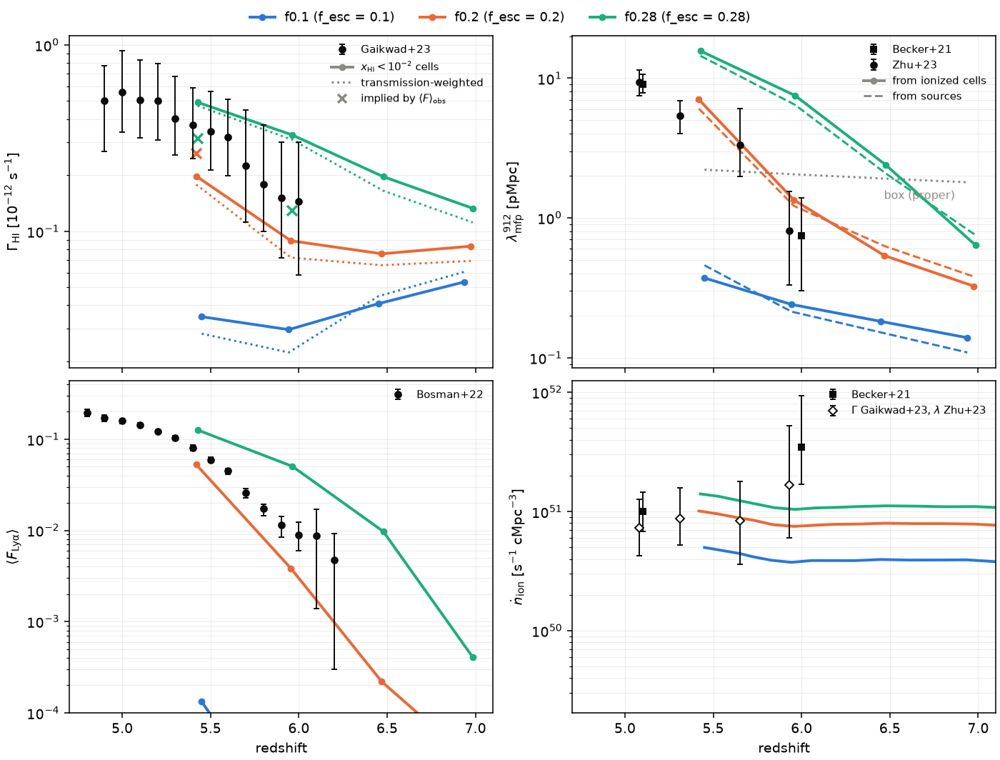

# IGM diagnostics at z = 5–6: Γ_HI, λ_mfp, ⟨F_Lyα⟩, ṅ_ion

These tools measure from `apps/radhydro` outputs the four quantities that
constrain the ionizing emissivity at the end of reionization. They are
compared with the measurements in `data/igm/igm_z5_6.txt` (Becker+21,
Zhu+23, Gaikwad+23, Bosman+22; the provenance is in the file header). The
goal is to calibrate the escape fraction of the 40 Mpc/h, 512³ run. The
tools are pure Python (numpy, scipy, matplotlib) and only read the run
directories.

| file | what |
|---|---|
| `tools/analysis/igm_stats.py` | measures one run: Γ_HI, λ_mfp, ⟨F⟩ per snapshot, ṅ per hydro step → JSON; `--selftest` runs the analytic checks |
| `tools/analysis/igm_plot.py` | compares several runs with the data: 4-panel figure and a text table |
| `tools/hyak/igm_diag.slurm` | both, on a klone compute node (16 cores); `CONV=1` adds the convergence checks |

```
python3 tools/analysis/igm_stats.py RUNS/reion256_f0.2 --jobs 8 --out igm_f0.2.json
python3 tools/analysis/igm_plot.py igm_f0.2.json:f0.2 igm_prod.json:f0.28 --out igm.png
RUNLIST="reion512_40mpc_f0.1:f0.1" JOBS=4 sbatch tools/hyak/igm_diag.slurm
```

Defaults: snapshots with 4.5 ≤ z ≤ 7.1; 4096 sightlines per set of start
points (`--nlos`; the slurm job uses 8192), 40 pMpc long (`--rmax`) with a
step of 0.5 cells (`--ds`); 4096 Lyα skewers per axis (`--nskew`; job:
8192). A 256³ snapshot takes about 10–40 s on one core.

## 1. What the run writes and the units

At every zdata1 output, with `fields_at_data1 = 1` and
`fields = fHI,fHeI,fHeII,temp,rhog,gamma` as in `make_production.py`:

| file | content |
|---|---|
| `run/step_NNNN/{fHI,rhog,temp}.bin` | float32 N³, Fortran order (i fastest): x_HI, ρ_gas/⟨ρ_b⟩, T [K] of the RT grid |
| `run/step_NNNN/gamma.bin` | float32 (3, N³): photoionization rates of HI, HeI, HeII [s⁻¹] |
| `run/step_NNNN/stats.txt` | every hydro step: redshift, scale factor, Nsource, `Luv`, x_HII,V … |
| `run/Gas/u_gas.z=ZZ.ZZZZ` | float32 (5, N³): ρ, ρv (3), E in code units (also at the data2 outputs) |
| `run/RT/rt_grid.z=ZZ.ZZZZ` | float32 (36, N³): the whole rt_grid record; component 6 (index 5) is the source `Luv` per cell |

(The filename tag is `pm.cpp` `ztag`; the RT grid equals the gas grid in
the production runs, N_rt_gas = 1.)

The units follow `cosmology.cpp` `calc_sim_var` at the snapshot's scale
factor a, with the code's constants (`constants.hpp`: Ω_m = 0.27,
Ω_b = 0.045, h = 0.70, X = 0.76):

* the proper cell size is dl = a·box/h/N Mpc;
* n_H = rhog·⟨n_H⟩, with ⟨n_H⟩ = ρ_crit Ω_b h² X / m_H / a³ (proper), and
  n_HI = fHI·n_H;
* the peculiar velocity along grid axis d is u(2+d)/u(1) × vel_unit, with
  vel_unit = dl/time_unit and time_unit = 2a²/(3 H0 h √Ω_m). With
  `hydro_scheme = unsplit`, any moving-frame velocity is folded into u
  (v_gas is 0, checked). With the legacy moving-frame scheme, u also holds
  the lab-frame momentum: `gas_state` subtracts ρv²/2 from E with it;
* H(z) = H0 h (Ω_m/a³ + Ω_Λ + Ω_r/a⁴)^½.

Fields are read in slabs of k through memory maps. The arrays held at
once are the τ_912 field (4N³ bytes), the pencils and the slab buffers.
The start points in ionized cells are drawn by rejection sampling, so no
N³ index array is built. A synthetic 512³ snapshot with 8192 sightlines
and skewers took 88 s on one core, with a maximum RSS of 6.1 GB, most of
it mapped file pages (`igm_diag/synth512/`). Reading `Luv` scans the
whole 19 GB rt_grid file once more.

## 2. Γ_HI

**What the code stores.** `rt_grid%gamma(1)` is the HI photoionization
rate in s⁻¹, summed over the five frequency groups (15.7–74 eV, Verner
cross-sections). `photo_cell` computes it as
Γ = Σ_ν n_γ,ν σ_HI(ν) · len_rt/dtsec_rt, where n_γ is the photons that
cross the cell in one RT substep. In the RSLA this is F·σ, independent of
ĉ (`docs/production_run.md` §1). `rt_step_1` resets it every substep, so
the output is the value of the **last RT substep** of the hydro step: an
instantaneous snapshot, not a time average. Cells that no photon reached
and that have x_HI ≥ 0.99 have Γ = 0. Since 2026-10-18 the field
`gammaHI_avg` (in `fields` and `movie_fields`) is the same rate averaged
over the hydro step's RT substeps, weighted by the substep length
(`Simulation::gamma_avg`, accumulated after every substep's physics in
double precision, output only, serial RT only): the quantity for the power
spectrum of Γ, where the single-substep ray sampling noise matters
(`docs/rt_methods_512.md` §6); `igm_stats.py` keeps reading `gammaHI`.

**Estimators** (`gamma` in the JSON):
* `V`: the volume average over the box;
* `ion_V`, `ion_M`, `ion_med`: the volume average, mass-weighted average
  and median over cells with x_HI < 0.5, 0.1, 10⁻², 10⁻³ (`fV`: their
  volume fractions);
* `gamma_Fweighted` (in `lya`): each cell weighted by the transmitted
  Lyα flux of the redshift-space pixel its gas lands in;
* `req_from_F`: Γ(x_HI < 10⁻²)/A, with A the τ rescaling that matches the
  Bosman ⟨F⟩ (§4). In photoionization equilibrium at fixed T, τ ∝ 1/Γ, so
  this is the Γ the simulation would need to reproduce the observed mean
  flux.

**Which one to compare with Gaikwad+23.** Gaikwad et al. infer ⟨Γ_HI⟩ by
fitting the forest transmission (its mean and PDF) with simulations. The
Γ they report is therefore the photoionization rate of the ionized gas
that transmits, not a volume average that includes neutral islands, where
Γ ≈ 0. (This reading of their method follows the task description; it has
not been checked against the paper here.) The closest estimator is the volume
average over ionized cells, `ion_V` at x_HI < 10⁻². It is the solid line
in the figure.
* Below x_HI ~ 10⁻² the average hardly depends on the threshold: in
  ionized gas x_HI ~ 10⁻⁴ (mean density, Γ ~ 2×10⁻¹³), so 10⁻² separates
  the ionized and neutral phases cleanly. 10⁻³ starts to cut dense
  ionized gas, and 10⁻⁴ cuts gas near the mean density, which biases the
  average.
* The mass-weighted average is 2–3× higher after overlap, and up to 10×
  before: dense gas sits near the sources.
* The transmission-weighted Γ is 10–20% below `ion_V`: the transmitting
  voids are far from the sources. It is the most literal "Γ of the forest".
* `req_from_F` is the most direct analogue of the observational
  procedure. It is also the number to compare with `ion_V`: their ratio
  says how far Γ and ⟨F⟩ are from each other in the simulation itself.

## 3. Mean free path of 912 Å photons

τ_912(r) = σ_912 ∫ n_HI dl, with σ_912 = 6.30×10⁻¹⁸ cm² and no frequency
dependence. The integral runs along straight sightlines:
* random start points;
* isotropic random directions (not along the axes, so a sightline does
  not retrace the same column every box length);
* periodic, 40 pMpc long: 18 box lengths at z = 5.4 for 10 Mpc/h, 4.5 for
  40 Mpc/h;
* sampled at the midpoints of 0.5-cell steps (nearest grid point).

⟨F(r)⟩ = ⟨e^{−τ(r)}⟩ is averaged over the sightlines. Two estimators:
* `lambda_e`: the r where ⟨F⟩ = 1/e, interpolated in ln F;
* `lambda_fit`: a least-squares fit of exp(−r/λ) to ⟨F(r)⟩ where
  ⟨F⟩ > 0.05.

The errors are jackknife errors over 16 groups of sightlines; they measure
sampling noise only, not cosmic variance. Three sets of start points:

| set | start | meaning |
|---|---|---|
| `random` | uniform in the volume | the volume-averaged λ; starts in neutral islands give λ ≈ 0, so before overlap this measures the neutral fraction |
| `ionized` | uniform in cells with x_HI < 0.01 | the λ of the ionized IGM. **Used in the figure**: the quasar sightlines of Becker+21 and Zhu+23 start in ionized regions |
| `sources` | source cells (`Luv > 0` in RT/rt_grid), weighted by luminosity; τ starts one cell away | the closest analogue of measuring from bright objects (quasar hosts); it includes the clustered absorbers around the sources, which the observations partly remove with their proximity-zone modelling |

The halo positions themselves are not written: the production runs find
halos on the fly and do not write catalogs. Their luminosities are in the
rt_grid `Luv` field, which is enough.

## 4. Lyα forest mean flux

The skewers run along the three axes (4096 random pencils per axis). The
pixels are the cells, with dv = H(z)·dl: 5.2 km/s at 256³/10 Mpc/h and
10.5 km/s at 512³/40 Mpc/h. Positions are in pixel units, periodic.

**Redshift-space deposit (top-hat cells, the default).** The gas of cell i
fills the interval between its faces in redshift space, uniformly:
* y_lo = i + v_{i−½}/dv and y_hi = i + 1 + v_{i+½}/dv;
* the face velocities are the means of the two neighbouring cells;
* the ends are swapped where shells cross.

Each gas element has a Doppler profile, φ_v = exp(−(Δv/b)²)/(√π b), with
b = (2kT/m_H)^½ from the RT-grid T. There are no damping wings: neutral
islands are saturated anyway. Both the top-hat and the Gaussian are
integrated over each pixel analytically, with
G(u) = u erf(u) + e^{−u²}/√π:

τ_p = K/dv · Σ_i n_HI,i dl · [C_i(p+1) − C_i(p)],
C_i(q) = β_i [G((q−y_lo)/β_i) − G((q−y_hi)/β_i)] / (2(y_hi − y_lo)),  β = b/dv

(→ ½ erf((q − x_i)/β) for a cell of zero width). The kernel is truncated
at 5b beyond the interval.

**Why not the point deposit.** The simpler point deposit puts all of a
cell's gas at x_i = i + ½ + v_i/dv. It is kept as `--lya-profile point`,
but it is wrong in partly neutral boxes:
* the neutral gas in voids is at the temperature floor (T ≈ 1 K,
  b ≈ 0.1 km/s);
* where the void expansion stretches the redshift-space spacing of the
  cells beyond a pixel, the narrow lines leave pixels empty;
* this gave τ = 0 in 1.5–3% of the pixels of the f_esc = 0.1 run: a
  spurious ⟨F⟩ of 0.02–0.04 from fully neutral regions.
After overlap (b ≳ 10 km/s) the two deposits agree to 1%.

K = π e² f_α λ_α/(m_e c) = σ_α c = 1.343×10⁻⁷ cm³ s⁻¹, with f_α = 0.4164,
λ_α = 1215.67 Å, e = 4.8032×10⁻¹⁰ esu, m_e = 9.1094×10⁻²⁸ g (standard
constants, in `igm_stats.py`). `--selftest` checks:
* the Gunn–Peterson τ of a uniform field, to 10⁻¹³, with both deposits;
* the line integral and periodic shifts;
* τ_GP/1.8 in a cold void stretched by 1.8 (the top-hat leaves no gaps;
  the point deposit does).

The tool reports:
* ⟨F⟩ = ⟨e^{−τ}⟩ over all pixels of the three axes, and per axis (the
  axis spread shows the box's sample variance);
* τ_eff = −ln⟨F⟩;
* A, the factor with ⟨e^{−Aτ}⟩ = ⟨F⟩_Bosman, with Bosman+22 interpolated
  linearly to the snapshot z (4.8–6.2; nan outside).

As agreed, the simulated x_HI is used as is: case B, and self-shielding
only as resolved by the RT.

## 5. ṅ_ion from the run

**No C++ change is needed.** The emission rate of the on-the-fly sources is
in every `step_NNNN/stats.txt`:
* `Luv` = Σ L_source / V_box in erg s⁻¹ Hz⁻¹ cMpc⁻³ (`rt_tools.cpp`
  `calc_halo`, V_box = (box/h)³);
* the RT emits fResc · Σ pop2_init = 0.2 × 10^25.2 × 1.0001 photons per
  erg/Hz (`ray_source`, `photo_source`);
* the abundance-matched source L already carries ξ_ion/Σpop2_init and
  f_esc/fResc (`halo_sources.hpp`).

So

ṅ_esc = 0.2 · Σ pop2_init · Luv   [photons s⁻¹ cMpc⁻³],

the escaped rate that the RT actually injects, at every hydro step
(`Run.ndot()`; it equals Σ `Luv` of the rt_grid / V_box at the data1
outputs, checked). The sources are found at the end of a hydro step and
emit during that step's RT, so the value belongs to the step that ends at
the stats redshift. Cells with sfr ≤ 10⁻⁶ M☉/yr (`sfr_min`) do not emit;
this is negligible for the abundance-matched sources. The intrinsic rate is
ṅ_esc/f_esc.

`tools/analysis/emissivity.py --moments` reads the `Moments : injected`
line of ray.log instead. That line exists only for `rt_method = m1|otvet`;
for the rays, stats.txt is the source.

## 6. Results: 10 Mpc/h, 256³ production runs

Runs: `reion256_f0.1`, `reion256_f0.2` and `reion256_prod` (f_esc = 0.28).
All are 10 Mpc/h, 256³, ĉ = 0.1c, unsplit hydro, abundance-matched
on-the-fly sources, with data1 outputs at z ≈ 7.0, 6.5, 6.0 and 5.4
(`reion256_f0.15` was still running and is not included). They were
measured by `tools/hyak/igm_diag.slurm` with 8192 sightlines per start
set and 8192 skewers per axis. Outputs are in
`/gscratch/astro/mcquinn/radhydro/runs/igm_diag/`: `igm_*.json`,
`igm.png`, `igm.txt`, and `conv/` for the convergence checks.



`docs/figures/igm_256.png`. Γ is in 10⁻¹² s⁻¹ (ionized cells, x_HI < 10⁻²)
and λ in pMpc (ionized starts). The data are interpolated linearly to the
snapshot redshift. For λ, Becker+21 and Zhu+23 are pooled; for ṅ the
Becker+21 value is listed and the Gaikwad-Γ + Zhu-λ value in parentheses.

| run | z | x_HII,V | Γ | Γ_obs | λ | λ_obs | box | ⟨F⟩ | ⟨F⟩_obs | A | log ṅ | log ṅ_obs |
|---|---|---|---|---|---|---|---|---|---|---|---|---|
| f0.1 | 5.45 | 0.499 | 0.035 | 0.358 | 0.37 | 4.5 | 2.2 | 1.3e-4 | 0.070 | – | 50.70 | 51.21 (50.93) |
| f0.2 | 5.42 | 0.9999 | 0.198 | 0.367 | 7.03 | 4.7 | 2.2 | 0.053 | 0.076 | 0.76 | 51.00 | 51.19 (50.93) |
| f0.28 | 5.43 | 1.0000 | 0.492 | 0.364 | 15.7 | 4.7 | 2.2 | 0.126 | 0.074 | 1.56 | 51.15 | 51.20 (50.93) |
| f0.1 | 5.94 | 0.354 | 0.030 | 0.148 | 0.24 | 0.80 | 2.1 | 5e-6 | 0.010 | – | 50.57 | 51.51 |
| f0.2 | 5.96 | 0.947 | 0.089 | 0.148 | 1.35 | 0.79 | 2.1 | 0.0038 | 0.010 | 0.65 | 50.88 | 51.51 |
| f0.28 | 5.96 | 0.9999 | 0.329 | 0.147 | 7.52 | 0.78 | 2.1 | 0.050 | 0.0098 | 2.56 | 51.02 | 51.52 |

**Sanity.**
* After overlap Γ is 2–5×10⁻¹³ s⁻¹, λ is 7–16 pMpc, and ⟨F⟩ is
  0.05–0.13 at z ≈ 5.4: all in the expected ranges.
* f0.1 is only half ionized at z = 5.45: its ⟨F⟩ ~ 10⁻⁴ is set by the
  neutral islands, and λ from ionized starts is the bubble size,
  ~0.4 pMpc.
* ṅ from stats.txt equals Σ Luv of the rt_grid / V at the data1 outputs
  (checked at z = 5.42).
* With f_esc = 0.2 at z = 5.42 the cells hold Γ_HeI = 1.2×10⁻¹³ and
  Γ_HeII ~ 10⁻¹⁷ (soft spectrum, no HeII reionization).

**Γ estimators** (z = 5.42, f0.2, in 10⁻¹³ s⁻¹):
* volume average and ionized volume average: 1.98 at every threshold;
* median 1.85;
* transmission-weighted 1.78;
* mass-weighted 5.0.

Before overlap (f0.2 at z = 6.97), the volume average (0.41) is half the
ionized average (0.83), and the ionized average rises by 15% between the
thresholds 0.5 and 10⁻³.

**Convergence** (f0.2, z = 5.42; `conv/`):

| check | λ_e, random starts | λ_e, ionized starts | ⟨F⟩ |
|---|---|---|---|
| base (4096 sightlines, step 0.5 cells) | 7.03 | 7.14 | 0.0521 |
| step 0.25 cells | 7.02 | 7.13 | 0.0521 |
| 32768 sightlines | 7.05 | 7.05 | 0.0521 |
| other seed | 7.01 | 7.03 | 0.0525 |
| rmax 80 pMpc | 7.03 | 7.14 | 0.0521 |
| all 65536 skewers per axis | 7.03 | 7.14 | 0.0524 |
| point-deposit Lyα | 7.03 | 7.14 | 0.0524 |

In short:
* λ is converged to about 1.5%. The jackknife errors (0.05 pMpc)
  underestimate the seed-to-seed scatter (0.1) by about 2×.
* ⟨F⟩ is converged to 1%. The three axes give 0.049, 0.047 and 0.062:
  the box's sample variance, ±13%, dominates.
* The top-hat and point deposits agree after overlap. Before overlap the
  point deposit gave 1.5–3% spurious transmitting pixels (e.g.
  ⟨F⟩ = 0.041 instead of 10⁻⁷ for f0.1 at z = 6.94); see §4.

**What the data say about f_esc** (for this box, resolution and ĉ; take
it as a test of the tools, not as the calibration):
* **⟨F⟩:** interpolating ln⟨F⟩ linearly in ln f_esc between f0.2 and
  f0.28 matches Bosman at f_esc ≈ 0.23, both at z = 5.42 and at z = 5.96.
* **Γ:** the same interpolation matches Gaikwad at f_esc ≈ 0.25 (z = 5.42)
  and 0.23 (z = 5.96).
* **ṅ:** f0.2 is 10^51.00 at z = 5.42, between Becker+21 (51.19,
  interpolated between their z = 5.1 and 6.0) and the Γ + λ value (50.93),
  and well within the errors. At z = 6 the Becker value (51.54 ± 0.4) is
  above all three runs.
* **λ is the outlier.** Already at f_esc = 0.2 the simulated λ is 1.5×
  (z = 5.42) and 1.7× (z = 5.96) the data, while Γ is 0.54–0.60× the data.
  At fixed Γ, the simulated λ is about 2.7× longer than observed:
  λ/Γ = 36 (f0.2) and 32 (f0.28) pMpc per 10⁻¹² s⁻¹, against 13 in the
  data at z = 5.4.

This is the signature of too few absorbers: unresolved self-shielded
systems and a box smaller than λ (§7). So the 912 Å mean free path of
these runs cannot be used to calibrate f_esc. Γ and ⟨F⟩ agree with each
other: the Γ implied by the observed ⟨F⟩ (crosses in the figure) is 0.26
(f0.2) and 0.32 (f0.28) at z = 5.42, against 0.37 ± 0.2 from Gaikwad.

## 7. Caveats

* **Box size vs λ_mfp.** After overlap the simulated λ (5–10 pMpc) is
  2–4× the proper box: 2.2 pMpc at z = 5.4 for 10 Mpc/h. The 40 pMpc
  sightlines wrap many times. Random directions avoid retracing the same
  column, but every sightline samples the same ~10 Mpc/h of structure. So:
  * λ is a property of this one realisation, with no large-scale
    fluctuations of the UVB or the absorber population (no voids, no
    neutral islands larger than the box, no rare bright sources);
  * the jackknife errors understate the true uncertainty;
  * at fixed Γ, the box's λ is that of a "typical" small region, while
    Becker's and Zhu's λ average over ~50 pMpc of sightline.
  The 40 Mpc/h box (8.9 pMpc proper at z = 5.4) is comparable to λ; there
  this caveat is milder but not gone. The same small-box variance shows in
  ⟨F⟩: the three axes differ by up to ±15% (§6).
* **Resolution of the absorbers.** The cells are 39 kpc/h comoving
  (256³/10 Mpc/h) and 78 kpc/h (512³/40 Mpc/h): 8.7 and 17 kpc proper at
  z = 5.4. Self-shielded systems (n_H ≳ 10⁻³–10⁻² cm⁻³, sizes of ~10 kpc
  proper) and minihalo absorbers are under-resolved, at 512³ even more. The
  simulated λ at a given Γ is therefore probably too long, and the
  λ-to-Γ relation of the simulation is not the true one. The comparison
  of the Γ and λ panels tests exactly this. The RT grid also smooths the
  density over a cell before computing x_HI (the RT runs on cell
  averages).
* **Reduced speed of light** (ĉ = 0.1c at 256³, 0.2c in the 512³ run).
  Γ = Fσ is right where the gas is optically thin and the radiation field
  is in equilibrium. But after overlap a photon takes λ/ĉ ≈ 230 Myr to
  cross λ = 7 pMpc at 0.1c, against an age of ~1 Gyr. Two effects follow:
  * the background lags the emissivity: it reflects ṅ at an earlier,
    lower value;
  * `ray_redshifting` redshifts the rays with the time elapsed, so a
    photon loses c/ĉ times more energy per distance than in reality. The
    15.7 eV group crosses 13.6 eV after Δa/a ≈ 15%, i.e. after ~7 pMpc at
    0.1c, which is comparable to λ.
  Both lower Γ relative to ṅ·λ. Part of the low Γ/ṅ of the 256³ runs (§6)
  probably comes from this, so a calibration of f_esc against Γ at
  ĉ = 0.1c will be biased high. The 512³ run at ĉ = 0.2c halves both
  effects. ⟨F⟩ inherits the same bias through Γ; λ is affected only
  through x_HI.
* **Γ is an instantaneous snapshot** (the last RT substep); it fluctuates
  with the discrete ray sampling. The volume averages are robust (millions
  of cells); `gammaHI_avg` (above) is the substep average for the
  cell-level statistics.
* **The source spectrum is fixed by the code** (five groups, 15.7–74 eV,
  `pop2_init` weights). The Becker eq. 10 conversion between Γ, λ and ṅ
  in the data file assumes α_s = 2 at 912 Å. The simulation's own Γ-to-ṅ
  ratio includes its group cross-sections (mean σ ≈ 0.4 σ_912 over the
  source spectrum), so compare ṅ with ṅ and Γ with Γ, not one through the
  other.
* **Lyα**: thermal broadening only (no damping wings, no instrumental
  resolution, no continuum errors). The pixel is the cell. The simulated T
  of the RT grid is used, at a resolution where the IGM temperature is
  set by the photoheating in the RT. The z = 5–6 forest is very sensitive
  to the neutral islands and to T; A absorbs all of these.
