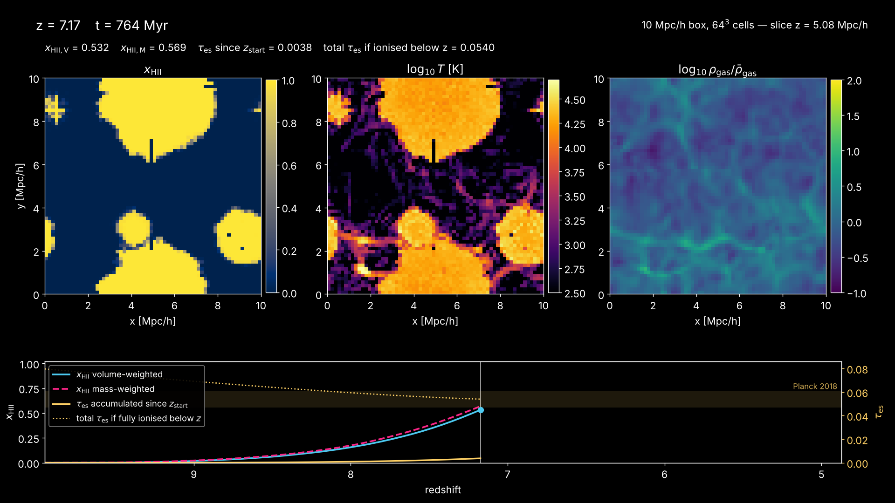
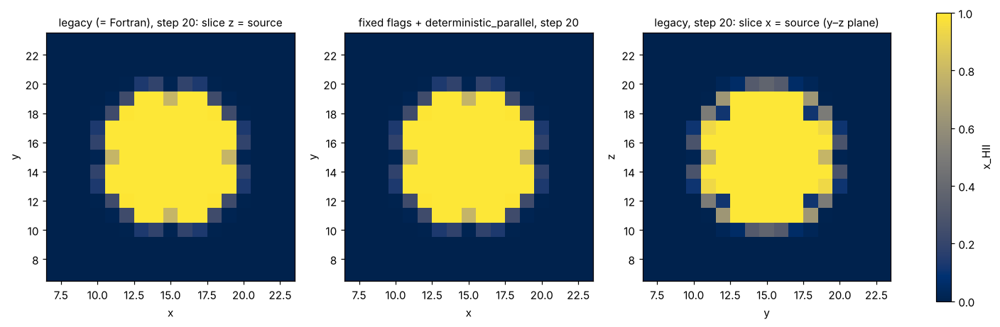
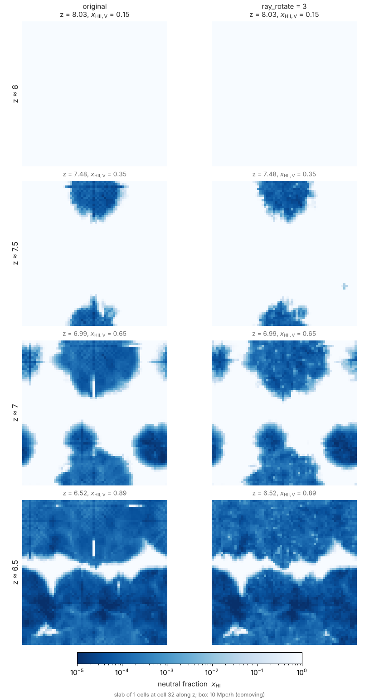

# Reionisation movies

`tools/movies/make_movie.py` turns an `apps/radhydro` run directory into an
MP4 and a few still PNGs. It works on a run in progress, on any N, and on any
box size.



Test movie (64³, 10 Mpc/h, 0.9 MB): [`docs/movies/reion64_test.mp4`](movies/reion64_test.mp4).

## Quick start

```
# set up the run with movie frames of x_HI, T and rho_gas every dz = 0.05
python3 tools/production/make_production.py RUN --N 128
# (make_production.py stores slabs of 1 cell by default; see "Slab frames")
OMP_NUM_THREADS=4 build/radhydro RUN RUN/run --quiet

# movie + stills (RUN/run/movie/cosmo.mp4, RUN/run/movie/cosmo_stills/)
python3 tools/movies/make_movie.py RUN/run --jobs 4
```

## What it shows

**Style `cosmo` (the default):**

- **Slices** through the box, or **thin projections** (`--thick n` averages n
  cells), of three fields:
  - x_HII (`cividis`, linear 0–1), or log₁₀ x_HI (−5 to 0) with `--xhi-log`.
    After overlap the linear x_HII panel is uniform; the log x_HI view still
    shows structure there.
  - log₁₀ T (`inferno`, 2.5–4.7).
  - log₁₀ ρ_gas/⟨ρ_gas⟩ (`viridis`, −1 to 2).
- The colour maps are perceptually uniform, and the scales are fixed for the
  whole movie. Override a scale with `--range-xHII`, `--range-xHI`,
  `--range-temp` or `--range-rhog LO HI` (log₁₀ for T and ρ).
- **Time panel:**
  - x_HII,V and x_HII,M against z, drawn up to the current frame, with a
    marker at the current z.
  - On the right axis, τ_es accumulated since the first frame, and the total
    τ_es if the IGM were fully ionised below the current z. This total is the
    accumulated part plus the integral from 0 to z, with HeIII below z = 3.
  - A band for Planck 2018, τ = 0.054 ± 0.007. **This value is quoted from
    memory**, not checked against the paper here. It is a visual guide only.
- **Labels:** redshift; cosmic time (flat ΛCDM with the original's Ω_m = 0.27,
  h = 0.7 and Ω_r); box size and N; the slice axis and position; the current
  x_HII,V, x_HII,M and both τ_es values.

**Style `planar`** (`--style planar --ray-axis x [--source-face low|high]`),
for plane-parallel runs (`docs/plane_parallel.md`, not implemented yet):

- Slices of x_HII and T in a plane that contains the ray direction. The ray
  direction runs horizontally.
- The I-front position against cosmic time. The front is where the x_HII
  averaged over planes perpendicular to the rays first drops below 0.5,
  counting from the source face. It is linearly interpolated between cells.
- The current proper front speed, in km/s and as a fraction of c.

The front finder is checked on a synthetic planar front (see Tests) but not
yet on a real plane-parallel run. On the cosmological test run the front
stays at 0, as it should.

## Inputs

| What | Where | Notes |
|---|---|---|
| frames | `movie/frames.txt`, `movie/frame_NNNNN_<field>.bin` | Written every `movie_dz` from inside the RT substeps (`docs/production_run.md` §4). Each field is float32 N³ in Fortran order. `rhog` is in units of the mean. |
| slab frames | `movie/frame_NNNNN_<field>.slab`, `movie/slab.txt` | With `movie_slab > 0`: only slabs through the box centre (see "Slab frames" below). |
| fields missing from the frames | `step_NNNN/<field>.bin` | If `movie_fields` lacks one of fHI, temp or rhog, the tool uses the regular field output nearest in redshift and labels the panel "step n, z = …". Field outputs come only at the zdata1 steps, so prefer putting all three fields in the movie frames. |
| no movie frames | `step_NNNN/{fHI,temp,rhog}.bin` | Each step with fields becomes one frame. |
| x_HII,V, x_HII,M | `frames.txt` (or `stats.txt`) | Sums over the whole box, so they don't depend on the slice. |
| box | `params.txt` in RUNDIR or RUNDIR/.. | Or `--box`. |

**Γ_HI in the frames (2026-10-11).** `movie_fields` may list `gammaHI`:
the HI photoionization rate of the last RT substep, one float per cell (the
HI component of `gamma`, which has 3 and which the slab reader cannot read).
`frames.txt` lines also end with four whole-box Γ_HI columns, named in the
header: `GammaHI_V` (volume mean), `GammaHI_ion_med` and `GammaHI_ion_mean`
(median and mean over the cells with x_HII > 0.5) and `fV_GammaHI_gt_1e-14`
(volume fraction with Γ_HI > 10⁻¹⁴ s⁻¹), all in s⁻¹ from `gamma(1)` of
the last RT substep before the frame. Older files have six columns; the
readers (`reion.py` `frames_table`/`read_gamma`, `reion_history.py`, the
movie tools) take either, and also a file whose lines change length at a
restart. `compare_movie.py` adds a log Γ_HI row (fixed range
10⁻¹⁴–10⁻¹¹ s⁻¹, `--range-gamma`, `--rows`) and a panel with the median
Γ_HI of the ionised cells when every run has `gammaHI` frames;
`stills.py` adds a Γ_HI column when the frames have it.

**Frames before the RT starts are skipped.** The C++ writes movie frames from
`movie_z0` (by default the first zdata1, z = 15). Before the first step with
a source, though, the RT grid is not set up yet: fHI = rhog = 0, and
frames.txt has x_HII,V = 1 and x_HII,M = nan. The tool drops these frames and
reports how many. In the 64³ test, 99 of 203 frames were dropped: the first
source forms in the step ending at z = 9.95. For a run whose sources form
late, set `movie_z0` to about the first-source redshift to save disk. A C++
change to skip these frames would be easy: they are not legacy output, and
`restart_smoke_det_movie` compares a restarted run with an uninterrupted
one, so it would still pass.

## Options

| Option | Default | Meaning |
|---|---|---|
| `-o OUT.mp4` | `RUNDIR/movie/<style>.mp4` | Stills go to `OUT_stills/` (or `--still-dir`). |
| `--axis x\|y\|z` | `z` | Slice normal. `z` reads contiguous slabs and is the fastest for big N. |
| `--pos P` | box centre | Slice position along `--axis`, in Mpc/h. |
| `--thick n` | 1 | Average over n cells along `--axis`: a thin projection. |
| `--zoom H0,H1,V0,V1` | whole box | Region of the slice plane to show, in Mpc/h. |
| `--zmax`, `--zmin`, `--every n` | all | Frame selection. τ_es still accumulates from the first frame of the run. |
| `--xhi-log` | off | Show log₁₀ x_HI instead of x_HII. |
| `--fps`, `--crf`, `--size W H`, `--dpi` | 12, 20, 1920×1080, 120 | Video settings: x264, yuv420p, faststart. |
| `--jobs n` | 1 | Number of processes that render frames, in order. |
| `--stills` | `auto` | `auto` takes the frames where x_HII,V first reaches 0.1, 0.5 and 0.9, plus the last frame. Also accepts a list of frame indices, or `none`. |
| `--no-mp4` | | Render only the stills. |

## Memory and speed (for 128³ and 192³ on Hyak)

- **Bounded memory.** The tool reads frames one at a time and memory-maps each
  field file, reading only the slab of the slice (`--thick` cells; true
  since the 2026-10-11 fix below). Rendered
  frames are piped as raw RGB into ffmpeg; no frame directory is written.
- **Memory doesn't grow with N or the number of frames.** Each render process
  holds one figure, about 150–200 MB of Python and matplotlib. The planar
  style reads one whole x_HII cube per frame for the front: 28 MB at 192³,
  as float64 57 MB.
- **Speed.** The 64³ test took 16 s for 104 frames with `--jobs 4`, about
  0.15 s per frame per process. Rendering dominates, so at 128³ or 192³ a
  190-frame movie should take well under a minute on 4 cores. Slices along
  `x` or `y` read strided pages, which is slower on a network file system;
  copy the frames to local scratch or use `--axis z`.
- **Whole-cube reads, fixed 2026-10-11.** Until then the slab reader used
  `np.take` on the memory-mapped cube. `np.take` first copies the whole
  Fortran-ordered file into a C-ordered array, so every frame field was read
  in full (512 MB at 512³) and transposed. On the 512³ production legs,
  `make_movie.py --jobs 192` took 1–2.5 h for about 100 frames after each
  leg. The readers in `movie_frames.py` now use basic slicing, which reads
  only the slab's pages and gives the same values. Rendered stills are
  byte-identical to before.
  - Measured on synthetic 512³ frames on klone: 6 frames with `--jobs 6`.
    | | old reader | new reader | slab frames |
    |---|---|---|---|
    | `make_movie.py`, files not cached | 106 s | | 1.6 s |
    | `make_movie.py`, cached | 9.5 s | 5.4 s | |
    | `stills.py`, 3 redshifts | 46 s | 5.2 s | 3.0 s |
  - `stills.py` still loads one full fHI cube on full-cube frames, to find
    the most ionised plane.
- **ffmpeg.** The tool uses `ffmpeg` from `PATH`, or the static binary of the
  `imageio-ffmpeg` package. Without root, run
  `pip install --user imageio-ffmpeg` (on Hyak, or try `module load ffmpeg`).
  `--no-mp4` needs no ffmpeg.
- **Disk for the frames.** Each frame takes 4N³ bytes per field. Writing
  fHI, temp and rhog every Δz = 0.05 from z = 15 (190 frames) needs
  0.6 GB at 64³, 4.8 GB at 128³ and 16 GB at 192³. At 192³, use
  `movie_dz = 0.1`, or `movie_fields = fHI,temp` (rhog then comes from the
  zdata1 field outputs), or set `movie_z0` close to the first source.
  For N ≥ 256 use slab frames instead (next section).

## Slab frames (`movie_slab`)

The movie tools only ever read a slab of each frame, so a run can store
just the slabs, frequently, even when its full snapshots are rare.

**Keys** (`apps/radhydro`):

| Key | Default | Meaning |
|---|---|---|
| `movie_slab` | 0 | 0: each frame field is the full cube, `frame_NNNNN_<field>.bin`, exactly as before. t > 0: only slabs of t cells, `frame_NNNNN_<field>.slab`. |
| `movie_slab_axes` | `xyz` | The slab normals: distinct letters of `xyz`, in the order stored. |

`make_production.py` writes `movie_slab = 1` by default (user,
2026-10-12): the three central planes, 3 MB per field and frame at 512³.
The movies show one plane, so that is all they need; a thicker slab
(`--movie-slab t`) only adds thin projections (`--thick`), a slice moved
by up to ±t/2 cells, and `stills.py`'s 2-cell default (with 1-cell slabs
it uses 1 cell and says so). The 40 Mpc/h 512³ runs of
`docs/rt_methods_512.md` used t = 8: 38 GB of frames per run, of which the
movies used 1 plane in 24.

**Layout.**

- Each slab covers cells s0 … s0+t−1 along its normal, with
  s0 = N/2 − t/2 (0-based), and all N cells along the other two axes. It is
  centred on the box centre, so it contains cell N/2: that is the plane
  `make_movie.py` slices by default.
- `frame_NNNNN_<field>.slab` holds one block per axis of `movie_slab_axes`,
  in that order. Each block is the sub-array of the cube with that axis's
  index restricted to the slab, float32, in Fortran order
  (ncomp, nx, ny, nz) with n_axis = t. ncomp is 1 except for `gamma` (3)
  and `ngam` (Nfreq).
- `movie/slab.txt` records `N`, `thick`, `axes` and `start` (= s0) as
  `key = value` lines. It is written at the start of the run. A restart
  with a different `movie_slab` or `movie_slab_axes` stops with an error,
  so that the frames of one run share one geometry.
- `frames.txt` is unchanged, apart from its header comment: x_HII,V and
  x_HII,M are still sums over the whole box at every frame.
- A run that changes `movie_slab` from 0 at a restart holds both kinds of
  frame. The tools read each file by its extension.

**Disk per frame field:** 4·3·t·N² bytes, against 4N³ for the cube.

| N | cube | t = 8, 3 axes | per frame, fHI + temp + rhog (slab vs cube) |
|---|---|---|---|
| 256 | 67 MB | 6.3 MB | 19 MB vs 201 MB |
| 512 | 537 MB | 25 MB | 75 MB vs 1.6 GB |
| 1024 | 4.3 GB | 101 MB | 302 MB vs 12.9 GB |

So a 512³ run with Δz = 0.1 from z = 15 to 5 (about 100 frames) needs
about 8 GB of frames, against about 160 GB for cubes.

**Tools** (shared reader: `tools/movies/movie_frames.py`):

- **`make_movie.py` and `compare_movie.py`:** both read full cubes and slab
  frames. With slabs, `--axis` must be one of `movie_slab_axes`, and the
  cells from `--pos` to `--pos` + `--thick` − 1 must lie in the slab. The
  default position is cell N/2 for `--thick 1`, as with cubes. For a thicker
  projection it is the `--thick` cells centred on N/2, kept inside the slab
  (`--thick 8` with `movie_slab = 8` averages the whole slab). A slice
  outside the slab stops with a message saying which cells are stored. The
  `planar` style takes the I-front from the plane-averaged x_HII of the
  first stored slab that contains the ray axis, not of the whole box, and
  prints a note saying so.
- **`stills.py` and `compare_stills.py`:** with slab frames, the default
  slab position is the most ionised `--slab` cells within the stored slab,
  not within the whole box. `--axis` and `--pos` must lie in the slab.
- **`tools/analysis/reion.py`, `reion_history.py`, `plot_calibration.py`
  and `calibrate_fesc.py`** read only `frames.txt`, so slab frames change
  nothing for them.
- **`tools/analysis/rt_methods_runs.py`:** the history comes from
  `frames.txt`. The field comparison (power spectra, cell fractions,
  correlations) needs whole cubes. It uses full-cube movie frames when
  every run has them, and otherwise the zdata1 field outputs
  `step_NNNN/{fHI,temp}.bin`, as before for runs without frames. Those come
  less often, and their redshifts differ between runs once the hydro steps
  differ.
- With full-cube frames, every tool gives the same output as before. The
  test `movie_slab` also checks that a still of the default slice is
  byte-identical when rendered from cube frames and from slab frames.

## Comparing runs side by side

`tools/movies/compare_movie.py` makes one movie of several runs that share
the ICs, e.g. rays vs moment RT (`docs/rt_moments.md` §6):

```
python3 tools/movies/compare_movie.py OUT.mp4 RUNS/reion256_c01/run:rays \
    RUNS/reion256_c01_m1/run:M1 RUNS/reion256_c01_otvet/run:OTVET --jobs 8
```

- One column per run, with slices of x_HII and log₁₀ T at the same
  position. On the right is x_HII,V(z) for every run, drawn up to the
  current frame (the whole curve is shown faintly).
- The first run sets the frames. Each other run shows its movie frame
  nearest in redshift, and the largest mismatch is printed. The frames are
  written at the same `movie_dz` redshifts, so they agree to within a
  substep.
- The movie stops at the lowest redshift that all runs reached.
- Stills (`OUT_stills/z*.png`) are taken where x_HII,V of the first run
  reaches 0.1, 0.5 and 0.9, and at the last frame.
- `--axis`, `--pos`, `--thick`, `--zmax`/`--zmin`, `--every`, `--range-xHII`
  and `--range-temp` work as in `make_movie.py`.
- `tools/movies/compare_stills.py` gives the same comparison as a single
  PNG grid at a few redshifts.

## The test movie (64³)

How the test movie was made:

- **Setup:** `tools/production/make_production.py RUN --N 64`. That gives a
  10 Mpc/h box, Ngas = Ndm = 64, Zel'dovich ICs at z = 100 (seed 7),
  on-the-fly FoF sources, `c_reduced = 0.01`, `nray_max_factor = 16`,
  `legacy_rt = legacy_physics = 0`, `deterministic_parallel`,
  `rt_substep_carry`, and `movie_dz = 0.05` with fHI, temp and rhog.
  (This movie predates `ray_rotate`; the script now also sets
  `ray_rotate = 3`, so a remake has no B16 streaks.)
- **Run:** 4 threads, z = 100 → 4.87, 27 hydro steps, 90 s, peak RSS 384 MB.
- **Movie:** `make_movie.py RUN/run --jobs 4` gave 104 frames from z = 9.95
  to 4.87 (after dropping the 99 pre-RT frames).

What the movie shows:

- x_HII,V passes 0.1, 0.5 and 0.9 at z ≈ 8.2, 7.2 and 6.5, and reaches
  0.9999 by z = 5.5.
- τ_es accumulated in the run is 0.023. Adding full ionisation below
  z = 4.87 gives a total of 0.052.
- **Bubbles.** Ionised regions grow and reach about 2×10⁴ K, and they have
  merged by z ≈ 6.5. The last neutral patches are dense filaments. Light
  travel at ĉ = 0.01c limits the growth: the bubbles stay small for several
  frames after a source appears.
- **Bubble shapes.** The bubbles are nearly spherical because at 64³ only a
  few halos are resolved (2 sources at z ≈ 8, 7 by z ≈ 7). The 128³
  production run with abundance-matched sources will be much clumpier.
- **Gas ahead of the I-front is too hot.** Filaments sit at 10³–10⁴ K and
  voids near 10²–10³ K, hotter than an adiabatic IGM. This is the hydro
  suite's finding that the scheme spuriously heats cold supersonic gas
  (`docs/hydro_tests.md`). Don't read pre-reionisation temperatures from
  these movies.

Artefacts, all in the data rather than the rendering:

- **Grid-aligned streaks (quirk B16, `docs/port_notes.md`).** Straight,
  one-cell-wide streaks of partly neutral gas run along x and y through
  sources, giving small "+" crosses on the sources. In the 64³ run one of
  them runs down the centre of the z = 32 slice (x = 31, y = 39–45, at
  x_HII ≈ 0.1 inside a bubble).
  - **Cause, as far as the uniform test shows:** the original HEALPix ray
    frame is fixed to the grid, and sources sit at cell centres. In that
    frame ±x and ±y are pixel vertices at every nside, so the rays around
    each of these axes are mirror-symmetric about it. They all leave the
    column of cells along the axis at the same distance, and those cells
    get too few photons. The rays around ±z (the poles) are diagonal, so
    the deficit there is much weaker.
  - **It is in the original code, not from our changes** (it is not B10,
    and not `deterministic_parallel` or `c_reduced`). In the uniform
    single-source test (`tests/problems/uniform_1src`, 30 steps;
    `tools/analysis/axis_deficit.py`), the axis cells near the front fall
    short of their shell mean by up to 0.25 in x_HII along x and y, and by
    0.003 along z. This holds with the legacy flags (bit-identical to
    gfortran), with the fixed flags, and with `deterministic_parallel`. With
    `c_reduced = 0.1` the shortfall reaches 0.45.

    

  - **Fixed behind a flag (2026-10-10):** `ray_rotate = 3` (or 2) rotates
    the HEALPix frame of the emitted rays every RT substep and source. The
    streaks and crosses disappear at no measurable cost, with slightly more
    cell-to-cell noise inside bubbles (`docs/port_notes.md` B16):

    
- **Radial spokes.** Faint spokes inside the bubbles follow the ray
  directions.

## Tests

`tools/movies/test_make_movie.py` (CTest `movie_tool`; skipped without
matplotlib) builds a synthetic 16³ run directory and checks:

- that pre-RT frames are skipped;
- the fallback to the field outputs;
- the front positions of a planar front, to 0.03 Mpc/h (0.06 cells);
- the τ_es integral, against a fine-grid evaluation (1e-3);
- t(z = 6) = 963 Myr;
- that both styles render an MP4 and the stills with zoom, axis, position
  and thickness options.

`tests/movie_slab_check.py` (CTest `movie_slab`, label `movie`) runs the
16³ full-loop smoke problem (`tests/problems_full/smoke`, 11 frames of
fHI, temp, rhog and gamma) three times: with full cubes, with
`movie_slab = 4`, and with `movie_slab = 3`, `movie_slab_axes = zx`. It
checks:

- that the slab runs write no cubes, and that `slab.txt` is right;
- that every slab file equals the stored cells of the full cube, gamma's
  three components included;
- that `frames.txt` is the same in all three runs;
- that `reion.py` gives identical output;
- that `make_movie.py` stills are byte-identical from cubes and slabs, for
  the default slice and for an x projection over the slab;
- the error messages for a slice outside the slab and for an axis that is
  not stored;
- the planar style on slabs;
- `stills.py` on slabs, byte-identical to cubes at the same `--pos`.

The matplotlib parts are skipped without matplotlib.

`restart_smoke_det_movie_slab` restarts a `movie_slab = 4` run and checks
that the result is bit-identical, frames and `slab.txt` included.
