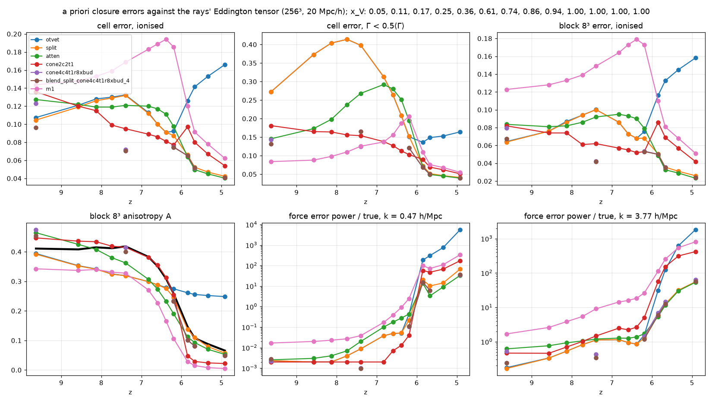
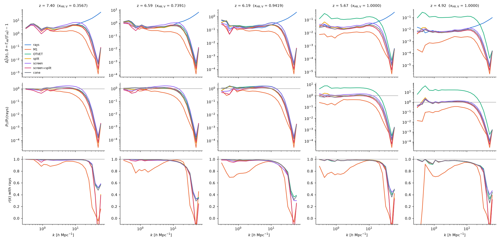

# A better Eddington tensor for OTVET

*Branch `otvet-closure`, started 2026-10-12. Work in progress: steps 1
(ground truth) and 2 (candidates and ranking) of the user's plan; nothing
is implemented in the solver yet.*

**The problem** (`docs/rt_methods_512.md` §5–6). After overlap, OTVET's
P_Γ is 2–9× the rays' at k ≲ 6 h/Mpc with r ≥ 0.95, its Γ has a floor at
0.62⟨Γ⟩ and its peaks are too low. Before overlap it matches the rays'
morphology and temperatures better than M1. The tensor is optically thin,
h = P/tr P with P = Σₛ Lₛ d dᵀ/|d|⁴ over minimum-image separations (FFT).

## 1. Ground truth: the rays' Eddington tensor

**`tensor_dump = 1`** (radhydro, serial backend; off by default, so a
null pointer and byte-identical) accumulates, on the hydro steps that write
a zdata1 snapshot, the Γ_HI-weighted angular moments of the radiation in
every cell, summed over the RT substeps of that step:

```
S0 = Σ w,   S1 = Σ w n,   S2 = Σ w n nᵀ,    w = Σ_g σ_HI(ν_g) n_g
```

- **Rays:** every deposit of a ray segment (`rrk::cast_1`), with the ray's
  direction n. The thick-source deposit counts as isotropic. Recombination
  rays are included.
- **Moment methods:** each group's N, F and D N after the transport, with D
  the closure actually used (OTVET h or M1's D(f)).
- h_true = S2/S0 (trace 1), f = S1/S0 (the reduced flux F/ĉN).
- Written per snapshot step: `tensor.bin` (10 floats per cell, means over
  the substeps), `tensor_odd.bin` (the odd substeps only: the difference of
  the odd and even halves estimates the rays' sampling noise),
  `otvet_h.bin` (the thin tensor of the step's sources, as the code
  computes it) and `sources.txt` (source cells and Luv; the header gives the
  photons per substep per unit Luv per group and σ_HI(ν_g), so the direct
  light of the sources can be put in the rays' units).
- Tests: the outputs other than the dump are byte-identical with and without
  it, the dump is identical for 1 and 4 threads, tr h = 1 and |f| ≤ 1 to
  float precision; fast suite 108/108.

**Runs.** `$RUNS/otvcl256{,_m1,_otvet}`: 256³ in 20 Mpc/h, the cell
(78 kpc/h), mass resolution and configuration of the 512³ comparison (case
A + RR with `recomb_rad_cell_onspot = 1`, ĉ = 0.2c, f_esc = 0.23,
`redshift_per_distance`, unsplit hydro), dumps at z = 10, 9, 8.5, 8, 7.5,
7, 6.75, 6.5, 6.25, 6, 5.75, 5.5, 5.

**Analysis.** `tools/analysis/tensor_compare.py` evaluates closures *a
priori*, on the rays' own radiation field (the tensor each closure would
give in the rays' state), against h_true: the S0-weighted Frobenius
distance |h − h_true| and the anisotropy A = |h − I/3|/√(2/3) (0 isotropic,
1 one beam), by regime (fronts, ionised gas by Γ/⟨Γ⟩, shadowed and diffuse
cells, distance to the nearest source) and on 8³ blocks (the large-scale
tensor behind P_Γ at low k, nearly free of ray noise).

Results in §3.

## 2. Literature

Read through the web (arXiv is not reachable from klone); quotes and
details in [`otvet_closure_literature.md`](otvet_closure_literature.md)
(tagged READ / INFER / RECALL), checked only as far as the HTML versions
allowed. Items marked *(memory)* were not verified.

- **Wu, McQuinn & Eisenstein 2021** (JCAP 02, 042; arXiv:2009.07278):
  linear theory of the Γ fluctuations after overlap with moment closures.
  OTVET implementations sum the sources only out to half a box, so the
  tensor isotropises on the scale L/2 instead of λ_mfp: "For box sizes
  smaller than twice the mean free path, the OTVET Eddington tensor is more
  anisotropic than the exact Eddington tensor", and simulations "likely
  overpredict fluctuations in the ionizing background by factors of 2−4".
  M1 suppresses the power on scales below λ_mfp. OTVET and M1 over-ionise
  self-shielding absorbers and OTVET cannot cast shadows. This is our
  post-overlap OTVET excess (same pattern, too much power, growing as λ
  grows). Their remedy, a kernel screened by exp(−r/λ) and summed over all
  periodic images, is the baseline to beat here.
- **Gnedin & Abel 2001** (astro-ph/0106278): the OTVET tensor without e^(−τ);
  a separate mean background; a short-range Green function to suppress the
  periodic images distorted the tensor; fronts leak behind obstacles at
  ≈ 1/5 of the normal speed; suggests Monte Carlo or short characteristics
  for better tensors.
- **Gnedin 2014** (CROC; arXiv:1403.4245, App. C): J = J̄ f + L (g − ḡ f), an
  isotropic background with an empirical Lyman-limit absorption plus a local
  part with the thin tensor of the sources in the box: the closest published
  analogue of a direct + diffuse split. **Gnedin 2025** (arXiv:2504.10571):
  CROC (OTVET) and Thesan (M1) Γ–source transfer functions; CROC suppressed
  below 1 cMpc by its approximate tensor; no ray tracing.
- **Finlator, Özel & Davé 2009** (arXiv:0808.3578): tensors from long
  characteristics with e^(−τ) to every source, 26 periodic replicas, updated
  only where J changed by > 5 %; cost ∝ n_grid^3.4–6.1. Their objection to
  the thin tensor is before overlap (fronts elongate towards each other),
  where ours already matches the rays.
- **Petkova & Springel 2009** (arXiv:0812.1801): tree tensor, non-periodic;
  shadows fill in ("the radiation also diffuses around the obstacle").
- **Gnedin & Katz 2026** (arXiv:2603.22400): second-order generalisations of
  M1 and OTVET are unstable as equations; first-order OTVET is stable. So we
  stay with first-order (h-only) closures.
- **Davies & Furlanetto 2016; Davies et al. 2017** (arXiv:1509.07131,
  1611.02711): a mean free path that varies with Γ amplifies the Γ
  fluctuations (semi-analytic) — the reason a single global λ may not be
  enough.
- Tree/attenuated sums *(memory)*: TreeCol (Clark, Glover & Klessen 2012),
  TRAPHIC (Pawlik & Schaye 2008), TREVR (Grond et al. 2019), TreeRay (Wünsch
  et al. 2021), LEBRON (Hopkins et al. 2020: thin tree sum with extinction at
  source and absorber). None was found used as a reionization Eddington
  tensor. Voxel cone tracing (Crassin et al. 2011, graphics) *(memory)*.

## 3. Where each closure goes wrong (a priori, 256³)

The rays' snapshots from z = 9.6 (x_V = 0.05) to 5.0, each compared with
the tensors the closures give for the rays' own sources and HI field
(`tensor_compare.py`; tables across z from `tensor_summary.py`, in
[`figures/otvet_closure_apriori.txt`](figures/otvet_closure_apriori.txt)).
Closures tested:
- `otvet`: the code's thin minimum-image tensor.
- `m1`: Levermore's D(f) on the rays' true flux, an oracle M1 that is
  better than M1 in practice, since the real M1's flux is its own.
- `split`: candidate 2 on the thin tensor.
- `atten`: candidate 1 at λ_eff, ½λ_eff and 2λ_eff, with λ_eff the
  Γ-weighted photon budget path ΣS0/(4πΣρ).
- `cone`: candidate 3 in numpy (`cone_tensor.py`). nside 2 (48 cones) or
  nside 4 (192 cones); receivers on a grid C = 2 times coarser; near field
  r < r_c = 4 cells; per-cell group-1 τ capped at 1 (`t1`).
- `post_otvet`, `post_m1`: the moment runs' own tensors at the nearest
  snapshot (another radiation field, so for orientation only).

The rays' sampling noise, from the odd and even substeps, is
0.005–0.02 on cells, far below every closure's error.



*Errors against z. Top: the S0-weighted Frobenius error |h − h_true| on
ionised cells, on ionised cells with Γ < ½⟨Γ⟩, and on 8³ blocks (the
tensors behind P_Γ at k ≲ 3 h/Mpc). Bottom: block anisotropy (black: the
truth), and the error power of the radiation force div(S0 h) relative to
the true force, at k = 0.47 and 3.8 h/Mpc. `cone2c2t1` is the first
nside-2 cone without a cutoff. The final configuration (nside-4 cone with
the budget cutoff, alone and blended with the split, σ = 4) was run at six
redshifts only (isolated points).*

**Before overlap (z = 9.6–8.1, x_V ≤ 0.17).**
- OTVET is good in the bulk: cell error 0.06–0.08 at Γ > ⟨Γ⟩/2, block
  error 0.06–0.09, and force error power ≤ 4 % at k ≤ 1 h/Mpc.
- Its errors are concentrated in the 10–20 % of ionised cells where
  Γ < ⟨Γ⟩/2 or the cell is shadowed. There the cell error is 0.27–0.40,
  and the truth is more beamed than OTVET (A = 0.75 against 0.54): the
  light comes only from the region's own sources, while OTVET also adds
  sources in other regions, behind neutral gas.
- Attenuation halves those errors: the cone gives 0.15–0.18 and the
  screened kernel 0.15–0.24.
- The oracle M1 is best in those cells (0.08–0.10; a single beam is its
  exact case) and worst everywhere else.
- The split equals OTVET here (N ≈ N_dir), except at the sources, where
  the recombination radiation makes the truth isotropic (A_true = 0.44
  against OTVET's 0.55 within 1.5 cells). The split lowers the force error
  at k ≥ 7.5 h/Mpc by a third to a half.

**During overlap (z = 7.7–6.4, x_V = 0.25–0.86).** OTVET's large-scale
tensor is **too isotropic**, not too anisotropic.
- Block anisotropy: 0.32 against the truth's 0.42 at z = 7.4.
- Far from sources it is worse: at 24–48 cells from the nearest source,
  A = 0.41 against 0.72 at z = 7.4, and 0.33 against 0.53 at z = 6.6.
- A cell at the edge of an ionised region is lit from the inside of its
  region. OTVET also adds the regions behind the neutral gas, from every
  side.
- The cone tensor follows the truth in every distance bin (0.54/0.72
  against 0.54/0.72 at z = 7.4) and in the block anisotropy (0.415 against
  0.418). Its block error is 0.052–0.062 against OTVET's 0.068–0.100.
- Its force error at k = 0.47 h/Mpc is 0.002–0.013 against OTVET's
  0.004–0.05, and at 0.94 h/Mpc 0.02–0.25 against 0.09–0.40.
- Its low-Γ and shadowed cell errors are 0.11–0.16 against OTVET's
  0.21–0.41.
- One global λ cannot do this. The screened kernel is worse than OTVET on
  blocks and in the force at every k ≥ 1 h/Mpc, because which directions
  should be cut is a property of the geometry, not of the distance.
- **The cone's weakness at nside 2 is small scales, and finer cones fix
  it** (`cmp_conevar2`). At nside 2 its force error at k ≥ 3.8 h/Mpc is
  2–5× OTVET's. nside 4 with the near field out to r_c = 8 cells fixes
  that, and receivers 4× coarser (64³ at 256³) do as well as 2× coarser:

  | z | closure | cell err | block err | block A (truth) | force err, k = 0.94 / 1.9 / 3.8 / 7.5 |
  |---|---|---|---|---|---|
  | 7.40 | OTVET | 0.132 | 0.100 | 0.319 (0.418) | 0.19 / 0.51 / 1.11 / 1.32 |
  | 7.40 | cone nside 2, C 2, r_c 4 | 0.095 | 0.062 | 0.415 | 0.06 / 0.33 / 1.46 / 2.19 |
  | 7.40 | cone nside 4, C 2, r_c 8 | 0.068 | 0.038 | 0.422 | 0.03 / 0.07 / 0.28 / 0.94 |
  | 7.40 | cone nside 4, C 4, r_c 8 | 0.066 | 0.038 | 0.419 | 0.02 / 0.07 / 0.27 / 1.03 |
  | 6.19 | OTVET | 0.092 | 0.075 | 0.275 (0.258) | 1.07 / 0.93 / 1.56 / 3.43 |
  | 6.19 | split | 0.087 | 0.068 | 0.246 | 0.62 / 0.78 / 1.29 / 2.13 |
  | 6.19 | cone nside 2, C 2, r_c 4 | 0.077 | 0.053 | 0.255 | 0.53 / 1.13 / 4.98 / 7.12 |
  | 6.19 | cone nside 4, C 2, r_c 8 | 0.078 | 0.058 | 0.230 | 0.37 / 0.86 / 1.39 / 3.30 |
  | 6.19 | cone nside 4, C 4, r_c 8 | 0.078 | 0.058 | 0.229 | 0.38 / 0.90 / 1.39 / 3.54 |

  At z = 7.4 the nside-4 cone beats OTVET at every k, and halves its cell
  error. At z = 6.2 it matches OTVET at k ≥ 3.8 and is better below. At
  z = 7.4 and 6.2 it is also better than the split, except at
  k ≥ 7.5 h/Mpc at z = 6.2 (3.5 against 2.1).
- **Blending scales** (`cmp_blend`: h_split + G_σ * (h_cone − h_split),
  σ = 4 or 8 cells, i.e. the split's small scales and the cone's large
  ones; tested with the nside-2 cone). The blend keeps the cone's large
  scales and the split's small scales. At z = 6.19, σ = 8 gives cell error
  0.071 and force 0.44 / 0.69 / 1.37 / 2.60. At z = 7.40, σ = 4 gives cell
  error 0.083 and force 0.06 / 0.27 / 0.83 / 1.23. That is close to the
  nside-4 cone on its own. The final configuration below is the nside-4
  cone with the budget cutoff, blended with the split.

**After overlap (z ≤ 6.2): Wu+21's normalisation error, measured.** The
minimum-image thin sum per unit emissivity is
∫_cube d³r/(4πr²) = 0.610 L. Wu+21's L_O is 4π × 0.610 L = 7.66 L, which
confirms the literature subagent's inference. So OTVET's anisotropy is
right only while the photons' path λ_eff ≈ 0.61 L. Beyond that, the
anisotropy is too large by λ_eff/0.61 L:

| z | x_V | λ_eff [cells] | λ_eff/0.61 L | A_OTVET/A_true (8³ blocks) | median N/N_loc |
|---|---|---|---|---|---|
| 6.19 | 0.94 | 155 | 1.01 | 1.07 | 1.06 |
| 5.85 | 0.9997 | 297 | 1.93 | 1.78 | 2.04 |
| 5.67 | 1.0000 | 366 | 2.38 | 2.37 | 2.56 |
| 5.34 | 1.0000 | 504 | 3.23 | 2.86 | 3.61 |
| 4.92 | 1.0000 | 687 | 4.40 | 3.76 | 4.99 |

(At z ≤ 5.34 the ratio falls 10–15 % short of λ_eff/0.61 L: the truth
keeps some anisotropy from local structure. OTVET's block anisotropy stays
at 0.25 while the truth's falls to 0.066. Its block error grows to 0.158;
the split's falls to 0.026, the screened kernel's to 0.023.)

- With the 512³ run's box twice as large and λ_mfp of 100–200 cMpc/h at
  z = 5.4–5.0, the factor is several. That is the 2–9× in P_Γ, growing in
  time.
- The direction is also wrong. On large scales OTVET's radiation force is
  *anti-correlated* with the true force at z ≤ 5.85 (r = −0.6 to −0.9 at
  k ≤ 4 h/Mpc). Its error power is 25–300× the true force's, which is
  small after overlap (κ is small).
- **The split fixes the normalisation with no λ.** Block anisotropy is
  0.138/0.110 against the truth's 0.147/0.108. Block error is 0.051/0.036
  against OTVET's 0.116/0.133. Force error at k ≤ 4 h/Mpc is 5–30×
  smaller, though r(k) stays weak (−0.5 to 0.6): the direction of the
  remaining anisotropy is still the thin one.
- The screened kernel at λ_eff is as good here as the split (0.049/0.033 on
  blocks), but it is worse than OTVET during overlap.
- The cone tensor with periodic images out to 8 boxes counts 3× the true
  light (ΣN_dir/ΣS0 = 2.7–3.1) and is too isotropic (A = 0.03 against
  0.11). The HI column does not stop that light; the light horizon
  (ĉ t since overlap ≈ 2 boxes at ĉ = 0.2c) and redshifting do.
- **An extra screening exp(−s/λ_x) on the cones** (`cmp_lamx`; cone with
  t1, nside 2):

  | z | λ_x | ΣN_dir/ΣS0 | cell err | block err | block A (truth) | force err, k = 0.47 / 0.94 / 3.8 |
  |---|---|---|---|---|---|---|
  | 7.40 | ∞ | 1.01 | 0.095 | 0.062 | 0.415 (0.418) | 0.002 / 0.063 / 1.46 |
  | 7.40 | λ_eff | 0.55 | 0.136 | 0.099 | 0.397 | 0.017 / 0.30 / 1.89 |
  | 7.40 | 4λ_eff | 0.84 | 0.101 | 0.067 | 0.409 | 0.003 / 0.094 / 1.42 |
  | 6.19 | ∞ | 0.87 | 0.077 | 0.053 | 0.255 (0.258) | 0.039 / 0.53 / 4.98 |
  | 6.19 | λ_eff | 0.52 | 0.090 | 0.064 | 0.268 | 0.077 / 0.79 / 7.18 |
  | 5.85 | ∞ | 2.67 | 0.097 | 0.086 | 0.048 (0.147) | 57 / 27 / 56 |
  | 5.85 | λ_eff | 0.73 | 0.064 | 0.046 | 0.120 | 10 / 5.0 / 24 |
  | 5.85 | 2λ_eff | 1.16 | 0.072 | 0.058 | 0.088 | 22 / 9.7 / 25 |
  | 5.85 (OTVET) | | | 0.126 | 0.116 | 0.261 | 185 / 25 / 31 |
  | 5.85 (split) | | | 0.066 | 0.051 | 0.138 | 20 / 4.2 / 5.8 |

  - The cut that helps after overlap hurts during it, where the HI already
    gives the right total light (ΣN_dir/ΣS0 ≈ 1).
  - The self-consistent rule is to choose λ_x so that the cone's direct
    light does not exceed the photons the solution holds (ΣN_dir = ΣN):
    λ_x = ∞ at z ≥ 6.2 and ≈ 1.5–2 λ_eff at z = 5.85.
  - With λ_x ≈ λ_eff the cone matches or beats the split at k ≤ 1 h/Mpc
    and on cells and blocks. It is still 4× worse at k ≥ 3.8 h/Mpc.
  - Applying the split cell by cell to the cone makes it worse (force 23
    against 10 at k = 0.47). Once normalised, the cone's own h = P/tr P is
    better than adding an isotropic remainder.
  - Blending scales instead (the split's small scales, the cone's large
    ones, σ = 8 cells) works. With λ_x = λ_eff it is the best closure at
    z = 5.85: cell error 0.060, block error 0.044, block A 0.119 against the
    truth's 0.147, force 10 / 4.4 / 4.6 / 6.1 at k = 0.47 / 0.94 / 1.9 /
    3.8 h/Mpc. The split alone gives 20 / 4.2 / 4.5 / 5.8, the cone alone
    10 / 5.0 / 7.0 / 24.
  - At z ≤ 5.67 the split, the screened kernel at λ_eff and the screened
    cone are within 10 % of each other: cell errors 0.050–0.053 at 5.67 and
    0.040–0.043 at 4.92, against OTVET's 0.141/0.166 and the rays' noise
    0.014. Their cell-level anisotropy is 0.10–0.12 against the truth's
    0.124 (z = 5.67); OTVET's is 0.27.
  - The force errors after overlap stay large for every closure (3–80×
    the true force power), but the true force is small then. What matters
    for P_Γ is that the anisotropy, and with it the spurious large-scale
    flux, falls to the truth's level. Only OTVET's force is
    anti-correlated with the truth.
- The oracle M1 is too isotropic (A = 0.015–0.03 against 0.11): the net
  flux of a nearly isotropic field says little about its anisotropy. Its
  force error is as large as OTVET's.

**The final configuration, all regimes** (`cmp_final`).
- The cone: nside 4 (192 cones), receivers 4× coarser, near field
  r < r_c = 8 cells from the thin FFT, τ cap 1.
- The cutoff, from the photon budget: the cone records its light in
  half-octave distance bins. λ_x is then solved so that ΣN_dir = ΣS0,
  bin by bin, without a second march (`--cone-lamx budget`). The solver
  will use its own ΣN.
- The blend with the split: h_split + G_σ * (h_cone − h_split), σ = 4
  cells.

The cutoff comes out at λ_x = 2.7, 4.1 and 7.3 λ_eff at z = 9.6, 7.4 and
6.2, a mild trim: the unscreened nside-4 cone has ΣN_dir/ΣS0 = 1.1–1.25
there. After overlap it is 1.5, 1.3 and 1.2 λ_eff at z = 5.85, 5.67 and
4.92.

| z | x_V | closure | cell err ionised / Γ < ½⟨Γ⟩ / shadowed | block err | block A (truth) | force err k = 0.47 / 0.94 / 3.8 / 7.5 | r(k) at 0.94 / 3.8 |
|---|---|---|---|---|---|---|---|
| 9.63 | 0.05 | OTVET | 0.107 / 0.273 / 0.275 | 0.064 | 0.394 (0.411) | 0.00 / 0.01 / 0.18 / 0.43 | 1.00 / 0.92 |
| | | split | 0.105 / 0.273 / 0.275 | 0.064 | 0.392 | 0.00 / 0.01 / 0.17 / 0.30 | 1.00 / 0.93 |
| | | cone, budget | 0.123 / 0.143 / 0.158 | 0.079 | 0.475 | 0.00 / 0.01 / 0.53 / 1.19 | 1.00 / 0.73 |
| | | **blend** | 0.096 / 0.132 / 0.153 | 0.067 | 0.454 | 0.00 / 0.01 / 0.24 / 0.57 | 1.00 / 0.87 |
| 7.40 | 0.36 | OTVET | 0.132 / 0.398 / 0.291 | 0.100 | 0.319 (0.418) | 0.01 / 0.19 / 1.11 / 1.32 | 0.93 / 0.73 |
| | | split | 0.132 / 0.398 / 0.291 | 0.100 | 0.319 | 0.01 / 0.19 / 1.12 / 1.28 | 0.93 / 0.73 |
| | | cone, budget | 0.072 / 0.124 / 0.109 | 0.042 | 0.415 | 0.00 / 0.03 / 0.43 / 1.60 | 0.98 / 0.79 |
| | | **blend** | 0.070 / 0.165 / 0.133 | 0.042 | 0.400 | 0.00 / 0.03 / 0.35 / 1.12 | 0.99 / 0.87 |
| 6.19 | 0.94 | OTVET | 0.092 / 0.151 / 0.270 | 0.075 | 0.275 (0.258) | 0.42 / 1.07 / 1.56 / 3.43 | 0.67 / 0.45 |
| | | split | 0.087 / 0.153 / 0.270 | 0.068 | 0.246 | 0.22 / 0.62 / 1.28 / 2.13 | 0.78 / 0.57 |
| | | cone, budget | 0.075 / 0.121 / 0.193 | 0.054 | 0.233 | 0.11 / 0.32 / 1.43 / 4.33 | 0.85 / 0.54 |
| | | **blend** | 0.074 / 0.121 / 0.198 | 0.053 | 0.233 | 0.11 / 0.31 / 1.19 / 2.43 | 0.85 / 0.62 |
| 5.85 | 1.00 | OTVET | 0.126 / 0.136 / 0.213 | 0.116 | 0.261 (0.147) | 185 / 25 / 31 / 31 | −0.03 / −0.35 |
| | | split | 0.066 / 0.073 / 0.213 | 0.051 | 0.138 | 20 / 4.2 / 5.8 / 6.9 | 0.56 / 0.30 |
| | | screened, λ_eff | 0.064 / 0.070 / 0.206 | 0.049 | 0.112 | 14 / 4.0 / 5.4 / 8.3 | 0.66 / 0.27 |
| | | **blend** | 0.065 / 0.068 / 0.190 | 0.050 | 0.101 | 15 / 4.4 / 5.9 / 7.5 | 0.68 / 0.37 |
| 5.67 | 1.00 | OTVET | 0.141 / 0.149 / – | 0.133 | 0.256 (0.108) | 307 / 112 / 123 / 75 | −0.62 / −0.61 |
| | | split | 0.052 / 0.052 / – | 0.036 | 0.110 | 10 / 7.1 / 12 / 11 | 0.15 / 0.20 |
| | | screened, λ_eff | 0.050 / 0.049 / – | 0.033 | 0.093 | 3.3 / 6.9 / 11 / 12 | 0.46 / 0.17 |
| | | **blend** | 0.052 / 0.050 / – | 0.035 | 0.081 | 6.2 / 10 / 13 / 11 | 0.65 / 0.32 |
| 4.92 | 1.00 | OTVET | 0.166 / 0.164 / – | 0.158 | 0.248 (0.066) | 5587 / 2505 / 1813 / 741 | −0.64 / −0.47 |
| | | split | 0.042 / 0.041 / – | 0.026 | 0.057 | 68 / 55 / 55 / 41 | 0.06 / 0.07 |
| | | screened, λ_eff | 0.040 / 0.039 / – | 0.023 | 0.053 | 33 / 50 / 53 / 41 | 0.16 / 0.05 |
| | | **blend** | 0.041 / 0.040 / – | 0.024 | 0.048 | 36 / 54 / 57 / 42 | 0.34 / 0.14 |

("–": no shadowed cells, N < N_loc/2, after z = 5.85.)
- **The blend is the best or close to the best at every z.**
  - *During overlap* (z = 7.4, 6.2): cell errors 0.07, against OTVET's
    0.13 and 0.09; low-Γ cells 0.12–0.17 against 0.15–0.40; blocks 0.04–0.05
    against 0.075–0.10; large-scale force 3–6× lower.
  - *After overlap*: it equals the split and the screened kernel at
    λ_eff, with a better-correlated force (r = 0.3–0.7 at k ≤ 1 h/Mpc,
    against the split's 0.06–0.56).
  - *Before overlap*: it halves OTVET's errors in low-Γ and shadowed cells
    and keeps the bulk. At k = 7.5 h/Mpc its force error is 0.57 against
    0.43.
- The split alone gets the after-overlap anisotropy most nearly right
  (block A 0.138 / 0.110 / 0.057 against the truth's 0.147 / 0.108 /
  0.066). The budget cone is slightly too isotropic (0.101 / 0.081 /
  0.048).
- Applying the split cell by cell to the budget cone (`split_cone…xbud`)
  is worse than the scale blend at z ≥ 7.4.

**The 256³ runs, a posteriori (the baseline the new closures must beat).**
`gamma_power.py` and `rt_methods_runs.py` on `otvcl256` (rays),
`otvcl256_m1` and `otvcl256_otvet`, 20 Mpc/h (outputs in
`scratch/otvet-closure/post256`). The 256³ box shows the same failure as
512³, and it grows as λ_eff/0.61 L does:

| z | σ_δ rays / M1 / OTVET | P_Γ OTVET/rays at k ≈ 0.9 / 2.2 / 4.2 / 6.7 h/Mpc | r(k) OTVET | P_Γ M1/rays at the same k |
|---|---|---|---|---|
| 6.38 | 1.50 / 0.86 / 1.18 | 1.11 / 1.24 / 1.36 / 1.32 | 0.97–0.98 | 0.45 / 0.64 / 0.54 / 0.42 |
| 6.19 | 1.15 / 0.60 / 1.00 | 1.37 / 1.74 / 1.88 / 1.89 | 0.96–0.98 | 0.71 / 0.65 / 0.62 / 0.47 |
| 5.85 | 0.64 / 0.24 / 0.78 | 3.97 / 4.25 / 4.29 / 4.10 | 0.94–0.98 | 0.45 / 0.49 / 0.46 / 0.38 |
| 5.67 | 0.54 / 0.18 / 0.81 | 6.99 / 6.95 / 6.91 / 6.32 | 0.95–0.98 | 0.24 / 0.36 / 0.42 / 0.36 |
| 5.34 | 0.46 / 0.11 / 0.76 | 10.6 / 11.4 / 11.3 / 10.0 | 0.92–0.98 | 0.12 / 0.28 / 0.39 / 0.34 |
| 4.92 | 0.40 / 0.07 / 0.74 | 15.9 / 19.3 / 18.9 / 15.3 | 0.89–0.97 | 0.06 / 0.19 / 0.34 / 0.26 |

- The excess in P_Γ is roughly (A_OTVET/A_true)², taken from the block
  anisotropies above: 3.2, 5.6 and 14 at z = 5.85, 5.67 and 4.92, against
  the measured 4.1, 6.9 and 16–19. This is a heuristic, not a derivation.
- M1 errs the other way, and by as much: it is too isotropic, and P_Γ is
  0.1–0.5× the rays'.
- The reionization histories agree to Δz ≤ 0.035 at x_V = 0.1–0.9. Only
  the end differs: x_V = 0.99 at z = 6.00 (rays), 6.07 (OTVET) and 6.10
  (M1).
- Morphology (`reion_power.py`, 21-cm-like ρ_HI and x_HII): at z ≥ 6.4
  both moment methods are within 10–30 % of the rays at k ≤ 2 h/Mpc. At
  k = 8 h/Mpc both are 20–45 % low throughout (OTVET 0.80 → 0.55 from
  z = 9.6 to 6.2, M1 0.82 → 0.65). Their fronts are thicker: 5.4 % (OTVET)
  and 6.1 % (M1) of the cells are partly ionised at z = 7.4, against the
  rays' 4.1 %. After overlap the residual HI
  differs from the rays' by factors of 10–10⁴ in power, in both directions
  and for both methods. Its power is then set by the self-shielded clumps
  and the last neutral islands, so it is not a clean test of the closure.

## 4. Candidate closures

Costs are for the 512³ run, where the present tensor (13 single-precision
FFTs of 512³ per hydro step) costs ≈ 28 s per hydro step (0.43 h of 4.8 h)
and 6 floats per cell (3.2 GB of 146 GB). All are first-order closures
(a tensor h, or P(N) = D N): Gnedin & Katz 2026 show that second-order
generalisations are unstable.

**What sets the direction of the radiation.**
- *Before overlap:* inside an H II region the gas is thin; the radiation
  is the direct light of the region's own sources, at ≤ ĉ t from them. The
  thin tensor is right except for sources in other regions (blocked by the
  neutral gas in between) and near the fronts.
- *During overlap:* light from several regions meets; neutral islands and
  dense filaments cast shadows, so the islands should be lit from the open
  sides only.
- *After overlap:* λ_mfp (≈ 100 cMpc/h at z ≈ 5.5 in these runs, several
  boxes) ≫ the source spacing. The radiation in a void is mostly light from
  many distant sources and periodic images, nearly isotropic, plus the
  direct light of the nearby sources; self-shielded clumps cast small
  shadows. The minimum-image thin tensor keeps only the nearby sources up to
  L/2, so it is too anisotropic away from them (Wu+21).

**Candidates** (physics; cost; memory; risks):

1. **Screened periodic kernel (baseline, Wu+21).** K = Σ_images e^(−r/λ)
   d dᵀ/r⁴ (27 images plus an isotropic continuum for the rest), with λ the
   photons' mean path from the moment solution's own budget,
   λ = ĉ N_flight/Ṅ_inj (absorption, redshifting and the light horizon
   together). Same FFTs; a kernel rebuilt when λ changes; no memory. Gets
   the box-size normalisation right; no shadows, one λ everywhere.
2. **Direct + diffuse split, from the solution's own N** (new; CROC's
   background split made local and self-consistent).
   P_g = N_g I/3 + min(N_g, N_dir,g)(h_dir − I/3): the direct light of the
   sources (thin sum in absolute units, the trace the FFT already computes)
   carries h_dir, and whatever the solution holds beyond it — wrapped and
   old photons, light from beyond λ, recombination radiation — is
   isotropic. Before overlap N ≈ N_dir in the H II regions, so it stays
   OTVET; after overlap the voids become diffuse by the amount the solution
   itself says. Per group for free (harder groups are more diffuse). Cost:
   one float per cell and a min per cell; P is piecewise linear in N with
   realizable slopes (I/3 and h_dir), so the GLF stays stable. Risks: the
   diffuse part has no direction (a streaming diffuse field becomes P1-like);
   unattenuated N_dir behind absorbers falls back to the thin tensor.
3. **Cone-traced attenuated direct light** (new; TreeCol / voxel cone
   tracing). For each receiver (a coarse grid) and N_pix HEALPix cones,
   march through mip-maps of the emissivity and the HI column with steps
   ∝ the cone width, accumulating e^(−τ) with the group-weighted
   transmission, periodically out to the horizon; the near field from the
   fine thin FFT. Gives the shadows of islands and large absorbers, a
   spatially varying λ, the periodic images. Combined with 2 for the rest.
   Cost (C++ estimate): 128³ receivers × 48 cones × ~20 samples × 2 fetches
   ≈ 2·10⁹ fetches, seconds per update; 192 cones on 256³ receivers ≈ 30×
   more. Memory: the pyramids and a coarse P, ≲ 1 GB. Risks: e^(−⟨τ⟩) of a
   cone average is not ⟨e^(−τ)⟩ for clumpy absorbers (a per-cell τ cap as a
   covering-fraction proxy); shadows narrower than a cone are lost.
4. **Coarse long characteristics from the sources** (Finlator+09 on a
   coarse grid, fine near field). Exact e^(−τ) per source; cost ∝ N_src
   × (L/2Δ)³ ≈ 10⁹–10¹⁰ segments per update at 512³ (minutes), minimum image
   only (images through 2).
5. **Flux-consistent hybrid.** The direct part as in 1–3 with its thin flux
   F_dir; the remainder (N − N_dir, F − F_dir) closed by M1, so a streaming
   diffuse field keeps its direction. +3 FFT components and 3 floats per
   cell; M1's crossing artefacts confined to the remainder.
6. **Per-group screened tensors** (λ_g): 5× the FFTs and +13 GB; matters
   more for He II and the temperature than for Γ_HI.
7. **Receiver-dependent λ(x):** screened kernels at a few λ, interpolated
   per cell by a λ(x) from the solution's smoothed κ (the Γ–λ coupling of
   Davies & Furlanetto on the receiving side). n_λ × the FFT cost.
8. **Regime mixing OTVET/M1** by f or the local optical depth. Cheap, but
   M1 fails where the radiation of many sources crosses, i.e. in the regime
   we would switch to it.
9. **Retarded sources** L(t − r/ĉ): store the luminosities of the last few
   hydro steps. Delays across the box are tens of Myr at ĉ = 0.2c; a small
   effect except near new sources.
10. **Fitted closure** h = a h_dir + b I/3 + c f̂f̂ with a, b, c functions of
    N/N_dir, f and x_HII, fitted to the rays: a diagnostic for the family of
    2 and 5 (how much a local mix can gain), not a closure on its own.
11. **The ray tracer itself at low resolution** (steady state, coarse
    grid, every hydro step): the most faithful, at roughly the cost of 4.

**Ranking** (from §3; for the user's decision before anything goes into
the solver). By expected quality:

1. **Cone-traced, HI-attenuated direct light (3), with a cutoff from the
   photon budget, blended with the split's small scales** (`cmp_final`).
   - It is the only candidate that fixes all three regimes. From z = 9.6 to
     4.9 it is the best or within 10 % of the best on cells and blocks, and
     the best or second best on the large-scale force.
   - During overlap it gets the geometry that nothing else gets: cell error
     0.07 against OTVET's 0.13 (z = 7.4), errors in shadowed and low-Γ cells
     0.4–0.8× OTVET's, large-scale force 3–6× lower.
   - After overlap the budget cutoff (λ_x set by ΣN_dir = ΣN, the
     solution's own photon count) brings it to the split's level, with a
     better-correlated force.
   - Cost at 512³: 128³ receivers × 192 cones × ≈ 46 log-spaced steps
     (r_c = 8 cells to 8 boxes) × 2 mip-map samples ≈ 4·10¹⁰ trilinear
     samples per hydro step. That is an estimate of 5–20 s on 192 cores,
     against the present 28 s, to be measured.
   - Memory: the two pyramids (1.2 GB) and the coarse tensor per distance
     bin (0.5–0.9 GB), ≈ 2 GB of 146 GB.
   - Risks: e^(−⟨τ⟩) in a cone is not ⟨e^(−τ)⟩ (hence the τ cap);
     realizability of a blended tensor (clamp the eigenvalues); and the cone
     uses the solution's own HI, which lags by one hydro step.
2. **Split (2) on the thin tensor.**
   - Never worse than OTVET from z = 9.6 to 4.9.
   - After overlap it removes Wu+21's normalisation error with the
     solution's own N and no λ: block error 2–6× lower, block anisotropy
     the closest to the truth of any closure, force error 5–80× lower.
   - It does nothing for the overlap-era geometry (identical to OTVET at
     z ≥ 6.4) or for shadows.
   - Cost: one float per cell and no extra FFT. It is also a component of 1.
3. **Screened periodic kernel (1), the baseline.**
   - After overlap it is as good as the split.
   - During overlap it is worse than OTVET on blocks and at every
     k ≥ 1 h/Mpc: one global λ cannot follow the geometry.

**Order of implementation**: split → screen → cone (+ blend), since the
blend needs the split and the screen is the reference to beat. The split
alone should already remove most of the after-overlap P_Γ excess, which
is the 512³ run's main symptom.

**Proposed implementation (step 3, after the user's go-ahead).**

One new flag, `otvet_closure`, whose default `thin` is today's tensor,
byte-identical. All options are deterministic and independent of the
thread count.

- **`split`**
  - The FFT path of `compute_otvet_tensor` already forms P. Keep tr P in
    absolute units: N_dir,g = q_g tr P / (4π), with q_g the moment
    injection per unit Luv of group g. That is one more float per cell; the
    per-group factor is a scalar.
  - `transport_group` then forms
    P_g = N_g I/3 + min(N_g, N_dir,g)(h − I/3) in place of N_g h.
  - With `min(N, N_dir) ≤ N`, the eigenvalues of P stay in [0, N], so the
    GLF fluxes keep their wave speed ĉ.
- **`screen`** (the baseline)
  - The kernel is e^(−r/λ) d dᵀ/r⁴ summed over the 27 images, plus the
    isotropic continuum beyond them.
  - λ = ĉ ΣN / ΣṄ_inj, from the moment solution's own budget at the
    previous hydro step.
  - The kernel is rebuilt when λ changes (6 more FFTs).
- **`cone`**
  - A new `src/otvet_cone.cpp`, reusing `healpix` from the ray tracer.
  - Mip-maps of the source emissivity and of the solution's HI column.
    Receivers on a grid `otvet_cone_coarse` = 4 times coarser,
    `otvet_cone_nside` = 4, near field r < `otvet_cone_rc` = 8 cells from
    the FFT with the thin kernel (smooth hand-over to 2 r_c).
  - Per-cell group-1 τ capped at `otvet_cone_taucap` = 1.
  - The cone part kept per half-octave distance bin. λ_x is solved each
    hydro step so that ΣN_dir = ΣN of the moment solution, and applied bin
    by bin, with no second march.
  - Blend: h = h_split + G_σ * (h_cone − h_split) with
    `otvet_cone_blend` = 4 cells (0: the cone alone). A separable
    real-space Gaussian, with eigenvalues clamped to [0, 1].
  - OpenMP over receivers, each receiver independent, fixed summation
    order.

**Checks.**
- Each C++ tensor is computed on the rays' z = 7.4, 6.2 and 5.67 snapshots
  and compared with the numpy prototypes and with h_true (`tensor_compare`
  reads them through `--moment`).
- Then full 256³ runs of each option with `tensor_dump`, about 45 min each
  for the moment methods, against `otvcl256` (rays). They are validated
  with `gamma_power.py` (P_Γ, r(k), PDF, spread), `reion_power.py` and
  `rt_methods_runs.py` (history, morphology, T).
- Then the winner at 512³ against the existing 512³ rays.

Not recommended, on the evidence of §3:
- **8, mixing with M1:** the oracle M1 is the best closure only in shadowed
  pre-overlap cells, which the cone also fixes, and it is the worst on
  large scales in every regime.
- **7, receiver λ(x):** the cone gives a spatially varying attenuation
  directly, along each direction.
- **4 and 11, long characteristics and a low-resolution ray tracer:** the
  same physics as the cone at 10–100× the cost.
- **6, per group:** second order for Γ_HI; revisit for He II.
- **9, retarded sources:** small.
- **10, fitted closure:** a diagnostic, not a closure.

## 5. Implementation (step 3)

The user approved all three closures on 2026-10-12, to be run at 512³
like the existing rays, OTVET and M1 runs.

**Flags** (`include/radray/otvet_closure.hpp`, `src/otvet_closure.cpp`;
`params.txt` or `--set`, with `rt_method = otvet` only):

| key | values | default |
|---|---|---|
| `otvet_closure` | `thin` (the original), `screen`, `cone` | `thin` |
| `otvet_split` | 1 = direct + diffuse split (thin or screen) | 0 |
| `otvet_screen_lambda` | screening length in RT cells; 0 = from the photon budget | 0 |
| `otvet_cone_nside` | HEALPix nside of the cones | 4 |
| `otvet_cone_coarse` | receivers every C cells | 4 |
| `otvet_cone_rc` | near-field radius (cells), hand-over to 2 r_c | 8 |
| `otvet_cone_taucap` | per-cell group-1 τ cap | 1 |
| `otvet_cone_smax` | reach of the cones in boxes | 8 |
| `otvet_cone_budget` | 1 = cutoff e^(−s/λ_x) from the photon budget | 1 |
| `otvet_cone_blend` | Gaussian σ (cells) of the blend with the split thin tensor; 0 = the cone alone | 4 |

With the defaults the code runs the original path:
`compute_otvet_tensor` and P = N h in `transport_group`. The thin tensor's
FFT kernel is now filled in parallel; the values are the same.

**Where it acts.**
- `moment_prep`, once per hydro step: `otvet_update_tensor` computes h,
  and for the split the direct light per cell, `ndir` = tr P/(4π) in
  luminosity units. It uses the step's sources, the solution's Γ-weighted
  photons Σ_g σ_g N_g (for the budget and the blend's split) and the HI
  column of `calc_rt_1`.
- `transport_group`, each GLF subcycle:
  P_g = N_g I/3 + min(N_g, q_g ndir)(h − I/3), with q_g the photons per
  unit L_uv injected per substep in group g.
- `moment_tensor_diag` uses the same P, so `tensor_dump` records the
  closure that was actually used.
- `ray.log` has a line `OTVET : …` per hydro step: λ, λ_x, ΣN_dir/ΣN, the
  number of sources and the wall time.
- **Lag of the budget.** λ and λ_x use the photons at the start of the
  hydro step, while the light crosses hundreds of cells within a step
  (`nstep_rt` ≈ 350 at 256³, z = 14). In the first hydro step with sources
  there are no photons yet, so the screened kernel uses λ = 1 cell and the
  cone no cutoff. From the second step on, the budget follows the
  solution.

**Checks so far.**
- `apps/otvet_tensor` computes a closure's tensor on a tensor-dump
  snapshot. On the smoke run's dump, the C++ and the numpy prototypes agree
  to ≤ 2·10⁻⁶ in every lit cell for thin, split, screen, screen + split and
  the cone with and without the budget.
- The blend differs by ≤ 0.016, from the eigenvalue clamp, which the
  prototype does not have.
- The h_s of the blend uses β = 1 (the thin tensor) where N = 0; the
  prototype used the isotropic tensor there.
- Unit tests (`test_moments`):
  - the HEALPix directions and the eigenvalue solver;
  - thin + split gives the original h bit for bit, and N_dir = Σ L/(4πr²);
  - the screened kernel matches the lattice sum over 27 images to 10⁻⁴;
  - the budget gives λ and makes ΣN_dir = ΣN to 10⁻⁶;
  - an HI block in front of one of two sources turns the receiver's
    h_xx = h_yy = 0.354 into 0.278 / 0.425;
  - screen and cone are identical on 1 and 3 threads;
  - the split solver is identical on 1 and 3 threads and stays realizable.
- ctest:
  - `thread_rt_otvet_{split,screen_split,cone}_lognormal_16src`;
  - `restart_smoke_otvet_{split,cone}`;
  - `tensor_dump_otvet_{cone,split}`.

  The fast suite passes. With the defaults, radhydro (smoke, direct and FFT
  tensor, with recombination radiation) and rt_driver (lognormal_16src)
  are byte-identical to the code before the closures (commit e55def7).
- **256³, on the rays' snapshots** (`apps/otvet_tensor` against the numpy
  prototypes, nside 4, coarse 4, r_c 8, σ = 4). The S0-weighted mean of
  |h_C++ − h_numpy| over lit cells is ≤ 2.5·10⁻⁷ for thin, split and screen
  and ≤ 2.5·10⁻⁵ for the cones (blend 1.8·10⁻⁴ at z = 7.4). The errors
  against the truth agree to 3–4 digits, and the budget's λ_x agrees to
  0.05 %:

  | z | thin | split | screen | screen + split | cone, budget | blend | λ_x | C++ s (32 threads): thin / screen / cone / blend |
  |---|---|---|---|---|---|---|---|---|
  | 7.40 | 0.1335 | 0.1329 | 0.1217 | 0.1874 | 0.0724 | 0.0712 | 167 | 3.5 / 4.7 / 8.0 / 12.2 |
  | 6.19 | 0.0924 | 0.0874 | 0.0976 | 0.1071 | 0.0749 | 0.0745 | 1129 | 3.7 / 5.6 / 12.7 / 17.9 |
  | 5.67 | 0.1414 | 0.0524 | 0.0497 | 0.0501 | 0.0515 | 0.0518 | 489 | 3.5 / 4.6 / 11.2 / 15.5 |

  (Each value is the S0-weighted cell error against the rays' tensor over
  all cells.) A few cells where P is near the noise floor differ by up to
  0.8. The C++ stops each cone where its own transmission falls below
  10⁻⁴; the prototype stopped only when every receiver's had.

## 6. The closures in full runs, 256³ (a posteriori)

`otvcl256_otvet_{split,screen,screensplit,cone}`: the box, ICs and
parameters of `otvcl256` (rays) and `otvcl256_otvet` (thin OTVET), with
`tools/hyak/otvet_closure_runs.sh`. All four ran to z = 4.9 in 45–47 min on
a node, the same as thin OTVET (47 min). The cone's tensor costs 8–9 s per
hydro step at 256³; the others 3.6 s. Validated with `gamma_power.py`,
`rt_methods_runs.py` and `reion_power.py` against the rays, M1 and thin
OTVET (`scratch/otvet-closure/post256cl`).

**The rays' Γ in the snapshots is mostly sampling noise on cell scales.**
`gammaHI.bin` is the Γ of the last RT substep. The tensor dump's S0 is the
same Γ-weighted radiation averaged over the hydro step's ~140 substeps.

| | rays' Γ quantiles in ionised cells, z = 4.92: 0.1 % / 16 % / 84 % / 99.9 % |
|---|---|
| single substep (`gammaHI.bin`) | 0.20 / 0.67 / 1.33 / 2.72 |
| hydro-step mean (S0) | 0.72 / 0.89 / 1.09 / 2.69 |

Averaging over the hydro step narrows the rays' spread from ±33 % to
±10 %, and their long low tail goes. So most of the single-substep spread
at 256³ is sampling noise (or variation within the step), which the moment
methods' Γ does not have.
- The odd and even substeps of the dump differ by 2 % per cell. That is a
  lower bound on the noise left in S0: a ray lives for many substeps, so
  the noise of consecutive substeps is correlated and partly cancels in the
  difference.
- `gamma_power.py --s0` compares the hydro-step means. The rays' white
  noise at k ≳ 10 h/Mpc (`docs/rt_methods_512.md` §6) is much reduced:
  r(k) with the rays stays ≥ 0.9 up to k ≈ 16 h/Mpc.
- The rays' Δ² still rises at k ≳ 20 h/Mpc. That is residual noise or
  real structure; it cannot be separated here.



*Γ_HI power spectra of the hydro-step means at z = 7.40, 6.59, 6.19, 5.67
and 4.92. Top: Δ²; middle: the ratio to the rays; bottom: r(k) with the
rays. Table: [`figures/otvet_closure_256_gamma_pk.txt`](figures/otvet_closure_256_gamma_pk.txt).
Histories and morphology:
[`figures/otvet_closure_256_compare.txt`](figures/otvet_closure_256_compare.txt).*

**P_Γ after overlap: the excess is gone.** P_Γ ratio to the rays (r(k)),
hydro-step means:

| z | k [h/Mpc] | M1 | OTVET | split | screen | screen + split | cone |
|---|---|---|---|---|---|---|---|
| 5.85 | 0.9 | 0.41 (0.75) | 2.86 (0.92) | 0.94 (0.92) | 0.87 (0.92) | 0.66 (0.93) | 0.80 (0.97) |
| | 2.2 | 0.49 (0.81) | 3.07 (0.98) | 1.02 (0.98) | 1.15 (0.98) | 0.87 (0.98) | 1.01 (0.98) |
| | 6.7 | 0.41 (0.96) | 3.17 (0.98) | 1.03 (0.99) | 1.36 (0.98) | 0.99 (0.99) | 1.15 (0.99) |
| 5.67 | 0.9 | 0.15 (0.74) | 4.88 (0.96) | 0.96 (0.96) | 1.06 (0.97) | 0.73 (0.97) | 0.73 (0.97) |
| | 2.2 | 0.44 (0.81) | 4.97 (0.99) | 1.01 (0.99) | 1.29 (0.99) | 0.89 (0.99) | 0.95 (0.98) |
| | 6.7 | 0.38 (0.96) | 4.83 (0.98) | 1.02 (0.99) | 1.47 (0.98) | 0.98 (0.98) | 1.17 (0.98) |
| 4.92 | 0.9 | 0.09 (0.72) | 14.8 (0.91) | 0.85 (0.92) | 0.87 (0.92) | 0.74 (0.92) | 0.69 (0.92) |
| | 2.2 | 0.20 (0.78) | 16.8 (0.98) | 0.98 (0.98) | 1.15 (0.98) | 0.95 (0.98) | 0.96 (0.98) |
| | 6.7 | 0.31 (0.92) | 15.5 (0.97) | 1.03 (0.97) | 1.33 (0.97) | 1.02 (0.97) | 1.20 (0.97) |

- **The split is within 15 % of the rays at k ≤ 7 h/Mpc** from z = 5.85 to
  4.92, where thin OTVET is 3–17× too high. Its pattern is OTVET's
  (r unchanged: OTVET's directions were right, its amplitude was not).
- **The cone** is within 0.7–1.3×. It is a little low at k ≈ 1 and a
  little high at k ≈ 4–7.
- **The screened kernel** is 1.15–1.5× at k ≥ 2, and the screen + split
  0.66–1.0×.
- At k = 10–16 h/Mpc all closures fall to 0.4–0.9× (M1 0.1–0.3×), since
  the moment methods' proximity zones are smoother than the rays'.

**One-point Γ (hydro-step means, ionised cells, Γ/⟨Γ⟩ quantiles 0.1 % /
1 % / 16 % / 50 % / 84 % / 99 % / 99.9 %):**

| z | rays | M1 | OTVET | split | cone |
|---|---|---|---|---|---|
| 5.67 | 0.66 / 0.73 / 0.84 / 0.94 / 1.11 / 1.95 / 4.24 | 0.76 / 0.86 / 0.93 / 0.98 / 1.05 / 1.43 / 2.81 | 0.48 / 0.53 / 0.65 / 0.85 / 1.25 / 3.24 / 8.38 | 0.72 / 0.75 / 0.83 / 0.93 / 1.12 / 2.05 / 4.40 | 0.79 / 0.82 / 0.87 / 0.94 / 1.08 / 1.91 / 4.25 |
| 4.92 | 0.72 / 0.79 / 0.89 / 0.97 / 1.09 / 1.52 / 2.69 | 0.88 / 0.94 / 0.98 / 1.00 / 1.02 / 1.09 / 1.55 | 0.55 / 0.57 / 0.67 / 0.85 / 1.24 / 3.13 / 7.97 | 0.89 / 0.90 / 0.93 / 0.97 / 1.05 / 1.51 / 2.70 | 0.91 / 0.91 / 0.93 / 0.97 / 1.04 / 1.47 / 2.68 |

- **Thin OTVET is too broad on both sides** against the hydro-step means:
  a floor at 0.5–0.55 ⟨Γ⟩, and a 99.9 % quantile of 8 ⟨Γ⟩ against the
  rays' 2.7–4.2. With the noisy single-substep Γ of the snapshots (§5 of
  `docs/rt_methods_512.md`), its peaks looked low and its floor high.
- **The split and the cone match the rays' upper half to ≤ 5 %** at both
  redshifts (the proximity zones of the sources).
- **Their lower half is too narrow by z = 4.92:** 16 % quantile 0.93
  against 0.89, 0.1 % 0.89–0.91 against 0.72. At z = 5.67 the split's is
  right (0.72 / 0.83 against 0.66 / 0.84). The rays' lower tail may still
  hold residual sampling noise (above). The rest would be shadowing by
  self-shielded gas, which the isotropic diffuse part fills in.

**Reionization history and morphology:**
- Within Δz ≤ 0.03 of the rays for every closure at x_V = 0.1–0.9.
- The end of reionization (x_V = 0.99): rays 6.00, cone 6.05, OTVET 6.07,
  split 6.07, M1 6.10, screen 6.10, screen + split 6.11.
- **The cone's ionised regions are the closest to the rays'.** It has the
  smallest fraction of cells off by > 0.1 in x_HII at z ≤ 6.6 (0.027–0.067,
  against OTVET's 0.030–0.071). Its x_HII power at k = 16 h/Mpc is
  0.84–0.93 of the rays' (OTVET 0.62–0.85). Its Γ quantiles during overlap
  follow the rays' (z = 6.83: 16 % quantile 0.29 against the rays' 0.31,
  OTVET's 0.37).
- The split is identical to OTVET until overlap (N ≤ N_dir: it only acts
  once the light outgrows the thin sum). The screen variants end late:
  one λ screens the overlap-era geometry wrongly (§3).

**Verdict (256³).** The split removes OTVET's after-overlap excess almost
exactly, at no cost. The cone does as well after overlap, and it also
improves the overlap era (morphology, the end of reionization, Γ
quantiles), at 2.3× the tensor cost (8.7 against 3.6 s per step at 256³: 188 s
of the 47 min run, 7 %). The screened kernel is the worst of the
three. Both the split and the cone leave the one-point Γ too narrow on the
low side late (no shadows behind self-shielded gas), and the small-scale
power (k ≳ 10 h/Mpc) too low.

**512³** (`reion512_rays_otvet_{split,cone,screen}`, against
`reion512_rays`, `_m1`, `_otvet`): running; results in §7.
