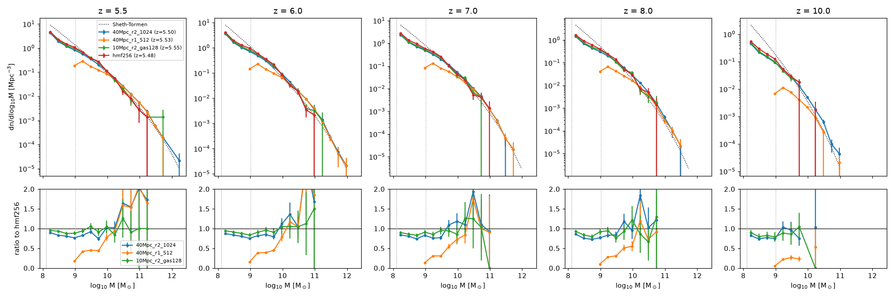

# Refined PM mesh: `pm_refine`

*Branch `pm-refine`, 2026-10-11. Goal: resolve halos of 1.3×10⁸ M☉
(20 particles of 6.4×10⁶ M☉) in the 40 Mpc/h, 512³ runs. That needs
Ndm = 1024 and a PM mesh fine enough for 1024³ particles.*

## 1. What it does

`pm_refine = r` (params.txt or `--set`, in `radhydro`, `pm_driver` and the
hydro-suite driver; default 1) solves gravity on a mesh of **Nm = r·Ngas**
cells per dimension instead of the gas grid. The DM uses the mesh exactly as
the original uses the gas grid. The only changes are the mesh size and the
particle-to-mesh ratio:

| | original (r = 1) | r > 1 |
|---|---|---|
| mesh | Ngas | Nm = r·Ngas |
| particles per mesh spacing | `N_dm_gas = Ngas/Ndm` (integer) | `N_dm_m = Nm/Ndm` (integer ≥ 1) |
| CIC, `link_dm`, `accelerate_dm` | on the gas grid | on the mesh (`x_dm_m`, `nmr`) |
| particle mass (mesh units) | (1−f_b)·N_dm_gas³ | (1−f_b)·N_dm_m³ |
| gas density on the mesh | the gas cell | every mesh cell gets the density of the gas cell it lies in (the cell's mass spread evenly over its r³ mesh cells) |
| force on the gas | `force(i,j,k)` | mean of `force` over the r³ mesh cells of the gas cell, divided by r (mesh cells → gas cells) |
| FFTs | serial FFTW plans | threaded FFTW (`libfftw3f_omp`), all threads |

* **Adjoint spread and average.** The gas spread and the force average are
  transposes of each other, and the DM CIC deposit and interpolation are as
  well. With the symmetric Green's function and the antisymmetric 4-point
  gradient, every mesh element's force on every other is equal and
  opposite. Total DM + gas momentum is therefore conserved to round-off, as
  in the original (§3).
* **Units.** Poisson's equation has the same constant in mesh units as in
  gas units (lap φ = (2a/3)δ). The mesh force is then r times the gas-unit
  force, hence the 1/r on the gas. DM velocities stay in DM-grid units
  (`/x_dm_m` in the kick). `amax_dm` is in mesh units, so the PM time step
  `dt_ap = 0.5/sqrt(amax_dm)` keeps particles to the same fraction of a
  mesh cell per step. That is √r shorter in time for the same physical
  acceleration, which is the right criterion for the finer mesh.
* **Ndm > Ngas.** `x_dm_gas = Ngas/Ndm` is now a real number (0.5 for
  Ndm = 2·Ngas), and is used only where DM velocities are converted to
  gas-grid or physical units: `summarize_dm`, and the halo velocities in
  `make_halo_units` (`src/halos.cpp`). It was integer division there, which
  gives 0 for Ndm > Ngas. `PMConfig::make` requires Nm to be a multiple of
  Ndm. With r = 1 this is the original check, Ngas a multiple of Ndm (Q10).
* **Domains.** `init_pm` scales the gas domains of `init_domain_gas` by r
  and keeps their order, so the deposit `cic_mass_assignment_all` stays
  deterministic, in the same domain order.
* **The power spectrum** (`Pk/pk.*`): DM on the mesh, gas on the gas grid
  (separate buffer); rows k = 2..Hgas+1 as before.
* **`pm_driver`** writes `phi.bin` on the mesh (Nm³).
* **Checkpoint.** The PM mesh holds no state between steps (only the
  particles do, and they are checkpointed with their count checked), so the
  checkpoint format is unchanged. `pm_refine` is not stored: like
  `c_reduced`, it can be changed at a restart. The checkpoint for Ndm > N is
  tested (`restart_smoke_pm_refine`).

**pm_refine = 1 is byte-identical to before.** Every r > 1 branch is
separate (`gas_force`, `calc_density_field`), r = 1 uses the original
serial FFT plans and never initialises FFTW's threads, and all other
expressions reduce to the original ones exactly (`nmr = ngasr`,
`x_dm_m = N_dm_gas`, `Nmcell = Ncell`). Checked: the PM, hydro and
full-loop stored references, the live Fortran comparisons, and the rest
of the fast and nightly suites (§3).

## 2. Initial conditions

`tools/ics/make_ics.py` accepts Ndm > Ngas (a multiple or a divisor of
Ngas). The gas fields keep only the modes |m| < Ngas/2 of the particles'
field, since the gas grid cannot hold the rest.

`--phases-from-ndm N` (zeldovich) takes the white-noise modes |m| < N/2 from
an Ndm = N run with the same seed (the same draws, rescaled by
(Ndm/N)^{3/2}). The rest comes from an independent stream. The large scales
then match the N³ run: the 1024³-particle ICs of the 40 Mpc/h box
(`--seed 7 --phases-from-ndm 512`) have the gas field of the 512³ production
ICs to 4.5×10⁻⁸ of its rms (float round-off of the larger FFT).

`tools/production/make_production.py --pm-refine 2` writes `pm_refine = 2`,
`Ndm = 2N` and those ICs. `--data-files dm` writes only the particles at
the zdata1 outputs (26 GB per output at 1024³).

1024³ ICs: 9 min 52 s and 293 GB on one node (numpy, single-threaded FFTs).

## 3. Tests

All in the fast suite (labels `pm`, `threads`, `restart`).

**Single-particle force** (`pm_refine_unit`, `tests/test_pm_refine.cpp`). The
test puts one particle (all the DM mass) in a 32³ gas box with no gas. It
compares the CIC-interpolated mesh force at 400 random points per distance
with the exact periodic force of a point mass: an Ewald sum, with the mean
density subtracted as the PM does. The table gives the rms of
|F − F_Ewald|/|F_Ewald|:

| d [gas cells] | r = 1 | r = 2 | r = 4 |
|---|---|---|---|
| 0.5 | 0.92 | 0.52 | 0.21 |
| 1 | 0.55 | 0.18 | 0.036 |
| 2 | 0.18 | 0.028 | 0.011 |
| 4 | 0.026 | 0.0091 | 0.0027 |
| 8 | 0.0094 | 0.0026 | 0.00075 |

The error depends only on the distance in **mesh** cells. pm_refine = 2 at
d/2 matches pm_refine = 1 at d (0.028 against 0.026 at 4 mesh cells, 0.0091
against 0.0094 at 8). The PM force is good to ~3% at 4 mesh cells and ~1%
at 8 (the 4-point gradient and the CIC kernel of the original). The
self-force on the particle is ≤ 7×10⁻⁷ of the force at one gas cell.

**Gas force.** The same particle's force on the gas cells, from
`calc_kick` (v_gas += F dt), against Ewald at the cell centres 3–8 gas
cells away: rms 1.6×10⁻² for r = 1 and 4.8×10⁻³ for r = 2. This checks the
1/r unit conversion and the average.

**Momentum conservation** (one kick from rest, random particles and gas):
|ΣP|/Σ|p| ≤ 3×10⁻⁹ for r = 1, 2, 4, Ndm = Ngas/2 … 4·Ngas, and every kick
(MF, non-MF, unsplit). `pm_physics_check.py momentum` also checks every
step of the `pm_driver` runs of `zeldovich_3d_r2`, `pancake_x_r2` and
`pancake_z_nomf_r2` (Ngas = 16, Ndm = 32, pm_refine = 2).

**The refined mesh is exact** (`pm_r2_twin_pancake_x`). The x pancake
with uniform frozen gas, run with pm_refine = 2 on a 16³ gas grid, moves
every particle bit for bit as the original does on a 32³ gas grid with the
same particles. The two runs have the same mesh, the same density and the
same time steps for all 25 steps. A uniform gas has no force at k ≠ 0, so
only the mesh matters.

**Zel'dovich pancakes (gravity only).** `pancake_x_r2` and
`pancake_z_nomf_r2` against the exact solution up to D/D_c = 0.93: mode
errors 4.5×10⁻³ (x) and 1.7×10⁻² (v); per-particle errors 4.0×10⁻² (x)
and 5.4×10⁻² (v). The per-particle x error is the original's own number at
one particle per mesh cell (the twin above gives exactly 4.0×10⁻²; the
committed `pancake_x` has one particle per 2 mesh cells and gives
3.2×10⁻²), so these tests use tol-x 0.045.

**Zel'dovich pancake with gas and DM** (`tools/analysis/pm_refine_pancake.py`;
the hydro-suite problem of `docs/hydro_tests.md` §6: λ = box = 32 Mpc/h,
caustic at z = 5, gas and DM on the exact growing mode). It compares
pm_refine = 1 (Ndm = N) with pm_refine = 2 (Ndm = 2N), for both kicks
(legacy: `calc_kick`, MF; unsplit: `calc_kick_unsplit`), against the exact
solution before the caustic. Errors at z = 7 / 5.5 (z = 5.5 is 0.08 in a
from the caustic):

| N | scheme | r | gas L1 ρ | gas L1 v | DM max x | DM max v | DM mode v |
|---|---|---|---|---|---|---|---|
| 32 | legacy | 1 | 3.1e-2 / 1.1e-1 | 1.1e-2 / 2.5e-2 | 2.6e-2 / 2.8e-2 | 3.5e-2 / 4.0e-2 | 6.3e-3 / 1.2e-2 |
| 32 | legacy | 2 | 2.3e-2 / 9.9e-2 | 7.7e-3 / 2.2e-2 | 1.3e-2 / 1.4e-2 | 1.7e-2 / 1.7e-2 | 1.6e-3 / 4.0e-3 |
| 32 | unsplit | 1 | 1.5e-2 / 1.0e-1 | 9.6e-3 / 1.9e-2 | 2.5e-2 / 2.7e-2 | 3.4e-2 / 4.1e-2 | 6.6e-3 / 1.2e-2 |
| 32 | unsplit | 2 | 1.2e-2 / 9.8e-2 | 6.7e-3 / 1.5e-2 | 1.3e-2 / 1.3e-2 | 1.7e-2 / 1.8e-2 | 2.0e-3 / 4.1e-3 |
| 64 | legacy | 1 | 1.6e-2 / 4.4e-2 | 2.7e-3 / 8.3e-3 | 1.3e-2 / 1.3e-2 | 1.7e-2 / 1.6e-2 | 1.4e-3 / 2.9e-3 |
| 64 | legacy | 2 | 1.4e-2 / 4.0e-2 | 1.8e-3 / 7.4e-3 | 6.3e-3 / 6.7e-3 | 8.4e-3 / 8.1e-3 | 3.7e-4 / 9.0e-4 |
| 64 | unsplit | 1 | 1.1e-2 / 4.5e-2 | 2.7e-3 / 6.0e-3 | 1.3e-2 / 1.4e-2 | 1.7e-2 / 1.7e-2 | 1.5e-3 / 3.0e-3 |
| 64 | unsplit | 2 | 5.4e-3 / 4.0e-2 | 1.6e-3 / 4.8e-3 | 6.3e-3 / 6.6e-3 | 8.3e-3 / 8.0e-3 | 5.0e-4 / 1.1e-3 |
| 128 | legacy | 1 | 6.6e-3 / 1.2e-2 | 8.0e-4 / 2.2e-3 | 6.3e-3 / 6.7e-3 | 8.5e-3 / 8.2e-3 | 3.5e-4 / 6.8e-4 |
| 128 | legacy | 2 | 3.7e-3 / 9.0e-3 | 4.7e-4 / 1.9e-3 | 3.1e-3 / 3.3e-3 | 4.1e-3 / 3.9e-3 | 1.1e-4 / 2.0e-4 |
| 128 | unsplit | 1 | 5.7e-3 / 1.2e-2 | 6.9e-4 / 1.7e-3 | 6.4e-3 / 6.8e-3 | 8.6e-3 / 8.3e-3 | 3.9e-4 / 7.6e-4 |
| 128 | unsplit | 2 | 2.6e-3 / 9.8e-3 | 4.1e-4 / 1.5e-3 | 3.1e-3 / 3.3e-3 | 4.1e-3 / 4.0e-3 | 1.5e-4 / 2.8e-4 |

* **The DM errors of pm_refine = 2 at gas grid N are those of the original
  at 2N** (max x 1.3e-2 for N = 32, r = 2, and for N = 64, r = 1;
  6.6e-3 for N = 64, r = 2, and 6.7e-3 for N = 128, r = 1). They halve at
  fixed N.
* **The gas is as good or better at the same N**, with both kicks. Gas
  L1 v at z = 7 is 7.7e-3 against 1.1e-2 at N = 32 (legacy), and 1.6e-3
  against 2.7e-3 at N = 64 (unsplit). The gas now falls in the better DM
  potential. Near the caustic (z = 5.5) the gas density error is set by
  the gas grid: 9.9e-2 against 1.1e-1 at N = 32.
* `--check` (pm_refine = 2 within 20% + 2e-3 of pm_refine = 1 in every
  measure, N, scheme and z) passes. Wall times (8 threads): r = 2 costs
  1.1–1.4× r = 1 at the same N.

**Linked lists.** The parallel `link_dm` of pm_refine > 1 builds exactly
the serial lists (`ll`, `hoc`, `hoc_cpu`): 64³ random and clustered
particles (`pm_refine_unit`).

**Thread-count independence.**
- `fft_threads`: threaded FFTW forward and backward transforms are
  byte-identical for 1, 2, 3, 4, 8 and 16 threads at 64³. On a node they
  are also identical for 1–192 threads at 512³ and 1–192 at 1024³.
- `thread_full_pm_refine`: the full `radhydro` loop on
  `tests/problems_full/onthefly_r2` gives byte-identical outputs (fields,
  DM, P(k), halos, RT) with 1, 2 and 4 threads. That problem has gas 16³,
  pm_refine = 2, Ndm = 32, FoF sources, the RT and unsplit hydro.

**Restart with Ndm > N** (`restart_smoke_pm_refine`). Resuming
`onthefly_r2` from the step-22 checkpoint reproduces every output file of
the uninterrupted run byte for byte. The 40 Mpc/h validation run was
preempted twice on `ckpt-g2` and resumed from its checkpoints.

**Default unchanged.** The fast suite gives 115/125 with the threaded FFTW
library. The 10 failures are the known stored-RT-reference mismatches on
this platform (`ref_*lognormal_16src*`, `ray_dump_*smallbuf`, `ref_c01_*`),
the same list as on `main`. Every PM and hydro stored reference
(`pm_ref_*`, `hydro_ref_*`) and every live Fortran comparison passes. The
nightly suite passes 22/22 (job 41729052, 54 min): the full-loop
stored references `full_ref_{legacy,onthefly}_rt{0,1}`, the live
Fortran full-loop comparison, and the hydro-suite full tier. It ran on the
code before the r > 1 speed-ups of §4, which do not touch the r = 1
paths.

### Halo mass function: 40 Mpc/h with 1024³ DM



Runs (`$RUNS = /gscratch/astro/mcquinn/radhydro/runs`). All have on-the-fly
FoF (b = 0.2, ≥ 20 particles) every step from z = 15, no sources
(`tvir_min = 1e30`), and Zel'dovich ICs at z = 100, seed 7:

| run | box | gas | Ndm | pm_refine | mesh spacing | m_p [M☉] | hydro |
|---|---|---|---|---|---|---|---|
| `hmf512_40mpc_r2` | 40 | 512³ | 1024³ | 2 | 39 kpc/h | 6.38e6 | unsplit |
| `hmf512_40mpc_r1` | 40 | 512³ | 512³ | 1 | 78 kpc/h | 5.10e7 | unsplit |
| `hmf256` (reference) | 10 | 256³ | 256³ | 1 | 39 kpc/h | 6.38e6 | legacy |
| `hmf_ctrl10/B_n128_r2_legacy` | 10 | 128³ | 256³ | 2 | 39 kpc/h | 6.38e6 | legacy |
| `hmf_ctrl10/C_n256_r1_unsplit` | 10 | 256³ | 256³ | 1 | 39 kpc/h | 6.38e6 | unsplit |
| `hmf_ctrl10/D_n128_r2_unsplit` | 10 | 128³ | 256³ | 2 | 39 kpc/h | 6.38e6 | unsplit |

The two 40 Mpc/h runs share their large scales (`--phases-from-ndm 512`).
The 10 Mpc/h controls B–D have exactly the DM ICs of `hmf256` (byte-
identical `xv_dm.init`) and differ from it only in the gas grid,
pm_refine and the hydro scheme.

```
python3 tools/analysis/hmf_runs_compare.py --interp \
  --run 40Mpc_r2_1024:$RUNS/hmf512_40mpc_r2/run/halos:40:1024 \
  --run 40Mpc_r1_512:$RUNS/hmf512_40mpc_r1/run/halos:40:512 \
  --run 10Mpc_r2_gas128:$RUNS/hmf_ctrl10/D_n128_r2_unsplit/run/halos:10:256 \
  --run hmf256:$RUNS/hmf256/run/halos:10:256 --ref hmf256 --z 5.5 6 7 8 10 \
  --out docs/figures/pm_refine_hmf.png --table docs/figures/pm_refine_hmf.txt
```

`--interp` interpolates each run's dn/dlogM to the requested z between its
two nearest catalogs (the runs' time steps differ). Ratios to `hmf256`
(table: `figures/pm_refine_hmf.txt`):

| log M [M☉] | particles (6.4e6 M☉) | 40 Mpc/h, r = 2, z = 5.5 / 6 / 7 / 8 | 40 Mpc/h, r = 1 | 10 Mpc/h, r = 2, gas 128³ |
|---|---|---|---|---|
| 8.23 | 27 | 0.89 / 0.87 / 0.84 / 0.86 | — (< 20 particles) | 0.95 / 0.95 / 0.90 / 0.93 |
| 8.48 | 47 | 0.83 / 0.84 / 0.81 / 0.75 | — | 0.94 / 0.91 / 0.86 / 0.84 |
| 8.73 | 84 | 0.81 / 0.80 / 0.74 / 0.73 | — | 0.88 / 0.88 / 0.83 / 0.80 |
| 8.98 | 150 | 0.76 / 0.75 / 0.83 / 0.77 | 0.17 / 0.15 / 0.14 / 0.10 | 0.88 / 0.84 / 0.91 / 0.92 |
| 9.23 | 270 | 0.83 / 0.82 / 0.76 / 0.83 | 0.42 / 0.39 / 0.31 / 0.28 | 0.94 / 0.91 / 0.85 / 0.95 |
| 9.48 | 470 | 0.92 / 0.85 / 0.77 / 0.84 | 0.45 / 0.39 / 0.31 / 0.31 | 1.05 / 0.96 / 0.95 / 0.76 |
| 9.98 | 1500 | 1.03 / 1.12 / 1.19 / 0.95 | 0.78 / 0.78 / 0.73 / 0.55 | 1.04 / 1.05 / 0.86 / 1.22 |

* **pm_refine = 2 resolves 1.3×10⁸ M☉ halos in the 40 Mpc/h box.** Down to
  20 particles its mass function is 0.73–0.89 of the 10 Mpc/h 256³
  reference at the same particle mass and mesh spacing, with no extra
  falloff toward 20 particles. With pm_refine = 1 the same box has no
  halos below 10⁹ M☉ (20 particles of 5.1e7). At 10⁹–10^9.5 M☉ it holds
  only 10–45% of the reference (the PM deficit below ~150 particles,
  `docs/hmf_validation.md`), against 75–92% with pm_refine = 2.
* **The remaining 10–25% comes mostly from the gas grid, not from the
  refined mesh.** With the same DM ICs, coarsening the gas from 256³ to
  128³ under the same 256³ mesh (control D/B against `hmf256`) removes
  5–20% of the 20–150-particle halos. That is about 17% of the mass (the
  gas) smoothed over 2 mesh cells, so less of it collapses into the
  smallest halos. The hydro scheme alone changes little: C/`hmf256` =
  0.99–1.11. The refined mesh moves the DM exactly (the twin test).
  Against control D, the 40 Mpc/h run is 0.84–0.94 at z = 5.5–10,
  **flat from 20 to ~500 particles**, i.e. no resolution signature: the
  big box finds the same halos per unit mass as the small box built the
  same way. The flat offset is box-to-box sample variance: the
  10 Mpc/h seed-7 box is high against Sheth–Tormen at all masses
  (`docs/hmf_validation.md`).
* The Poisson errors in the table treat the runs as independent. The
  10 Mpc/h runs share their ICs and largely their halos, so their ratios
  are much better determined than the ±.
* Above ~10^9.7 M☉ (> 800 particles) all runs agree within the noise of
  the small box; the 40 Mpc/h runs extend the function to 10^11.5–10^12 M☉.
* **Abundance matching.** The 1024³ particle mass equals the 10 Mpc/h
  256³ one, so the FoF fit `data/hmf/fof_256_10mpc.txt` and
  `data/uv_lf/am_params_256_10mpc.txt` describe pm_refine = 2 runs better
  than the 128³ ones the 512³ production uses. Their low-mass deficit is
  10–25% larger, from the gas grid, as above. Not changed here; see
  "Open".

## 4. Cost

40 Mpc/h, gas 512³, one klone `cpu-g2` node (2×96 cores, 192 threads), no
RT. Per hydro step at z ≈ 6, in seconds:

| | hydro | PM | FoF | summaries | total | steps to z = 5.5 | peak RSS |
|---|---|---|---|---|---|---|---|
| pm_refine = 1, 512³ DM | 12.9 | 3.3 | 5.6 | 6.6 | 29 | 49 (21 min) | 105 GB |
| pm_refine = 2, 1024³ DM, first build | 10–13 | 30 | 29–30 | 10.8 | 80–84 | 55 | 173 GB |
| pm_refine = 2, final code (measured, one step) | 10–13 (22 after a restart) | 12.8 | 31.9 | 5.6 | ~60 (72 after a restart) | 55 | 174 GB |

The final-code row is one step restarted from the run's last checkpoint
(`$RUNS/pm_refine_timing`). The hydro after a restart is slower
(22 s against 10–13 s in the uninterrupted run, the same with
pm_refine = 1 restarts; probably the NUMA placement of the arrays read
from the checkpoint). At a zdata1 output the step also spends 20 s in
`calc_power_spectrum` (`calc_pk_3d` over the 1024³ mesh is serial) and
24 s writing the 26 GB `DM/xv_dm`. The first validation build used serial FFTs (`RADRAY_FFTW` pointed at the
serial library; §5) and none of the speed-ups below. The algorithm is the
same, so its halos stand. The final PM stages on the 1024³ ICs
(`pm_bench`, 192 threads, s per step; first build in parentheses): drift
0.2 ×2, `link_dm` 0.5 (4.4), density 0.9, gravity 0.6 (13.3), kick 6.5–8.8
(8.5–9.3), `summarize_dm` 0.17 (5.3). The speed-ups apply to
pm_refine > 1 only:

* **FFT threads capped at 32.** FFTW's OpenMP 1024³ transforms take
  0.28 s with 32 threads but 3–10 s with 48–192, and the output is
  identical for any count.
* **`link_dm` builds its row chains in parallel** (32 chunks, joined per
  row in ip order). The lists are identical to the serial build (unit
  test).
* **The mesh force is stored once per mesh cell** (`PMState::fmesh`,
  3 floats per cell, 12.9 GB at 1024³) instead of being re-evaluated
  8 times per particle. The values are identical.
* **`summarize_dm`, `arms`, `vrms`** (diagnostics only) are summed over
  fixed chunks or planes. They are thread-count independent, but no longer
  in the serial order.

Steps: `dt_ap = 0.5/sqrt(amax_dm)` is in mesh units, so the PM limit is √2
shorter: 55 hydro steps against 49 from z = 100 to 5.5.

**In the production configuration (with RT)** the 512³ runs spend most of
each step in the RT: 6856 s of the 8772 s of the first f_esc = 0.1 leg,
and more after overlap. pm_refine = 2 adds about 35 s per step, mostly the
on-the-fly FoF on 8× more particles (32 s against 5.6 s), plus 10 s of PM.
It also adds about 70 GB of memory (174 GB peak with no rays): xv 26 GB, ll and hoc 17 GB, mesh
force 13 GB, density 4 GB, FoF work arrays. The 512³ production peaked at
200 GB, so pm_refine = 2 needs `--mem` ≳ 300G rather than the 256G of
`docs/cluster.md`. Each checkpoint holds 26 GB more particles, and each
`DM/xv_dm.*` output is 26 GB (`data_files = dm` or `norays` writes them at
every zdata1 redshift).

## 5. Notes

* **Open:**
  * whether production should switch the abundance matching to the 256³
    fit (or a fit to these 1024³ catalogs);
  * whether the FoF should run less often than every step at 10⁹
    particles;
  * a production 512³ run with pm_refine = 2 (`make_production.py
    --pm-refine 2`; it needs `--mem` ≳ 300G).

* `calc_pk_3d` (P(k) at the zdata1 outputs) is a serial loop: 20 s on
  the 1024³ mesh. It is not parallelised here because its bins are double
  sums whose order the original fixes.
* **Q14 (preserved).** The DM speed and acceleration diagnostics of the
  `calc_timestep` log (`vmax_dm`, `vrms_dm`, `amax_dm`, `arms_dm`) are
  converted to km/s with the gas-grid units, but they are in DM-grid and
  mesh units. They are off by x_dm_gas (2 in the original's default
  Ndm = Ngas/2) and by r for the accelerations. They are diagnostics only;
  the time step uses the grid values.
* `env.sh` now selects `fftw-3.3.10-float-omp` (the same SSE2 build with
  `--enable-openmp`) unless `RADRAY_FFTW` is already set. A shell that
  sourced an older `env.sh` still has the serial prefix in `RADRAY_FFTW`,
  and CMake caches the library path. Build in a fresh directory, or pass
  `RADRAY_FFTW` explicitly. CMake reports "Threaded FFTW: …", and
  `radhydro` prints "(PM mesh …, threaded FFTW)" or "serial FFTW". Without
  the threaded library, pm_refine > 1 still works, with serial FFTs.
