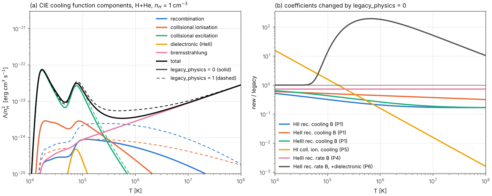

# Port notes: Fortran RadHydro RT → C++ `radray`

This document covers phase 1, the faithful port. It records:

* which C++ function implements which Fortran routine;
* every place where the Fortran was ambiguous and had to be interpreted;
* everything in the original that looks like a bug. Each such behaviour is
  preserved unless stated otherwise, and is flagged here.

**Validation result:** the C++ port agrees **bit for bit** with the gfortran
harness (`reference/harness`, one thread) on all five problems in
`tests/problems`, in all four combinations of the `legacy_rt` (§5a) and
`legacy_physics` (§5b) switches.

* 700/700 field files (all steps) are byte-identical.
* `stats.txt` and `rt_stats.txt` agree exactly for all 10 steps, including
  all 64 `ngam_ray` thresholds.
* The merge path is exercised: `lognormal_16src_smallbuf` merges from step 5.

The CTests `ref_*` check this continuously against
`reference/harness/outputs`. The CTests `ref_legacy0_*` check it against
`reference/harness/outputs_legacy_rt0`, with the fixes of §5a switched on.
The CTests `ref_fixed_*` check the recommended configuration,
`legacy_rt = 0` + `legacy_physics = 0`, against
`reference/harness/outputs_legacy_rt0_phys0`.

## 1. Routine map

| Fortran | C++ |
|---|---|
| **physical_constants.f90, cosmo_parameters.f90** | `include/radray/constants.hpp` (`radray::pc`, `radray::cp`, `radray::folded`) |
| **radhydro_global.f90** sizes | `Config` (`config.hpp`). `Ngas=Nrt=N` is set at run time. `Nray_max = nray_max_factor*N^3` |
| radhydro_global.f90 types | `RTGrid` (rt_grid_type, SoA) and `GasGrid` (u_gas, w_gas) in `grid.hpp`. `Ray`, `RayStat` and `RayState` in `rays.hpp`. `RTStat` in `simulation.hpp` |
| radhydro_global.f90 module variables | `Simulation` (`simulation.hpp`), with `SimClock`, `Units`, `RayState`, `Domains`, `RTStat` |
| **radhydro.f90** `init_variables` | `init_variables` (cosmology.cpp) |
| radhydro.f90 `calc_timestep` (RT part) | `calc_timestep` (cosmology.cpp), with a fixed `da_sim` |
| radhydro.f90 `radhydro` (clock part) | `advance_clock_hydro_step` (cosmology.cpp) |
| radhydro.f90 main loop | `apps/rt_driver.cpp` |
| **cosmo_tools.f90** `calc_sim_var` | `calc_sim_var` |
| cosmo_tools.f90 `calc_dt_from_da`, `calc_da_from_dt` | same names |
| **domain_tools.f90** `init_domain_rt` / `set_domain_rt` / `end_domain_rt` | same names (rt_tools.cpp) |
| **halo_tools.f90** `calc_halo` / `add_halo_to_rt` (and the `link_halo` order) | `calc_halo` (rt_tools.cpp) |
| **general_tools.f90** `interpolate` (`'lin'` branch) | `interpolate_lin` (ray_tracing.cpp) |
| general_tools.f90 `index_sort_r4_i4` | `std::stable_sort` in `make_index_gas_rt` (only reached when `N_rt_gas > 1`) |
| **rt_rates.f90** `calc_atomic_rates`, `photoion_sigma` | same names (rt_rates.cpp). `METAL` is off |
| **ray_tracing_tools.f90** `init_ray_tracing` | `init_ray_tracing` + `RayState::init` |
| `ray_tracing_1`, `ray_source`, `ray_cast_split`, `ray_cast_merge` | same names |
| `ray_tracing_3` | same name |
| `ray_cast_1`, `ray_cast_3` (the `#else RAYFAST` versions) | same names |
| `ray_segment` | same name |
| `ray_create`, `ray_remove`, `ray_insert_head`, `ray_insert_tail` | same names |
| `lside_from_radius`, `nside_from_radius`, `nray_from_nside`, `rmin_from_nside`, `rmax_from_nside` | same names |
| `ray_redshifting` / `redshift_ray` (the `#else FREQ1` version) | `ray_redshifting` |
| `ray_buffer_allocate` / `_supplement` / `_deallocate` | same names |
| HEALPix 3.11 `pix_tools`: `pix2vec_nest`, `vec2pix_nest`, `mk_pix2xy`, `mk_xy2pix1` | `healpix::pix2vec_nest`, `healpix::vec2pix_nest` (healpix.cpp) |
| **rt_tools.f90** `init_rt` | `init_rt`. `init_simulation` bundles the init sequence |
| `radiative_transfer`, `prep_rt` (`calc_rt_i`), `post_rt` (`calc_rt_f`, `calc_ray_f`) | same names. The shared gas-averaging code is in `average_gas`, `gas_state_from_avg` and `store_gas_state` |
| `rt_step_1` (`calc_rt_1`, `calc_ray_1`), `rt_step_2`, `rt_step_3` | same names |
| `radiative_physics` (`photo_source`, `photo_cell`, `make_index_gas_rt`) | `radiative_physics`. `photo_source` and `photo_cell` are inlined and marked with comments |
| `summarize_rt` | `summarize_rt` (to stdout) |
| unit 201 `ray.log` | `<outdir>/ray.log` (same content, not byte-identical formatting) |

### Not ported

These do not affect the RT state or the spec outputs:

* `make_data_2d` and `write_data_3` (2-D slices);
* `calc_gas_3` (the `zreion` reionisation redshift);
* the `Log/nside_of_r.dat` and `r_of_nside.dat` dumps;
* `random_seed` (the random branch is `if (.false.)`);
* `mp_unit` and `Msun_unit` (particle units);
* the `timing` bookkeeping.

## 2. Index conventions

* RT cells are addressed with Fortran 1-based `(irt,jrt,krt)` everywhere.
  `RTGrid::cell(i,j,k)` maps them to the 0-based linear index
  `(i-1)+N*((j-1)+N*(k-1))`, with i fastest as in Fortran.
* Multi-component fields keep the component index fastest:
  `ngam(f,cell) -> ngam[cell*5+f-1]`. This matches the Fortran derived type
  and the output format, so the output is a plain memory dump.
* Ray storage indices `ir` are 1-based. Slot 0 is a dummy, and `0` means
  "no ray" in the chains, as in Fortran. `htoc_ray(m,cell)` with m = 1..4 is
  `RTGrid::htoc_ray(m, c)`.
* Loop counters over photon groups, components and segments are 0-based in
  C++. Wherever Fortran used a literal index (for example `ngam_ray(16)`,
  `alpha_rec(4,iT)`), the C++ keeps the Fortran number and converts it
  explicitly (`ngam_ray[16-1]`, accessors that take 1-based arguments).

## 3. Precision and Fortran semantics (how faithfulness was achieved)

* `real(4)` maps to `float` and `real(8)` to `double`. Every Fortran
  expression is reproduced with the same operation order and the same
  promotion points. Examples:
  * `ray%r**2` (merge) and `ray%ngam*ray%nu` (merge) are float products.
  * `sum(u(2:4)**2)/u(1)/2` in `photo_cell` is computed entirely in float.
  * `1-rt_grid%fgam` in `ray_cast_3` is a float subtraction.
  * `(/irt,jrt,krt/)-0.5` is float.
  * `sum()` of a `real(4)` array accumulates in float, left to right, from 0.
* **Single-precision literals.** Literals such as `0.99`, `1E-6`, `1E-3`,
  `0.98` and `1E-9` are single precision in Fortran. They are written as
  `0.99f` and so on and promoted exactly where Fortran promotes them.
  Several `real(8), parameter`s are initialised from single literals:
  * `omegam = 0.27` is really `(double)0.27f`, and so are `omegab`,
    `hubble0`, `XHy`, `YHe`, `freq_init`, `fResc`, `eSF`, `eSN` and
    `lgT_del`;
  * `HI_eV = 13.60` (and the HeI and HeII equivalents);
  * `sfr_min = ngam_min = 1E-6`, `fgam_min = seg_min = 1E-4`;
  * `gamma_ideal = 5./3` is a float division.

  Exponent literals in `rt_rates.f90` (`x**1.503`) are float literals
  promoted to double.
* **Constants folded at compile time.** gfortran folds some expressions with
  correctly rounded MPFR:
  * `10**25.2` in `pop2_init` (the whole expression is real(4));
  * `Tcmb0**4` in `omegar`;
  * `log10(1.01)` (real(4)) in `rt_step_1`;
  * `log(4.)` (real(4)) in `lside_from_radius`;
  * `1E3*(ob*h0**2)**0.4` in `calc_sim_var`;
  * `1D1**lgD_min`.

  Correct rounding can differ from libm by one ulp, so these are hardcoded as
  hex-float literals taken from a gfortran dump
  (`tests/fortran_consts/dump_consts.f90`, output in `expected_consts.txt`).
  All the other derived constants are computed in C++ and checked against
  the same dump by the `fortran_semantics` test.
* **Integer powers** `x**2`, `x**3`, `x**4` are expanded the way gfortran
  does it: `x*x`, `(x*x)*x`, `(x*x)*(x*x)`. Real powers use `pow`.
* **`INT`, `NINT`, `FLOOR`, `CEILING`, `MOD`** are implemented in
  `fortran.hpp`:
  * `INT` truncates toward zero. NaN and out-of-range values give
    `INT32_MIN`, as gfortran's `cvttsd2si` does. This matters for `log10(0)`
    in `calc_ray_1`.
  * `NINT` rounds half away from zero.
  * `MOD` for integers is C++ `%`. For reals it is `fmod`.
* **libm.** The C++ calls the same glibc `exp`, `expf`, `log`, `log10`,
  `pow`, `sqrt`, `atan2`, `sin` and `cos` that the gfortran build calls. The
  build uses `-ffp-contract=off -fno-fast-math`, so no FMA and no
  reassociation.
* **Linked lists and processing order are reproduced exactly:**
  * head insertion of source rays;
  * tail insertion of rays that move cells;
  * the `htoc_ray(1:2)` snapshot versus the live `htoc_ray(3:4)` (rays that
    are appended during a pass are not processed again in that pass);
  * the per-cone `merge1` lists in chain order;
  * the domain order. With `Ncpu=1`, `init_domain_rt` gives `n1 = 2`
    (8 domains), and `set_domain_rt` returns them in the order 1..8 every
    pass. Inside each domain the loops run k, j, i.
* **Ray storage pool.** It is emulated exactly: the `ray_index` permutation,
  `Nray`, `Nrbuf`, `ifree` with LIFO reuse, the `nrbuf/4` refill in
  `ray_create` and spill in `ray_remove`, and the
  allocate/supplement/deallocate logic with `Ncpu=1`. This is required, not
  cosmetic; see bug B1. It also makes the storage indices identical to the
  Fortran ones. Only the touched part of the pool is materialised: capacity
  for `Nray_max` rays is reserved but untouched. Positions above the
  high-water mark are implicitly the identity and zero, which is equivalent.
  Since Phase 1d the links and `ray_index`/`ifree` are stored as int32
  (`Nray_max < 2^31` is checked), so a ray is 88 B instead of 96 B; the
  values are those of the Fortran int8 and no result changes
  (`docs/parallel.md` §4).
* **HEALPix.** It is a transcription of the HEALPix **3.11 Fortran**
  `pix2vec_nest`/`vec2pix_nest` (32-bit path, `nside <= 8192`), which is the
  version the original Makefile links. It is not a transcription of
  healpix_cxx/healpy, whose floating-point expressions differ:
  * healpy's `pix2vec` differs by up to 1.1e-15;
  * healpy's `vec2pix` can disagree right at pixel boundaries.

  Against healpy, 1e6 random vectors (nside 1..8192, plus special
  directions) give identical pixels.

## 4. Interpretations of ambiguous Fortran

1. **Time stepping in the driver.** For each step the driver does what the
   `radhydro.f90` main loop does without hydro or PM:
   * `calc_sim_var`;
   * `calc_timestep`. Both branches reduce to `da_sim` fixed, then
     `calc_dt_from_da` and `dt_sec = dt_yr*yr2sec`, then the RT step part;
   * the two half-step clock updates, each followed by `calc_sim_var`;
   * `calc_halo`, then `radiative_transfer`, which rewinds the clock by
     `da_sim` and re-advances it by `da_sim/nstep_rt` per substep;
   * `summarize_rt`.

   The initial state is `z = z_init` and `a = 1/(1+z_init)`, with `year`
   from the `init_variables` formula. This agrees with the harness.
2. **Sources.** Each line of `sources.txt` is one `source_type`, with `L` and
   `sfr` rounded to `real(4)`. `link_halo` reverses the per-cell order twice,
   so each cell's sources are summed in input order, in double, and stored
   as float.
3. **`gfortran MAX/MIN` with mixed kinds**, for example
   `max(u(1),Dgas_min)`. Both arguments are promoted to double, and the
   result is stored back to float where the left-hand side is real(4).
4. **`nray_active`** in `stats.txt` is `Nray - ray_save%nfree` after
   `post_rt`, which is `Nray`, because the free buffers have been returned.
   **`ngam_rays_total`** is summed in storage order over slots with
   `nside > 0` after `post_rt`. At that point dead slots have been zeroed,
   so these are the live rays. **`ncst1`, `nmrg1`, `nspl1` and `ndel1`** are
   the values of the last RT substep (`ray_save`).
5. **`int(Nray_max/64.)` and `j*int(...)`** in `rt_step_1` are int32 in
   Fortran. With `legacy_rt = 1`, the C++ keeps the real(4) division but
   uses int64 for the product. This is identical unless
   `64*N^3 > 2^31`, roughly N ≥ 323, where the Fortran overflows (bug B9).
   With `legacy_rt = 0`, both codes use exact int64 `j*(Nray_max/64)`.

## 5. Bugs and quirks in the original (preserved unless noted)

B1–B4, B8 and B9 are preserved only with `legacy_rt = 1` (the default). With
`legacy_rt = 0` they are fixed in both codes; see §5a.

* **B1. Dead rays steer the split/merge thresholds.** `ray_remove` only
  unlinks a ray and pushes its index onto the free list. `calc_ray_1` scans
  every storage slot with `nside > 0`. Rays that were freed during the
  current hydro step are therefore counted in `ngam_pdf`, and so in
  `ngam_ray`, until `ray_buffer_deallocate` zeroes them in `post_rt`.
  Preserved by emulating the pool exactly. `ngam_avg/Nray` divides by the
  pool count, but it is only logged. **Fixed with `legacy_rt = 0`**:
  `ray_remove(...,flag=.true.)` clears the freed slot.
* **B2. `ngam_ray(j)` is never reset** while the ray count is too small to
  reach `j*Nray_max/64`. It keeps its stale value, or its initial 0. The
  consequences:
  * with the default `Nray_max = 64 N^3`, merging is effectively disabled;
  * with `ngam_ray(32) = 0`, every ray with `dr < 0` is split.

  Preserved. **Fixed with `legacy_rt = 0`**: `ngam_ray` is zeroed before
  the thresholds are recomputed.
* **B3. `rt_grid%dx` is never reset.** `calc_rt_1` zeroes `nu`, `ngam`,
  `fgam`, `gamma` and `lambda`, but not `dx`. The new photon-weighted
  directions are added on top of the previous substep's unit vector.
  `radiative_physics` then normalises the sum, and that direction is used
  by `make_index_gas_rt` when `N_rt_gas > 1`. Preserved. **Fixed with
  `legacy_rt = 0`**: `dx` is reset in `calc_rt_1`.
* **B4. `tau` is zero in neutral cells during the first RT call.**
  `init_rt` zeroes `tau`. `calc_rt_1` updates it only in cells with
  `fHI < 0.99` or `fHeI < 0.99`, and `calc_rt_f` (all cells) runs only in
  `post_rt`. During the first hydro step:
  * rays are attenuated only through `fgam`;
  * `ray_cast_1` spreads photons over segments in proportion to path length;
  * a source in a neutral cell always emits rays, instead of depositing
    photons locally.

  Also, a cell that stays neutral keeps the `tau` of the last `post_rt`
  for a whole hydro step. Preserved. **Fixed with `legacy_rt = 0`**:
  `calc_rt_1` updates `tau` in every cell.
* **B5. Out-of-bounds histogram in `post_rt`/`calc_ray_f`.** The arrays are
  `ngam_pdf, nrad_pdf(-9:10)`, but `max(ngam,1E-9)` with a real(4) `1E-9`
  (9.99999972e-10) gives bin −10 for empty cells. This is a stack write out
  of bounds on every call, and the C++ port's UBSan/ASan build caught it.
  **Fixed** as in the harness (PATCHES.md 5): the arrays run −10..10. It
  affects diagnostics only.
* **B6. `calc_gas_3` bug.** The j-loop sets `irt` instead of `jrt`, so
  `jrt` is uninitialised in `zreion(2:3)`. It is not ported (zreion only);
  the harness fixed it.
* **B7. `merge1` overflow.** Each of the 192 cones holds at most 10000 ray
  indices, with no bound check. That is also about 15 MB of automatic stack
  per thread. The C++ uses dynamic vectors and throws if a cone exceeds
  10000, which would have been memory corruption in Fortran. Similarly,
  `ray_create` and `ray_buffer_supplement` throw where the Fortran would
  overflow `ifree`, or index it negatively when `nrbuf/4 < nr`.
* **B8. At most 3 segments per cast and advance.** A unit step along a
  near-diagonal can cross 3 faces and need 4 segments. The remainder is
  dropped, and the ray advances less than 1 cell. Preserved; the `rays` test
  confirms it happens. **Fixed with `legacy_rt = 0`**: up to 4 segments.
* **B9. int32 overflow** of `j*int(Nray_max/64.)` for N ≥ ~323, and loss of
  float precision in `int(Nray_max/64.)` for very large `Nray_max`. These are
  irrelevant at N = 32. The C++ uses int64 for the product (see §4.5).
  **Fixed with `legacy_rt = 0`** in both codes: exact int64
  `j*(Nray_max/64)`.
* **B10. The `1E-6` nudge is lost.** In `ray_cast_3`, `x0+(l+1E-6)*dx` is
  stored as float. Near x = 32 the float ulp is 3.8e-6, so rays usually end
  exactly on a cell face. The home cell is still `int(x)`. A stored `x` can
  also round up to exactly `N`, which maps to cell 1 through
  `mod(int(x),N)`. Preserved by storing float32 and computing in double.
* **B11. `dr` is redundant but stored.** `dr` and `rmax-r` round
  differently in float. It is kept as a field.
* **B12. Physics oddities.** These are preserved with
  `legacy_physics = 1` (the default); they matter for later physics
  validation, not for the port. The first three, plus six more found
  while fixing them or listed for a later decision (P4–P9), are **fixed
  with `legacy_physics = 0`** (§5b):
  * the case-B recombination *cooling* coefficients (`coef_cool(4:6)`) use
    the case-A formulas (P1);
  * HeI collisional excitation cooling (`coef_cool(11)`) is zero (P2);
  * `coef_cool(15)` is never set (P3);
  * recombination radiation is disabled (`if (.false.)`). It stays
    disabled in both modes;
  * both branches of the `nside_merge` choice give 2;
  * `photo_cell`'s final gas update does not clamp `us(1)` to `Dgas_min`.
* **B13. ifort versus gfortran.** The original was built with
  `ifort -O3 -ipo -ftz`. ifort's default `-fp-model fast=1` allows
  reassociation and FMA, and `-ftz` flushes denormals to zero. Production
  RadHydro results are therefore not bitwise reproducible with IEEE
  gfortran or C++. Our reference is the IEEE gfortran harness.
* **B14. `end_domain_rt`** updates the shared domain table outside the
  critical section. This is a race with more than one thread, and
  irrelevant here.
* **B15. `ray_buffer_supplement`** contains `!$omp barrier` inside a
  `parallel do`, which is non-conforming OpenMP. The harness removed it, and
  the C++ is serial.

* **B16. Grid-aligned photon deficit along ±x and ±y from each source.**
  `ray_source` emits the `nside_init = 4` HEALPix directions
  (`pix2vec_nest`) in a frame fixed to the grid, from the source cell
  centre. Directions ±x and ±y are pixel vertices at every nside. The
  rays around each of these axes are therefore mirror-symmetric about the
  grid planes through the source, and they leave the column of cells along
  the axis at the same distance. Those cells get too few photons. At ±z
  (the poles) the surrounding rays are diagonal, and the effect is about
  100× weaker.
  * **Uniform single-source test** (30 steps): axis cells near the front
    fall short of their shell mean by up to 0.25 in x_HII (0.45 with
    `c_reduced = 0.1`). This is identical for the legacy flags (= gfortran),
    the fixed flags and `deterministic_parallel`.
  * **Cosmological runs:** visible as one-cell streaks and "+" crosses on
    sources (`docs/movies.md`).
  * **Fix: `ray_rotate`** (params.txt / `--set`, default 0 = the original;
    2026-10-10, user request). `ray_source` rotates its 192 HEALPix
    directions by a uniformly random rotation, `dx = rot · pix2vec`, and
    stores in `ipix` the grid-frame pixel containing the rotated direction
    (`vec2pix`). Nothing else changes: a ray carries its direction in `dx`,
    and `ray_cast_split` already keeps the deviation `dx − centre(ipix)`
    (needed for merged rays anyway), so splits and merges need no frame id
    and no extra ray memory. Modes: 1 = one fixed rotation for the run;
    2 = a new rotation every RT substep, the same for all sources;
    3 = a new one every RT substep and source cell. The rotation is a
    splitmix64 hash of `ray_rotate_seed`, the substep (scalefactor bits and
    `istep_rt`, so it survives restarts) and, for mode 3, the cell; results
    do not depend on the thread count. Independent of `legacy_rt` and
    `legacy_physics`. The recombination-radiation rays
    (`ray_source_recomb`, `docs/recomb_radiation.md`) are rotated the same
    way, from a separate hash stream so that they do not share the stellar
    rotation of their cell. `ray_frame_rotation` in `ray_tracing.hpp`; tests
    `rays` (unit) and `ray_rotate` (below).
  * **Cost:** the emission itself is negligible (a 3×3 product and one
    `vec2pix` per emitted ray), but ray tracing gets 3–10 % slower
    single-threaded (`rt_driver`, 30 steps, fixed flags, ray_tracing_1+3,
    3 repeats): `uniform_1src` 0.68 → 0.71 s, `uniform_8src` 3.36 → 3.76 s,
    `lognormal_16src` 33.7 → 35.7 s. On `lognormal_16src` the rotated rays
    cast about 4 % more and split 3 % more. Callgrind on `uniform_8src`
    (10 steps): 5–6 % more instructions in `ray_cast_1/3` and
    `ray_segment`, with branch mispredicts unchanged, so it is extra work,
    not a slower pipeline. The cause is not pinned down; it is not the
    face crossings per unit length (the mean |x|+|y|+|z| of the grid-frame
    pixel centres is 1.500, as for random directions). Mode 1 (one fixed rotation) costs the same as
    2 and 3, so the cost comes from breaking the grid alignment, not from
    changing frames. In the 64³ `radhydro` run at 4 threads the difference
    is within the noise (RT 40.8 s with mode 0, 39.1 s with mode 3).
  * **Effect** (`tools/analysis/ray_rotate_compare.py`,
    `docs/figures/ray_rotate_uniform.png`; `uniform_1src`, 30 steps).
    Most negative axis-cell-minus-shell-mean x_HII over the three axes and
    steps 1–30 (axis and step of the worst cell):

    | ray_rotate | legacy flags | legacy, `c_reduced = 0.1` | fixed flags |
    |---|---|---|---|
    | 0 | −0.46 (x, 15) | −0.47 (x, 18) | −0.46 (x, 16) |
    | 1 | −0.10 (x, 18) | – | – |
    | 2 | −0.019 (z, 6) | −0.017 (x, 17) | – |
    | 3 | −0.018 (y, 6) | −0.024 (y, 9) | −0.017 (y, 6) |

    (The −0.25 quoted above comes from steps 5, 10, 20 and 30 only; the
    deficit peaks between them.) With rotation the worst cell is on any
    axis, at the level of the front's ordinary cell-to-cell scatter.
    A fixed rotation (1) is not enough: the split children are still laid
    out on the grid-frame pixel pattern (shifted by the parent's
    deviation), and a residual deficit stays on one axis. Modes 2 and 3
    average it out. They also lower the rms of x_HII over spherical shells
    by 20–35 % (it measures every angular non-uniformity, not only the
    axes), and the front radius and emitted photons are unchanged.
  * **The 12-fold ring is B16 too.** The isolated neutral, cold cells in
    a ring inside the 1-source sphere (`uniform_1src`, 240 steps, fixed
    flags, `nray_max_factor = 16`; `docs/ray_compression.md` §6) vanish with
    `ray_rotate = 3`: 36 → 0 cells with x_HII < 0.9 within 8 cells of the
    source, and the scatter of log T there falls from 0.52 to 0.03 dex
    (`docs/figures/ray_rotate_ring240.png`).
  * **64³ cosmological run** (`docs/figures/ray_rotate_stills64.png`, slice
    z = 32, modes 0 and 3): the "+" crosses, the neutral streak at
    x = 31 and the faint grid lines through bubbles are gone; the
    reionisation history is the same to the printed digits (x_HII,V =
    0.15, 0.35, 0.65, 0.89 at z = 8.03, 7.48, 6.99, 6.52). The price is
    noise: the coverage gaps between rays now move every substep instead
    of staying put, so isolated cells inside bubbles show a lower
    instantaneous photoionisation rate. The cell-to-cell scatter of
    log x_HI in ionised cells (x_HI < 0.01, about a 3³ median) rises from
    0.28 to 0.31 dex at z = 7.5 and 0.19 to 0.21 dex at z = 6.5, and is
    the same by z = 6 (0.141 against 0.145); the mean x_HI of ionised cells
    rises by 1–14 %. More rays per source (a larger `nside_init`) would
    lower both; not tried.
  * **Production uses `ray_rotate = 3`** (user decision 2026-10-10;
    `make_production.py`). Mode 2 is equivalent in these tests; 3 also
    decorrelates neighbouring sources. The single-source tests exaggerate
    the effect for a full cosmological run, where many overlapping sources
    fill each other's gaps.

* **B17. `photo_cell` ionises photon-starved cells without the photons.**
  The ionisation balance is iterated (`ne` to 1e-3, at most 5 times). In
  each iteration the densities are first computed implicitly with the
  current photo-ionisation rates, then the rates are rescaled by
  nrad/num1 so that the photo-ionisations do not exceed the photons the
  cell received ("Photoionisations can not exceed the number of
  photons"). In a photon-starved cell with Γ·dt ≫ 1 (a neutral front cell
  that receives fewer photons than it has atoms) every iteration ionises
  the cell almost fully, because backward Euler gives
  x_HI(new) = x_HI/(1 + Γdt) for any large Γdt; `ne` therefore
  "converges" at once while the rates still exceed the photons by the
  factor nHI/nrad, and the loop ends. The densities are kept, but only
  the photons of the rescaled rates are taken from the cell: it is
  ionised by photons it was not given. Found in the
  `rt_cells_per_substep` study (`docs/rt_multicell.md`): on
  `lognormal_16src` (c = 1, 20 steps, fixed flags) the ionised hydrogen
  exceeds the counted net photo- and collisional ionisations by 1.8 % of
  x_HII,M; the excess grows with Γ_max·dt, which scales as k² with k RT
  cells per substep (6.5 % at k = 2, 16 % at k = 4). Uniform gas hardly
  shows it (the front cells are less starved). **Option
  `photon_conserve = 1`** (params.txt / `--set`, `radhydro`, `rt_driver`,
  the AMReX backend) also iterates while any frequency group is limited
  by more than 1e-3, at most 1000 times (`rrk::kPhotonIterMax`). The
  budget then closes to 4e-5 per H atom at negligible cost
  (`radiative_physics` time unchanged). **Since 2026-10-14 (user
  decision) the fix is part of `legacy_physics = 0`:** the key's default
  (−1) follows `legacy_physics`, and an explicit 0 or 1 overrides it in
  either mode. The Fortran harnesses mirror it (RT harness PATCHES.md
  14), and the stored `legacy_physics = 0` references were regenerated
  on the CI platform with it; the legacy references are unchanged.
  Effects and tests: `docs/rt_multicell.md`.

* **Redshift per time with a reduced speed of light** (not a quirk of the
  original, which hard-wires c: a consequence of the C++ `c_reduced`).
  `ray_redshifting` and `moment_redshift` scale frequencies by
  (a − da)/a once per hydro step, i.e. per unit time. With ĉ < c the
  radiation then loses c/ĉ times more energy per distance travelled than
  real photons. **Option `redshift_per_distance = 1`** (default 0 = the
  original; independent of `legacy_rt` and `legacy_physics`) uses
  ((a − da)/a)^s with s = min(nstep_rt·dl_rt/dl_c, 1) ≈ ĉ/c, and does
  nothing with `c_reduced ≥ 1`. Details and tests:
  `docs/production_run.md` §1, "Redshifting per time or per distance".

## 5a. The `legacy_rt` switch (phase 1b)

`legacy_rt` is a `params.txt` key, default 1. Both drivers also accept
`--set legacy_rt=0`: `rt_driver <prob> <out> --set legacy_rt=0` and
`rt_harness.x <prob> <out> [nsteps] --set legacy_rt=0`. `--set key=value`
works for any params.txt key. In Fortran the switch is the module variable
`legacy_rt` in `radhydro_global` (harness patch 8). In C++ it is
`Config::legacy_rt`. Every fix carries a comment naming its bug ID.

| bug | Fortran (harness copy) | C++ | `legacy_rt = 0` behaviour |
|---|---|---|---|
| B1 | `ray_remove` | `ray_remove` | freed slot zeroed (`nside = 0`, ...) |
| B2 | `rt_step_1` | `rt_step_1` | `ngam_ray = 0` before the threshold loop |
| B9 | `rt_step_1` | `rt_step_1` | `nr > int(j,8)*(Nray_max/64)` |
| B3 | `calc_rt_1` | `rt_step_1` (calc_rt_1 part) | `rt_grid%dx = 0` |
| B4 | `calc_rt_1` | `rt_step_1` (calc_rt_1 part) | `tau` updated in all cells |
| B8 | `ray_segment`, `ray_cast_1`, `ray_cast_3` | same | `nseg = 4` segments; `dl` arrays have 4 elements |

With `legacy_rt = 1` the outputs are unchanged: they are bit-identical to
`reference/harness/outputs`, in both codes. With `legacy_rt = 0` the C++
and the harness are bit-identical too: all 700 field files, `stats.txt`
and `rt_stats.txt` of all steps. This holds for the -O2 builds, the
`-fcheck=all` harness and the ASan/UBSan C++ build.

**Impact** (N=32, 10 steps, `legacy_rt = 0` vs `1`; from `compare.py`
histories, `rt_stats.txt` and `ray.log`). The attribution comes from
switching the fixes on one at a time in a scratch build.

* **B3** changes only the `dx` output field, because `N_rt_gas = 1`.
* **B1 and B2** change nothing when the thresholds are never reached, which
  is every problem except `lognormal_16src_smallbuf`. There, B1 delays
  merging: the first merge moves from step 5 to step 7, and the total
  merges in `ray.log` fall from 50900 to 41775 (−18%). Merging now happens
  in 41 substeps, down from 63. More rays survive: `nray_active` at step 10
  is 14541 instead of 12831 (+13%), and with all fixes there are 30% more
  splits. On top of B1, B2 makes no further difference here.
  `uniform_8src_smallbuf` and the factor-64 problems still never merge.
* **B4** is the main physics change. It matters in the first hydro step,
  where `tau` used to be 0 in neutral cells:
  * The volume-weighted xHII at step 1 drops by 1.1% (uniform_8src) and
    11% (lognormal_16src). The mass-weighted xHII drops by 0.9%
    (lognormal).
  * The difference decays to about −0.1% (uniform_8src) and −0.3%
    (lognormal) by step 10. In uniform_1src, xHII is +0.07% at step 1 and
    +0.05% at step 10.
  * In lognormal_16src, the step-1 photon budget
    (absorbed + in rays)/emitted improves from 1.0049 to 1.0002, and from
    1.0026 to 1.0006 at step 2. Dense, neutral source cells are now
    optically thick, so they deposit their photons locally (see the
    `rho_source` consumption factor). From step 3 on, the budget is within
    0.12% of legacy.
  * Also in lognormal_16src at step 1, more photons are still in flight:
    `ngam_rays_total` is ×2.05 and `nray_active` is 405 instead of 213.
  * Uniform problems: the budget is unchanged to 1e-5 (0.9996–0.9999).
* **B8** lets rays advance a full cell every substep. They reach the next
  split radius sooner. Total splits roughly double in uniform_8src
  (12768 → 23808 with all fixes). There are +17% in uniform_1src and +8% in
  lognormal_16src. `nspl1` at step 10 goes 640→704, 1120→1792 and
  6804→7256. On the ionisation history, B8 has only a 1e-4 to 6e-4 effect.
* **Temperatures.** Mass-weighted mean temperatures differ by at most
  0.7% in the uniform problems. In lognormal they differ by 5% at step 1
  and by at most 1.2% afterwards. Individual cells near the I-front differ
  much more.
* **Totals.** At step 10 the ionised fractions agree with legacy to 0.05%
  to 0.3%. `ngam_rays_total` is 0.2% to 1.2% lower. `nray_active` is
  unchanged in the uniform problems, +1.8% in lognormal_16src and +13% in
  lognormal_16src_smallbuf.

## 5b. The `legacy_physics` switch (atomic-physics fixes)

`legacy_physics` is a `params.txt` key, default 1, independent of
`legacy_rt`. Both drivers accept `--set legacy_physics=0`. In Fortran it is
the module variable `legacy_physics` in `radhydro_global` (harness patch 9);
the driver sets it before `init_rt` calls `calc_atomic_rates`. In C++ it is
`Config::legacy_physics`, passed to `calc_atomic_rates(rates,
legacy_physics)`; `rt_driver` rebuilds the tables after reading the flag.
The recommended configuration is `legacy_rt = 0` + `legacy_physics = 0`.

With `legacy_physics = 1` no original computation is changed or
reordered: the new code sits in `if (.not. legacy_physics)` blocks after
the original assignments, and the original cooling sum is kept verbatim in
its own branch. The one edit to original statements is P9's: `photo_cell`
reads the rates from local arrays, which with `legacy_physics = 1` are
exact copies of the table entries at the original nearest node. Every
stored reference is unchanged.

### Where the rates come from

The comment in `calc_atomic_rates` cites "Hui & Gnedin (1996)", which is Hui
& Gnedin 1997, MNRAS 292, 27 (HG97), Appendix A. I checked the code against
an independent transcription of that appendix (`hui_gnedin_97.py` in the
`rabacus` package):

* `alpha_rec(1,3,4,5)`, `gamma_col(1:3)` and `coef_cool(1,3)` are HG97
  fits with λ_X = 2 T_X/T (`x = 2*xHI` etc.).
* `coef_cool(10,12)` (HI and HeII collisional excitation) are Cen (1992,
  ApJS 78, 341) / Black (1981). `exp(-0.375*x)` reproduces 118348 K and
  473638 K.
* `coef_cool(13)` is Cen/Black bremsstrahlung with a constant Gaunt factor
  of 1.3.
* `coef_cool(14)` is exact Compton cooling, 4 a σ_T k/(m_e c), checked
  numerically.
* `alpha_rec(2)` is the exception: HeII case A recombination, and
  `coef_cool(2)` = kT times it. The code has `2.78D-14 x**0.681` where HG97
  have `3.0D-14 λ**0.654`. The two agree to about 4% at 10⁴–10⁵ K. This is
  probably the "personal communication with Nick" of the comment.
  `legacy_physics = 0` replaces it with the HG97 fit (P7).

The fixes use HG97 for every process HG97 covers; the bremsstrahlung
Gaunt factor is that of Katz, Weinberg & Hernquist (1996). For the one process HG97
does not give, HeI collisional excitation, they use Cen (1992). λ_X uses the
code's own threshold temperatures `HI_K`, `HeI_K` and `HeII_K` (13.6, 24.59
and 54.42 eV), as the existing fits do. These differ from HG97's 157807,
285335 and 631515 K by at most 1.4e-4 relative.

### The fixes

| id | what | `legacy_physics = 0` | source |
|---|---|---|---|
| P1 | case B recombination cooling `coef_cool(4:6)` repeated the case A fits | HII: `3.435e-30 T λ_HI^1.970/(1+(λ_HI/2.250)^0.376)^3.720`; HeII: `1.26e-14 kT λ_HeI^0.750` (= kT α_HeII^B, radiative part); HeIII: 8 × the HII fit at λ_HeII | HG97 App. A |
| P2 | HeI collisional excitation `coef_cool(11)` was 0 | `9.10e-27 T^-0.1687 exp(-13179/T)/(1+sqrt(T/1e5))` [erg cm⁶ s⁻¹], times **ne² nHeII** in the cooling sum | Cen (1992), cooling-rate table (He 2³S); same as Enzo/Grackle `ceHeI` |
| P3 | `coef_cool(15)` was allocated but never set or used | HeII dielectronic recombination cooling `0.75 k T_HeII α_d`, times ne nHeII, added to the sum | HG97 App. A (= Cen 1992 `1.24e-13 T^-1.5 exp(-470000/T)(1+0.3 exp(-94000/T))`) |
| P4 | HeIII case B recombination `alpha_rec(6)` = `2*3.753D-14…` | `2*2.753D-14…`, the hydrogenic scaling of `alpha_rec(4)`; enters the ionisation balance | HG97 App. A; 3.753 is a typo |
| P5 | collisional ionisation cooling `coef_cool(7:9)` = **kT** × Γ_X | k T_X × Γ_X: the ionisation potential removed per ionisation | HG97 App. A; Cen 1992 (1.27e-21/5.85e-11 erg = 13.6 eV) |
| P6 | no dielectronic recombination in the HeII → HeI rate | α_d = `1.90e-3 T^-1.5 exp(-0.75 λ_HeII/2)(1+0.3 exp(-0.15 λ_HeII/2))` added to `alpha_rec(2)` and `alpha_rec(5)` | Aldrovandi & Pequignot (1973) via HG97 App. A |
| P7 | HeII case A recombination `alpha_rec(2)` and cooling `coef_cool(2)` used `2.78e-14 x^0.681` ("personal communication with Nick") | `3.0e-14 λ_HeI^0.654` (+ α_d, P6) and `3.0e-14 kT λ_HeI^0.654` | HG97 App. A (Burgess & Seaton fit; same source as case B) |
| P8 | bremsstrahlung `coef_cool(13)` used a constant Gaunt factor 1.3 | `1.42e-27 T^0.5 g_ff`, `g_ff = 1.1 + 0.34 exp(−(5.5 − log10 T)²/3)` | Katz, Weinberg & Hernquist (1996, ApJS 105, 19), Table 1 (from Spitzer 1978; also Cen 1992) |
| P9 | rates looked up at the nearest table node (`iT = 1 + nint(...)`, up to ±0.005 dex in T) | every tabulated rate and cooling coefficient interpolated linearly in ln R vs log T between the two enclosing nodes; edge node outside the table | numerical; see below |
| B17 | `photo_cell`'s photon limit stops with `ne`, so photon-starved front cells ionise without the photons (§5, B17) | the limit iterated to convergence (`photon_conserve`, since 2026-10-14; the key overrides in either mode) | bookkeeping; `docs/rt_multicell.md` §2.1 |
| P11 | `photo_cell` removes only exp(−(δ − 50)/50) of the photons its photoionisations use from a cell denser than `rho_source` = 50× the mean, so dense gas ionises without consuming photons and does not self-shield | every photoionisation consumes its photon (`photon_consume_dense`, since 2026-10-28; the key overrides in either mode; no Fortran mirror) | modelling; P11 below |

Reasoning for the less obvious choices:

* **P2.** None of HG97, Katz et al. (1996) and Cen (1992) gives a two-body
  fit for excitation of HeI from the ground state. Cosmological codes use
  the Cen (1992) rate as "HeI collisional excitation" (Enzo/Grackle call it
  `ceHeI`). It describes excitation of the metastable 2³S level, which is
  populated by HeII recombination, so it scales as ne² nHeII. Used as
  `coef_cool(11)*ne*nHeI` it would be dimensionally wrong. The cooling sum
  therefore uses `coef_cool(11)*ne*ne*nHeII`, in that order, left to right,
  in both codes. Relative to HeII collisional excitation at 3×10⁴ K it is
  about 8×10⁻³ (ne/cm⁻³), so it is negligible at IGM densities.
  Two-body excitation of HeI from the ground state (thresholds 19.8 and
  21.2 eV), missing from all these rate sets, is added separately as P10
  (Glover & Jappsen 2007).
* **P3.** Slot 15 has no comment, and `photo_cell` never reads it. The
  comment block in `calc_atomic_rates` lists an older 10-slot layout, and
  the comment in `photo_cell` lists 14 slots, so the array was evidently
  sized for one more process. Of the standard two-body processes in Cen
  (1992), Katz et al. (1996) and HG97, the only one missing from slots
  1–14 is HeII dielectronic recombination cooling, which matters at
  10⁵–10⁶ K. That is the most defensible reading.
* **P6.** P3 removes the energy of dielectronic recombinations, so the
  recombinations themselves must be in the ionisation balance, as in HG97
  and Katz et al. (1996). Above about 7×10⁴ K, dielectronic recombination
  dominates HeII → HeI. α_d is added to both the case A and the case B
  rate, so their difference (the disabled recombination radiation) does
  not change.
* **P7** only touches case A quantities. `alpha_rec(1:3)` enter only the
  disabled recombination-radiation block, and `coef_cool(1:3)` are never
  used (the cooling sum uses case B), so P7 has no effect on any run. It
  makes the case A and case B HeII rates come from one compilation, so the
  difference that recombination radiation would use is consistent.
* **P8.** g_ff ranges from 1.1 (10⁸ K) to 1.44 (3.2×10⁵ K); it is 1.26 at
  10⁴ K and 1.31 at 2×10⁴ K, so free-free cooling changes by −15% to +11%.
  It matters only above about 10⁶ K, where free-free dominates (CIE total
  −3% at 10⁷ K, +4% at 3×10⁵ K; see the table below). HG97 use a constant 1.3 like the
  original, but Cen (1992) and Katz et al. (1996) use the T-dependent fit;
  more accurate thermally averaged Gaunt factors (e.g. van Hoof et al.
  2014) need a table in γ² = Z² Ry/kT and would differ between H⁺ and
  He²⁺; the fit is accurate to about 10% for Z = 1, consistent with the
  other rates.
* **P9: interpolation.** The node index and weight are
  `u = (log10 T − lgT_min)/lgT_del`, `i = 1 + int(u)`, `w = u − (i−1)`, and
  each rate is `R_i exp(w ln(R_{i+1}/R_i))` (harness `rates_interp` /
  `rate_lerp` in `rt_rates.f90`; C++ `rates_interp` / `rate_lerp`).
  Interpolating ln R rather than R is exact for the power laws
  (bremsstrahlung, the recombination fits away from their breaks), and for
  a Boltzmann factor exp(−T_X/T) its mid-interval error is
  (Δ ln T)²/8 · T_X/T = 6.6×10⁻⁵ T_X/T, while linear interpolation of R
  has an extra (T_X/T)² term (12× worse for HI excitation at 10⁴ K).
  `w = 0` returns the node value exactly. Where a node is 0 (below the
  `λ/2 > 100` cut-offs) the interpolation is linear in R. Below the first
  node (1 K) and above the last (10^9.99 K) the edge node is used, with no
  extrapolation; the legacy `nint` lookup ran off the table above
  10^9.995 K (the C++ legacy path throws there). The worst-case lookup
  error between 10⁴ and 10⁸ K drops from 13% to 7.8×10⁻⁴ for HI
  excitation, from 73% to 4.1×10⁻³ for HeII collisional ionisation, from
  19% to 1.0×10⁻³ for HI collisional ionisation, and from 1.7% to 6×10⁻⁶
  for case B recombination (figure, panel c). The rates are still
  evaluated at the temperature from before the update (unchanged).
* **P4 and P5** are clear errors, so they are fixed under the same flag. P5
  multiplied the ionisation rate by the electron's thermal energy kT
  instead of the ionisation potential k T_X. That underestimates the
  cooling by T_X/T below T_X: a factor 16 for HI at 10⁴ K, and 8 at
  2×10⁴ K. Above T_X it overestimates the cooling.

All new literals are double precision. Both codes evaluate the new
expressions in the same order, and both call the same glibc `pow` and `exp`.

`tests/test_rates.cpp` (CTest `rates`) tabulates every changed coefficient
(P1–P8) at 10⁴–10⁸ K and compares it with an independent evaluation of the
published fit:
* With the code's threshold temperatures, the two agree to 1e-12, or to
  1e-6 where the table keeps the original's real(4) exponent literals.
* With HG97's own threshold temperatures they agree to ≤ 0.2%.
* The dielectronic terms agree with Cen's form to ≤ 4% at T ≥ 10⁵ K.

The test also checks that the legacy tables and all untouched slots do not
change. For P9 it checks that:
* `atomic_rates_at(T)` (the table formulas at any T) reproduces every
  table entry exactly, in both modes;
* the interpolation returns the node values exactly at `w = 0`, and the
  node values to 1e-12 for a lookup by T at a node;
* at the midpoint of every table interval where all 24 rates are positive
  (all of 1–10¹⁰ K above the cut-offs, 616–997 intervals per slot), the
  interpolated value matches the direct formula evaluation to within 10%
  of the predicted interpolation error h²/8 · d²lnR/du² (u = log10 T),
  estimated from the table's second differences, plus 2e-13 round-off.
  The higher-order terms reach 6% only where a steep term switches on
  (HeII dielectronic recombination at 1.6×10⁴ K inside `alpha_rec(2)`);
* for every rate the interpolation error is < 1/10 of the nearest-node
  error over 10⁴–10⁸ K;
* zero nodes (linear in R), the table edges, NaN and the T → (i, w)
  mapping.

`docs/figures/cooling_rates.png` is made by `tools/plot_cooling.py` from
the output of `test_rates --csv`. Panel (a) shows the H+He cooling function
in collisional ionisation equilibrium (CIE), by process, in both modes.
Panel (b) shows the ratio new/legacy of each changed coefficient.
Panel (c) shows the worst-case lookup error of the legacy nearest-node
lookup and of the P9 interpolation for three steep rates.

| CIE Λ/nH² [erg cm³ s⁻¹], nH = 1 | 1.6e4 K | 3.2e4 K | 1e5 K | 3.2e5 K | 1e6 K | 1e7 K |
|---|---|---|---|---|---|---|
| total, legacy | 6.63e-23 | 1.59e-23 | 2.45e-23 | 5.69e-24 | 5.77e-24 | 1.02e-23 |
| total, fixed | 6.78e-23 | 1.75e-23 | 2.04e-23 | 3.98e-24 | 3.88e-24 | 8.81e-24 |
| bremsstrahlung, legacy → fixed (P8) | 1.10e-25 → 1.10e-25 | 3.71e-25 → 3.83e-25 | 8.7e-25 → 9.5e-25 | 1.58e-24 → 1.75e-24 | 2.81e-24 → 3.06e-24 | 8.89e-24 → 8.62e-24 |
| recombination, legacy → fixed | 2.4e-25 → 1.1e-25 | 6.6e-25 → 2.8e-25 | 2.2e-24 → 8.8e-25 | 2.4e-24 → 7.7e-25 | 2.1e-24 → 5.4e-25 | 9.0e-25 → 1.7e-25 |
| coll. ionisation, legacy → fixed | 1.8e-25 → 1.8e-24 | 4.7e-25 → 2.5e-24 | 8.6e-25 → 2.7e-24 | 8.7e-25 → 8.4e-25 | 7.5e-25 → 2.4e-25 | 4.2e-25 → 1.4e-26 |

The total changes most between 10⁵ and 10⁶ K, where it falls by up to 33%
(37% before P8, whose larger Gaunt factor there adds back 4–8%).
There, recombination cooling was overestimated by a factor 3–5 (P1, the
case A/B mixup). At 1–3×10⁴ K hydrogen-line cooling dominates, so the total
changes by at most 10%.

### Validation

The C++ and the harness are bit-identical in all four combinations
(`legacy_rt`, `legacy_physics`) ∈ {0,1}² on all five problems. This covers
all 700 field files, and `stats.txt` and `rt_stats.txt` of all 10 steps.
It is checked by both `compare.py --rtol 0 --atol-frac 0` and
`tests/compare_reference.py`. It holds for the -O2 builds, for the
`-fcheck=all` harness, which runs clean, and for the ASan/UBSan C++ build,
which is also clean. With `legacy_physics = 1`, the harness outputs equal
`reference/harness/outputs` and `outputs_legacy_rt0` exactly. Since
2026-10-28 the `legacy_physics = 0` comparisons set
`photon_consume_dense = 0` (P11, not mirrored in the harnesses).

### Physics impact

The runs are N=32, 10 steps, measured from the field files. The table
compares `legacy_physics = 0` with `1`, both with `legacy_rt = 0`. With
`legacy_rt = 1` the changes agree with these to within 0.3 percentage
points.

| | uniform_1src | uniform_8src | lognormal_16src |
|---|---|---|---|
| ⟨xHII⟩_V, step 10 | −0.02% | −0.02% | +0.47% |
| ⟨xHII⟩_M, step 10 | −0.02% | −0.02% | +0.24% |
| ⟨xHeII⟩_V, step 10 | −0.07% | −0.06% | +0.35% |
| ⟨xHeIII⟩_V, step 1 / 10 | +0.3% / +0.9% | +0.35% / +0.9% | +2.5% / +21% |
| mass-weighted T of ionised cells (xHII > 0.5), step 10 | 20910 → 20820 K (−0.46%) | 20750 → 20660 K (−0.42%) | 17640 → 17950 K (+1.8%) |
| median T of ionised cells, step 10 | −0.55% | −0.39% | −0.34% |
| Tmax, step 10 | +0.03% | +0.12% | 34620 → 34170 K (−1.3%) |
| cumulative HeIII recombinations `nrec(3)`, step 10 | −26% | −26% | −13% |

* **I-front speed is unchanged.** In uniform_1src the set of cells with
  xHII > 0.5 is identical at every step (R_I = 3.739 cells at step 10 in
  both modes), and the volume-weighted xHII moves by at most 0.02%. The
  front is photon-limited: recombination and cooling times are long
  compared with the 2.6×10¹⁴ s run. In lognormal_16src the ionised
  fraction at step 10 is 0.5% higher. Fewer HeIII recombinations leave
  more photons for hydrogen, and the ionised gas is slightly hotter.
* **HeIII.** P4 lowers the HeIII recombination rate by 27%. The HeIII
  fraction rises by up to 21% in the dense lognormal gas, where it is
  recombination-limited, and by 0.9% in the uniform problems.
* **Temperatures.** Two effects compete:
  * P1 roughly halves the recombination cooling of ionised gas (×0.45
    for HII at 2×10⁴ K), which heats it.
  * P5 multiplies the collisional-ionisation cooling of the partly
    neutral gas at the front by T_HI/T ≈ 8, which cools it.

  In the uniform problems the front dominates, and the ionised gas cools
  by about 0.5% (100 K). In lognormal_16src the dense, recombining
  ionised gas dominates, and its mass-weighted temperature rises by 1.8%
  (300 K), while the hottest cells, at the fronts, cool by 1.3%.
* **P2, P3 and P6 have no effect here.** No cell exceeds about
  3.5×10⁴ K, where α_d ≈ 1e-16 cm³/s, and the 2³S term is small at these
  densities. They will matter for shock-heated gas at 10⁵–10⁶ K once
  hydro is coupled.

This attribution comes from the size of each coefficient change at the
temperatures present. The fixes were not switched on one at a time.

The table above is for P1–P6. **P7–P9 on top of P1–P6** (N=32, 10 steps,
`legacy_rt = 0`, from the field files of runs of the P1–P6 harness and the
current one) change much less:

| P1–P9 vs P1–P6 | uniform_1src | uniform_8src | lognormal_16src |
|---|---|---|---|
| ⟨xHII⟩_V, step 10 | −0.001% | −0.001% | +0.006% |
| ⟨xHeIII⟩_V, step 10 | −0.001% | +0.003% | +0.014% |
| mass-weighted T of ionised cells, step 1 / 10 | −0.06% / +0.06% | +0.12% / +0.07% | +0.14% / +0.07% |
| median T of ionised cells, step 10 | +0.03% | +0.003% | +0.04% |
| per-cell T, rms (ionised cells) / max, step 10 | 0.13% / 0.38% | 0.12% / 0.21% | 0.12% / 18% (one cell) |
| cumulative collisional ionisations of HI | −0.04% | −0.24% | −0.21% |
| cumulative HeIII recombinations | +0.05% | −0.05% | −0.02% |

The ionised volume (cells with xHII > 0.5) is identical at steps 1 and 10.
The change is almost all P9: per cell the rates move by up to the
nearest-node error (several % for the collisional terms at 1–3×10⁴ K, and
of either sign), and these errors largely average out. P7 has no effect
(case A only), and P8 changes free-free cooling by +1% at 2×10⁴ K, where
it is negligible. Relative to legacy (`legacy_physics = 1`), the totals
are the P1–P6 numbers above to within 0.1 percentage point (e.g. ⟨xHII⟩_V
at step 10: −0.02%, −0.02%, +0.48%; ⟨xHeIII⟩_V: +0.9%, +0.9%, +21%;
mass-weighted T of ionised gas: −0.40%, −0.35%, +1.9%). P8 and P9 will
matter more once hydro is coupled: P8 for shock-heated gas above 10⁶ K,
P9 wherever steep Boltzmann-factor rates are sampled at 10⁴–10⁵ K.

### P10: HeI collisional excitation from the ground state (added)

None of the compilations this code follows (Cen 1992, Katz et al. 1996,
HG97; Enzo/Grackle and SPHRAY likewise) has a term for two-body excitation
of HeI from the 1¹S ground state (thresholds 19.8 and 21.2 eV). Their "HeI
collisional excitation" is Cen's He(2³S) rate, which `legacy_physics = 0`
uses as P2. The user supplied Glover & Jappsen (2007, ApJ 666, 1). Its
Table 7 (p. 16) gives their own fit to the convergent-close-coupling data of
Bray et al. (2000, A&AS 146, 481):

    He excitation (1¹S state):  Λ = 1.1×10⁻¹⁹ T^0.082 exp(−230000/T) ne nHe   [erg cm⁻³ s⁻¹]

where nHe is the neutral-helium density. With `legacy_physics = 0` this is
a new slot, `coef_cool(16)`, which multiplies `ne*nHeI` and is appended as
the last term of the cooling sum in both codes. It is set to 0 where
`230000/T > 100`, the same underflow guard as the other Boltzmann-factor
rates. It is interpolated with P9 like every other slot, and `test_rates`
checks it against an independent evaluation (agreement 1e-12, slot 16).
Note that GJ07 say their model is not designed for very hot gas, and the
Bray et al. data span about 5.6×10³–5.6×10⁵ K.

Impact on the RT test problems (N=32, 10 steps, legacy_rt=0): negligible.
⟨xHII⟩_V changes by at most 1e-6 relative, the mass-weighted T of ionised gas
by 0.1 K, and per-cell T by at most 1.8×10⁻⁴. The gas there stays near
2×10⁴ K, where exp(−230000/T) ≈ 10⁻⁵. The term matters in collisionally
ionised gas at 3–10×10⁴ K where HeI survives, i.e. shocks, once hydro is
coupled.

### P11: dense gas consumes its photons (`photon_consume_dense`)

In `photo_cell` the photons a cell's photoionisations use are removed from
the radiation with the factor x = min(exp(−(δ − 50)/50), 1), δ = ρ/ρ̄
(`rho_source` = 50). Below 50× the mean x = 1; above it the cell ionises
with only the fraction x of the photons taken out (x = 0.37 at δ = 100,
0.02 at δ = 250). Dense gas, which includes every source cell, therefore
neither consumes nor shields the radiation: a subgrid escape-fraction
choice of the original rather than an error, kept as the default.

**Key `photon_consume_dense`** (params.txt / `--set`, `radhydro`,
`rt_driver`; the serial rays, the plane-parallel rays and sweep, the
moment RT and the AMReX backends, which all share `rrk::photo_gas_cell`):
1 sets x = 1, so every photoionisation consumes its photon; 0 is the
original. It began as a plane-parallel key (2026-10-26). **Since
2026-10-28 (user decision: dense gas must consume photons by default in
production) it is part of `legacy_physics = 0`:** the default (−1)
follows `legacy_physics` like `photon_conserve` (B17), and an explicit 0 or
1 overrides it in either mode (`Config::photon_consume_dense_effective`).
With `legacy_physics = 1` nothing changes.

The Fortran harnesses do not mirror it (user decision 2026-10-08: new flags
need no mirror), so every test that compares a `legacy_physics = 0` run
with the harnesses or their stored outputs sets `photon_consume_dense = 0`
(`ref_fixed_*`, `ray_dump_fixed_*`, `ref_c01_*`, `FULL_SET_rt0` of the
full-loop tests, the spike case `amrex_bitwise_ln16p0_*`).

Only this use of `rho_source` changes. The other two stay in both modes:
the SN heating above 50× the mean (subgrid feedback, not photon
bookkeeping; "Other suspected physics issues" below) and the weight
exp(−(δ − 50)/50) of the fifth clumping factor in the gas summary
(`summarize_gas`, an output diagnostic compared with the Fortran full
harness; with P11 on, the all-cell clumping factor is the one that matches
the photon consumption).

Impact (`rt_driver`, N = 32, `legacy_rt = legacy_physics = 0`, 10 steps,
P11 on against `photon_consume_dense = 0`): none on the uniform problems
(δ = 1, x = 1 exactly; bitwise identical). On `lognormal_16src`, whose six
cells above 50× the mean hold the dense sources, the counted HI
photoionisations at step 10 fall by 2.1 %, ⟨x_HII⟩_M by 2.0 % and ⟨x_HII⟩_V
by 1.3 % (0 at step 1, −1.1 % and −0.7 % at step 5); `smallbuf` the same.
In the reionisation runs the dense cells are the source cells, so P11
lowers the effective escape fraction: an f_esc(z) calibrated without it
(`docs/production_run.md` §8) must be redone.

### The thermal update `eth/(1+log(1-net*dt/eth))` (analysed, not changed)

For `net < 0` the update is eth' = eth/(1 + ln(1 + y)), where
y = |net| dt/eth is the cooling time-step ratio; for `net > 0` it is the
explicit eth' = eth + net dt.

* **No singularity or sign change.** For y > 0 the log argument is
  1 + y > 1, so 1 + ln(1 + y) > 1 and 0 < eth' < eth for all y, including
  y ≥ 1 (net·dt ≥ eth), where the explicit update would go negative. eth'
  is monotonically decreasing in y, so more cooling never gives a higher
  temperature, and it cannot overshoot below zero.
* **Consistent to first order.** eth'/eth = 1 − y + (3/2) y² + O(y³). The
  exact solution with frozen rates is 1 − y; backward Euler gives
  1 − y + y². For a cooling rate ∝ T^a the exact solution is
  1 − y + (a/2) y², so the update is second-order-correct for a = 3 and
  first-order otherwise.
* **What it integrates exactly.** It is the exact solution of
  d eth/dt = −C (eth/eth₀)² exp(1 − eth₀/eth), a cooling law that switches
  off like a Boltzmann factor as the gas cools below its starting
  temperature. That is a deliberate stand-in for the steep fall of H and He
  line cooling below the starting T, which prevents overcooling in one step.
* **Where it is inaccurate.** For y ≫ 1 the gas cools only by a factor
  1 + ln(1 + y) per step (e.g. 10⁶ K gas with y = 10³ ends at 1.3×10⁵ K,
  where the true solution would reach about 10⁴ K). It always errs towards
  too little cooling, never too much, so subsequent steps finish the
  cooling: well behaved, not unstable.
* **Heating-dominated cells.** The explicit update deposits exactly the
  photo- and SN-heating energy counted in the step, so it conserves energy.
  It can take cold gas far above equilibrium in one substep; the
  subsequent cooling step then uses the log form, with rates at the new T.
  This is the operator-splitting lag of evaluating all rates at the
  start-of-step temperature, not a defect of the formula.
* **In the test problems** (instrumented `legacy_rt = legacy_physics = 0`
  runs, all substeps, all cells) the cooling ratio is y ≤ 4.1×10⁻⁴
  (uniform_8src: max 3.1×10⁻⁴), so the update differs from backward Euler
  by < 10⁻⁷ relative. Heating ratios reach 3×10⁴ (gas at the 1.5 K floor
  ionised in one substep).

Verdict: a deliberate, well-behaved approximation, first-order accurate,
unconditionally positive and monotone. It is **left unchanged** in both
modes. If hydro coupling produces cells with y ≫ 1 (dense shocked gas
above the 200 × mean-density suppression threshold), the remedy would be
subcycling or an implicit solve with T-dependent rates, which is a
modelling change to be made together with the full radhydro loop.

### Other suspected physics issues (not changed)

These are deliberate modelling or numerical choices and stay as they are
in both modes (except the one marked P11):

* Some terms are ad hoc subgrid choices, not rate errors:
  * cooling and SN heating are suppressed above 200 × the mean density
    (since 2026-10-14 the threshold is `cool_suppress_overdensity`, default
    200 = the original, 0 = off; Stage F, `docs/stage_f.md` §2: dense gas
    is allowed to cool under AMR, with the star-formation sink as the
    guard);
  * the photon consumption factor applies above `rho_source` (with
    `legacy_physics = 0` since 2026-10-28 it is off: P11,
    `photon_consume_dense`);
  * SN heating itself.
* Recombination radiation stays disabled (`if (.false.)`).
* The rates are looked up at `tmp` from before the ionisation update, and
  ne is iterated at most 5 times, to 1e-3. These are numerical choices;
  the photon leak the 5-iteration limit causes in photon-starved cells is
  B17 (`photon_conserve`).
* **T1. The thermal history before heating** (found 2026-10-26,
  `docs/thermal_history.md`). The gas starts at, and is floored to,
  `temp_min`: T_CMB above 1+z = 10³(Ω_b h²)^0.4 ≈ 217, then
  T_CMB₀(1+z)²/217, an instantaneous decoupling. Neutral gas has no
  residual electrons, so it never couples to the CMB, although
  `coef_cool(14)` is exact. Against RECFAST the unheated gas is 0.76× at
  z = 100 and 0.60× from z ≈ 30. Kept as the default (`thermal_init =
  floor`); `thermal_init = recfast` (2026-10-26) starts the gas at the
  RECFAST temperature and couples it to the CMB through the residual
  electrons, and `thermal_floor` sets the hydro's 1 K floor (0.1 K with
  recfast). New keys, not under `legacy_physics` (user decision).
* The original fits use single-precision exponent literals (`x**1.503` is
  `pow(x, 1.50300002…)`). This shifts the rates by about 1e-7 relative,
  which is harmless, so they are kept.

## 6. Open issues / limitations

* Only `N_rt_gas = 1` (Ngas = Nrt) is validated. The general path in
  `make_index_gas_rt` uses a stable sort, whereas the original uses ifort's
  `qsort`. Ties could be ordered differently.
* `Ncpu = 1` only. The buffer logic is written for one thread; the
  multi-thread `nr(:)` exchange in `ray_buffer_supplement` is reduced to the
  one-thread case.
* `ray.log` has the same content as the Fortran unit-201 log, with
  different number formatting. It is not compared.
* Bitwise agreement assumes x86-64, glibc libm and the compiler flags
  above. A different libm (or a GPU) changes `exp`, `log`, `pow` and so on
  by an ulp, and the results will then only agree to round-off.
