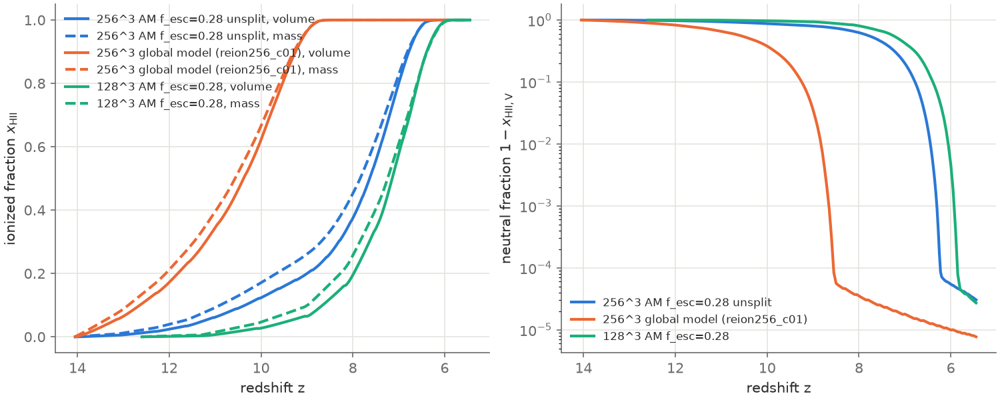
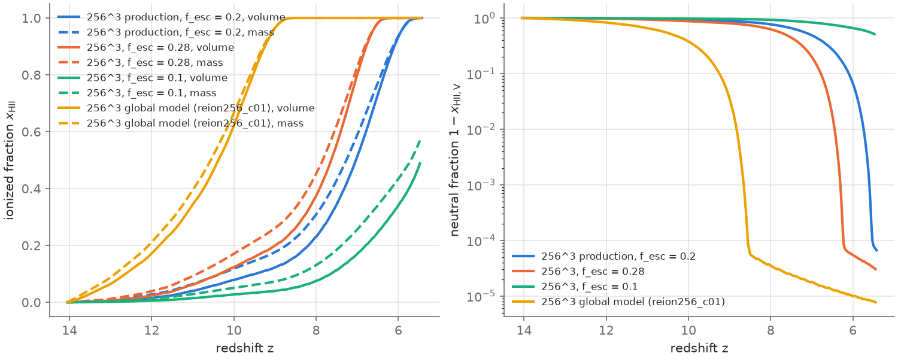
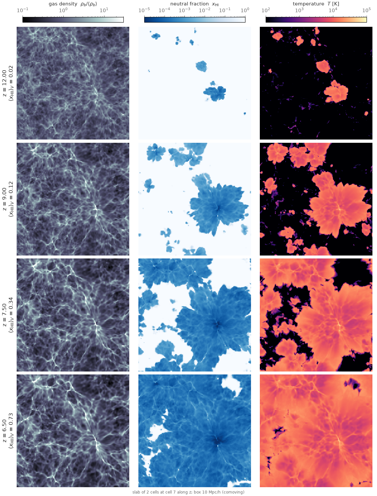

# The 256³ production run

*Production-256 thread, 2026-10-10, on klone (`docs/cluster.md`). Branch
`production-256`. Runs under `$RUNS = /gscratch/astro/mcquinn/radhydro/runs`,
Slurm logs in `/gscratch/astro/mcquinn/radhydro/logs/prod256/`.*

## 1. Configuration

`tools/production/make_production.py $RUNS/<run> --N 256 --c-reduced 0.1
--am-params data/uv_lf/am_params_256_10mpc.txt --f-esc <f> --xi-ion 25.38
--movie-dz 0.025 --movie-fields fHI,temp,rhog --restart-every 4
--hydro-scheme unsplit`, submitted with
`sbatch --exclusive -c 192 --mem=256G --time=1-00:00:00
--export=ALL,PROB=$RUNS/<run>,THREADS=192 tools/hyak/reion_production.slurm`.

| Setting | Value |
|---|---|
| Box, resolution | 10 Mpc/h, Ngas = Ndm = 256³, Zel'dovich ICs at z = 100, seed 7 (the ICs of `reion256`) |
| Speed of light | `c_reduced = 0.1` (convergence: `docs/production_run.md` §9) |
| Rays | `nray_max_factor = 16`, `ray_rotate = 3` (B16 fix), `deterministic_parallel`, `rt_substep_carry` |
| Physics flags | `legacy_rt = legacy_physics = 0` |
| Hydro | **`hydro_scheme = unsplit`** (dual energy; `docs/hydro_unsplit.md`), `ra_max` at the original 0.1 |
| Sources | on-the-fly FoF (≥ 20 particles = 1.3×10⁸ M☉), `sfr_model = abundance` with the 256³ L(M) (`data/uv_lf/am_params_256_10mpc.txt`, `docs/hmf_validation.md`), log ξ_ion = 25.38, f_esc below |
| Outputs | fields at the 13 `zdata1` redshifts (z = 15 … 5.5), movie frames of x_HI, T and ρ_gas every Δz = 0.025, checkpoint every 4 hydro steps (`restart_keep_latest`) |
| Node | one whole `cpu-g2` node, 192 threads |

## 2. The f_esc = 0.28 run (`$RUNS/reion256_prod`, job 41706017)

f_esc = 0.28 is the 128³ calibration to τ_es = 0.054 at 0.1c
(`docs/production_run.md` §8). This run was made before the user's
decisions of the same day (`docs/PLAN.md`: round f_esc values, and
reionization ending at z = 5.5 as the only target), so it serves as the
256³ calibration point rather than the production run.

| | |
|---|---|
| Wall time | **1 h 31 min 54 s** on 192 threads (RT 4800 s, IO 452 s, hydro 165 s, FoF 24 s, PM 21 s) |
| Peak RSS | 30.8 GB |
| Hydro steps / RT substeps | 48 / 4042 (RT from z = 13.1) |
| Sources at the end | 5144 halos |
| Rays | peak 1.43×10⁸ live rays (0.53 Nray_max; `reion256_c01`: 1.31×10⁸); the pool guard never acted |
| Disk | 139 GB (296 movie frames of 3 × 64 MB, the last checkpoint 16 GB) |

The history (`tools/analysis/reion_history.py`), against the global-model
run `reion256_c01` of `docs/cluster.md` §7 (same ICs and c, legacy hydro,
`ray_rotate = 0`) and the 128³ run with the same f_esc:

| run | weighting | z(10%) | z(25%) | z(50%) | z(75%) | z(90%) | z(99%) | z(99.9%) | τ_es |
|---|---|---|---|---|---|---|---|---|---|
| 256³, abundance-matched, f_esc = 0.28 | V | 10.34 | 8.58 | 7.63 | 7.10 | 6.78 | 6.44 | 6.30 | 0.0631 |
| | M | 10.89 | 9.11 | 7.84 | 7.19 | 6.81 | 6.44 | 6.28 | |
| 256³, global model (`reion256_c01`) | V | 12.64 | 11.48 | 10.38 | 9.66 | 9.25 | 8.83 | 8.65 | 0.0904 |
| | M | 12.89 | 11.76 | 10.56 | 9.75 | 9.29 | 8.82 | 8.64 | |
| 128³, abundance-matched, f_esc = 0.28 | V | 8.66 | 7.80 | 7.14 | 6.67 | 6.39 | 6.05 | 5.92 | 0.0541 |
| | M | 8.99 | 8.03 | 7.24 | 6.70 | 6.38 | 6.03 | 5.90 | |

| run | weighting | z = 10 | z = 9 | z = 8 | z = 7.5 | z = 7 | z = 6.5 | z = 6 |
|---|---|---|---|---|---|---|---|---|
| 256³, AM, f_esc = 0.28 | V | 0.123 | 0.200 | 0.374 | 0.556 | 0.801 | 0.982 | 1.000 |
| | M | 0.171 | 0.261 | 0.452 | 0.622 | 0.828 | 0.981 | 1.000 |
| 256³, global model | V | 0.622 | 0.965 | 1.000 | 1.000 | 1.000 | 1.000 | 1.000 |
| 128³, AM, f_esc = 0.28 | V | 0.027 | 0.065 | 0.195 | 0.341 | 0.577 | 0.850 | 0.995 |

* **Against the global source model** (`reion256_c01`): the
  abundance-matched sources reionize the box 2.7 units of redshift later
  (midpoint z = 7.6 against 10.4, end z = 6.4 against 8.8) with τ_es =
  0.063 against 0.090. The global model's emissivity was never calibrated
  (`docs/cluster.md` §7 noted τ_es = 0.07–0.09 as "too early"); the
  abundance-matched one is tied to the observed UV LFs. The run also
  differs in `hydro_scheme` and `ray_rotate`, which `docs/hydro_unsplit.md`
  and `docs/port_notes.md` B16 found to leave the global history
  unchanged at 64³, so the source model is the whole difference.
* **Against 128³ at the same f_esc:** the 256³ box reionizes earlier by
  Δz = 0.5 at the midpoint and 0.4 at the end, with τ_es 0.063 against
  0.054, and starts much earlier (x_V = 0.12 against 0.03 at z = 10). Two
  causes, in order: the 256³ box resolves halos down to 1.3×10⁸ M☉
  (128³: 10⁹ M☉), and with L(M) matched to the observed LF down to the
  resolution limit those halos add their share of the emissivity, most
  of it at z ≥ 9 where they are the only halos; and the two N are
  different realisations (`docs/cluster.md` §7: the 256³ fundamental mode
  is 1.17× linear, the 128³ one 0.78×). A 128³ calibration therefore does
  not transfer to 256³; the end of reionization must be tuned at 256³.
* The cost is the same as the global-model run (1 h 32 min against
  1 h 33 min) although reionization is later: the RT cost per substep
  follows the ionised volume and the ray population, which saturates at
  0.4–0.5 Nray_max either way.
* Stills (`$RUNS/reion256_prod/run/stills/`): `still_z{12,9,7.5,6.5}.png`,
  `stills_grid.png`.

## 3. Tuning f_esc to end reionization at z = 5.5

The user's decisions (`docs/PLAN.md`, 2026-10-10): round values of f_esc,
the end of reionization at z ≈ 5.5 as the target, τ_es only reported.
Runs at f_esc = 0.2 (`$RUNS/reion256_f0.2`, job 41707183) and 0.1
(`$RUNS/reion256_f0.1`, job 41707184), same configuration, each 1 h 30 min
on a whole node:

| f_esc | z(10%) | z(50%) | z(90%) | z(99%) | z(99.9%) | x_HII,V at z = 6 | τ_es |
|---|---|---|---|---|---|---|---|
| 0.28 | 10.34 | 7.63 | 6.78 | 6.44 | 6.30 | 1.000 | 0.0631 |
| **0.2** | 9.48 | 7.03 | 6.10 | **5.74** | **5.60** | 0.933 | 0.0566 |
| 0.1 | 7.64 | (x_M = 0.5 at z = 5.70) | | | | 0.341 | 0.0445 (to z = 5.4) |
| 0.15 | 8.55 | 6.43 | (x_V = 0.75 at z = 5.77) | | | 0.660 | 0.0508 (to z = 5.4) |

(volume-weighted; the mass-weighted redshifts are 0.0–0.3 higher early
on and the same at the end.)

* **f_esc = 0.2 ends reionization at z = 5.6–5.7** (x_V = 0.99 at 5.74,
  0.999 at 5.60), the round value nearest the target. f_esc = 0.15
  (`$RUNS/reion256_f0.15`, job 41707783, 1 h 29 min) reaches only
  x_V = 0.87 at z = 5.5 (midpoint z = 6.43), and f_esc = 0.1 leaves the
  box half neutral by mass at z = 5.7 and 52 % neutral by volume at
  z = 5.5. So the end point is steep in f_esc here: Δz = 2.1 per e-fold
  between 0.28 and 0.2 (1.5× the 128³ slope), and from 0.2 to 0.15 the
  end moves below the last output at z = 5.4.
* With 0.1c the end is late by Δz ≈ 0.4 against full c
  (`docs/production_run.md` §9), so at full c this f_esc would end
  reionization at z ≈ 6.0–6.1. τ_es = 0.057 is 0.4σ above Planck.

## 4. The production run: f_esc = 0.2 (`$RUNS/reion256_f0.2`, job 41707183)

| | |
|---|---|
| Wall time | **1 h 29 min 47 s** on 192 threads (RT 4731 s, IO 396 s, hydro 162 s, FoF 24 s, PM 21 s) |
| Peak RSS | 30.9 GB |
| Hydro steps / RT substeps | 48 / 4049 (RT from z = 13.1) |
| Sources at the end | about 5100 halos |
| Rays | peak 1.45×10⁸ (0.54 Nray_max); the pool guard never acted |
| Disk | 140 GB (346 movie frames, the last checkpoint 16 GB); `run/reion.txt`, `run/stills/`, `run/movie/cosmo.mp4` |

History (`$RUNS/reion256_f0.2/analysis/history.md`), with the global-model
run `reion256_c01` of `docs/cluster.md` §7 (same ICs and c, the
uncalibrated Trac & Cen source model, legacy hydro, `ray_rotate = 0`):

| run | weighting | z(10%) | z(25%) | z(50%) | z(75%) | z(90%) | z(99%) | z(99.9%) | τ_es |
|---|---|---|---|---|---|---|---|---|---|
| production, f_esc = 0.2 | V | 9.48 | 7.90 | 7.03 | 6.46 | 6.10 | 5.74 | 5.60 | 0.0566 |
| | M | 10.32 | 8.33 | 7.26 | 6.56 | 6.13 | 5.72 | 5.55 | |
| global model (`reion256_c01`) | V | 12.64 | 11.48 | 10.38 | 9.66 | 9.25 | 8.83 | 8.65 | 0.0904 |
| | M | 12.89 | 11.76 | 10.56 | 9.75 | 9.29 | 8.82 | 8.64 | |

| run | weighting | z = 10 | z = 9 | z = 8 | z = 7.5 | z = 7 | z = 6.5 | z = 6 | z = 5.5 |
|---|---|---|---|---|---|---|---|---|---|
| production, f_esc = 0.2 | V | 0.078 | 0.123 | 0.230 | 0.344 | 0.513 | 0.730 | 0.933 | 1.000 |
| | M | 0.118 | 0.177 | 0.309 | 0.430 | 0.588 | 0.771 | 0.936 | 1.000 |
| global model | V | 0.622 | 0.965 | 1.000 | 1.000 | 1.000 | 1.000 | 1.000 | 1.000 |
| | M | 0.666 | 0.966 | 1.000 | 1.000 | 1.000 | 1.000 | 1.000 | 1.000 |

*`tools/movies/stills.py`: gas density, neutral fraction and temperature
in a 2-cell slab at z = 12, 9, 7.5 and 6.5.*

**Movie:** `docs/movies/production_256_c01.mp4` (2.5 MB, 346 frames at
12 fps, `tools/movies/make_movie.py` style `cosmo`: x_HI, T, ρ_gas with
the x_HII(z) and τ_es panels).

* **Against the global model** the calibrated sources reionize the box
  3.1–3.4 units of redshift later (midpoint 7.0 against 10.4, end 5.7
  against 8.8), over a longer interval (x_V 10 % → 99 % in Δz = 3.7
  against 3.8, but 50 % → 99 % in 1.3 against 1.6), with τ_es 0.057
  against 0.090. The ionized fraction is 0.12 at z = 9 where the global
  model's was 0.97. The global model's emissivity was never calibrated;
  this history is tied to the observed UV LFs through L(M) and to the
  z ≈ 5.5 end point through f_esc.
* **Morphology** (stills): the largest bubbles grow around the densest
  knots and overlap between z = 7.5 and 6.5, with the last neutral
  islands in the voids far from the filaments. No grid-aligned "+"
  crosses on the sources or neutral streaks along the axes
  (`ray_rotate = 3`, B16), which every earlier 256³ still showed.
* **Temperatures:** ionized gas at 1–2×10⁴ K, the neutral IGM below
  100 K (the unsplit hydro: the legacy scheme held it near 10⁴ K,
  `docs/hydro_tests.md`), the filaments and knots at 10²–10³ K before
  the fronts arrive.
* **Cost** is the same as the global-model run and the f_esc = 0.28 run
  (1 h 30–33 min): the RT cost per substep follows the ray population,
  which saturates at about half the pool once the box is largely ionized.

## 5. Open

* The 0.1c bias on the end of reionization (Δz ≈ 0.4) and the 0.2–0.3 mag
  bright-end offset of the 256³ L(M) fit (`docs/hmf_validation.md`) are
  the known systematics of this calibration.
* The 128³ and 256³ boxes are different realisations
  (`docs/cluster.md` §7), so the N dependence of the calibration mixes
  resolution and cosmic variance.
