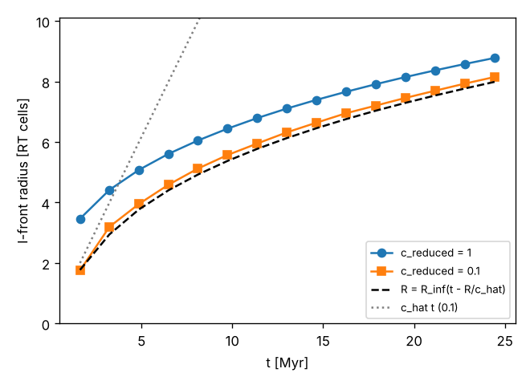

# Production reionization run: reduced speed of light, ray pool, restart, cost

This covers the work that prepares the production run (box 10 Mpc/h,
Ngas = Ndm = N, c_reduced = 0.01, nray_max_factor = 16, z ≈ 15 → 5.5, 4
threads): the reduced speed of light, the OpenMP parallelisation
(`docs/parallel.md`), the ray-pool guard, the F1 fix, restarts, movie
frames, and the measured cost that sizes the run. Every change keeps the
legacy validation: with the defaults all Fortran-vs-C++ references are
bit-identical, for any thread count.

New parameters of `apps/radhydro` (params.txt / `--set`), all defaulting to
the original behaviour:

| key | default | meaning |
|---|---|---|
| `c_reduced` | 1 | reduced speed of light ĉ = c_reduced·c (section 1); also `rt_driver` and both Fortran harnesses |
| `deterministic_parallel` | 0 | 1: parallel ray tracing, thread-count independent (`docs/parallel.md`); needs `legacy_rt = 0` |
| `threads` | 0 | OpenMP threads (0: `OMP_NUM_THREADS` / all cores) |
| `rt_substep_carry` | 0 | 1: carry the rounding of `nstep_rt` to the next hydro step, so the total RT substeps equal the light travel at ĉ exactly (`legacy_rt = 0` only) |
| `ra_max` | the original 0.1 | max expansion per hydro step, da/a ≤ ra_max/(1−ra_max) (`legacy_rt = 0` only) |
| `movie_dz`, `movie_z0`, `movie_fields` | 0, first zdata1, `fHI,temp` | movie frames every `movie_dz` in redshift, written from inside the RT substeps (section 4) |
| `restart_every`, `restart_keep_latest` | 0, 1 | complete checkpoint every n hydro steps (section 4); `--restart <file>` resumes |

`tools/production/make_production.py OUTDIR --N 128` writes the ICs and the
params.txt of the production configuration.

## 1. Reduced speed of light

### What c_reduced does

`calc_timestep` sets the number of RT substeps per hydro step from the
comoving light travel distance in RT cells,

    nstep_rt = nint(dl_c/dl_rt * cscale),   dl_c = 2c/(H0 √Ωm) (√(a+da) − √a),

and the RT moves every ray by exactly one RT cell per substep
(`ray_cast_3`, ≤ 1 cell of segments). The original hard-wires
`cscale = 1`, so rays travel at c. With `cscale = c_reduced` there are
c_reduced times fewer substeps per hydro step, each `dtsec_rt = dt/nstep_rt`
long, and rays still move one cell per substep: they travel at
ĉ = c_reduced·c. This is the only place where c_reduced enters, in the C++
(`cosmology.cpp`) and in both Fortran harnesses (RT harness PATCHES.md 12,
full harness PATCHES.md section 4).

**nstep_rt ≥ 1.** If the light travel of a hydro step at ĉ is under half
an RT cell, `nint` gives 0 (and `dt_rt = dt/0`). Both codes then use one
substep and print a warning; rays then move one cell per hydro step, faster
than ĉ. Never reached with c_reduced = 1, and not in the production
configuration (below). The CTest `full_vs_fortran_live_smoke_legacy_rt0_c0.0001`
runs the guard in both codes (nstep_rt = 0 in all 15 steps) and they agree
bit for bit.

### What changes and what does not (photon conservation)

The standard reduced-speed-of-light approximation (RSLA; Gnedin & Abel
2001) keeps the source emission rate and the photoionisation rate in the
optically thin limit, and lets the photon density scale as 1/ĉ. Checked
for every place that involves c or the substep length:

| quantity | where | with c_reduced |
|---|---|---|
| photons emitted per substep | `ray_source`, `photo_source`: L·`dtsec_rt` | ∝ dtsec_rt ∝ 1/ĉ: the emission **rate** per unit time is unchanged; photons per hydro step are identical (the `ifront_rsla` test checks the total to 1e-6) |
| photons in flight, radiation energy density | rays and the cells they cross | a ray travels 1 cell per substep, so photons emitted during a time t fill a sphere of radius ĉt: n_γ ∝ L/(4πr²ĉ) ∝ 1/ĉ, as in the RSLA |
| photoionisation rate Γ | `radiative_physics`: Γ = n_γ,cell σ (len_rt/dtsec_rt) | the photons crossing a cell in one substep ∝ F·A·dtsec_rt, divided by dtsec_rt: Γ = Fσ, **independent of ĉ** in the optically thin limit |
| ionisations per substep, photon limiter | `photo_cell` (`num1`, `nrad`) | both ∝ dtsec_rt: consistent, photons are conserved per substep |
| heating, cooling, chemistry | `photo_cell` with `dtsec_rt` | physical time steps; unchanged rates |
| Thomson optical depth `dtau` | σ_T n_e c dtsec_rt | uses the **true c** and the physical time (it is the CMB τ_es integral, not a ray quantity): unchanged |
| cosmological redshifting of rays | `ray_redshifting`: factor (a − da)/a per hydro step | depends on the expansion during the hydro step, i.e. on time: unchanged |
| ray removal | `ngam_min`, `fgam_min` per substep, `nside_max` (path length ≈ 4000–8000 cells) | per-substep fractions and a path length: unchanged; a ray reaches nside_max after a longer time |
| I-front speed | — | limited to ≤ ĉ (below) |

So photons are conserved per substep, the emission rate is physical, Γ is
correct where the medium is optically thin, and the photon density and
energy in rays scale as 1/ĉ: the RSLA. Known RSLA limitations apply: fronts
cannot move faster than ĉ, and after overlap, where the mean free path is
long, the photon field responds to changes with the light-crossing time at
ĉ (Gnedin 2016; Deparis et al. 2019 and Ocvirk et al. 2019 argue for
ĉ ≳ 0.1–0.2c for the timing of reionization).

### Validation

* **Fortran vs C++** for c_reduced = 0.1: all five RT problems, legacy
  (`legacy_rt = legacy_physics = 1`) and fixed, bit-identical (stored
  reference `reference/harness/outputs_c0.1_fixed`, CTests `ref_c01_*`);
  c_reduced = 0.0005 (the guard), bit-identical; full loop: smoke with
  c_reduced = 0.1 in both source modes and flag sets, and 1e-4, live
  CTests `full_vs_fortran_live_smoke_*_c*`; also the `-O0 -fcheck=all`
  Fortran builds (clean).
* **I-front test** (`tests/ifront_rsla_check.py`, CTest `ifront_rsla`;
  figure `docs/figures/ifront_rsla.png`): uniform gas at the mean density,
  z = 10, N = 32, one source of 8e28 (code units), 15 hydro steps of
  da = 2e-4, c_reduced = 1 and 0.1, `legacy_rt = legacy_physics = 0`.
  The finite-c front (Shapiro et al. 2006, AJ 131, 1314) is the
  infinite-c front at the retarded time,

      R(t) = R_∞(t − R(t)/ĉ),

  which without recombinations is exactly their R³/3 + (Q/ĉ)R = Qt
  (R → ĉt early, R → R_∞ late). R_∞ is taken from the c = 1 run (itself
  corrected the same way), ĉ = one cell per substep (0.083c here: nstep_rt
  is rounded, 2 instead of 2.4 per step), so there is no free parameter.

  

  | step | t [Myr] | ĉt [cells] | R (c = 1) | R (c = 0.1) | R_∞(t − R/ĉ) | error |
  |---|---|---|---|---|---|---|
  | 1 | 1.6 | 2.0 | 3.46 | 1.76 | 1.77 | −0.9% |
  | 2 | 3.2 | 4.0 | 4.42 | 3.20 | 2.95 | +8.5% |
  | 3 | 4.9 | 6.0 | 5.08 | 3.95 | 3.77 | +4.8% |
  | 5 | 8.1 | 10.0 | 6.05 | 5.12 | 4.92 | +4.0% |
  | 10 | 16.3 | 19.9 | 7.66 | 6.95 | 6.75 | +2.9% |
  | 15 | 24.4 | 29.8 | 8.78 | 8.15 | 7.99 | +2.0% |

  The front at ĉ = 0.083c is causal (R ≤ ĉt + 1.5 cells, checked for both
  runs), starts on the light cone (R = 1.76 vs ĉt = 2 after two
  substeps), lags the c = 1 front by 49% after one step, 22% after three
  and 7% after fifteen, and follows the retarded-time solution to 2–5%
  (rms 3.8%, pass criteria 12% per step and 6% rms). The small systematic
  excess (front 0.1–0.2 cells ahead) is the cast's one-cell look-ahead: a
  ray deposits its photons over the cell ahead of it before it advances.
  Emitted photons are identical in the two runs.

### The production configuration: light per hydro step

Box 10 Mpc/h, z = 15 → 5.5, ĉ = 0.01c. The light travel per hydro step
does not depend on N in Mpc/h; in RT cells it scales with N:

| N | RT cell [kpc/h] | hydro steps 15 → 5.5 (ra_max) | light per hydro step at 0.01c | RT substeps per hydro step | RT substeps 15 → 5.5 |
|---|---|---|---|---|---|
| 64 | 156 | 9 | 1.6–2.4 Mpc/h | 10–15 | ≈ 105 |
| 128 | 78 | 9 | 1.6–2.4 Mpc/h | 20–30 | ≈ 210 |
| 192 | 52 | 9 | 1.6–2.4 Mpc/h | 30–46 | ≈ 315 |

So the hydro step does not "dominate the light travel" in the sense that
`nstep_rt` would round to 0 or 1: light still crosses 10–46 cells per hydro
step and the guard is never needed. Rays move one cell per substep as
always. Two consequences matter, though:

* **Rounding.** `nint` of 10–15 changes ĉ by up to ±5% from step to step
  at N = 64 (less at larger N). `rt_substep_carry = 1` carries the
  remainder, so the total number of substeps (the light horizon) is exact;
  the production params use it.
* **Light horizon.** At 0.01c light travels ≈ 16 comoving Mpc/h between
  z = 15 and 5.5, 1.6 box lengths; one hydro step moves it 16–24% of the
  box. A source that forms at z = 8 lights up only ≈ 6 Mpc/h by z = 5.5.
  Reionization will be delayed and the post-overlap photon field
  underestimated (see above); the user accepted this.

**ra_max / outputs.** With the original ra_max (da/a = 1/9) there are only
**9 hydro steps** from z = 15 to 5.5 (and ≈ 17 from z = 100 to 15; the
Courant and PM limits did not bind in the N = 64 and 128 runs). A movie
needs far more frames: `movie_dz` writes x_HI and T at any redshift
spacing from inside the RT substeps (one substep = 1/10–1/46 of a hydro
step), independently of the hydro step, so ra_max does not need to change
for the movie. The gas dynamics response to photoheating, however, is
updated only 9 times; if the hydrodynamics of the ionised gas matters, set
`ra_max = 0.02–0.05` (da/a = 2–5%, 20–50 hydro steps; legacy_rt = 0
only): the hydro is cheap (section 5), and with `rt_substep_carry` the
RT substep total is unchanged.

## 2. Ray pool (F3) and ray memory

The ray pool could overflow (F3): merging is triggered by thresholds on the
photon content, not by the pool size. With `legacy_rt = 0` there is now a
guard (C++ and both Fortran harnesses, RT harness PATCHES.md 13): from the
live count, the number of source cells and a histogram of the rays that may
split this substep, the split threshold is raised (only) if the worst case
— every candidate splits into 4 and every source cell emits 192 rays —
could take the live count above 0.9·Nray_max (the remaining tenth covers
the Fortran-style free buffer, ≤ Nray_max/16); the candidates that may
still split then fit in a third of the remaining budget. If even the
sources do not fit, splitting stops and all but fresh source rays merge.
It is an integer computation on the histogram, deterministic, and inactive
in every stored reference (all `legacy_rt = 0` references, including the
nightly N = 32 ones, are unchanged). The full harness's legacy problem with
nray_max_factor = 1 (which overflowed before) now runs, with the guard
active in 508 of 1669 substeps, and Fortran and C++ agree bit for bit
(nightly CTest `full_vs_fortran_live_legacy_poolguard`). With
`legacy_rt = 1` the original behaviour (error on overflow) is kept.
(A first version capped at 3/4·Nray_max with a quarter of the budget; it
acted in the N = 32, factor-4 nightly references during split bursts that
did not threaten the pool, so it was relaxed to the worst case above.)

`Ray` is now 88 B (int32 links), see `docs/parallel.md` §4.

## 3. F1, restart, nightly tests

* **F1** (write_data_1/2 with one thread wrote only xv_dm): fixed in the
  C++ and in the full harness (`-DHARNESS_FULL_F1`). Both write DM/xv_dm,
  Gas/{u,v,w}_gas and, at data 1, RT/rt_grid and Ray/{ray, ray_index,
  htoc_ray} in the original formats; the live tests compare them (Gas, RT
  byte for byte; Ray as a prefix: the C++ stops at the ray high-water
  mark, the original writes all Nray_max slots). D3D/zreion is not
  written by the C++ (calc_gas_3 is not ported). Only restart files are
  affected.
* **Restart.** The original's data-1 files cannot restart the run
  bit-identically (no free lists, stale thresholds, RT statistics, clock).
  `restart_every = n` writes a complete binary checkpoint
  (`include/radray/checkpoint.hpp`: clock, all RT grid fields and chains,
  gas, grid velocity, rays up to the high-water mark with the pool, the
  thresholds, the RT statistics, particles, output schedule, movie state)
  to `<out>/restart/checkpoint.bin` (or one per step with
  `restart_keep_latest = 0`); `radhydro <problem> <out> --restart
  <checkpoint>` resumes, appending to the logs. CTests `restart_smoke_legacy`
  (restart at step 13 inside the RT phase) and `restart_smoke_det_movie`
  (deterministic_parallel and movie frames): every file written after the
  restart is byte-identical to the uninterrupted run.
* **Nightly tests.** The four ~5-minute `full_ref_{legacy,onthefly}_rt{1,0}`
  and the new `full_vs_fortran_live_legacy_poolguard` carry the label
  `nightly` and are disabled by default. To run them:

      cmake -DRADRAY_NIGHTLY_TESTS=ON build
      ctest --test-dir build -L nightly

## 4. Movie frames and checkpoints in the production run

`movie_dz = 0.05` writes frames `movie/frame_NNNNN_{fHI,temp}.bin`
(float32 N³ each) and a line in `movie/frames.txt` (frame, step, substep,
z, ⟨x_HII⟩_V, ⟨x_HII⟩_M) every Δz = 0.05 from z = 15: ≈ 190 frames to
z = 5.5, from inside the RT substeps (frames in steps without RT are written
at the end of the hydro step). Disk: 2·4N³ B per frame: 0.4 GB (N = 64),
3.2 GB (N = 128), 10.8 GB (N = 192) for 190 frames; use
`movie_fields = fHI` or a larger `movie_dz` at N = 192.

## 5. Measured runs, cost and timing table

### Production-configuration runs

Both runs: `tools/production/make_production.py` (box 10 Mpc/h, Ngas = Ndm
= N, Zel'dovich ICs at z = 100, seed 7, FoF ≥ 20 particles, global SFR
model, c_reduced = 0.01, nray_max_factor = 16, legacy_rt = legacy_physics
= 0, deterministic_parallel, rt_substep_carry), `OMP_NUM_THREADS=4`.
**The machine was shared** with another job during all measurements
(load average 3–14; a calibration loop with no memory traffic got only
1.9–2.6× on 4 threads), so the 4-thread wall times below are upper bounds.

* **N = 64**, z = 100 → 4.87, 27 hydro steps, 256 s in total: hydro 27.7 s,
  PM 5.6 s, FoF 2.2 s, summaries 1.9 s, IO 18 s, **RT 183 s** (82
  substeps). The first FoF source forms at z = 8.9 (RT runs from the start
  of that step, z = 10.05). x_HII,V = 0.02, 0.61, 0.99994 at z = 8.9, 7.1,
  5.5. Rays: 2.73M at the end (0.65 Nray_max), pool guard active in 7
  substeps. Peak RSS 400 MB.
* **N = 128**, z = 100 → 5.27, 29 hydro steps, **69 min in total** on
  the shared machine (≈ 2 cores effectively): RT 62 min (190 substeps
  from z = 12.6, 177 of them to z = 5.56; the first FoF source forms at
  z = 11.3), hydro + PM + FoF
  + summaries ≈ 12 s per step, IO 1–2 min. The run stopped once at a full
  disk while writing a checkpoint (section 7) and was restarted from the
  step-23 checkpoint (`--restart`). RT steps 20–29: 29, 68, 323, 447, 455
  (before the restart), 551, 468, 488, 368, 405 s; rays at their ends
  0.26M, 2.1M, 11.1M, 14.5M, 17.1M, 19.2M, 20.7M, 21.3M, 21.8M, 22.0M
  (0.66 Nray_max), x_HII,V = 0.04, 0.21, 0.42, 0.63, 0.83, …, 0.9915 at
  z = 6.2, 0.99993 at z = 5.3. Pool guard active in 12 substeps. RSS 557 MB
  before the rays, **2.76 GB peak**.
* The Courant/PM limit binds at N = 128 below z ≈ 9 (da/a = 0.10, then
  0.06–0.07 near z = 6); at N = 64 every step is the ra_max step.

### Cost per component, one thread

| N (= Ndm) | hydro / step | PM / step | summaries / step | FoF / call | RT per ray per substep | RT per cell per substep | memory without rays |
|---|---|---|---|---|---|---|---|
| 64 | 1.24 s | 0.18 s | 0.06 s | 0.18 s | 1.96 µs (2.8M rays) | 1.7 µs | 0.30 GB |
| 128 | 9.5 s | 1.75 s | 0.49 s | 1.6 s | 1.8–2.2 µs (11–17M rays) | ≈ 1.7 µs | 0.56 GB |
| 192 | 33.1 s | 5.0 s | 1.6 s | — | (same per ray) | (same per cell) | 1.89 GB |

(Memory ≈ 265 B per cell with Ndm = N, plus 88 B per ray slot touched.)
The RT per ray covers `ray_tracing_1`/`3`, `calc_ray_1` and the
redshifting; per cell it is `radiative_physics` (fully ionised gas) and
`calc_rt_1`.

### Timing table (box 10 Mpc/h, Ngas = Ndm = N, nray_max_factor 16, 4 threads)

From `tools/production/timing_table.py`: hydro steps from z = 100 to 5.5
(ra_max steps), RT substeps = light travel at ĉ from the start of the step
in which the first source forms (z = 10.05, 12.64 and ≈ 14.2 for N = 64,
128, 192) to z = 5.5, and per substep (1.7 µs × N³ + 2.0 µs × ⟨N_ray⟩)
with ⟨N_ray⟩ = 0.4 Nray_max (the substep-weighted mean seen in the runs;
the population grows from 0 to 0.5–0.65 Nray_max by z = 5.5). The 4-thread
column assumes the parallel efficiency measured when two cores were free
(section 6): ×3.5 for the RT, ×3 for hydro/PM. Memory: grids + 88 B ×
0.75 Nray_max (the runs peaked at 0.5–0.65; the pool guard caps the
worst case at 0.9: then N = 128 needs 3.2 GB and N = 192 10.8 GB).

| N | c_reduced | RT substeps | t (4 threads) | t (1 thread) | peak memory |
|---|---|---|---|---|---|
| **64** | **0.01** | 68 | **1 min** | 5 min | 0.3 GB |
| 64 | 0.03 | 203 | 4 min | 14 min | 0.3 GB |
| 64 | 0.1 | 675 | 12 min | 43 min | 0.3 GB |
| **128** | **0.01** | 179 | **28 min** | 1.6 h | 2.8 GB |
| 128 | 0.03 | 538 | 1.3 h | 4.6 h | 2.8 GB |
| 128 | 0.1 | 1794 | 4.4 h | 15 h | 2.8 GB |
| **192** | **0.01** | 301 | **2.6 h** | 8.9 h | 9.3 GB |
| 192 | 0.03 | 902 | 7.4 h | 26 h | 9.3 GB |
| 192 | 0.1 | 3007 | 25 h | 86 h | 9.3 GB |

The hydro part (27–30 steps) is 2 min (N = 128) to 7 min (N = 192) of
these. Checks against the runs: N = 64 predicts 68 substeps to z = 5.5
(the run did 67) and 4 min of RT on one thread; N = 128 predicts 179
substeps to z = 5.5 (the run did 177 to z = 5.56) and 1.6 h on one
thread; the complete N = 128 run took 69 min on about two free cores,
consistent with the 28-min projection for four. The uncertainty is mostly
the ray population (±30%) and the source model: with the global SFR
model the box is ionised by z ≈ 6.5 (N = 64) and the ray count saturates;
an abundance-matched model with fainter, more numerous sources will change
⟨N_ray⟩.

Not included: checkpoints (`restart_every = 1`: N = 128 ≈ 2 GB per write,
N = 192 ≈ 6–9 GB, 10–60 s each on this disk) and movie frames (section 4).

## 6. Speedups

### On an idle Hyak node (2026-10-08; full tables in `docs/cluster.md` §6)

One hydro step restarted from a production checkpoint on a whole `cpu-g2`
node (AMD EPYC 9654, 2 × 96 cores), `OMP_PLACES=cores OMP_PROC_BIND=close`,
`tools/hyak/scaling_test.slurm`. **All outputs byte-identical** for 1, 8, 24,
48, 96 and 192 threads at both sizes.

| component | 128³, 96 thr | 128³, 192 thr | 256³, 96 thr | 256³, 192 thr |
|---|---|---|---|---|
| ray_tracing_1 | 52.8 | 57.3 | 78.3 | 116 |
| ray_tracing_3 | 53.0 | 57.7 | 78.8 | 114 |
| calc_ray_1 (histogram) | 50.0 | 19.5 | 67.7 | 92.0 |
| radiative_physics | 34.8 | 44.8 | 34.1 | 39.6 |
| post_rt (redshifting, PDFs) | 81.2 | 141 | 74.4 | 131 |
| hydro | 35.7 | 37.8 | 49.0 | 79.8 |
| PM (serial FFTW) | 11.0 | 10.1 | 12.6 | 11.7 |
| summaries | 3.9 | 4.3 | 4.2 | 4.2 |
| FoF + sources | 6.0 | 5.6 | 7.4 | 7.3 |
| **RT total** | **50.3** | **53.7** | **67.8** | **94.1** |
| step (with its output) | 39.2 | 39.4 | 45.7 | 52.2 |
| step time [s] (1 thread: 406 s at 128³, 2507 s at 256³) | 10.4 | 10.3 | 54.8 | 48.0 |

(128³: step 25, z = 7.30 → 6.70, 19 substeps, 17–19M rays; 256³: step 31,
z = 8.09 → 7.82, 15 substeps, 136–140M rays.) The colour-swept ray tracing
flattens at 128³ between 96 and 192 threads (512 domains per colour) and keeps
scaling at 256³ (4096 per colour), as expected. Per thread, one ray-substep
(`ray_tracing_1` + `ray_tracing_3` + `calc_ray_1` + `post_rt`) costs
1.0–1.05 µs on one Genoa core, and `radiative_physics` 1.05–1.2 µs per cell per substep,
against 2.0 and 1.7 µs on the old VM. The 4-thread entries below are therefore superseded.

### On the shared 4-core VM (first thread)

Measured by restarting the same checkpoint for one hydro step with 1, 2 and
4 threads (`tools/production/speedup.sh`) and from the first steps of the
runs (`speedup_hydro.sh`). The outputs of the 1-, 2- and 4-thread runs are
**byte-identical** (N = 64 step 28 and N = 128 step 23, all files). The
machine was shared: when the 2-thread runs were made about two cores were
free (calibration loop 1.9–2.3× on 2 threads), and during the 4-thread runs
fewer than that (load average up to 14).

| component | N = 64, 2 threads | N = 128, 2 threads | N = 64, 4 threads (shared) | N = 128, 4 threads (shared) |
|---|---|---|---|---|
| ray_tracing_1 | 1.88 | (RT phases not timed separately) | 1.86 | |
| ray_tracing_3 | 2.00 | | 1.94 | |
| radiative_physics | 1.65 | | 1.59 | |
| calc_ray_1 (histogram) | 1.63 | | 1.53 | |
| post_rt (redshifting, PDFs) | 1.85 | | 1.90 | |
| hydro | 1.65 | 1.63 | 1.34 | 2.0 |
| PM | 1.57 | 2.3 | 1.0 | 2.2 |
| summaries | 1.29 | 1.8 | 0.89 | 0.84 |
| FoF | 1.36 | 1.6 | 0.80 | 1.7 |
| RT total (one hydro step) | 1.90 | 1.90 | 1.85 | 1.24 |

The ray tracing scales almost perfectly on the cores that were available
(1.9–2.0 on two), which is what the colour scheme should do: 64 (N = 64)
to 512 (N = 128) independent domains per colour and two barriers per
colour. Hydro, PM and `radiative_physics` reach 1.6–1.7 on two threads
(memory-bound sweeps; batched ordered replay). On four free cores we
expect ≈ 3.5 for the RT and ≈ 3 for hydro/PM (the projection used in the
timing table); the 4-thread numbers above are limited by the other job.
The idle-node measurement on Hyak is at the top of this section.

## 7. Recommendations for the production run

1. **N = 128, c_reduced = 0.01** is the run to do first: about half an
   hour on 4 idle cores (it took 69 min on this shared machine), 2.8 GB
   of memory (measured peak RSS 2.76 GB). It resolves halos of ≈ 7e8 Msun/h (20 particles), 4.5× better
   than N = 64.
2. **N = 192, c_reduced = 0.01** fits (8–9 GB at the ray populations seen,
   10.8 GB at the pool guard's cap; 1.9 GB without rays) and takes ≈ 2.5–3 h on 4 idle cores, but
   only if the disk can hold the checkpoints: one checkpoint is 6–9 GB
   and the atomic rewrite needs twice that. Use `restart_every = 2–3` and
   check the free disk space (this sandbox has ≈ 40 GB in total, shared;
   the N = 128 run stopped at a full disk).
3. **c_reduced.** At 0.01 light crosses 16 Mpc/h between z = 15 and 5.5
   and 1.6–2.4 Mpc/h per hydro step; reionization will be late and
   light-limited. 0.03 costs 3× (N = 128: 1.3 h) and 0.1 costs 10×
   (N = 128: 4.4 h; N = 192: ≈ 1 day), both affordable at N = 128.
   Consider an N = 128, c_reduced = 0.1 run as the reference for how much
   0.01 changes x_HII(z).
4. **Outputs.** Keep ra_max (9 hydro steps from z = 15 to 5.5) for the
   cost, and use `movie_dz` for the movie (0.05 → ≈ 190 frames of x_HI and
   T; 3.2 GB at N = 128, 10.8 GB at N = 192: use `movie_fields = fHI` or
   `movie_dz = 0.1` at N = 192). If the gas response to photoheating
   matters, `ra_max = 0.03` (≈ 30 steps from z = 15) adds only minutes of
   hydro. Use `data_files = norays` and a short `fields` list (the
   production params do): with the F1 fix every data-1 output otherwise
   writes all rays (1.4 GB at N = 128).
5. Always use `rt_substep_carry = 1` and `deterministic_parallel = 1`
   (the production params do): the first makes the light travel exact, the
   second is the only way the ray tracing runs on more than one core, and
   it makes the run reproducible and restartable bit for bit.
