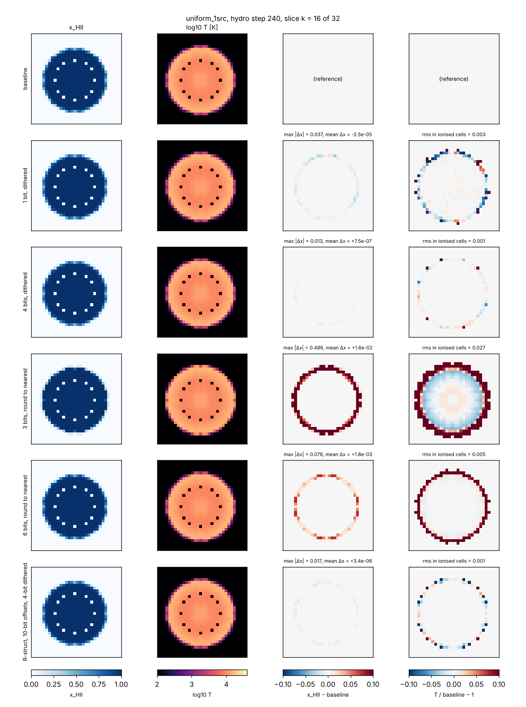
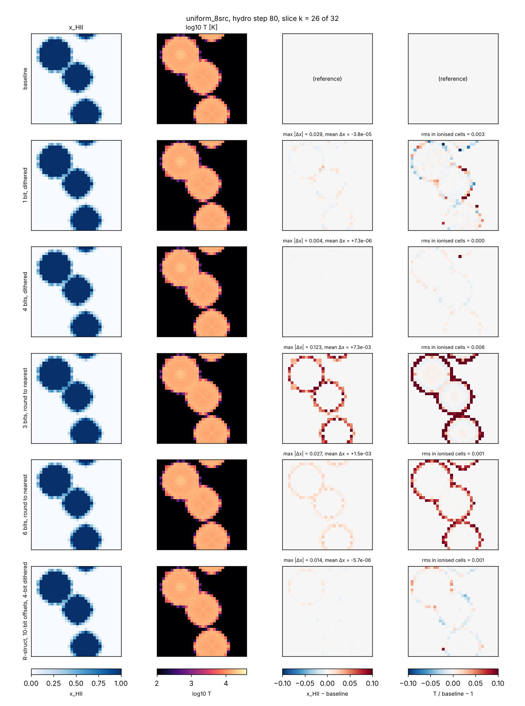
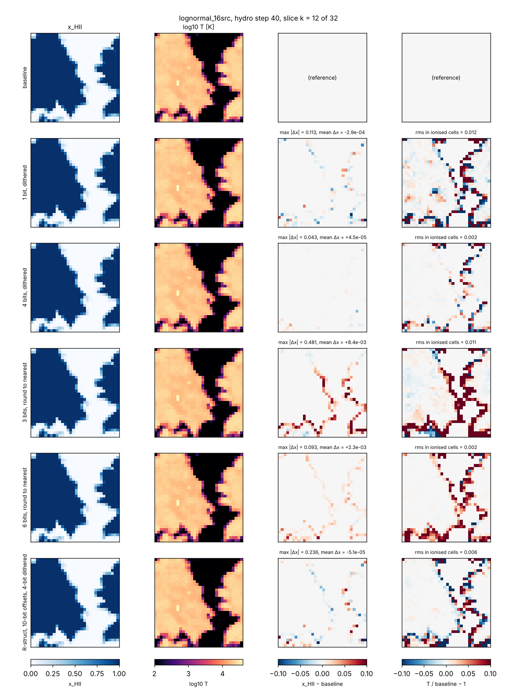
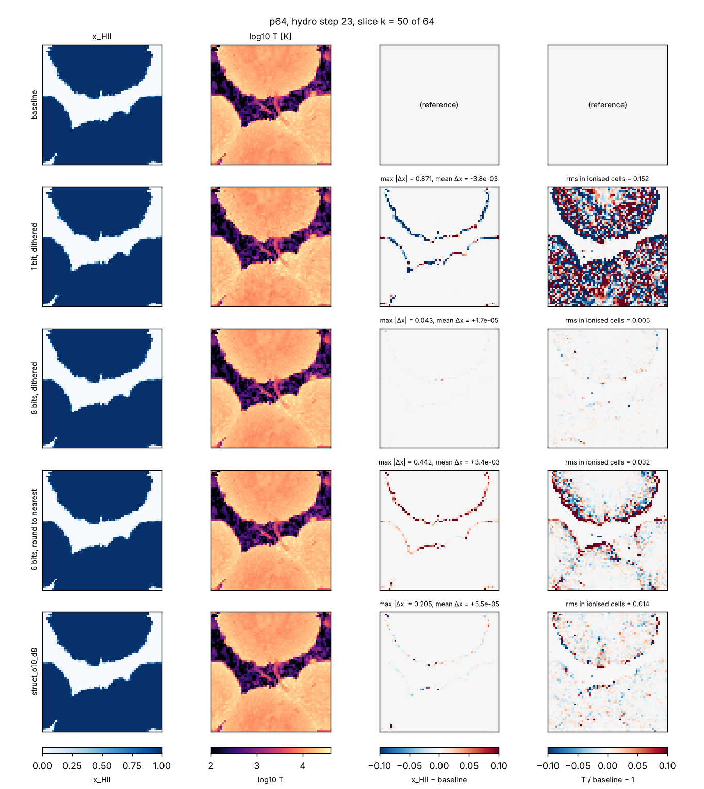
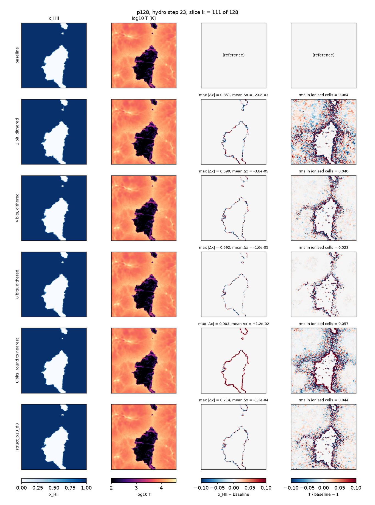

# Ray compression study (ROADMAP §4, Stage B)

*Written 2026-10-08. Research only: no simulation result changes. Every new
option is off by default, and with the defaults the C++ stays bit-identical
to the Fortran harnesses (CTests `ray_dump_*`).*

Question: how few bytes can a ray take, how fast can it be encoded and
decoded, and how much flux precision can we drop before the astrophysical
outputs move by more than the targets (x_HII within 1–2 %, τ_es within 1 %,
I-front within half a cell, T within a few percent; `docs/ROADMAP.md`).

**Short answer**

1. A fixed-width **structural encoding** ("R-struct", §4) stores a ray in
   **~30 B instead of 80 B** of ray data (88 B per slot with the int32
   chain links of the current code; 96 B in the original). Its errors are far
   below anything the RT cares about. Decoding it costs about one HEALPix
   `pix2vec` (~100 ns).
2. **rANS entropy coding** of the same fields (§5) reaches **5–9 B per ray
   before overlap and 12.7 B after**, with a 6-bit dithered photon total and
   10-bit in-cell offsets. It costs **230–310 ns to decode and 290–450 ns
   to encode per ray**. That is 25–35 % of the RT cost per ray-substep on
   this machine (~2 µs), so it is not cheap enough to apply to every ray
   every substep on CPU.
3. **Photon precision is not the constraint, provided quantisation is
   dithered.** Stochastic (unbiased) rounding of every photon group down to
   **1–2 mantissa bits** keeps x_HII, T, τ_es, the I-front and the photon
   budget far inside the targets on all three RT test problems (§6).
   Round-to-nearest is biased: 6 bits already gives ~1 % errors, 3 bits ~3–9 %.
4. Rays that were never merged are almost **fully determined** by
   (source, nside, ipix, age) (§3). They cost ~5–8 bits of geometry instead of
   ~110. After overlap, however, >90 % of rays have been merged, so this
   matters most before overlap.

**Recommendation** (§8): adopt R-struct (with dithered photon totals of ~8
bits) as the in-memory ray format of the Stage D rewrite. Keep the rANS coder
for checkpoints, MPI ray migration and possibly cold storage. Make dithering
mandatory for every lossy field.

---

## 1. Instrumentation (C++)

| piece | what | default |
|---|---|---|
| `include/radray/ray_dump.hpp`, `src/ray_dump.cpp` | After selected RT substeps (after `rt_step_3`, i.e. the state that would be stored between substeps) write every live ray in cell-chain order to `<dir>/rays_s<substep>.npy` (numpy structured array) plus a JSON sidecar. Per ray: the raw `Ray` fields (`nside ipix r dr x dx nu ngam`), its cell and chain position, provenance (`src` emitting cell or −1 if mixed, `birth` substep, `nmerge`, `nclamp`, flags merged/mixed/clamped) and cell context (`tau fgam ngam` per group, `fHI fHeI fHeII temp rhog`). The JSON holds N, z, substep, `ngam_ray`, the source cells and the volume-weighted x_HII. | off |
| provenance | `RayState::prov` (one `RayProv` per storage slot), filled by `ray_source`, `ray_cast_split` (children inherit, flag a clamped r) and `ray_cast_merge`. Only allocated when the dump is on, and never read by the RT. | off |
| `include/radray/ray_quant.hpp`, `src/ray_quant.cpp` | The lossy experiment of §6: after every substep each live ray is quantised in place (`ray_quant_bits`, `ray_quant_dither`, `ray_quant_struct`, `ray_quant_offbits`). This changes results on purpose. Per the user's decision (docs/PLAN.md, "Fortran harness scope") it has no Fortran counterpart. | off |

Parameters (both `rt_driver` and `radhydro`, in `params.txt` or `--set`):

```
ray_dump_dir = DIR          # snapshots go here
ray_dump_every = K          # every K-th global RT substep, and/or
ray_dump_at = 50 100 250    # these global RT substeps (1-based)
ray_quant_bits = m          # research only: photon mantissa bits (0 = off)
ray_quant_dither = 1        # 1 stochastic (unbiased), 0 round to nearest
ray_quant_struct = 1        # research only: R-struct round trip every substep
ray_quant_offbits = 16      # with ray_quant_struct: offset bits per axis
```

The dump also works with `deterministic_parallel = 1` (main's parallel ray
tracing). Provenance lives in a calloc'd per-slot buffer like the rays, so
threads write disjoint slots. Results with the dump on equal those without,
and 4 threads equal 1 thread (checked on `lognormal_16src`). Rays read from
a restart checkpoint have no provenance and are dumped with `src = -2`.

Checks: `ctest -L raycomp`. These run `lognormal_16src_smallbuf` (merging
on) with the dump on and compare with the stored Fortran outputs, legacy and
fixed modes, with `--rtol 0 --atol-frac 0`. Both are identical. The tests
also round-trip the last snapshot through the codec (0 mismatches).

Tools (`tools/ray_compression/`): `snap.py` (loader and derived fields),
`entropy.py` (step 3), `ray_codec.cpp` → `build/ray_codec` (steps 4–5),
`run_precision.sh` + `precision_metrics.py` (step 6), and `study.py` (batch
driver and figures).

## 2. Snapshots

All runs use the production ray settings (`legacy_rt = legacy_physics = 0`,
`nray_max_factor = 16`), except the 64³ run, which repeats the
`docs/full_run.md` §5 demo (factor 4; factor 16 would take ~4 h).

| run | set-up | snapshots (global RT substep) | rays | x_HII (vol) |
|---|---|---|---|---|
| 1 source | `uniform_1src`, 240 hydro steps | 60, 240, 720, 1440 | 0.6k–6.8k | 0.004–0.09 |
| 16 sources | `lognormal_16src`, 60 + 160 hydro steps | 30 … 720, 960, 1200, 1440 | 2k–352k | 0.001–0.993 |
| 64³ full run | Ngas = 64, Ndm = 32, 4 Mpc/h, on-the-fly FoF (17 sources), z = 7.94 → 7.06 (one hydro step, 3338 RT substeps), factor 4 | 50, 100, 250 … 3250 | 29k–832k | 0.009–1.0 (overlap at substep ≈ 2000) |

The 64³ run took 71 min (RT 4221 s), about **2.0 µs per ray-substep**. The
lognormal run also gives 2.0 µs. This is the yardstick for codec costs.

## 3. Empirical entropy and determinism (step 3)

`entropy.py` quantises each field at the precision of the structural
encoding (§4) and reports bits per ray:

* the plug-in entropy H(X);
* the conditional entropy H(X|Y);
* a split-half cross-entropy (model counted on even rays, evaluated on odd
  rays, back-off to the marginal). The cross-entropy is what a coder with a
  fitted table would pay. The plug-in H(X|Y) is optimistic when Y has many
  values.

### 3.1 Never-merged rays are deterministic

For rays that were never merged and whose splits never clamped r (all rays
of the 1-source run; 93 % of rays at x_HII = 0.28 and 7 % at 0.99 in the
16-source run):

| quantity | follows from | measured residual |
|---|---|---|
| direction `dx` | `centre(nside, ipix)` | ≤ 1.1·10⁻⁷ rad (float32 round-off; ≤ 3.5·10⁻⁶ of a pixel) |
| position `x` | `x_src + r·centre(ipix)` | median 7·10⁻⁶, max 1.5·10⁻⁴ cell (the 1e-6 nudges of `ray_cast_3` and float rounding) |
| `r` | `substep − birth + 1` | exact up to float rounding (|Δ| ≤ 2·10⁻⁴) |
| `dr` | `rmax(nside) − r` | ≤ 3·10⁻⁵ (true for **all** rays, merged or not) |
| `nside` | `nside_from_radius(r)` | equal for 80–90 %; otherwise one level lower (split deferred because the ray was too faint) |
| `nu` | the emission spectrum and the hydro steps since birth (redshifting) | H(nu tuple) ≈ 0 (1 source); ≤ 0.3 bit given the birth substep |


*Left: position residual from the origin model. Middle: deviation of dx from
the pixel centre, never-merged (solid) vs merged (dotted; merged rays are
spread over ~1 pixel). Right: r − age.*

So a never-merged ray is fully given by (source, age, nside, ipix) plus its
photons. Coding it conditionally costs:

| field | how | bits/ray |
|---|---|---|
| source | same as the previous ray in the block, or raw id | 0–4 (H(src\|cell) = 2.5–4 with 16 sources) |
| r | r − round(\|cell centre − x_src\|) | 3.1–3.3 |
| nside | nside_from_radius(r) − lside | 0.4–0.6 |
| ipix | position among the pixel predicted from the cell centre and its 8 neighbours | 2.2–2.4 (hits: 51 % same pixel, 98 % within the 3×3 neighbourhood) |
| position, direction, dr | derived | 0 |

That is **~6–10 bits of geometry**, against 48 + 30 + 16 + 16 ≈ 110 bits in
R-struct. These rays must be wrapped around the periodic box at most once
(r < N/2 − 1) for the prediction to be unambiguous; farther rays fall back to
the general class.

Clamped splits (a deferred split that clamps r to [rmin, rmin+1]) move the
effective origin. They are rare (one ray in the 16-source run at x = 0.99, a
0.16-cell shift) and are coded as general rays.

### 3.2 Entropy of each field (all rays)

Bits per ray, cross-entropy, at three phases of the 16-source run
(full table for every snapshot: `entropy.py` output, reproducible with
`study.py entropy`):

| field (precision) | raw | R-struct | x=0.28 | x=0.65 | x=0.99 | best context (x=0.99) |
|---|---|---|---|---|---|---|
| merged flag | — | 1 | 0.38 | 0.99 | 0.37 | 0.13 given nside |
| offset per axis (1/65536 cell) | 32 | 16 | 13.2 | 14.9 | 16.1 | none helps |
| offset per axis (1/1024 cell) | | 10 | 9.9 | 9.9 | 10.0 | none |
| nside | 32 | 4 (with ipix: 30) | 1.6 | 2.0 | 2.6 | 0.45 given nside(r) |
| ipix | 32 | 30 (with nside) | 11.8 | 12.6 | 15.7 | ≈ 2.3 for never-merged given (src, cell, r) |
| r (1/8 cell) | 32 | 16 | 4.4 | 5.9 | 9.9 | 7.7 given nside |
| dr | 32 | 0 | 0 | 0 | 0 | derivable |
| direction offset θ, φ (merged; 1/128 pixel) | 96 (dx) | 2 × 8 | 7.2 + 6.7 | 7.2 + 6.7 | 7.3 + 7.1 | φ given θ: 7.0 |
| direction offset (never merged) | | 0 | 0 | 0 | 0 | |
| log2 Σngam (1/128 octave) | 32 (float) | 32 | 10.0 | 9.8 | 9.2 | 9.1 given (nside, merged) |
| shape, per group, 5 groups (1/128 octave) | 128 | 65 | 26.4 | 25.6 | 24.5 | group i given group i−1: ≈ 17 in total |
| shape, joint tuple | | | 11.3 | 11.0 | 11.9 | a 255-entry dictionary from the previous snapshot covers 61–79 % of rays |
| nu, 5 groups (8 bit in band) | 160 | 40 | 0.9 | 1.1 | 3.0 | 2.0 given birth |

Observations:

* The **in-cell offsets of merged rays are incompressible** (≈ the stated
  precision). The only lever is precision itself: 10 bits per axis
  (1/1024 cell) instead of 16 saves 18 bits per merged ray. It changes
  nothing measurable (§6).
* **Directions of merged rays** cost ipix + offset ≈ 25–30 bits. They spread
  over about one pixel (median |offset| ≈ 0.25 pixel).
* **Photons:** after 1/128-octave log quantisation the total has ~9–10 bits of
  entropy. The spectral shapes repeat heavily (rays of one source and
  emission time share a history), so a small dictionary removes most of
  their cost.
* **nu** is nearly constant: it changes only through merges and
  redshifting. A dictionary codes it in 1–3 bits.
* Conditioning on the **cell's optical depth** helps little once the coder
  is fitted out of sample (cross-entropy). The plug-in H(X|cell) values look
  spectacular (e.g. 3.6 bits for Σngam) but do not generalise: they reflect
  the many cells with only a few rays.

## 4. Structural encoding "R-struct" (step 4)

`ray_codec` computes it per snapshot (fixed width, no entropy coding):

| field | bits | encoding | max error (measured) |
|---|---|---|---|
| position | 3 × 16 | offset in the chain cell, 1/65536 cell (the cell is implicit in a cell-sorted array) | 7.6·10⁻⁶ cell |
| nside + ipix | 30 | `4·nside² + ipix` (unique NESTED id, < 2³⁰ for nside ≤ 8192) | exact |
| merged flag | 1 | | |
| direction offset | 2 × 8, merged rays only | (θ, φ) tangent-plane offset from the pixel centre, 1/128 pixel | 0.0042 rad worst case (nside = 4); rms 1.5·10⁻⁴ rad |
| r | 16 | 1/8 cell; **dr dropped** (= rmax(nside) − r) | 0.0625 cell (never-merged rays: exact) |
| photon total | 32 | float32 Σngam | exact |
| spectral shape | 5 × 13 | round(128·log2(ngam_i/Σngam)), or zero | 0.13 % of the ray total per group; Σ exact |
| nu | 5 × 8 | linear in the band | 0.04 eV |

**Size: 232 + 16·f_merged bits = 29–31 B per ray** (80 B of ray data; 88 B per slot in the current code, 96 B in the original, with the
chain links). The R32 layout of the design doc has the same content, packed
into 32 B. The direct `nside` + `ipix` id saves 4 bits, and the flag lets
never-merged rays skip the direction offset.

The round trip changes nothing measurable in the RT (§6, `struct` and
`struct_o10` variants: x_HII ≤ 0.3 %, front shift ≤ 0.05 cell).

## 5. Entropy coding with rANS (step 5)

`tools/ray_compression/ray_codec.cpp` (CMake target `ray_codec`):

```
build/ray_codec TRAIN_STEM TEST_STEM [--mbits m] [--offbits b] [--no-origin] [--block n] [--reps k]
```

* **Coder:** rANS with a 32-bit state, byte-wise renormalisation and two
  interleaved states. Probabilities are 12-bit, all alphabets have ≤ 256
  symbols, and the decode tables are uint8 slot→symbol plus packed
  (freq, cum), so the whole model set stays in L2. Bypass bits (offsets,
  mantissas, low bits) go to a separate raw bit stream.
* **Blocks:** whole cells, ≥ 4096 rays. Blocks decode independently, so
  decoding parallelises and allows random access by cell.
* **Models:** static histograms counted on the **previous snapshot** of the
  same run (the first snapshot is coded with its own model, "oracle"). The
  models are:
  * rays per cell (context: the previous cell's count);
  * the class of each ray (origin-coded / general unmerged / general merged;
    context: the previous ray's class);
  * for origin-coded rays, the §3.1 chain;
  * for general rays: offsets raw, nside histogram, r as
    bucket(zigzag(8r − 8 rmin)) + raw bits (context nside and class), and
    the source hint. ipix is predicted from (x − x_src) when a source is
    known, otherwise coded as merge cone + raw bits. The direction offset
    uses 8-bit histograms (φ conditioned on |θ|);
  * the float exponent of Σngam around a per-nside mode, plus `--mbits`
    raw mantissa bits;
  * nu as a dictionary index (255 most frequent tuples), with escape to
    the 5 groups coded in turn, each given the previous group's value
    (redshifting moves all groups together);
  * the shape tuple as an index into a 255-entry dictionary, with escape to
    s₀ + successive differences, each given the ray's nu in that group.
* The symbol traversal is written once and used for counting, encoding and
  decoding, so the three cannot drift apart. Every run checks that the
  decoded R-struct values equal the encoded ones (0 mismatches in all runs).
* **Timing:** single-threaded, on this VM (Xeon @ 2.8 GHz). Encode is
  quantise + model + rANS flush. Decode is rANS + reconstruction of float
  `x, dx, r, dr, nside, ipix, ngam, nu`, i.e. what the RT needs. The codec
  uses its own fast NESTED `pix2vec`/`vec2pix` (`fast_healpix.hpp`,
  polynomial sincos/atan2). These agree with the Fortran-faithful ones to
  1e-15 and to 0 of 2·10⁶ test pixels.

Results (bytes per ray incl. block headers; models from the previous
snapshot; timings at the 6-bit/10-bit setting, machine otherwise idle):

| run | substep | rays | x_HII | origin-coded | R-struct | rANS lossless | 10-bit total | 6-bit total | 6-bit + 10-bit offsets | no origin class | encode ns | decode ns (of which reconstruct) |
|---|---|---|---|---|---|---|---|---|---|---|---|---|
| 64³ | 100 | 83k | 0.03 | 100 % | 29.0 | 7.4 | 5.8 | 5.3 | 5.3 | 13.9 | 449 | 312 (96) |
| 64³ | 500 | 470k | 0.24 | 53 % | 29.9 | 11.4 | 9.7 | 9.2 | 8.2 | 14.8 | 406 | 298 (101) |
| 64³ | 1000 | 615k | 0.54 | 28 % | 30.4 | 13.4 | 11.8 | 11.3 | 9.7 | 15.2 | 377 | 288 (106) |
| 64³ | 1500 | 727k | 0.81 | 10 % | 30.8 | 15.5 | 13.8 | 13.3 | 11.3 | 16.1 | 349 | 277 (97) |
| 64³ | 2000 | 832k | 0.996 | 4 % | 30.9 | 17.0 | 15.4 | 14.9 | 12.7 | 17.3 | 331 | 266 (100) |
| 64³ | 3000 | 635k | 1.0 | 1 % | 31.0 | 17.0 | 15.4 | 14.9 | 12.7 | 17.1 | 290 | 233 (98) |
| 16 src | 240 | 83k | 0.16 | 100 % | 29.0 | 7.6 | 6.0 | 5.5 | 5.5 | 14.2 | 404 | 278 (107) |
| 16 src | 480 | 203k | 0.41 | 78 % | 29.4 | 8.9 | 7.3 | 6.8 | 6.3 | 14.0 | 357 | 264 (93) |
| 16 src | 720 | 255k | 0.65 | 43 % | 30.1 | 12.1 | 10.5 | 10.0 | 8.7 | 15.0 | 354 | 277 (100) |
| 16 src | 1200 | 337k | 0.95 | 11 % | 30.8 | 16.0 | 14.4 | 13.9 | 11.8 | 16.7 | 351 | 258 (103) |
| 16 src | 1440 | 352k | 0.99 | 7 % | 30.9 | 17.0 | 15.4 | 14.9 | 12.8 | 17.5 | 354 | 256 (102) |
| 1 src | 1440 | 6.8k | 0.09 | 100 % | 29.0 | 13.4 (oracle 5.0) | 11.8 | 11.3 | 11.3 (oracle 2.9) | 20.4 | 527 | 339 (79) |

All 150 codec runs (every snapshot × 5 settings) decode back to exactly the
encoded R-struct values.

* **Origin coding** halves the size while most rays are unmerged (5–8 B vs
  14 B). It is irrelevant after overlap, where 93–99 % of rays are merged.
* **Merged rays cost ~13 B** at the recommended precision. Offsets (30 bits
  at 10 bits per axis), ipix (~20) and the direction offset (~14) dominate,
  and all three are nearly incompressible. Photons cost ~19 bits (total ~8,
  shape ~11 with the dictionary).
* **Model staleness:** with ≥ 10⁵ rays the previous-snapshot model costs
  ≤ 0.1 B more than a model fitted on the snapshot itself (64³ s1000: 9.7
  vs 9.6 B; s3000: 12.7 vs 12.6 B). For the 1-source run (training snapshot
  of 3k rays, 720 substeps earlier) it costs 2.6× more, because the shape
  dictionary and the exponent modes go stale. Production coders should
  refit every few hundred substeps; refitting is one counting pass.
* **Speed:** decode 230–310 ns and encode 290–450 ns per ray. The RT costs
  ~2.0 µs per ray-substep here, so coding every ray every substep would add
  25–35 %.


Where the time goes (decode, x = 0.54 snapshot of the 64³ run):

* reconstruction (`pix2vec` + shapes + positions): ~100 ns;
* `vec2pix` for the ipix prediction of origin/sourced rays: ~40–50 ns;
* ~15 rANS symbols + raw bits: ~120–150 ns.

The single most expensive item, `pix2vec`, is shared with R-struct, because
any (ipix + offset) direction format needs it. Storing the direction as an
octahedral-encoded 2×16-bit unit vector instead would cost ~5 ns to decode,
at +16 bits for merged rays and +32 for never-merged ones.

**Learned models.** A small neural network was not tried. The residual
fields that dominate the coded size (offsets, ipix low bits, direction
offsets, mantissas) are close to uniform at their stated precision. The
fields with structure (shape, nu, r, nside, ipix of never-merged rays) are
already captured by histograms, dictionaries and the exact origin
predictions. Merged rays, which dominate after overlap, cost ~100 bits, of
which ~65 are offsets, ipix low bits and direction offsets that §3.2 shows
are uniform at their precision. That leaves little for a better model to
remove, while an NN would add far more than the ~100 ns per ray that is the
whole decode budget.


### 5.3 Many sources

The runs above have 1–17 sources. The production run will have thousands
(a 10 Mpc/h, 128³ box with only resolved halos) and later runs millions.
Two full-loop runs at the production configuration (`tools/production/
make_production.py`: 10 Mpc/h, 0.01c, `nray_max_factor` 16, all fixes on,
deterministic parallel ray tracing) with the FoF threshold lowered to 8
particles, dumped at several substeps (`tools/ray_compression/
many_sources.py`, tables in `docs/data/ray_compression/many_sources_*.json`):

| run | substep | z | x_HII | sources | rays | never merged | sources per cell¹ | same source as previous ray² | H(source id) | B/ray, stale model³ | B/ray, refit⁴ |
|---|---|---|---|---|---|---|---|---|---|---|---|
| 64³ | 35 | 8.10 | 0.46 | 10 | 398k | 100 % | 1.5 | 36 % | 2.7 | 8.7 | |
| 64³ | 50 | 7.11 | 0.86 | 20 | 1.45M | 81 % | 3.5 | 20 % | 3.9 | 9.5 | |
| 64³ | 70 | 5.99 | 1.00 | 99 | 2.43M | 31 % | 4.3 | 15 % | 5.3 | 13.9 | |
| 64³ | 90 | 5.08 | 1.00 | 169 | 3.21M | 16 % | 4.4 | 11 % | 6.2 | 13.9 | |
| 128³ | 60 | 9.33 | 0.35 | 205 | 11.9M | 66 % | 7.7 | 11 % | 7.1 | 11.3 | |
| 128³ | 100 | 7.76 | 0.75 | 723 | 17.3M | 25 % | 4.0 | 12 % | 8.6 | 14.8 | 12.1 |
| 128³ | 150 | 6.23 | 0.997 | 1506 | 22.2M | 10 % | 3.0 | 13 % | 9.7 | 15.6 | 13.7 |

¹ distinct sources among the rays of a cell (cells with unmerged rays).
² what the coder's "same source" flag sees in chain order. ³ 8-bit total,
10-bit offsets, models from the previous snapshot. ⁴ the same with the
models counted on the snapshot itself ("oracle"). The 128³ run reached
2596 sources at z = 5.3; its last snapshots were not dumped for lack of
disk.

* **The source id is not the problem.** It costs 2.6–5 bits per ray
  averaged over all rays, because only the origin-coded (unmerged) rays
  carry one and most of those share it with a neighbour. H(source id) is
  close to log₂(sources): the rays of a cell come from 3–8 sources with
  nearly equal weight, so a rank-by-distance code would save 1–2 bits per
  unmerged ray at the price of a nearest-source query in the decoder. Not
  worth it.
* **More rays stay unmerged at 0.01c:** 10–25 % after overlap, against
  1–7 % at full c. Origin coding therefore keeps paying in the production
  configuration.
* **What does cost bytes is the spectra.** With hundreds of sources emitting
  at hundreds of epochs, nu and the spectral shape diversify: 28k–43k
  distinct nu tuples instead of ~100, and the 255-entry dictionaries cover
  23–39 % of rays instead of 60–95 %. nu went from ≤ 4 to 18 bits and the
  shape from 11–17 to 28–32 bits per ray: +3–4 B. Their entropies are only
  6.5–7.7 (nu) and 13.5–15 bits (shape), so the models, not the data, were
  at fault.
* **The models go stale within one hydro step.** Redshifting multiplies
  every ray's nu by (a − da)/a each hydro step, so the nu values of the
  next snapshot are a shifted set that the previous snapshot's tables do
  not contain. Refitting on the current population (the oracle column)
  brings nu to 7–9 bits and the total to **12.1–13.7 B per ray at 723–1506
  sources, the same as the 17-source run after overlap**. Counting the
  models is one pass over the rays (~10 ns per ray); a production coder
  should refit them every hydro step, or code nu relative to the ray's
  age.
* The shape still costs 21–25 bits against ~14 of entropy. A larger
  dictionary (10⁴ entries) or a shape index conditioned on the source's
  spectrum would recover another ~1 B; not done here.

Where the ray population changes by more than ~10× between snapshots
(early times, 2k → 2M rays), the stale model also costs: 21.7 B at substep
30 of the 128³ run against 11 B with a refit. The same cure applies.

The run-level lesson is not about coding: a source emits 192 rays per
substep whatever its luminosity, so at 10⁶ sources 2·10⁸ rays would be
created per substep and merged or deleted almost at once. The lever there
is the number of rays created (initial `nside` per source luminosity, no
rays from sources inside ionised transparent regions; ROADMAP §4.5), not
their encoding.

## 6. Lossy precision (step 6)

`tools/ray_compression/run_precision.sh` runs `uniform_1src` (240 hydro
steps), `uniform_8src` (80) and `lognormal_16src` (100, to x_HII = 0.95). It
uses the production ray settings, with these variants:

* `dm`: every photon group stochastically rounded to m mantissa bits after
  every RT substep;
* `rm`: rounded to nearest instead of dithered;
* `struct`: the R-struct round trip of §4 every substep;
* `struct_o10`: the same with 10-bit offsets;
* `struct_d4`, `struct_o10_d4`: combined with 4-bit dithered totals;
* `nrmf32`: `nray_max_factor = 32`. This is not a quantisation; it measures
  the algorithm's own sensitivity to its ray budget, as a scale for "small".

`precision_metrics.py` compares each run with its baseline; maxima are over
all hydro steps.

| problem | variant | x_HII vol | x_HII mass | T mass | τ_es | I-front shift (cells) | photoionisations |
|---|---|---|---|---|---|---|---|
| uniform_1src | d1 | 5.1e-3 | 5.1e-3 | 3.0e-3 | 3.8e-4 | 0.029 | 4.5e-4 |
| | d2 | 4.0e-3 | 4.0e-3 | 3.4e-3 | 2.0e-4 | 0.021 | 1.8e-4 |
| | d4 | 7.5e-4 | 7.5e-4 | 1.0e-3 | 2.6e-7 | 0.010 | 5.5e-6 |
| | d8 | 3.1e-5 | 3.1e-5 | 4.1e-5 | 3.4e-6 | 0.003 | 3.7e-6 |
| | r3 | **9.3e-2** | **9.3e-2** | **9.8e-2** | **5.8e-2** | 0.21 | **6.0e-2** |
| | r6 | **1.1e-2** | **1.1e-2** | 1.4e-2 | 9.2e-3 | 0.049 | 9.2e-3 |
| | struct_o10 | 5.6e-5 | 5.6e-5 | 6.2e-4 | 1.9e-5 | 0.025 | 3.6e-6 |
| | struct_o10_d4 | 7.3e-4 | 7.3e-4 | 1.2e-3 | 1.6e-5 | 0.018 | 1.5e-6 |
| uniform_8src | d1 | 4.8e-4 | 4.8e-4 | 4.7e-4 | 2.6e-4 | 0.019 | 2.8e-4 |
| | d2 | 7.2e-4 | 7.2e-4 | 7.6e-4 | 9.6e-5 | 0.013 | 1.0e-4 |
| | d4 | 7.6e-5 | 7.6e-5 | 1.4e-4 | 2.5e-5 | 0.007 | 1.8e-5 |
| | r3 | **3.2e-2** | **3.2e-2** | **3.5e-2** | **2.7e-2** | 0.089 | **2.7e-2** |
| | r6 | 6.4e-3 | 6.4e-3 | 8.2e-3 | 5.0e-3 | 0.038 | 5.1e-3 |
| | struct_o10_d4 | 5.8e-5 | 5.8e-5 | 5.8e-4 | 2.3e-5 | 0.027 | 1.5e-5 |
| lognormal_16src | d1 | 3.9e-3 | 4.0e-4 | 5.8e-4 | 1.5e-4 | 0.053 | 1.3e-4 |
| | d2 | 6.1e-3 | 1.7e-4 | 5.1e-4 | 2.7e-5 | 0.039 | 2.9e-5 |
| | d4 | 2.4e-4 | 1.4e-4 | 4.1e-4 | 4.9e-5 | 0.028 | 1.5e-5 |
| | d8 | 8.6e-5 | 4.7e-5 | 1.9e-4 | 5.2e-6 | 0.016 | 3.5e-6 |
| | r3 | **2.6e-2** | **3.0e-2** | 2.5e-2 | **2.3e-2** | 0.11 | **2.0e-2** |
| | r6 | 7.1e-3 | **1.0e-2** | 9.0e-3 | 6.7e-3 | 0.049 | 5.8e-3 |
| | struct | 8.0e-4 | 1.3e-4 | 5.1e-4 | 9.1e-6 | 0.047 | 2.5e-5 |
| | struct_o10 | 2.7e-3 | 1.4e-4 | 8.6e-4 | 1.6e-5 | 0.049 | 3.4e-5 |
| | struct_o10_d4 | 3.2e-3 | 1.9e-4 | 8.4e-4 | 4.3e-5 | 0.050 | 7.7e-6 |
| | *nrmf32 (reference)* | 2.4e-3 | 3.2e-4 | 9.7e-4 | 1.0e-6 | 0.10 | 3.4e-6 |

Bold: at or beyond a target. The I-front shift is the number of cells whose
ionisation state (x > 0.5) differs, divided by the number of
ionised–neutral cell faces in the baseline, i.e. the mean front
displacement in cells. In `uniform_*` the ray count never reaches the
merge thresholds, so `nrmf32` is identical to the baseline there.


Slices through the 32³ runs (`tools/ray_compression/slices.py`). Columns:
x_HII, T, the change in x_HII, and the relative change in T. Rows: the
baseline and five variants.







* **Where the differences are.** Every variant's differences sit on the
  I-fronts, one cell thick. Dithered quantisation gives front cells that
  scatter with both signs, with mean Δx_HII ≈ 0. Round-to-nearest gives a
  coherent ring of the same sign (fronts run ahead), plus a systematic
  temperature offset inside the bubble at 3 bits.
* **Large T ratios.** The ratios of ±10 % or more are front cells whose
  baseline T is still ~10²–10³ K. They are a front-position effect, not a
  temperature error.
* **Interior holes.** The isolated neutral cells inside the 1-source
  sphere are identical in the baseline, so they are not a quantisation
  artefact. Their 12-fold ring pattern suggests a HEALPix angular-sampling
  property of the original ray tracing. It is B16: they vanish with
  `ray_rotate = 3` (`docs/port_notes.md` B16).

Findings:

* **Dithered quantisation meets every target at every bit depth tested, down
  to 1 bit.** That is factor-of-2 steps, i.e. each group stored as a random
  power of two with the right mean. The global errors are ≤ 0.6 % in x_HII,
  ≤ 0.4 % in T, ≤ 4·10⁻⁴ in τ_es, ≤ 0.05 cell in the front, ≤ 5·10⁻⁴ in
  photoionisations. In the lognormal run they are no larger than the
  algorithm's own sensitivity to `nray_max_factor` (16 → 32). The reason is
  that every cell sums many ray contributions per substep and many substeps
  per hydro step. Unbiased per-ray noise averages away, roughly as
  1/√(rays × substeps), as the roadmap anticipated.
* **Round-to-nearest is biased and fails:** 3 bits gives 3–9 % errors and
  6 bits ~1 %. The error grows monotonically in time (figure), because each
  re-quantisation of the same ray adds the same-signed error. The design
  doc's recommendation of dithering is therefore essential, not a
  refinement.
* **Per-cell scatter.** The rms change of T and x_HII in ionised cells is
  0.6–2 % (lognormal) for *any* perturbation, including d10 and `nrmf32`
  (4 %). This is the chaotic sensitivity of individual cells near fronts,
  not a precision effect. The global metrics above are the meaningful ones.
* **The structural round trip** (16- or 10-bit offsets, 1/8-cell r,
  1/128-pixel direction offsets, 8-bit nu, 1/128-octave shapes) is as
  harmless as the photon quantisation.
* **Coarsest precision within the targets:** 1–2 dithered mantissa bits per
  group (and also the shape at 1/128 octave). Bits per ray are then
  dominated by geometry, not photons. A conservative production choice is
  **6–8 dithered bits for the photon total**, which costs only 2–4 bits more
  per ray than 1–2 bits.

### 6.1 The production configuration at 64³

The same instrument on the full loop in the production configuration
(`make_production.py --N 64`: 10 Mpc/h, 0.01c, `nray_max_factor` 16,
on-the-fly sources with an 8-particle FoF threshold, 185 sources at the end,
68 RT substeps from z = 15 to 4.9; `docs/data/ray_compression/
precision_metrics_prod64.json`). Fields exist at the zdata1 outputs only, so
τ_es and the photoionisation count are not available here:

| variant | x_HII vol | x_HII mass | T mass | T rms, ionised cells | I-front shift (cells) | photons in rays |
|---|---|---|---|---|---|---|
| d8 (8 dithered bits) | 3.5e-5 | 3.0e-5 | 1.5e-4 | 1.1e-2 | 0.039 | 1.1e-5 |
| struct_o10_d8 | 3.0e-4 | 2.6e-4 | 5.8e-4 | 1.1e-2 | 0.062 | 1.5e-5 |
| d1 (1 dithered bit) | **7.9e-3** | **7.7e-3** | **1.4e-2** | 3.4e-2 | 0.15 | 2.0e-2 |
| r6 (6 bits, nearest) | 7.4e-3 | 7.0e-3 | 5.0e-3 | 1.6e-2 | 0.10 | 1.5e-2 |



*Mid-reionisation slice (z = 7.95, x_HII = 0.49).*

**1 bit is no longer comfortable here.** It still meets the targets
(x_HII 0.8 %, T 1.4 %, front 0.15 cell), but with ten times the error of the
32³ tests and a 15 % rms temperature scatter in ionised cells (slice,
second row): at 0.01c a hydro step has only 13–24 substeps to average
over, against hundreds at full c. **8 dithered bits remain at the 10⁻⁴
level** (0.5 % T scatter), and the structural round trip adds nothing
measurable. This is the configuration-dependence the roadmap anticipated,
and it fixes the production choice at ~8 bits rather than 1–2.

Caveats: 32³ boxes over ≤ 240 hydro steps, and one 64³ run in the
production configuration. The 128³ check (`tools/production/
hyak_precision.sbatch`, §9) is §6.2.

### 6.2 The production configuration at 128³ (klone, 2026-10-10)

`hyak_precision.sbatch` on klone (job array 41705715, six tasks of 24
threads on shared nodes; the baseline took 3 min, the `ray_quant` variants
10–12 min and `struct_o10_d8` 26 min: the instrument is not optimised).
`make_production.py $RUNS/p128 --N 128 --movie-dz 0`: 10 Mpc/h, 0.01c,
`nray_max_factor` 16, `ray_rotate = 3`, the ICs of `reion128`, 20-particle
FoF sources with the global SFR model, 190 RT substeps from z = 12.6 to
5.27, 12 field outputs. Metrics as in §6.1
(`docs/data/ray_compression/precision_metrics_prod128.json`; τ_es and the
photoionisation count are again unavailable):

| variant | x_HII vol | x_HII mass | T mass | T rms, ionised cells | I-front shift (cells), max / at x_V ≤ 0.85 | photons in rays |
|---|---|---|---|---|---|---|
| d8 (8 dithered bits) | 6.1e-5 | 4.1e-5 | 7.2e-5 | 1.7e-2 | 0.20 / 0.058 | 6.9e-5 |
| d4 | 3.2e-4 | 2.6e-4 | 1.3e-3 | 1.8e-2 | 0.20 / 0.089 | 2.8e-4 |
| struct_o10_d8 | 2.0e-4 | 2.2e-4 | 3.3e-4 | 1.8e-2 | 0.21 / 0.092 | 1.4e-4 |
| d1 (1 dithered bit) | 3.3e-3 | 2.6e-3 | 7.2e-3 | 2.6e-2 | 0.27 / 0.13 | 2.4e-2 |
| r6 (6 bits, nearest) | **1.9e-2** | **1.5e-2** | **1.6e-2** | 2.5e-2 | 0.30 / 0.25 | 2.6e-2 |

The history of the volume-weighted x_HII (baseline 0.043, 0.21, 0.42,
0.63, 0.83, 0.95, 0.99 at z = 11.3, 10.1, 8.9, 8.0, 7.3, 6.7, 6.2):

| variant | z = 10.1 | z = 8.9 | z = 8.0 | z = 7.3 | z = 6.7 |
|---|---|---|---|---|---|
| d8 | 0.2110 | 0.4172 | 0.6344 | 0.8314 | 0.9467 |
| d1 | 0.2104 | 0.4158 | 0.6324 | 0.8292 | 0.9453 |
| r6 | 0.2136 | 0.4247 | 0.6463 | 0.8431 | 0.9535 |



*Slice through the largest neutral island at z = 8.0 (x_HII,V = 0.63), the
slab with the most ionised cells (k = 111).*

* **The 64³ conclusion holds at 128³.** 8 dithered bits stay at the
  10⁻⁴ level in every global quantity (6×10⁻⁵ in x_HII, 7×10⁻⁵ in the
  mass-weighted T), and the R-struct round trip with 10-bit offsets adds
  a few 10⁻⁴. 1 dithered bit is at 0.3–0.7 %, within the targets but
  with ten times the 32³ error, as at 64³. Round-to-nearest at 6 bits
  biases the history by +1.5–2 % (fronts run ahead: the coherent red rim
  in the slice) and is the only variant beyond a target.
* **The I-front shift saturates at 0.2 cells for every variant, 8 bits
  included**, once the box is more than 85 % ionised (z < 8). The metric
  divides the cells whose ionisation state differs by the number of
  ionised–neutral faces, which shrinks as the last islands vanish, and
  each variant's perturbation is amplified by the chaotic ray order over
  190 substeps: this is the algorithm's own sensitivity (the `nrmf32`
  reference of §6 reached 0.10 in 32³). Before that, the shift follows
  the bit count: 0.001–0.06 cells (d8), 0.015–0.09 (d4), 0.09–0.13 (d1),
  0.02–0.25 (r6).
* **The per-cell temperature scatter in ionised cells is 1.7 % at 8 bits**
  (against 1.1 % at 64³ and 0.5 % in 32³), 2.5 % at 1 bit, and sits on the
  I-fronts (the rms is dominated by front cells whose baseline T is
  10²–10³ K); inside the bubbles the T ratio is at the 10⁻³ level.

The recommendation of §8 stands: the R-struct with 8 dithered photon bits.


## 7. Bytes per ray, summary

| format | bytes/ray, before overlap | after overlap | decode | accuracy cost |
|---|---|---|---|---|
| `Ray` data / per slot with links (current code; original 96) | 80 / 88 | 80 / 88 | — | — |
| R-struct, fixed width (§4) | 29 | 31 | ~100 ns (`pix2vec`) | none measurable |
| rANS, lossless w.r.t. R-struct | 7–12 | 17 | 230–310 ns | none measurable |
| rANS, 6-bit dithered total + 10-bit offsets | 5–9 | 12.7 | 230–310 ns | none measurable (§6) |

## 8. Recommendation

1. **In-memory format of the Stage D ray rewrite: R-struct, ~28–30 B per
   ray**, in SoA form inside the cell-sorted arrays (the cell index is
   implicit). Specifically:
   * 3 × 16-bit offsets (10–12 bits suffice);
   * a 30-bit unique HEALPix id;
   * a never-merged flag;
   * an 8+8-bit direction offset for merged rays;
   * 16-bit r with dr dropped;
   * the photons as a total with 8 dithered mantissa bits plus 5
     log-quantised shape values (or the 5 groups directly at 8 dithered
     bits each). Not fewer: 1–2 bits pass the 32³ tests but give 1 %
     errors and 15 % per-cell T scatter at 0.01c (§6.1);
   * 8-bit nu, or a per-run nu table.

   Decoding costs ~100 ns per ray, dominated by `pix2vec`. Evaluate an
   octahedral direction encoding (~5 ns) if that matters. This is about a
   2.7–3× memory saving over the 80 B of ray data (about 3× per 88 B slot),
   at no measurable accuracy cost.
2. **Make dithering mandatory** for every lossy field (photons, shape,
   position). Use a deterministic hash of (substep, ray, field) so results
   do not depend on the thread count (as in `ray_quant.cpp`).
3. **Use rANS only where bytes matter more than ~300–400 ns per ray:**
   checkpoints, MPI ray migration, and cold or bulk storage. There it gives
   another 2.4–5× over R-struct (5–13 B per ray). Keep never-merged rays
   origin-coded, use dictionaries plus per-group conditional models for
   shapes and nu, and **refit the models every hydro step** (redshifting
   makes them stale, §5.3). With thousands of sources the source id costs
   ~3 bits per ray and needs no special treatment; grouping rays by source
   in the Stage D sort key would make it nearly free.
4. **Not worth pursuing:** a neural-network model (no structure left that a
   histogram misses, and no decode budget); per-cell conditioning on τ for
   the photon fields (does not generalise).
5. **Bigger wins are algorithmic** (`docs/ROADMAP.md` §4.5). After overlap
   most rays are merged, and their cost is dominated by incompressible
   position and direction bits. Reducing the *number* of rays, in the
   transparent ionised bulk (fewer cones, a moment/background hand-over)
   and at emission (192 rays per source per substep regardless of
   luminosity, §5.3), saves more than any encoding.

## 9. Reproducing

```
cmake --build build -j
# snapshots (examples)
build/rt_driver tests/problems/lognormal_16src OUT --nsteps 60 \
  --set legacy_rt=0 --set legacy_physics=0 --set nray_max_factor=16 \
  --set ray_dump_dir=OUT/dump --set ray_dump_every=120
build/radhydro FULL64 OUT --set ray_dump_dir=dump --set ray_dump_every=250
# analysis
python3 tools/ray_compression/study.py entropy OUT/dump --out entropy.json
python3 tools/ray_compression/study.py codec OUT/dump --out codec.json
tools/ray_compression/run_precision.sh PREC 3
python3 tools/ray_compression/precision_metrics.py PREC --json precision.json
python3 tools/ray_compression/study.py figures --codec codec.json \
  --precision precision.json --det STEM1 STEM2 --outdir docs/figures
```

Production-configuration precision check on Hyak (one job array, six
variants, 3–26 min each on 24 cores; run 2026-10-10, §6.2):

```
python3 tools/production/make_production.py RUNS/p128 --N 128 --movie-dz 0
sbatch --export=ALL,ROOT=$PWD/RUNS/p128 tools/production/hyak_precision.sbatch
python3 tools/ray_compression/precision_metrics.py RUNS/p128/prec --N 128 --json metrics.json
python3 tools/ray_compression/slices.py RUNS/p128/prec p128 --N 128 --out slices.png \
    --step 23 --variants d1 d4 d8 r6 struct_o10_d8     # step 23 is z = 8.0; the default is the last output
```

The 64³ version of the same (`make_production.py --N 64`, the variants run
by hand) is §6.1. The snapshots themselves (~15 GB with the 128³ run) are
not committed.
