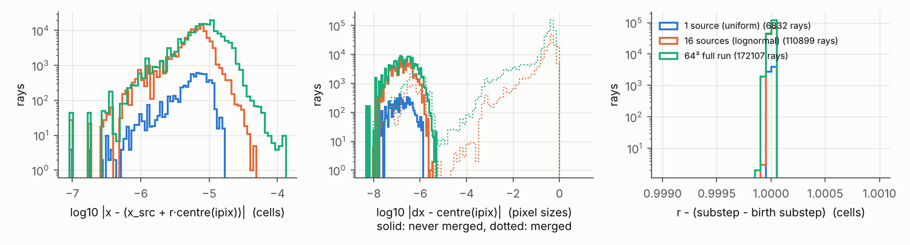
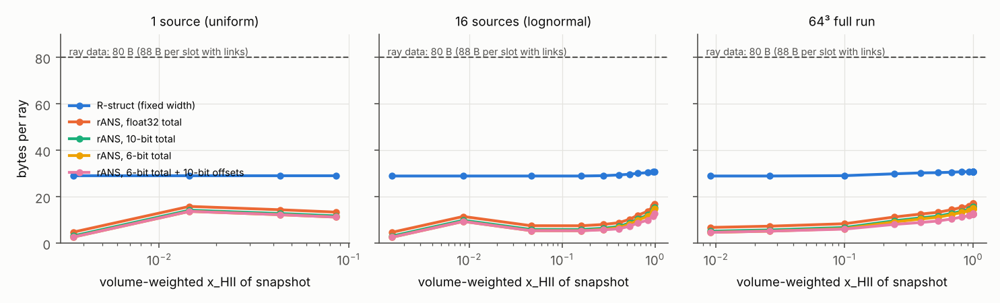
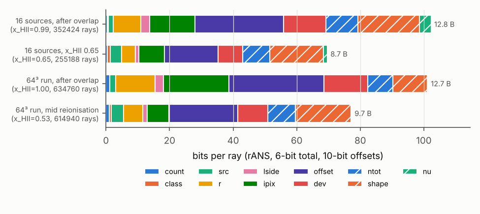
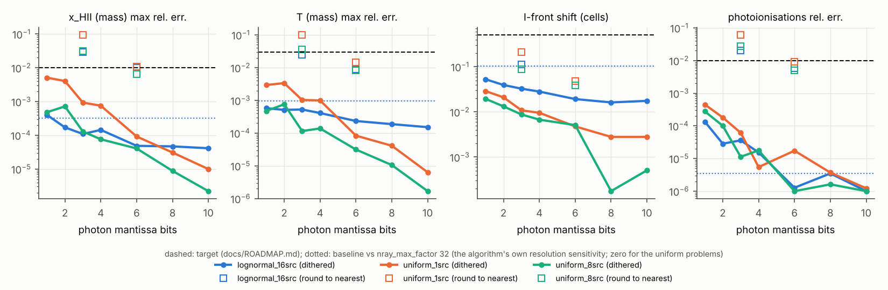
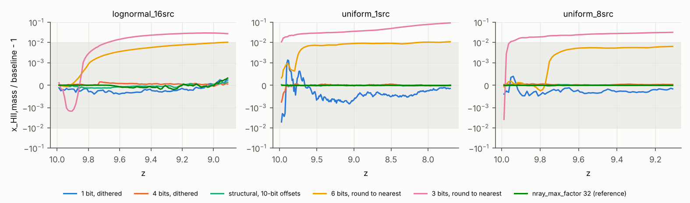

# Ray compression study (ROADMAP §4, Stage B)

*Written 2026-10-08. Research only: no simulation result changes. Every new
option is off by default, and with the defaults the C++ stays bit-identical
to the Fortran harnesses (CTests `ray_dump_*`).*

Question: how few bytes can a ray take, how fast can it be encoded and
decoded, and how much flux precision can we drop before the astrophysical
outputs move by more than the targets (x_HII within 1–2 %, τ_es within 1 %,
I-front within half a cell, T within a few percent; `docs/ROADMAP.md`).

**Short answer**

1. A fixed-width **structural encoding** ("R-struct", §4) stores a ray in
   **~30 B instead of 80 B** (96 B with the chain links). Its errors are far
   below anything the RT cares about. Decoding it costs about one HEALPix
   `pix2vec` (~100 ns).
2. **rANS entropy coding** of the same fields (§5) reaches **8.7–13 B per ray**,
   depending on the phase of reionisation, with a 6-bit photon total and
   10-bit in-cell offsets. It costs **~250–300 ns to decode and ~350–400 ns
   to encode per ray**. That is ~30 % of the RT cost per ray-substep on this
   machine (~2 µs), so it is not cheap enough to apply to every ray every
   substep on CPU.
3. **Photon precision is not the constraint, provided quantisation is
   dithered.** Stochastic (unbiased) rounding of every photon group down to
   **1–2 mantissa bits** keeps x_HII, T, τ_es, the I-front and the photon
   budget far inside the targets on all three RT test problems (§6).
   Round-to-nearest is biased: 6 bits already gives ~1 % errors, 3 bits ~3–9 %.
4. Rays that were never merged are almost **fully determined** by
   (source, nside, ipix, age) (§3). They cost ~5–8 bits of geometry instead of
   ~110. After overlap, however, >90 % of rays have been merged, so this
   matters most before overlap.

**Recommendation** (§8): adopt R-struct (with dithered photon totals of ~8
bits) as the in-memory ray format of the Stage D rewrite. Keep the rANS coder
for checkpoints, MPI ray migration and possibly cold storage. Make dithering
mandatory for every lossy field.

---

## 1. Instrumentation (C++)

| piece | what | default |
|---|---|---|
| `include/radray/ray_dump.hpp`, `src/ray_dump.cpp` | After selected RT substeps (after `rt_step_3`, i.e. the state that would be stored between substeps) write every live ray in cell-chain order to `<dir>/rays_s<substep>.npy` (numpy structured array) plus a JSON sidecar. Per ray: the raw `Ray` fields (`nside ipix r dr x dx nu ngam`), its cell and chain position, provenance (`src` emitting cell or −1 if mixed, `birth` substep, `nmerge`, `nclamp`, flags merged/mixed/clamped) and cell context (`tau fgam ngam` per group, `fHI fHeI fHeII temp rhog`). The JSON holds N, z, substep, `ngam_ray`, the source cells and the volume-weighted x_HII. | off |
| provenance | `RayState::prov` (one `RayProv` per storage slot), filled by `ray_source`, `ray_cast_split` (children inherit, flag a clamped r) and `ray_cast_merge`. Only allocated when the dump is on, and never read by the RT. | off |
| `include/radray/ray_quant.hpp`, `src/ray_quant.cpp` | The lossy experiment of §6: after every substep each live ray is quantised in place (`ray_quant_bits`, `ray_quant_dither`, `ray_quant_struct`, `ray_quant_offbits`). This changes results on purpose. Per the user's decision (docs/PLAN.md, "Fortran harness scope") it has no Fortran counterpart. | off |

Parameters (both `rt_driver` and `radhydro`, in `params.txt` or `--set`):

```
ray_dump_dir = DIR          # snapshots go here
ray_dump_every = K          # every K-th global RT substep, and/or
ray_dump_at = 50 100 250    # these global RT substeps (1-based)
ray_quant_bits = m          # research only: photon mantissa bits (0 = off)
ray_quant_dither = 1        # 1 stochastic (unbiased), 0 round to nearest
ray_quant_struct = 1        # research only: R-struct round trip every substep
ray_quant_offbits = 16      # with ray_quant_struct: offset bits per axis
```

Checks: `ctest -L raycomp`. These run `lognormal_16src_smallbuf` (merging
on) with the dump on and compare with the stored Fortran outputs, legacy and
fixed modes, with `--rtol 0 --atol-frac 0`. Both are identical. The tests
also round-trip the last snapshot through the codec (0 mismatches).

Tools (`tools/ray_compression/`): `snap.py` (loader and derived fields),
`entropy.py` (step 3), `ray_codec.cpp` → `build/ray_codec` (steps 4–5),
`run_precision.sh` + `precision_metrics.py` (step 6), and `study.py` (batch
driver and figures).

## 2. Snapshots

All runs use the production ray settings (`legacy_rt = legacy_physics = 0`,
`nray_max_factor = 16`), except the 64³ run, which repeats the
`docs/full_run.md` §5 demo (factor 4; factor 16 would take ~4 h).

| run | set-up | snapshots (global RT substep) | rays | x_HII (vol) |
|---|---|---|---|---|
| 1 source | `uniform_1src`, 240 hydro steps | 60, 240, 720, 1440 | 0.6k–6.8k | 0.004–0.09 |
| 16 sources | `lognormal_16src`, 60 + 160 hydro steps | 30 … 720, 960, 1200, 1440 | 2k–352k | 0.001–0.993 |
| 64³ full run | Ngas = 64, Ndm = 32, 4 Mpc/h, on-the-fly FoF (17 sources), z = 7.94 → 7.06 (one hydro step, 3338 RT substeps), factor 4 | 50, 100, 250 … 3250 | 29k–832k | 0.009–1.0 (overlap at substep ≈ 2000) |

The 64³ run took 71 min (RT 4221 s), about **2.0 µs per ray-substep**. The
lognormal run also gives 2.0 µs. This is the yardstick for codec costs.

## 3. Empirical entropy and determinism (step 3)

`entropy.py` quantises each field at the precision of the structural
encoding (§4) and reports bits per ray:

* the plug-in entropy H(X);
* the conditional entropy H(X|Y);
* a split-half cross-entropy (model counted on even rays, evaluated on odd
  rays, back-off to the marginal). The cross-entropy is what a coder with a
  fitted table would pay. The plug-in H(X|Y) is optimistic when Y has many
  values.

### 3.1 Never-merged rays are deterministic

For rays that were never merged and whose splits never clamped r (all rays
of the 1-source run; 93 % of rays at x_HII = 0.28 and 7 % at 0.99 in the
16-source run):

| quantity | follows from | measured residual |
|---|---|---|
| direction `dx` | `centre(nside, ipix)` | ≤ 1.1·10⁻⁷ rad (float32 round-off; ≤ 3.5·10⁻⁶ of a pixel) |
| position `x` | `x_src + r·centre(ipix)` | median 7·10⁻⁶, max 1.5·10⁻⁴ cell (the 1e-6 nudges of `ray_cast_3` and float rounding) |
| `r` | `substep − birth + 1` | exact up to float rounding (|Δ| ≤ 2·10⁻⁴) |
| `dr` | `rmax(nside) − r` | ≤ 3·10⁻⁵ (true for **all** rays, merged or not) |
| `nside` | `nside_from_radius(r)` | equal for 80–90 %; otherwise one level lower (split deferred because the ray was too faint) |
| `nu` | the emission spectrum and the hydro steps since birth (redshifting) | H(nu tuple) ≈ 0 (1 source); ≤ 0.3 bit given the birth substep |



*Left: position residual from the origin model. Middle: deviation of dx from
the pixel centre, never-merged (solid) vs merged (dotted; merged rays are
spread over ~1 pixel). Right: r − age.*

So a never-merged ray is fully given by (source, age, nside, ipix) plus its
photons. Coding it conditionally costs:

| field | how | bits/ray |
|---|---|---|
| source | same as the previous ray in the block, or raw id | 0–4 (H(src\|cell) = 2.5–4 with 16 sources) |
| r | r − round(\|cell centre − x_src\|) | 3.1–3.3 |
| nside | nside_from_radius(r) − lside | 0.4–0.6 |
| ipix | position among the pixel predicted from the cell centre and its 8 neighbours | 2.2–2.4 (hits: 51 % same pixel, 98 % within the 3×3 neighbourhood) |
| position, direction, dr | derived | 0 |

That is **~6–10 bits of geometry**, against 48 + 30 + 16 + 16 ≈ 110 bits in
R-struct. These rays must be wrapped around the periodic box at most once
(r < N/2 − 1) for the prediction to be unambiguous; farther rays fall back to
the general class.

Clamped splits (a deferred split that clamps r to [rmin, rmin+1]) move the
effective origin. They are rare (one ray in the 16-source run at x = 0.99, a
0.16-cell shift) and are coded as general rays.

### 3.2 Entropy of each field (all rays)

Bits per ray, cross-entropy, at three phases of the 16-source run
(full table for every snapshot: `entropy.py` output, reproducible with
`study.py entropy`):

| field (precision) | raw | R-struct | x=0.28 | x=0.65 | x=0.99 | best context (x=0.99) |
|---|---|---|---|---|---|---|
| merged flag | — | 1 | 0.38 | 0.99 | 0.37 | 0.13 given nside |
| offset per axis (1/65536 cell) | 32 | 16 | 13.2 | 14.9 | 16.1 | none helps |
| offset per axis (1/1024 cell) | | 10 | 9.9 | 9.9 | 10.0 | none |
| nside | 32 | 4 (with ipix: 30) | 1.6 | 2.0 | 2.6 | 0.45 given nside(r) |
| ipix | 32 | 30 (with nside) | 11.8 | 12.6 | 15.7 | ≈ 2.3 for never-merged given (src, cell, r) |
| r (1/8 cell) | 32 | 16 | 4.4 | 5.9 | 9.9 | 7.7 given nside |
| dr | 32 | 0 | 0 | 0 | 0 | derivable |
| direction offset θ, φ (merged; 1/128 pixel) | 96 (dx) | 2 × 8 | 7.2 + 6.7 | 7.2 + 6.7 | 7.3 + 7.1 | φ given θ: 7.0 |
| direction offset (never merged) | | 0 | 0 | 0 | 0 | |
| log2 Σngam (1/128 octave) | 32 (float) | 32 | 10.0 | 9.8 | 9.2 | 9.1 given (nside, merged) |
| shape, per group, 5 groups (1/128 octave) | 128 | 65 | 26.4 | 25.6 | 24.5 | group i given group i−1: ≈ 17 in total |
| shape, joint tuple | | | 11.3 | 11.0 | 11.9 | a 255-entry dictionary from the previous snapshot covers 61–79 % of rays |
| nu, 5 groups (8 bit in band) | 160 | 40 | 0.9 | 1.1 | 3.0 | 2.0 given birth |

Observations:

* The **in-cell offsets of merged rays are incompressible** (≈ the stated
  precision). The only lever is precision itself: 10 bits per axis
  (1/1024 cell) instead of 16 saves 18 bits per merged ray. It changes
  nothing measurable (§6).
* **Directions of merged rays** cost ipix + offset ≈ 25–30 bits. They spread
  over about one pixel (median |offset| ≈ 0.25 pixel).
* **Photons:** after 1/128-octave log quantisation the total has ~9–10 bits of
  entropy. The spectral shapes repeat heavily (rays of one source and
  emission time share a history), so a small dictionary removes most of
  their cost.
* **nu** is nearly constant: it changes only through merges and
  redshifting. A dictionary codes it in 1–3 bits.
* Conditioning on the **cell's optical depth** helps little once the coder
  is fitted out of sample (cross-entropy). The plug-in H(X|cell) values look
  spectacular (e.g. 3.6 bits for Σngam) but do not generalise: they reflect
  the many cells with only a few rays.

## 4. Structural encoding "R-struct" (step 4)

`ray_codec` computes it per snapshot (fixed width, no entropy coding):

| field | bits | encoding | max error (measured) |
|---|---|---|---|
| position | 3 × 16 | offset in the chain cell, 1/65536 cell (the cell is implicit in a cell-sorted array) | 7.6·10⁻⁶ cell |
| nside + ipix | 30 | `4·nside² + ipix` (unique NESTED id, < 2³⁰ for nside ≤ 8192) | exact |
| merged flag | 1 | | |
| direction offset | 2 × 8, merged rays only | (θ, φ) tangent-plane offset from the pixel centre, 1/128 pixel | 0.0042 rad worst case (nside = 4); rms 1.5·10⁻⁴ rad |
| r | 16 | 1/8 cell; **dr dropped** (= rmax(nside) − r) | 0.0625 cell (never-merged rays: exact) |
| photon total | 32 | float32 Σngam | exact |
| spectral shape | 5 × 13 | round(128·log2(ngam_i/Σngam)), or zero | 0.13 % of the ray total per group; Σ exact |
| nu | 5 × 8 | linear in the band | 0.04 eV |

**Size: 232 + 16·f_merged bits = 29–31 B per ray** (80 B raw, 96 B with the
chain links). The R32 layout of the design doc has the same content, packed
into 32 B. The direct `nside` + `ipix` id saves 4 bits, and the flag lets
never-merged rays skip the direction offset.

The round trip changes nothing measurable in the RT (§6, `struct` and
`struct_o10` variants: x_HII ≤ 0.3 %, front shift ≤ 0.05 cell).

## 5. Entropy coding with rANS (step 5)

`tools/ray_compression/ray_codec.cpp` (CMake target `ray_codec`):

```
build/ray_codec TRAIN_STEM TEST_STEM [--mbits m] [--offbits b] [--no-origin] [--block n] [--reps k]
```

* **Coder:** rANS with a 32-bit state, byte-wise renormalisation and two
  interleaved states. Probabilities are 12-bit, all alphabets have ≤ 256
  symbols, and the decode tables are uint8 slot→symbol plus packed
  (freq, cum), so the whole model set stays in L2. Bypass bits (offsets,
  mantissas, low bits) go to a separate raw bit stream.
* **Blocks:** whole cells, ≥ 4096 rays. Blocks decode independently, so
  decoding parallelises and allows random access by cell.
* **Models:** static histograms counted on the **previous snapshot** of the
  same run (the first snapshot is coded with its own model, "oracle"). The
  models are:
  * rays per cell (context: the previous cell's count);
  * the class of each ray (origin-coded / general unmerged / general merged;
    context: the previous ray's class);
  * for origin-coded rays, the §3.1 chain;
  * for general rays: offsets raw, nside histogram, r as
    bucket(zigzag(8r − 8 rmin)) + raw bits (context nside and class), and
    the source hint. ipix is predicted from (x − x_src) when a source is
    known, otherwise coded as merge cone + raw bits. The direction offset
    uses 8-bit histograms (φ conditioned on |θ|);
  * the float exponent of Σngam around a per-nside mode, plus `--mbits`
    raw mantissa bits;
  * the shape tuple as an index into a 255-entry dictionary, with escape to
    s₀ + successive differences;
  * nu as a dictionary index, with escape to 5 bytes.
* The symbol traversal is written once and used for counting, encoding and
  decoding, so the three cannot drift apart. Every run checks that the
  decoded R-struct values equal the encoded ones (0 mismatches in all runs).
* **Timing:** single-threaded, on this VM (Xeon @ 2.8 GHz). Encode is
  quantise + model + rANS flush. Decode is rANS + reconstruction of float
  `x, dx, r, dr, nside, ipix, ngam, nu`, i.e. what the RT needs. The codec
  uses its own fast NESTED `pix2vec`/`vec2pix` (`fast_healpix.hpp`,
  polynomial sincos/atan2). These agree with the Fortran-faithful ones to
  1e-15 and to 0 of 2·10⁶ test pixels.

RESULTS_TABLE





Where the time goes (decode, x = 0.54 snapshot of the 64³ run):

* reconstruction (`pix2vec` + shapes + positions): ~100 ns;
* `vec2pix` for the ipix prediction of origin/sourced rays: ~40 ns;
* ~15 rANS symbols + raw bits: ~120–150 ns.

The single most expensive item, `pix2vec`, is shared with R-struct, because
any (ipix + offset) direction format needs it. Storing the direction as an
octahedral-encoded 2×16-bit unit vector instead would cost ~5 ns to decode,
at +16 bits for merged rays and +32 for never-merged ones.

**Learned models.** A small neural network was not tried. The residual
fields that dominate the coded size (offsets, ipix low bits, direction
offsets, mantissas) are close to uniform at their stated precision. The
fields with structure (shape, nu, r, nside, ipix of never-merged rays) are
already captured by histograms, dictionaries and the exact origin
predictions. The best a model can do is the out-of-sample cross-entropy of
§3.2, and the codec is within ~1–2 B of that sum. An NN would add far more
than the ~100 ns per ray that is the entire decode budget.

## 6. Lossy precision (step 6)

`tools/ray_compression/run_precision.sh` runs `uniform_1src` (240 hydro
steps), `uniform_8src` (80) and `lognormal_16src` (100, to x_HII = 0.95). It
uses the production ray settings, with these variants:

* `dm`: every photon group stochastically rounded to m mantissa bits after
  every RT substep;
* `rm`: rounded to nearest instead of dithered;
* `struct`: the R-struct round trip of §4 every substep;
* `struct_o10`: the same with 10-bit offsets;
* `struct_d4`, `struct_o10_d4`: combined with 4-bit dithered totals;
* `nrmf32`: `nray_max_factor = 32`. This is not a quantisation; it measures
  the algorithm's own sensitivity to its ray budget, as a scale for "small".

`precision_metrics.py` compares each run with its baseline; maxima are over
all hydro steps.

| problem | variant | x_HII vol | x_HII mass | T mass | τ_es | I-front shift (cells) | photoionisations |
|---|---|---|---|---|---|---|---|
| uniform_1src | d1 | 5.1e-3 | 5.1e-3 | 3.0e-3 | 3.8e-4 | 0.029 | 4.5e-4 |
| | d2 | 4.0e-3 | 4.0e-3 | 3.4e-3 | 2.0e-4 | 0.021 | 1.8e-4 |
| | d4 | 7.5e-4 | 7.5e-4 | 1.0e-3 | 2.6e-7 | 0.010 | 5.5e-6 |
| | d8 | 3.1e-5 | 3.1e-5 | 4.1e-5 | 3.4e-6 | 0.003 | 3.7e-6 |
| | r3 | **9.3e-2** | **9.3e-2** | **9.8e-2** | **5.8e-2** | 0.21 | **6.0e-2** |
| | r6 | **1.1e-2** | **1.1e-2** | 1.4e-2 | 9.2e-3 | 0.049 | 9.2e-3 |
| | struct_o10 | 5.6e-5 | 5.6e-5 | 6.2e-4 | 1.9e-5 | 0.025 | 3.6e-6 |
| | struct_o10_d4 | 7.3e-4 | 7.3e-4 | 1.2e-3 | 1.6e-5 | 0.018 | 1.5e-6 |
| uniform_8src | d1 | 4.8e-4 | 4.8e-4 | 4.7e-4 | 2.6e-4 | 0.019 | 2.8e-4 |
| | d2 | 7.2e-4 | 7.2e-4 | 7.6e-4 | 9.6e-5 | 0.013 | 1.0e-4 |
| | d4 | 7.6e-5 | 7.6e-5 | 1.4e-4 | 2.5e-5 | 0.007 | 1.8e-5 |
| | r3 | **3.2e-2** | **3.2e-2** | **3.5e-2** | **2.7e-2** | 0.089 | **2.7e-2** |
| | r6 | 6.4e-3 | 6.4e-3 | 8.2e-3 | 5.0e-3 | 0.038 | 5.1e-3 |
| | struct_o10_d4 | 5.8e-5 | 5.8e-5 | 5.8e-4 | 2.3e-5 | 0.027 | 1.5e-5 |
| lognormal_16src | d1 | 3.9e-3 | 4.0e-4 | 5.8e-4 | 1.5e-4 | 0.053 | 1.3e-4 |
| | d2 | 6.1e-3 | 1.7e-4 | 5.1e-4 | 2.7e-5 | 0.039 | 2.9e-5 |
| | d4 | 2.4e-4 | 1.4e-4 | 4.1e-4 | 4.9e-5 | 0.028 | 1.5e-5 |
| | d8 | 8.6e-5 | 4.7e-5 | 1.9e-4 | 5.2e-6 | 0.016 | 3.5e-6 |
| | r3 | **2.6e-2** | **3.0e-2** | 2.5e-2 | **2.3e-2** | 0.11 | **2.0e-2** |
| | r6 | 7.1e-3 | **1.0e-2** | 9.0e-3 | 6.7e-3 | 0.049 | 5.8e-3 |
| | struct | 8.0e-4 | 1.3e-4 | 5.1e-4 | 9.1e-6 | 0.047 | 2.5e-5 |
| | struct_o10 | 2.7e-3 | 1.4e-4 | 8.6e-4 | 1.6e-5 | 0.049 | 3.4e-5 |
| | struct_o10_d4 | 3.2e-3 | 1.9e-4 | 8.4e-4 | 4.3e-5 | 0.050 | 7.7e-6 |
| | *nrmf32 (reference)* | 2.4e-3 | 3.2e-4 | 9.7e-4 | 1.0e-6 | 0.10 | 3.4e-6 |

Bold: at or beyond a target. The I-front shift is the number of cells whose
ionisation state (x > 0.5) differs, divided by the number of
ionised–neutral cell faces in the baseline, i.e. the mean front
displacement in cells. In `uniform_*` the ray count never reaches the
merge thresholds, so `nrmf32` is identical to the baseline there.





Findings:

* **Dithered quantisation meets every target at every bit depth tested, down
  to 1 bit.** That is factor-of-2 steps, i.e. each group stored as a random
  power of two with the right mean. The global errors are ≤ 0.6 % in x_HII,
  ≤ 0.4 % in T, ≤ 4·10⁻⁴ in τ_es, ≤ 0.05 cell in the front, ≤ 5·10⁻⁴ in
  photoionisations. In the lognormal run they are no larger than the
  algorithm's own sensitivity to `nray_max_factor` (16 → 32). The reason is
  that every cell sums many ray contributions per substep and many substeps
  per hydro step. Unbiased per-ray noise averages away, roughly as
  1/√(rays × substeps), as the roadmap anticipated.
* **Round-to-nearest is biased and fails:** 3 bits gives 3–9 % errors and
  6 bits ~1 %. The error grows monotonically in time (figure), because each
  re-quantisation of the same ray adds the same-signed error. The design
  doc's recommendation of dithering is therefore essential, not a
  refinement.
* **Per-cell scatter.** The rms change of T and x_HII in ionised cells is
  0.6–2 % (lognormal) for *any* perturbation, including d10 and `nrmf32`
  (4 %). This is the chaotic sensitivity of individual cells near fronts,
  not a precision effect. The global metrics above are the meaningful ones.
* **The structural round trip** (16- or 10-bit offsets, 1/8-cell r,
  1/128-pixel direction offsets, 8-bit nu, 1/128-octave shapes) is as
  harmless as the photon quantisation.
* **Coarsest precision within the targets:** 1–2 dithered mantissa bits per
  group (and also the shape at 1/128 octave). Bits per ray are then
  dominated by geometry, not photons. A conservative production choice is
  **6–8 dithered bits for the photon total**, which costs only 2–4 bits more
  per ray than 1–2 bits.

Caveats: these are small (32³) boxes over ≤ 240 hydro steps. The 64³ full
run was not repeated with quantisation (71 min per run). The roadmap's
production box with `c_reduced` has more substeps per hydro step, which only
helps the averaging. Re-check d4 and `struct_o10` once on the production
configuration before adopting them.

## 7. Bytes per ray, summary

BYTES_SUMMARY

## 8. Recommendation

1. **In-memory format of the Stage D ray rewrite: R-struct, ~28–30 B per
   ray**, in SoA form inside the cell-sorted arrays (the cell index is
   implicit). Specifically:
   * 3 × 16-bit offsets (10–12 bits suffice);
   * a 30-bit unique HEALPix id;
   * a never-merged flag;
   * an 8+8-bit direction offset for merged rays;
   * 16-bit r with dr dropped;
   * the photons as a total with ~8 dithered mantissa bits plus 5
     log-quantised shape values (or the 5 groups directly at ~8 dithered
     bits each);
   * 8-bit nu, or a per-run nu table.

   Decoding costs ~100 ns per ray, dominated by `pix2vec`. Evaluate an
   octahedral direction encoding (~5 ns) if that matters. This is about a
   2.7–3× memory saving over the current 80 B (3.3× including the links),
   at no measurable accuracy cost.
2. **Make dithering mandatory** for every lossy field (photons, shape,
   position). Use a deterministic hash of (substep, ray, field) so results
   do not depend on the thread count (as in `ray_quant.cpp`).
3. **Use rANS only where bytes matter more than ~300–400 ns per ray:**
   checkpoints, MPI ray migration, and cold or bulk storage. There it gives
   another 2.3–3.5× over R-struct (8.7–13 B per ray). Keep never-merged rays
   origin-coded, use dictionaries for shapes and nu, and train models on the
   previous snapshot.
4. **Not worth pursuing:** a neural-network model (no structure left that a
   histogram misses, and no decode budget); per-cell conditioning on τ for
   the photon fields (does not generalise).
5. **Bigger wins are algorithmic** (`docs/ROADMAP.md` §4.5). After overlap
   93–99 % of rays are merged, and their cost is dominated by incompressible
   position and direction bits. Reducing the *number* of rays in the
   transparent ionised bulk (fewer cones, a moment/background hand-over)
   saves more than any encoding.

## 9. Reproducing

```
cmake --build build -j
# snapshots (examples)
build/rt_driver tests/problems/lognormal_16src OUT --nsteps 60 \
  --set legacy_rt=0 --set legacy_physics=0 --set nray_max_factor=16 \
  --set ray_dump_dir=OUT/dump --set ray_dump_every=120
build/radhydro FULL64 OUT --set ray_dump_dir=dump --set ray_dump_every=250
# analysis
python3 tools/ray_compression/study.py entropy OUT/dump --out entropy.json
python3 tools/ray_compression/study.py codec OUT/dump --out codec.json
tools/ray_compression/run_precision.sh PREC 3
python3 tools/ray_compression/precision_metrics.py PREC --json precision.json
python3 tools/ray_compression/study.py figures --codec codec.json \
  --precision precision.json --det STEM1 STEM2 --outdir docs/figures
```

The snapshots themselves (~1.9 GB) are not committed.
