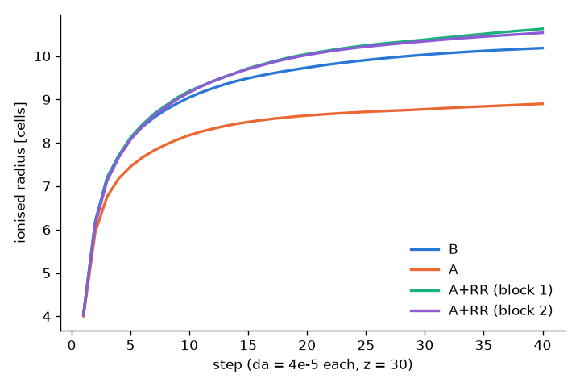
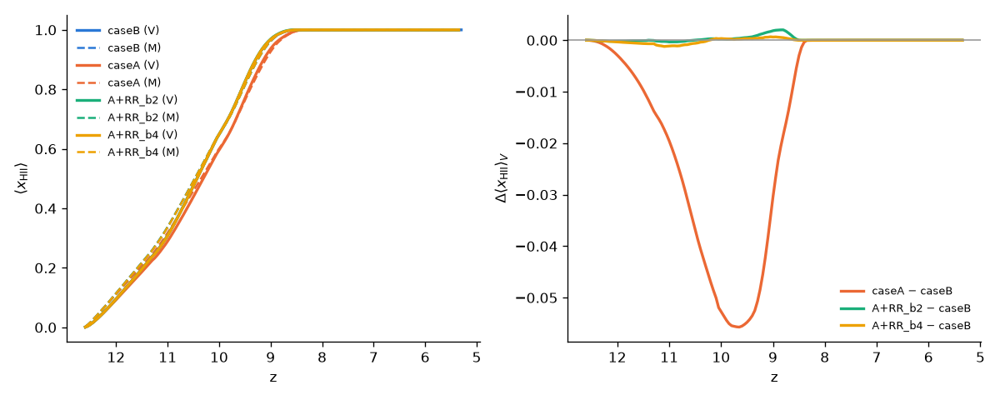
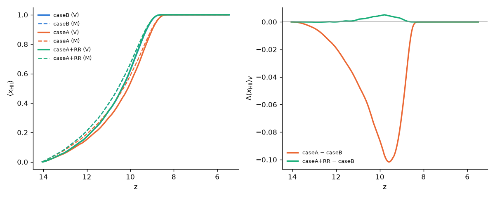
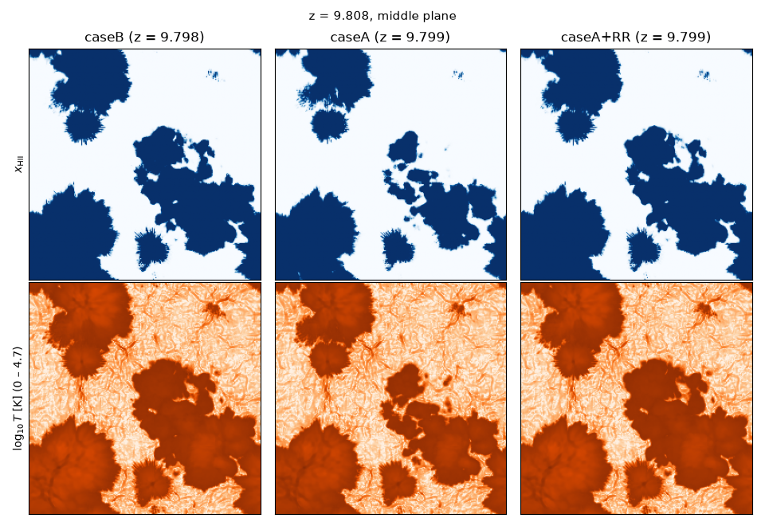
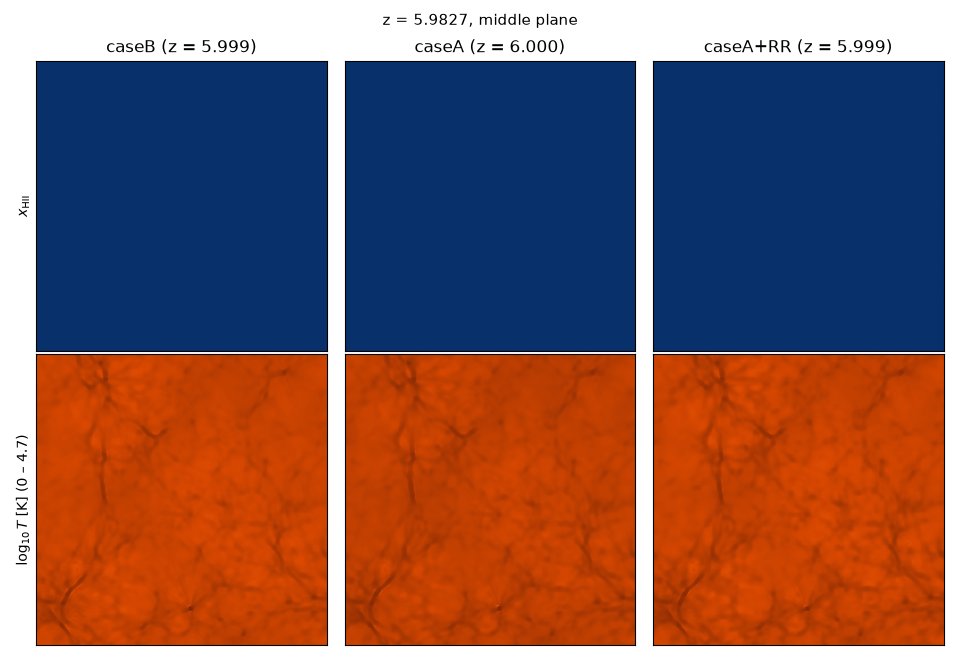
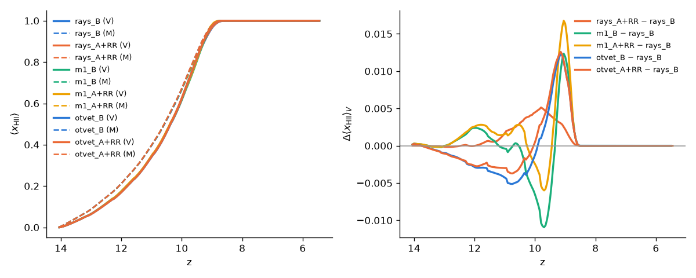

# Case A recombination and recombination radiation

*Written 2026-10-10 (branch `recomb-radiation`). New options, not in the
original. With the defaults (`recomb_case = B`, `recomb_rad = 0`) the code
is the original. On klone the fast suite gives 92/102 (the two new
fast `recomb` tests pass; `main` gives 90/100),
with byte-identical mismatch details: the 10 failures are the known 1-ulp
platform differences of `docs/cluster.md` §3.*

## 1. Usage

```
radhydro  <problem> <out> --set recomb_case=A                   # case A only
radhydro  <problem> <out> --set recomb_case=A --set recomb_rad=1  # + transported recombination radiation
radhydro  <problem> <out> --set recomb_case=A --set recomb_rad=1 --set recomb_rad_lines=1  # + H-ionising helium lines
radhydro  <problem> <out> --set rt_method=m1 --set recomb_case=A --set recomb_rad=1     # with the moment RT
```

| Parameter | Values | Meaning |
|---|---|---|
| `recomb_case` | `B` (default), `A` | Recombination rates and recombination cooling in `photo_cell` |
| `recomb_rad` | `0` (default), `1` | Ground-state recombinations are transported. Needs `recomb_case = A`. With the rays they are emitted as rays and need `legacy_rt = 0`; with `rt_method = m1 \| otvet` every cell emits into the moments (§2.3). |
| `recomb_rad_lines` | `0` (default), `1` | Also the helium recombination photons that ionise H (§2.2). Needs `recomb_rad = 1`. |
| `recomb_rad_nside` | 1 (default), 2, 4 | Rays only: HEALPix nside of a recombination emission, 12·nside² rays |
| `recomb_rad_block` | integer dividing N, default 2 | Rays only: emission is gathered over blocks of b³ RT cells |
| `recomb_rad_pool` | (0, 0.9), default 0.75 | Rays only: recombination rays are launched only while the live rays stay below this fraction of `Nray_max` |

The three meaningful combinations are:
- **case B** (the original): ground-state recombination photons are absorbed
  where they are made (on the spot);
- **case A**: they escape and are lost (the optically thin limit);
- **case A + `recomb_rad`**: they are transported.

`recomb_rad = 1` with case B is refused: it would count the same photons
twice.

## 2. What it does

**Case A.** `photo_cell` uses `alpha_rec(1:3)` in the ionisation balance and
in the recombination count, and `coef_cool(1:3)` in the cooling. Case B uses
`alpha_rec(4:6)` and `coef_cool(4:6)`, as the original does. With
`legacy_physics = 0` these are the Hui & Gnedin (1997) fits (P1, P4, P6, P7;
`docs/port_notes.md` §5b). With `legacy_physics = 1` they are the original
coefficients, including the case-A formula used for case B cooling (P1).

**Recombination radiation.** The original has a disabled block for this
(`if (.false.)` in `photo_cell`, B12). It adds the case A − case B
recombinations of HII, HeII and HeIII to the cell's own photon groups 1, 3
and 5, before the ionisation balance. Those are the ground-state
recombinations, whose photons can ionise. The mapping is right for the group
edges (13.6 / 18.3 / 24.6 / 36.6 / 54.4 / 100 eV). Note that the original
block would count the photons twice, since its balance uses case B.

`recomb_rad = 1` transports these photons with the rays
(`src/recomb_rad.cpp`). Every RT cell is in one of two modes for each
substep, chosen per block of `recomb_rad_block`³ cells at the start of the
substep (`recomb_prepare`, in `rt_step_1`):

- **Launch.** `photo_cell` uses case A and counts the cell's ground-state
  recombinations, (α_A − α_B) n_e n_X dt, into a buffer.
  - At the next substep the block launches the buffer as 12·nside² rays
    (12 by default) from one of its cells (`ray_source_recomb`, next to
    `ray_source` in `ray_tracing_1`).
  - The launching cell rotates through the block from substep to substep.
  - The rays start at the cell centre with r = 0, like stellar rays, and
    from then on are ordinary rays: they are cast, split, merged with any
    ray, redshifted and absorbed.
  - Photon energy: the threshold plus the mean excess of §2.1, kept inside
    the group.
- **On the spot.** `photo_cell` uses case B for the cell. Its ground-state
  recombinations are only counted, for the budget.

A block is put on the spot when any of these holds:
- its launching cell is optically thick (exp(−τ_min) < 0.01, the test
  `ray_source` uses for stars);
- its photons per ray would be below `ngam_min` (such rays are removed at
  once);
- the ray pool has no room for it.

The room is `recomb_rad_pool`·Nray_max minus the live rays, the stellar
source rays (192 per source cell), 3 rays per expected stellar split (every
candidate above the current split threshold) and the recombination rays of
the substep. The brightest blocks, ranked by their production in the last
substep, get the room first. The ranking uses whole histogram bins, so it
does not depend on the order. The stellar sources and splits therefore come
first, and the F3 pool guard is not triggered by recombination rays.

While the live rays exceed the cap, the faint rays of a cell are merged into
12 direction bins (nside 1) instead of the original 48 (`RayState::
nside_merge`, 2 in the original). That lets the live count fall.

**Why gather and limit.** If every ionised cell emitted, the diffuse field
would fill every direction bin of every ionised cell: about 48 merged rays
per cell, or 8×10⁸ rays at 256³ once the box is ionised. The production
pool holds 2.7×10⁸ (`nray_max_factor = 16`). Gathering over 2³ blocks and
emitting 12 rays reduces the emission 128-fold compared with 192 rays per
cell. The pool cap and the on-the-spot fallback keep the stellar transport
unaffected.

**Budget.** `ray.log` gets one line per substep:
`Recomb : launched … dropped … onspot … emit … launch_mode … of … merge_nside …`.
The first three are cumulative, in photons per H atom of the box:
- **launched:** sent as rays;
- **dropped:** a launch-mode block whose photons per ray came out below
  `ngam_min`;
- **onspot:** the case-B cells.

`rt_stats.txt` `nrab` now holds the ground-state recombinations (0 with
`recomb_rad = 0`, as in the original).

**Determinism and restarts.** Blocks are independent, the sums are taken per
plane and added in order, and emission writes only the launching cell's
chain. The results are byte-identical for 1, 2 and 4 threads
(`thread_rt_recomb_lognormal_16src`). Checkpoint version 4 holds the
buffers, the cell modes and the budget, and restarts are bit-identical
(`restart_smoke_recomb`). Versions 1–3 still load (without
`recomb_rad`).

### 2.1 Photon energy

A ground-state recombination photon has hν = χ + E_e, where E_e is the
captured electron's kinetic energy. The Milne relation gives the photon
spectrum

  dN/dE ∝ E² σ_pi(E) exp(−(E − χ)/kT),

with σ_pi the photoionisation cross-section. For σ_pi ∝ E⁻³ (hydrogenic,
Kramers) this is ∝ exp(−x)/(1 + εx), with x = (E − χ)/kT and ε = kT/χ, so
the mean excess is ⟨E − χ⟩ ≈ kT(1 − ε). It is therefore a little less than
kT, and falls further as T rises.

`recomb_mean_excess` integrates the relation numerically with the code's
own cross-sections (`photoion_sigma`, Verner-type fits). It tabulates the
result in log T at start-up, for HI, HeI and HeII, and for the HeII n = 2
level (Kramers):

| T | kT | HI | HeI | HeII | HeII n = 2 |
|---|---|---|---|---|---|
| 5 000 K | 0.43 eV | 0.98 kT | 1.01 kT | 1.00 kT | 0.97 kT |
| 10 000 K | 0.86 eV | 0.96 kT | 1.01 kT | 0.99 kT | 0.95 kT |
| 20 000 K | 1.72 eV | 0.93 kT | 1.02 kT | 0.98 kT | 0.91 kT |
| 40 000 K | 3.45 eV | 0.88 kT | 1.03 kT | 0.96 kT | 0.85 kT |

**Check against the cooling.** In case A, the extra recombination cooling
per ground-state recombination should equal ⟨E − χ⟩. It is the energy the
gas loses and the photon carries away. With `legacy_physics = 0` (Hui &
Gnedin 1997 fits), (Λ_A − Λ_B)/(α_A − α_B) for HII comes out as 0.96, 0.94,
0.91 and 0.85 kT at the four temperatures above. The tabulated excess
agrees with this to 2–3% of kT. For HeII both cooling fits are kT·α, which
gives exactly kT, against 1.01 kT. So the transported photons return to the
gas, within a few per cent of kT, the energy that case A takes out.

The first version used χ + kT. That was 4% of kT too high at 10⁴ K and 12%
at 4×10⁴ K, about 0.03–0.4 eV per photon. The 256³ runs of §4 used it. The
difference is far below anything those comparisons resolve.

With `legacy_physics = 1`, case-B cooling repeats the case-A formula (P1).
Recombination radiation is then not energy-consistent, so use
`legacy_physics = 0`.

### 2.2 Helium recombination photons that ionise H (`recomb_rad_lines`)

Case B assumes that recombinations to excited states produce only photons
that cannot ionise. For helium that is not true. With
`recomb_rad_lines = 1`, every case-B recombination α_B n_e n_X dt of HeII
and HeIII also emits the following, transported like the ground-state
continuum:

| recombination | channel | per case-B recombination | energy | group |
|---|---|---|---|---|
| HeII → HeI | triplets → 2³S → 1¹S | 3/4 | 19.82 eV | 2 |
| | singlets → 2¹P → 1¹S | 1/4 × 2/3 | 21.22 eV | 2 |
| | singlets → 2¹S two-photon (20.62 eV in all) | 1/4 × 1/3 × 0.49 photons above 13.6 eV | 13.6–20.6 eV | 1, 2 |
| HeIII → HeII | 2P → 1S, HeII Lyα | 2/3 | 40.81 eV | 4 |
| | 2S two-photon (40.81 eV in all) | 1/3 × 1.42 photons above 13.6 eV | 13.6–40.8 eV | 1–4 |
| | Balmer continuum (capture to n = 2) | f_BC(T): 0.24 at 10⁴ K, 0.28 at 2×10⁴ K | 13.6 eV + ⟨E − χ⟩ | 1 |

That is 0.97 H-ionising photons per HeII recombination, and 1.42 + f_BC
per HeIII recombination.

- **Two-photon spectrum.** The Nussbaumer & Schmutz (1984) fit for the
  hydrogen 2s decay, scaled to the total energy. The HeI 2¹S decay uses the
  same shape. The photons above 13.6 eV are split into groups numerically
  (`add_two_photon`).
- **f_BC** is α₂/α_B from Kramers' partial recombination coefficients,
  α_n ∝ (1/n) x_n e^{x_n} E₁(x_n) with x_n = 4χ_H/(n²kT), summed to
  n = 2000. It has no Gaunt factors and is good to roughly 10–20%.
- **The branching fractions are from memory and still need checking.**
  These are the 3/4 : 1/4 triplet/singlet split, the 2/3 : 1/3 split
  between 2P and 2S in each case, and the fit coefficients α = 0.88,
  β = 1.53, γ = 0.8. They follow the usual low-density treatment
  (Osterbrock & Ferland 2006, ch. 4; Nussbaumer & Schmutz 1984), which was
  not reachable from here. The values are in `recomb_init` and `heII_fBC`
  in `src/recomb_rad.cpp`. The 0.49 and 1.42 photons per decay above
  13.6 eV are computed, and they match the values usually quoted.
- **At IGM densities** the 2³S level decays radiatively: collisional
  transfer to the singlets is negligible. The 21.2 eV photons are
  resonance-scattered by HeI, which is not modelled. They are absorbed by
  HI, with the group's cross-section.
- **On-the-spot cells** (rays only: thick blocks, or no room in the pool).
  There the line photons are counted in `onspot` and not transported. That
  is the original's case-B treatment, in which they are lost.
- **HeII Lyα and the other group-2–4 photons** also ionise HeI where they
  are absorbed.

### 2.3 With the moment RT

With `rt_method = m1 | otvet` there are no blocks and no pool.
- Every cell uses case A. Each substep, `moment_step_1` adds the
  recombination photons of the previous substep to the cell's own photon
  density, one group at a time, with zero flux (isotropic emission). Line
  photons are included when `recomb_rad_lines = 1`.
- Nothing is on the spot. In optically thick cells the photons are
  absorbed in place at the next substep, which is the on-the-spot result.
- They count in the moments' `injected`, so the photon-conservation
  bookkeeping (`Moments : in flight … injected … absorbed … lost`) covers
  them. `ray.log` gets `Recomb : emitted …`, which is cumulative, per H
  atom.
- Tests:
  - `thread_rt_recomb_m1_lognormal_16src`: M1 with the lines, results the
    same for 1, 2 and 4 threads;
  - `restart_smoke_recomb_otvet`: OTVET with the lines, restarts
    bit-identical.

## 3. Strömgren sphere

`tools/analysis/recomb_stromgren.py` (ctest `recomb_stromgren`, nightly):
- uniform gas at 30× the mean density at z = 30, n_H ≈ 0.17 cm⁻³, below
  `rho_source` = 50, so every photoionisation uses a photon;
- N = 32, one source of Luv = 6·10³¹ in the centre;
- c_reduced = 1, legacy flags 0;
- 40 steps of Δa = 4·10⁻⁵, about 7 recombination times.

The ionised radius R = (3V_HII/4π)^(1/3), in cells:



| run | R (step 40) | T (median, ionised) | expected | ratio |
|---|---|---|---|---|
| case B | 10.18 | 20 745 K | – | – |
| case A | 8.90 | 25 661 K | 8.80 = R_B (α_B(T_B)/α_A(T_A))^(1/3) | 1.011 |
| case A + RR, block 1 | 10.28 | 21 260 K | 10.26 = R_B (α_B(T_B)/α_B(T))^(1/3) | 1.002 |
| case A + RR, block 2 | 10.78 | 21 547 K | 10.30 | 1.047 |

- Case A shrinks the sphere by the expected (α_B/α_A)^(1/3), to 1%.
- With the recombination radiation transported, the radius returns to the
  case-B value, corrected to the run's temperature. In this optically
  thick geometry the on-the-spot approximation is exact for the total.
- With block 2, 84% of the ground-state recombinations are launched as
  rays, and R is 4.7% above R_B. The radial profile shows two causes:
  - the edge is half a cell further out;
  - the diffuse photons fill the holes that the stellar rays' HEALPix
    sampling leaves inside the case-B sphere along the grid axes (B16): the
    shell at r ≈ 7 has x_HII = 0.95 with case B and 1.00 with RR.
    (These runs use the original frame. With `ray_rotate = 3`, the
    production setting, those holes are gone; see `docs/port_notes.md`
    B16. That part of the 4.7% should shrink; not re-measured.)
- With block 1 the 32³ test pool (`nray_max_factor` 64 of 32³) has room for
  only 32% of the emission, so 68% is on the spot (case B). The result is
  then close to case B, as it should be.

The test checks:
- case A to 4%;
- case A + RR within [0.97, 1.06] of the temperature-corrected R_B for
  both blocks.

**Moment RT and helium lines** (`--method m1|otvet`, `--lines`; the nightly
tests `recomb_stromgren_m1` and `recomb_stromgren_otvet`). Each method is
compared with its own case B, and the radii are at step 40:

| run | case A ratio | case A + RR ratio | launched |
|---|---|---|---|
| rays, block 1 / block 2 | 1.011 | 1.003 / 1.050 | 33% / 85% |
| M1 | 1.011 | 1.007 | 100% |
| OTVET | 1.009 | 1.006 | 100% |
| rays + lines, block 1 / block 2 | – | 1.008 / 1.061 | 33% / 72% |
| M1 + lines | – | 1.039 | 100% |

(The rays rows are the current code, with the energy of §2.1. The ratios
in the earlier table used χ + kT and differ by at most 0.003.)

- **The moment methods recover case B best.** Every cell emits where it
  is, so there are no block offsets or sampling holes.
- **The helium photons enlarge the sphere, as they should.** Case B
  ignores them. There is about one per HeII recombination, i.e. ~8% of the
  H recombinations here, so R should grow by up to
  (1 − 0.08)^(−1/3) ≈ 1.03.
  - M1 gives +3.2%.
  - The rays give +0.5–1%, because only 33–72% of their emission is
    launched. On-the-spot blocks drop the line photons.
- With `--lines` the upper bound of the check is 1.10.

## 4. Reionization runs

All the runs here use the production setup (`tools/production/make_production.py`):
10 Mpc/h, on-the-fly sources, c_reduced = 0.1, legacy flags 0,
deterministic_parallel, one whole klone node (192 threads). Launch them with
`tools/hyak/recomb_runs.sh` (siblings `_caseB`, `_caseA` and `_caseA_rr` of
an existing case-B run, with the same ICs) and post-process them with
`tools/hyak/recomb_post.slurm` (`rt_methods_runs.py` and
`compare_movie.py`).

### 4.1 128³: choosing the settings

The case-B run is the existing `reion128_c01`. The defaults are
bit-identical, so it is the same as a rerun with this build. Full table:
[`figures/recomb128.txt`](figures/recomb128.txt).

| run | z(x_V = 0.5) | z(x_V = 0.99) | τ_es | launched as rays | split-limited substeps | wall |
|---|---|---|---|---|---|---|
| case B | 10.431 | 8.787 | 0.0869 | – | 0 | – |
| case A | 10.308 | 8.608 | 0.0857 | – | 0 | 8:06 |
| case A + RR, block 2 | 10.431 | 8.813 | 0.0869 | 50% | 91 of 1865 | 15:26 |
| case A + RR, block 4 | 10.429 | 8.794 | 0.0869 | 79% | 0 | 13:04 |

(Wall time is the whole run. The old case-B run used a different thread
count, so its time is not comparable. A case-B rerun at `nray_max_factor =
32` took 10:45, against 10:41 for case A.)



*128³: x_HII and the difference from case B. Only case A departs.*

Per-cell comparison with case B, at matched movie frames:

| z | x_V (B) | cells off by > 0.1 in x: A / RR b2 / RR b4 | corr(log T): A / b2 / b4 | median T of ionised gas: B / A / b2 / b4 |
|---|---|---|---|---|
| 11.30 | 0.239 | 3.3% / 0.3% / 0.9% | 0.986 / 0.999 / 0.998 | 14 638 / 14 985 / 14 700 / 14 858 K |
| 10.05 | 0.635 | 9.5% / 1.3% / 1.3% | 0.912 / 0.997 / 0.997 | 13 183 / 13 837 / 13 228 / 13 348 K |
| 8.95 | 0.975 | 3.4% / 0.8% / 0.5% | 0.661 / 0.959 / 0.987 | 10 303 / 11 685 / 10 374 / 10 463 K |

- **Transporting the recombination radiation brings the run back to case
  B.**
  - τ_es is the same to 10⁻⁴.
  - The history agrees to Δz ≤ 0.03.
  - Per-cell x_HII and T agree almost as closely as two case-B runs would.
  - Ionised gas is 0.5–1.6% hotter.
  - The on-the-spot approximation is therefore a very good one for these
    boxes. Case A alone, the optically thin limit, delays reionization by
    Δz = 0.12–0.18 and heats ionised gas by up to 13% near overlap.
- **Settings.**
  - `nray_max_factor = 32` does not help. The stellar rays expand to fill
    the larger pool (the cast and merge thresholds are pool quantiles), and
    the launched fraction stayed at 16% with `recomb_rad_pool = 0.6`.
  - A lower cap (0.6 with the factor-16 pool) launches only 10%.
  - Larger blocks fit more of the emission into the same room, because each
    block uses 12 rays. Block 4 launches 79% with no stellar split ever
    limited, and is cheaper than block 2.
  - At 256³, block 4 has the same physical size (0.16 Mpc/h) as block 2 at
    128³.
- **Cost.** About 1.6× the case-A run with block 4, 1.9× with block 2.

### 4.2 256³

The case-B run is the existing `reion256_c01`. Case A + RR uses
`recomb_rad_block = 4`. All three use the same ICs, 192 threads and one
klone node. Full table: [`figures/recomb256.txt`](figures/recomb256.txt).
Movie: [`movies/recomb_256_c01.mp4`](movies/recomb_256_c01.mp4), with
x_HII and T side by side.

| run | z(x_V = 0.25) | z(x_V = 0.5) | z(x_V = 0.99) | τ_es | wall | RT | ray tracing (1 + 3) | peak RSS |
|---|---|---|---|---|---|---|---|---|
| case B | 11.478 | 10.379 | 8.826 | 0.0904 | 1:32:42 | 1.40 h | 3400 s | 27.0 GB |
| case A | 11.275 | 10.114 | 8.574 | 0.0880 | 1:33:51 | 1.40 h | 3408 s | 26.9 GB |
| case A + RR, block 4 | 11.481 | 10.390 | 8.836 | 0.0905 | 2:16:39 | 2.00 h | 5351 s | 30.5 GB |



*256³: x_HII and its difference from case B. Case A lags by up to 0.10 in
x_V near z = 9.6. With the recombination radiation transported, the run
stays within +0.005 of case B.*



*Middle plane at z = 9.8 (x_V = 0.70 in case B). The case-A bubbles are
visibly smaller. Case A + RR cannot be told apart from case B by eye.*

Per-cell comparison with case B, at matched movie frames:

| z | x_V (B) | cells off by > 0.1 in x: A / RR | corr(log T): A / RR | median T of ionised gas: B / A / RR |
|---|---|---|---|---|
| 12.29 | 0.137 | 2.5% / 0.6% | 0.973 / 0.998 | 13 016 / 13 659 / 13 401 K |
| 10.91 | 0.364 | 8.0% / 1.7% | 0.927 / 0.996 | 11 625 / 12 583 / 11 971 K |
| 9.81 | 0.700 | 13.6% / 2.3% | 0.813 / 0.995 | 11 342 / 12 471 / 11 537 K |
| 8.98 | 0.965 | 8.1% / 0.8% | 0.480 / 0.987 | 10 470 / 12 188 / 10 633 K |
| 7.41 | 1.000 | – | 0.992 / 0.976 | 6 958 / 8 710 / 7 501 K |
| 6.00 | 1.000 | – | 0.991 / 0.975 | 5 421 / 6 794 / 6 176 K |



- **Before overlap, the recombination radiation recovers case B.** This
  confirms the 128³ result:
  - τ_es agrees to 10⁻⁴;
  - every x_V milestone is within Δz = 0.013;
  - at most 2.3% of cells differ by more than 0.1 in x_HII;
  - the x_HII power spectrum agrees to 1% down to z = 9.8, and is 5–8% low
    at z = 9.0 as overlap ends;
  - ionised gas is 1.3–3% hotter.

  Case A alone delays reionization by Δz = 0.20–0.27 (from x_V = 0.25
  on) and makes ionised gas 2–16% hotter.
- **After overlap, case A + RR moves toward case A, and that is the
  physically expected result.**
  - The ionised IGM is optically thin to its own recombination photons.
    Most of them travel far and are absorbed in the residual HI elsewhere,
    or redshift below 13.6 eV, rather than on the spot. Locally, the gas is
    close to case A.
  - The residual neutral fraction scales as x_HI ∝ α. Its power,
    P_x/P_B ≈ 2.3–3.0 in both case-A runs, is close to (α_A/α_B)².
  - Photoheating per volume scales with the recombination rate. At z = 6
    the ionised gas is therefore 25% hotter in case A and 14% hotter in
    case A + RR than in case B.
  - The on-the-spot approximation is good up to overlap but overstates how
    much the gas is shielded afterwards. This matters for the post-overlap
    IGM temperature and for the neutral fraction in voids.
- **Recombination budget** (from `Log/ray.log`, cumulative ground-state
  recombination photons per ⟨n_H⟩):

  | up to z | launched | on the spot (case B) | launched fraction |
  |---|---|---|---|
  | 11.57 | 0.056 | 0.0001 | 99.8% |
  | 10.33 | 0.113 | 0.034 | 77% |
  | 8.98 | 0.173 | 0.153 | 53% |
  | 8.63 | 0.217 | 0.169 | 56% |
  | 7.82 | 0.352 | 0.180 | 66% |
  | 5.44 (end) | 0.922 | 0.201 | 82% |

  - During overlap (z ≈ 10.3–8.6) the stellar rays fill the pool. In 389
    of those 744 substeps there was no room for any recombination rays, so
    whole blocks fell back to case B.
  - The fallback is case B, so no photons are lost. That is why the
    history still follows case B through overlap.
  - Afterwards the pool frees up and almost all the emission is launched.
  - The dropped share (blocks below `ngam_min`) is 8 × 10⁻¹⁰.
  - No stellar split was ever limited: `ray.log` has no `Pool guard`
    line.
- **Cost.**
  - Wall time is 1.46× case A, and RT time 1.43×. The extra time is
    almost all ray tracing: ray_tracing_1 + 3 take 5351 s against 3408 s.
    Radiative physics takes 1497 s against 1367 s.
  - The final pool occupancy is 0.70 against 0.49, with 189 M rays against
    131 M.
  - Peak memory rises by 13%, because of the larger pool.
  - Case A itself costs the same as case B.

### 4.3 256³ with the moment RT

Case A + RR siblings of the M1 and OTVET runs `reion256_c01_m1` and
`reion256_c01_otvet` (`docs/rt_moments.md` §6), at 0.1c, made with
`tools/hyak/recomb_runs.sh`. They were built from commit 8dc2267, which
uses χ + kT (§2.1), and have no helium lines.
- Full table, with every run compared with the case-B rays:
  [`figures/recomb256_moments.txt`](figures/recomb256_moments.txt).
- Movie of the three case A + RR runs (rays | M1 | OTVET):
  [`movies/recomb_256_c01_moments.mp4`](movies/recomb_256_c01_moments.mp4).

| run | z(x_V = 0.5) | z(x_V = 0.99) | τ_es | recombination photons emitted (per H) | wall | RT | peak RSS |
|---|---|---|---|---|---|---|---|
| M1, case B | 10.373 | 8.909 | 0.0905 | – | 49:35 | 0.78 h | 13.5 GB |
| M1, case A + RR | 10.386 | 8.939 | 0.0906 | 1.16 | 51:22 | 0.81 h | 14.9 GB |
| OTVET, case B | 10.367 | 8.897 | 0.0906 | – | 51:39 | 0.82 h | 14.3 GB |
| OTVET, case A + RR | 10.373 | 8.896 | 0.0906 | 1.10 | 53:13 | 0.85 h | 15.5 GB |
| rays, case A + RR (§4.2) | 10.390 | 8.836 | 0.0905 | 1.12 (82% as rays) | 2:16:39 | 2.00 h | 30.5 GB |



*All six runs against the case-B rays. Within each method, case A + RR
moves the history by at most +0.005 in x_V, about as much as with the
rays.*

- **The moment methods confirm the ray result.** With every cell emitting,
  and nothing on the spot, the history is within Δz ≤ 0.03 of the same
  method's case B, and τ_es is unchanged to 10⁻⁴.
- **Temperature: the same pattern, slightly stronger.** The median T of
  ionised gas rises over each method's own case B by:

  | z | rays | M1 | OTVET |
  |---|---|---|---|
  | 12.3 | +3.0% | +2.7% | +3.1% |
  | 9.8 | +1.7% | +4.4% | +4.2% |
  | 9.0 | +1.6% | +5.3% | +5.2% |
  | 6.0 | +14% | +18% | +18% |

  - The moment methods emit all of the recombination radiation during
    overlap. The rays put about half of it on the spot (case B).
  - After overlap all three move towards case A, for the reason given in
    §4.2. The residual-neutral power P_x rises 1.6–4× over each method's
    case B, and up to 10× at k = 16 for M1 at z = 6.
- **About 20% of the recombination photons are lost to redshift.** The
  moments' `lost` grows by 0.21 (M1) and 0.24 (OTVET) photons per H atom,
  out of 1.10–1.16 emitted. At c_reduced = 0.1 these just-above-threshold
  photons stay in flight for a long time in the ionised IGM, and redshift
  below 13.6 eV (§5).
- **Cost:** +4% RT time, +3–4% wall time and +1.2 GB, against +43% RT time
  for the rays. The emission is one addition per cell and group.

## 5. Caveats

- **Helium lines** (`recomb_rad_lines`): the branching fractions are
  low-density estimates from memory (§2.2) and still need checking. HeI
  21.2 eV resonance scattering is not modelled. In on-the-spot blocks
  (rays) the line photons are lost, as in case B.
- **Ray losses apply to these photons as to stellar ones.** A ray below
  `ngam_min` after splits is removed, and photons redshift out of group 1
  below 13.6 eV. Recombination photons start at 13.6 eV + kT, so about 7%
  of redshift loses them.
  - With a reduced speed of light they spend 1/c_reduced times longer in
    flight across ionised gas, so this loss is larger than with c.
  - The rays carry no source tag, so these losses can't be separated from
    the stellar ones.
- **Spatial offset.** Emission from a 2³ block is launched from one cell, up
  to 1.7 cells from where it was made. In ionised gas the mean free path is
  far longer. In optically thick cells the block is on the spot.
- **One substep of delay** between recombination and emission (one cell of
  light travel).
- The pool-limited fraction depends on the pool size and on
  `recomb_rad_pool`: see §4. The moment RT has no such limit (§2.3, §4.3).
