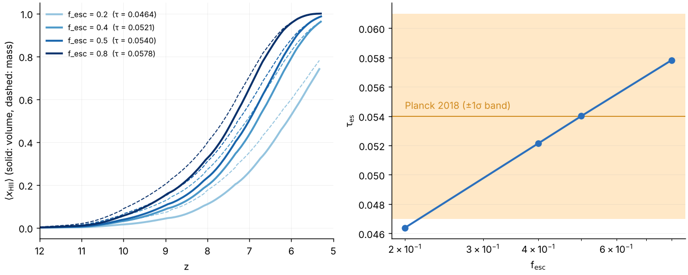
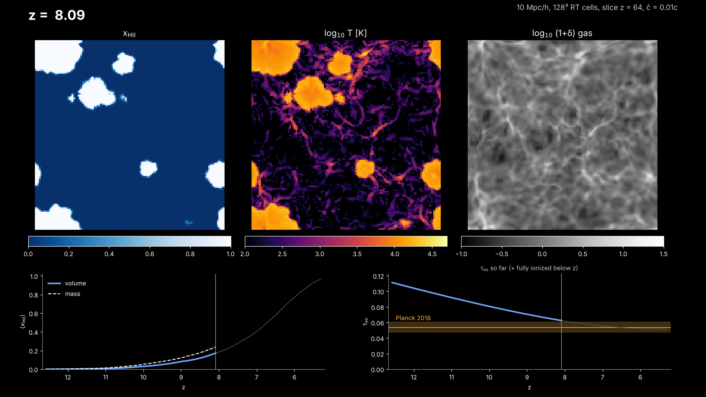

# Production reionization run: calibration, movie, Hyak

*2026-10-09, production-run thread (PR #7). This builds on
`docs/production_run.md` (c_reduced, restarts, movie frames, cost model),
`docs/abundance_matching.md` (sources) and `docs/hmf_validation.md`.*

The configuration:

| Setting | Value |
|---|---|
| Box | 10 Mpc/h |
| Resolution | Ngas = Ndm = N |
| c_reduced | 0.01 |
| nray_max_factor | 16 |
| Flags | `legacy_rt = legacy_physics = 0`, `deterministic_parallel`, `rt_substep_carry` |
| Sources | on-the-fly FoF (≥ 20 particles), `sfr_model = abundance`, log ξ_ion = 25.38, one f_esc |
| Sub-grid sources | none |

## 1. f_esc calibration to τ_es

`tools/production/calibrate_fesc.py` runs the production configuration for
a list of f_esc values, sharing one set of ICs. Each run computes the
reionization history and τ_es (`tools/analysis/reion.py`) from the movie
log. The script then interpolates, in log f_esc, the value that gives the
Planck τ.

**How τ_es is computed:**
* σ_T c n_e integrated over dt, with n_e from the mass-weighted x_HII
  (this includes clumping);
* He I ionized along with H, and He II ionized below z = 3, which is
  assumed (HeII reionization is not in the run);
* full ionization assumed below the last frame;
* the simulation cosmology.

As a check, instantaneous reionization at z = 6 gives 0.039.

**Planck 2018:** τ = 0.054 ± 0.007 (Planck Collaboration VI 2020).

**Resolution.** At N = 64, only halos of 20 particles or more emit, i.e.
above 8×10⁹ M☉. Then even f_esc = 1 reaches only x_HII = 0.88 by
z = 4.9, with τ = 0.040. So the calibration is done **at the production
resolution, N = 128**, where each run takes 13–16 min on 4 threads.

```
build/am_fit --lf data/uv_lf/lf_params.txt --out runs/am
python3 tools/production/calibrate_fesc.py runs/cal128 --N 128 \
    --am-params runs/am/am_params.txt --fesc 0.2 0.4 0.5 0.8
python3 tools/analysis/plot_calibration.py runs/cal128
```

Results with the draft L_UV(M) fit (Tinker HMF, Donnan+24 at z ≥ 9,
Bouwens+21 at z ≈ 6–8, unconfirmed):

| f_esc | τ_es | z(x_V = 0.1) | z(x_V = 0.5) | z(x_V = 0.99) | x_HII,M at the end (z ≈ 5.3) | wall time, 4 threads |
|---|---|---|---|---|---|---|
| 0.2 | 0.0464 | 8.11 | 6.09 | — | 0.781 | 13 min |
| 0.4 | 0.0521 | 8.79 | 6.81 | — | 0.963 | 15 min |
| **0.5** | **0.0540** | 9.05 | 7.01 | — | 0.985 | 15 min |
| 0.8 | 0.0578 | 9.46 | 7.40 | 5.67 | 0.9995 | 16 min |

**τ_es constrains f_esc only weakly here.** A factor of 4 in f_esc moves
τ from 0.046 to 0.058, most of the Planck 1σ band (0.047–0.061). The end
of reionization is the sharper constraint: only f_esc ≳ 0.8 completes it
(x_V = 0.99) by z ≈ 5.7. A Lyα-forest end point (z ≈ 5.3–6) would select
f_esc ≈ 0.6–0.8 within the Planck band.



**The calibrated value is f_esc = 0.50** (f_esc ξ_ion = 10^25.08). The
interpolation gives 0.4997, and the run at 0.5 gives τ = 0.0540. The
midpoint is z = 7.0. The box is 98.5% ionized by mass at z ≈ 5.3, but not
completely; that is a late end, partly reflecting the biases below.

### After switching to the simulated mass function (2026-10-09)

With L(M) matched to the simulated FoF halos (`docs/abundance_matching.md`
§3b), the box's bright halos are fainter than with Tinker.

| f_esc | τ_es | z(x_V = 0.1) | z(x_V = 0.5) | x_HII,M at the end (z ≈ 5.3) |
|---|---|---|---|---|
| **0.5** | **0.0511** | 8.78 | 6.65 | 0.912 |

With **all LFs from the papers** (`docs/abundance_matching.md` §3c),
f_esc = 0.5 gives τ_es = 0.0516, x_V = 0.5 at z = 6.72, and x_M = 0.967
at z ≈ 5.3.

**The production run starts with f_esc = 0.5** (user decision). Its τ is
within the Planck 1σ range, 0.3σ below the central value. The box is not
fully ionized by z ≈ 5.3, so the end of reionization is late. Raising
f_esc toward 0.7–0.8 would centre τ and end reionization earlier.

### Biases of this calibration (to be read with the number)

* **Reduced speed of light, 0.01c.** Light crosses only about 16 Mpc/h
  between z = 15 and 5.5, and 1.6–2.4 Mpc/h per hydro step.
  * I-fronts cannot move faster than ĉ, so ionized regions grow late and
    overlap is delayed.
  * After overlap the photon field responds on the light-crossing time
    at ĉ.
  * Both delay reionization at fixed f_esc and lower τ_es, so the
    calibrated f_esc is **biased high**.
  * Deparis et al. 2019 and Ocvirk et al. 2019 recommend ĉ ≳ 0.1–0.2c for
    the timing of reionization. A 0.1c run at N = 128 takes about 4.4 h on
    4 cores (`docs/production_run.md` §5) and would measure this bias.
* **No sub-grid sources.** Halos below 20 particles (1.0×10⁹ M☉ at
  N = 128) do not emit at all. The FoF mass function is also 2–4× below
  ST/Tinker at 20–60 particles (`docs/hmf_validation.md`).
  * The faint galaxies, which by the extrapolated LF carry much of the
    ionizing emissivity, are missing.
  * The resolved halos must compensate, which again biases f_esc
    **high**.
  * It also makes the sources more biased and the ionized regions larger
    and fewer than with the full population.
* **Late first halos.** The first FoF halo forms at z ≈ 11.3
  (Zel'dovich ICs at z = 100; none at z = 12.6, where ST predicts a few
  dozen). Early τ is lost, biasing f_esc high.
* **The box LF vs the observed LF.** L(M) is matched to the analytic
  Tinker HMF, but the FoF halos lie 1.3–2.2× above Tinker at
  ≳ 5×10⁹ M☉. So the box's own UV LF is 1.3–2× above the observed LF
  brighter than M_UV ≈ −16, and below it at the faint end
  (`tools/analysis/box_lf.py`, `figures/box_lf_128.png`). This biases f_esc
  **low**.
* **Small box.** 10 Mpc/h has large sample variance in the halo
  abundance at z ≳ 8.
* **τ_es convention.** τ assumes full ionization below the last frame
  (z ≈ 5.3) and He II reionization at z = 3. Each is uncertain by about
  ±0.001.

So f_esc ≈ 0.5 is an **effective** parameter of this setup. It absorbs
the speed of light, the resolution and the source model, and should not
be compared with physical escape fractions without these caveats.

## 2. Movie

**Output.** `apps/radhydro` writes movie frames from inside the RT
substeps, every `movie_dz` in redshift, independent of the hydro step
(`docs/production_run.md` §4). The run writes `movie_fields =
fHI,temp,rhog`.

**Rendering.** `tools/movie/make_movie.py RUN` renders one PNG per frame,
in parallel, and assembles an MP4 with ffmpeg (libx264, yuv420p, crf 18).
Each frame has:
* slices of x_HII, log T and log(1+δ_gas), with colour ranges fixed over
  the movie;
* x_HII(z), volume- and mass-weighted;
* τ_es known at that moment: the run's history so far, plus a fully
  ionized universe below the current z. It decreases monotonically to the
  run's total τ_es, shown against the Planck band.

**Frames before the first RT substep are skipped.** Before any source
exists, the rt_grid is not initialised, so these frames read x_V = 1 and
x_M = NaN. The analysis treats them as neutral.

```
python3 tools/movie/make_movie.py RUN [--fps 15] [--slice-axis z] [--thick 1] [--jobs 4]
```

**Test movies made here:**
* `runs/movie64/fesc_1/run/movie/reion.mp4`: N = 64, f_esc = 1, 104 frames.
* the N = 128, f_esc = 0.5 run with the simulated-HMF matching (the
  production configuration at N = 128): `docs/figures/reion_test_128.mp4`.
  It has Δz = 0.05 and is about 1.6 MB. A still is below.

  

**Cadence for the production movie.** Use `movie_dz = 0.02–0.025`. The
sources start at z ≈ 11.3, so that is about 230–290 rendered frames to
z = 5.5, or 15–20 s at 15 fps.
* **Disk:** frames are full cubes of 3 fields, 12 N³ bytes each: 25 MB at
  N = 128 and 200 MB at N = 256. That is 7 and 58 GB for 290 frames.
* **At N = 512** (1.6 GB per frame) a slice-only frame writer would be
  needed. It is not implemented yet.

## 3. Hyak (`klone`, `cpu-g2`, account `astro`)

**Scripts in `tools/hyak/`:**
* `build_hyak.sh`: builds with CMake and runs the fast suite. Set
  `HYAK_MODULES` to klone's gcc/fftw modules.
* `scaling_test.slurm`: one RT-dominated hydro step restarted from a
  checkpoint with 1–192 threads, using `tools/production/speedup.sh`.
  It checks that the outputs are byte-identical across thread counts.
* `reion_production.slurm`: the production job.
  * It resumes automatically from `run/restart/checkpoint.bin`.
    Checkpoints are written atomically after every hydro step, and the
    restart is bit-identical.
  * It uses `--requeue`, so it is safe on preemptible partitions.
  * It writes `run/DONE` at the end, then runs `reion.py` and the movie.
  * A resubmission after `DONE` exits at once.

### Cost estimate

**Measured here** (4 threads): N = 128 with abundance-matched sources takes
13–16 min (RT 640–830 s), with a peak RSS of 2.4 GB.

**Scaling with N.** RT work scales as cells × substeps ∝ N⁴. Memory and
the size of a checkpoint or frame scale as N³. The thread speed-up on
Genoa beyond 4 threads is **not yet measured**: run `scaling_test.slurm`
first. The table assumes 50% parallel efficiency, i.e. 4–8× faster on
32–64 cores than on 4.

| N | RT substeps | 4 cores (here) | one cpu-g2 node, 32–64 cores (estimate) | core-hours | peak memory | checkpoint (needs 2×) | movie, 290 frames |
|---|---|---|---|---|---|---|---|
| 128 | ≈ 210 | 15 min (measured) | 2–4 min | 1–2 | 2.4 GB | ≈ 2 GB | 7 GB |
| 192 | ≈ 315 | ≈ 1.3 h | 10–20 min | 5–10 | 8–11 GB | 6–9 GB | 24 GB |
| 256 | ≈ 420 | ≈ 4 h | 30–60 min | 16–32 | ≈ 20 GB | ≈ 16 GB | 58 GB |
| 512 | ≈ 840 | ≈ 64 h | 8–16 h | 250–500 | ≈ 160 GB | ≈ 130 GB | slice writer needed |

* The ray population depends on the sources. With abundance-matched
  sources the rays saturate later than with the global-SFR model.
* At the owned allocation (about 1000 cores), even 512³ is a modest job.
* The binding constraint is the **0.01c light horizon**, not the cost:
  0.1c costs 10× more and is affordable up to 256³ (about 5–10 h on a
  node).
* At larger N, halos down to 20 particles are smaller (1.3×10⁸ M☉ at
  256³). Their L comes from further down the extrapolated LF, and f_esc
  must be recalibrated, which takes one run of the scan per f_esc value.

### Commands

On klone, from the repository root, after `git pull` on `production-run`:

```
# 0. build (once). Set the module names to what `module avail` shows.
export HYAK_MODULES="gcc fftw"        # placeholder, see build_hyak.sh
salloc -A astro -p cpu-g2 -c 16 --mem 32G -t 1:00:00 tools/hyak/build_hyak.sh

# 1. sources: the fitted L_UV(M, z) for 128^3 / 10 Mpc/h is committed as
#    data/uv_lf/am_params_128_10mpc.txt; to refit (seconds):
#    build/am_fit --lf data/uv_lf/lf_params.txt --hmf st \
#        --sim-hmf data/hmf/fof_128_10mpc.txt --out runs/am

# 2. production problem: N = 128 first, then 256 if the scaling test is good
N=128
python3 tools/production/make_production.py runs/reion$N --N $N \
    --am-params data/uv_lf/am_params_128_10mpc.txt --f-esc 0.5 --xi-ion 25.38 \
    --movie-dz 0.025 --movie-fields fHI,temp,rhog --restart-every 1

# 3. run (resubmit the same command after any interruption; it resumes)
sbatch --export=ALL,PROB=runs/reion$N --cpus-per-task=32 --mem=64G \
       tools/hyak/reion_production.slurm

# 4. after the first checkpoint exists: thread scaling on a full node
sbatch --export=ALL,PROB=runs/reion$N,CK=runs/reion$N/run/restart/checkpoint.bin \
       tools/hyak/scaling_test.slurm

# 5. results: runs/reion$N/run/reion.txt (x_HII(z), tau_es) and
#    runs/reion$N/run/movie/reion.mp4
```

For N = 256, change `N`, and use `--mem=96G` and 64 cores. First refit
the simulated mass function from a no-source 256³ run
(`docs/hmf_validation.md`; minutes on a node), then refit L(M) with it,
then recalibrate f_esc:

```
python3 tools/production/calibrate_fesc.py runs/cal256 --N 256 \
    --am-params runs/am/am_params.txt --fesc 0.2 0.35 0.5
```

Run it as a job, about 1–2 h per value on 64 cores, or use
`reion_production.slurm` on the problems it writes.
