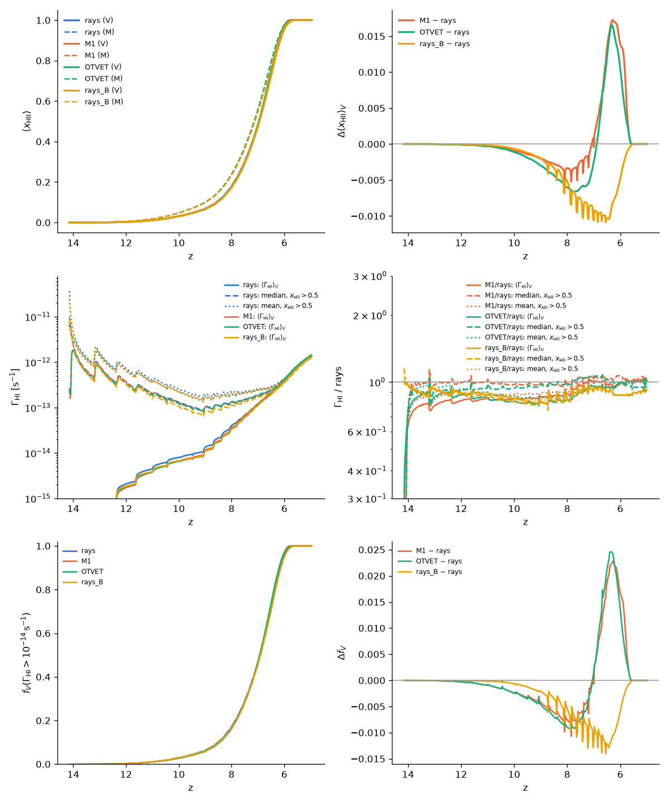
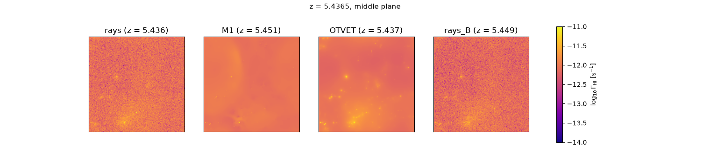
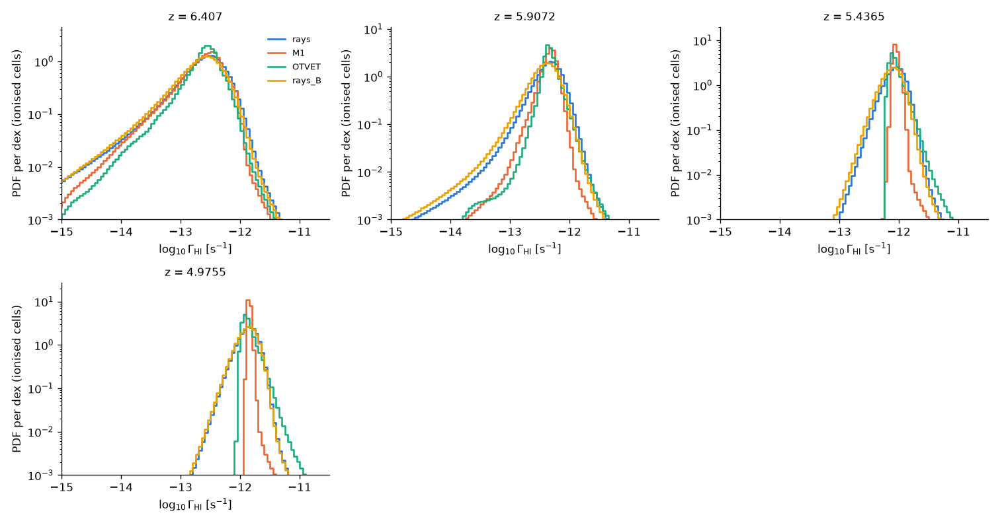
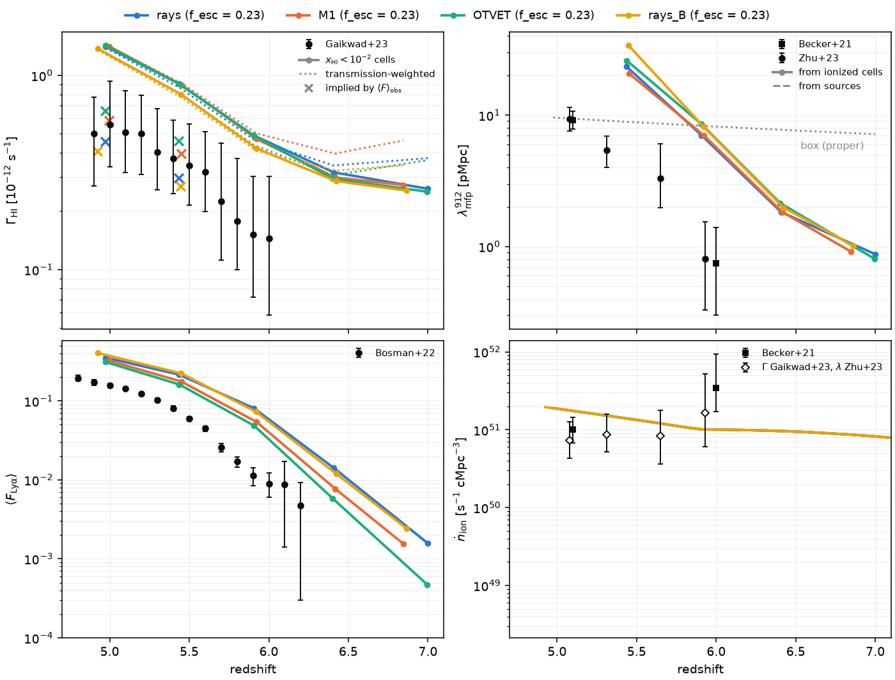

# Rays, M1 and OTVET at 40 Mpc/h, 512³: the HI photoionization rate

*Run on klone 2026-10-11 (branch `rt-methods-512`; one whole `cpu-g2` node,
192 threads, per run).* Three reionization runs that differ only in
`rt_method` (rays, M1, OTVET), with the same ICs, sources, speed of light
and recombination treatment, for movies and for the comparison of the HI
photoionization rate Γ_HI after overlap. A fourth run, rays with case B
(on-the-spot) recombination and no recombination radiation, separates the
effect of the recombination radiation from that of the RT method. The 256³
comparison at 10 Mpc/h is `docs/rt_moments.md` §6.

## 1. Configuration

| | |
|---|---|
| Box, resolution | 40 Mpc/h, N = Ndm = 512 (cell 78 kpc/h, m_p = 5.1×10⁷ M☉: the mass and cell resolution of the 10 Mpc/h 128³ box) |
| ICs | Zel'dovich, z = 100, seed 7: the ICs of `reion512_40mpc_f0.1` (identical parameters, linked) |
| Flags | `legacy_rt = legacy_physics = 0`, `deterministic_parallel`, `rt_substep_carry`, `hydro_scheme = unsplit`, `ray_rotate = 3` (used by the rays only) |
| Sources | `sfr_model = abundance` with `data/uv_lf/am_params_128_10mpc.txt`, log ξ_ion = 25.38, constant f_esc = 0.23 (the ṅ_ion calibration of 2026-10-11, `docs/PLAN.md`) |
| Light | `c_reduced = 0.2`, constant for the whole run; `redshift_per_distance = 1` |
| Recombination | **case A with the recombination radiation transported** (`recomb_case = A`, `recomb_rad = 1`, `recomb_rad_block = 4` for the rays; `docs/recomb_radiation.md`), the production default since this thread (user, 2026-10-11). Fourth run: case B, no recombination radiation |
| Ray pool | `nray_max_factor = 15` (16 × 512³ overflows the int32 ray links) |
| Redshifts | z = 100 → 5; RT from z = 15 (the first `zdata1`; the first halos above 20 particles appear at z ≈ 13.2) |
| Movie | every Δz = 0.025 (≈ 400 frames), slabs of 8 cells normal to x, y, z (`movie_slab = 8`) of x_HI, T, ρ_gas and Γ_HI (`gammaHI`); `frames.txt` with the whole-box Γ_HI statistics (§2) |
| Snapshots | z = 15, 7, 6.5, 6, 5.5, 5: x_HI, x_HeI, x_HeII, T, ρ_gas, Γ_HI and `Gas/u_gas` (`data_files = gas`) |
| Checkpoints | every 4 hydro steps, the newest two kept (`restart_keep = 2`) |

```
R=/gscratch/astro/$USER/radhydro/runs
python3 tools/production/make_production.py $R/reion512_rays --N 512 --box 40 --c-reduced 0.2 \
    --nray-max-factor 15 --am-params data/uv_lf/am_params_128_10mpc.txt --f-esc 0.23 --xi-ion 25.38 \
    --movie-dz 0.025 --movie-slab 8 --movie-fields fHI,temp,rhog,gammaHI \
    --fields fHI,fHeI,fHeII,temp,rhog,gammaHI --zdata1 "15 7 6.5 6 5.5 5" --restart-every 4 \
    --restart-keep 2 --hydro-scheme unsplit --redshift-per-distance 1 --data-files gas
# the same with --recomb-case B --recomb-rad 0 -> $R/reion512_rays_caseB
SBATCH_ARGS="--exclusive --cpus-per-task=192 --mem=300G --time=20:00:00" \
    tools/hyak/rt_methods_runs.sh $R/reion512_rays          # -> reion512_rays_{m1,otvet}
sbatch --exclusive --cpus-per-task=192 --mem=400G --time=1-20:00:00 \
    --export=ALL,PROB=$R/reion512_rays,THREADS=192,POST=sbatch tools/hyak/reion_production.slurm
# (and the same for reion512_rays_caseB)
SETS=reion512_rays:rt_methods_512 EXTRA=reion512_rays_caseB:rays_B IGM=1 \
    sbatch --time=8:00:00 tools/hyak/rt_methods_post.slurm
```

## 2. What was added for this comparison

- **Whole-box Γ_HI in `movie/frames.txt`.** Every frame line ends with
  `GammaHI_V GammaHI_ion_med GammaHI_ion_mean fV_GammaHI_gt_1e-14`: the
  volume mean of Γ_HI, its median and mean over the cells with
  x_HII > 0.5, and the volume fraction with Γ_HI > 10⁻¹⁴ s⁻¹. They are
  taken from `rt_grid%gamma(1)` of the last RT substep before the frame
  (the same instantaneous value as the snapshots, `docs/igm_diagnostics.md`
  §2), so the Γ history needs no cube. Serial sums, so they do not depend
  on the thread count. Old six-column files, and files that change at a
  restart, still read (`reion.py` `frames_table`, `read_gamma`).
- **`gammaHI`** for `movie_fields` and `fields`: Γ_HI alone, one float per
  cell (the user asked to store only the HI rate: `gamma` has three
  components and 3× the disk).
- **`restart_keep = n`**, **`data_files = gas`**, and
  `make_production.py --fields --restart-keep --data-files --recomb-case
  --recomb-rad --recomb-rad-block` (`docs/production_run.md`).
- **Tools.** `compare_movie.py`: a log Γ_HI row (fixed range
  10⁻¹⁴–10⁻¹¹ s⁻¹) and a panel with the median Γ_HI of the ionised cells;
  `stills.py`: a Γ_HI column; `rt_methods_runs.py`: the Γ history (the four
  columns against z and their ratios to the rays) in `history.png`,
  `maps_gamma_zXX.png` and `gamma_pdf.png` (log Γ_HI in ionised cells) from
  the snapshots; `igm_stats.py` reads `gammaHI.bin`;
  `rt_methods_post.slurm` takes `SETS`, `EXTRA` and `IGM=1`.
- **Tests.** `movie_slab` now also writes `gammaHI` frames and checks the
  four columns of every frame against values recomputed from the full
  cubes. Fast suite on klone: 102/112, the 10 known stored-reference
  failures (`docs/cluster.md` §3).
- **Tried first on** the 256³ runs of `docs/rt_moments.md` §6 (snapshot
  Γ maps and PDFs from their `gamma.bin`) and on a 128³, 10 Mpc/h set with
  this exact configuration (`$RUNS/rtm128_test{,_m1,_otvet,_caseB}`,
  comparison in `$RUNS/rtm128_test_cmp/`).

## 3. Cost

Whole `cpu-g2` node, 192 threads, z = 100 → 5 in one job each. RT is the
sum of the RT timers; transport is `calc_ray_1 + ray_tracing_1 +
ray_tracing_3` (moments: the GLF subcycles and the scaling); OTVET's
`prep` is the FFT Eddington tensor.

| run | hydro steps | RT substeps | wall | RT | transport | photo-chemistry | output | peak RSS |
|---|---|---|---|---|---|---|---|---|
| rays, case A + RR | 55 | 4498 | 14:17:59 | 12.0 h | 10.1 h | 1.67 h | 1.8 h | 246 GB |
| M1, case A + RR | 52 | 4476 | 4:13:14 | 3.80 h | 1.89 h | 1.71 h | 80 s | 143 GB |
| OTVET, case A + RR | 56 | 4501 | 4:47:51 | 4.35 h | 2.01 h (+ 0.43 h tensor) | 1.71 h | 83 s | 146 GB |
| rays, case B | 52 | 4549 | 8:33:21 | 7.22 h | 5.23 h | 1.68 h | 0.93 h | 207 GB |

- **Against the expectation** (scaling the 256³, 0.1c runs of
  `docs/rt_moments.md` §6.5 by 8× the cells and 2× the substeps): rays
  (case B) 8.6 h against 6–10 h, M1 and OTVET 4.2–4.8 h against 3–5 h,
  memory 207 / 143–146 GB against 220 / 110 GB.
- **Recombination radiation costs the rays 1.67× in wall time** (1.9× in
  transport); the moment methods pay nothing visible for it (each cell
  re-emits into its own moments). Early on the recombination rays dominate:
  at z ≈ 10.5 the case A + RR run carried 654 M rays against 44 M in case
  B, and its hydro steps took 12–23× longer at z = 11–12, falling to 1.8×
  by z = 8.7 and ≈ 1.5× after overlap, when the stellar rays fill the
  pool. `recomb_rad_pool = 0.75` bounds the recombination rays.
- **The ray pool guard never fired** (`nray_max_factor = 15`, the
  original `ra_max`) in any run.
- **Output:** the checkpoints dominate the ray runs' I/O (1.7 h of 14.3 h:
  166 GB each with case A + RR, two kept). Movie frames: 38 GB per run (401
  frames × 4 slab fields of 25 MB; the brief's ~10 GB estimate counted
  fewer fields). Snapshots: ≈ 6 GB each.
- M1 is 3.4× and OTVET 3.0× cheaper than the rays with recombination
  radiation; photo-chemistry is now 45 % (M1) and 39 % (OTVET) of their RT.

## 4. Reionization history



*Top: x_HII and the difference from the rays (case A + RR). Middle: the
whole-box Γ_HI statistics of `frames.txt` — volume mean (solid), median and
mean over ionised cells (dashed, dotted) — and their ratio to the rays.
Bottom: the volume with Γ_HI > 10⁻¹⁴ s⁻¹. Full table:
[`figures/rt_methods_512.txt`](figures/rt_methods_512.txt).*

| run | z(x_V = 0.1) | 0.5 | 0.9 | 0.99 | z(x_M = 0.5) | τ_es |
|---|---|---|---|---|---|---|
| rays, A + RR | 8.575 | 6.961 | 6.171 | 5.816 | 7.137 | 0.0532 |
| M1, A + RR | 8.550 | 6.964 | 6.210 | 5.914 | 7.137 | 0.0532 |
| OTVET, A + RR | 8.536 | 6.957 | 6.205 | 5.868 | 7.145 | 0.0533 |
| rays, case B | 8.546 | 6.941 | 6.153 | 5.799 | 7.116 | 0.0530 |

- The three methods agree to |Δx_HII,V| ≤ 0.017 at every z, and τ_es to
  0.2 %. As at 256³, the moment runs finish overlap slightly earlier:
  x_V = 0.99 at Δz = +0.05 (OTVET) and +0.10 (M1) before the rays.
- Case B against case A + RR (rays): reionization Δz ≈ 0.02 later, τ_es
  0.4 % lower. Transporting the recombination radiation brings case A
  back almost to case B, as at 10 Mpc/h (`docs/recomb_radiation.md` §4).
- **Γ_HI histories.** Before overlap the mean over ionised cells agrees to
  ≲ 15 %; the rays' volume mean is 10–20 % above the moment methods'
  at z = 8–12 (the rays reach further ahead of the fronts). **After
  overlap the volume-mean Γ_HI agrees to 1–2 %** (z = 5.5: rays 8.31,
  M1 8.38, OTVET 8.33 × 10⁻¹³ s⁻¹; z = 5.0: 1.38, 1.41, 1.39 × 10⁻¹²): the
  mean is set by the emissivity and the mean free path, not the transport.
  **The median differs:** in OTVET it is 10 % below the mean after
  overlap (a skewed distribution), in M1 1–3 % below, in the rays 4–5 %
  below. Case B rays have a 9–10 % lower Γ_HI after overlap: the
  recombination photons that case A + RR transports.
- The Γ curves jump at every hydro step: the sources (halo catalogue and
  luminosities) are updated once per hydro step, and Γ follows within the
  light-crossing time of a few cells.

## 5. Γ_HI maps and PDFs



*log Γ_HI in the middle plane at z ≈ 5.44 (after overlap; rays | M1 |
OTVET | rays case B). Also [z ≈ 5.91](figures/rt_methods_512_gamma_z5.91.png)
(x_V = 0.98) and [z ≈ 4.98](figures/rt_methods_512_gamma_z4.98.png).*



*PDF of log Γ_HI in ionised cells (x_HII > 0.5) at the snapshots.*

Γ_HI in ionised cells (10⁻¹² s⁻¹; 16th / 50th / 84th percentiles):

| z | rays A + RR | M1 | OTVET | rays B |
|---|---|---|---|---|
| 6.41 | 0.099 / 0.257 / 0.499 | 0.107 / 0.259 / 0.455 | 0.138 / 0.262 / 0.411 | 0.085 / 0.229 / 0.452 |
| 5.91 | 0.270 / 0.455 / 0.692 | 0.349 / 0.467 / 0.581 | 0.376 / 0.452 / 0.587 | 0.224 / 0.388 / 0.600 |
| 5.44 | 0.584 / 0.865 / 1.212 | 0.794 / 0.875 / 0.994 | 0.698 / 0.815 / 1.075 | 0.511 / 0.762 / 1.075 |
| 4.98 | 0.925 / 1.362 / 1.885 | 1.327 / 1.399 / 1.484 | 1.100 / 1.287 / 1.710 | 0.897 / 1.326 / 1.840 |

- **Around sources.** The rays and OTVET show the proximity zones of
  individual halos: Γ rises steeply towards each source (OTVET's
  Eddington tensor is the optically thin 1/r² sum over sources, so it keeps
  the radial geometry). M1 smears them out: its local closure carries one
  flux direction per cell, so where the radiation of many sources
  crosses it diffuses, and the peaks are lower and broader. The brightest
  cell is 600–1100 ⟨Γ⟩ in the rays, 250–320 ⟨Γ⟩ in OTVET and 50–80 ⟨Γ⟩
  in M1 (z = 5.44 and 4.98); the 99.99th percentile is 6–8, 12 and 3–5
  ⟨Γ⟩. OTVET's proximity zones are thus broader than the rays' (more cells
  at several ⟨Γ⟩), the rays' peaks the sharpest, M1's the weakest.
- **In the diffuse IGM after overlap.** The means agree, the widths do
  not: the 16–84 % range is ±35 % for the rays, ±13 % (z = 5.44) to ±6 %
  (z = 4.98) for M1, and ±22–24 % for OTVET. M1's Γ is almost uniform away
  from sources and keeps narrowing as the mean free path grows (its
  0.01st percentile rises from 0.64 to 0.81 ⟨Γ⟩). OTVET has a sharp lower
  edge at ≈ 0.62 ⟨Γ⟩ (0.01st percentile, both redshifts), the rays a long
  low tail (0.01st percentile 0.1 ⟨Γ⟩): with the optically thin tensor,
  radiation reaches every cell from all sources without the shadowing
  behind dense gas that the rays have (an interpretation, not tested
  cell by cell). Part of the rays'
  cell-to-cell scatter is the sampling noise of the discrete rays (the
  grain in the maps; §6 bounds it in k).
- **In the last neutral islands** (z ≈ 6.4–5.9). The low-Γ tail of the
  ionised cells (the edges of the islands and the shadowed gas behind
  them) is longest for the rays, then M1, and shortest for OTVET: OTVET's
  fronts are illuminated from all directions at the optically thin rate,
  so its islands are eroded faster, and they are in slightly different
  places in both moment runs (the movie). M1's islands differ most in
  position (as at 256³, `docs/rt_moments.md` §6.4: 11 % of cells differ by
  more than 0.1 in x_HII at z = 6.41, OTVET 6 %, case B 4 %).

## 6. Power spectrum of Γ_HI after overlap

*(Being filled in from the full set of cubes.)*

## 7. The IGM at z = 5–6



*`igm_stats.py` / `igm_plot.py` on the snapshots against
`data/igm/igm_z5_6.txt`. Table: [`figures/rt_methods_512_igm.txt`](figures/rt_methods_512_igm.txt).*

| z ≈ 5.44 | rays A + RR | M1 | OTVET | rays B | data |
|---|---|---|---|---|---|
| Γ_HI(x_HI < 10⁻²) [10⁻¹²] | 0.905 | 0.895 | 0.904 | 0.800 | 0.36 (Gaikwad+23) |
| transmission-weighted Γ | 0.869 | 0.913 | 0.808 | 0.771 | |
| ⟨F_Lyα⟩ | 0.215 | 0.175 | 0.161 | 0.223 | 0.072 (Bosman+22) |
| λ_mfp (ionised starts) [pMpc] | 23.3 | 20.7 | 26.0 | 33.8 | 4.6 (Becker+21, Zhu+23) |
| log ṅ_ion [s⁻¹ cMpc⁻³] | 51.14 | 51.14 | 51.14 | 51.14 | 51.20 (Becker+21) |

- All four miss the forest in the same way as the f_esc = 0.23 run of the
  calibration (`docs/PLAN.md`, 2026-10-11): ṅ matches, Γ is 2.5×, ⟨F⟩
  2–3× and λ_mfp ≈ 5× the data. The user's reading stands: the sinks that
  set λ_mfp are unresolved until AMR.
- **The RT method changes ⟨F⟩ at fixed mean Γ by 20–35 %.** The
  transmission is a convex function of Γ (τ ∝ 1/Γ), so a field with more
  scatter transmits more at the same mean: the rays' broad Γ distribution
  gives the highest ⟨F⟩, M1's narrow one less, and OTVET the least, because
  its Γ is lowest in the voids that transmit (its transmission-weighted Γ
  is 11 % below its mean, M1's 2 % above). A forest calibration of f_esc
  would thus differ by ≈ 30 % between methods.
- **Recombination radiation shortens λ_mfp** (rays: 23 against 34 pMpc
  at z = 5.44) and raises Γ by 10 %. The likely reason (not separated
  here): case A recombines faster, so dense gas holds more HI, and the
  transported recombination photons only partly make up for it locally
  while adding to the background.
