# Moment RT: M1 and OTVET as alternatives to the ray tracing

*Written 2026-10-10 (branch `claude/elegant-bell-rqd3l1`, merged into `main`
the same day). New methods, not
in the original code. The default, `rt_method = rays`, is unchanged and stays
bit-identical to the Fortran: the full fast suite (93 tests, including the
live gfortran comparisons) passes unchanged.*

## 1. Usage

```
rt_driver  <problem> <out> --set rt_method=m1        # or otvet
radhydro   <problem> <out> --set rt_method=otvet
```

| Parameter | Values | Meaning |
|---|---|---|
| `rt_method` | `rays` (default), `m1`, `otvet` | radiative transfer method |
| `moment_nsub` | integer ≥ 3, default 4 | transport subcycles per RT substep (Courant number 1/`moment_nsub`) |
| `otvet_tensor` | `auto` (default), `direct`, `fft` | how the OTVET tensor is summed over the sources |
| `moment_order` | `1` (default), `2` | transport scheme: 1 = first-order GLF; 2 = MC-limited linear reconstruction, GLF flux of the face states, two-stage step; needs `moment_nsub ≥ 6`, uniform grid only (§9) |
| `moment_inject` | `1` (default since 2026-11-10), `0` | when a substep's source and recombination photons enter the moments: 1 after the transport, so they are absorbed in their own cell first; 0 before it (the first implementation, which leaves dense source cells neutral) (§5a) |

All other parameters keep their meaning. `c_reduced` sets the light speed of
the moment solver too. `legacy_physics` selects the atomic physics, as with
the rays. `legacy_rt` and `deterministic_parallel` only concern the ray
bookkeeping and have no effect on the moment methods, which always behave as
the fixed path: the direction field is reset, and τ is updated in every cell.
They need not be set. The ray-only options (`ray_dump_*`, `ray_quant_*`, the
ray pool) do nothing with the moment methods.

## 2. What it does

`src/rt_moments.cpp` (`include/radray/rt_moments.hpp`) replaces the ray
casting of each RT substep (`ray_tracing_1` and `ray_tracing_3`). It solves
the two-moment equations for the photon number density N and the flux F of
each of the 5 frequency groups, on the RT grid, at the reduced speed of light
ĉ:

```
dN/dt + ĉ div F        = S − absorption
dF/dt + ĉ² div (D N)   =   − absorption
```

**Closures.** The two methods differ only in the Eddington tensor D:

- **M1** (Levermore 1984): D is local. With f = |F|/(ĉN),
  χ = (3 + 4f²)/(5 + 2√(4 − 3f²)) and D = (1−χ)/2 I + (3χ−1)/2 u uᵀ, where
  u = F/|F|. This is the closure of RAMSES-RT (Rosdahl et al. 2013) and
  ATON (Aubert & Teyssier 2008).
- **OTVET** (Gnedin & Abel 2001): D = h, the optically thin variable
  Eddington tensor. It is h = P / tr P, with P(x) = Σₛ Lₛ d dᵀ / |d|⁴ summed
  over the source cells; d is the minimum-image separation in cells, and Lₛ
  is the cell's Luv. The source cell itself gets an isotropic Lₛ·4/3, the
  self-weight of a radius of half a cell. Off-diagonal terms with a
  component at exactly N/2 vanish, since the two periodic images average
  out. h is recomputed every hydro step, when the sources change.
  - `direct` sums in double precision.
  - `fft` is a periodic convolution with single-precision FFTW
    (`src/rt_moments_fft.cpp`). It agrees with `direct` to 3·10⁻⁷ in h
    (`test_moments`).
  - `auto` uses `direct` while N_src·N_cell ≤ 2.7·10⁸, and `fft` otherwise.

**Transport.** The scheme is the first-order Global Lax–Friedrichs (Rusanov)
flux with wave speed ĉ, unsplit, on the periodic box, as in RAMSES-RT. One RT
substep is one cell of light travel (calc_timestep), so `moment_nsub`
subcycles give a Courant number of C = 1/`moment_nsub`.

- Each cell's state splits into right- and left-going parts (N ± F_d)/2 ≥ 0,
  so the update is a positive combination for C ≤ 1/3. After every subcycle,
  N ≥ 0 and |F| ≤ N are enforced; this is the realizability of M1.
- **C = 1/3 exactly gives the centre cell zero weight.** Odd and even cells
  then decouple: a source cell is emptied every third subcycle, and
  `photo_source` skips it. The default is therefore 4 (C = 0.25, 0.75 of the
  limit, like RAMSES-RT's 0.8).
- The photon-weighted group energy E = ν N moves with the photons (flux
  E F_d / N), so each group's mean frequency is carried. That mean is what
  the rays carry per ray, and what `photo_cell` reads.

**Coupling to the physics: unchanged.**

- Sources inject fResc·pop2_init·Luv·dtsec_rt photons per substep into their
  cell, isotropically (F = 0). That is the number `ray_source` emits.
- After transport, N is deposited in `rt_grid%ngam`, E in `rt_grid%nu` and
  Σ_g F in `rt_grid%dx`.
- `radiative_physics` (`photo_cell`) is then called unchanged. N, in units
  of ⟨n_H⟩, is the photon density in the cell during the substep: exactly
  what the rays deposit, with Γ = ĉ n_γ σ, the photon limiter and the
  rho_source consumption.
- After `photo_cell`, N, F and E are scaled by the surviving photon fraction
  `rt_grid%fgam`. This is the absorption term above, with the same κ for
  both moments. As with the rays, photons below `ngam_min` in a cell are
  dropped (absorbed).

**Redshift.** In `post_rt`, each cell's 5-group spectrum gets exactly the
rays' `redshift_ray`. The code is factored out of `ray_redshifting` as
`redshift_spectrum`, with unchanged arithmetic: every stored ray reference
still passes. F is moved between groups with the photons, using the same
keep and move-down fractions.

**Photon budget.** `ray.log` gets one line per hydro step:
`Moments : in flight … injected … absorbed … lost …`, in photons per H atom
of the box. Photons are conserved to float precision: injected − absorbed −
lost = in flight to 6 digits in every run. "Lost" is the redshift out of the
lowest group plus groups below `ngam_min`. `stats.txt`
`ngam_rays_total` holds the moment photons in flight.

**Determinism and restarts.**
- Every loop writes only its own cells (the transport is a Jacobi stencil),
  and every sum is taken in a fixed order. The results are byte-identical
  for any thread count (`thread_rt_m1_*`, `thread_rt_otvet_*`, 1/2/4
  threads).
- Checkpoint version 3 holds N, F, E and the budget, and restarts are
  bit-identical (`restart_smoke_m1`, `restart_smoke_otvet`).
- Versions 1–2 still read as ray runs. A checkpoint can't be restarted with
  a different `rt_method`.

**Memory.** 20 floats per cell for the state (5 groups × N, F, E), plus 14
of scratch, plus 6 for the OTVET tensor: about 140–160 B per cell, against
88 B per ray for the rays, of which there are up to 64 per cell.

## 3. Tests

Run with `ctest -L moments`, about 40 s.

| Test | What |
|---|---|
| `moments` (`tests/test_moments.cpp`) | photon and energy conservation of the transport, realizability, light-cone spread of a pulse, an M1 plane beam moving exactly 1 cell per substep with no sideways spread, the OTVET tensor (single source: rank 1, trace 1, the N/2 images; random sources: direct vs FFT), thread independence of the transport, redshift (photons, F following, frequency range) |
| `ifront_rsla_m1`, `ifront_rsla_otvet` | the I-front against the finite-c solution (as `ifront_rsla`), checked from R = 5 cells (`--rmin 5`) |
| `thread_rt_m1_lognormal_16src`, `thread_rt_otvet_lognormal_16src` | byte-identical outputs for 1, 2 and 4 threads |
| `restart_smoke_m1`, `restart_smoke_otvet` | bit-identical restart of the full loop |
| `restart_smoke_m1_order2`, `restart_smoke_otvet_order2` | the same with `moment_order = 2` (§9; its unit tests are in `moments`) |

## 4. Comparison with the rays

Produced by `tools/analysis/rt_methods.py build/rt_driver WORKDIR --threads 4`,
which writes `docs/figures/rt_methods_ifront.png`, `rt_methods_maps.png` and
`rt_methods.txt`. All runs use N = 32, c_reduced = 0.1 and
legacy_rt = legacy_physics = 0 (with B17 `photon_conserve` and P11
`photon_consume_dense`). The moment methods use the default
`moment_inject = 1` (§5a).

*Rerun 2026-11-10 with three changes:*
1. **The rays rotate their HEALPix frame** for every source and RT substep,
   `ray_rotate = 3`, as every production run since 2026-10-10 does (the
   B16 fix, `docs/port_notes.md`). The rays with the original fixed frame
   (`ray_rotate = 0`) are kept as a fourth column, "rays, fixed frame"
   (`rays0` in `rt_methods.txt`).
2. **The moments inject after the transport,** `moment_inject = 1`, the
   default since 2026-11-10. The numbers with the old order, 0, are quoted
   below as "inject 0".
3. **B17 and P11.** Since the first version of this section (2026-10-10),
   `legacy_physics = 0` has gained B17 and P11, which changes every
   method's numbers.
   - With `photon_conserve = 0 photon_consume_dense = 0` (and
     `moment_inject = 0`) the script's runs reproduce the old table exactly
     (the box at step 60: M1 0.5692, the fixed-frame rays 0.5252).
   - Together B17 and P11 lower the box's x_HII at step 60 from 0.525 to
     0.468 for the rays and from 0.569 to 0.545 for M1 with inject 0. For
     that M1 run alone: B17 gives 0.553, P11 0.560.

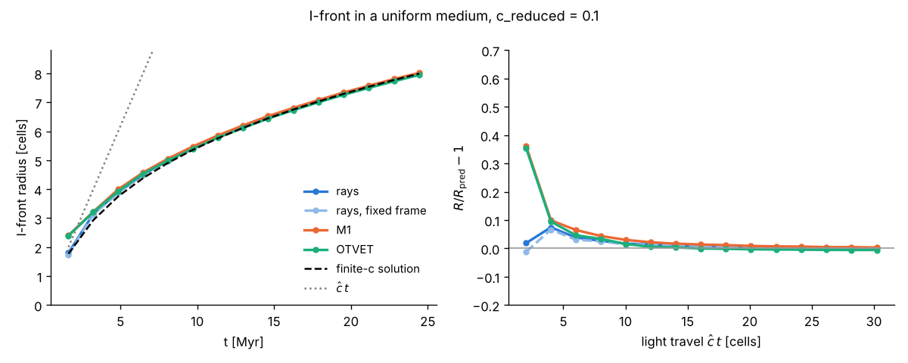

**I-front in a uniform medium** (one source of Luv = 8e28, z = 10):

| Method | Error at ĉt = 2 cells | at 6 cells | at 10 cells | at 30 cells |
|---|---|---|---|---|
| rays | +1.9% | +3.8% | +1.7% | +0.2% |
| rays, fixed frame | −1.2% | +3.1% | +1.4% | +0.1% |
| M1 | +36% | +6.5% | +3.0% | +0.3% |
| OTVET | +36% | +4.6% | +1.6% | −0.6% |
| M1, inject 0 | +61% | +15% | +7.4% | +1.7% |
| OTVET, inject 0 | +61% | +14% | +6.0% | +0.8% |

The rotation hardly changes the rays' mean radius, but it halves the
spread of the front over directions: the radius of the partly ionised cells
at ĉt = 30 is 7.99 ± 0.17 cells with the rotation and 8.03 ± 0.32 without
(M1 7.95 ± 0.21, OTVET 7.84 ± 0.29).

**Why the moment fronts run ahead early.** The radius is taken from the
ionised volume. While the recombinations are negligible, that volume
counts the photons absorbed, which are the photons emitted minus those still
in flight. Fewer photons in flight than with the rays means a larger volume
(`rt_methods.txt`, "I-front ahead of the finite-c solution"):

| ĉt [cells] | photons in flight, M1 / OTVET (rays = 1) | inject 0 | ionised volume beyond r = ĉt + 0.87, M1 / OTVET | inject 0 |
|---|---|---|---|---|
| 2 | 0.65 / 0.67 | 0.42 / 0.43 | 11% / 13% | 17% / 19% |
| 4 | 0.88 / 0.89 | 0.66 / 0.69 | 0.5% / 0.6% | 1.8% / 2.2% |
| 6 | 0.87 / 0.91 | 0.66 / 0.70 | 0.0% / 0.0% | 0.0% / 0.1% |
| 10 | 0.90 / 0.96 | 0.74 / 0.79 | 0 | 0 |
| 30 | 0.95 / 1.03 | 0.83 / 0.91 | 0 | 0 |

Two things put the moment photons into neutral gas early.
- **The injection order** (§5a). With inject 0 the source's photons are
  transported 4 subcycles before anything absorbs them. The source cell
  itself barely absorbs, and the photons start spread over the
  neighbouring cells. Injecting after the transport removes about half of
  the early lead.
- **The first-order scheme's numerical diffusion** (upwind at C = 1/4:
  σ ≈ 2 cells after 6 substeps), which remains with inject 1:
  - In the first substeps photons move faster than light. The
    `moment_nsub` = 4 subcycles of a substep reach 4 cells while light
    travels 1, and at ĉt = 2 a tenth of the ionised volume lies outside
    the light cone.
  - Later nothing is ionised outside the light cone, but the front is
    thicker: about 1.5× as many cells with 0.3 < x_HII < 0.7 at ĉt = 30.

The excess volume becomes a smaller fraction of the volume as R grows, and
the moment fronts converge to the finite-c solution and to the rays. The
photon budget is exact (§2), so the ionised volume is right once the front
is resolved.

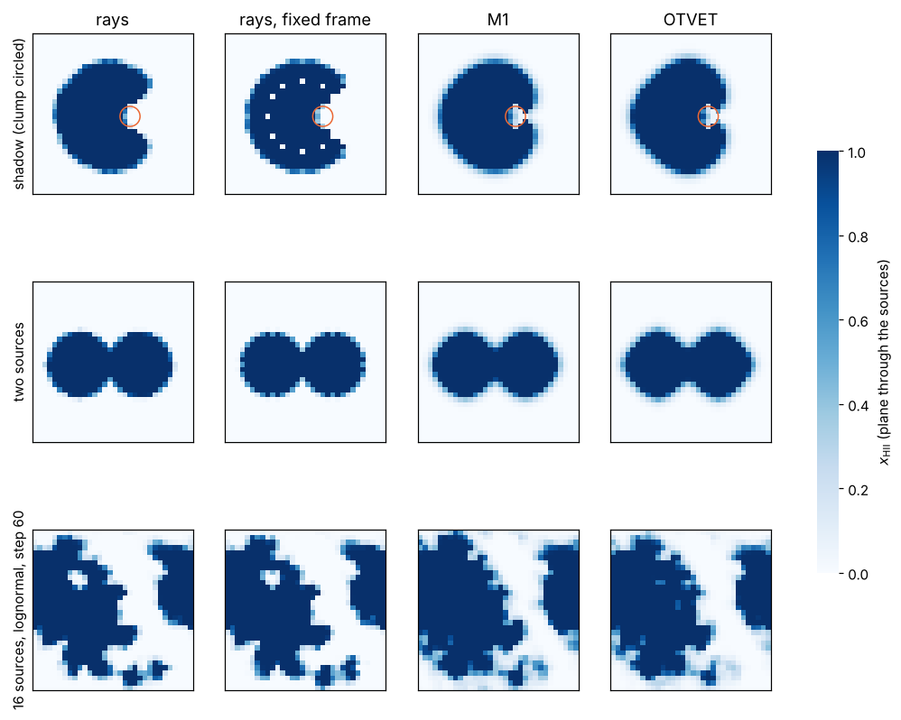

Maps of x_HII in the plane through the sources, after 15 steps:

- **Shadow.** A 3× brighter source, and a clump of radius 2 cells at 50× the
  mean density, 4 cells away. This is a point-source test of our own, not
  Iliev et al. 2006 Test 3 (§5).
  - Every method casts a shadow. The mean x_HII on the axis behind the
    clump is 0.000 for the rays (with or without the rotation), 0.044 for
    M1 and 0.004 for OTVET (inject 0: 0.054 and 0.005).
  - At the same distance beside the clump it is 0.40 (rays), 0.50 (fixed
    frame), 0.34 (M1) and 0.25 (OTVET). These cells are at the edge of the
    front, 9–12 cells from the source, so the number mostly measures how
    the front's edge falls on them.
  - OTVET's radial tensor keeps the shadow sharpest. M1 fills it in a little:
    its flux direction relaxes towards isotropy behind the obstacle.
  - **Holes.** With the fixed frame the rays leave neutral holes inside the
    front, in the gaps between the 192 HEALPix directions (B16): 33 of the
    2385 cells at r < R − 2 outside the clump's shadow are neutral
    (x_HII < 0.5). With `ray_rotate = 3` there are none, as for M1 and
    OTVET.
- **Two sources** 12 cells apart. The width of the ionised region through
  the midpoint is 7 cells for the rays, M1 and OTVET (5 with the fixed
  frame), and through a source 13 cells for all three (OTVET 15 with
  inject 0). The classic M1 failure, where crossing beams merge, needs
  beams that cross; two isotropic point sources do not provoke it at this
  resolution.
- **16 sources in a lognormal field** (`tests/problems/lognormal_16src`,
  60 steps):

| step | x_HII (volume): rays / M1 / OTVET | x_HII (mass) | partly ionised cells | cells off by > 0.1 vs rays: fixed frame / M1 / OTVET |
|---|---|---|---|---|
| 10 | 0.014 / 0.029 / 0.029 | 0.068 / 0.072 / 0.071 | 2% / 5% / 5% | 0.7% / 4.0% / 4.0% |
| 20 | 0.078 / 0.098 / 0.095 | 0.131 / 0.141 / 0.140 | 5% / 10% / 10% | 2.6% / 7.1% / 7.0% |
| 40 | 0.266 / 0.290 / 0.281 | 0.259 / 0.274 / 0.270 | 11% / 19% / 19% | 5.1% / 14% / 14% |
| 60 | 0.468 / 0.496 / 0.482 | 0.391 / 0.410 / 0.404 | 15% / 24% / 23% | 6.2% / 19% / 18% |

  The frame rotation leaves the global fractions unchanged (the fixed frame
  gives x_HII = 0.468 at step 60 as well), but moves 6% of the cells by more
  than 0.1. That is the rays' own sampling noise, the floor against which
  the moment methods' 18–19% should be read.

  The moment methods start ahead, while the fronts are a few cells across,
  as in the I-front test. At step 60 they are 6% (M1) and 3% (OTVET) above
  the rays in x_HII.
  - With inject 0 they were 16% and 11% above, with 23% and 20% of the
    cells off by more than 0.1.
  - With inject 0 and B17 and P11 off they were 8% and 5% above.
  - The moment fronts are thicker: 1.6× as many partly ionised cells.
  - The median temperature at step 60 is 13 900 K for the rays, 15 100 K
    for M1 and 14 600 K for OTVET. With x_HII ≈ 0.5 the median sits at the
    edge of the ionised gas and follows the ionised fraction.
  - OTVET is the closer of the two to the rays everywhere.

**Cost** (the box, 60 steps of one RT substep each, whole run including
output; 4-core container; measured 2026-10-10, before B17 and P11 and with
the fixed frame; the frame rotation costs nothing measurable,
`rt_methods.txt`):

| | 1 thread | 4 threads |
|---|---|---|
| rays (`deterministic_parallel = 1`) | 25.5 s | 11.0 s |
| M1 | 3.9 s | 2.1 s |
| OTVET | 4.6 s | 2.1 s |

The moment transport costs about 0.7 µs per cell per substep with one
thread (5 groups × 4 subcycles). It does not depend on the number of
sources or rays. Most of the rays' time here is `post_rt` (redshifting every
ray, every hydro step) and the ray casting. In a production run with many
substeps per hydro step and up to 64 rays per cell the ratio will differ:
measure it on the cluster. Cells whose stencil holds no photons are skipped.

## 5a. Injection order: neutral source cells (`moment_inject`)

*Found 2026-10-12 while asking why M1 has so many neutral absorbers after
overlap (`docs/rt_methods_512.md` §6b).* Each RT substep injects the source
photons (and, with `recomb_rad = 1`, the recombination photons) into the
moments, transports them `moment_nsub` times, and only then lets
`photo_cell` absorb. The first GLF subcycle already moves 3C = 3/4 of a
cell's isotropic photons to its 6 neighbours, so a source's own cell sees
only a small part of its photons before they leave. A dense source cell
whose recombinations exceed that part stays neutral, however bright the
source; the rays absorb a source's photons starting in its own cell. The
recombination photons leak out of dense cells the same way, which is the
moment-method form of the rays' block-emission artifact (`docs/rt_methods_512.md`
§6c).

At 512³ (z = 5.44) M1 leaves 21 % of the cells at 100–500 ρ̄ neutral
(rays 1.2 %, OTVET 2.3 %); their Γ is 500× below their surroundings, while
the rays and OTVET ionise the same cells with Γ about 2× *above* them. At
128³ (`$RUNS/m1_clumps/m1`, with `Luv` written) 71 % of M1's HI at
z = 5.39 sits in 25 source cells, the brightest ones (median L ten times
that of all sources); the rays and OTVET have x_HI ≈ 10⁻⁴ there.

`moment_inject = 1` injects after the transport, so the photons are
absorbed in the cell that emitted them before they move on (128³,
`$RUNS/m1_clumps/{m1_inj,otvet_inj}`, `compare.txt`):

| z | x_HI,M: rays (A+RR) / rays B / M1 / **M1 inject** / OTVET / **OTVET inject** | Γ_max/⟨Γ⟩: rays / M1 / **M1 inject** / OTVET / **OTVET inject** |
|---|---|---|
| 6.43 | 0.184 / 0.196 / 0.161 / **0.170** / 0.165 / **0.171** | 952 / 86 / **1860** / 263 / **2033** |
| 5.68 | 5.6e-4 / 1.0e-4 / 1.8e-3 / **1.1e-4** / 7.1e-5 / **7.2e-5** | 377 / 31 / **660** / 256 / **893** |
| 5.39 | 4.8e-4 / 4.0e-5 / 1.8e-3 / **6.0e-5** / 4.3e-5 / **4.3e-5** | 151 / 12 / **428** / 235 / **657** |
| 4.90 | 8.2e-5 / 2.0e-5 / 2.0e-3 / **3.2e-5** / 2.1e-5 / **2.1e-5** | 96 / 8 / **164** / 131 / **287** |

- M1's neutral HI after overlap falls 30–60× to the level of OTVET and the
  case B rays (the case A + RR rays still carry the block-emission artifact,
  fixed since by `recomb_rad_cell_onspot`); it has no cells with
  x_HI > 0.01 left by z = 5.4.
- The proximity peaks come back: the source cells now hold their
  photons for one absorption, and Γ_max is now 2–3× the rays'.
- During reionization the moment runs move slightly toward the rays
  (x_V at z = 6.43: M1 0.841 → 0.829, OTVET 0.827 → 0.819, rays 0.815), and
  ⟨Γ⟩ after overlap drops 1–4 %.
- The diffuse Γ distribution after overlap does not change (M1 16–84 %:
  0.98–1.01 ⟨Γ⟩; OTVET 0.62–1.21): that part is the closure.
- OTVET's HI hardly changes: its tensor already points away from the
  source, and its neutral source cells at z ≈ 6.9 ionised before overlap.

**The default is 1 since 2026-11-10** (user decision, `docs/PLAN.md`). Until
then it was 0, the first implementation; `make_production.py` wrote 1, and
the 512³ suite (`docs/rt_suite_512.md`) and the plane-parallel C1/T4 runs
used it. The moment RT is new code, so ground rule 3 (defaults keep the
original) does not bind it, and `moment_inject = 0` stays available.
- The 512³ M1 and OTVET runs of `docs/rt_methods_512.md`, the 256³ runs
  of §6, and the `rt_driver` comparisons of §4 before 2026-11-10 used 0.
  They are not rerun.
- Checkpoints do not store the key. A run started with the old default
  and restarted from its `params.txt` with the new binary changes order at
  the restart unless `moment_inject = 0` is added.
- `make_production.py` now writes the key explicitly
  (`--moment-inject 0|1`, default 1).

## 5. Caveats and open questions

- **First-order diffusion.** Fronts are thick (about 2–3 cells), and small
  fronts run ahead (§4). A second-order (MUSCL + RK2) transport would reduce
  this, but needs realizability-preserving limiting. Not done.
- **M1 with crossing beams** (Rosdahl et al. 2013, Fig. 3; Aubert & Teyssier
  2008) is not tested here. The point-source problems above do not
  provoke it.
- **OTVET formulation.** This is the time-dependent two-moment system with
  the OTVET tensor, solved explicitly with the same GLF machinery as M1.
  Published OTVET implementations differ:
  - Gnedin & Abel 2001 combine the moment equations differently;
  - Petkova & Springel 2009 drop ∂F/∂t and solve the resulting diffusion
    equation implicitly.

  The papers could not be consulted (no network access to journals), so
  these remarks are from memory and should be checked. The tensor itself
  (1/r² weighted, optically thin) is the defining OTVET ingredient.
  `kSelfWeight` (the source cell's own weight, 4) is a choice; it only
  matters where several sources compete within a few cells.
  The user keeps this explicit formulation (2026-10-12, `docs/PLAN.md`):
  the moment methods are for comparison only.
- **No recombination radiation** (as with the rays, where it is off).
- **Not validated against the Iliev et al. 2006/2009 tests** quantitatively.
  That would be the next step, with plane-parallel sources for the shadow
  test (Test 3). The shadow test of §4 is our own point-source set-up and
  has no published counterpart. The published shadow problems with M1 and
  OTVET results are, *from memory and unchecked (no journal access)*:
  - Iliev et al. 2006, Test 3: a plane-parallel flux on a dense uniform
    clump, I-front trapping and the shadow, with Gnedin's OTVET among the
    codes compared;
  - Iliev et al. 2009, Test 7: the same clump with hydrodynamics
    (photoevaporation);
  - for M1, Test 3 in RAMSES-RT (Rosdahl et al. 2013) and the shadow tests
    of González, Audit & Huynh 2007 (HERACLES) and Aubert & Teyssier 2008
    (ATON);
  - for OTVET in SPH, the point-source shadow of Petkova & Springel 2009.

  The moment RT has no plane-parallel sources yet: `docs/plane_parallel.md`
  is a ray mode, and the OTVET tensor is built from point sources.
- **AMR, MPI and GPU** (ROADMAP): the moment solver is a 7-point stencil on
  the grid, with a ghost layer of one cell per subcycle. It is a natural fit
  for every one of them, and for the "moment hand-over in transparent
  regions" of ROADMAP §4.5.

## 6. Production comparison on Hyak (256³)

*Run on klone 2026-10-09/10 (branch `claude/elegant-bell-rqd3l1`, one
whole cpu-g2 node, 192 threads per run).* Two sets, each with three runs that
share the ICs and every parameter except `rt_method`:
- `reion256_c01`: c_reduced = 0.1.
- `reion256`: c_reduced = 0.01.

The ray runs are the existing production runs (`docs/cluster.md` §4–§7).
Every run uses `legacy_rt = legacy_physics = 0`, 10 Mpc/h, 256³, on-the-fly
sources, and goes from z = 100 to z = 5.4.

### 6.1 Reproduce

```
# on klone, repository at this branch (or main after the merge)
sbatch tools/hyak/build_hyak.sh                     # build/ + fast suite
export RUNS=/gscratch/astro/$USER/radhydro/runs
tools/hyak/rt_methods_runs.sh                       # DRYRUN=1 to only print
#  -> $RUNS/reion256_c01_{m1,otvet}, $RUNS/reion256_{m1,otvet}: params.txt +
#     rt_method, ics -> the base ICs; one whole-node job each
#     (reion_production.slurm: auto-restart, DONE, reion.py, movie)
sbatch --dependency=afterany:<the four jobs> tools/hyak/rt_methods_post.slurm
#  -> $RUNS/rt_methods_{c01,c001}/: compare.txt, history.png, maps_z*.png,
#     compare.mp4 + compare_stills/ (tools/movies/compare_movie.py)
```

- The fast suite on klone: 90 of 100 pass. The 10 failures are the known
  1-ulp platform differences of the stored RT references (`docs/cluster.md`
  §3): its 8, plus `ray_dump_{legacy,fixed}_lognormal_16src_smallbuf`, which
  compare with the same `lognormal_16src_smallbuf` references and show the
  same mismatches. Every `moments`, restart and thread test passes.
- `rt_methods_runs.py` compares the fields at the **movie frames** nearest
  to the reference's zdata1 redshifts. The zdata1 outputs themselves drift
  apart once the Courant step feels the different temperatures: by up to
  Δz = 0.1 after z ≈ 11 at 0.01c.
  - The movie frames are written at the same `movie_dz` redshifts from
    inside the RT substeps. They agree to Δz ≤ 0.003 at 0.1c, and to within
    one RT substep (Δz ≤ 0.05) at 0.01c. The `z_run` column of
    `compare.txt` gives each run's frame.
  - ⟨x⟩_M comes from `frames.txt`, since the frames carry no `rhog`.

Full tables: [`figures/rt_methods_256_c01.txt`](figures/rt_methods_256_c01.txt),
[`figures/rt_methods_256_c001.txt`](figures/rt_methods_256_c001.txt).

### 6.2 Movies

Side by side (rays | M1 | OTVET), with slices of x_HII and T at the box
centre and x_HII,V(z) of all three runs:
- [`movies/rt_methods_256_c01.mp4`](movies/rt_methods_256_c01.mp4)
  (0.1c, 173 frames, 2.6 MB);
- [`movies/rt_methods_256_c001.mp4`](movies/rt_methods_256_c001.mp4)
  (0.01c, 171 frames, 3.1 MB).

Each run's own movie (x_HII, T, ρ and τ_es) is
`$RUNS/<run>/run/movie/cosmo.mp4`.

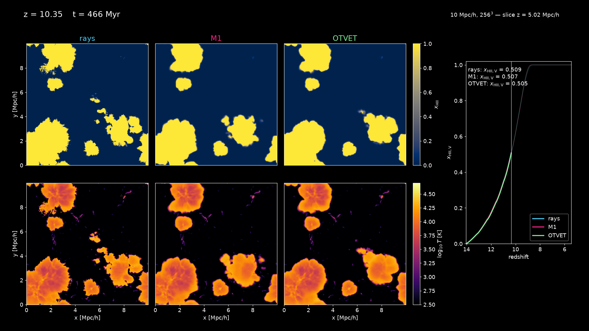

*0.1c at z = 10.35, x_HII,V ≈ 0.51.*

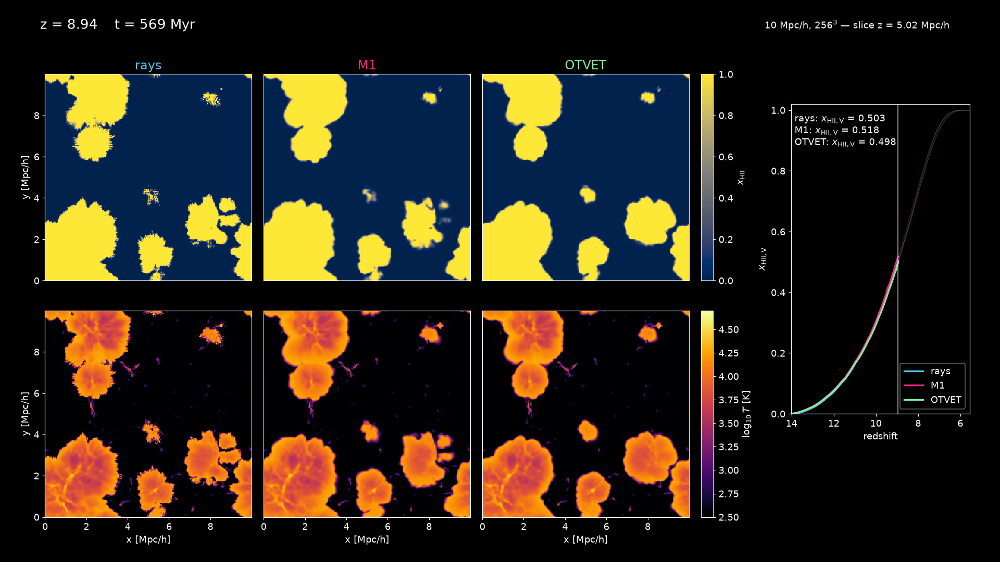

*0.01c at z = 8.94, x_HII,V ≈ 0.50.*

### 6.3 Reionization history

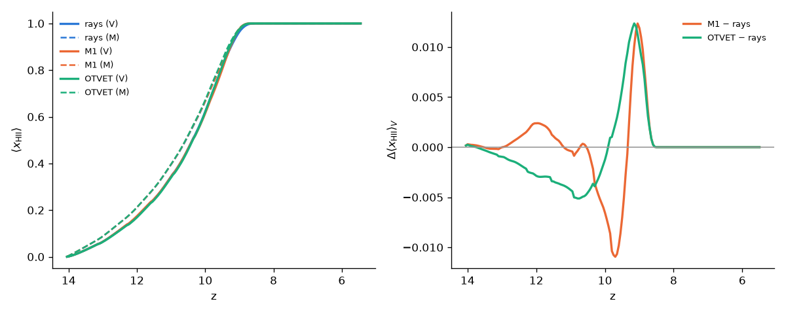

*0.1c: x_HII (left) and the difference from the rays in x_HII,V (right).*

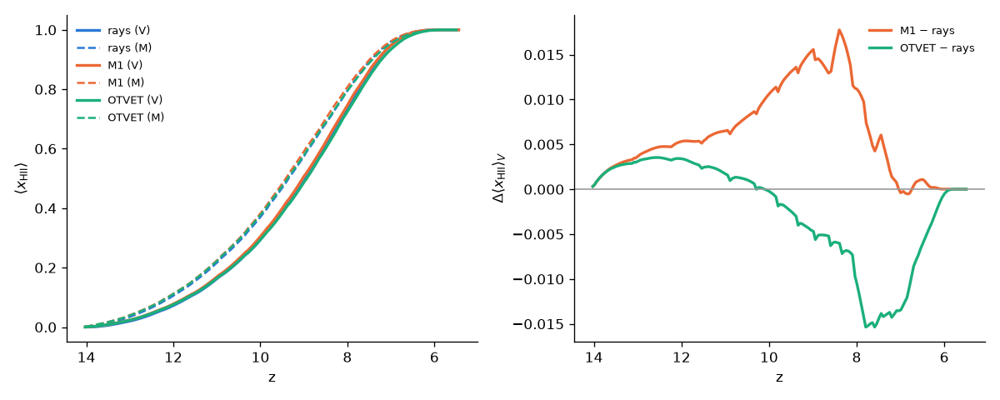

*Same for 0.01c.*

| set | run | z(x_V = 0.1) | 0.5 | 0.9 | 0.99 | z(x_M = 0.5) | τ_es |
|---|---|---|---|---|---|---|---|
| 0.1c | rays | 12.639 | 10.379 | 9.248 | 8.826 | 10.565 | 0.0904 |
| | M1 | 12.645 | 10.373 | 9.262 | 8.909 | 10.573 | 0.0905 |
| | OTVET | 12.624 | 10.367 | 9.282 | 8.897 | 10.577 | 0.0906 |
| 0.01c | rays | 11.645 | 8.960 | 7.291 | 6.494 | 9.352 | 0.0761 |
| | M1 | 11.710 | 9.029 | 7.309 | 6.517 | 9.416 | 0.0768 |
| | OTVET | 11.679 | 8.934 | 7.217 | 6.373 | 9.373 | 0.0764 |

- **The global history is the same to |Δx_HII,V| ≤ 0.018 at every z.**
  - At 0.1c: up to x_V = 0.9, z agrees to 0.04, and τ_es to 0.2%. The
    largest differences, ±0.012, come in the last stage of overlap
    (z ≈ 9–10). The end of reionization (x_V = 0.99) is Δz = 0.07–0.08
    later with the moment methods.
  - At 0.01c: M1 runs ahead by up to +0.018 (z ≈ 8.4), and OTVET falls
    behind by up to −0.015 (z ≈ 7.8). τ_es agrees to 1%. OTVET finishes
    Δz = 0.12 earlier at x_V = 0.99.
- **Small early fronts (§4) show at 0.01c only.** At z = 13.12 the moment
  runs have 17–20% more ionised volume (x_V = 0.0199 and 0.0195 against
  0.0166). They also have 1.4–1.5× the x_HII power at k = 2, and the median T
  of their ionised gas is 13% lower (15 100–15 200 K against 17 400 K).
  - The difference shrinks to 2–5% by z = 11.5.
  - At 0.1c the fronts are already larger at that redshift (x_V = 0.057),
    and the three runs agree to 2%.

### 6.4 Morphology and temperature

| set | z | x_V (rays) | cells with \|Δx\| > 0.1: M1 / OTVET | corr(log T): M1 / OTVET | partly ionised: rays / M1 / OTVET |
|---|---|---|---|---|---|
| 0.1c | 12.30 | 0.137 | 5.1% / 2.5% | 0.902 / 0.977 | 1.5 / 2.5 / 2.3% |
| | 10.90 | 0.364 | 13.3% / 5.9% | 0.818 / 0.959 | 4.4 / 5.3 / 4.6% |
| | 9.80 | 0.700 | 19.9% / 7.9% | 0.597 / 0.912 | 5.4 / 5.0 / 4.8% |
| | 9.00 | 0.965 | 6.0% / 2.2% | 0.083 / 0.796 | 1.0 / 0.9 / 0.8% |
| | 6.80 | 1.000 | – | 0.934 / 0.989 | – |
| 0.01c | 11.54 | 0.108 | 2.9% / 2.6% | 0.962 / 0.976 | 2.2 / 3.1 / 2.9% |
| | 8.99 | 0.494 | 10.3% / 7.0% | 0.889 / 0.951 | 4.2 / 5.9 / 5.3% |
| | 7.44 | 0.870 | 9.9% / 5.8% | 0.674 / 0.893 | 3.5 / 3.5 / 3.5% |
| | 6.85 | 0.966 | 4.2% / 2.4% | 0.541 / 0.867 | 1.4 / 1.5 / 1.5% |

- **OTVET matches the rays' ionisation and temperature morphology much better
  than M1.**
  - It has 2–2.5× fewer cells off by more than 0.1 in x_HII during the
    middle of reionization.
  - Its log T correlates with the rays' at 0.91–0.99 at 0.1c and 0.87–0.98
    at 0.01c.
  - For M1 the correlation drops through overlap (0.60 at x_V = 0.7, at
    0.1c).
  - This is consistent with the known weakness of M1 where radiation from
    many sources crosses: the local closure gives a single flux direction
    per cell. That is an interpretation, not tested here.
- **The last neutral islands are in different places** (0.1c, z = 9.0,
  x_V = 0.965–0.977, below). In the M1 run they have moved so far that its
  log T correlates with the rays' at only 0.08. OTVET's are closer: 0.80.
  - Tests that depend on where the islands survive late, such as the
    Lyα forest after overlap, are therefore sensitive to the RT method at
    this level.
- **Fronts.** The moment fronts are smooth, while the rays' are ragged:
  - the rays' HEALPix sampling leaves holes at large radius, worst at 0.01c
    (§4). These ray runs (2026-10-09) predate `ray_rotate`: they use the
    fixed frame, and the holes are B16. With `ray_rotate = 3`, the
    production setting since 2026-10-10, they are gone (§4, the shadow
    holes; `docs/rt_methods_512.md` and `docs/rt_suite_512.md` use it);
  - the moment methods have up to 1.4× as many partly ionised cells
    (5.9% against 4.2%) while the bubbles grow;
  - at overlap the fraction of partly ionised cells is the same for all
    three methods.
- **The temperature of ionised gas agrees to 1–2%** from z ≈ 11 on. Medians
  for rays / M1 / OTVET:
  - 0.1c, z = 6.80: 6194 / 6290 / 6225 K;
  - 0.1c, z = 5.45: 5042 / 5123 / 5099 K;
  - 0.01c, z = 7.44: 9584 / 9473 / 9648 K.

  The moment runs are slightly hotter after overlap at 0.1c.
- **x_HII power after overlap.** At 0.1c, M1's residual neutral-fraction
  power is 0.82–1.09 of the rays' at k = 2–16, and OTVET's is 0.58–0.89.
  OTVET's residual x_HI fluctuations are smoother. With x_V > 0.999 (0.01c,
  z ≤ 5.9) the ratio only says whether a last patch survives in the box,
  and is meaningless.

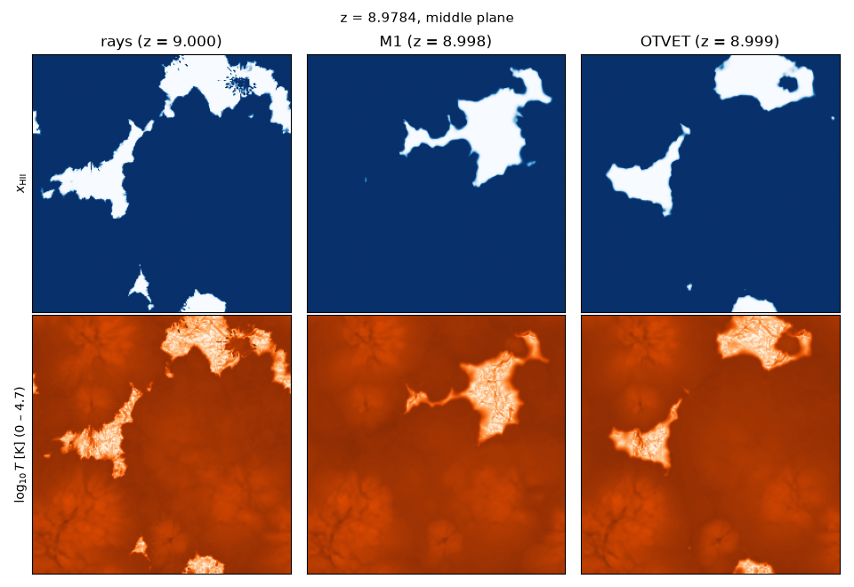

*0.1c at z = 9.0: the last neutral regions (dark) in the middle plane.*

### 6.5 Cost

Whole node, 192 threads. The RT time is the sum of the RT timers in
`run.log`. Wall time is the whole run, including hydro, PM, FoF and output.

| set | run | substeps | wall | RT | transport | photo-chemistry | other RT | peak RSS |
|---|---|---|---|---|---|---|---|---|
| 0.1c | rays | 4064 | 1:32:42 | 5032 s | 3552 s | 1382 s | 98 s | 27.0 GB |
| | M1 | 4037 | 49:35 | 2823 s | 1206 s | 1549 s | 68 s | 13.5 GB |
| | OTVET | 4035 | 51:39 | 2952 s | 1229 s | 1553 s | 170 s | 14.3 GB |
| 0.01c | rays | 404 | 26:17 | 882 s | 641 s | 181 s | 60 s | 23.1 GB |
| | M1 | 403 | 6:50 | 265 s | 116 s | 136 s | 13 s | 14.2 GB |
| | OTVET | 401 | 8:28 | 366 s | 116 s | 132 s | 118 s | 14.4 GB |

What the columns contain:
- **transport:** for the rays, `calc_ray_1 + ray_tracing_1 + ray_tracing_3`.
  For the moment methods, `ray_tracing_1` (the GLF subcycles and the
  deposit) plus `ray_tracing_3` (scaling by the surviving fraction).
- **photo-chemistry:** `radiative_physics`.
- **other RT:** `prep`, `calc_rt_1`, `sync` and `post_rt`. OTVET's `prep`
  is the FFT tensor, 106 s in all for the hydro steps with sources.

Findings:
- **Speed-up over the rays: 1.8× in RT time at 0.1c** (1.9× wall for M1,
  1.8× for OTVET), and 2.4–3.3× at 0.01c (3.1–3.9× wall).
- **Memory:** about half the rays' at 0.1c.
- **The transport met the estimate; the total did not.** The moment
  transport costs 0.29–0.30 s per substep at both light speeds (0.26–0.27 s
  of it in `ray_tracing_1`). That is inside the 0.15–0.3 s expected from
  the 32³ timings, and 2.9× cheaper than the ray tracing per substep at
  0.1c.
  - It is 3.1 µs of thread time per cell per substep, against 0.7 µs on
    one thread at 32³: the 192 threads give a 44× speed-up, at the low end
    of the 40–80× guessed for memory-bound scaling.
  - The 10–20 min estimate counted only the transport, though.
    `radiative_physics` (`photo_cell`, unchanged) costs as much as with the
    rays (0.33–0.45 s per substep) and is now **51–55% of the moment RT
    time**.
  - A faster RT now needs faster photo-chemistry. Its cost does not depend
    on the RT method.
- **Time per substep follows the ionised volume, not the number of sources**
  (wall time per hydro step ÷ substeps, 0.1c):

  | z | 11.6 | 9.8 | 8.6 | 7.8 | 6.8 | 5.5 |
  |---|---|---|---|---|---|---|
  | x_V (rays) | 0.24 | 0.70 | 1.00 | 1.00 | 1.00 | 1.00 |
  | N_source | 278 | 1020 | 2140 | 3200 | 4500 | 5300 |
  | rays [s] | 1.15 | 1.42 | 1.56 | 1.56 | 1.45 | 1.55 |
  | M1 [s] | 0.39 | 0.70 | 0.86 | 0.88 | 0.88 | 0.88 |
  | OTVET [s] | 0.40 | 0.71 | 0.90 | 0.92 | 0.92 | 0.95 |

  - The moment cost per substep doubles between x_V = 0.24 and overlap,
    then stays flat while N_source grows 2.5×.
  - The transport skips cells whose stencil holds no photons (§4). The
    rise is consistent with more cells holding photons, for the transport
    and the photo-chemistry, until photons fill the box at overlap. Not
    checked with per-step timers.
  - OTVET's tensor grows only with the source count (`auto` → FFT here, a
    fixed cost per hydro step).
- **Photon budget** (M1, 0.1c, `ray.log` at the end): injected 11.38,
  absorbed 2.54, lost 2.47 and in flight 6.36 photons per H atom. That
  closes to the printed digits.

### 6.6 Conclusions

- At 256³ in a 10 Mpc/h box, both moment methods reproduce the rays'
  reionization history to |Δx_V| ≤ 0.02 and τ_es to 1%. They take
  roughly half the RT time and half the memory at 0.1c.
- **OTVET is the better match** for morphology and temperature: 2–3× fewer
  discrepant cells than M1, and corr(log T) ≥ 0.87 throughout.
  - M1's last neutral islands and its temperature structure near overlap
    differ substantially from the rays'.
  - OTVET costs 5% more than M1 at 0.1c (the FFT tensor). At 0.01c, with
    few substeps per hydro step, it costs 38% more.
- **Next for speed:** `radiative_physics`. Beyond that, a second-order
  transport would sharpen the fronts (§5).

## 7. Constant-opacity transfer function, and Gnedin 2025

*Written 2026-11-20 (branch `claude/dreamy-ride-nchi0z`), on the user's
question whether the Γ fluctuations of §6 and `docs/rt_suite_512.md` §6
contradict Gnedin 2025 (arXiv:2504.10571), where M1 and OTVET both follow
T_ΓL(k) = (P_Γ/P_L)^½ = arctan(kλ)/(kλ).*

**Test.** `tools/analysis/moment_transfer.cpp` runs the solver's own
transport (`mk::flux_cell`, `mk::glf_cell`, `otvet_fft_convolve`,
`moment_nsub` = 4, `moment_inject` = 1) to the steady state in a medium of
uniform mean free path λ: each substep ends with N, F *= exp(−Δx/λ) instead
of `photo_cell`. `moment_transfer.py` compares T(k) = (P_N/P_L)^½ with:
- exact: arctan(kλ)/(kλ) (Gnedin 2025, eq. 2);
- M1 linearised (D = I/3): 1/(1 + k²λ²/3);
- OTVET linearised: (1 + 2π²kλ²/(3L_O))/(1 + k²λ²/3), L_O = 7.66 L for the
  minimum-image cube (Wu, McQuinn & Eisenstein 2021, eqs. 5.14–5.15 without
  the opacity response; rederived here);
- the same two with the scheme's numerical diffusion. Per unit ĉ/Δx the
  first-order GLF flux adds ½∇² to both moment equations, which replaces κ
  by q = κ + ½|k|²Δx (discretely κ − ½Σ(2cos k_d − 2)) in the flux equation
  and in the loss term: T_M1 = κ/(q + |s|²/3q), s_d = sin k_d.

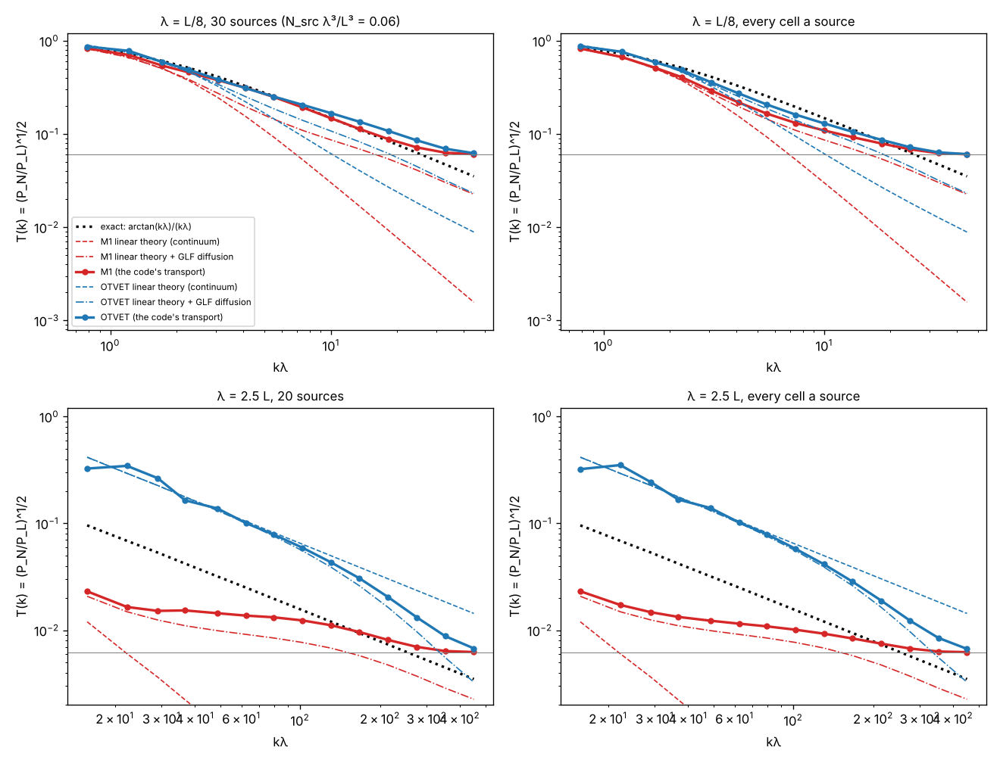

*T(k) for λ = L/8 (top; 128³) and λ = 2.5 L (bottom; 64³, the λ/L of the
512³ runs at z ≈ 5.4), with 20–30 sources (left) and every cell a source
(right). Grey line: 1 − exp(−Δx/λ), the photons a source injected in the
current substep. All cases (also λ = L and 2000–3000 sources):
[`figures/moment_transfer.txt`](figures/moment_transfer.txt).*

**Results.**
- **The implementation solves the equations it claims.** With every cell a
  source M1 equals the isotropic closure to 4 digits, and both closures
  follow their linear theory with the GLF term: to 3–10 % for kλ ≤ 5 at
  λ = L/8, to 10–25 % at λ ≥ L for M1 (above it), and to 5–10 % for OTVET
  at k ≥ 3 fundamentals. `ctest -L moments`: 26 of 26 pass.
- **λ ≪ L (Gnedin's regime: his fitted λ is 0.3–1 cMpc/h in a 20 cMpc/h
  box, read off his Fig. 5, at x_HI = 0.99–0.17).** Two cases, with
  different reasons for the agreement with arctan(kλ)/(kλ) at kλ = 2–20:
  - *30 sources (0.06 per λ³):* T/T_exact = 0.89–1.05 (M1) and 0.96–1.28
    (OTVET). One beam per cell is M1's exact case. At kλ = 10 M1 is 1.7×
    its linear theory with the GLF term, so this is not the scheme.
  - *Every cell a source (4096 per λ³):* 0.74–0.95 (M1) and 0.88–1.03
    (OTVET), **but through the numerical diffusion.** The continuum linear
    M1 is 0.2 of exact at kλ = 10 (0.030 against 0.148); the GLF term
    lifts it for kλ > (2λ/Δx)^½ = 5.7. A resolution artifact, not evidence
    that M1 follows the exact form.

  Which of these (or the shared ionized/neutral pattern, which dominates
  P_Γ during reionization) makes his Fig. 5 and 7 and our 512³ runs agree
  is **not established**.
- **λ ≳ L (our runs after overlap).** M1 is 0.42× (λ = L) and 0.24×
  (λ = 2.5 L) the exact T at the box scale; OTVET is 1.6–2.3× and 3.4–5×.
  In power: M1 0.17 and 0.06, OTVET 3–5 and 11–26. The 512³ suite at
  z = 4.99 has M1 0.04–0.07 and OTVET 11.6–14 times the rays' P_Γ at
  k ≤ 2 h/Mpc: **the production numbers are those of the closures at
  λ ≈ 2.5 L, not a bug.** Gnedin 2025 shows no ALTAIR run in this regime.
- **During reionization the 512³ runs agree with each other as his do.**
  From `figures/rt_suite_512_pk.txt`, T_M1/T_OTVET = 0.73–1.15 at
  x_V = 0.49 and 0.79 over k = 0.16–47 h/Mpc, and both are 0.8–1.3× the
  rays' at k ≤ 4 h/Mpc. It is 0.5–0.7 at x_V = 0.97 and 0.05–0.16 after
  overlap.

**Two numerical effects** (the first is also what lifts the dense case at λ = L/8):
- **M1's small-scale T is set by the GLF diffusion, not by the closure.**
  For k > (2/λΔx)^½ the flux equation is damped by the numerical term, and
  T flattens near 1.5 Δx/λ instead of falling as 3/(kλ)². At λ = 2.5 L on
  64³ this is 5–100× the continuum M1 value. A less diffusive flux (HLL,
  second order) would lower M1's P_Γ further, and the plateau moves with
  resolution.
- **The injection floor.** With `moment_inject = 1` the photons of the
  current substep sit in the source cell: a white term T = 1 − exp(−Δx/λ),
  which exceeds the exact T for kΔx ≳ 1.5 (the flat last bins of
  `rt_suite_512_pk.txt`).

Both give a plateau in T(k) at high k. Thesan's unexplained plateau in
Gnedin's Fig. 4–5 has that shape, but it starts at scales far above the
cell: not tested, a guess only.

**Resolution test (2026-11-20, on the user's remark that M1 has more Γ
power than the rays at high k, against Wu et al. 2021, Fig. 4).** Every
cell a source, λ = L, `moment_inject = 1`, at 32³, 64³ and 128³ (the last
blocks of `figures/moment_transfer.txt`):

| | 32³ | 64³ | 128³ | 256³ |
|---|---|---|---|---|
| M1 = exact at kΔx | 1.30 | 1.3 | 1.3–1.4 | 1.3 |
| the same in kλ | 42 | 84 | 180 | 335 |
| T_M1/T_exact at kλ ≈ 14 (linear M1: 0.13) | 0.59 | 0.39 | 0.27 | 0.20 |

(256³ added 2026-11-23.)

- **The crossing is fixed in kΔx, not in kλ: numerical.** The 512³ suite
  after overlap has M1 overtaking the rays at kΔx ≈ 1.4 (k ≈ 17.6 h/Mpc).
- **With `moment_inject = 0` (64³) there is no crossing**: T_M1/T_exact is
  0.24–0.27 for kΔx = 0.2–1 and falls to 0.03 at the Nyquist corner. The
  excess over exact is the source cells' own-substep photons.
- **M1 is not converged at any k > 1/λ**: at fixed kλ its T falls toward
  the linear solution with resolution. The suite's M1 deficit at
  k ≤ 2 h/Mpc is likely smaller than a converged M1 solver's.
- Not tested: a less diffusive flux; the rays' own high-k power against the
  64-rays-per-cell cap (Wu et al. 2021, §5.2.3).

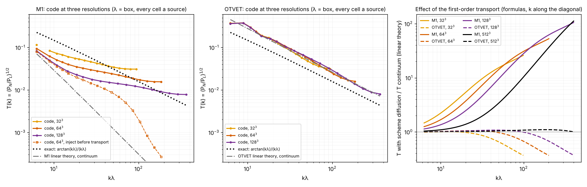

*The same test for both closures (λ = L, every cell a source,
`moment_inject = 1`). Left: M1 at 32³, 64³ and 128³, and 64³ with
`moment_inject = 0`. Middle: OTVET. Right: the linear theory with the GLF
term over the continuum one, for k along the diagonal. Data:
[`figures/moment_transfer_convergence.txt`](figures/moment_transfer_convergence.txt).*

- **OTVET is converged in this test, M1 is not.** OTVET's T at kλ ≈ 14
  and 30 is 1.77–1.93 of exact at all three resolutions and 0.97–1.12 of
  its continuum linear theory. M1's is 0.59 / 0.39 / 0.26 of exact at
  kλ ≈ 14 (4.4 / 2.9 / 1.9 of its continuum theory) and 0.88 / 0.59 / 0.32
  at kλ ≈ 30.

### 7.1 The exact linear solution of the discrete scheme

*2026-11-23.* `tools/analysis/moment_transfer_exact.py` solves the test of
this section for small perturbations with no further approximation: the
first-order scheme as coded (GLF flux, `moment_nsub` subcycles, the
injection after or before them, the absorption once per substep and, for
OTVET, the Fourier response of the code's tensor kernel), linearised about
the uniform state, mode by mode on the code's grid and averaged over the
shells of `moment_transfer.py`. The formulas are in the script's header.
The "linear theory with the GLF term" used above treats the subcycles and
the injection as continuous in time and is replaced by this where the two
differ.

- **The code equals this solution to 3 % in every bin**: T(code)/T(exact
  linear) = 0.969–1.023 over M1 and OTVET, `moment_inject` = 1 and 0,
  32³–256³, λ = L/4 and L, every cell a source
  ([`figures/moment_transfer_exact.txt`](figures/moment_transfer_exact.txt),
  the `code/` columns).
- So in this test every departure of T from the continuum closures (the
  plateau at high k, the crossing at kΔx ≈ 1.3, the resolution dependence
  at fixed kλ) is a property of the linearised discrete scheme; nothing
  nonlinear enters.
- Reproduce: `moment_transfer.py N λ <prefixes> > code.txt`, then
  `moment_transfer_exact.py N N/λ --code code.txt`.
- Not covered: `moment_order = 2` (PR #40).

## 8. Convergence runs for the Γ fluctuations

*2026-11-20, asked by the user.* `tools/hyak/rt_convergence.sh` (klone;
`all` chains everything with job dependencies, or the phases `ics`, `res`,
`rays`, `post` one by one; `DRYRUN=1` prints the jobs). Both
series use the 512³ suite's `make_production.py` arguments in a 20 Mpc/h
box.

- **Why M1 first.** Linear theory with the GLF term at λ = L (formulas of
  §7): the scheme raises M1's T by 1.2 / 1.9 / 4.5 at kλ = 14 / 30 / 60 at
  512³ (3.4 / 9 / 20 at 32³) and changes OTVET's by ≤ 6 % (512³; 0.6–1.07
  at 32³–128³). The screen and cone were not put through the test.
- **`res`: the gas / RT grid N = 128, 256, 512 at fixed dark matter.**
  512³ particles on the 512³ PM mesh in every run (`pm_refine` = 4, 2, 1);
  `make_ics.py --Ndm 512 --phases-from-ndm 256` gives a byte-identical
  `xv_dm.init` for every `--Ngas` (checked at Ndm = 32, Ngas = 8, 16, 32),
  so the halos and sources match up to the gas's gravity. Rays, M1 and
  M1 with `moment_inject = 0` at each N (`rtconv_N<N>_rays`, `..._rays_m1`,
  `..._rays_m1_inj0`; the last added on the user's request, to measure the
  white injection term of §7 in full runs). Measure P_Γ(M1)/P_Γ(rays) at
  fixed k against N. Prediction of §7: the ratio falls with N at
  k ≳ 1 h/Mpc after overlap, and M1 overtakes the rays at kΔx ≈ 1.3 at
  every N. Confound: the gas resolution changes the absorbers and λ, so
  compare at matched x_V and quote λ.
- **`rays`: the ray budget at N = 256**, `nray_max_factor` = 8, 32, 64,
  120 beside the suite's 15 (`rtconv_N256_rays_f<F>`), reference f120.
  Rays outside the brightest quarter of the pool merge into the 48 cones
  of `nside_merge` = 2 per cell and only the brightest half may split
  (`calc_ngam_ray`), so the live rays per cell are a fraction of
  `nray_max_factor`: **the suite's 15 is well below the 64 per cell that
  Wu et al. 2021 §5.2.3 take for this code** (ℓ ≈ 8, converged for
  k ≲ ℓ/λ). `nray_max_factor`·N³ < 2³¹ caps the 512³ suite at 15.
  Not varied: `nside_merge` (no params.txt key; 4 would need one).
- Checked here: every phase with `DRYRUN=1`; `radhydro` runs 3 steps of
  the new N = Ndm/4, `pm_refine` = 4 combination (N = 8, Ndm = 32).
- **Run 2026-11-20 to 23 on klone; results in §8.1–8.5.** Added while the
  series ran: plain OTVET at every N (`otvet` phase), the rays at
  `nray_max_factor` = 120 at 128³ (the reference there, §8.1), and M1 and
  OTVET with `moment_order = 2` at 128³ and 256³ (submitted by hand with an
  executable of the branch `moment-order2`, PR #40).

**Injection order at three resolutions (2026-11-20, added to §7's test).**
`moment_inject = 0` at 32³, 64³, 128³ (λ = L, every cell a source):
- **T(inject 1) − T(inject 0) = 1 − exp(−Δx/λ) to 1–4 % at every k and
  resolution.** `moment_inject = 1` is the inject-0 field plus a white
  term, the photons of the current substep in their source cell.
- T/T(continuum linear M1) at kλ ≈ 11 / 14 / 30 / 57: inject 0 gives
  1.2 / 1.4 / 2.6 / 6.7 at 128³ (inject 1: 1.5 / 1.9 / 4.6 / 15), and
  1.7 / 2.2 / 4.1 / – at 32³ (2.9 / 4.4 / 15 / –). Inject 0 is nearer
  the continuum M1 but not converged either: what remains is the GLF term.
- Above kΔx ≈ 1 inject 0 falls to 0.03–0.08 of exact: its source photons
  are spread over ~2 cells by the 4 subcycles before Γ is evaluated. That
  is the smoothing behind the neutral source cells of §5a, not M1.

**The same series at λ = L/4 (2026-11-20; the user: λ = L is a strange
case).** λ = L was chosen to mimic the suite after overlap, but there the
lowest mode is already at kλ = 6.3 and OTVET's box-normalised tensor term
dominates. At λ = L/4 (32³–256³, λ = 8–64 cells) the series starts at
kλ = 1.6, where every run agrees with the theory:

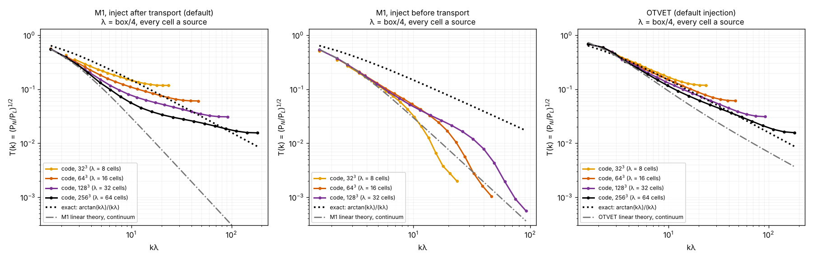

*M1 with `moment_inject = 1` (left) and 0 (middle), OTVET (right). Table:
[`figures/moment_transfer_convergence_l4.txt`](figures/moment_transfer_convergence_l4.txt).*

- **kλ ≲ 2: converged and correct.** M1 is within 2–13 % of its continuum
  theory at every N, OTVET within 6 %.
- **M1, inject 1:** T/T(continuum) at kλ ≈ 10 is 5.1 / 3.5 / 2.4 / 1.8 at
  32³ / 64³ / 128³ / 256³, at kλ ≈ 20: 17 / 9.6 / 7.7 / 4.6. Roughly first
  order in Δx; it equals the exact T at kΔx ≈ 1.25 at every N.
- **M1, inject 0:** within 15 % of the continuum for kλ ≤ 5 at every N
  and 1.1–1.7 at kλ ≈ 10; then the source smoothing cuts it off.
- **OTVET is not converged here either**, unlike at λ = L: T/T(continuum)
  at kλ ≈ 10 is 1.8 / 1.6 / 1.4 / 1.2 and at kλ ≈ 20: 3.1 / 2.2 / 2.0 / 1.6.
  With λ < L its tensor term is small (it grows as λ/L), so its mid-k
  solution is M1-like and is lifted by the same two terms. The lift brings
  it to within 0.77–1.15 of the *exact* T at these resolutions, by
  accident. "OTVET is converged" above holds for λ ≳ L only.

### 8.1 Results: the ray budget

*Runs of 2026-11-20 to 23 (klone). Figures and tables by
`tools/analysis/rt_convergence_cmp.py` and `rt_convergence_fig.py`
(`rt_convergence.sh post`).*

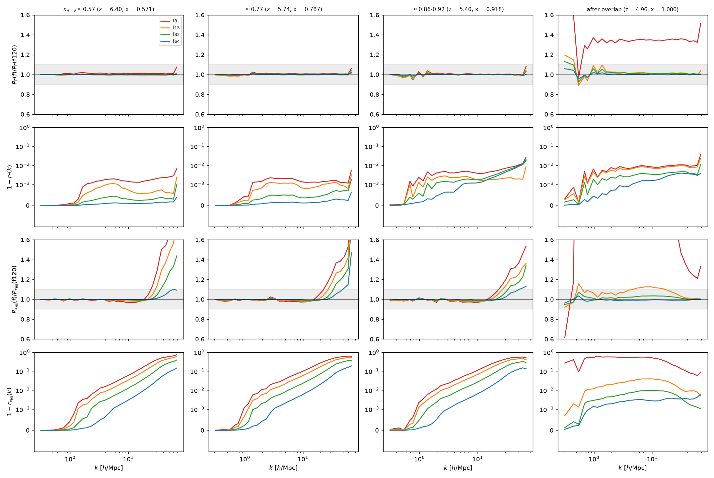

*256³, `nray_max_factor` f = 8, 15, 32, 64 against f = 120: P(k) ratio and
1 − r(k) for δ_Γ (rows 1–2) and x_HII (rows 3–4) at four epochs. Table:
[`figures/rt_convergence_rays.txt`](figures/rt_convergence_rays.txt).*

- **During reionization the suite's f = 15 is converged in P_Γ.** At
  x_V = 0.57, 0.79 and 0.92, P_Γ(f)/P_Γ(120) is within 10 % of 1 for every
  f ≥ 8 at every k up to the Nyquist frequency (at k ≤ 2 h/Mpc: within
  5.4 % for f = 8 and 4.6 % for f = 15), and 1 − r_Γ ≤ 0.03. The histories
  x_V(z) agree to 0.001.
- **After overlap (z = 4.96) it is not at the box scale.** f = 15 has 1.20
  of the reference power at k = 0.3 h/Mpc and is within 10 % at k ≥ 0.5;
  f = 32 and 64 have 1.13 and 1.06 at k = 0.3. f = 8 has 1.3–1.4 at
  k ≥ 1 h/Mpc, a 14 % lower median Γ and a 21 % shorter λ.
- **x_HII at small scales depends on f at every epoch**:
  P_x(15)/P_x(120) > 1.1 for k ≳ 30 h/Mpc and 1 − r_x = 0.1 at
  k ≈ 20 h/Mpc.
- **At 128³ f = 15 fails after overlap.** The pool guard forces merges
  (767 substeps limited, 900 forced) and the run ends with
  ⟨Γ⟩_V = 8.5 × 10⁻¹⁴ s⁻¹ and λ = 5.7 pMpc against 4.8 × 10⁻¹³ and 38 pMpc
  at f = 120 (12–43 times the reference P_Γ). Up to x_V = 0.75 the two
  agree to 1 % in P_Γ. The 128³ rows below use f = 120 as the reference. The
  budget is global, `nray_max_factor`·N³, while the rays needed after
  overlap scale with the sources and λ, so a coarse grid needs a larger
  factor.
- Not varied: `nside_merge`.

### 8.2 Results: the resolution series

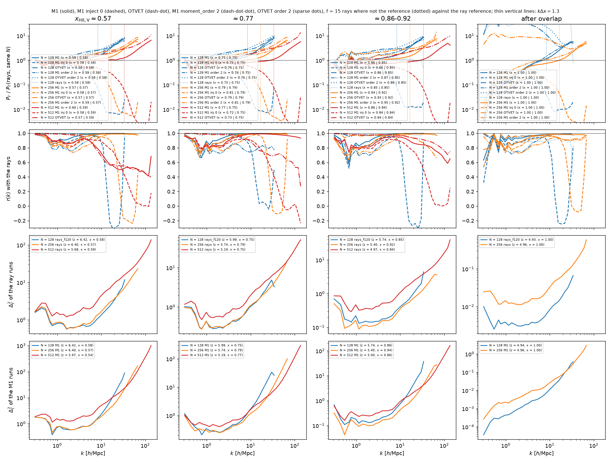

*Columns: epochs matched in x_HII,V (the last in z). Rows: P_Γ of each
moment run over the rays' of the same N; r(k) with the rays; Δ²_Γ of the
ray runs; Δ²_Γ of the M1 runs. Table, with ⟨Γ⟩, λ and the dense-cell
statistics: [`figures/rt_convergence_res.txt`](figures/rt_convergence_res.txt).*

P_Γ/P_Γ(rays) at k = 1, 2, 4, 8, 16 h/Mpc, x_V ≈ 0.57–0.59:

| | 128³ | 256³ | 512³ |
|---|---|---|---|
| M1 | 0.91 0.93 1.12 1.47 3.05 | 0.91 0.96 0.99 1.10 1.36 | 0.78 0.78 0.87 0.99 1.05 |
| M1, `moment_inject = 0` | 0.76 0.60 0.38 0.09 0.01 | 0.79 0.74 0.54 0.31 0.08 | 0.69 0.62 0.53 0.50 0.31 |
| OTVET | 1.20 1.50 2.08 2.56 3.64 | 1.06 1.27 1.50 1.96 2.47 | 0.86 0.99 1.18 1.73 2.14 |
| M1, `moment_order = 2` | 0.94 1.14 1.47 1.91 3.29 | 1.00 1.18 1.40 1.56 1.90 | – |
| OTVET, `moment_order = 2` | 1.04 1.21 1.64 2.47 4.19 | 1.08 1.33 1.72 2.38 3.07 | – |

After overlap (z ≈ 4.95; λ = 38 pMpc at 128³ and 15 pMpc at 256³, 7.7 and
3.2 box lengths):

| | 128³ | 256³ |
|---|---|---|
| M1 | 0.12 0.33 0.71 1.11 2.47 | 0.16 0.35 0.60 0.74 0.98 |
| M1, `moment_inject = 0` | 0.06 0.13 0.17 0.05 0.01 | 0.07 0.16 0.24 0.17 0.05 |
| OTVET | 35 34 26 12 3.7 | 9.2 9.2 8.4 7.3 4.6 |
| M1, `moment_order = 2` | 0.15 0.33 0.65 1.35 2.95 | 0.30 0.55 0.83 1.07 1.41 |
| OTVET, `moment_order = 2` | 36 36 34 24 7.0 | 9.0 9.0 8.2 7.7 6.4 |

- **The prediction of §7 holds after overlap**: M1 overtakes the rays at
  kΔx = 1.08 (128³) and 1.28 (256³), and its ratio to the rays at fixed
  k ≥ 4 h/Mpc falls with N. Its deficit at k ≤ 2 h/Mpc changes little
  (0.12–0.33 against 0.16–0.35), but λ/L differs by 2.4 between the two
  runs, so this is not a clean resolution test.
- **During reionization M1's small-scale excess over the rays falls with
  N**: 3.05, 1.36, 1.05 at k = 16 h/Mpc. The crossing is then not at fixed
  kΔx (0.43, 0.24, 0.21 at x_V ≈ 0.58). At k = 1–2 h/Mpc M1 is 0.9–0.96 of
  the rays at 128³ and 256³ and 0.78 at 512³.
- **OTVET's excess falls with N at every k**, during reionization (at
  k = 4 h/Mpc: 2.08, 1.50, 1.18) and after overlap (35 to 9 at
  k = 1 h/Mpc, with the same λ/L caveat).
- **The rays' own P_Γ is not converged in N at fixed x_V**: the 512³ run
  has 1.8–2.7 times the 256³ power at k = 1–16 h/Mpc at x_V ≈ 0.58
  (z = 5.68 against 6.40); 128³ and 256³ agree to 0.78–1.02. The gas grid
  changes the absorbers: the 512³ runs reionize later (at z = 5 x_V = 0.83
  for the rays, 0.86 M1, 0.82 OTVET; x_M = 0.84, 0.88, 0.85; corrected
  2026-11-23, the numbers here were x_M), while the 128³ and 256³ runs
  overlap between z = 5.4 and 5.0.
- The 512³ runs have no epoch after overlap.

### 8.3 Results: `moment_inject = 0` and `moment_order = 2` in the runs

- **`moment_inject = 0` removes M1's small-scale excess and overshoots.**
  Its P_Γ is below the rays' at every k ≥ 1 h/Mpc and every N, and at
  fixed k it rises toward the rays with N (k = 8 h/Mpc: 0.09, 0.31, 0.50;
  k = 16 h/Mpc: 0.01, 0.08, 0.31). At 512³ its r_Γ with the rays is
  0.83–0.92 at k = 1–8 h/Mpc (default M1: 0.80–0.93) and falls to 0 at the
  Nyquist frequency.
- **It reionizes earlier**: at 512³ x_V = 0.954 at z = 4.98 against 0.865
  (default M1) and 0.837 (rays); the median Γ of the ionised cells at z = 5
  is 1.5 times the default's and 1.8 times the rays'.
- **Dense cells** (above 100 times the mean density, 256³, z = 4.96): the
  mass-weighted x_HI is 0.31 against 0.18 (default M1), 0.11 (rays) and
  0.02 (OTVET), and their mean Γ is 7 × 10⁻¹³ s⁻¹ against 4.5 × 10⁻¹²
  (default) and 3.6 × 10⁻¹² (rays): the neutral source cells of §5a. Not
  computed for the 512³ run.
- **`moment_order = 2` does not reduce M1's excess over the rays in these
  runs**, unlike in the uniform test (PR #40). At x_V ≈ 0.58 it raises
  P_Γ/P_Γ(rays) at k = 2–16 h/Mpc at both N (256³: 1.18, 1.40, 1.56, 1.90
  against 0.96, 0.99, 1.10, 1.36) and lowers r_Γ at k = 1–4 h/Mpc from
  0.86–0.95 to 0.75–0.84 (256³). After overlap at 256³ it has more power
  at every k (0.30 of the rays at k = 1 h/Mpc against 0.16), again with
  lower r. **The cause is not known.**
- **`moment_order = 2` with OTVET does not reduce its excess either.**
  During reionization it lowers the excess at k ≤ 8 h/Mpc at 128³ and
  raises it at k = 16 h/Mpc; at 256³ it raises it at every k ≥ 1 h/Mpc
  (k = 2–16 h/Mpc: 1.33, 1.72, 2.38, 3.07 against 1.27, 1.50, 1.96, 2.47). After
  overlap it raises it at k = 4–16 h/Mpc at 128³ (34, 24, 7.0 against 26,
  12, 3.7) and at k = 8–16 h/Mpc at 256³ (7.7, 6.4 against 7.3, 4.6).
  At the two epochs of the tables r_Γ with the rays is unchanged to 0.01
  at both N, unlike for M1.

### 8.4 The uniform test of §7 with the rays

`tools/analysis/ray_transfer.cpp` puts the ray tracer through the test of
§7: the solver's own `rt_step_1` and `rt_step_3` with `legacy_rt = 0`, and
every cell transmitting exp(−Δx/λ) in place of the photochemistry.
`tools/hyak/ray_transfer.sh` runs it. 128³, λ = L/4 and L, sources in one
cell in 512 (192 rays per source cell and substep do not fit the pool with
every cell a source), `nray_max_factor` = 8, 15, 64, 120. Tables (T and,
in brackets, the correlation coefficient r with the sources; `_avg` is the
mean over the last 16 substeps; M1 and OTVET with the same sources):
[`figures/ray_transfer_N128_l4.txt`](figures/ray_transfer_N128_l4.txt),
[`figures/ray_transfer_N128_l1.txt`](figures/ray_transfer_N128_l1.txt).

| `nray_max_factor` | 8 | 15 | 64 | 120 |
|---|---|---|---|---|
| live rays per cell, λ = L/4 / L | 6.7 / 6.7 | 12.6 / 12.6 | 39 / 31 | 63 / 52 |
| substeps the pool guard limited (forced), λ = L/4 | 318 (314) | 631 (0) | 12 (0) | 0 |
| rms noise per cell σ | 0.38 | 0.27 | 0.14–0.18 | 0.11–0.14 |

- **The part of the field correlated with the sources is the exact
  solution**: r·T/T_exact = 0.95–1.05 in every bin for λ = L/4 and
  0.87–1.09 for λ = L, at every budget, with no plateau at high k and with
  the injection term (the photons of the current substep in the source
  cell) at its true size.
- **The rest is white noise** of rms σ ≈ 0.95 n_ray^−½ per cell and
  substep (0.86–1.01 over the eight runs), n_ray the live rays per cell:
  T√(1 − r²) is flat in k at σ/√512. It adds σ²Δx³ to P_N/N̄², or
  Δ² = σ²(kΔx)³/2π², 0.11 at the Nyquist frequency for the suite's
  σ = 0.27. Its height in T depends on the source field, so it does not
  carry over to the runs as a number.
- Averaging 16 substeps lowers σ by 1.5 (λ = L/4) to 2.5 (λ = L), not 4:
  the rays persist between substeps.
- M1 and OTVET with these sparse sources have the T of the every-cell
  case to 4 % (λ = L/4) and 1 % (λ = L).
- Not varied: the source density, the mean photon count per cell (0.1 per
  H atom), `nside_merge`.

### 8.5 Cost

Total wall time of the resolution series to z = 5 on 192 cores (cpu-g2),
from the runs' timers:

| | 128³ | 256³ | 512³ |
|---|---|---|---|
| rays [s] | 2370 | 9003 | 60537 |
| M1 [s] | 571 | 3562 | 32123 |
| OTVET [s] | 572 | 3606 | 32247 |
| rays / M1 | 4.1 | 2.5 | 1.9 |
| ray transport / M1 transport | 10.1 | 3.5 | 2.5 |
| photochemistry, share of the rays' RT | 5 % | 16 % | 22 % |
| mean live rays per cell | 9.3 | 7.8 | 5.0 |
| peak memory, rays / M1 [GB] | 32 / 30 | 60 / 48 | 196 / 130 |

- The rays' cost follows their number, which the sources and the merging
  set and not the grid (33 000–41 000 source cells at every N), while the
  moment transport and the photochemistry scale with N³. The ratio
  therefore falls with N **at a fixed box and source population**; it is
  not a trend with problem size.

### 8.6 The 2026-11-23 follow-up: what was asked and the tools

*Asked by the user on 2026-11-23 (the "Runs to make" A and B of the
assessment in `docs/STATUS.md`). Outputs on klone under
`$RUNS/assess_2026-11-23/`; the B runs as `$RUNS/rtconv_N<N>_rays_<name>`.*

- **A. Analysis of existing outputs** of the late-end 512³ suite (40 Mpc/h,
  78 kpc/h cells, P11, case B; `$RUNS/reion512late{,_caseA,_m1}` and the
  OTVET-type runs through `$RUNS/paper_view`, as the paper's figures):
  A1 the mask/cap test of the Γ excess at k ≈ 5 h/Mpc (§8.7), A2 stacked
  Γ profiles around the sources (§8.8), A3 the photon sink by density on the
  suite and the 39 against 78 kpc/h test (§8.9), A4 T_ΓL(k) against the
  runs' own source field (§8.10).
- **B. Small runs** in the configuration of `rt_convergence.sh` (§8.11).
  New phases of `tools/hyak/rt_convergence.sh`: `cone`
  (`otvet_cone_blend = 0`, the paper's cone), `screen`, `m1o2i0`
  (`moment_order = 2`, `moment_nsub = 6`, `moment_inject = 0`), `otvi0`
  (OTVET, `moment_inject = 0`), and `merge4` (the rays with
  `nside_merge = 4`, the key of PR #43). `rt_convergence_cmp.py` knows the
  new runs; `--ref-f120` makes the f = 120 rays the reference at 256³ as
  at 128³.
- **New tools:** `tools/analysis/gamma_mask_cap.py` (A1) and
  `tools/analysis/gamma_source_transfer.py` (A4);
  `tools/analysis/gamma_profile.py` (A2) is PR #42.
- **No source list exists for these runs.** The snapshots have no
  `Luv.bin` and no `sources.txt`, and the checkpoints that held the halos
  are gone (the scrubbed `restart` directories are empty). The run.log's
  `Nsource` counts source *halos* (`halo_sources.cpp`), 0.52–0.55 million,
  more than the 0.33 million local density maxima of the whole 512³ box,
  so no density threshold reproduces the source cells. A1, A2 and A4 use
  stand-ins, named in each section. A source list would need a rerun with
  `fields = ...,Luv`.

### 8.7 A1: the Γ excess at k ≈ 5 h/Mpc: source cells, proximity zones?

`gamma_mask_cap.py` at the paper's four epochs (the rays' steps 69, 84,
93, 99: z = 6.48, 5.70, 5.24, 4.99, x_V = 0.54, 0.80, 0.96, 1.00), P_Γ of
δ_Γ = Γ/⟨Γ⟩_V − 1 of `gammaHI_avg` with the binning of the paper's figure,
four ways, each applied to every run including the rays:

- **as is**;
- **spike**: every single-cell maximum of the run's own Γ above twice the
  mean of its 6 face neighbours replaced by that mean. This removes the
  injection floor of the moment methods (§7: the current substep's photons
  in the source cell) and any other one-cell spike. 71 000 (rays), 95 000
  (M1) and 83 000–91 000 (OTVET, screen, cone) cells at z = 5.70, with a
  median contrast of 4.0 (rays) and 4.8–6.0 (moments), holding 0.5–1.1 %
  of ΣΓ; 12 000–24 000 cells at z = 4.99;
- **peaks**: the density maxima above 10 times the mean (29 000–39 000, the
  halo centres' stand-in) replaced by the mean of their neighbours;
- **cap**: Γ ≤ 3⟨Γ⟩_V (`rt_suite_figures.py --clip 3`): 10 % of the volume
  (17 % of ΣΓ) at z = 6.48, 2–3 % at 5.70, under 0.5 % after.

P_Γ(method)/P_Γ(rays) at k = 4.9 h/Mpc
([`$RUNS/assess_2026-11-23/gamma_mask_cap/gamma_mask_cap.txt`]):

| z | variant | M1 | OTVET | screen | cone |
|---|---|---|---|---|---|
| 6.48 | as is | 1.00 | 1.51 | 2.93 | 2.02 |
| | spike | 0.73 | 1.10 | 2.60 | 1.77 |
| | peaks | 0.97 | 1.47 | 2.86 | 1.98 |
| | cap | 1.04 | 0.89 | 1.22 | 1.05 |
| 5.70 | as is | 1.07 | 1.60 | 3.23 | 2.12 |
| | spike | 0.76 | 1.15 | 2.80 | 1.85 |
| | peaks | 1.00 | 1.52 | 3.15 | 2.08 |
| | cap | 0.97 | 0.94 | 1.80 | 1.44 |
| 5.24 | as is | 0.85 | 1.92 | 2.43 | 2.01 |
| | spike | 0.59 | 1.58 | 2.15 | 1.78 |
| | cap | 0.74 | 1.27 | 1.74 | 1.64 |
| 4.99 | as is | 0.60 | 3.80 | 2.07 | 1.92 |
| | spike | 0.38 | 3.75 | 1.85 | 1.70 |
| | cap | 0.43 | 2.10 | 1.59 | 1.68 |

(peaks at z = 5.24 and 4.99 within 0.06 of "as is".)

- **The single-cell spikes are part of it, not most of it.** Removing them
  lowers the closures' ratio at k ≈ 5 by 0.2–0.45 before overlap (OTVET
  to 1.10–1.58, the screen to 2.15–2.80, the cone to 1.77–1.85) and M1 to
  0.59–0.76 of the rays (0.38 at z = 4.99): M1's ratio of ≈ 1 at k ≈ 5 is
  its injection floor. At k ≈ 10 the spikes matter more (OTVET 2.2 → 1.3, M1 1.2 → 0.5
  at z = 5.70).
- **The proximity zones carry most of it before overlap.** Capping Γ at
  3⟨Γ⟩_V brings OTVET to 0.9 and the cone to 1.05–1.44 at z = 6.48–5.70;
  the screen keeps 1.2–1.8. The cap also lowers r(k) with the rays at
  k ≈ 5 from 0.95 to 0.44–0.81: the capped cells are where the rays' and
  the closures' small-scale fields agree in phase, so the cap removes the
  shared structure as well as the excess. §8.8 shows the closures' excess
  Γ in the 1–3 cells around dense peaks.
- **The density peaks (halo stand-ins) carry none of it** (≤ 0.07 change):
  the source cells cannot be isolated this way (§8.6).
- **After overlap the excess is not local.** At z = 4.99 OTVET keeps
  3.75× after the spike mask and 2.1× after the cap; its excess is the
  box-scale tensor term of §7 (λ ≈ 2 L).
- **The ranking at k ≤ 2 h/Mpc** (as is, at k = 1.1 h/Mpc: z = 5.70 M1
  0.79, OTVET 1.04, cone 1.41, screen 2.24) survives the spike and peaks
  masks at every epoch (changes ≤ 0.1). With the cap it changes before
  overlap: M1 rises to 1.22–1.28 (the highest at z = 6.48, equal to the
  cone at 5.70) and OTVET becomes the lowest (0.75–0.99), because the rays
  lose more power to the cap than M1 does. At z = 5.24 (screen > OTVET >
  cone > M1) and 4.99 (OTVET > screen > cone > M1, M1 0.08) the ranking
  survives the cap.

### 8.8 A2: stacked Γ profiles around the sources

`gamma_profile.py` (PR #42) at z = 5.97, 5.48 and 4.99 for the six runs
(the rays, rays with case A + RR, M1, OTVET, screen, cone), sources =
density maxima above 100 times the mean (1729–3466 of them; and above 3
times, 123 000–130 000, as a check), Γ(r)/⟨Γ⟩_ion stacked in spherical
shells. Output: `$RUNS/assess_2026-11-23/gamma_profile/{rho100,rho3}`.

Ratio to the rays' profile, group "all", density maxima > 100 (the shells
nearest 1, 2, 3 and 10 cells have mean radii 1.28, 2.23, 3.13, 8.61; src
is the peak cell), and the slope d ln(Γ/⟨Γ⟩_ion − 1)/d ln r over
r = 2.2–8.6 cells:

| z | | src | 1 | 2 | 3 | 10 | slope |
|---|---|---|---|---|---|---|---|
| 5.97 | rays (Γ/⟨Γ⟩_ion) | 80.8 | 14.3 | 6.13 | 4.19 | 2.21 | −1.05 |
| | M1 | 1.81 | 0.94 | 0.97 | 0.92 | 0.84 | −1.30 |
| | OTVET | 2.19 | 1.34 | 1.28 | 1.15 | 1.00 | −1.26 |
| | screen | 2.36 | 1.89 | 1.93 | 1.71 | 1.25 | −1.34 |
| | cone | 1.87 | 1.51 | 1.57 | 1.42 | 1.11 | −1.30 |
| 5.48 | rays | 49.7 | 9.33 | 4.28 | 3.21 | 1.93 | −0.93 |
| | M1 | 1.76 | 0.91 | 0.89 | 0.85 | 0.79 | −1.26 |
| | OTVET | 2.04 | 1.34 | 1.31 | 1.21 | 1.06 | −1.09 |
| | screen | 2.24 | 1.82 | 1.86 | 1.66 | 1.26 | −1.17 |
| | cone | 1.83 | 1.49 | 1.54 | 1.40 | 1.13 | −1.15 |
| 4.99 | rays | 16.1 | 3.63 | 2.09 | 1.77 | 1.32 | −0.90 |
| | M1 | 1.47 | 0.75 | 0.78 | 0.76 | 0.80 | −1.71 |
| | OTVET | 1.86 | 1.76 | 1.79 | 1.61 | 1.32 | −0.97 |
| | screen | 1.68 | 1.39 | 1.41 | 1.28 | 1.12 | −1.04 |
| | cone | 1.64 | 1.32 | 1.32 | 1.19 | 1.05 | −1.13 |

Case A + RR is within 3 % of the rays everywhere.

- **Every moment method has 1.5–2.4 times the rays' Γ in the peak cell**
  (the injection floor, or the photons of nearby sources pooled there).
- **The thin-tensor closures' proximity zones are brighter than the rays'**:
  OTVET 1.15–1.8, the screen 1.3–1.9, the cone 1.2–1.6 times the rays at
  1–3 cells, still 1.0–1.3 at 9 cells; the excess falls as r^−1 to
  r^−1.3, close to the rays' r^−0.9 to r^−1.05, not as 1/r².
- **M1's proximity zones are fainter** (0.75–0.97 at 1–3 cells) and fall
  more steeply (r^−1.3 to r^−1.7).
- With this and §8.7, the closures' excess at k ≈ 5 h/Mpc is mostly the
  extra Γ within a few cells of the dense peaks; the peak cells themselves
  (one cell each) add white power that matters at k ≳ 10 h/Mpc.
- The density maxima > 3 (123 000–130 000) include many peaks outside the
  ionised gas; their excess over ⟨Γ⟩_ion is negative at r ≥ 2 cells at
  z = 5.97, so the slopes there are not defined. Their ratios to the rays
  at z = 5.48–4.99 are smaller (M1 0.93–0.96, the closures 1.01–1.28 at
  1–10 cells) with the same order of the methods.

### 8.9 A3: the photon sink by density

`tools/analysis/absorber_budget.py` (`docs/absorbers_closures.md` §3),
with exact bins δ < 10, 10–50, 50–100, 100–1000, > 1000 (a wrapper,
`$RUNS/assess_2026-11-23/absorber_budget/scripts/`). With P11 on, every
photoionisation removes its photon, so the tool's "removed" equals the
photoionisations P = Γ n_HI V; but P from `gammaHI_avg` times the
instantaneous n_HI over-counts in dense cells that cycle within a step
(it exceeds the emission at 39 kpc/h), so **only the recombinations R are
quoted**.

**The late-end suite** (z = 5.97, 5.48, 5.24, 4.99):

| | R(δ > 100)/rays | R total/rays | x_HI,M(δ > 100) |
|---|---|---|---|
| rays | 1 | 1 | 0.149, 0.135, 0.121, 0.098 |
| M1 | 0.81, 0.83, 0.84, 0.86 | 0.96–0.97 | 0.250, 0.233, 0.214, 0.185 |
| OTVET | 0.87, 0.91, 0.96, 0.98 | 0.98–0.99 | 0.210, 0.171, 0.122, 0.053 |
| cone | 0.94, 0.97, 0.96, 0.96 | 0.97–0.98 | 0.140, 0.111, 0.095, 0.075 |

- The gas above 100 times the mean (0.003–0.008 % of the volume) holds
  22 % (z = 5.97) to 37 % (z = 4.99) of the rays' recombinations.
- **M1 leaves the dense gas more neutral and recombines 14–19 % less
  there**; OTVET and the cone 2–13 % and 3–6 % less. The box totals differ
  by 1–4 %. The same sign as in the refined 128³ budget runs (M1 delivers
  fewer photons to the densest cells than the rays).
- The in-flight reservoir grows from 1.1–1.4 steps' emission at z = 5.97
  to 5.2–5.6 at z = 4.99 for every method, as in §3.1 of that document.

**39 against 78 kpc/h** (`rtconv_N512_*` against `rtconv_N256_*`,
20 Mpc/h; §4 (b) of `docs/absorbers_closures.md`, run now). Matched in
x_V (0.53–0.84 at 512³, z = 5.99–4.97; 0.57–0.79 at 256³, z = 6.40–5.74):

| | 256³ | 512³ |
|---|---|---|
| rays: R(δ > 100)/ṅ | 0.07–0.11 | 0.32–0.38 |
| rays: R(δ > 100)/R | 0.17–0.23 | 0.44–0.55 |
| rays: x_HI,M(δ > 100) | 0.17–0.20 | 0.29–0.34 |
| M1: R(δ > 100)/rays | 0.77–0.83 | 0.87–0.90 |
| OTVET: R(δ > 100)/rays | 0.86–0.91 | 0.89–0.94 |
| M1: x_HI,M(δ > 100) | 0.27–0.29 | 0.33–0.39 |

- **Halving the cell size multiplies the dense-gas sink by 3.5–4.4 for
  every method**: half of the rays' recombinations are in gas above 100 times the
  mean at 39 kpc/h, a fifth at 78 kpc/h. This is why the 512³ runs reionize
  later (§8.2).
- **The moment methods' deficit in the dense sink shrinks with
  resolution**, from 17–23 % (M1) and 9–14 % (OTVET) to 10–13 % and
  6–11 %. It does not grow, as Wu et al. 2021's mechanism (M1 ionizing
  resolved absorbers more easily) would make it.
- Tables: `$RUNS/assess_2026-11-23/absorber_budget/{late512,rtconv256,rtconv512}/summary.txt`
  and `rtconv_pair.txt`.

### 8.10 A4: T_ΓL(k) against the runs' own source field

`gamma_source_transfer.py` for the rays, M1 and OTVET at the paper's four
epochs: T = (P_Γ/P_L)^½ with δ_L of a stand-in source field, against
arctan(kλ)/(kλ) for each snapshot's λ_mfp (`igm_stats.py`, sight lines
from ionised cells: 4.6, 9.2, 28–34 and 74–92 cMpc/h at the four epochs).

**How the source field was built:** the local maxima (3³, periodic) of
the run's own gas density above 10 times the mean (29 000–40 000 cells),
each weighted by the gas mass of its 3³ neighbourhood (a proxy for the halo
mass that the abundance-matched luminosity rises with; an unweighted
version is in the table file). Not the code's sources (§8.6): its errors
enter P_L and the cross spectrum, and r(Γ, L) measures how well Γ follows
it.

T(k)/T(k_min) (k_min = 0.157 h/Mpc) against the same ratio of
arctan(kλ)/(kλ), and r(Γ, L):

| z | k [h/Mpc] | rays | M1 | OTVET | exact | r: rays, M1, OTVET |
|---|---|---|---|---|---|---|
| 6.48 | 0.49 | 0.25 | 0.19 | 0.23 | 0.59 | 0.85, 0.76, 0.86 |
| | 1.07 | 0.11 | 0.09 | 0.11 | 0.32 | 0.80, 0.55, 0.77 |
| | 4.9 | 0.038 | 0.037 | 0.048 | 0.077 | 0.71, 0.69, 0.72 |
| 5.70 | 0.49 | 0.18 | 0.15 | 0.18 | 0.45 | 0.88, 0.59, 0.90 |
| | 1.07 | 0.081 | 0.074 | 0.092 | 0.22 | 0.75, 0.43, 0.80 |
| | 4.9 | 0.029 | 0.031 | 0.041 | 0.051 | 0.70, 0.68, 0.74 |
| 5.24 | 0.49 | 0.18 | 0.19 | 0.28 | 0.35 | 0.81, 0.22, 0.91 |
| | 1.07 | 0.084 | 0.093 | 0.14 | 0.17 | 0.75, 0.33, 0.87 |
| 4.99 | 0.49 | 0.36 | 0.33 | 0.41 | 0.33 | 0.80, 0.31, 0.96 |
| | 1.07 | 0.17 | 0.089 | 0.20 | 0.15 | 0.81, 0.57, 0.93 |
| | 4.9 | 0.059 | 0.078 | 0.070 | 0.034 | 0.75, 0.71, 0.84 |

- **During reionization (z = 6.48, 5.70) T falls 2–3 times faster than
  arctan(kλ)/(kλ) for every method** at k = 0.5–1 h/Mpc: the Γ field there
  is the ionised/neutral pattern, not the linear response to the sources
  in a medium of one λ. The three methods agree with each other to
  10–25 % in T.
- **After overlap the rays follow the exact form** (λ ≈ 1.8 L, kλ > 10:
  T ∝ 1/k, the normalised T within 7–23 % of it at k = 0.5–2 h/Mpc),
  **OTVET follows it with a higher amplitude** (T 1.9–2.0 times the
  rays', r = 0.91–0.96) and **M1 falls below it** (T 0.3–0.4 of the rays'
  at k = 1–2 h/Mpc) and
  decorrelates from the sources (r = 0.2–0.6 at k ≤ 1 h/Mpc). The same
  as the uniform test of §7 at λ ≈ 2.5 L.
- At k ≳ 5 h/Mpc T flattens above the exact form for every method (the
  stand-in's shot noise and the proximity zones).
- Table: `$RUNS/assess_2026-11-23/gamma_source_transfer/gamma_source_transfer.txt`.

### 8.11 B: small runs

*Run on klone 2026-11-23/25 (`ckpt-g2`, as the group's `cpu-g2` cores
were taken). The binary is `main` at 833c16f (with #37 and #40); the
`nside_merge = 4` runs use the binary of PR #43. Same ICs, sources and
outputs as the series of §8.1–8.2 (`tools/hyak/rt_convergence.sh`, phases
`cone`, `screen`, `m1o2i0`, `otvi0`, `merge4`).*

| run | what | N | state |
|---|---|---|---|
| `rtconv_N<N>_rays_cone` | the paper's cone, `otvet_cone_blend = 0` | 128, 256, 512 | done (512³ to z = 4.99, as far as the 512³ series) |
| `rtconv_N<N>_rays_screen` | the screen | 128, 256, 512 | done (likewise) |
| `rtconv_N<N>_rays_m1_o2_inj0` | M1, `moment_order = 2`, `moment_inject = 0` | 128, 256 | done |
| `rtconv_N<N>_rays_otvet_inj0` | OTVET, `moment_inject = 0` | 128, 256 | done |
| `rtconv_N256_rays_f64_m4` | the rays with `nside_merge = 4`, f = 64 | 256 | done |
| `rtconv_N256_rays_f15_m4` | likewise, f = 15 | 256 | failed during step 48 (the last is 49): ray pool overflow (`Nray_max = 251658240`, 15 × 256³); not rerun |

The comparison (`rt_convergence_cmp.py --runs $RUNS --res 128,256
--ref-f120 --merge4`, and `--res 512` for the 512³ group, then
`rt_convergence_fig.py`; job `$RUNS/assess_2026-11-23/rtconv_B/cmp2.sh`,
output in `fig2/` and `fig512/` there) takes the f = 120 rays of the same N
as the reference at both N and pairs snapshots in x_HII,V (after overlap
in z), as in §8.2. Full table, every run and the histories:
[`figures/rt_convergence_B.txt`](figures/rt_convergence_B.txt).

**P_Γ(run)/P_Γ(rays f = 120) at k = 1, 2, 4, 8 h/Mpc, 256³** (r(k) is
0.94–1.00 for every OTVET-type run at every k ≤ 8 and epoch; the
reference x_V is 0.571, 0.787, 0.918, then z = 4.96):

| run | x_V ≈ 0.57 | ≈ 0.79 | ≈ 0.92 | after overlap |
|---|---|---|---|---|
| OTVET (§8.2) | 1.06 1.28 1.50 1.95 | 1.17 1.33 1.61 2.09 | 1.66 1.98 2.14 2.64 | 9.90 9.42 8.51 7.40 |
| OTVET inject 0 | 0.94 1.00 0.92 0.78 | 1.00 0.98 0.95 0.83 | 1.42 1.54 1.38 1.16 | 9.54 8.73 7.24 5.39 |
| cone (blend 0) | 1.14 1.35 1.74 2.19 | 1.09 1.25 1.65 2.12 | 1.28 1.42 1.77 2.30 | 1.27 1.42 1.75 2.26 |
| screen | 1.22 1.76 2.27 2.77 | 1.35 1.86 2.35 2.90 | 1.56 2.29 2.64 3.24 | 1.85 2.13 2.26 2.44 |
| M1 (§8.2) | 0.90 0.96 0.99 1.10 | 0.71 0.80 0.94 1.03 | 0.79 0.94 1.06 1.16 | 0.17 0.36 0.60 0.75 |
| M1 order 2 (§9) | 1.00 1.18 1.40 1.56 | 0.80 1.06 1.36 1.55 | 0.85 1.24 1.55 1.76 | 0.32 0.56 0.84 1.09 |
| M1 inject 0 (§8.2) | 0.79 0.74 0.54 0.31 | 0.55 0.53 0.48 0.29 | – | 0.08 0.16 0.24 0.18 |
| M1 order 2, inject 0 | 0.92 1.03 1.00 0.72 | 0.72 0.87 0.95 0.73 | 0.76 0.99 1.06 0.81 | 0.23 0.41 0.52 0.46 |

(–: no snapshot of the run near that x_V.) r(k) at k = 1, 2, 4 h/Mpc of
the M1 runs at 256³ before overlap: M1 0.81–0.86, 0.85–0.87, 0.95–0.96;
order 2 0.79–0.84, 0.74–0.77, 0.82–0.85; inject 0 0.83, 0.81–0.82,
0.91–0.93; order 2 with inject 0 0.76–0.82, 0.67–0.71, 0.72–0.77 (after
overlap 0.76, 0.66, 0.76).

**128³, the same k** (reference x_V 0.578, 0.751, 0.855, then z = 4.93):

| run | x_V ≈ 0.58 | ≈ 0.75 | ≈ 0.86 | after overlap |
|---|---|---|---|---|
| OTVET | 1.20 1.50 2.08 2.56 | 1.43 1.78 2.32 2.71 | 1.79 2.20 2.82 2.93 | 35.4 34.1 26.3 11.9 |
| OTVET inject 0 | 1.03 1.05 0.98 0.43 | 1.23 1.22 1.00 0.47 | 1.55 1.58 1.40 0.58 | 34.2 31.8 22.2 7.02 |
| cone (blend 0) | 1.32 1.73 2.44 2.59 | 1.38 1.80 2.42 2.51 | 1.49 1.98 2.70 2.58 | 1.42 2.00 2.53 2.29 |
| screen | 1.34 1.93 2.80 3.20 | 1.52 2.16 2.91 3.25 | 1.73 2.48 3.37 3.45 | 1.93 2.44 2.68 2.41 |
| M1 | 0.91 0.93 1.12 1.47 | 0.83 0.84 1.09 1.41 | 0.83 0.92 1.22 1.57 | 0.12 0.33 0.71 1.11 |
| M1 order 2 | 0.94 1.14 1.47 1.91 | 0.83 1.02 1.19 1.78 | 0.93 1.20 1.69 2.13 | 0.15 0.33 0.65 1.35 |
| M1 inject 0 | 0.76 0.60 0.38 0.09 | 0.68 0.51 0.32 0.09 | 0.70 0.58 0.39 0.10 | 0.06 0.13 0.17 0.05 |
| M1 order 2, inject 0 | 0.83 0.88 0.77 0.33 | 0.73 0.80 0.75 0.32 | 0.81 0.93 0.87 0.36 | 0.11 0.20 0.22 0.16 |

r(k) at k = 1, 2, 4 h/Mpc of the M1 runs at 128³: M1 0.86–0.89, 0.89–0.93,
0.97–0.98; order 2 0.75–0.79, 0.70–0.76, 0.86–0.87; order 2 with inject 0
0.71–0.74, 0.58–0.65, 0.72–0.78 before overlap (after overlap 0.65, 0.51,
0.59).

**512³, the same k, against the 512³ rays (f = 15, the largest budget at
512³; at 256³ f = 15 is within 2 % of f = 120 at k ≤ 2 h/Mpc up to
x ≈ 0.8 and 5 % at x ≈ 0.92, §8.2).** The
512³ series stops at z ≈ 4.97 before overlap (the rays at x_V = 0.837).
The cone and screen are behind the rays and OTVET there (x_V = 0.799 and
0.793 at z = 4.99, OTVET 0.838), so the pairing in x_V is loose: the run's
x_V is given beside each row.

| run | x_V ≈ 0.59 (rays, z = 5.68) | ≈ 0.75 (z = 5.19) | ≈ 0.84 (z = 4.97) |
|---|---|---|---|
| OTVET | 0.86 0.99 1.18 1.73 (0.568) | 1.02 1.12 1.26 1.69 (0.727) | 0.97 1.05 1.24 1.63 (0.838) |
| cone (blend 0) | 0.77 0.92 1.06 1.58 (0.615) | 1.10 1.27 1.44 1.90 (0.702) | 1.19 1.31 1.54 2.08 (0.799) |
| screen | 0.91 1.23 1.51 2.12 (0.609) | – | 1.72 2.16 2.51 3.32 (0.793) |
| M1 | 0.78 0.78 0.87 0.99 (0.598) | 0.64 0.71 0.77 0.80 (0.774) | 0.61 0.69 0.74 0.77 (0.865) |

r(k) at k ≤ 4 is 0.95–0.99 for OTVET, the cone and the screen.

*B1, the cone without the blend and the screen.*
- The cone has 1.1–1.4× the rays' power at k = 1–2 and 1.7–2.3× at
  k = 4–8 at 256³, and about the same at every epoch, after overlap
  included (r ≥ 0.96). Before overlap that is OTVET's level at k ≤ 2
  (higher at x ≈ 0.57, lower at x ≈ 0.92); after overlap OTVET is 7–10×
  and the cone stays at 1.3–2.3×.
- The screen is above the cone everywhere: 1.2–2.3× at k = 1–2 and
  2.3–3.2× at k = 4–8 (256³). Ranking at k ≤ 2, closest to the rays first:
  before overlap cone ≈ OTVET < screen; after overlap cone < screen ≪
  OTVET. The late-end 512³ suite (40 Mpc/h, §8.7, k = 1.1 h/Mpc) has the
  same order after overlap and OTVET < cone < screen before it.
- From 128³ to 256³ both come down, more at large k before overlap (cone
  at k = 4: 2.4–2.7 → 1.7–1.8; screen 2.8–3.4 → 2.3–2.6) and at k = 1–2
  after overlap (cone 1.42/2.00 → 1.27/1.42).
- At 512³ (before overlap only) the cone's excess keeps falling at
  k = 4–8 (1.1–1.5 and 1.6–2.1, from 1.7–1.8 and 2.1–2.3 at 256³) and is
  1.1–1.3× at k = 1–2 from x ≈ 0.70, as at 256³; at x ≈ 0.6 it is 0.8–0.9×.
  The screen falls at x ≈ 0.6 (0.9–2.1×), but at x ≈ 0.8 it is 1.7–3.3×,
  no lower than at 256³ (1.4–2.9× at x ≈ 0.79, 1.6–3.2× at 0.92). At
  k ≤ 2 the cone is at or below OTVET at x ≈ 0.6 and above it from
  x ≈ 0.7, and the screen is highest: OTVET < cone < screen from x ≈ 0.7,
  as in the late-end 512³ suite before overlap. The 512³ runs have no after-overlap
  snapshot, so the after-overlap ratios are known only at 128³ and 256³.

*B2, M1 with `moment_order = 2` and `moment_inject = 0`.* The two changes do not cancel each other's faults. Injection
after transport removes M1's small-scale excess as it does at first
order (k = 8: 0.32–0.36, k = 16: 0.04–0.05 of the rays), and order 2
lifts k = 1–4 from M1 inject 0's 0.32–0.76 to 0.73–0.93. But the
correlation with the rays is the lowest of any run (r = 0.58–0.65 at
k = 2 before overlap, 0.51 after), lower than either change alone, and
after overlap the large-scale deficit of every M1 run stays
(0.11–0.22 at k = 1–4). 256³ says the same: before overlap k = 1–4 is
0.72–1.06 (order 2 alone 0.80–1.55, inject 0 alone 0.48–0.79) and
k = 8 is 0.72–0.81 (order 2 1.55–1.76, inject 0 0.29–0.31), the closest
amplitudes of the M1 runs; but r = 0.67–0.71 at k = 2 is again the lowest
(M1 0.85–0.87), and after overlap it has 0.23–0.52 of the rays' power at
k = 1–4 (M1 0.17–0.60).

*B3, OTVET with `moment_inject = 0`.* Before overlap it removes OTVET's
excess at k ≥ 2: at 256³, 0.92–1.00 at k = 2–4 and 0.78–0.83 at k = 8 at
x ≈ 0.57–0.79 (OTVET 1.28–1.61, 1.95–2.09), and the k = 1–2 power falls to
the rays' level (0.94–1.00). So OTVET's small-scale excess before overlap
is made by the injection into the source cells and their neighbours, not
by the closure. That fits A1 (§8.7), where masking the single-cell
spikes removed only part of the excess: the injection also raises the
source cells' neighbours. Near overlap (x ≈ 0.92) it keeps 1.4–1.5× at
k = 1–2. After overlap it changes little at k = 1–2 (8.7–9.5× against
9.4–9.9×) and lowers k = 4–8 from 7.4–8.5× to 5.4–7.2×: OTVET's
box-scale excess there is the closure's. r(k) is unchanged (≥ 0.94). At 128³ it falls far below the rays at k ≥ 8
(0.43–0.58 at k = 8, 0.01–0.03 at k = 16), as M1 inject 0 does.

*B4, the rays with `nside_merge = 4`.* Only f = 64 finished. Before
overlap it agrees with the f = 120 rays to 1–3 % in P_Γ at k ≤ 2 h/Mpc
(8 % at k = 0.5 at x ≈ 0.92; r = 1.00), a little worse than f = 64
without it (0.4–1.5 %).
After overlap it loses large-scale power: 0.61, 0.77, 0.91 of the
reference's P_Γ at k = 0.3, 0.5, 1 h/Mpc (f = 64 without it: 1.06, 0.99,
1.02), r = 0.97–0.99, median Γ of the ionised cells within 1 %. It keeps
more rays, not fewer: 6.7e8 active at the peak against 4.5e8 for f = 64
(1.5×). That is why f = 15 overflowed its pool (2.4e8 of 15 × 256³ =
2.5e8 during step 48). To finish, it would need a larger pool,
`nray_max_factor` ≈ 20 for some margin: 1.5 × the peak of the f = 15 run
without it (1.7e8) is 15.2 × 256³. The
f = 64 run took 3.3 h against 5.1 h for f = 64 without it, on `ckpt-g2`
nodes of different types and with restarts, so that is not a timing
comparison. As run here, `nside_merge = 4` buys no accuracy, costs memory
and changes the after-overlap large-scale Γ by 10–40 %.

## 9. Second-order transport (`moment_order = 2`)

§7 found that M1's small-scale power is set by two numerical terms: the
diffusion of the first-order GLF flux, (ĉΔx/2)∇² on both moment equations,
and the white floor of `moment_inject = 1`. `moment_order = 2` removes the
first to leading order. The default `moment_order = 1` is unchanged, bit for
bit.

**Scheme** (`moment_transport2`, `src/rt_moments.cpp`; kernels `mc_slope`,
`face_flux`, `muscl_flux` in `kernels/moment_cell.hpp`):

- Linear reconstruction of N, F, E in each cell with the monotonized-central
  limiter, per component and per axis.
- The two face states are made realizable (N ≥ 0, |F| ≤ N, E ≥ 0), each gets
  the closure of its own state (M1: of its N, F; OTVET and the split: the
  tensor h and N_dir of its own cell), and the face flux is GLF:
  Φ = ½(f(U_L) + f(U_R)) − ½(U_R − U_L).
- Unsplit in the three axes, two stages (Heun, SSP-RK2); each stage ends with
  the realizability clamp of the first-order kernel.
- Needs `moment_nsub ≥ 6` (the code refuses otherwise): positivity of the
  unsplit limited update needs half the first-order Courant number, C ≤ 1/6.
- Uniform grid only. `rt_backend = amrex` refuses it.
- Applies to M1, OTVET, the split/cone closures and the `ga01` background
  field. Photons and energy are conserved to rounding as before (flux form).

Where the limiter is inactive the scheme's diffusion is fourth order: in the
linear model of §7, q = κ + Σ_d (2 − 2 cos k_d)²/8 replaces
q = κ + Σ_d (1 − cos k_d), and the gradient is s̃_d = sin k_d (3 − cos k_d)/2
(curves "lin+MUSCL" of `moment_transfer.py`).

**Tests** (`tests/test_moments.cpp`, label `moments`):

| Test | Result |
|---|---|
| point pulse in vacuum, 5 substeps | photons conserved, realizable; mean radius 5.04 cells (M1) and 4.78 (OTVET) against 5.85 and 5.92 at first order (the front moves 5); rms width 1.11 and 0.80 against 1.85 and 1.48 |
| smooth wave advected one period (isotropic closure) | L1 error 1.21e-2, 3.39e-3, 9.29e-4 at N = 16, 32, 64: ratios 3.6 per doubling |
| thread independence | identical for 1, 2, 4 threads, M1 and OTVET |
| `restart_smoke_m1_order2`, `restart_smoke_otvet_order2` | the full loop restarts bit-identically |

**Uniform-opacity transfer function** (`moment_transfer <...> 2`, 64³ and
128³, every cell a source, λ = L/4 and L;
`docs/figures/moment_transfer_order2.txt`). T relative to the continuum
linear M1, 128³:

| kΔx | λ = L/4: order 1 | order 2 | order 1, inject 0 | order 2, inject 0 | λ = L: order 1 | order 2 | order 1, inject 0 | order 2, inject 0 |
|---|---|---|---|---|---|---|---|---|
| 0.11 | 1.13 | 1.06 | 1.01 | 0.93 | 1.84 | 1.37 | 1.36 | 0.88 |
| 0.19 | 1.56 | 1.28 | 1.20 | 0.90 | 3.69 | 2.22 | 2.19 | 0.73 |
| 0.34 | 2.89 | 1.96 | 1.71 | 0.76 | 9.41 | 5.04 | 4.59 | 0.34 |
| 0.63 | 6.89 | 4.38 | 2.98 | 0.46 | 26.4 | 15.0 | 10.4 | 1.44 (r < 0) |
| 1.14 | 17.1 | 13.3 | 4.15 | 0.80 | 68.8 | 51.8 | 16.1 | 3.66 (r < 0) |
| exact, kΔx = 0.63 | 10.0 | | | | 40.6 | | | |

- **With the default `moment_inject = 1` the gain is modest.** Order 2
  lowers M1's T by 1.1–1.9 at kΔx = 0.1–0.8; it stays 2–15 times the
  continuum M1 at kΔx = 0.3–0.6, because what is left is the white floor of
  the injection, which the transport order does not touch. M1 still crosses
  the exact T at kΔx ≈ 1.3–1.5.
- **With `moment_inject = 0` order 2 removes the excess** and undershoots:
  0.9 of the continuum at kΔx = 0.1–0.2, 0.3–0.8 at kΔx = 0.3–0.5 (order 1:
  1.0–2.2 and 1.7–7). The linear model predicts 1.0–1.4 there; the deficit
  is nonlinear. The sources of this test are white noise, the least
  favourable input for a limiter (an extremum in every other cell, where the
  slope is set to zero). At λ = L and kΔx = 0.5–1.1 the response is
  anticorrelated with the sources (r = −0.4 to −0.8) at |T| below the
  continuum M1's, which is itself 30–70 times below the exact T there. Not
  understood in detail; it is a regime where M1 has almost no response.
- **OTVET changes little**: at λ = L its T is within 0.9–1.2 of its
  continuum at either order (its tensor term dominates); at λ = L/4 order 2
  lowers the lift from 1.2–2.1 to 1.1–1.8 at kΔx = 0.2–0.8.
- The mean ⟨N⟩/(⟨L⟩λ) is the same for both orders.

**Cost.** Per RT substep the transport does 6 subcycles of 2 stages, each
with 6 closure evaluations per cell (two face states per axis) against one
at first order. Measured: the transfer driver's transport is 10 times
(M1) to 17 times (OTVET) slower at 128³; the full-loop smoke tests take
73 s against 6 s. Memory: 15 more floats per cell (two stage copies and the
face fluxes of one group). Reconstructing the pressure tensor from one
closure evaluation per cell would cut most of this; not done.

**Not done:** no production run yet with `moment_order = 2`; no AMReX
levels; the limiter is fixed (monotonized central); HLL fluxes (the other
common way to cut M1's diffusion) are not implemented.
