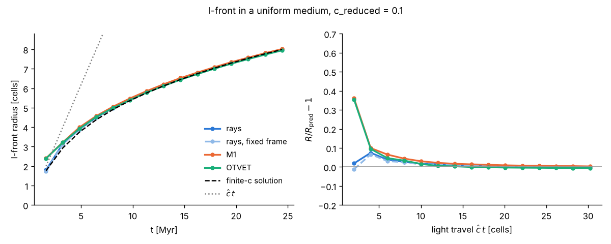
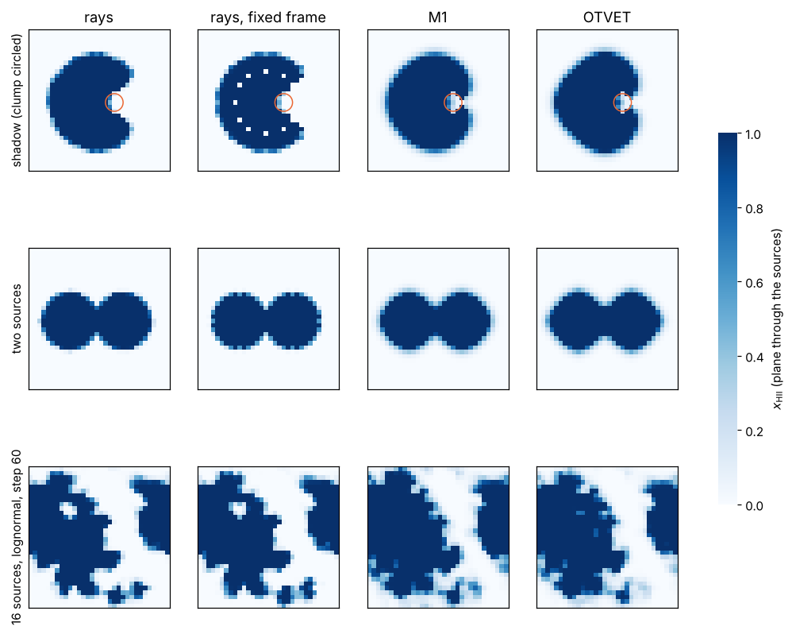
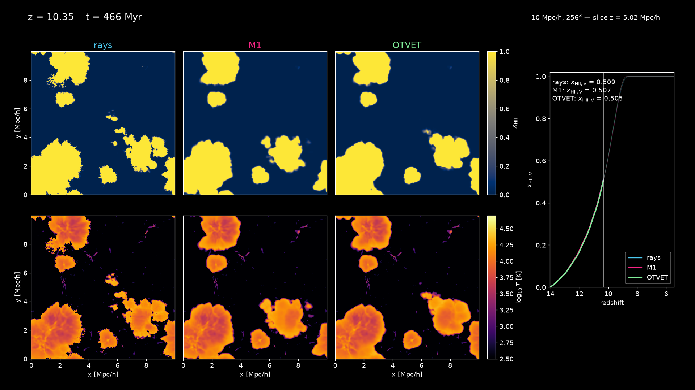
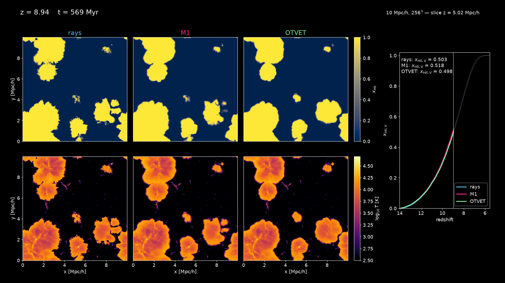
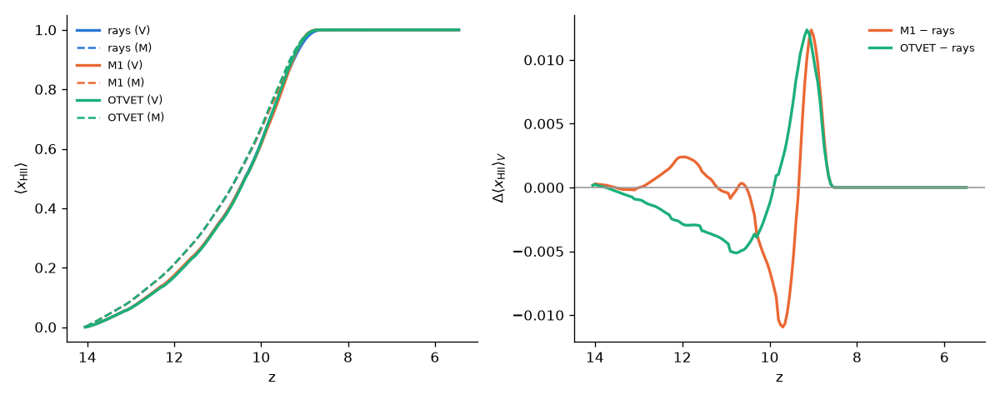
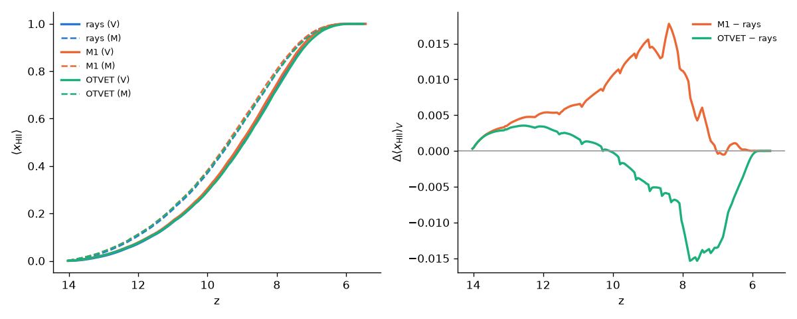
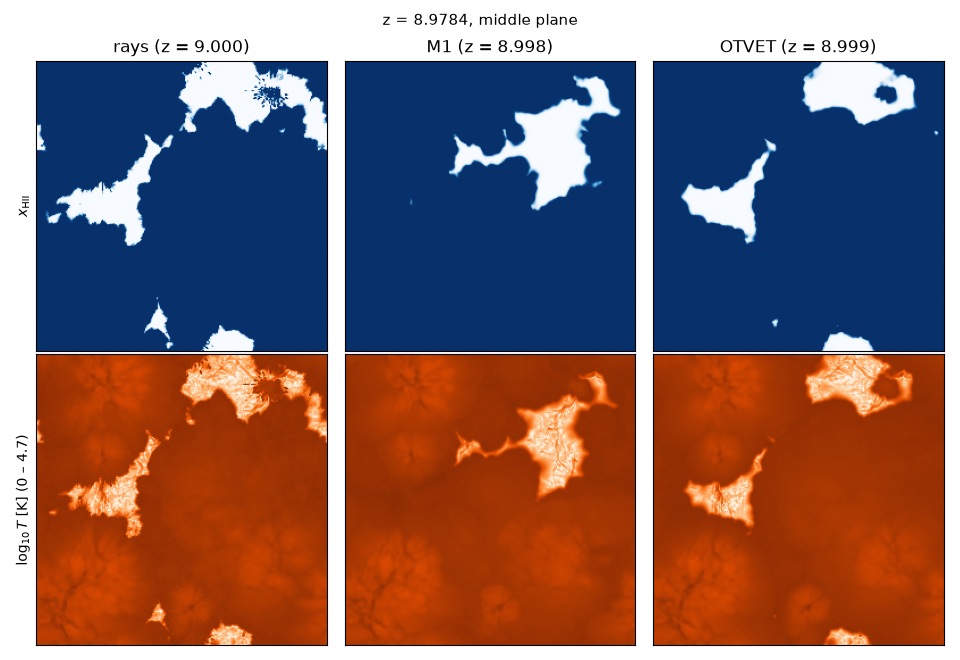

# Moment RT: M1 and OTVET as alternatives to the ray tracing

*Written 2026-10-10 (branch `claude/elegant-bell-rqd3l1`, merged into `main`
the same day). New methods, not
in the original code. The default, `rt_method = rays`, is unchanged and stays
bit-identical to the Fortran: the full fast suite (93 tests, including the
live gfortran comparisons) passes unchanged.*

## 1. Usage

```
rt_driver  <problem> <out> --set rt_method=m1        # or otvet
radhydro   <problem> <out> --set rt_method=otvet
```

| Parameter | Values | Meaning |
|---|---|---|
| `rt_method` | `rays` (default), `m1`, `otvet` | radiative transfer method |
| `moment_nsub` | integer ≥ 3, default 4 | transport subcycles per RT substep (Courant number 1/`moment_nsub`) |
| `otvet_tensor` | `auto` (default), `direct`, `fft` | how the OTVET tensor is summed over the sources |
| `moment_inject` | `1` (default since 2026-11-10), `0` | when a substep's source and recombination photons enter the moments: 1 after the transport, so they are absorbed in their own cell first; 0 before it (the first implementation, which leaves dense source cells neutral) (§5a) |

All other parameters keep their meaning. `c_reduced` sets the light speed of
the moment solver too. `legacy_physics` selects the atomic physics, as with
the rays. `legacy_rt` and `deterministic_parallel` only concern the ray
bookkeeping and have no effect on the moment methods, which always behave as
the fixed path: the direction field is reset, and τ is updated in every cell.
They need not be set. The ray-only options (`ray_dump_*`, `ray_quant_*`, the
ray pool) do nothing with the moment methods.

## 2. What it does

`src/rt_moments.cpp` (`include/radray/rt_moments.hpp`) replaces the ray
casting of each RT substep (`ray_tracing_1` and `ray_tracing_3`). It solves
the two-moment equations for the photon number density N and the flux F of
each of the 5 frequency groups, on the RT grid, at the reduced speed of light
ĉ:

```
dN/dt + ĉ div F        = S − absorption
dF/dt + ĉ² div (D N)   =   − absorption
```

**Closures.** The two methods differ only in the Eddington tensor D:

- **M1** (Levermore 1984): D is local. With f = |F|/(ĉN),
  χ = (3 + 4f²)/(5 + 2√(4 − 3f²)) and D = (1−χ)/2 I + (3χ−1)/2 u uᵀ, where
  u = F/|F|. This is the closure of RAMSES-RT (Rosdahl et al. 2013) and
  ATON (Aubert & Teyssier 2008).
- **OTVET** (Gnedin & Abel 2001): D = h, the optically thin variable
  Eddington tensor. It is h = P / tr P, with P(x) = Σₛ Lₛ d dᵀ / |d|⁴ summed
  over the source cells; d is the minimum-image separation in cells, and Lₛ
  is the cell's Luv. The source cell itself gets an isotropic Lₛ·4/3, the
  self-weight of a radius of half a cell. Off-diagonal terms with a
  component at exactly N/2 vanish, since the two periodic images average
  out. h is recomputed every hydro step, when the sources change.
  - `direct` sums in double precision.
  - `fft` is a periodic convolution with single-precision FFTW
    (`src/rt_moments_fft.cpp`). It agrees with `direct` to 3·10⁻⁷ in h
    (`test_moments`).
  - `auto` uses `direct` while N_src·N_cell ≤ 2.7·10⁸, and `fft` otherwise.

**Transport.** The scheme is the first-order Global Lax–Friedrichs (Rusanov)
flux with wave speed ĉ, unsplit, on the periodic box, as in RAMSES-RT. One RT
substep is one cell of light travel (calc_timestep), so `moment_nsub`
subcycles give a Courant number of C = 1/`moment_nsub`.

- Each cell's state splits into right- and left-going parts (N ± F_d)/2 ≥ 0,
  so the update is a positive combination for C ≤ 1/3. After every subcycle,
  N ≥ 0 and |F| ≤ N are enforced; this is the realizability of M1.
- **C = 1/3 exactly gives the centre cell zero weight.** Odd and even cells
  then decouple: a source cell is emptied every third subcycle, and
  `photo_source` skips it. The default is therefore 4 (C = 0.25, 0.75 of the
  limit, like RAMSES-RT's 0.8).
- The photon-weighted group energy E = ν N moves with the photons (flux
  E F_d / N), so each group's mean frequency is carried. That mean is what
  the rays carry per ray, and what `photo_cell` reads.

**Coupling to the physics: unchanged.**

- Sources inject fResc·pop2_init·Luv·dtsec_rt photons per substep into their
  cell, isotropically (F = 0). That is the number `ray_source` emits.
- After transport, N is deposited in `rt_grid%ngam`, E in `rt_grid%nu` and
  Σ_g F in `rt_grid%dx`.
- `radiative_physics` (`photo_cell`) is then called unchanged. N, in units
  of ⟨n_H⟩, is the photon density in the cell during the substep: exactly
  what the rays deposit, with Γ = ĉ n_γ σ, the photon limiter and the
  rho_source consumption.
- After `photo_cell`, N, F and E are scaled by the surviving photon fraction
  `rt_grid%fgam`. This is the absorption term above, with the same κ for
  both moments. As with the rays, photons below `ngam_min` in a cell are
  dropped (absorbed).

**Redshift.** In `post_rt`, each cell's 5-group spectrum gets exactly the
rays' `redshift_ray`. The code is factored out of `ray_redshifting` as
`redshift_spectrum`, with unchanged arithmetic: every stored ray reference
still passes. F is moved between groups with the photons, using the same
keep and move-down fractions.

**Photon budget.** `ray.log` gets one line per hydro step:
`Moments : in flight … injected … absorbed … lost …`, in photons per H atom
of the box. Photons are conserved to float precision: injected − absorbed −
lost = in flight to 6 digits in every run. "Lost" is the redshift out of the
lowest group plus groups below `ngam_min`. `stats.txt`
`ngam_rays_total` holds the moment photons in flight.

**Determinism and restarts.**
- Every loop writes only its own cells (the transport is a Jacobi stencil),
  and every sum is taken in a fixed order. The results are byte-identical
  for any thread count (`thread_rt_m1_*`, `thread_rt_otvet_*`, 1/2/4
  threads).
- Checkpoint version 3 holds N, F, E and the budget, and restarts are
  bit-identical (`restart_smoke_m1`, `restart_smoke_otvet`).
- Versions 1–2 still read as ray runs. A checkpoint can't be restarted with
  a different `rt_method`.

**Memory.** 20 floats per cell for the state (5 groups × N, F, E), plus 14
of scratch, plus 6 for the OTVET tensor: about 140–160 B per cell, against
88 B per ray for the rays, of which there are up to 64 per cell.

## 3. Tests

Run with `ctest -L moments`, about 40 s.

| Test | What |
|---|---|
| `moments` (`tests/test_moments.cpp`) | photon and energy conservation of the transport, realizability, light-cone spread of a pulse, an M1 plane beam moving exactly 1 cell per substep with no sideways spread, the OTVET tensor (single source: rank 1, trace 1, the N/2 images; random sources: direct vs FFT), thread independence of the transport, redshift (photons, F following, frequency range) |
| `ifront_rsla_m1`, `ifront_rsla_otvet` | the I-front against the finite-c solution (as `ifront_rsla`), checked from R = 5 cells (`--rmin 5`) |
| `thread_rt_m1_lognormal_16src`, `thread_rt_otvet_lognormal_16src` | byte-identical outputs for 1, 2 and 4 threads |
| `restart_smoke_m1`, `restart_smoke_otvet` | bit-identical restart of the full loop |

## 4. Comparison with the rays

Produced by `tools/analysis/rt_methods.py build/rt_driver WORKDIR --threads 4`,
which writes `docs/figures/rt_methods_ifront.png`, `rt_methods_maps.png` and
`rt_methods.txt`. All runs use N = 32, c_reduced = 0.1 and
legacy_rt = legacy_physics = 0 (with B17 `photon_conserve` and P11
`photon_consume_dense`). The moment methods use the default
`moment_inject = 1` (§5a).

*Rerun 2026-11-10 with three changes:*
1. **The rays rotate their HEALPix frame** for every source and RT substep,
   `ray_rotate = 3`, as every production run since 2026-10-10 does (the
   B16 fix, `docs/port_notes.md`). The rays with the original fixed frame
   (`ray_rotate = 0`) are kept as a fourth column, "rays, fixed frame"
   (`rays0` in `rt_methods.txt`).
2. **The moments inject after the transport,** `moment_inject = 1`, the
   default since 2026-11-10. The numbers with the old order, 0, are quoted
   below as "inject 0".
3. **B17 and P11.** Since the first version of this section (2026-10-10),
   `legacy_physics = 0` has gained B17 and P11, which changes every
   method's numbers.
   - With `photon_conserve = 0 photon_consume_dense = 0` (and
     `moment_inject = 0`) the script's runs reproduce the old table exactly
     (the box at step 60: M1 0.5692, the fixed-frame rays 0.5252).
   - Together B17 and P11 lower the box's x_HII at step 60 from 0.525 to
     0.468 for the rays and from 0.569 to 0.545 for M1 with inject 0. For
     that M1 run alone: B17 gives 0.553, P11 0.560.



**I-front in a uniform medium** (one source of Luv = 8e28, z = 10):

| Method | Error at ĉt = 2 cells | at 6 cells | at 10 cells | at 30 cells |
|---|---|---|---|---|
| rays | +1.9% | +3.8% | +1.7% | +0.2% |
| rays, fixed frame | −1.2% | +3.1% | +1.4% | +0.1% |
| M1 | +36% | +6.5% | +3.0% | +0.3% |
| OTVET | +36% | +4.6% | +1.6% | −0.6% |
| M1, inject 0 | +61% | +15% | +7.4% | +1.7% |
| OTVET, inject 0 | +61% | +14% | +6.0% | +0.8% |

The rotation hardly changes the rays' mean radius, but it halves the
spread of the front over directions: the radius of the partly ionised cells
at ĉt = 30 is 7.99 ± 0.17 cells with the rotation and 8.03 ± 0.32 without
(M1 7.95 ± 0.21, OTVET 7.84 ± 0.29).

**Why the moment fronts run ahead early.** The radius is taken from the
ionised volume. While the recombinations are negligible, that volume
counts the photons absorbed, which are the photons emitted minus those still
in flight. Fewer photons in flight than with the rays means a larger volume
(`rt_methods.txt`, "I-front ahead of the finite-c solution"):

| ĉt [cells] | photons in flight, M1 / OTVET (rays = 1) | inject 0 | ionised volume beyond r = ĉt + 0.87, M1 / OTVET | inject 0 |
|---|---|---|---|---|
| 2 | 0.65 / 0.67 | 0.42 / 0.43 | 11% / 13% | 17% / 19% |
| 4 | 0.88 / 0.89 | 0.66 / 0.69 | 0.5% / 0.6% | 1.8% / 2.2% |
| 6 | 0.87 / 0.91 | 0.66 / 0.70 | 0.0% / 0.0% | 0.0% / 0.1% |
| 10 | 0.90 / 0.96 | 0.74 / 0.79 | 0 | 0 |
| 30 | 0.95 / 1.03 | 0.83 / 0.91 | 0 | 0 |

Two things put the moment photons into neutral gas early.
- **The injection order** (§5a). With inject 0 the source's photons are
  transported 4 subcycles before anything absorbs them. The source cell
  itself barely absorbs, and the photons start spread over the
  neighbouring cells. Injecting after the transport removes about half of
  the early lead.
- **The first-order scheme's numerical diffusion** (upwind at C = 1/4:
  σ ≈ 2 cells after 6 substeps), which remains with inject 1:
  - In the first substeps photons move faster than light. The
    `moment_nsub` = 4 subcycles of a substep reach 4 cells while light
    travels 1, and at ĉt = 2 a tenth of the ionised volume lies outside
    the light cone.
  - Later nothing is ionised outside the light cone, but the front is
    thicker: about 1.5× as many cells with 0.3 < x_HII < 0.7 at ĉt = 30.

The excess volume becomes a smaller fraction of the volume as R grows, and
the moment fronts converge to the finite-c solution and to the rays. The
photon budget is exact (§2), so the ionised volume is right once the front
is resolved.



Maps of x_HII in the plane through the sources, after 15 steps:

- **Shadow.** A 3× brighter source, and a clump of radius 2 cells at 50× the
  mean density, 4 cells away. This is a point-source test of our own, not
  Iliev et al. 2006 Test 3 (§5).
  - Every method casts a shadow. The mean x_HII on the axis behind the
    clump is 0.000 for the rays (with or without the rotation), 0.044 for
    M1 and 0.004 for OTVET (inject 0: 0.054 and 0.005).
  - At the same distance beside the clump it is 0.40 (rays), 0.50 (fixed
    frame), 0.34 (M1) and 0.25 (OTVET). These cells are at the edge of the
    front, 9–12 cells from the source, so the number mostly measures how
    the front's edge falls on them.
  - OTVET's radial tensor keeps the shadow sharpest. M1 fills it in a little:
    its flux direction relaxes towards isotropy behind the obstacle.
  - **Holes.** With the fixed frame the rays leave neutral holes inside the
    front, in the gaps between the 192 HEALPix directions (B16): 33 of the
    2385 cells at r < R − 2 outside the clump's shadow are neutral
    (x_HII < 0.5). With `ray_rotate = 3` there are none, as for M1 and
    OTVET.
- **Two sources** 12 cells apart. The width of the ionised region through
  the midpoint is 7 cells for the rays, M1 and OTVET (5 with the fixed
  frame), and through a source 13 cells for all three (OTVET 15 with
  inject 0). The classic M1 failure, where crossing beams merge, needs
  beams that cross; two isotropic point sources do not provoke it at this
  resolution.
- **16 sources in a lognormal field** (`tests/problems/lognormal_16src`,
  60 steps):

| step | x_HII (volume): rays / M1 / OTVET | x_HII (mass) | partly ionised cells | cells off by > 0.1 vs rays: fixed frame / M1 / OTVET |
|---|---|---|---|---|
| 10 | 0.014 / 0.029 / 0.029 | 0.068 / 0.072 / 0.071 | 2% / 5% / 5% | 0.7% / 4.0% / 4.0% |
| 20 | 0.078 / 0.098 / 0.095 | 0.131 / 0.141 / 0.140 | 5% / 10% / 10% | 2.6% / 7.1% / 7.0% |
| 40 | 0.266 / 0.290 / 0.281 | 0.259 / 0.274 / 0.270 | 11% / 19% / 19% | 5.1% / 14% / 14% |
| 60 | 0.468 / 0.496 / 0.482 | 0.391 / 0.410 / 0.404 | 15% / 24% / 23% | 6.2% / 19% / 18% |

  The frame rotation leaves the global fractions unchanged (the fixed frame
  gives x_HII = 0.468 at step 60 as well), but moves 6% of the cells by more
  than 0.1. That is the rays' own sampling noise, the floor against which
  the moment methods' 18–19% should be read.

  The moment methods start ahead, while the fronts are a few cells across,
  as in the I-front test. At step 60 they are 6% (M1) and 3% (OTVET) above
  the rays in x_HII.
  - With inject 0 they were 16% and 11% above, with 23% and 20% of the
    cells off by more than 0.1.
  - With inject 0 and B17 and P11 off they were 8% and 5% above.
  - The moment fronts are thicker: 1.6× as many partly ionised cells.
  - The median temperature at step 60 is 13 900 K for the rays, 15 100 K
    for M1 and 14 600 K for OTVET. With x_HII ≈ 0.5 the median sits at the
    edge of the ionised gas and follows the ionised fraction.
  - OTVET is the closer of the two to the rays everywhere.

**Cost** (the box, 60 steps of one RT substep each, whole run including
output; 4-core container; measured 2026-10-10, before B17 and P11 and with
the fixed frame; the frame rotation costs nothing measurable,
`rt_methods.txt`):

| | 1 thread | 4 threads |
|---|---|---|
| rays (`deterministic_parallel = 1`) | 25.5 s | 11.0 s |
| M1 | 3.9 s | 2.1 s |
| OTVET | 4.6 s | 2.1 s |

The moment transport costs about 0.7 µs per cell per substep with one
thread (5 groups × 4 subcycles). It does not depend on the number of
sources or rays. Most of the rays' time here is `post_rt` (redshifting every
ray, every hydro step) and the ray casting. In a production run with many
substeps per hydro step and up to 64 rays per cell the ratio will differ:
measure it on the cluster. Cells whose stencil holds no photons are skipped.

## 5a. Injection order: neutral source cells (`moment_inject`)

*Found 2026-10-12 while asking why M1 has so many neutral absorbers after
overlap (`docs/rt_methods_512.md` §6b).* Each RT substep injects the source
photons (and, with `recomb_rad = 1`, the recombination photons) into the
moments, transports them `moment_nsub` times, and only then lets
`photo_cell` absorb. The first GLF subcycle already moves 3C = 3/4 of a
cell's isotropic photons to its 6 neighbours, so a source's own cell sees
only a small part of its photons before they leave. A dense source cell
whose recombinations exceed that part stays neutral, however bright the
source; the rays absorb a source's photons starting in its own cell. The
recombination photons leak out of dense cells the same way, which is the
moment-method form of the rays' block-emission artifact (`docs/rt_methods_512.md`
§6c).

At 512³ (z = 5.44) M1 leaves 21 % of the cells at 100–500 ρ̄ neutral
(rays 1.2 %, OTVET 2.3 %); their Γ is 500× below their surroundings, while
the rays and OTVET ionise the same cells with Γ about 2× *above* them. At
128³ (`$RUNS/m1_clumps/m1`, with `Luv` written) 71 % of M1's HI at
z = 5.39 sits in 25 source cells, the brightest ones (median L ten times
that of all sources); the rays and OTVET have x_HI ≈ 10⁻⁴ there.

`moment_inject = 1` injects after the transport, so the photons are
absorbed in the cell that emitted them before they move on (128³,
`$RUNS/m1_clumps/{m1_inj,otvet_inj}`, `compare.txt`):

| z | x_HI,M: rays (A+RR) / rays B / M1 / **M1 inject** / OTVET / **OTVET inject** | Γ_max/⟨Γ⟩: rays / M1 / **M1 inject** / OTVET / **OTVET inject** |
|---|---|---|
| 6.43 | 0.184 / 0.196 / 0.161 / **0.170** / 0.165 / **0.171** | 952 / 86 / **1860** / 263 / **2033** |
| 5.68 | 5.6e-4 / 1.0e-4 / 1.8e-3 / **1.1e-4** / 7.1e-5 / **7.2e-5** | 377 / 31 / **660** / 256 / **893** |
| 5.39 | 4.8e-4 / 4.0e-5 / 1.8e-3 / **6.0e-5** / 4.3e-5 / **4.3e-5** | 151 / 12 / **428** / 235 / **657** |
| 4.90 | 8.2e-5 / 2.0e-5 / 2.0e-3 / **3.2e-5** / 2.1e-5 / **2.1e-5** | 96 / 8 / **164** / 131 / **287** |

- M1's neutral HI after overlap falls 30–60× to the level of OTVET and the
  case B rays (the case A + RR rays still carry the block-emission artifact,
  fixed since by `recomb_rad_cell_onspot`); it has no cells with
  x_HI > 0.01 left by z = 5.4.
- The proximity peaks come back: the source cells now hold their
  photons for one absorption, and Γ_max is now 2–3× the rays'.
- During reionization the moment runs move slightly toward the rays
  (x_V at z = 6.43: M1 0.841 → 0.829, OTVET 0.827 → 0.819, rays 0.815), and
  ⟨Γ⟩ after overlap drops 1–4 %.
- The diffuse Γ distribution after overlap does not change (M1 16–84 %:
  0.98–1.01 ⟨Γ⟩; OTVET 0.62–1.21): that part is the closure.
- OTVET's HI hardly changes: its tensor already points away from the
  source, and its neutral source cells at z ≈ 6.9 ionised before overlap.

**The default is 1 since 2026-11-10** (user decision, `docs/PLAN.md`). Until
then it was 0, the first implementation; `make_production.py` wrote 1, and
the 512³ suite (`docs/rt_suite_512.md`) and the plane-parallel C1/T4 runs
used it. The moment RT is new code, so ground rule 3 (defaults keep the
original) does not bind it, and `moment_inject = 0` stays available.
- The 512³ M1 and OTVET runs of `docs/rt_methods_512.md`, the 256³ runs
  of §6, and the `rt_driver` comparisons of §4 before 2026-11-10 used 0.
  They are not rerun.
- Checkpoints do not store the key. A run started with the old default
  and restarted from its `params.txt` with the new binary changes order at
  the restart unless `moment_inject = 0` is added.
- `make_production.py` now writes the key explicitly
  (`--moment-inject 0|1`, default 1).

## 5. Caveats and open questions

- **First-order diffusion.** Fronts are thick (about 2–3 cells), and small
  fronts run ahead (§4). A second-order (MUSCL + RK2) transport would reduce
  this, but needs realizability-preserving limiting. Not done.
- **M1 with crossing beams** (Rosdahl et al. 2013, Fig. 3; Aubert & Teyssier
  2008) is not tested here. The point-source problems above do not
  provoke it.
- **OTVET formulation.** This is the time-dependent two-moment system with
  the OTVET tensor, solved explicitly with the same GLF machinery as M1.
  Published OTVET implementations differ:
  - Gnedin & Abel 2001 combine the moment equations differently;
  - Petkova & Springel 2009 drop ∂F/∂t and solve the resulting diffusion
    equation implicitly.

  The papers could not be consulted (no network access to journals), so
  these remarks are from memory and should be checked. The tensor itself
  (1/r² weighted, optically thin) is the defining OTVET ingredient.
  `kSelfWeight` (the source cell's own weight, 4) is a choice; it only
  matters where several sources compete within a few cells.
  The user keeps this explicit formulation (2026-10-12, `docs/PLAN.md`):
  the moment methods are for comparison only.
- **No recombination radiation** (as with the rays, where it is off).
- **Not validated against the Iliev et al. 2006/2009 tests** quantitatively.
  That would be the next step, with plane-parallel sources for the shadow
  test (Test 3). The shadow test of §4 is our own point-source set-up and
  has no published counterpart. The published shadow problems with M1 and
  OTVET results are, *from memory and unchecked (no journal access)*:
  - Iliev et al. 2006, Test 3: a plane-parallel flux on a dense uniform
    clump, I-front trapping and the shadow, with Gnedin's OTVET among the
    codes compared;
  - Iliev et al. 2009, Test 7: the same clump with hydrodynamics
    (photoevaporation);
  - for M1, Test 3 in RAMSES-RT (Rosdahl et al. 2013) and the shadow tests
    of González, Audit & Huynh 2007 (HERACLES) and Aubert & Teyssier 2008
    (ATON);
  - for OTVET in SPH, the point-source shadow of Petkova & Springel 2009.

  The moment RT has no plane-parallel sources yet: `docs/plane_parallel.md`
  is a ray mode, and the OTVET tensor is built from point sources.
- **AMR, MPI and GPU** (ROADMAP): the moment solver is a 7-point stencil on
  the grid, with a ghost layer of one cell per subcycle. It is a natural fit
  for every one of them, and for the "moment hand-over in transparent
  regions" of ROADMAP §4.5.

## 6. Production comparison on Hyak (256³)

*Run on klone 2026-10-09/10 (branch `claude/elegant-bell-rqd3l1`, one
whole cpu-g2 node, 192 threads per run).* Two sets, each with three runs that
share the ICs and every parameter except `rt_method`:
- `reion256_c01`: c_reduced = 0.1.
- `reion256`: c_reduced = 0.01.

The ray runs are the existing production runs (`docs/cluster.md` §4–§7).
Every run uses `legacy_rt = legacy_physics = 0`, 10 Mpc/h, 256³, on-the-fly
sources, and goes from z = 100 to z = 5.4.

### 6.1 Reproduce

```
# on klone, repository at this branch (or main after the merge)
sbatch tools/hyak/build_hyak.sh                     # build/ + fast suite
export RUNS=/gscratch/astro/$USER/radhydro/runs
tools/hyak/rt_methods_runs.sh                       # DRYRUN=1 to only print
#  -> $RUNS/reion256_c01_{m1,otvet}, $RUNS/reion256_{m1,otvet}: params.txt +
#     rt_method, ics -> the base ICs; one whole-node job each
#     (reion_production.slurm: auto-restart, DONE, reion.py, movie)
sbatch --dependency=afterany:<the four jobs> tools/hyak/rt_methods_post.slurm
#  -> $RUNS/rt_methods_{c01,c001}/: compare.txt, history.png, maps_z*.png,
#     compare.mp4 + compare_stills/ (tools/movies/compare_movie.py)
```

- The fast suite on klone: 90 of 100 pass. The 10 failures are the known
  1-ulp platform differences of the stored RT references (`docs/cluster.md`
  §3): its 8, plus `ray_dump_{legacy,fixed}_lognormal_16src_smallbuf`, which
  compare with the same `lognormal_16src_smallbuf` references and show the
  same mismatches. Every `moments`, restart and thread test passes.
- `rt_methods_runs.py` compares the fields at the **movie frames** nearest
  to the reference's zdata1 redshifts. The zdata1 outputs themselves drift
  apart once the Courant step feels the different temperatures: by up to
  Δz = 0.1 after z ≈ 11 at 0.01c.
  - The movie frames are written at the same `movie_dz` redshifts from
    inside the RT substeps. They agree to Δz ≤ 0.003 at 0.1c, and to within
    one RT substep (Δz ≤ 0.05) at 0.01c. The `z_run` column of
    `compare.txt` gives each run's frame.
  - ⟨x⟩_M comes from `frames.txt`, since the frames carry no `rhog`.

Full tables: [`figures/rt_methods_256_c01.txt`](figures/rt_methods_256_c01.txt),
[`figures/rt_methods_256_c001.txt`](figures/rt_methods_256_c001.txt).

### 6.2 Movies

Side by side (rays | M1 | OTVET), with slices of x_HII and T at the box
centre and x_HII,V(z) of all three runs:
- [`movies/rt_methods_256_c01.mp4`](movies/rt_methods_256_c01.mp4)
  (0.1c, 173 frames, 2.6 MB);
- [`movies/rt_methods_256_c001.mp4`](movies/rt_methods_256_c001.mp4)
  (0.01c, 171 frames, 3.1 MB).

Each run's own movie (x_HII, T, ρ and τ_es) is
`$RUNS/<run>/run/movie/cosmo.mp4`.



*0.1c at z = 10.35, x_HII,V ≈ 0.51.*



*0.01c at z = 8.94, x_HII,V ≈ 0.50.*

### 6.3 Reionization history



*0.1c: x_HII (left) and the difference from the rays in x_HII,V (right).*



*Same for 0.01c.*

| set | run | z(x_V = 0.1) | 0.5 | 0.9 | 0.99 | z(x_M = 0.5) | τ_es |
|---|---|---|---|---|---|---|---|
| 0.1c | rays | 12.639 | 10.379 | 9.248 | 8.826 | 10.565 | 0.0904 |
| | M1 | 12.645 | 10.373 | 9.262 | 8.909 | 10.573 | 0.0905 |
| | OTVET | 12.624 | 10.367 | 9.282 | 8.897 | 10.577 | 0.0906 |
| 0.01c | rays | 11.645 | 8.960 | 7.291 | 6.494 | 9.352 | 0.0761 |
| | M1 | 11.710 | 9.029 | 7.309 | 6.517 | 9.416 | 0.0768 |
| | OTVET | 11.679 | 8.934 | 7.217 | 6.373 | 9.373 | 0.0764 |

- **The global history is the same to |Δx_HII,V| ≤ 0.018 at every z.**
  - At 0.1c: up to x_V = 0.9, z agrees to 0.04, and τ_es to 0.2%. The
    largest differences, ±0.012, come in the last stage of overlap
    (z ≈ 9–10). The end of reionization (x_V = 0.99) is Δz = 0.07–0.08
    later with the moment methods.
  - At 0.01c: M1 runs ahead by up to +0.018 (z ≈ 8.4), and OTVET falls
    behind by up to −0.015 (z ≈ 7.8). τ_es agrees to 1%. OTVET finishes
    Δz = 0.12 earlier at x_V = 0.99.
- **Small early fronts (§4) show at 0.01c only.** At z = 13.12 the moment
  runs have 17–20% more ionised volume (x_V = 0.0199 and 0.0195 against
  0.0166). They also have 1.4–1.5× the x_HII power at k = 2, and the median T
  of their ionised gas is 13% lower (15 100–15 200 K against 17 400 K).
  - The difference shrinks to 2–5% by z = 11.5.
  - At 0.1c the fronts are already larger at that redshift (x_V = 0.057),
    and the three runs agree to 2%.

### 6.4 Morphology and temperature

| set | z | x_V (rays) | cells with \|Δx\| > 0.1: M1 / OTVET | corr(log T): M1 / OTVET | partly ionised: rays / M1 / OTVET |
|---|---|---|---|---|---|
| 0.1c | 12.30 | 0.137 | 5.1% / 2.5% | 0.902 / 0.977 | 1.5 / 2.5 / 2.3% |
| | 10.90 | 0.364 | 13.3% / 5.9% | 0.818 / 0.959 | 4.4 / 5.3 / 4.6% |
| | 9.80 | 0.700 | 19.9% / 7.9% | 0.597 / 0.912 | 5.4 / 5.0 / 4.8% |
| | 9.00 | 0.965 | 6.0% / 2.2% | 0.083 / 0.796 | 1.0 / 0.9 / 0.8% |
| | 6.80 | 1.000 | – | 0.934 / 0.989 | – |
| 0.01c | 11.54 | 0.108 | 2.9% / 2.6% | 0.962 / 0.976 | 2.2 / 3.1 / 2.9% |
| | 8.99 | 0.494 | 10.3% / 7.0% | 0.889 / 0.951 | 4.2 / 5.9 / 5.3% |
| | 7.44 | 0.870 | 9.9% / 5.8% | 0.674 / 0.893 | 3.5 / 3.5 / 3.5% |
| | 6.85 | 0.966 | 4.2% / 2.4% | 0.541 / 0.867 | 1.4 / 1.5 / 1.5% |

- **OTVET matches the rays' ionisation and temperature morphology much better
  than M1.**
  - It has 2–2.5× fewer cells off by more than 0.1 in x_HII during the
    middle of reionization.
  - Its log T correlates with the rays' at 0.91–0.99 at 0.1c and 0.87–0.98
    at 0.01c.
  - For M1 the correlation drops through overlap (0.60 at x_V = 0.7, at
    0.1c).
  - This is consistent with the known weakness of M1 where radiation from
    many sources crosses: the local closure gives a single flux direction
    per cell. That is an interpretation, not tested here.
- **The last neutral islands are in different places** (0.1c, z = 9.0,
  x_V = 0.965–0.977, below). In the M1 run they have moved so far that its
  log T correlates with the rays' at only 0.08. OTVET's are closer: 0.80.
  - Tests that depend on where the islands survive late, such as the
    Lyα forest after overlap, are therefore sensitive to the RT method at
    this level.
- **Fronts.** The moment fronts are smooth, while the rays' are ragged:
  - the rays' HEALPix sampling leaves holes at large radius, worst at 0.01c
    (§4). These ray runs (2026-10-09) predate `ray_rotate`: they use the
    fixed frame, and the holes are B16. With `ray_rotate = 3`, the
    production setting since 2026-10-10, they are gone (§4, the shadow
    holes; `docs/rt_methods_512.md` and `docs/rt_suite_512.md` use it);
  - the moment methods have up to 1.4× as many partly ionised cells
    (5.9% against 4.2%) while the bubbles grow;
  - at overlap the fraction of partly ionised cells is the same for all
    three methods.
- **The temperature of ionised gas agrees to 1–2%** from z ≈ 11 on. Medians
  for rays / M1 / OTVET:
  - 0.1c, z = 6.80: 6194 / 6290 / 6225 K;
  - 0.1c, z = 5.45: 5042 / 5123 / 5099 K;
  - 0.01c, z = 7.44: 9584 / 9473 / 9648 K.

  The moment runs are slightly hotter after overlap at 0.1c.
- **x_HII power after overlap.** At 0.1c, M1's residual neutral-fraction
  power is 0.82–1.09 of the rays' at k = 2–16, and OTVET's is 0.58–0.89.
  OTVET's residual x_HI fluctuations are smoother. With x_V > 0.999 (0.01c,
  z ≤ 5.9) the ratio only says whether a last patch survives in the box,
  and is meaningless.



*0.1c at z = 9.0: the last neutral regions (dark) in the middle plane.*

### 6.5 Cost

Whole node, 192 threads. The RT time is the sum of the RT timers in
`run.log`. Wall time is the whole run, including hydro, PM, FoF and output.

| set | run | substeps | wall | RT | transport | photo-chemistry | other RT | peak RSS |
|---|---|---|---|---|---|---|---|---|
| 0.1c | rays | 4064 | 1:32:42 | 5032 s | 3552 s | 1382 s | 98 s | 27.0 GB |
| | M1 | 4037 | 49:35 | 2823 s | 1206 s | 1549 s | 68 s | 13.5 GB |
| | OTVET | 4035 | 51:39 | 2952 s | 1229 s | 1553 s | 170 s | 14.3 GB |
| 0.01c | rays | 404 | 26:17 | 882 s | 641 s | 181 s | 60 s | 23.1 GB |
| | M1 | 403 | 6:50 | 265 s | 116 s | 136 s | 13 s | 14.2 GB |
| | OTVET | 401 | 8:28 | 366 s | 116 s | 132 s | 118 s | 14.4 GB |

What the columns contain:
- **transport:** for the rays, `calc_ray_1 + ray_tracing_1 + ray_tracing_3`.
  For the moment methods, `ray_tracing_1` (the GLF subcycles and the
  deposit) plus `ray_tracing_3` (scaling by the surviving fraction).
- **photo-chemistry:** `radiative_physics`.
- **other RT:** `prep`, `calc_rt_1`, `sync` and `post_rt`. OTVET's `prep`
  is the FFT tensor, 106 s in all for the hydro steps with sources.

Findings:
- **Speed-up over the rays: 1.8× in RT time at 0.1c** (1.9× wall for M1,
  1.8× for OTVET), and 2.4–3.3× at 0.01c (3.1–3.9× wall).
- **Memory:** about half the rays' at 0.1c.
- **The transport met the estimate; the total did not.** The moment
  transport costs 0.29–0.30 s per substep at both light speeds (0.26–0.27 s
  of it in `ray_tracing_1`). That is inside the 0.15–0.3 s expected from
  the 32³ timings, and 2.9× cheaper than the ray tracing per substep at
  0.1c.
  - It is 3.1 µs of thread time per cell per substep, against 0.7 µs on
    one thread at 32³: the 192 threads give a 44× speed-up, at the low end
    of the 40–80× guessed for memory-bound scaling.
  - The 10–20 min estimate counted only the transport, though.
    `radiative_physics` (`photo_cell`, unchanged) costs as much as with the
    rays (0.33–0.45 s per substep) and is now **51–55% of the moment RT
    time**.
  - A faster RT now needs faster photo-chemistry. Its cost does not depend
    on the RT method.
- **Time per substep follows the ionised volume, not the number of sources**
  (wall time per hydro step ÷ substeps, 0.1c):

  | z | 11.6 | 9.8 | 8.6 | 7.8 | 6.8 | 5.5 |
  |---|---|---|---|---|---|---|
  | x_V (rays) | 0.24 | 0.70 | 1.00 | 1.00 | 1.00 | 1.00 |
  | N_source | 278 | 1020 | 2140 | 3200 | 4500 | 5300 |
  | rays [s] | 1.15 | 1.42 | 1.56 | 1.56 | 1.45 | 1.55 |
  | M1 [s] | 0.39 | 0.70 | 0.86 | 0.88 | 0.88 | 0.88 |
  | OTVET [s] | 0.40 | 0.71 | 0.90 | 0.92 | 0.92 | 0.95 |

  - The moment cost per substep doubles between x_V = 0.24 and overlap,
    then stays flat while N_source grows 2.5×.
  - The transport skips cells whose stencil holds no photons (§4). The
    rise is consistent with more cells holding photons, for the transport
    and the photo-chemistry, until photons fill the box at overlap. Not
    checked with per-step timers.
  - OTVET's tensor grows only with the source count (`auto` → FFT here, a
    fixed cost per hydro step).
- **Photon budget** (M1, 0.1c, `ray.log` at the end): injected 11.38,
  absorbed 2.54, lost 2.47 and in flight 6.36 photons per H atom. That
  closes to the printed digits.

### 6.6 Conclusions

- At 256³ in a 10 Mpc/h box, both moment methods reproduce the rays'
  reionization history to |Δx_V| ≤ 0.02 and τ_es to 1%. They take
  roughly half the RT time and half the memory at 0.1c.
- **OTVET is the better match** for morphology and temperature: 2–3× fewer
  discrepant cells than M1, and corr(log T) ≥ 0.87 throughout.
  - M1's last neutral islands and its temperature structure near overlap
    differ substantially from the rays'.
  - OTVET costs 5% more than M1 at 0.1c (the FFT tensor). At 0.01c, with
    few substeps per hydro step, it costs 38% more.
- **Next for speed:** `radiative_physics`. Beyond that, a second-order
  transport would sharpen the fronts (§5).
