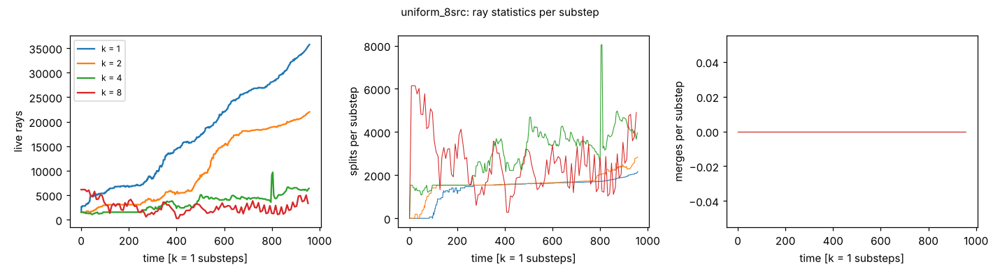
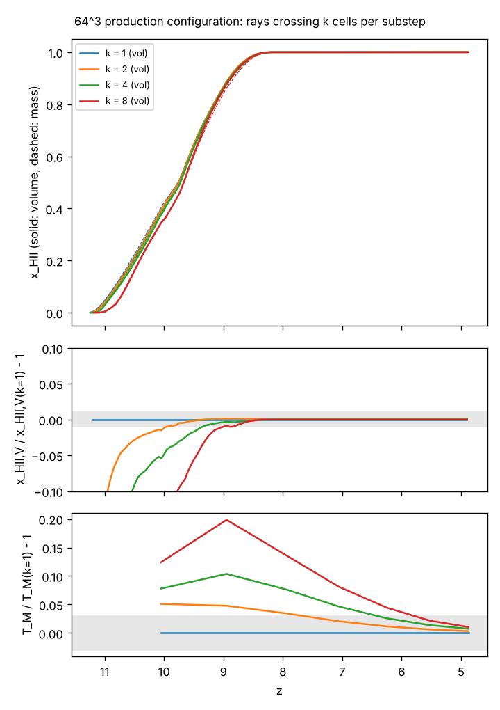
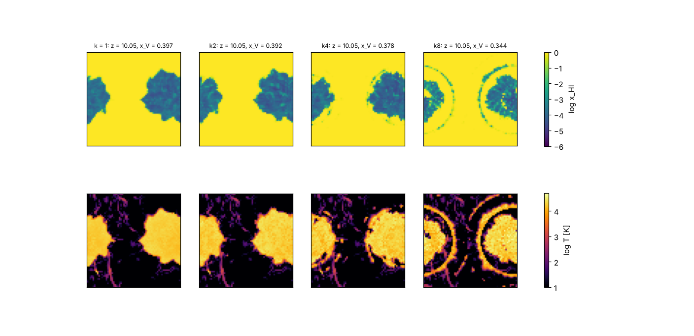
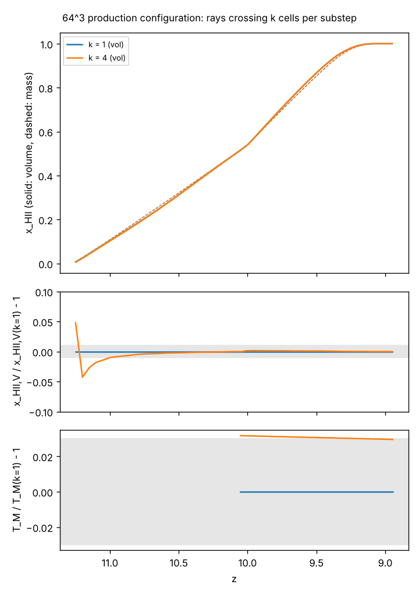

# Rays crossing k RT cells per substep (`rt_cells_per_substep`)

*Written 2026-10-11 on branch `rt-multicell`. The test of a coarse RT
substep for the RT on AMR (Stage F, `docs/framework_decision.md` §6):
instead of sub-cycling a level-l region with 2^l RT substeps per coarse
substep, keep the coarse substep everywhere and let rays travel 2^l fine
cells per substep there. On the uniform grid that is "rays travel k cells
per substep, with a k times longer substep at the same ĉ". If k = 2 and 4
agree with k = 1 to the acceptance metrics of `docs/ROADMAP.md`, the AMR RT
needs no fine-level time sub-cycling.*

## Summary

**Implemented:** `rt_cells_per_substep = k` (1–16; default 1 is the
original, byte-identical; `legacy_rt = 0` and `rt_method = rays` only,
refused otherwise; `rt_driver` and `radhydro`; log, summary line and
checkpoint version 6). The k-cell path, the substep count and the
redshifting follow the request (§1.2). Three generalisations were needed
to make k > 1 correct (§1.3): the photo-ionisation rate needs the
crossing speed k·len_rt/dtsec_rt, the split clamp is [rmin, rmin + k],
and sources emit at a finer nside for k > 4. The AMReX backend supports
k > 1 by growing its ghost layers and local `Redistribute` to k + 1, so it
does not refuse. Two further problems needed new options, both off by
default (§2): `photon_conserve` (B17, a photon-limiter quirk of the
original that grows as k²) and `ray_deposit = exposure` (with the share
deposit, photons jump up to k − 1 cells past I-fronts).

**k = 1** is byte-identical: fast suite 117/117, nightly label 22/22,
AMReX label 54/54, and smoke diffs against `main` (§3).

**Accuracy against k = 1** with the recommended options (`exposure` +
`photon_conserve`; the scheme as specified does worse, §4, §5, §7):

| test | metric | k = 2 | k = 4 | k = 8 |
|---|---|---|---|---|
| uniform I-front, c = 1 (§4) | front / profile | 0.01 cells / 0.006 | 0.04 / 0.04 | 0.15 / 0.07 |
| uniform I-front, 0.1c (§4) | largest front lag | 0.18 cells | 2.3 | 5.2 |
| `uniform_8src`, c = 1 (§5) | front shift / x_HII at end | 0.02 cells / −0.04 % | 0.02 / +0.06 % | 0.16 / +0.6 % |
| `lognormal_16src`, c = 1 (§5) | x_HII,M at end / T rms (ionised) | −1.8 % / 5 % | −2.9 % / 6 % | −14 % / 18 % |
| 64³ production, 0.1c (§7) | τ_es / Δz(x_V = 0.5) | −0.12 % / −0.007 | −0.52 % / −0.033 | −1.6 % / −0.088 |
| | max T_M error / front shift | 5 % / 0.18 cells | 10 % / 0.45 | 20 % / 1.6 |
| 64³ production, c = 1, to z = 9 (§8) | τ_es / Δz(x_V = 0.5) / max T_M error / front shift | | −0.003 % / 0.000 / 3 % / 0.07 cells | |
| cost: 64³ production, RT time per hydro step (§7.1) | relative to k = 1 | 0.77 | 0.76 | 2.06 (one domain per colour at 64³) |

**What fails first** (§8) is the lagged optical depth at fronts that move
more than one cell per substep, i.e. v_front > ĉ/k. That happens with
light-limited fronts at 0.1c for k ≥ 4 (the uniform I-front lags 2.3
cells; the production run reionises late and T_M is 10 % high while its
first fronts are fast). Next comes dense, quickly recombining gas at
k = 8. At c = 1, where the fronts are photon-limited, k = 4 passes the
production run (T_M 3 % high). **The transport over k cells is accurate;
the error is the k-times-longer substep** (§6): k = 8 at 8ĉ matches k = 1
at ĉ to 1 %, and k = 1 at ĉ/8 shows the errors of k = 8 at ĉ. On a uniform
grid, then, k > 1 equals fewer substeps. It saves only 1.3× in RT time per
hydro step at k = 2 and 4 (more live rays, k cells per ray-substep), so it
is not a speed option.

**Recommendation for the AMR RT** (§9): a mixture. Use the coarse substep
everywhere, with 2^l cells per substep on level l, the exposure deposit,
`photon_conserve` and per-level angular resolution. Add photo-chemistry
sub-cycling in fine cells, and time sub-cycling of the transport only in
patches where a front outruns the substep (detectable from the
deposits). With refinement on overdensity, fronts in refined gas move
about 4^-l as many fine cells per coarse substep, so the criterion is met
most easily where the cells are small. k = 2 (one level) is within the
targets in every test here, except T_M at 5 % while the first production
fronts are fast.

## 1. The scheme

### 1.1 What the original substep does

`calc_timestep` sets `nstep_rt = nint(dl_c/dl_rt · ĉ/c)`, the light
crossings of one RT cell in the hydro step, and `dtsec_rt = dt/nstep_rt`.
In each substep every ray advances one cell length: `ray_segment` splits
the path at the cell faces into up to `nseg` segments (3, or 4 with
`legacy_rt = 0`); `cast_1` (step 1) deposits in each segment's cell
max(dl/sum(dl remaining), 1 − e^(−τ dl)) of the photons not yet deposited,
with τ from the previous substep; `photo_cell` (step 2) absorbs part of
each cell's deposit and sets the transmitted fraction `fgam`; `cast_3`
(step 3) attenuates the ray by (1 − fgam) of each segment, moves it to the
end of its path and relinks it. A ray already crosses up to 3 faces per
substep with the lagged optical depth; k only makes the path longer.

### 1.2 What changes with k (all in the shared kernels, so the serial code and the AMReX backend agree)

| Piece | k = 1 (original) | k > 1 |
|---|---|---|
| `calc_timestep` | nstep_rt = nint(dl_c/dl_rt · ĉ/c), carry and ≥ 1 guard on that count | nint(dl_c/(k dl_rt) · ĉ/c): k times longer substeps, the light distance per hydro step unchanged; carry and guard on the k-cell count |
| `ray_segment` | path of 1 cell, `nseg` = 4 (`legacy_rt = 0`) | path of k cells, `nseg` = 3k + 1 (at most k faces per axis), `rrk::kNsegMax` = 49 (k ≤ 16) |
| `cast_1`, `cast_3` | loop over the segments | the same loop; the `fdl` normalisation, `seg_min`, the `1e-6f` overshoot and the removal threshold unchanged |
| photo-ionisation rate in `photo_gas_cell` | Γ = n_dep σ len_rt/dtsec_rt | Γ = n_dep σ **k** len_rt/dtsec_rt (§1.3) |
| split radius clamp in `split` | [rmin, rmin + 1] | [rmin, rmin + **k**] (§1.3) |
| source emission | nside_init = 4 (192 rays) | the same for k ≤ 4; for k > 4 the nside whose split radius covers the first path (§1.3; 768 rays for k = 5–8) |
| `redshift_per_distance` | s = nstep_rt dl_rt/dl_c | s = nstep_rt **k** dl_rt/dl_c |
| `deterministic_parallel` | 8³ domains; chain insertions within d/2 − 1 cells | d ≥ 2k + 2 (8 for k ≤ 3, 16 at 64³ for k = 4); insertions in step 1 within d/2 − k, in step 3 within d/2 |
| AMReX backend | 2 ghost layers, local `Redistribute` over 3 cells | both at least k + 1 (the reach assertion is unchanged and passes, §3) |
| checkpoint | version 5 | version 6 records k; a restart with another k converts the substep carry |

Unchanged, because they are per substep: emission (ngam ∝ dtsec_rt, so a
source's photons per hydro step are the same), the thick-source local
deposit, the split and merge criteria, the ray-pool guard (it now counts
the rays a source emits), the merge cones, `recomb_rad` (its photons are
buffered per substep and emitted at the next one; the photon budget is
unchanged), `ray_rotate` (keyed on the substep number: fewer substeps,
fewer rotations, the same statistics), the movie frames (written at the
substep that crosses the frame redshift: k times coarser in time).

Restrictions: `legacy_rt = 0` (the legacy mode is the Fortran's, and its 3
segments cannot cover even one cell, B8), `rt_method = rays` (the moment
solvers keep k = 1 and refuse k > 1), 1 ≤ k ≤ 16. **Light must cross at
least k cells per hydro step**: otherwise the nstep_rt ≥ 1 guard (with the
substep carry it is applied silently) makes the radiation faster than ĉ.
The `ifront_rsla` problem at 0.1c has 2.3 cells of light per hydro step, so
k = 4 runs at 1.7 ĉ there (§4).

### 1.3 Three generalisations that k forced (found in this study)

**The photo-ionisation rate needs the crossing speed.** A ray carries the
photons emitted in its substep. With k cells per substep they occupy a
path of k cells, and a cell crossed in full receives the fraction 1/k of
them as its deposit. Physically every photon of the ray crosses that cell
during the substep, so the absorption probability per photon is τ_cell and
the rate is Γ = (photons crossing per unit area and time) σ = N_ray σ/(A
dtsec_rt) = k n_dep σ len_rt/dtsec_rt with n_dep = deposit/volume. The
original's len_rt/dtsec_rt is ĉ for one cell per substep; the general form
is k len_rt/dtsec_rt = ĉ. Without the factor, Γ in ionised gas is k times
too low and x_HI there k times too high: 4.4× at k = 4 in the uniform test
(§4, a diagnostic build without the factor), while the front radius hardly changes.
The `multicell` CTest checks the interior x_HI for this reason.

**The split radius clamp.** A ray past its split radius has moved at most
one substep, 1 cell in the original, beyond it, and `split` clamps the
daughters' radius to [rmin, rmin + 1] (it never binds for k = 1). With k
cells per substep it would bind and move the effective origin forward by
up to k − 1 cells; [rmin, rmin + k] keeps it a no-op. In the uniform tests
the two clamps give identical results at k = 4 and 8 (a diagnostic build
with [rmin, rmin + 1]), because rays emitted at r = 0 overshoot the split
radii by less than one cell inside the box (k = 4: radii 3.9, 7.8, 15.6,
31.3 cells reached at r = 4, 8, 16, 32; k = 8 with the emission rule below:
7.8, 15.6, 31.3 at 8, 16, 32). In general (other split radii, other
start points) the overshoot reaches k − 1 cells, where the old clamp would
bind.

**The emission nside for k > 4.** A ray splits at most once per substep. A
source ray emitted at nside_init = 4 (split radius 3.9 cells) that travels
8 cells in its first substep stays at nside 4 over that path and the next,
about 4 cells² per ray at r = 8 against `ray_per_cell` = 1: the uniform
I-front at k = 8 had partly neutral shells inside the sphere (§4).
`rrk::emit_nside(k)` emits at the smallest nside ≥ nside_init with
rmax(nside) ≥ k − 1 (nside_init for k ≤ 4); after the first substep one
split per substep keeps up, since rmax doubles while r grows by k.

## 2. Two more problems, and two options

### 2.1 B17: `photo_cell` ionises photon-starved cells without the photons (`photon_conserve`)

`photo_gas_cell` iterates the implicit ionisation balance (ne to 1e-3, at
most 5 times). In each iteration the densities are computed with the
current rates, then the rates are rescaled so that the photo-ionisations
do not exceed the cell's photons. In a photon-starved cell with Γ dt ≫ 1 (a
neutral front cell that gets fewer photons than it has atoms), backward
Euler ionises the cell almost fully at every iteration (x_HI → x_HI/(1 +
Γdt)), so ne "converges" at once while the rates still exceed the photons;
the densities are kept and only the photons of the rescaled rates are
taken. The ionised hydrogen then exceeds the counted net ionisations. It
is a quirk of the original (now **B17** in `docs/port_notes.md`), small at
k = 1, but Γ_max dt in a thick front cell scales as k² (k times the photons
per ray and the factor k of the rate). On `lognormal_16src` (c = 1, 20
steps):

| k | x_HII,M | net ionisations | excess ("leak") | with `photon_conserve = 1` |
|---|---|---|---|---|
| 1 | 0.1745 | 0.1714 | 0.0031 (1.8 %) | 4e-5 |
| 2 | 0.1819 | 0.1700 | 0.0119 (6.5 %) | |
| 4 | 0.1962 | 0.1640 | 0.0323 (16.5 %) | 5e-5 |

**`photon_conserve = 1`** (default 0 = the original; independent of
`legacy_rt` and `legacy_physics`, so the Fortran-mirrored modes are
untouched; rays, moments and the AMReX backend) also iterates while any
frequency group is limited by more than 1e-3, at most 1000 times. The
budget then closes to 4e-5 per H atom; `radiative_physics` costs the same
(1.99 s against 1.97 s on that run). CTest `photon_conserve`.

### 2.2 The in-flight photons jump to the end of the path (`ray_deposit = exposure`)

The share deposit gives segment n the fraction max(dl_n/Σ_{m≥n} dl_m,
fabs_n) of the photons **not yet deposited**, so the deposits sum to the
ray's photons. Let a ray cross an ionised stretch and then reach a neutral
cell within one substep. The neutral cell receives only the share of the
remaining path; the photons deposited in the ionised stretch are mostly
transmitted there (fgam ≈ 1) and leave with the ray, whose new position is
the end of the path, beyond the front. In the next substep they are
deposited up to k − 1 cells beyond the I-front. With one cell per substep
the jump stays inside a cell; with k cells it smears every front over
about k cells, whatever the front speed. This is what makes the uniform
I-front at k = 8 partly neutral inside its volume-equivalent radius even
at c = 1 (§4).

Physically every photon of the ray crosses every cell of its path during
the substep, so a front reached in mid-path should get all photons that
arrive there. **`ray_deposit = exposure`** (default `share` = the original;
`legacy_rt = 0`; any k) deposits in segment n

  dep_n = A_n · max(dl_n/L, fabs_n),  A_{n+1} = A_n (1 − fabs_n),

with A_1 = the ray's photons, L the path length and fabs_n = 1 − e^(−τ_n
dl_n) from the previous substep's τ as before: dl_n/L is the time the ray's
photons spend in the cell (with the factor k of the rate this gives the
exact thin-cell absorption A_n τ_n dl_n), fabs_n the absorbed fraction in a
thick cell, and only the absorption estimate, not the deposit, is taken
from the photons passed on. `cast_3` removes what each cell actually
absorbed, dep_n (1 − fgam_n), from the photons that arrive and moves the
ray only while some are left. In thin cells it is the share deposit. The
deposits no longer sum exactly to the ray's photons, so photon
conservation holds only to the accuracy of the lagged absorption estimate:
in the uniform test the total ionisations stay within 0.2 % of k = 1 at
k = 4 and 8 (the share deposit: +1.5 % and +2.3 %).

## 3. Validation of k = 1

Every new option defaults to the original (`rt_cells_per_substep = 1`,
`photon_conserve = 0`, `ray_deposit = share`), and the generalisations are
written so that k = 1 is the same arithmetic (1 × dl_rt, `rmin + 1`, the
4-segment step, nside_init, `nray_init × nsrc`):

- **Fast suite:** `main` (07aa378) and this branch both pass 112/112 in the
  cloud container (gcc 13.3, gfortran 13.3; `healpix_vs_healpy` skipped in
  both), including every stored-reference and live-Fortran comparison in
  both legacy modes, the restart and the thread tests. On the final code
  the fast suite is 117/117 (the 112 of `main` and 5 new tests), the
  nightly label 22/22 (the two `hydro_suite_full_*kh` tiers re-run after
  the container's disk filled during the first run; the hydro code is
  unchanged on this branch) and the AMReX label 54/54
  (`amrex_full64_vs_serial` is nightly-only).
- **Smoke diffs:** `rt_driver` outputs byte-identical to `main` on
  `uniform_8src` (`deterministic_parallel`, 2 threads) and, after each later
  commit, to the previous binary on `lognormal_16src` (fixed flags,
  `ray_rotate = 3`) and `uniform_8src` (legacy flags).
- **AMReX backend** (`-DRADRAY_AMREX=ON`, AMReX 26.10, OpenMPI 4.1.6):
  `ctest -L amrex` 50/50 before the exposure option and 54/54 on the final
  code (the bitwise tests against `rt_serial` at k = 1 and the 12 multicell
  tests below included).
- **New tests** (all pass): `rays` (unit: k-cell segments cover the path in
  3k+1 segments and k = 1 is the 4-segment step exactly; the clamp),
  `multicell` (k = 2 vs 1 on the uniform I-front at c = 1: front within half
  a cell, finite-c solution, interior x_HI, front profile),
  `multicell_exposure` (the same at k = 4 with `ray_deposit = exposure` and
  `photon_conserve = 1`), `photon_conserve` (B17 resolved and fixed),
  `thread_rt_det_multicell_lognormal_16src` (k = 3, the largest k with 8³
  domains, byte-identical for 1, 2, 4 threads), `restart_smoke_det_multicell`
  (k = 2 with the substep carry, bit-identical restart), and in the AMReX
  build `amrex_roundoff_multicell{2,4,4x}_{uniform_8src,lognormal_16src}`
  (the backend with k = 2 and 4, and 4 with the exposure deposit, against
  the serial port with the same options to round-off; ghosts and local
  `Redistribute` grow to k + 1, so the backend supports k > 1 rather than
  refusing it).


## 4. Step 2: the uniform I-front (`uniform_1src`, finite-c solution)

`tools/analysis/rt_multicell_ifront.py` builds the problem of
`tests/ifront_rsla_check.py` (uniform neutral gas at the mean density,
z = 10, one source of Luv = 8e28 in the centre cell) and runs `rt_driver`
(`legacy_rt = legacy_physics = 0`, `rt_substep_carry = 1`) for every k and
c. It measures the front radius R = (3 V_ion/4π)^(1/3) after every hydro
step, against k = 1 and against the finite-c solution R = R_inf(t − R/ĉ)
of Shapiro et al. (2006) (R_inf from the c = 1, k = 1 run; ĉ = the light
front of the run, k cells per substep, over t), and the shell-mean x_HI and
T around the source. "share" is the scheme as specified (share deposit,
original photon limit); "pc" adds `photon_conserve = 1`; "exposure" uses
`ray_deposit = exposure`. Columns: the largest |R − R(k=1)| over the steps
with R ≥ 2 cells and at the last step; the relative error against the
finite-c solution (max / rms, R ≥ 2); the largest difference of the
shell-mean x_HI from k = 1 at the profile steps (the front profile); the
mean x_HI of the shells inside R/2 at the last step over k = 1 (the
photo-ionisation rate); the casts over the run; the wall time (one
thread; the runs shared the machine with other jobs).

**The original problem** (N = 32, da = 2e-4, 15 steps). At 0.1c it has
2.3 cells of light per hydro step, so k = 4 cannot keep ĉ (light 1.67× too
far: the ≥ 1 guard) and k = 2 has 1–2 substeps per step:

| scheme | c | k | max \|ΔR\| (R ≥ 2) | ΔR last | finite-c max / rms | shell x_HI max \|Δ\| | x_HI inside R/2 | casts | wall [s] |
|---|---|---|---|---|---|---|---|---|---|
| share | 0.1 | 1 | 0.00 | +0.00 | 0.107 / 0.040 | 0.000 | 1.00 | 1.35e+05 | 1 |
| share | 0.1 | 2 | 0.91 | +0.16 | 0.113 / 0.055 | 0.618 | 1.05 | 5.86e+04 | 0 |
| share | 0.1 | 4 | 0.58 | +0.57 | 0.052 / 0.045 | 0.999 | 1.00 | 6.03e+04 | 1 | light 1.67×
| share | 1 | 1 | 0.00 | +0.00 | 0.000 / 0.000 | 0.000 | 1.00 | 1.81e+06 | 5 |
| share | 1 | 2 | 0.06 | +0.02 | 0.014 / 0.007 | 0.072 | 1.04 | 7.38e+05 | 3 |
| share | 1 | 4 | 0.15 | +0.07 | 0.030 / 0.018 | 0.378 | 1.15 | 3.93e+05 | 2 |
| exposure+pc | 0.1 | 1 | 0.00 | +0.00 | 0.106 / 0.034 | 0.000 | 1.00 | 1.59e+05 | 1 |
| exposure+pc | 0.1 | 2 | 0.90 | -0.02 | 0.105 / 0.041 | 0.580 | 1.02 | 5.47e+04 | 1 |
| exposure+pc | 0.1 | 4 | 0.35 | +0.29 | 0.113 / 0.036 | 0.999 | 1.00 | 5.16e+04 | 1 | light 1.67×
| exposure+pc | 1 | 1 | 0.00 | +0.00 | 0.000 / 0.000 | 0.000 | 1.00 | 1.97e+06 | 5 |
| exposure+pc | 1 | 2 | 0.03 | -0.00 | 0.010 / 0.003 | 0.004 | 0.98 | 6.90e+05 | 3 |
| exposure+pc | 1 | 4 | 0.10 | -0.00 | 0.029 / 0.008 | 0.053 | 0.96 | 3.13e+05 | 2 |

**A 64³ version** (same box and source, cells half the size, da = 4e-4,
15 steps; 9.3 cells of light per hydro step at 0.1c, 93 at c = 1), with
k = 8 as the first step-5 case. The "share" k = 8 row predates the
emission rule of §1.3 (sources at nside 4: partly neutral shells inside
the sphere, x_HI inside R/2 at 36–41× that of k = 1); the other k = 8 rows
use it:

| scheme | c | k | max \|ΔR\| (R ≥ 2) | ΔR last | finite-c max / rms | shell x_HI max \|Δ\| | x_HI inside R/2 | casts | wall [s] |
|---|---|---|---|---|---|---|---|---|---|
| share | 0.1 | 1 | 0.00 | +0.00 | 0.034 / 0.011 | 0.000 | 1.00 | 7.52e+06 | 21 |
| share | 0.1 | 2 | 0.30 | +0.14 | 0.044 / 0.021 | 0.114 | 1.00 | 2.33e+06 | 9 |
| share | 0.1 | 4 | 2.28 | +0.59 | 0.254 / 0.075 | 0.496 | 1.00 | 9.28e+05 | 6 |
| share | 0.1 | 8 | 5.21 | +0.48 | 0.341 / 0.096 | 1.000 | 36.29 | 3.88e+05 | 4 |
| share | 1 | 1 | 0.00 | +0.00 | 0.000 / 0.000 | 0.000 | 1.00 | 9.06e+07 | 216 |
| share | 1 | 2 | 0.06 | -0.00 | 0.006 / 0.002 | 0.112 | 1.00 | 2.73e+07 | 83 |
| share | 1 | 4 | 0.22 | +0.03 | 0.026 / 0.009 | 0.388 | 1.00 | 1.03e+07 | 58 |
| share | 1 | 8 | 0.59 | +0.21 | 0.068 / 0.029 | 0.941 | 40.87 | 4.35e+06 | 30 |
| share+pc | 0.1 | 1 | 0.00 | +0.00 | 0.024 / 0.007 | 0.000 | 1.00 | 7.40e+06 | 27 |
| share+pc | 0.1 | 2 | 0.23 | -0.06 | 0.031 / 0.009 | 0.127 | 1.00 | 2.23e+06 | 14 |
| share+pc | 0.1 | 4 | 2.24 | +0.02 | 0.257 / 0.068 | 0.424 | 1.00 | 8.63e+05 | 8 |
| share+pc | 0.1 | 8 | 5.14 | -0.28 | 0.294 / 0.082 | 1.000 | 1.00 | 4.34e+05 | 6 |
| share+pc | 1 | 1 | 0.00 | +0.00 | 0.000 / 0.000 | 0.000 | 1.00 | 9.05e+07 | 236 |
| share+pc | 1 | 2 | 0.01 | -0.01 | 0.001 / 0.000 | 0.118 | 1.00 | 2.72e+07 | 114 |
| share+pc | 1 | 4 | 0.03 | -0.02 | 0.001 / 0.001 | 0.365 | 1.00 | 1.02e+07 | 68 |
| share+pc | 1 | 8 | 0.03 | -0.03 | 0.004 / 0.002 | 0.829 | 1.00 | 4.80e+06 | 47 |
| exposure+pc | 0.1 | 1 | 0.00 | +0.00 | 0.031 / 0.009 | 0.000 | 1.00 | 9.22e+06 | 28 |
| exposure+pc | 0.1 | 2 | 0.18 | -0.04 | 0.034 / 0.010 | 0.090 | 1.00 | 2.66e+06 | 13 |
| exposure+pc | 0.1 | 4 | 2.28 | +0.01 | 0.256 / 0.068 | 0.326 | 1.00 | 8.15e+05 | 8 |
| exposure+pc | 0.1 | 8 | 5.19 | -0.32 | 0.296 / 0.082 | 1.000 | 1.00 | 4.00e+05 | 7 |
| exposure+pc | 1 | 1 | 0.00 | +0.00 | 0.000 / 0.000 | 0.000 | 1.00 | 1.02e+08 | 260 |
| exposure+pc | 1 | 2 | 0.01 | -0.01 | 0.000 / 0.000 | 0.006 | 1.00 | 2.87e+07 | 118 |
| exposure+pc | 1 | 4 | 0.04 | -0.00 | 0.003 / 0.001 | 0.037 | 1.00 | 9.66e+06 | 68 |
| exposure+pc | 1 | 8 | 0.15 | +0.02 | 0.018 / 0.005 | 0.067 | 1.00 | 3.79e+06 | 40 |


*R − R(k=1) for the three variants at 0.1c (top) and c = 1 (bottom); the
grey band is ±0.5 cell.*


*Shell-mean x_HI and T at steps 2, 6 and 15 (t = 6.5, 19.5, 49 Myr) for
k = 1, 2, 4, 8: share deposit (top two rows) and exposure deposit (bottom
two), both with `photon_conserve`; c = 1 and 0.1c. The spikes of x_HI at
r ≈ 7.5 and 14 cells are the B16 ring (`ray_rotate = 0` here), the same for
every k.*

What the tables say:

- **c = 1 (fronts photon-limited, v ≪ ĉ):** the front radius agrees to
  0.01–0.04 cells for k ≤ 4 and 0.03–0.15 cells for k = 8 with
  `photon_conserve`; with the original limiter it drifts by 0.22 (k = 4)
  and 0.59 cells (k = 8), which is B17. The front *profile* needs the
  exposure deposit: with the share deposit the shell x_HI is off by 0.37
  (k = 4) and 0.83 (k = 8) across the front, because photons jump past it
  (§2.2); with the exposure deposit by 0.004–0.04 (k ≤ 4) and 0.02–0.07
  (k = 8), the profiles lying on top of each other. The interior x_HI is
  that of k = 1 to 1 % for every variant with the rate factor of §1.3.
- **0.1c (the front is light-limited early):** k = 2 stays within 0.2–0.3
  cells (front profile 0.09–0.13 at step 2, then ≤ 0.04). k = 4 is 2.3
  cells behind at step 1 and k = 8 5.2 cells, whatever the deposit; both
  recover later (k = 4 to 0.01–0.02 cells at the end, k = 8 to 0.3 cells
  with a profile still off by 0.6). This is the lagged optical depth: in
  step 1 the front moves at 0.7ĉ, i.e. 2.8 cells per k = 4 substep, and a
  front cell that the previous substep's τ calls thick receives all of the
  ray's photons; if it ionises within the substep the transmitted photons
  leave with the ray to the end of its path, past the cells that should
  have been ionised next. The criterion is **v_front · dtsec_rt < 1 cell,
  i.e. v_front < ĉ/k**: from step 3 the front moves at 0.18ĉ (0.7 cells
  per k = 4 substep, 1.5 per k = 8 substep) and k = 4 is fine, k = 8 not
  yet.
- **Cost:** k = 2, 4, 8 take 2.2×, 3.8× and 6.5× less wall time at c = 1
  (exposure + pc), with 3.5×, 10.6× and 27× fewer casts: the saving is in
  the per-substep passes over the grid (calc_rt_1, the photo-chemistry,
  the emission) and in fewer, longer casts, not in fewer rays (§7).

## 5. Step 3: `lognormal_16src` and `uniform_8src`

`tools/analysis/rt_multicell_fields.py`: `rt_driver` on the two 32³
problems with the production ray settings of
`tools/ray_compression/run_precision.sh` (`legacy_rt = legacy_physics = 0`,
`nray_max_factor = 16`), `rt_substep_carry = 1`, c = 1 (the problems' own
setting: 11.6 cells of light per hydro step, enough for k = 8),
`lognormal_16src` for 100 steps (x_HII,V from 0 to 0.95) and `uniform_8src`
for 80 (to 0.23). Each k > 1 is compared with k = 1 of the same variant.
The per-cell columns use the relative difference |a − b|/max(|a|, |b|,
1e-6 max|a|) at the last step; `compare.py --steps last` gives the maxima
(1.00 everywhere: single cells always differ completely somewhere).

| problem, scheme | k | x_HII,V / x_HII,M at the end (rel. to k = 1) | max over steps: x_V, x_M, T_M | front shift max / last [cells] | rms rel. diff. last step: x_HI (ion.), T (ion.), ngam, Γ (ion.) | max rel. diff. (compare.py): fHI, temp, ngam |
|---|---|---|---|---|---|---|
| lognormal, share | 1 | 0.9495 / 0.8167 | | | | |
| lognormal, share | 2 | +0.48% / +0.92% | 109.74%, 12.15%, 17.1% | 0.25 / 0.12 | 32.0%, 4.9%, 18%, 31% | 1.00, 1.00, 1.00 |
| lognormal, share | 4 | +1.29% / +2.01% | 277.78%, 28.21%, 32.6% | 0.54 / 0.18 | 32.9%, 8.0%, 20%, 34% | 1.00, 1.00, 1.00 |
| lognormal, share | 8 | +2.97% / +6.06% | 968.10%, 38.71%, 51.0% | 1.13 / 0.31 | 34.8%, 15.2%, 34%, 33% | 1.00, 1.00, 1.00 |
| lognormal, share+pc | 1 | 0.9460 / 0.8100 | | | | |
| lognormal, share+pc | 2 | -0.41% / -1.18% | 46.25%, 2.94%, 7.3% | 0.17 / 0.11 | 34.4%, 5.1%, 18%, 32% | 1.00, 1.00, 1.00 |
| lognormal, share+pc | 4 | -0.34% / -2.12% | 71.74%, 7.99%, 11.2% | 0.33 / 0.16 | 33.4%, 7.6%, 19%, 34% | 1.00, 1.00, 1.00 |
| lognormal, share+pc | 8 | -4.44% / -13.37% | 91.75%, 21.48%, 26.0% | 0.77 / 0.51 | 65.7%, 15.1%, 49%, 55% | 1.00, 1.00, 1.00 |
| lognormal, exposure+pc | 1 | 0.9487 / 0.8177 | | | | |
| lognormal, exposure+pc | 2 | -0.83% / -1.79% | 5.22%, 2.77%, 2.9% | 0.14 / 0.13 | 35.2%, 5.1%, 19%, 32% | 1.00, 1.00, 1.00 |
| lognormal, exposure+pc | 4 | -1.26% / -2.87% | 34.71%, 8.39%, 7.3% | 0.16 / 0.16 | 33.1%, 6.2%, 21%, 32% | 1.00, 1.00, 1.00 |
| lognormal, exposure+pc | 8 | -7.04% / -14.18% | 103.38%, 22.19%, 21.1% | 0.66 / 0.66 | 67.9%, 18.1%, 54%, 57% | 1.00, 1.00, 1.00 |
| uniform_8src, share | 1 | 0.2310 / 0.2310 | | | | |
| uniform_8src, share | 2 | -0.09% / -0.09% | 2.50%, 2.50%, 25.3% | 0.24 / 0.17 | 45.1%, 4.9%, 36%, 28% | 1.00, 1.00, 1.00 |
| uniform_8src, share | 4 | +0.26% / +0.26% | 16.50%, 16.50%, 41.1% | 0.84 / 0.08 | 40.4%, 6.3%, 35%, 45% | 1.00, 1.00, 1.00 |
| uniform_8src, share | 8 | +2.70% / +2.70% | 17.21%, 17.21%, 44.9% | 1.13 / 1.13 | 67.2%, 48.2%, 55%, 58% | 1.00, 1.00, 1.00 |
| uniform_8src, share+pc | 1 | 0.2308 / 0.2308 | | | | |
| uniform_8src, share+pc | 2 | -0.19% / -0.19% | 1.51%, 1.51%, 24.9% | 0.24 / 0.17 | 45.2%, 4.9%, 36%, 29% | 1.00, 1.00, 1.00 |
| uniform_8src, share+pc | 4 | -0.30% / -0.30% | 2.78%, 2.78%, 36.9% | 0.84 / 0.08 | 41.0%, 5.8%, 36%, 45% | 1.00, 1.00, 1.00 |
| uniform_8src, share+pc | 8 | -0.08% / -0.08% | 33.09%, 33.09%, 45.3% | 0.94 / 0.94 | 69.5%, 41.9%, 56%, 57% | 1.00, 1.00, 1.00 |
| uniform_8src, exposure+pc | 1 | 0.2314 / 0.2314 | | | | |
| uniform_8src, exposure+pc | 2 | -0.04% / -0.04% | 3.16%, 3.16%, 14.1% | 0.02 / 0.00 | 4.1%, 0.9%, 27%, 6% | 0.40, 0.94, 1.00 |
| uniform_8src, exposure+pc | 4 | +0.06% / +0.06% | 3.91%, 3.91%, 22.4% | 0.02 / 0.00 | 4.2%, 1.3%, 29%, 9% | 0.35, 1.00, 1.00 |
| uniform_8src, exposure+pc | 8 | +0.64% / +0.64% | 27.81%, 27.81%, 37.0% | 0.16 / 0.06 | 33.3%, 4.2%, 40%, 19% | 1.00, 1.00, 1.00 |

**The per-cell differences are mostly ray noise.** Two equivalent k = 1
runs (share and exposure deposit, both with `photon_conserve`) differ by
20 % (lognormal) and 32 % (uniform_8src) rms in x_HI of ionised cells, 25 %
and 20 % in Γ, 14 % and 19 % in the photon counts and 2.7 % and 2.2 % in T:
the instantaneous Γ of a cell comes from the few rays that crossed it in
the last substep. The x_HI, ngam and Γ columns at k = 2–4 are at this
floor. T of ionised cells (5–8 % rms) is above it; §6 shows why.

What k does:

- **The front:** with the share deposit the mean I-front displacement
  reaches 0.25 (k = 2), 0.54 (k = 4) and 1.1 cells (k = 8) on lognormal and
  0.24, 0.84, 1.1 on uniform_8src; with the exposure deposit 0.14, 0.16,
  0.66 and 0.02, 0.02, 0.16. Uniform gas with the exposure deposit is the
  only case that meets half a cell at k = 8.
- **The global history:** on uniform_8src x_HII agrees to 0.3 % at the end
  for every variant up to k = 4 (0.06 % with exposure + pc; the maxima in
  the table are the first two steps, when the fronts are a few cells and
  light-limited). On lognormal the end state depends on the limiter: with
  the original one x_HII,M rises with k (+0.9, +2.0, +6.1 %), because the
  B17 leak grows with k (the excess over the counted net ionisations is
  0.005, 0.016, 0.057, 0.145 per H atom for k = 1, 2, 4, 8); with
  `photon_conserve` it falls with k (−1.2/−1.8 % at k = 2, −2.1/−2.9 % at
  k = 4, −13/−14 % at k = 8, share/exposure) with more recombinations
  (+4 %, +6 %, +11 % at k = 2, 4, 8). The deposit rule hardly matters for
  these global numbers; §6 shows that the k = 8 deficit is a substep-length
  effect.
- **The rays:** on lognormal the live rays per substep are about the same
  for every k (k = 1: 2.0e5 mean, 3.4e5 at the end; k = 8: 1.2–2.3e5 and
  3.8–4.3e5): a ray lives as long in time, emissions are k times rarer but
  k times brighter. On uniform_8src (exposure + pc) they fall with k
  instead: 3.6e4 at the end for k = 1, 2.2e4, 6e3 and 4e3 for k = 2, 4, 8
  (not investigated further; the 64³ production run has more rays at
  larger k, §7.1). Splits per substep rise with k (1.5e4 → 2.3e4, 3.0e4, 3.3e4 on
  lognormal), since a ray passes its split radius by up to k cells per
  substep; merges first rise and fall again at k = 8. The casts over the run
  fall by 1.8×, 3.3×, 6× (lognormal) and 2.3×, 3–6×, 9–15× (uniform_8src).
  At k = 8 the live rays oscillate from substep to substep (the burst of an
  emission, then the merges).




*Live rays, splits and merges per substep on `lognormal_16src` (top) and
`uniform_8src` (bottom), exposure + pc, on a common time axis (k = 1
substeps).*


*The mean front displacement (max over the run), the final x_HII,M and the
rms T of ionised cells against k for the six problem/variant pairs; dotted:
half a cell, 1 %, 3 %.*


*`uniform_8src` at step 80, slice through the box centre: share deposit
with the original limiter (top), exposure deposit with `photon_conserve`
(bottom). The share deposit's fronts at k = 8 are ragged, partly neutral
over several cells; the exposure deposit's are those of k = 1.*


*`lognormal_16src` at step 100 (exposure + pc): the self-shielded
filament through the sources is larger at k = 8.*

## 6. Path length or substep length? (diagnostic runs)

A run with k cells per substep at speed ĉ differs from k = 1 in two ways:
each ray crosses k cells per substep (the transport), and every substep
is k times longer (everything else per substep: the optical depth lagged
by one substep, the photo-chemistry and thermal update over dtsec_rt, the
emission bursts). Two pairs of runs separate them: k = 8 at ĉ = 8c has the
substep length of k = 1 at c, and k = 1 at ĉ = c/8 has that of k = 8 at c
(the speed of light then differs, which matters little in these
photon-limited problems).

`lognormal_16src` (share + pc unless noted, 100 steps):

| run | substep length | x_HII,V | x_HII,M | T_M [K] |
|---|---|---|---|---|
| k = 1, c = 1 | 1 | 0.946 | 0.810 | 14254 |
| k = 8, c = 8 | 1 | 0.961 | 0.817 | 14085 |
| k = 8, c = 1 | 8 | 0.904 | 0.702 | 12631 |
| k = 1, c = 1/8 | 8 | 0.861 | 0.696 | 12601 |
| k = 8, c = 1, exposure + pc | 8 | 0.882 | 0.702 | 12306 |
| k = 8, c = 1, exposure + pc, photo-chemistry sub-cycled 8× | 8 | 0.911 | 0.745 | 12754 |

`uniform_8src` (exposure + pc), mean T of the ionised cells:

| run | substep length | step 3 | step 10 |
|---|---|---|---|
| k = 1, c = 1 | 1 | 22793 | 20524 |
| k = 4, c = 4 | 1 | 23159 | 20365 |
| k = 4, c = 1 | 4 | 25790 | 21122 |
| k = 1, c = 1/4 | 4 | 25735 | 20931 |
| k = 4, c = 1, photo-chemistry sub-cycled 4× | 4 | 25766 | 20795 |

**The transport across k cells per substep is accurate; the errors at
fixed ĉ come from the k times longer substep.** k = 8 at 8c reproduces
k = 1 to 1 % in x_HII,M and T_M, while k = 1 at c/8 shows the same 14 %
deficit in x_HII,M as k = 8 at c; on `uniform_8src` the early T excess of
k = 4 appears at k = 1 with 4× longer substeps and disappears at k = 4
with substeps of the k = 1 length. Sub-cycling the photo-chemistry inside
the substep (the same deposit and rate, the photons spread evenly over
the sub-steps: a diagnostic build, not committed) recovers about a third
of the x_HII,M deficit and none of the T excess. The rest is the optical
depth lagged by one, now longer, substep: a cell that the previous
substep's τ calls thick receives all arriving photons as its deposit, and
its rate, with the crossing-speed factor k, assumes the time-share deposit
of a thin cell; if the cell has become thin within the substep it absorbs
up to k times the physical amount, over-ionising and over-heating it,
and photons skip the cells behind a front that moved more than one cell
(§4). Both effects are strongest where τ changes fastest: near sources,
at fronts and in dense, quickly recombining gas.

What would remove the rest (not done here): a separate exposure field for
the rate (Γ from the time-share A dl/L of every cell, the photon limit
from the deposit), and a second, corrector pass of step 1 with the updated
τ in cells whose τ changed by more than a factor 2 within the substep.

## 7. Step 4: the 64³ production configuration

`make_production.py --N 64 --c-reduced 0.1 --hydro-scheme unsplit
--redshift-per-distance 0 --movie-dz 0.05 --movie-slab 4 --movie-fields fHI`
(10 Mpc/h, Ngas = Ndm = 64, `legacy_rt = legacy_physics = 0`,
redshifting per time, `deterministic_parallel`,
`rt_substep_carry`, `ray_rotate = 3`, `nray_max_factor` 16, on-the-fly FoF
sources with the global SFR model, RT from z = 15, the same ICs for every
run) plus `--rt-cells-per-substep k` and the variant's options, 4 threads.
c_reduced = 0.1 is the production value (`make_production.py` still
defaults to 0.01, where a 64³ hydro step has too few cells of light for
k = 4). With the global SFR model at 64³ a single, very bright source
appears at z ≈ 11 and reionises most of the box by z ≈ 8.5 (τ_es = 0.078),
so the fronts are light-limited for much of the run: the hardest case for
k. `tools/analysis/rt_multicell_compare.py` compares each run with k = 1
of the same variant: the acceptance metrics of
`tools/ray_compression/precision_metrics.py` at the zdata1 field outputs,
the x_HII(z) histories of `movie/frames.txt` (every Δz = 0.05), τ_es
(`tools/analysis/reion.py`), T_M of every hydro step and the cost
(`timing.txt`, `Log/ray.log`). JSON in `docs/data/rt_multicell/`.

| scheme | k | τ_es | Δz at x_HII,V = 0.1 / 0.5 / 0.99 | max \|Δx_HII,V\| | max rel. Δx_HII,V, x > 0.1 / x > 0.3 | max rel. ΔT_M | rms ΔT/T, ionised cells, z = 5 | front shift [cells] |
|---|---|---|---|---|---|---|---|---|
| exposure + pc | 1 | 0.0784 | z = 10.82 / 9.76 / 8.46 | | | | | |
| exposure + pc | 2 | −0.12 % | −0.019 / −0.007 / +0.008 | 0.006 | 5.8 % / 1.9 % | 5.1 % | 4.9 % | 0.18 |
| exposure + pc | 4 | −0.52 % | −0.054 / −0.033 / −0.009 | 0.022 | 16 % / 6.5 % | 10.4 % | 6.1 % | 0.45 |
| exposure + pc | 8 | −1.60 % | −0.187 / −0.088 / −0.011 | 0.069 | 65 % / 14 % | 19.8 % | 7.4 % | 1.60 |
| share | 1 | 0.0789 | z = 10.84 / 9.82 / 8.51 | | | | | |
| share | 2 | +0.54 % | −0.011 / +0.067 / +0.084 | 0.027 | 4.8 % / 4.8 % | 6.6 % | 5.0 % | 0.48 |
| share | 4 | +0.91 % | −0.041 / +0.116 / +0.172 | 0.056 | 13 % / 8.9 % | 12.1 % | 6.0 % | 0.98 |

*Each run against k = 1 of its scheme. "exposure + pc": `ray_deposit =
exposure`, `photon_conserve = 1` (§2); "share": the scheme as specified
(share deposit, original limiter). x_HII from `movie/frames.txt` every
Δz = 0.05 (the relative error where the k = 1 run has x_HII,V above 0.1 or
0.3); T_M from every hydro step at z ≤ 15; the rms ΔT/T over the cells
ionised at the last output; front shift: the largest, over the zdata1
outputs, of the cells whose ionisation state (x > 0.5) differs per front
face (`precision_metrics.py`). For scale, the two k = 1 runs (share against
exposure + pc, an O(1) change of the deposit within a cell) differ by
0.6 % in τ_es and 0.05–0.07 in the redshifts of x_HII,V = 0.5 and 0.99.*



*x_HII,V and x_HII,M against z, the relative difference of x_HII,V and of
T_M from k = 1 (exposure + pc); grey: 1 % and 3 %.*



*x_HI and T in the central slice at the zdata1 output nearest x_HII,V = 0.5
(exposure + pc).*

- **k = 2 with exposure + pc** meets the targets: τ_es within 0.12 %, the
  redshifts of x_HII,V = 0.1, 0.5 and 0.99 within 0.02, x_HII,V within
  0.006 absolute and within 2 % relative once x > 0.3 (the 6 % at x ≈ 0.1
  is the same Δz = −0.02 while x_HII grows fast), the front shift 0.18
  cells, T_M within 5 % while the first fronts are fast and within 1 %
  after overlap.
- **k = 4 with exposure + pc** is marginal: τ_es within 0.5 % and the front
  within half a cell (0.45), but reionisation is Δz = 0.03–0.05 late
  before overlap (x_HII,V up to 0.022 low, 6.5 % at x ≈ 0.3) and T_M 10 %
  high at z ≈ 10 (1 % at z = 5).
- **k = 8** fails: τ_es −1.6 %, x_HII,V up to 0.07 low, a front shift of
  1.6 cells, T_M 20 % high early.
- **The share deposit** fails x_HII already at k = 2: reionisation ends
  Δz = 0.08 (k = 2) and 0.17 (k = 4) early, x_HII,V up to 0.027 and 0.056
  high, the front displaced by half a cell and one cell (the photons that
  jump past fronts, §2), and T_M 7 % and 12 % high at z ≈ 10. Its τ_es
  stays within 1 %.

### 7.1 Cost

**Clean timing.** The exposure + pc k = 1 run went to hydro step 22
(z = 8.95, x_HII,V ≈ 0.9) and wrote a checkpoint. From it, every k and
scheme ran two hydro steps (23–24, z = 8.95 → 7.06, the costliest of the
run: overlap and the most rays) on 4 threads of the otherwise idle 4-core
VM. A restart with another k converts the substep carry. Both schemes start
from the same state:

| scheme | k | RT step 23 / 24 [s] | RT per hydro step, rel. to k = 1 | substeps | ray-substeps | live rays at the end | ray tracing [s] | ns per ray-substep | grid passes [s] | wall [s] |
|---|---|---|---|---|---|---|---|---|---|---|
| exposure + pc | 1 | 123 / 141 | 1.00 | 260 | 5.67e+08 | 2.19 M | 228 | 402 | 36.1 | 266 |
| exposure + pc | 2 | 88 / 116 | 0.77 | 130 | 3.28e+08 | 2.65 M | 185 | 564 | 19.7 | 207 |
| exposure + pc | 4 | 91 / 109 | 0.76 | 65 | 1.96e+08 | 3.32 M | 188 | 957 | 11.7 | 202 |
| exposure + pc | 8 | 248 / 297 | 2.06 | 32 | 1.03e+08 | 3.39 M | 537 | 5232 | 7.5 | 547 |
| share | 1 | 127 / 148 | 1.00 | 260 | 5.67e+08 | 2.19 M | 238 | 420 | 36.7 | 277 |
| share | 2 | 96 / 124 | 0.80 | 130 | 3.28e+08 | 2.65 M | 199 | 608 | 21.0 | 223 |
| share | 4 | 95 / 122 | 0.79 | 65 | 1.97e+08 | 3.32 M | 204 | 1037 | 12.4 | 219 |

*Ray-substeps: the live rays summed over the substeps (`Log/ray.log`).
ns per ray-substep: the ray tracing (`ray_tracing_1` + `ray_tracing_3`)
over the ray-substeps. Grid passes: `prep`, `calc_rt_1`, `calc_ray_1`,
`radiative_physics`, `sync`, `post_rt`. RT is 99 % of the wall time.*

**The RT per hydro step falls only 1.3× at k = 2 and 4.** The substeps
fall k-fold, but:
- A ray-substep crosses k cells. Its cost rises 1.4× (k = 2) and 2.4×
  (k = 4): per cell crossed, 402, 282 and 239 ns. The per-ray overhead is
  amortised, the per-cell work is not.
- The live rays grow with k (2.19, 2.65 and 3.32 M at the end), because a
  ray passes its split radius by up to k cells per substep and splits
  rise (§5).

So the ray-substeps fall only 1.7× and 2.9×, and the ray tracing only
1.2×. The grid passes fall k-fold (36 → 20 → 12 s) but are only 14 % of
the RT at k = 1. Over the whole run the share runs give the same picture:
RT 844, 639 and 602 s for k = 1, 2 and 4 (0.76 and 0.71). k = 1 and 2 ran
alone; k = 4 shared the machine with a build for part of its run. At
k = 1 the RT per hydro step rises from 9 s at z = 10 to 170 s at z = 5.
The exposure full runs in §7's JSON shared the machine with other jobs,
so their times are not used here.

**k = 8 is twice as slow as k = 1**, for a reason specific to the
uniform-grid code. `deterministic_parallel` needs domains d ≥ 2k + 2,
which at 64³ means d = 32, one domain per colour, so ray tracing runs on
one thread (5.2 µs per ray-substep). 27 colours (3 per axis) instead of 8
would allow d = 16; not done. At 128³ and above k = 8 has enough domains.

**The deposit rule does not change the cost.** The two schemes have the
same ray-substeps; the share deposit took 4–8 % longer here.

## 8. Step 5: where it breaks

**What fails first is the lagged optical depth at fronts that move more
than one cell per substep (v_front > ĉ/k).** In order of appearance:

1. **Light-limited fronts at 0.1c, k ≥ 4** (§4: the uniform I-front is
   2.3 cells behind at step 1 for k = 4, 5.2 for k = 8; §7: the 64³
   production run at k = 4 reionises Δz = 0.03–0.05 late, x_HII,V up to
   0.022 low, and T_M is 10 % high while its first fronts are fast). With
   k = 2 the same fronts stay within 0.3 cells.
2. **Without the two fixes, at any c:** with the share deposit the fronts
   smear over ~k cells (front profile off by 0.37 at k = 4, 0.83 at k = 8 on
   the uniform I-front at c = 1; mean front shift 0.5–1.1 cells at k = 4–8
   on the 32³ problems), and with the original limiter the B17 leak grows
   as k² (lognormal x_HII,M +2 % at k = 4, +6 % at k = 8).
3. **k = 8 in dense, clumpy gas at c = 1** (§5, §6): x_HII,M −13 to −14 %
   on `lognormal_16src`, the same as k = 1 at c/8: the substep length, not
   the transport.
4. **Angular sampling near sources for k > 4** if sources emit at
   nside_init (fixed by §1.3's emission rule).

**c_reduced = 1 with k = 4** (fast fronts in a coarse step, in the
physical sense: at c = 1 a k = 4 substep has the duration of a k = 1
substep at 0.25c). The uniform I-front at c = 1 (§4) is photon-limited
after the first substep and k = 4 passes there (front 0.04 cells, profile
0.04); `lognormal_16src` and `uniform_8src` at c = 1 (§5) pass at k = 4
for the front (0.16 and 0.02 cells with the exposure deposit) but
lognormal's x_HII,M is −2.1 to −2.9 % at the end. The 64³ production
configuration at c = 1 (exposure + pc, the same ICs) costs about ten times
the 0.1c run, so it ran only k = 1 and 4 and stopped after the hydro step
that crosses z = 9.5 (at z = 8.95, the steps being Δz ≈ 1 there):

| k | τ_es | Δz at x_HII,V = 0.1 / 0.5 / 0.99 | max \|Δx_HII,V\| | max rel. Δx_HII,V, x > 0.1 / x > 0.3 | ΔT_M at z = 10.05 / 8.95 | rms ΔT/T, ionised cells, z = 8.95 | front shift [cells] | RT [s] |
|---|---|---|---|---|---|---|---|---|
| 1 | 0.0822 | z = 11.01 / 10.09 / 9.20 | | | | | | 2220 |
| 4 | −0.003 % | −0.003 / 0.000 / +0.001 | 0.0012 | 1.0 % / 0.2 % | +3.2 % / +3.0 % | 4.7 % | 0.07 | 1087 |



*The c = 1 pair: x_HII against z and the relative differences of x_HII,V
and T_M (T_M at the two hydro steps with RT); grey: 1 % and 3 %.*

**At c = 1, k = 4 passes every target.** τ_es agrees to 3e-5, the history
to Δz = 0.003 and 1 % (0.2 % once x > 0.3), and the front to 0.07 cells.
Only T_M, 3 % high, sits at the edge of "a few %". That is the
over-absorption of front cells with a lagged τ (§6), at a quarter of the
k = 1 substep count. The fronts here are photon-limited: a k = 4 substep at
c = 1 lasts as long as a k = 1 substep at 0.25c, and the fronts move well
under ĉ/4. The RT took 2.0× less time (both runs shared the machine with a
test suite, so this is indicative only). For scale, the reduced speed of
light itself moves this history much more: at k = 1 the production 0.1c
reionises Δz = 0.33 later (z(x_V = 0.5) = 9.76 against 10.09) with a τ_es
4.6 % lower, ten times the k = 4 error at 0.1c (§7).

## 9. Recommendation for the RT on AMR

**What the study shows.** Moving rays k cells per substep is accurate as
transport: with the substep length of k = 1 (k = 8 at 8c) the lognormal box
matches k = 1 to 1 %, and with the exposure deposit the uniform I-front
keeps its k = 1 profile up to k = 8. What costs accuracy is the k times
longer substep at a given ĉ, the time resolution: fronts that move more
than one cell per substep (v_front > ĉ/k) leak photons past themselves,
cells whose optical depth changes within the substep absorb with an
outdated τ, and the photo-chemistry is integrated over the long substep.
On a uniform grid this makes k > 1 no better than the original with k
times fewer substeps; it is not a speed-up option for uniform runs (the
saving is about 1.3× in RT time at k = 2 and 4 and the errors grow; at 0.1c
the production fronts are light-limited for a long time).

**On AMR the question is different.** The alternative to a coarse substep
with 2^l cells per substep in a level-l patch is to sub-cycle that patch
2^l times per coarse substep, with the rays crossing coarse/fine
boundaries at mismatched times and the deposits synchronised across
levels. The coarse substep gives up fine time resolution in the patch, not
fine spatial resolution, and the criterion for that to be harmless is
local: a front must move less than one fine cell per coarse substep. With
refinement on overdensity (about 8× the mass per cell per level) a front
driven by a given flux moves 1/(1+δ) as fast, so in a level-l cell it
crosses roughly 2^l/8^l = 4^-l as many cells per coarse substep as a
front at the mean density crosses coarse cells: refined gas is where the
criterion is easiest to meet. The fast fronts (light-limited, R-type) live
in voids, which stay on the coarse level with k = 1. The weak point is
dense gas with short recombination times, where the coarse substep hurts
the photo-chemistry and the τ lag (the lognormal box at k = 8).

**Recommendation: a mixture.**

1. Coarse substep everywhere, with rays moving 2^l fine cells per substep
   in level-l patches (`rt_cells_per_substep` = 2^l locally), the exposure
   deposit, `photon_conserve = 1`, and the angular resolution set per level
   (the emission/entry nside that resolves fine cells over the first
   substep path, §1.3; ray splitting continuing into fine levels as
   planned).
2. Sub-cycle the photo-chemistry (cheap, per cell, no rays) in fine cells
   whose recombination or photo-ionisation time is shorter than the coarse
   substep; add the exposure field for Γ (§6) so that a cell deposited as
   thick but turned thin cannot absorb k times too much.
3. Sub-cycle the transport in time only in patches where a front outruns
   the substep. The code can detect it: a cell that the lagged τ called
   thick (fabs ≈ 1) but that transmits most of its deposit (fgam > 1/2)
   within the substep is a front that moved more than a cell. Flag such
   patches for 2^l sub-steps at the next coarse step.
4. Validate on the Iliev tests with refinement and against uniform runs at
   the matched finest resolution, as planned in `docs/framework_decision.md`
   §6; the step-5 failures here (fast fronts at k ≥ 4, dense gas at k = 8)
   are the cases to watch.

A pure coarse substep (1 alone) is acceptable for k = 2 (one level) in all
tests here and for k = 4 where fronts are photon-limited (the c = 1 tests,
the 64³ production run at c = 1 included), but not for light-limited
fronts at 0.1c (64³ production at k = 4: reionisation Δz = 0.03–0.05 late,
T_M 10 % high early). Pure time sub-cycling stays the safe reference.

## 10. Files, tests and how to run

**Parameters** (`params.txt` or `--set`, `rt_driver` and `radhydro`; logged
and printed in the summary line only when not the default):

| key | default | meaning |
|---|---|---|
| `rt_cells_per_substep` | 1 (original) | k, 1–16; `legacy_rt = 0` and `rt_method = rays` only, refused otherwise; light should cross ≥ k cells per hydro step (§1.2; the ≥ 1 guard warns only without `rt_substep_carry`) |
| `photon_conserve` | 0 (original) | iterate `photo_gas_cell` until no frequency group is photon-limited (B17, §2.1); any k, both legacy modes |
| `ray_deposit` | `share` (original) | `exposure`: §2.2; `legacy_rt = 0` |

**Code:** `include/radray/kernels/ray_kernels.hpp` (`RTP::cells`,
`RTP::deposit`, `nseg_for`, `ray_segment` over k cells, the clamp,
`emit_nside`, the exposure branches of `cast_1`/`cast_3`),
`include/radray/kernels/rt_cell.hpp` (the rate factor, `photon_conserve`),
`src/cosmology.cpp` (`calc_timestep`, `redshift_per_distance`),
`src/ray_tracing.cpp` and `src/rt_tools.cpp` (parameters, the
deterministic domains and reach, the pool guard),
`src/checkpoint.cpp` (version 6), `src/amrex/rt_level.cpp` (ghosts and
`Redistribute` ≥ k + 1), `tools/production/make_production.py`
(`--rt-cells-per-substep`, `--photon-conserve`, `--ray-deposit`).

**Tests** (`ctest -L multicell`, all in the fast suite): `multicell`,
`multicell_exposure`, `photon_conserve`,
`thread_rt_det_multicell_lognormal_16src`, `restart_smoke_det_multicell`,
the `rays` unit test, and with `-DRADRAY_AMREX=ON`
`amrex_roundoff_multicell*` (§3).

**The studies** (any build of this branch; one thread each for the
`rt_driver` studies):

```
# step 2: uniform I-front (add --set photon_conserve=1 --set ray_deposit=exposure for "exposure+pc")
python3 tools/analysis/rt_multicell_ifront.py build/rt_driver tests/problems/uniform_1src OUT \
    --N 64 --da 4e-4 --nsteps 15 --k 1 2 4 8 --c 0.1 1 --threads 1 --profile-steps 2 6 15 \
    --json OUT.json --plot OUT
# step 3: per-cell fields and ray statistics
python3 tools/analysis/rt_multicell_fields.py build/rt_driver tests/problems/lognormal_16src OUT \
    --nsteps 100 --k 1 2 4 8 --threads 1 --json OUT.json --fig OUT
# step 4: production configuration, the same ICs for every k
for k in 1 2 4 8; do
  python3 tools/production/make_production.py prob_k$k --N 64 --c-reduced 0.1 \
      --hydro-scheme unsplit --redshift-per-distance 0 --movie-dz 0.05 --movie-slab 4 \
      --movie-fields fHI --rt-cells-per-substep $k --photon-conserve 1 --ray-deposit exposure \
      $( [ $k = 1 ] || echo --no-ics )
  [ $k = 1 ] || ln -s ../prob_k1/ics prob_k$k/ics
  if [ $k = 1 ]; then R=cmp/base; else R=cmp/k$k; fi
  build/radhydro prob_k$k $R --quiet
done
python3 tools/analysis/rt_multicell_compare.py cmp --N 64 --json cmp.json --fig cmp
# figures of §4 and §5 from the JSON outputs
python3 tools/analysis/rt_multicell_figures.py ifront --json A.json B.json --labels share exposure+pc --out F.png
```

`tools/hyak/rt_multicell.slurm` repeats step 4 at 128³ on one klone node
(both schemes and the c = 1 case are in its header).

**Data:** `docs/data/rt_multicell/` holds the JSON of the production
comparisons (§7, §8).
