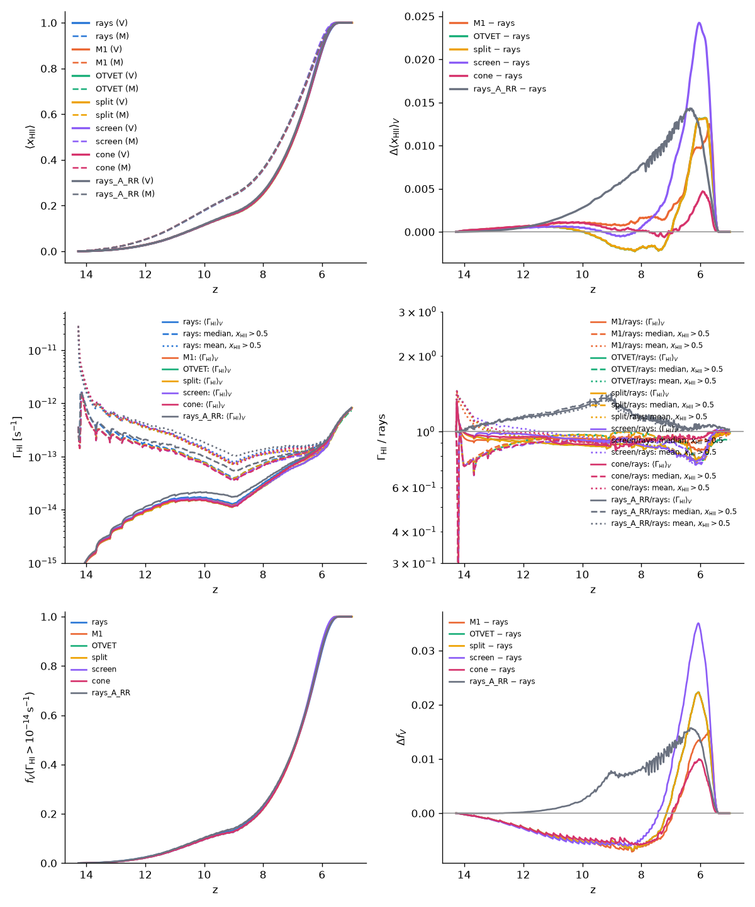
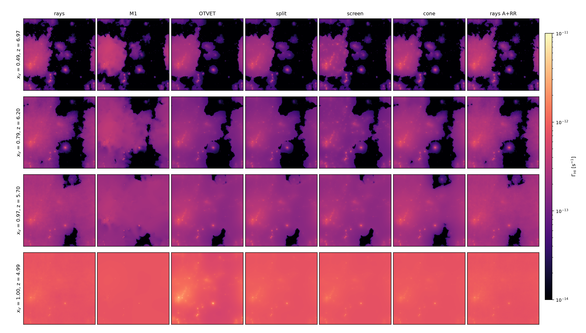
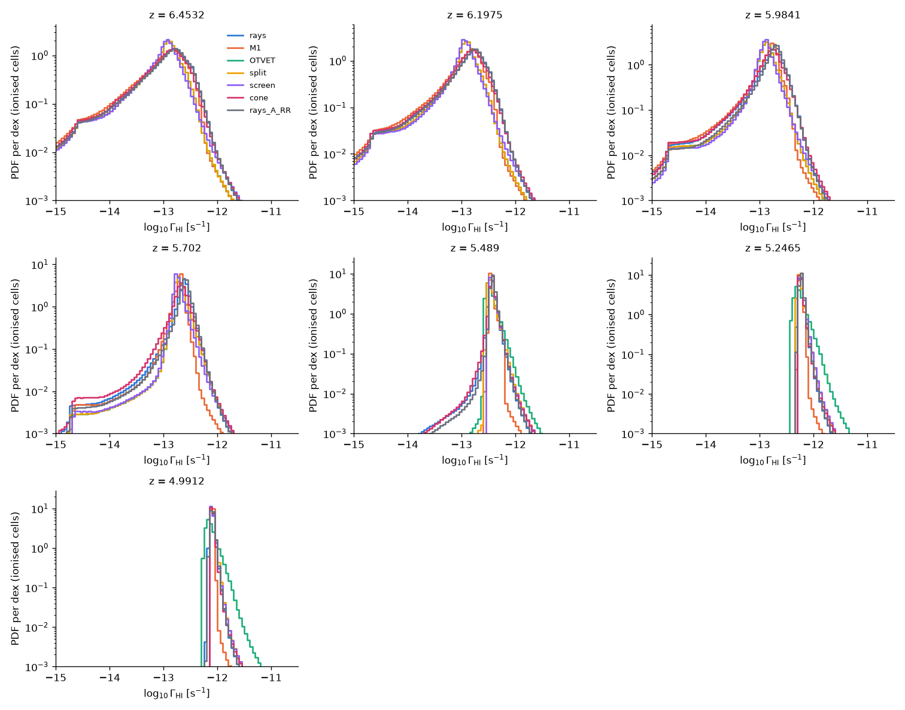
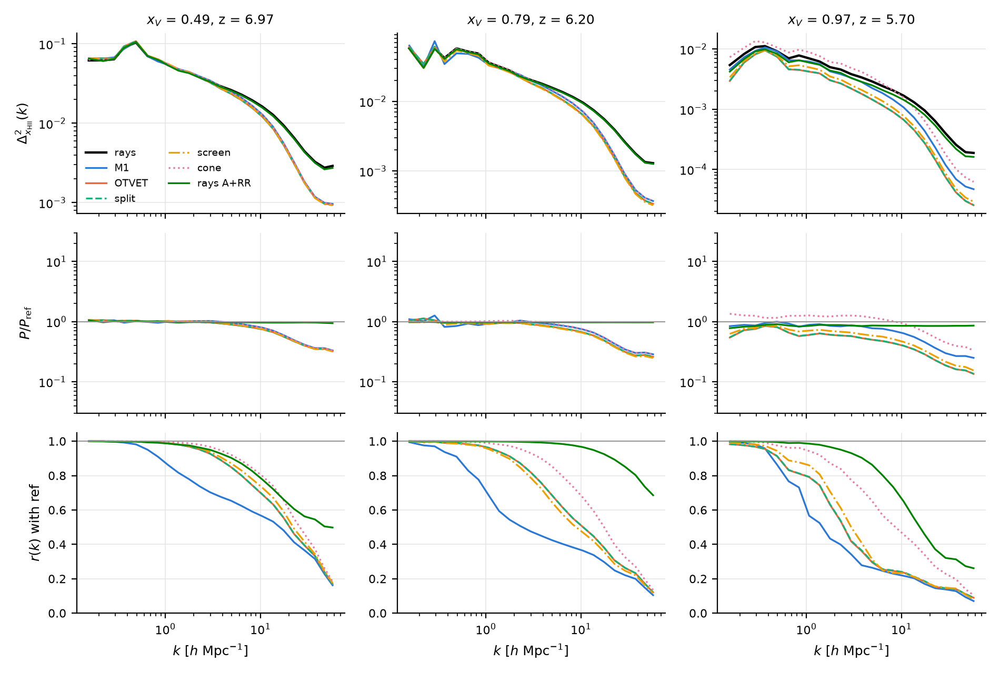
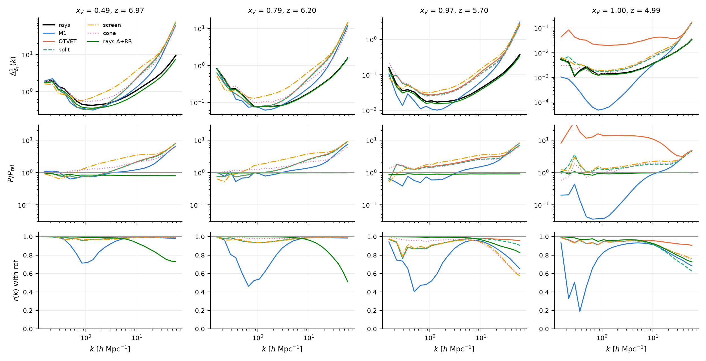

# The uniform 512³ suite: rays, M1 and OTVET at one ĉ, f_esc and recombination treatment

*Run on klone from 2026-10-18 (branch `rt-suite-512`; one whole `cpu-g2`
node, 192 threads, per run; `tools/hyak/rt_suite512.sh`).* The rerun of
every RT method with the decisions of `docs/PLAN.md` ("Unified RT-methods
suite", 2026-10-17/19) for the paper on the moment methods against the
rays: the same ICs, sources, reduced speed of light (the schedule on the
ionised fraction), f_esc(z), recombination treatment (case B) and outputs
in every run, plus one ray run with case A and the recombination radiation
transported. The first 512³ set (constant 0.2c, constant f_esc = 0.23,
case A + RR, 512³ particles) is `docs/rt_methods_512.md`; the closure runs
of that set are `docs/otvet_closure.md`. Both documents and their figures
stay as they are; the runs of those names were overwritten by this set
(user decision, 2026-10-18).

## 1. Configuration

| | |
|---|---|
| Box, resolution | 40 Mpc/h, N = 512 gas cells (78 kpc/h), **Ndm = 1024** particles (m_p = 6.4×10⁶ M☉) on the **2048³ PM mesh** (`pm_refine = 4`, the uniform-grid refined mesh of `docs/pm_refine.md`; no AMR) |
| ICs | Zel'dovich, z = 100, seed 7 with the 512³ large-scale phases: `$RUNS/hmf512_40mpc_r2/ics` (linked) |
| Flags | `legacy_rt = legacy_physics = 0` (`photon_conserve` with it), `deterministic_parallel`, `rt_substep_carry`, `hydro_scheme = unsplit`, `ray_rotate = 3` (rays), `moment_inject = 1` (moments), `redshift_per_distance = 1` |
| Sources | `sfr_model = abundance` with **`data/uv_lf/am_params_st_fof.txt`** (the Sheth–Tormen refit to the well-resolved FoF halos of the 40 Mpc/h 1024³ run, `docs/pm_refine.md` §6; the sources of `fesc512_b2.5_{uniform,amr}`), `fof_min_npart = 20` (1.3×10⁸ M☉ with 1024³ particles), log ξ_ion = 25.38, **f_esc(z) = 0.135 ((1+z)/7)^2.5** (`f_esc = 0.135`, `f_esc_beta = 2.5`, `f_esc_z0 = 6`; no bump, user decision 2026-10-19) |
| Light | **the schedule** `c_reduced_schedule = 0.1 0.25 0.2 0.5 0.3 0.75 0.5`: 0.1c below x_HII,V = 0.25, 0.2c to 0.5, 0.3c to 0.75, 0.5c after (each hydro step's ĉ from the previous step's x_HII,V) |
| Recombination | **case B, no recombination radiation** (`recomb_case = B`, `recomb_rad = 0`) for the base rays and every moment method; the `caseA` ray run: `recomb_case = A`, `recomb_rad = 1`, `recomb_rad_block = 4`, `recomb_rad_cell_onspot = 1` |
| Cooling, sink | `cool_suppress_overdensity = 200` (the original), no star-formation sink |
| Ray pool | `nray_max_factor = 15` |
| Redshifts | z = 100 → 5; RT from z = 15 (the first `zdata1`) |
| Movie | every Δz = 0.025 (≈ 400 frames), slabs of 8 cells (`movie_slab = 8`) of x_HI, T, ρ_gas, Γ_HI (`gammaHI`, the last substep's) and **`gammaHI_avg`** (the running substep average of the step) |
| Snapshots | z = 15, 7, 6.5, 6.25, 6, 5.75, 5.5, 5.25, 5: x_HI, x_HeI, x_HeII, T, ρ_gas, `gammaHI`, `gammaHI_avg` and `Gas/u_gas`; **no dark matter** (`data_files = gas`; the particles are only in the checkpoints) |
| Checkpoints | every 10 hydro steps, one kept (`restart_keep = 1`; the writes are atomic) |
| Job | one `cpu-g2` node each, `--exclusive --cpus-per-task=192 --mem=1000G --time=4-00:00:00`, `reion_production.slurm` (resumes from the checkpoint by itself, writes `DONE`) |

The runs (`$RUNS/<name>`, the names of the 2026-10-11 set):

| run | method | `rt_method` and closure keys | recombination |
|---|---|---|---|
| `reion512_rays` | rays (the base) | `rays` | B |
| `reion512_rays_caseA` | rays | `rays` | A + RR, `recomb_rad_cell_onspot = 1` |
| `reion512_rays_m1` | M1 | `m1` | B |
| `reion512_rays_otvet` | OTVET, thin tensor | `otvet` | B |
| `reion512_rays_otvet_split` | OTVET, direct + diffuse split | `otvet`, `otvet_split = 1` | B |
| `reion512_rays_otvet_screen` | OTVET, screened kernel | `otvet`, `otvet_closure = screen` | B |
| `reion512_rays_otvet_cone` | OTVET, HI-attenuated cone tensor | `otvet`, `otvet_closure = cone` | B |

```
source tools/hyak/env.sh                 # RUNS=/gscratch/astro/$USER/radhydro/runs
sbatch tools/hyak/build_hyak.sh          # then ctest -R "gamma_avg|c_schedule|movie_slab"
export AM_PARAMS=data/uv_lf/am_params_st_fof.txt   # the script's default is the 128-box table
OVERWRITE=1 tools/hyak/rt_suite512.sh probe      # 3 steps at the 2048^3 mesh: memory, PM time
OVERWRITE=1 tools/hyak/rt_suite512.sh base       # reion512_rays
OVERWRITE=1 tools/hyak/rt_suite512.sh siblings   # caseA, m1, otvet, split, screen, cone
tools/hyak/rt_suite512.sh post                   # rt_methods_post.slurm -> $RUNS/rt_methods_512/
```

## 1b. The first launch, and why the table changed

The first launch (2026-10-18 20:55, the 128-box table
`am_params_128_10mpc.txt` of the 512³ f_esc calibration, decision (1) of
2026-10-18) ionised the box by z ≈ 9: x_V = 0.29 at z = 12.1, 0.83 at
z = 10.8, 0.99999 at z = 9.2. With 1024³ particles the 20-particle FoF
floor is 1.3×10⁸ M☉, 8× below the floor of that calibration, and the
fitted L(M) (L ∝ M^1.19 below the break, plus the +0.4–0.9 dex high-z
normalisation) applied to those halos gave 20–60× the calibration run's
source luminosity density at z = 11–13 (the table in `docs/STATUS.md`,
"STOPPED 2026-10-19"). The seven runs were cancelled after 9–11.5 h. The
user chose the Sheth–Tormen table (2026-10-19), the source population of
`fesc512_b2.5_uniform` and `fesc512_b2.5_amr`, so those two runs (0.1c,
the sink, cooling suppression 0, `ray_deposit = exposure`, the AMReX
backend) are the reference for the base's early history; f6 = 0.135 and
β = 2.5 were kept without the precheck.

## 2. The probe: memory and the PM at the 2048³ mesh

Three hydro steps of the base from z = 100 (no RT yet) on one node
(`$BASE/probe`, job 42013527, 13.7 min):

| | |
|---|---|
| peak resident memory | **311 GB** (`/usr/bin/time -v`: 326178764 kB) |
| PM per step | 235, 225, 220 s (`timing.txt`; the hydro 13, 7.5, 6.4 s; summaries 5.5 s) |

The estimate of the pre-launch checklist was ≈ 275 GB of PM host arrays
at the 2048³ mesh; the measured peak is that plus the gas fields. With the
RT's 150–250 GB the runs were expected near 500–560 GB, within the 1000 GB
requested. The PM adds ≈ 4 min per hydro step, ≈ 3.5 h per run over ≈ 55
steps, against ≈ 1 h at the 512³ mesh of the first set.

## 3. Cost

One whole `cpu-g2` node, 192 threads, z = 100 → 5 in one job each; the
continuous-schedule set (the final one), the binary
`$RUNS/rt_suite512_bin/radhydro_interp` (gcc 13.2, the threaded FFTW).
RT is the sum of the RT timers; the PM is the 1024³ particles on the 2048³
mesh; `timing.txt` and `/usr/bin/time -v`.

| run | hydro steps | RT substeps | wall | RT | PM | I/O | peak RSS |
|---|---|---|---|---|---|---|---|
| rays, case B (base) | 99 | 5293 | 23 h 52 min | 16.3 h | 1.9 h | 4.4 h | 475 GB |
| rays, case A + RR | 99 | 5330 | 24 h 51 min | 17.7 h | 1.6 h | 4.4 h | 483 GB |
| M1 | 99 | 5349 | 9 h 47 min | 6.6 h | 1.65 h | 0.46 h | 367 GB |
| OTVET, thin | 99 | 5305 | 9 h 56 min | 6.8 h | 1.64 h | 0.46 h | 373 GB |
| OTVET, split | 100 | 5385 | 10 h 38 min | 7.5 h | 1.62 h | 0.46 h | 374 GB |
| OTVET, screen | 99 | 5347 | 10 h 08 min | 7.0 h | 1.64 h | 0.46 h | 370 GB |
| OTVET, cone | 99 | 5312 | 10 h 35 min | 7.4 h (tensor 0.5 h) | 1.66 h | 0.46 h | 376 GB |

- **The moment methods are 2.4× cheaper than the rays** in wall time
  (2.4× in RT), against 3.0–3.4× in the first set: the schedule's 0.5c end
  costs the rays most (their late steps take 1900–2100 s against 870–1000 s
  for the moments), and the checkpoints and snapshots with the 1024³
  particles are 4.4 h of the ray runs' I/O (`restart_every = 10`, one kept,
  about 130 GB each for the rays with their pool).
- **Recombination radiation now costs the rays 4 %** (1.67× in the first
  set): with `recomb_rad_cell_onspot = 1` most recombination photons are
  absorbed in their own cell and never become rays; the pool guard never
  fired in any run.
- **Memory:** the 2048³-mesh PM adds ≈ 275 GB of host arrays to every run
  (the probe: 311 GB before the RT), so the moment runs need 370 GB and the
  rays 475–483 GB, within the 1000 GB requested.
- **The step-schedule set** (the same seven runs, cancelled and overwritten,
  `docs/STATUS.md`) ran its PM 4× slower (6.2 h per run, 230 s per step)
  because its binary had been built in a checkout whose CMake cache still
  named the single-threaded FFTW; the probe's 220–235 s per PM step was
  that too. Nothing else differed in cost.
- Disk: 1.40 TB for the set with one checkpoint each (281 + 284 GB the ray
  runs, 167 GB each moment run; ≈ 105 GB each without the checkpoint).

## 4. Reionization history

`tools/analysis/reion_history.py` and `rt_methods_runs.py` (`compare.txt`),
volume-weighted x_HII from `movie/frames.txt`; τ_es with Planck 2018 at
0.054 ± 0.007.

| run | z10 | z25 | z50 | z75 | z90 | z99 | z99.9 | τ_es |
|---|---|---|---|---|---|---|---|---|
| rays, case B | 10.28 | 8.02 | 6.94 | 6.29 | 5.94 | **5.58** | 5.46 | 0.0591 |
| rays, case A + RR | 10.33 | 8.08 | 6.98 | 6.33 | 5.97 | 5.61 | 5.48 | 0.0595 |
| M1 | 10.29 | 8.04 | 6.95 | 6.31 | 5.97 | 5.66 | 5.59 | 0.0594 |
| OTVET, thin | 10.28 | 8.01 | 6.94 | 6.31 | 5.98 | 5.64 | 5.53 | 0.0594 |
| OTVET, split | 10.28 | 8.01 | 6.94 | 6.31 | 5.98 | 5.64 | 5.54 | 0.0594 |
| OTVET, screen | 10.29 | 8.02 | 6.96 | 6.34 | 6.01 | 5.68 | 5.57 | 0.0596 |
| OTVET, cone | 10.30 | 8.02 | 6.94 | 6.30 | 5.96 | 5.60 | 5.46 | 0.0594 |



- **The histories agree to 0.1 in z throughout.** Every method reaches
  x_V = 0.5 within 0.04 of z = 6.94 and ends (x_V = 0.99) between z = 5.58
  (rays) and 5.68 (screen); τ_es is 0.0591–0.0596 (+0.7σ). This is the
  photon budget: the same sources and the same case-B recombinations, and
  the moment methods conserve photons as the rays do.
- **The moment methods end slightly later than the rays** (0.02–0.10 in
  z99), the cone closest (0.02), M1 and screen furthest (0.08–0.10). In the
  first set (constant 0.2c, case A + RR, 512³ particles) OTVET ended 0.04
  *earlier* than the rays and M1 0.03 later; the ordering has changed with
  the schedule's faster end, where the rays' fronts cross the last voids at
  0.5c and the moments' diffusion lags. The case A + RR rays end 0.03 later
  than case B, as before (recombination radiation delays overlap a little
  while raising Γ after it).
- **f6 = 0.11 lands the end where it was tuned to:** z99 = 5.58 against the
  target of 5.5 (the 256³ precheck put the 20 Mpc/h box at 5.63 for this
  f6, and the 40 Mpc/h box ended 0.05 earlier rather than 0.1 later). The
  earlier launch at f6 = 0.135 with these sources was heading for z99 ≈ 6.1
  (`docs/STATUS.md`).
- **Mass-weighted** z50 = 7.32–7.35 and z99 = 5.62–5.72, inside-out as
  always; the moment methods' mass-weighted end is later by the same
  0.02–0.10.

## 5. Γ_HI: the substep average, maps and PDFs

Every run wrote `gammaHI_avg`, Γ_HI averaged over the hydro step's RT
substeps (`docs/igm_diagnostics.md`), beside the last-substep `gammaHI`.
All Γ statistics below use the average unless said otherwise.



*Slabs of 8 cells (625 kpc/h) through the box middle at the snapshots
nearest x_V = 0.5, 0.8, 0.97 and after overlap (z = 4.99); columns: rays
(case B), M1, OTVET thin, split, screen, cone, rays with case A + RR; log
Γ_HI from 10⁻¹⁴ to 10⁻¹¹ s⁻¹ (`tools/analysis/rt_suite_figures.py`;
`figures/rt_suite_512_panels.txt` names every snapshot).*

- **Inside the bubbles the rays, the cone and the case A + RR rays look
  alike**: a Γ field that falls away from each source with the proximity
  zones resolved. **M1 smears the sources out**: its bubbles are filled with
  a nearly uniform Γ, the proximity zones gone, and its fronts are rounder
  (the two-moment closure beams nothing and diffuses everything after one
  cell). **OTVET thin and split put the same structure as the rays inside the
  bubbles but at a lower level**, and **screen leaves a mottled field** at
  x_V = 0.5–0.8 (its screened kernel over-weights the nearest sources).
- **After overlap** (z = 4.99) the rays, M1, split, screen and cone are
  smooth with Γ ≈ 8×10⁻¹³ s⁻¹; **OTVET thin alone keeps bright patches around
  the source clusters**, the after-overlap excess of `docs/otvet_closure.md`
  that the attenuated tensors remove: its optically thin tensor still points
  the flux at distant sources that the ionised but not transparent IGM no
  longer lets through.



*The PDF of log Γ_HI in ionised cells at the snapshots (`rt_methods_runs.py
--gamma-field gammaHI_avg`).* Quantiles of Γ/⟨Γ⟩_V in ionised cells at
z = 4.99 (`gamma_power.py`): the rays span 0.81–1.85 between the 0.1 % and
99.9 % points, the case A + RR rays 0.81–1.84, the cone 0.92–1.93, screen
0.89–2.03, **M1 0.94–1.26** (the narrowest: it has no proximity zones) and
**OTVET thin 0.65–4.2** (the widest, both tails). At z = 5.49, just before
overlap, the rays' and the cone's 0.1 % points are at 0.09–0.10 (the last
neutral islands' edges) while M1, OTVET, split and screen are at 0.7–0.8:
the moment methods have no dark cells left where the rays still have them.

**The Γ history** (`movie/frames.txt`, the last-substep Γ; `compare.txt`):
the median Γ of the ionised cells agrees between the rays and every method
to within 10 % at every frame from z = 12 to 5: at z = 5.5 M1 is 0.94×, OTVET
0.92×, the case A + RR rays 1.05× the rays; at z = 5 they are 1.00×, 0.93×
and 1.02×. The mean Γ_HI is what the photon budget fixes; the methods differ
in how it is distributed.

## 6. Power spectra of x_HII and Γ_HI, and the cross-correlation with the rays

`tools/analysis/rt_suite_figures.py` (3D P(k), log bins from the
fundamental to the Nyquist of the diagonal, Δ² = k³P/2π²; the ratio to the
case-B rays and r(k) = P_ab/√(P_aa P_bb) with them; the full tables in
`figures/rt_suite_512_pk.txt`).



*Δ² of x_HII itself at x_V = 0.49, 0.79, 0.97 (the 21-cm convention), the
ratio to the rays and r(k).*

| x_V | k [h/Mpc] | M1 | OTVET | split | screen | cone | rays A + RR |
|---|---|---|---|---|---|---|---|
| 0.49 | 1.1 | 1.00 / 0.86 | 1.01 / 0.99 | 1.01 / 0.99 | 1.03 / 0.99 | 1.02 / 1.00 | 0.99 / 0.99 |
| 0.49 | 4.9 | 0.96 / 0.65 | 0.90 / 0.85 | 0.90 / 0.85 | 0.90 / 0.87 | 0.96 / 0.92 | 0.98 / 0.90 |
| 0.79 | 1.1 | 0.93 / 0.69 | 0.93 / 0.96 | 0.93 / 0.96 | 0.91 / 0.95 | 1.02 / 0.99 | 0.98 / 1.00 |
| 0.79 | 4.9 | 0.91 / 0.43 | 0.83 / 0.69 | 0.83 / 0.69 | 0.81 / 0.65 | 0.94 / 0.86 | 0.98 / 0.99 |
| 0.97 | 1.1 | 0.89 / 0.57 | 0.60 / 0.79 | 0.60 / 0.79 | 0.71 / 0.86 | 1.27 / 0.94 | 0.85 / 0.99 |
| 0.97 | 4.9 | 0.78 / 0.26 | 0.50 / 0.30 | 0.50 / 0.30 | 0.59 / 0.31 | 1.17 / 0.65 | 0.86 / 0.86 |

*(P/P_rays / r(k).)*

- **The large-scale x_HII field is the same in every method** (ratio within
  10 % and r ≥ 0.96 at k ≤ 1 h/Mpc for all but M1 up to x_V = 0.8): the
  bubbles are where the sources are. **M1 decorrelates first and most**:
  r = 0.86 already at k = 1 h/Mpc at x_V = 0.5, 0.57 at x_V = 0.97; its
  fronts are in the wrong places at the few-Mpc scale.
- **The cone tensor reproduces the rays' morphology best at every stage**
  (r = 0.92 / 0.86 / 0.65 at k = 5 h/Mpc for x_V = 0.49 / 0.79 / 0.97
  against 0.85 / 0.69 / 0.30 for OTVET thin and 0.65 / 0.43 / 0.26 for M1),
  and at the end it has *more* small-scale x_HII power than the rays
  (1.2–1.3× at k = 1–5 h/Mpc at x_V = 0.97): its last neutral islands are
  sharper. OTVET thin and split, identical here, have half the rays' power
  at k ≥ 1 h/Mpc at x_V = 0.97: their fronts are diffuse and their islands
  disappear early.
- **Case A + RR against case B** (rays both): r ≥ 0.99 at k ≤ 2 h/Mpc at
  every stage and 0.86 at k = 5 h/Mpc at x_V = 0.97; the recombination
  radiation changes the morphology less than any closure does.



*Δ² of δ_Γ = Γ_HI/⟨Γ_HI⟩_V − 1 (the substep average) at x_V = 0.49, 0.79,
0.97 and 1.0, the ratio to the rays and r(k).*

| x_V | k [h/Mpc] | M1 | OTVET | split | screen | cone | rays A + RR |
|---|---|---|---|---|---|---|---|
| 0.49 | 0.5 | 0.63 / 0.91 | 0.79 / 0.98 | 0.79 / 0.98 | 0.97 / 0.97 | 1.10 / 1.00 | 0.87 / 1.00 |
| 0.49 | 1.8 | 0.80 / 0.83 | 0.84 / 0.97 | 0.84 / 0.97 | 1.87 / 0.97 | 1.28 / 0.99 | 0.84 / 0.99 |
| 0.79 | 0.5 | 0.68 / 0.60 | 0.80 / 0.95 | 0.80 / 0.95 | 1.07 / 0.97 | 1.14 / 0.99 | 0.97 / 1.00 |
| 0.79 | 1.8 | 0.83 / 0.71 | 1.08 / 0.95 | 1.07 / 0.95 | 2.11 / 0.95 | 1.31 / 0.98 | 0.98 / 1.00 |
| 0.97 | 0.5 | 0.56 / 0.40 | 1.26 / 0.87 | 1.23 / 0.87 | 1.25 / 0.87 | 1.26 / 0.96 | 0.89 / 1.00 |
| 0.97 | 1.8 | 0.62 / 0.72 | 1.70 / 0.93 | 1.62 / 0.93 | 2.13 / 0.93 | 1.52 / 0.96 | 0.89 / 0.99 |
| 1.00 (z = 4.99) | 0.5 | **0.04** / 0.45 | **11.6** / 0.93 | 1.07 / 0.93 | 0.99 / 0.93 | 0.71 / 0.92 | 0.88 / 0.97 |
| 1.00 | 1.8 | 0.07 / 0.89 | 14.1 / 0.94 | 1.32 / 0.94 | 1.44 / 0.94 | 1.09 / 0.95 | 0.92 / 0.96 |
| 1.00 | 4.9 | 0.41 / 0.93 | 13.5 / 0.96 | 1.63 / 0.95 | 1.86 / 0.96 | 1.75 / 0.96 | 0.96 / 0.96 |

- **After overlap the three attenuated tensors have the rays' P_Γ to within
  a factor 1.1–1.9 at k ≤ 5 h/Mpc with r = 0.92–0.96**, OTVET thin has
  11–14× too much power at every k (the known excess, r still 0.93 because
  it is the same sources' pattern with the wrong amplitude), and **M1 has
  25× too little at k ≤ 2 h/Mpc** with r = 0.45 at k = 0.5 h/Mpc: the
  two-moment closure washes the large-scale Γ fluctuations out. Among the
  attenuated tensors the cone is closest at k ≤ 2 h/Mpc (0.7–1.1×) and the
  split and screen at 1.0–1.4×; all three have 1.6–1.9× at k = 5 h/Mpc,
  where the moments' sharper proximity zones (no ray sampling) add power.
- **During reionization** (x_V = 0.5–0.8) every VET variant has r ≥ 0.95 with
  the rays at k ≤ 2 h/Mpc and P within 30 % except screen, which has 1.9–2.1×
  at k = 1.8 h/Mpc (the mottling of §5); **M1 is 20–40 % low and r falls to
  0.6–0.7 at k = 0.5–1 h/Mpc**. At x_V = 0.97 the VET variants are 1.2–1.7×
  high at k ≤ 2 h/Mpc, M1 0.6×, and the cone keeps r = 0.96.
- **With Γ capped at 3⟨Γ⟩** (`figures/rt_suite_512_pk_gamma_clip3.png`,
  the background without the source cells and their proximity zones) the
  same ordering holds with the amplitudes closer to 1: after overlap OTVET
  thin 10× at k ≤ 1 h/Mpc, split/screen/cone 0.7–1.3×, M1 0.02–0.04; during
  reionization the cone within 20 % at k ≤ 2 h/Mpc, M1 0.6–1.4× with
  r = 0.3–0.5.
- **The substep average against the last substep:** the rays' last-substep
  Γ carries the sampling noise of the discrete rays, nearly white: at
  z = 4.99 its P_Γ is 1.2×, 2.2×, 5.8× and 9.8× the averaged field's at
  k = 5, 10, 23 and 38 h/Mpc (0.95× at k ≤ 2; `gamma_pk_inst/`, the same
  analysis on `gammaHI`), and 1.1–2.8× at z = 5.49. The average removes it,
  so the high-k ratios above are of the physical fields. M1's two fields
  agree to 10 % at k ≥ 1 h/Mpc (its Γ has no sampling noise; the residual
  is the change within the step).
- **Case A + RR rays:** 0.85–0.97× the case-B rays' P_Γ at every k and
  stage with r ≥ 0.96: the recombination radiation smooths Γ slightly, as
  in the first set.

## 7. The IGM at z = 5–6

`igm_stats.py` on every run (`rt_methods_post.slurm`, IGM=1;
`figures/rt_suite_512_igm.txt`, `figures/rt_suite_512_igm.png`), the ratio
to the data in brackets: Γ_HI the median over x_HI < 10⁻² times x_HII,V
(the PR #48 estimator, Gaikwad+23), λ_mfp the exponential fit from ionised
starts (Becker+21 / Zhu+23), ⟨F⟩ the Lyα mean flux (Bosman+22).

| run | Γ(5.98) | Γ(5.49) | Γ(5.25) | Γ(4.99) | λ(5.98) | λ(5.49) | λ(5.25) | ⟨F⟩(5.49) | ⟨F⟩(4.99) |
|---|---|---|---|---|---|---|---|---|---|
| rays, B | 1.06× | 1.09× | 1.28× | 1.45× | 3.0 (4.0×) | 15.1 (3.5×) | 28.1 (4.3×) | 1.95× | 1.88× |
| rays, A + RR | 1.14× (5.95) | 1.14× | 1.32× | 1.46× | 3.5 (4.4×) | 16.0 (3.7×) | 28.6 (4.4×) | 2.04× | 1.88× |
| M1 | 0.98× | 1.07× (5.47) | 1.26× | 1.50× | 2.9 (3.9×) | 15.7 (3.5×) | 27.8 (4.1×) | 2.12× | 1.99× |
| OTVET, thin | 0.82× | 1.00× | 1.18× | 1.35× | 3.0 (4.0×) | 18.2 (4.2×) | 33.8 (5.2×) | 1.92× | 1.88× |
| OTVET, split | 0.82× | 1.03× | 1.24× | 1.53× (4.96) | 3.0 (4.0×) | 17.3 (4.0×) | 30.6 (4.7×) | 2.01× | 1.99× |
| OTVET, screen | 0.81× | 1.11× (5.48) | 1.28× | 1.47× | 3.2 (4.2×) | 18.5 (4.2×) | 32.1 (4.8×) | 2.08× | 1.97× |
| OTVET, cone | 1.00× | 1.11× (5.48) | 1.27× | 1.47× | 3.1 (4.0×) | 17.3 (4.0×) | 31.2 (4.7×) | 2.04× | 1.98× |

*(λ in pMpc; a redshift in brackets where a run's snapshot differs from the
column's.)*

- **Γ_HI against Gaikwad+23 is within 10 % for every method at z ≥ 5.5** by
  the median estimator, rising to 1.35–1.53× by z = 5.0 for all of them:
  the emissivity with f6 = 0.11 is right at the end of reionization and a
  little high after it (ṅ_ion = 10^50.73–50.83, 0.4–0.75 dex below
  Becker+21). The spread between methods is 20 % at z = 5.98 (OTVET,
  split and screen low at 0.82×, where their x_V is 0.90–0.91 against the
  rays' 0.88 and their bubbles' Γ is lower, §5) and ≤ 12 % after overlap.
- **λ_mfp is 3.5–5.2× the data at z ≤ 5.5** in every run, OTVET thin the
  longest (its excess Γ around the sources clears the dense cells); at
  z = 5.98 all are at 3.0–3.5 pMpc (4×). This is 2× the excess of
  `fesc512_b2.5` at the same Γ (1.8–1.9×): the Sheth–Tormen faint halos
  ionise the voids early and the schedule's 0.5c end lets the field relax,
  and the 1024³ particles on the 2048³ mesh add no Lyman-limit opacity
  (the open item of `docs/fesc_evolution.md` §6).
- **⟨F⟩ is 1.9–2.1× Bosman+22** for every method, the forest too
  transparent for the same reason; A = 1.8–2.4.
- **The IGM statistics do not separate the methods** once Γ is the median
  of the ionised cells: the budget fixes the mean, and the forest at
  z ≤ 5.5 sees the mean. The method differences are in the maps, the PDF
  and P_Γ (§5–6).

## 8. Movie

`docs/movies/rt_suite_512.mp4` (8.6 MB, `tools/movies/compare_movie.py`;
`$RUNS/rt_methods_512/compare.mp4`, stills in `compare_stills/`): the seven
runs side by side from z = 15 to 5, rows x_HII, log T and log Γ_HI (8-cell
slabs), with the x_V(z) and median-Γ panels. The Γ panel is smooth through
the schedule: the step-schedule set's movie
(`$RUNS/rt_methods_512/compare_partial.mp4`, kept) showed the ×1.5–2 jumps
at each switch.

`docs/movies/rt_suite_512_diff_xHII.mp4` (4.9 MB; `compare_movie.py --rows
xHII --diff`, new): the rays' x_HII in the first column and, in the others,
each method's x_HII minus the rays' on a ±0.5 diverging scale (red: more
ionised than the rays). The differences live at the fronts: M1's are the
largest and extend into the bubbles (its fronts run ahead inside the
large bubbles and behind at the small ones); OTVET, split and screen share
a thinner pattern of the same sign; the cone's is the thinnest; the case
A + RR rays differ from case B only by a speckle at the fronts.

## 9. Conclusions, and what differs from the first set

1. **The histories are method-independent to 0.1 in z and τ_es to
   0.0005**: with photon-conserving transport and the same sources, every
   method reionizes the box at the same time. The moment methods end
   0.02–0.10 later than the rays (the cone closest), where in the first set
   OTVET ended 0.04 earlier; the schedule's 0.5c end makes the rays'
   fronts faster than diffusion.
2. **M1 is the outlier in morphology and in Γ**: its fronts decorrelate from
   the rays' at k ≈ 1 h/Mpc already at x_V = 0.5 (r = 0.86, 0.57 by
   x_V = 0.97), it has no proximity zones, and after overlap it has 25× too
   little large-scale Γ power (r = 0.45). This is as in the first set
   (`docs/rt_methods_512.md` §6: "M1 ... 2–10× low"), now cleaner with the
   substep average and sharper at 512³ with 1024³ particles.
3. **OTVET with the thin tensor has the right history and morphology to
   x_V = 0.8 but 11–14× too much Γ power after overlap**, as before
   (6–30× in the first set). **The three attenuated tensors remove it**:
   split, screen and cone are within 0.7–1.9× of the rays' P_Γ at all k
   after overlap with r = 0.92–0.96, as `docs/otvet_closure.md` found at
   constant 0.2c.
4. **The cone tensor is the best match to the rays overall**: the closest
   x_HII morphology at every stage (r = 0.65 against 0.26–0.31 at
   k = 5 h/Mpc at x_V = 0.97), Γ within 10–30 % and r ≥ 0.96 through
   reionization, 0.7–1.1× after overlap at k ≤ 2 h/Mpc, and the rays'
   history to 0.02. Its cost is 7 % above OTVET thin (the tensor 0.5 h).
   Screen is the roughest of the three during reionization (2× the Γ
   power at k ≈ 2 h/Mpc, a mottled field); split equals thin until overlap
   and then behaves like screen.
5. **Recombination radiation (case A + RR against case B, rays)** changes
   the history by 0.03 in z99, Γ by +5 %, and the morphology by less than
   any closure (r ≥ 0.99 at k ≤ 2 h/Mpc); at 4 % of the wall time with
   `recomb_rad_cell_onspot = 1` it is cheap to keep. In the first set it
   cost 1.67× and the comparison was made with it on; here the methods
   were compared in case B and the RR run shows the effect is small.
6. **The IGM against the data** is the same for every method: Γ within
   10 % of Gaikwad+23 at z ≥ 5.5 and 1.4–1.5× at z = 5, ⟨F⟩ 1.9–2.1× and
   λ_mfp 3.5–5× the data, the resolution excess of the f_esc study made
   larger by the Sheth–Tormen faint sources and the faster late ĉ.
7. **The schedule and the substep average matter for the Γ comparison**:
   the step schedule's switches put ×1.5–2 transients into Γ (the z = 6.2
   snapshot of the step set was 30 % high), removed by the continuous
   schedule; the rays' last-substep Γ carries white sampling noise at
   k ≥ 10 h/Mpc, removed by `gammaHI_avg`. Both are now the defaults of the
   suite's configuration (the C++ defaults are unchanged).

## 10. Open

- The emissivity: f6 = 0.11 gives z99 = 5.58 and Γ 1.45× the data at
  z = 5; a lower β (less early emission) rather than a lower f6 would move
  the end later at fixed Γ(5.4), untried.
- The λ_mfp excess (3.5–5×) at the data's Γ: the subgrid Lyman-limit
  opacity or AMR of `docs/fesc_evolution.md` §6.
- The AMR repeat of the suite (thread C: the moment methods and FLD on the
  AMReX hierarchy, `recomb_rad` on the backend), and FLD as a sibling of
  this base.
- The step-schedule set's outputs are gone (overwritten); its record is in
  `docs/STATUS.md` and `$RUNS/rt_methods_512/{igm_base,compare_partial.mp4}`.
