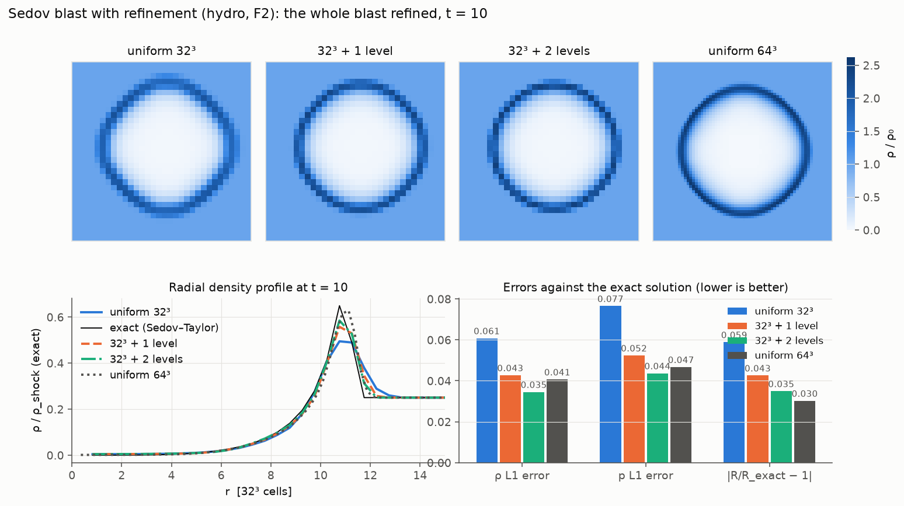
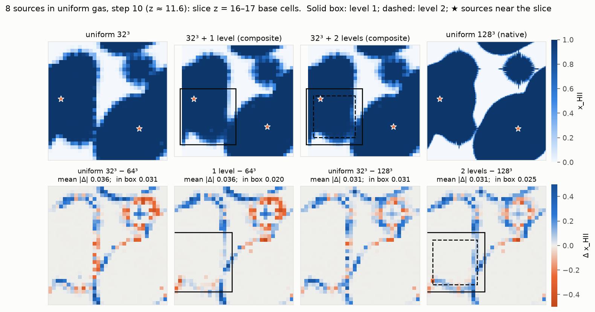
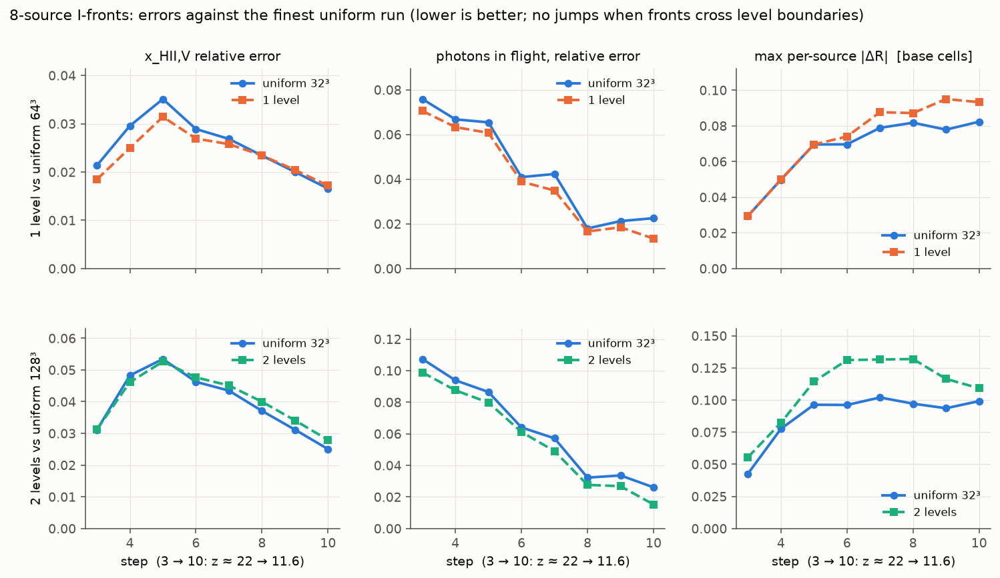
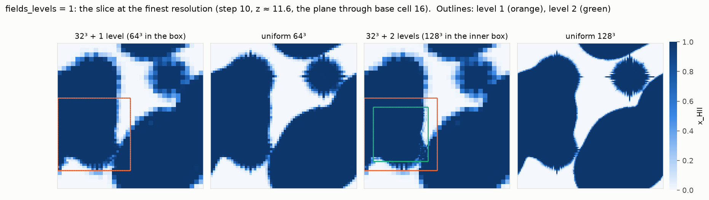
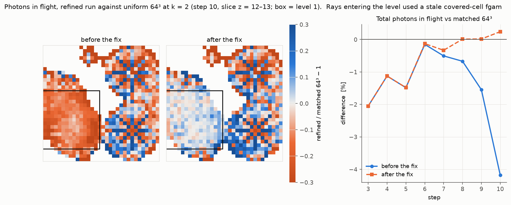
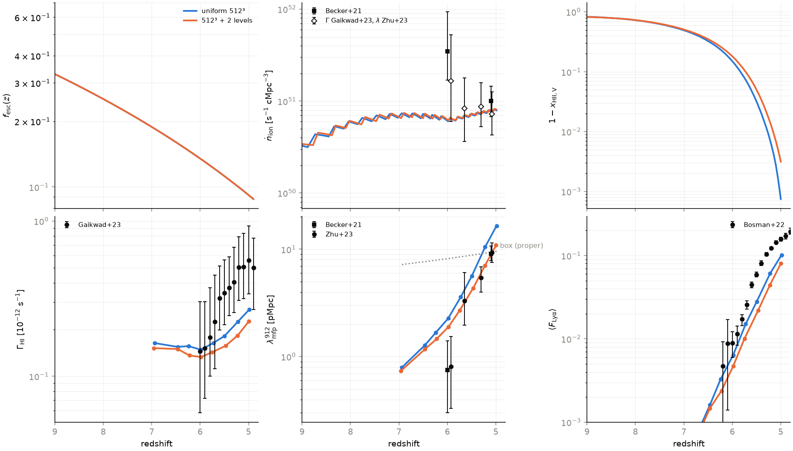
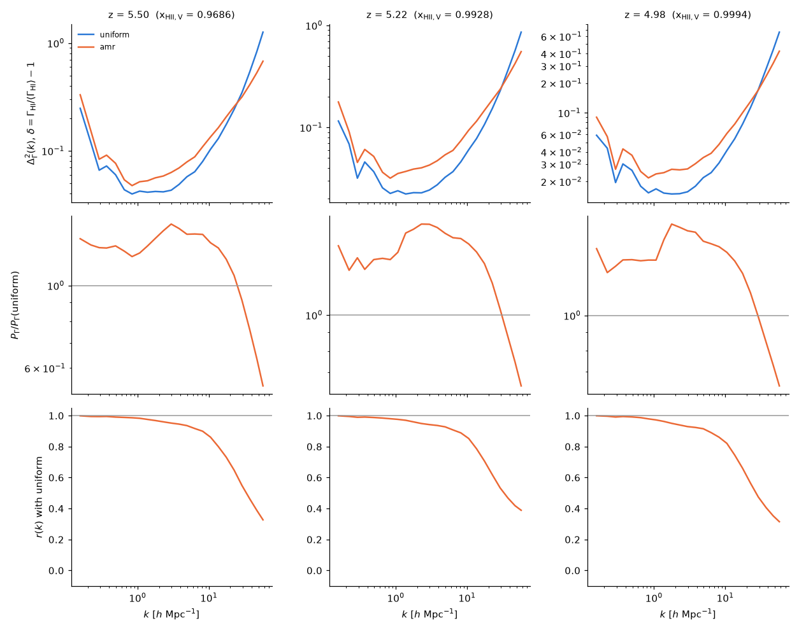
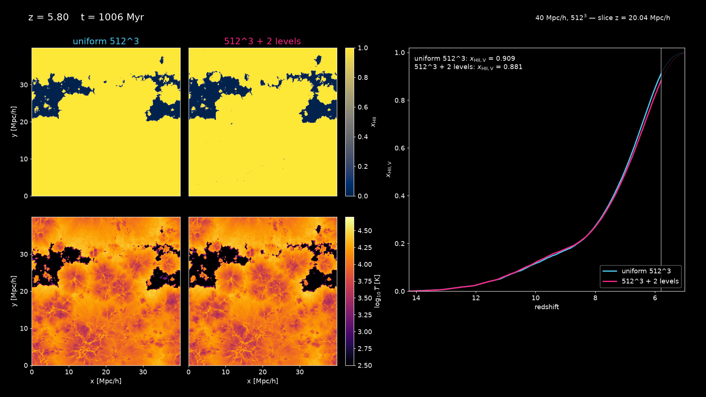

# Stage F: AMR for the gas, then the RT (`amrex_max_level`)

*Started 2026-10-14 (branch `stage-f-decisions`). The user's decisions are
in `docs/PLAN.md`, "Stage F decisions": one coarse RT substep across
levels, B17 under `legacy_physics = 0`, cooling on in dense gas with an
aggressive star-formation sink, the rest the implementer's choice, in the
order F1 (hierarchy, refinement off, bitwise), F2 (refined hydro, the
cooling flag and the sink), F3 (the RT across levels).*

## 0. Summary

| Item | State |
|---|---|
| F1: the gas hierarchy (`amrex_max_level`, AmrMesh regridding, FillPatch, refluxing, average-down) in `src/amrex/hydro_level.cpp`; `amrex_max_level = 0` is bitwise the Stage E level | done 2026-10-14 |
| F2: refined hydro validated on the hydro test suite (§2: one level on 32³ matches the uniform 64³ run); `cool_suppress_overdensity`; the star-formation sink (F2b) | done 2026-10-14 (the pancake, KH and full-tier cases pending) |
| F3: the gas state on every level (F3a) and rays across levels with the coarse substep (F3b, `rt_cells_per_substep` = 2^l on level l) | done 2026-10-15: the I-front validated inside the refined region and across its boundary (§3); 2026-10-14 (branch `stage-f3-8src`): the 8 sources of `uniform_8src` with one and two levels, three fixes (§3, "Eight sources") |
| F4: the PM on the refined gas levels (`pm_gas_levels`, default 1): the deposit from the finest level, every level kicked on its own cells; `make_production.py --ndm` (e.g. `pm_refine = 4` with 2× particles) | done 2026-10-15 (§4; on klone: pending) |

## 1. The hierarchy (F1)

**Parameters** (`params.txt` / `--set`, AMReX-free in `hydro_backend.hpp`;
all backends refuse them unless `hydro_backend = amrex`):

| key | default | meaning |
|---|---|---|
| `amrex_max_level` | 0 | refinement levels of the gas hierarchy (0 = Stage E, one level) |
| `amrex_refine_mass` | 8 | a level-l cell is tagged when its gas mass exceeds `amrex_refine_mass` × the mean mass of a base cell, i.e. ρ/ρ̄_gas > `amrex_refine_mass` · 8^l (the Lagrangian criterion of `docs/ROADMAP.md` §5) |
| `amrex_regrid_every` | 1 | regrid every n hydro calls (two per `radhydro` step) |
| `amrex_fine_max_grid_size` | 32 | box size of the refined levels (level 0 keeps `amrex_hydro_max_grid_size` or the shared decomposition) |
| `amrex_blocking_factor` | 8 | AMReX `blocking_factor` (grids are multiples of it) |
| `amrex_n_error_buf` | 1 | cells of buffer around tagged cells |
| `amrex_grid_eff` | 0.7 | AMReX `grid_eff` |

**Data.** Level 0 is the Stage E level: with `amrex_state = 1` its
BoxArray and DistributionMapping are the shared decomposition and the gas
state (float, `gas_state.hpp`) owns the level-0 data between steps; the
refined levels (`U` in double, their own BoxArray from the tags and their
own SFC mapping) are owned by the hydro hierarchy between steps and are
written to the checkpoint as AMReX `VisMF` files next to it
(`<checkpoint>.amr/Level_l/`). The refinement ratio is 2 in every
direction; the geometry of level l is `refine(geom[l-1], 2)`, periodic.

**The step** (`advance(lev, t, dt)`, recursive; `dt` is the level-0 CFL
substep `dt_sub` of the serial driver, and because dx and dt halve
together the kernel's `dtdx` is `dt_sub` on every level):

1. ghosts of `U[lev]` (level 0: `FillBoundary`; finer: `FillPatchTwoLevels`
   from the parent's old and new states, interpolated in time, with
   `cell_cons_interp`, plus the level's own data), the dual-energy
   selection into `Es` (ghosts: `FillBoundary`, or the parent's current
   `Es` interpolated);
2. the substep of `hydro_mh.hpp` on the level (predictor, faces into three
   face-centred flux MultiFabs, the update, `En` ghosts, the floors and
   the dual-energy finalisation), as in Stage E1;
3. if `lev < finest`: the level's fluxes into the flux register of
   `lev+1` (`CrseInit`, factor −dtdx), two `advance(lev+1, ·, dt/2)`
   (each adds its fluxes with factor +dtdx/8: dt_f·A_f/V_c), then
   `Reflux` into `U[lev]` (scale 1) and `average_down` of `U[lev+1]` onto
   `U[lev]` (all 10 components: conserved variables, e, w).

The CFL step is the serial driver's arithmetic with the signal maximum
taken over every level (a level-l cell with signal s needs
dt/2^l ≤ cfl·2^-l/s, the same bound as a base cell), recomputed before
every substep as the serial driver does. With `amrex_max_level = 0` the
recursion is the Stage E1 loop, operation for operation: bitwise
identical (`ctest -L amrex_hydro`).

**Three traps met on the way** (all fixed, all with tests): (1) the
kernel's `dtdx` is the *level-0* substep on every level, since a level-l
cell of dx 2^-l takes dt 2^-l; with the level's own dt the fine levels
advanced at half speed per level (Sedov's shock radius came out 20–40 %
short while mass, momentum and energy were still conserved, the register
factors being consistent with the wrong update). (2) The time within a
hydro call restarts at zero, so every level's interpolation interval
(the parent's old and new states) must be reset at each call; with the
previous call's interval the first fine fill of a call extrapolated and
produced negative ghost densities. (3) AMReX's `cell_cons_interp` and
`lincc_interp` limit the slopes per direction, and in a field with
density contrasts of 1e6 (`random3d`) the three-direction sum made
negative fine densities next to small coarse values; the hierarchy
interpolates with `mf_linear_slope_minmax_interp` (the slope vector
limited so that no fine value leaves the range of the coarse neighbours),
which FillPatch dispatches only when passed as an `MFInterpolater*`.
`RADRAY_AMR_DEBUG=1` scans every level after each phase and reports the
first non-finite or non-positive cell with its parent column, and counts
the bad or untouched ghost cells of every fill.

**Regridding.** `AmrMesh::MakeNewGrids` with `ErrorEst` tagging on the
level's density (above); new levels are filled by `FillPatchTwoLevels`
(the old fine data where it exists, the parent interpolated elsewhere),
at the start of a hydro call every `amrex_regrid_every` calls and at the
first call. Level 0's grids never change here (the balancing of Stage E4
moves them; the refined levels are then rebuilt at the next regrid).

**Coupling to the RT and PM before F3 and Stage G** (interim, approximate,
documented so it can be removed; the RT acts on every level since F3, the
PM since §4 with `pm_gas_levels = 1`): the RT and the PM act on level 0 only.
Between hydro calls they change the level-0 gas (w, u(5), e by the RT;
the momenta and E by the PM kick; the metals). At the start of a hydro
call the hierarchy compares the level-0 state with what it wrote out last
(a float copy) and pushes every change down to the fine cells of that
coarse cell: the density and the species by the coarse ratio (additive
share where the old value is 0), the momenta by the coarse velocity
change (p_f += ρ_f Δv_c), E by the fine cell's kinetic-energy change plus
its thermal change, e by the coarse ratio. Unchanged coarse cells leave
their fine cells untouched exactly. After the step the fine levels are
averaged down, so level 0 is always consistent with them.

## 2. Refined hydro, cooling and the sink (F2)

**Validation on the hydro test suite** (`tests/hydro_suite`,
`docs/hydro_tests.md`; `run_suite.py --scheme unsplit --amr L
--refine-mass 0.2`, `tools/hyak/hydro_suite_amr.slurm`, one klone node,
2026-10-14; JSON in `docs/data/stage_f/`). With `refine_mass = 0.2` every
cell above 0.2× the mean gas density is refined: the whole Sedov box (the
ambient medium is at the mean density) and everything but the
undisturbed low-density state of a tube, so a refined run on N³ is the
uniform (2^L N)³ solution averaged down to N³, and the analysis (the
level-0 fields) should sit between the uniform N³ and (2N)³ runs. L1
errors against the exact solutions (ρ, u, p for the tubes; ρ, p, v and
the shock radius for Sedov at t = 10), uniform / 1 level / 2 levels:

| case | ρ | u or v | p | R error | wall [s] |
|---|---|---|---|---|---|
| Sod x, N = 32 | 0.0227 / 0.0098 / 0.0098 | 0.0242 / 0.0099 / 0.0099 | 0.0196 / 0.0080 / 0.0080 | | 3 / 11 / 13 |
| Sod x, N = 64 | 0.0120 / 0.0057 / 0.0057 | 0.0142 / 0.0066 / 0.0066 | 0.0090 / 0.0042 / 0.0042 | | 11 / 148 / 168 |
| Sod xyz (diagonal), N = 32 | 0.0248 / 0.0189 / 0.0189 | 0.0262 / 0.0186 / 0.0186 | 0.0228 / 0.0170 / 0.0170 | | 3 / 6 / 7 |
| strong shock, N = 32 | 0.159 / 0.086 / 0.036 | 0.0257 / 0.0128 / 0.0091 | 0.0249 / 0.0104 / 0.0096 | | 1 / 11 / 50 |
| strong shock, N = 64 | 0.114 / 0.066 / 0.034 | 0.0142 / 0.0068 / 0.0054 | 0.0137 / 0.0063 / 0.0047 | | 8 / 154 / 508 |
| 123 (double rarefaction), N = 32 | 0.0327 / 0.0210 / 0.0221 | 0.0649 / 0.0196 / 0.0184 | 0.279 / 0.057 / 0.069 | | 1 / 8 / 32 |
| Sedov, N = 32 | 0.0608 / 0.0427 / 0.0345 | 0.0987 / 0.0683 / 0.0604 | 0.0765 / 0.0523 / 0.0436 | +5.9 % / +4.3 % / +3.5 % | 2 / 39 / 113 |
| Sedov, N = 64 | 0.0406 / 0.0279 / 0.0202 | 0.0648 / 0.0418 / 0.0332 | 0.0467 / 0.0318 / 0.0250 | +3.0 % / +1.9 % / +1.5 % | 43 / 936 / 2587 |

*Sedov at t = 10, N = 32 (`tools/analysis/amr_figures.py --only sedov`).
Top: density slices through the blast. The refined runs are shown at the
base resolution: the driver writes the level-0 composite (each refined
cell's children averaged down), not the fine levels. Bottom: the binned
radial profile against the exact solution, and the L1 and shock-radius
errors of the table.*

One level on N = 32 matches or beats the uniform N = 64 run (Sod: 0.0098
against 0.0120; Sedov: 0.0427 against 0.0406, R error 4.3 % against
3.0 %), two levels halve the errors again where the second level is
tagged (the strong shock, Sedov; Sod's second level never is: the
threshold 0.2 · 8 is above its densities, so amr1 = amr2 there). The
Sedov anisotropy falls from 2.7 % to 1.3 % to 1.0 % (N = 32). The cost
is the whole-box refinement's: 8× the cells and 2× the substeps per level
(the N = 64 two-level Sedov run is a 256³ run, 60× the uniform wall), with
the flux-register and FillPatch overheads on top (`reflux` and `fill` in
the timers line; to profile). Before the two fixes of §1 ("three traps")
the refined runs were *worse* than the uniform ones: Sedov's radius
20–40 % short, the tube errors 4–10× larger.

Still to do in F2: the pancake and Kelvin–Helmholtz cases of the suite,
the full tier, and the composite of the finest data for a comparison at
the matched finest resolution; `cool_suppress_overdensity` and the sink
are built (below).

`cool_suppress_overdensity` (done with F1: `params.txt` / `--set`, both
drivers, `make_production.py --cool-suppress-overdensity`; default 200 =
the original: the cooling rate × (200/x)² and the SN heating × (200/x)^1.5
above x = ρ/ρ̄; 0 = no suppression; `rrk::PhysCtx::cool_suppress` in
`rt_cell.hpp`; tests `cool_suppress_default_identity` (200 is bitwise the
default) and `cool_suppress_off_smoke`). The sink (`sf_overdensity`, 0 =
off; `sf_efficiency` per free-fall time): gas above the threshold is
converted to collisionless star particles in the PM container, with
their mass.

**The sink (F2b, built 2026-10-14; tests label `sink`).** In every hydro
call, on every level's cells not covered by a finer level, a cell with
x = ρ_gas/ρ̄_gas > `sf_overdensity` loses
the mass dm = min(1, `sf_efficiency` · dt/t_ff) · ρ V, with
t_ff = √(3π/32Gρ_tot) and ρ_tot = ρ_gas Ω_m/Ω_b (the local total density
of the PM mesh when it is available), at constant specific quantities:
ρ, the momenta, the species densities and e scale by (1 − dm/ρV), E
loses dm (½v² + e/ρ)/V. The removed mass becomes one star particle per
cell and call at the cell centre with the cell's velocity, its mass in
units of the dark-matter particle mass, its formation time, and an id
above the dark-matter range. Stars live in the PM container
(`pm_backend = amrex`, `amrex_state = 1`: production) with a mass
component and a type flag; the CIC deposit weights particles by mass
(dark matter 1), the kick and drift treat them as dark matter, the
load balancing moves them with their boxes. They are not in rank 0's
`xv` mirror: the FoF and the `xv_dm` files see dark matter only (the
halo masses miss the stellar mass; documented), and the stars are
gathered to rank 0 for `DM/stars.<ztag>` (int64 n, then records
{int64 id; float x[3], v[3], mass, a_form}, sorted by formation time and
position) and `sink.txt` (the count and the total mass) at every data
output and at the end, and for the checkpoint (version 8, loaded at a
restart). Ids are `Npart + 1 + the running count`, numbered by a global
sort of each call's event positions, so they do not depend on the rank
count (the stars file and the checkpoint are byte-identical for 1, 2 and
3 ranks: `amrex_sink_ranks_smoke`; a restart is bit-identical:
`amrex_sink_restart_smoke`; `sink_check.py` checks the bookkeeping). The
hydro drivers without a PM (`hydro_driver`, the suite) apply the sink as
a mass loss (tests of the hydro part). The default `sf_overdensity = 0`
keeps every stored reference; `make_production.py --sf-overdensity` (and
`--amrex-max-level`, `--amrex-refine-mass`) write the production
parameters; the production value is a few thousand (user decision), to
be set with the first refined production run. Code: `hydro_level.cpp`
`sink`, `pm_level.cpp` `add_stars` / `gather_stars` / `load_stars`,
`pm_backend.hpp`, `radhydro.cpp` `write_stars` / `write_sink_summary`,
`checkpoint.cpp`.

## 3. The RT across levels (F3)

The user's decision: one coarse substep everywhere, no time sub-cycling
of the transport (the I-fronts in refined, dense gas move much slower
than light; quasars are not modelled). Design (2026-10-14), in two steps.

**F3a: the gas state on every level.** `GasState` grows one float
MultiFab per refined level (`levels[l].G`, the hydro hierarchy's BoxArray
and mapping of that level), so the gas lives in one place: the hydro
copies every level in and out (as level 0 today), a regrid rebuilds the
state's fine levels with the hydro's, the checkpoint writes them (the
`.amr` directory moves from the hydro to the state), and the push-down of
the level-0 changes the RT and PM make (§1) moves to the state, where it
belongs. Nothing changes for `amrex_max_level = 0` (bitwise), and the
level-0-only RT keeps working on refined runs as today.

**Built (2026-10-14/15, branch `stage-f3`).** F3a as designed. F3b in
`src/amrex/rt_level.cpp`: `Level` carries its refinement index, cells
per coarse substep (`rt_cells_per_substep` 2^l), per-level units and RT
parameters, a coverage mask (the cells under the finer level: no
emission, no physics, no statistics), an in-patch mask (where a ray
leaves the level) and the rays leaving it; the substep is split into
four phases (tau, cast, phys, advance), and `Hierarchy` (one `Level`
per level of the gas state, rebuilt at a regrid with its rays parked on
the parent) interleaves the levels' phases: after the tau phase a
refined level's ghost cells outside its grids take the parent's tau
(halved) and after the physics the parent's fgam (1 − √(1 − f)); after
the casts the deposits cross the boundary both ways (a level's ghost
deposits beyond its grids summed into the parent's cells, the parent's
deposits under the level shared among the 8 children exactly in the
int64 fixed point); after the advance the rays migrate (`leaving` up,
`collect_down` down, scaled to the other level's units with dr = rmax(nside)
− r); the statistics are summed over the levels and published once; after
`post` the finer levels' cells and gas are averaged down onto the
parents. Sources: `apply_sources` records the catalogue's positions
(`Simulation::rt_sources`) and the hierarchy puts a covered base cell's
Luv/sfr on the finest cell holding each source. The checkpoint carries
every level's rays in base units (a restart scatters them onto the base
level and the first prep moves them down). `amrex_refine_box` refines a
fixed region (tests). With `amrex_max_level = 0` the plain `Level` runs:
bitwise Stage E (176/176 on klone), and the refined smoke runs are
byte-identical across 1, 2 and 3 ranks and through a restart (the `sink`
tests run with one level).

**Validation, first result (2026-10-15, `tools/hyak/rt_amr_ifront.slurm`,
`tests/problems_full/make_ifront.py`, `tools/analysis/ifront_full.py`).**
One source at the centre of a uniform 4 Mpc/h box, the fixed physics,
ĉ = 0.1c, RT from z = 30 on 8 ranks; the I-front radius from the ionised
volume, R = (3V/4π)^{1/3}, in base cells. The refined 32³ run (one level
over the central half of the box) against the uniform 32³ run and the
uniform 64³ run as the reference:

| step | R (64³) | R (32³) | err | R (32³ + 1 level) | err |
|---|---|---|---|---|---|
| 3 | 4.138 | 4.159 | 0.022 | 4.142 | 0.004 |
| 4 | 4.868 | 4.897 | 0.029 | 4.854 | 0.014 |
| 5 | 5.448 | 5.479 | 0.031 | 5.430 | 0.018 |
| 6 | 6.030 | 6.039 | 0.008 | 5.986 | 0.044 |

The refined run tracks the 64³ front to a few hundredths of a cell, as
well as the base run does; here the front stayed inside the refined
region (radius 12: `HALF = 8` tags 8..23, the level adds the buffer and
the blocking factor, 4..27). With the whole box refined (the RT entirely on level
1, the hydro and PM at 32³) the front reaches 8.60 base cells at step 10
against the 64³ run's 8.74 and the 32³ run's 8.65. *Corrected
2026-10-14 ("Eight sources" below):* this 1.5 % lag is not the two-cell
coarse substep's (the uniform 64³ run with `rt_cells_per_substep = 2`
is 0.013 cells *ahead* of k = 1) but gravity: `make_ifront.py` wrote
Zel'dovich dark matter (σ ≈ 0.15 per cell), so the "uniform" gas grew
structure, and the refined runs, with the PM on level 0 only (Stage G),
grew a different one than the uniform 64³ run (denser around the source,
more recombinations). With the dark matter at rest the whole-box run
reproduces the uniform 64³ k = 2 run to 1e-4 (below). The photons in
flight compared here (526 against 552) were also in different units
(fixed below). The first run with the tagged box of radius 4 (the level: radius 8),
so that the front crosses the level boundary, overshot by 0.57 cells
right after the crossing and had 8× the photons in flight: the kernels
keep a ray's photons per RT-cell volume (`ray_source`: ngam / vol_rt /
nH_avg), so a ray and the exchanged deposits must be rescaled by 8 across
a level (now done). The rerun (`rt_amr_ifront5`): the front crosses the
level boundary between steps 8 and 10 without a jump and continues on
the base level; refined 32³ against the 64³ reference, errors in base
cells: 0.004, 0.014, 0.018, 0.044, 0.061, 0.080, 0.108, 0.140 (steps
3–10; the uniform 32³ run: 0.022, 0.029, 0.031, 0.008, 0.010, 0.029,
0.060, 0.087), i.e. the fine level's lag carried across, nothing from the
crossing (the lag was the gravity of the Zel'dovich dark matter, see
above; with the dark matter at rest, `rt_amr_ifront7`, the refined errors
are 0.013, 0.007, 0.015, 0.011, 0.012, 0.018, 0.016, 0.014 against the
base run's 0.029–0.064, three to four times smaller at every step, the
crossing between steps 9 and 10 included). CTest `amrex_rt_amr_ifront` (label `amr`, nightly) repeats the
three runs on 2 ranks. Three more traps on the way: the
refined levels' RT parameters must carry their own grid size for the
periodic wrap (`nrtr`, `hrtr`: a source ray at x = 32.5 on level 1
wrapped to cell 0); after the RT hierarchy's step the hydro's push-down
reference must be the current level 0 (the RT changed the fine cells
itself and averaged them down; the hydro pushed the same change down
again, and a species that had grown from ~0 overflowed in the ratio rule,
now guarded); and `fgam` is the transmitted fraction, so a half cell's is
√fgam.

**Next: the production configuration (scripts ready 2026-10-15, not yet
run).** `tools/hyak/amr_validate_runs.sh` sets up and submits three
10 Mpc/h, 0.1c runs with the abundance-matched sources on the backends:
`u128` (gas 128³, pm_refine = 2), `amr128` (the same ICs, two levels,
`amrex_refine_mass` 8) and `u256` (gas 256³, pm_refine = 1, the DM ICs of
`u128` byte for byte), so all three share the dark matter and the 256³ PM
mesh; `tools/analysis/amr_validate_compare.py` compares x_HII(z), τ_es,
T_M and the zdata1 fields (the reference averaged onto 128³) with `u256`.
`tools/hyak/amr_cost_probe.slurm` restarts the 512³ checkpoint of
`reion512_40mpc_f0.23` on 5 nodes for two steps with 0 levels, 2 levels,
and 2 levels on the 2048³ mesh (`pm_refine = 4` at the restart) and
reports the per-step times, the cells per level (`RADRAY_AMR_DEBUG`) and
the memory: the cost of the hierarchy at the target size before a
refined 512³ production run (whose PM at pm_refine = 2 adds FoF and P(k)
on rank 0, `docs/stage_e_pm.md` §4.1). The 128³ runs default to the
512³ target's PM, `pm_refine = 4` with 2× particles (the 512³ mesh, 256³
particles), and the refined gas in the PM (`pm_gas_levels = 1`, §4).

**Eight sources (2026-10-14, branch `stage-f3-8src`;
`tools/hyak/rt_amr_ifront8.slurm`, `make_ifront.py --sources 8src`,
`tools/analysis/ifront_multi.py`; data `docs/data/stage_f/ifront8_*.json`).**
The 8 sources of `tests/problems/uniform_8src` at the centres of their
32³ cells (the same places for every N; the 64³ and 128³ grids put each
in the fine cell above the corner, +0.25 base cells, the same for the
refined levels), equal luminosities (the one-source L), the dark matter
at rest. Compared: x_HII,V and x_HII,M, the photons in flight
(`ngam_rays_total`, in base units), and the ionised volume around each
source: every base cell goes to its nearest source (periodic), the finer
uniform runs averaged down to 32³ first (the sources sit at 32³ cell
centres, so many base cells are equidistant from two sources and the
partition must be the same for every run), R_s = (3V_s/4π)^{1/3} in base
cells. One level over base cells 0..15 × 4..19 × 4..19
(`amrex_refine_box`, `amrex_n_error_buf = 0`, so the level is exactly the
box; checked with `RADRAY_AMR_DEBUG=1`, which now prints each level's
bounding box): sources 1 and 6 inside, near its faces; their fronts
overlap inside and leave it, the fronts of 3, 8 and 2 (through the
periodic face) enter it and meet 1's and 6's at the faces. Two levels:
level 2 over 2..13 × 6..17 × 6..17 (`amrex_refine_box` now takes one box
per level), holding 1 and 6. 8 ranks × 4 threads on one klone node. Errors
against the uniform run at the finest resolution, uniform 32³ / refined
(relative for x and the photons; base cells for R; worst over steps 3–10;
"jump" is the largest change of R_refined − R_ref from one step to the
next):

| case | x_HII,V | x_HII,M | photons in flight | max \|ΔR\| per source | max jump | wall |
|---|---|---|---|---|---|---|
| 1 level vs 64³ | 0.035 / 0.031 | 0.034 / 0.031 | 0.076 / 0.071 | 0.082 / 0.095 | 0.020 / 0.026 | 14 / 28 / 109 s |
| 2 levels vs 128³ | 0.053 / 0.053 | 0.050 / 0.050 | 0.107 / 0.099 | 0.102 / 0.132 | 0.035 / 0.035 | 14 / 80 / 1432 s |
| whole box, 1 level, vs 64³ with k = 2 | 0.027 / 1e-4 | 0.026 / 0.002 | 0.026 / 6e-6 | 0.071 / 2e-4 | — / 1e-4 | |

Per step (1 level): x_HII,V 0.018–0.031 against 0.021–0.035, better at
steps 3–7 and equal within 0.0006 at 8–10, where the unrefined 7/8 of the
box dominates; the photons in flight better at every step. The two
sources in the refined level start better than the base run (R_1 4.153
against 4.170, the reference 4.141) and source 1 stays better; the largest
per-source errors are those of sources 3 and 6, whose fronts meet at the
level's faces: 0.03 base cells above the base run's at steps 8–10. No
jump at any crossing (0.026 base cells at most, the base run's own
step-to-step variation 0.020). The checks of `ifront_multi.py --check`
(per source |ΔR| within the base run's + 0.25 cells, x within the base
run's + 1 %, photons in flight within + 3 %, jumps below 0.15 cells) pass
for both. With the whole box on level 1, the hierarchy reproduces the
uniform 64³ run with `rt_cells_per_substep = 2` to 1e-4 (the ray
transport, splitting, merging and physics on a refined level are the
uniform code's), and the partly refined run is within 0.25 % of that run's
photons in flight at every step; against it the per-source error is
0.084 (base 0.071), i.e. a residual of a few hundredths of a cell at the
level's faces, more ionised outside them. A likely, unverified, source:
a fine ray's deposit in a ghost cell outside its level goes to the parent
as photons over the whole coarse cell, which absorbs 1 − fgam of it,
while the ray loses 1 − √fgam (a photon excess at fine-to-coarse
crossings). CTest `amrex_rt_amr_ifront8` (label `amr`, nightly) repeats
the one-level case on 2 ranks (≈ 11 min with `amrex_rt_amr_ifront`).

*Step 10 (z ≈ 11.6), a slice through source 6 and the refined boxes. Top:
x_HII. The refined panels are the level-0 composites (base resolution;
the fine levels are not written); the uniform 128³ run is shown at its own
resolution. Bottom: the difference from the finer uniform run averaged to
32³. Inside the level-1 box the mean |Δx_HII| falls from 0.031 to 0.020
(one level, against 64³) and from 0.031 to 0.025 (two levels, against
128³); over the whole slice it is unchanged, the rest of the box being
at the base resolution.*

*The errors of the table per step. The curves have no jump at the
steps where fronts cross the level boundaries.*

**Slices at the finest resolution (`fields_levels = 1`, 2026-10-16).** The
field files of a refined run hold the level-0 composite. With
`fields_levels = 1` every field output also writes one plane of the RT
cells at the finest resolution (`step_NNNN/levels_slice.bin`, `.txt`;
`docs/full_run.md`): each level's plane is reduced onto rank 0 and the
levels are composed coarse to fine, a coarse cell filling its fine
pixels; a level map per pixel gives the outlines. A 3D output at the finest
resolution would be too large for production; the plane is what the slice
figures need. CTest `amrex_fields_levels` (two nested levels on 2 ranks:
the level map, the level-0 pixels equal to the base field).

*The slice of the figure above at the finest resolution (`fields_levels =
1`, `fields_levels_index = 16`), beside the uniform runs in the same
planes: inside the refined boxes the fronts have the resolution and the
shapes of the uniform 64³ and 128³ runs.*

Three fixes came out of it:

1. **The covered cells' fgam** (`fill_covered_fgam`, after every
   substep's physics, finest first): a parent ray crossing a cell under a
   finer level gives its deposit to the 8 children (each takes the
   parent's value per volume) and loses, in `cast_3`, 1 − fgam of the
   covered cell, which had no physics and kept the fgam of the last
   `average_down`, one step (about 13 substeps) old. Rays entering the
   refined level through gas ionised since then lost too many photons:
   the photons in flight inside the level were 14 % low within two cells
   of its faces at step 10, 4.2 % in total. The covered cell now takes the
   mean of its children's fgam of the same substep, which is what the
   children absorb of the parent's deposit (photon conserving). Total
   deficit after the fix: 0.24 %.

   

   *Photons in flight of the refined run against uniform 64³ with
   `rt_cells_per_substep = 2`, before and after the fix (step 10; the
   level-1 box outlined). The 2 % offset at the early steps, the same in
   both, comes from the unrefined part of the box (32³).*
2. **Each level's ray pool** (`calc_ngam_ray`, `pool_guard`): the split
   and merge thresholds and the pool guard of every level used the base
   pool `Nray_max = nray_max_factor N³`; a refined level with up to 8× the
   cells was held to the base grid's ray budget (the guard fired 279 times
   in the whole-box run). Level l now has `Nray_max × cells(l)/N³`; level
   0 is unchanged (bitwise).
3. **The photons in flight** (`ngam_rays_total`) summed each level's rays
   in that level's units (a ray's ngam is per RT-cell volume, 8^l times
   the base value); now in base units, as after a restart.

And the test problem: `make_ifront.py` now puts the dark matter at rest
on its lattice, as its description said (above). The refined results
change; `amrex_max_level = 0` is bitwise as before.

**Rays at the level faces (2026-10-20/21, branch `split-on-entry`).** Two
changes, both defaults, both only with `amrex_max_level > 0`; tested on the
8-source problem (one and two levels against uniform 64³ and 128³; the
x_HII error inside, in two-cell shells on both sides of the level faces,
and outside):

1. **`amrex_split_on_entry = 1`.** A ray moved down a level arrives with
   its radius doubled per level crossed, so it is past its split radius
   with the coarse level's angular sampling (about ¼ ray per fine cell face
   per level), and it split only at the next substep. The kernel's
   `split` also clamps the children's radius to [r_min, r_min + cells] of
   the new nside, which assumes a ray at most one substep past its split
   radius; for an arriving ray it pulled the children back toward the
   source by up to r_max(nside) − cells fine cells. Now an arriving ray
   splits at once, as often as its new radius needs, keeping its radius,
   if it is above the level's split threshold (`ngam_ray32` of its last
   substep). Effect: the error just inside the level faces 8–10 % lower
   late in the run (0.0179 → 0.0159 at step 10, one level); nothing else
   changes measurably (~9·10⁵ arrival splits over the one-level run).
2. **`amrex_ghost_rule = conserve`.** A fine ray stepping into a ghost cell
   outside its level loses 1 − √fgam of its photons (half the coarse path),
   while its deposit used to go to the parent in full, so the parent
   absorbed 1 − fgam of it: photons were created just outside the level
   (fgam = 0.5: the parent absorbed 50 % of the deposit, the ray lost
   29 %). Now the deposit goes to the parent with weight 1/(1 + √fgam)
   (the parent's fgam of the previous substep), so the parent absorbs
   exactly 1 − √fgam of it: photon conserving, half the path in thin gas
   (weight → ½), the whole deposit in thick gas (→ 1), and a crossing of
   two fine ghost cells adds up to one coarse crossing. Tested against
   `sqrt` (the previous rule), `parent` (the ray loses 1 − fgam: conserving
   but drained as over a whole coarse cell) and `half` (weight ½: accurate
   in thin gas but it loses half the photons of thick cells; its lower x
   errors came from that loss). The signed mean Δx_HII in the two-cell
   shell outside the level faces, against the finer uniform run (step 10;
   the uniform 32³ run in the same cells for comparison):

   | | uniform 32³ | sqrt | conserve |
   |---|---|---|---|
   | 1 level | +0.024 | +0.026 | +0.023 |
   | 2 levels, level-1 faces | +0.027 | +0.034 | +0.025 |

   `sqrt` added up to +0.005–0.008 to the base grid's own error there
   (more at the earlier steps, relative); with `conserve` the refined
   runs are as good as or better than uniform 32³ in those cells at every
   step: what remains outside a level is the base resolution's own error
   (the 32³ fronts are slightly too ionized), which only a larger refined
   region removes. Worst errors over steps 3–10 (x_HII,V; per-source R in
   base cells): one level 0.031 → 0.030, 0.095 → 0.091; two levels 0.053
   → 0.046, 0.132 → 0.105.

**F3b, as designed: rays on the levels.** Each level has its own RT cells (`RTCell`
FabArray), deposit and optical-depth FabArrays with their ghost layers,
and ray container. A ray lives on the finest level covering its position;
positions stay in level-0 cell units, so a migration between levels is a
re-indexing (the cell of the new level) and a `Redistribute` of that
level's container. Per coarse substep a level-l ray crosses 2^l of its
cells (`RTP::cells = 2^l`, the k-cell path of `docs/rt_multicell.md`, the
rate's crossing speed `k len_rt/dtsec_rt`, the exposure deposit and
`photon_conserve`, which the decision requires), then the level's
deposits are summed in its ghosts and the cell physics runs on its cells
with the level's `len_rt`. Coarse cells under fine grids see no rays and
no physics: after the substep's physics the gas and the RT diagnostic
fields of a refined level are averaged down onto the parent (as the hydro
does), so the level-0 fields are always the composite. Splitting and
merging stay per cell of the ray's level, so the angular resolution
follows the local cell size (the split radius is measured in local
cells); a ray entering a finer level splits at its next substep if the
local criterion says so, and one entering a coarser level merges there.
Sources emit on the finest level covering the source cell with the
emission nside of that level (`rrk::emit_nside` for k = 2^l). The
ray-weighted load balancing counts the rays of every level per level-0
box (the fine levels' mapping is their own; the balancing moves level 0
and the state's fine levels follow the hydro's regrid). The serial code
and the moment solvers stay single-level (refused with
`amrex_max_level > 0`).

**Validation.** Refinement off: bitwise Stage E (every existing test).
With refinement: `uniform_1src` and `uniform_8src` with a refined region
(the I-front crossing a level boundary) against the uniform run at the
matched finest resolution (the composite of §2) and the k = 2, 4 results
of `docs/rt_multicell.md` §4; the Iliev tests of the suite with
refinement; the full-loop smoke problem for rank/thread independence and
restarts; a 128³ production-configuration run with two levels against the
uniform 128³ and 256³ runs (x_HII(z), τ_es, T_M, the front positions).

## 4. The PM on the refined levels (`pm_gas_levels`)

*2026-10-15, branch `claude/pensive-goodall-kvpwgz`; the cheaper step
before multigrid gravity (Stage G), on the user's request, with
`pm_refine = 4` as the target.*

**Before** (§1, "Coupling"): the PM saw only level 0. The mesh took the
density of the level-0 gas cell each mesh cell lies in, the level-0 cell
was kicked by the mean mesh force over its r³ mesh cells, and the hydro's
push-down gave every fine cell its parent's velocity change. A finer PM
mesh (`pm_refine`) therefore sharpened the dark matter only: the refined
gas felt, and sourced, gravity at the level-0 resolution.

**Now** (`pm_gas_levels = 1`, the default; needs `pm_backend = amrex` and
`amrex_state = 1`, no effect without refinement, `pm_refine` a power of
2), in `src/amrex/pm_level.cpp`:

* **Deposit** (`composite_density`): every mesh cell takes the gas density
  of the finest level l ≤ log₂ r covering it (each level's cells spread
  over their q³ = (r/2^l)³ mesh cells; ParallelCopy of the levels in
  order, the finer overwriting). A level finer than the mesh is already
  in its average-down onto level log₂ r (the hydro, the sink, the RT and
  this kick all average down).
* **Kick** (`kick_fine`, after level 0's own kick): every refined cell is
  kicked (the unsplit kick of `kick_gas`) by the mean mesh force over its
  q³ mesh cells, or, for a level finer than the mesh, by the force of the
  mesh cell holding it; divided by r (velocities of every level are in
  level-0 cell units). Spread and average are transposes, so the gas-DM
  forces stay pairwise antisymmetric.
* **Average-down**: the kicked u(2:5) of every level onto its parent's
  covered cells (finest first, the mean of the 8 children in double), so
  level 0 is the composite; then `amrex_hydro_level0_is_current()`, so
  the hydro does not push the kick down again.
* `pm_gas_levels = 0` keeps the level-0 coupling (for comparison).
* `RADRAY_PM_MOMENTUM_CHECK=1` prints the DM + gas momentum change of every
  PM step relative to the summed |change| of the gas cells (a diagnostic).
* `make_production.py --ndm` sets the particle count apart from the mesh:
  `--N 512 --pm-refine 4 --ndm 1024` is the 2048³ mesh with 1024³
  particles (the ICs of the `pm_refine = 2` runs), and `--pm-gas-levels`.

**Tests** (`tests/pm_gas_levels_check.py`, CTest
`amrex_pm_gas_levels_check`, label `amr`, ~30 s on 2 ranks; run in a cloud
container with AMReX 26.10 fetched, OpenMPI 4.1.6):

1. *Equivalence.* Uniform gas, the same 16³ particles, z = 100 → 4.9,
   against the uniform 32³ run on the same 32³ mesh (B), the composite
   averaged onto 16³:

   | run | gas ρ rms | gas momentum rms | particle positions rms [cells] |
   |---|---|---|---|
   | 16³, no refinement, `pm_refine = 2` | 1.7e-1 | 1.7e-1 | 6.0e-3 |
   | 16³ + level 1 everywhere, `pm_gas_levels = 0` | 8.8e-2 | 1.7e-1 | 7.7e-3 |
   | 16³ + level 1 everywhere, `pm_gas_levels = 1` | **2.7e-3** | **7.5e-3** | **1.0e-4** |

   With the level coupling the refined run reproduces the uniform run at
   its resolution (what is left is the hierarchy's time stepping); with
   the level-0 coupling the particles were no better than without
   refinement.
2. *Momentum.* The smoke problem with two levels over the whole box:
   |ΔP_DM + ΔP_gas| / Σ|Δp_gas| per PM step ≤ 1e-7 at `pm_refine` = 1
   (both levels finer than the mesh), 2 (mixed) and 4 (both spanning mesh
   cells); the test requires < 1e-5.
3. `amrex_pm_gas_levels_ranks_smoke` (1, 2, 3 ranks byte-identical) and
   `amrex_pm_gas_levels_restart_smoke` (bit-identical restart), two levels,
   `pm_refine = 4`.

**The first refined production run** (`tools/hyak/amr512_runs.sh`, set up
2026-10-15, to launch on klone after the cost probe): `fesc512_b2.5_amr`
(40 Mpc/h, gas 512³ + two levels, 1024³ particles on the 2048³ mesh, 0.1c,
case B, f_esc(z) = 0.135 ((1+z)/7)^2.5 from the f_esc thread, the exposure
deposit, cooling in dense gas with the sink at 3000× the mean, FoF every
30 Myr, the ICs of `hmf512_40mpc_r2`) and its control `fesc512_b2.5_uniform`
(the same without refinement), 5 nodes each (120 ranks × 8 threads).
Both finished (2026-10-16 / 2026-10-18; the refined run crashed twice,
"a rank with rays to add but no box" at step 23 and a UCX segfault at step
57, and resumed from its checkpoints). Analysis below (2026-10-22:
`tools/hyak/igm_diag.slurm`, `tools/hyak/fesc_post.slurm` with
`REF=fesc512_b2.5_uniform`, `fesc_summary.py`).

**Cost** (the per-step timers of `run/timing.txt`, which exclude the
checkpoints and movie frames; z = 90 → 5):

| | `fesc512_b2.5_uniform` | `fesc512_b2.5_amr` | ratio |
|---|---|---|---|
| hydro steps | 114 | 124 | |
| cells above 8 ρ̄ / 64 ρ̄ at z = 7 (lower bounds on the level-1 / level-2 cells ÷ 8 / 64) | | 4.0 × 10⁵ / 6.8 × 10³ | |
| the same at z = 5 | | 8.0 × 10⁵ / 3.1 × 10⁴ (≥ 6.4 M + 2.0 M fine cells, ≈ 6 % of the base grid) | |
| step time, total | 4.30 h | 11.34 h | 2.6 |
| per step, z = 12–9 / 8–7 / 6–5 | 215 / 149 / 157 s | 263 / 358 / 484 s | 1.2 / 2.4 / 3.1 |
| RT | 2.15 h | 7.96 h | 3.7 |
| hydro | 0.03 h | 1.15 h | 46 |
| PM | 0.17 h | 0.22 h | 1.3 |
| halos, summaries, I/O | 1.04, 0.30, 0.62 h | 1.10, 0.32, 0.59 h | 1.0 |
| rays in flight at z = 7 / 5.5 / 5 | 1.3 / 1.5 / 1.5 × 10⁹ | 2.6 / 4.0 / 4.4 × 10⁹ | 2.0 / 2.6 / 2.9 |
| hydro cell-substeps counted by the kernel (p from e) | 1.45 × 10¹⁰ | 4.93 × 10¹⁰ | 3.4 |
| hydro sub-cycling (substeps per unsplit call, max) | 1 | 6.0 (56) | |
| peak RSS, min / max over ranks | 17 / 246 GB | 39 / 245 GB | 2.3 / 1.0 |
| one checkpoint at `restart_every = 1` (outside the step timers: job wall-clock − step time, per step) | 290 s | 760 s | 2.6 |
| sink mass at z = 5 (level-0 cell units; mean cell mass 0.165) | 2.7 × 10³ | 2.3 × 10⁵ (1.0 % of the gas) | 84 |
| core-hours: step time / job wall-clock | 4 100 / 12 900 | 10 900 / 36 000 | 2.6 / 2.8 |

- **Where the factor 2.6 goes.** The RT is 70 % of the refined run's step
  time and 3.7× the uniform run's: the sources sit in the refined gas, so
  most rays are born at the finest level and split there, and 6 % more
  cells carry 2.9× the rays (4.4 × 10⁹ at z = 5; `nray_max_factor = 15`).
  The hydro is 46× (4020 s): FillPatch 2150 s, refluxing 1010 s, the CFL
  reduction 660 s, the kernels (predict + flux + update) 640 s. Per counted
  cell-substep that is 78 µs against 6 µs: the overhead is per box, not
  per cell, with the refined cells scattered over the halos in small
  boxes on 119 ranks. The fine levels also sub-cycle hard (up to 56
  substeps in one call: cold dense gas at the sink), so the finest-level
  cell count is well above the density-threshold bound.
- **Checkpoints dominated the wall-clock.** With `restart_every = 1` the
  last job wrote 68 checkpoints in 23.2 h of which 8.8 h were steps: 760 s
  per checkpoint (the 4 × 10⁹ rays), 290 s for the uniform run. Hence the
  2026-10-18 production default `restart_every = 10`
  (`docs/production_run.md`).
- **Wall-clock of the refined run:** 10.0 h (job 1: steps 1–23, then the
  9.5 h hang before `backend_abort` existed) + 4.3 h (steps 24–56, UCX
  segfault) + 23.2 h (steps 57–124) = 37.5 h on 5 nodes; the uniform run
  13.4 h.
- Memory: a typical rank 39 GB against 17 GB (the rays and the levels);
  the 245 GB maximum is rank 0 in both (the IC read and the FoF).
- For the zoom-in plan's estimates: `docs/zoom_turbulence.md` §7.

**What the refinement does to the IGM** (`fesc_summary.py`; tables
[`figures/amr512.md`](figures/amr512.md), the per-snapshot IGM table
`$RUNS/igm_diag/amr512/igm.txt`, the P_Γ tables
[`figures/amr512_gamma_pk.txt`](figures/amr512_gamma_pk.txt)):

*Blue: `fesc512_b2.5_uniform`; orange: `fesc512_b2.5_amr`. The same
sources (ṅ_ion within 0.02 dex), so every difference is the refined gas.*

| run | z10 | z50 | z90 | z99 | x_V(z = 5) | τ_es |
|---|---|---|---|---|---|---|
| uniform | 10.27 | 7.02 | 5.83 | 5.27 | 0.9993 | 0.0595 |
| + 2 levels | 10.34 | 6.97 | 5.73 | 5.16 | 0.9968 | 0.0590 |

| z | run | x_V | Γ_HI [10⁻¹²] (÷ Gaikwad) | λ_mfp [pMpc] (÷ data) | ⟨F⟩ (÷ Bosman) |
|---|---|---|---|---|---|
| 5.9 | uniform | 0.881 | 0.153 (1.01×) | 2.6 (2.4×) | 0.008 (0.7×) |
| | + 2 levels | 0.851 | 0.136 (0.90×) | 2.1 (2.0×) | 0.006 (0.5×) |
| 5.7 | uniform | 0.932 | 0.166 (0.74×) | 3.8 (1.3×) | 0.016 (0.6×) |
| | + 2 levels | 0.907 | 0.145 (0.65×) | 2.9 (1.0×) | 0.012 (0.5×) |
| 5.4 | uniform | 0.980 | 0.196 (0.53×) | 7.0 (1.4×) | 0.037 (0.5×) |
| | + 2 levels | 0.966 | 0.164 (0.44×) | 5.0 (1.0×) | 0.027 (0.3×) |
| 5.1 | uniform | 0.997 | 0.246 (0.49×) | 13.2 (1.5×) | 0.079 (0.6×) |
| | + 2 levels | 0.993 | 0.205 (0.40×) | 8.9 (1.0×) | 0.061 (0.4×) |

- **Reionization ends 0.1 later** (z99 5.16 against 5.27; x_V 0.9968
  against 0.9993 at z = 5; the mass-weighted x reaches 0.986 only) with
  the same photon budget: the refined dense gas absorbs more.
- **Γ_HI is 10–17 % lower** at fixed z (0.90× → 0.83× from z = 5.9 to
  5.1) and **λ_mfp 20–33 % lower** (0.81× → 0.67×). At fixed Γ (λ ∝ Γ^≈1
  between runs, `docs/fesc_evolution.md` §4) the refinement shortens λ by
  about 10–20 %: in the expected direction (`docs/fesc_evolution.md` §6,
  option 1) but a small step, as predicted there. The level-2 cells are
  19.5 kpc/h, still far above the ≲ 10 kpc/h of the published λ
  convergence studies, and only cells above 8 ρ̄ (64 ρ̄) are refined.
- With this configuration (0.1c, case B, the sink; not recalibrated) both
  runs are under the Gaikwad Γ by 2× at z ≤ 5.4 while the refined run's λ
  sits on Becker+21/Zhu+23 (1.0×); at the calibrated Γ its λ would be
  ≈ 1.5× the data (the uniform run's 1.4–1.5× times 0.85).
- **The sink** took 1.0 % of the gas by z = 5 in the refined run against
  0.012 % in the uniform run (the 3000 ρ̄ threshold is reached in 19.5 kpc/h
  cells, not in 78 kpc/h ones): the refined run removes 84× more gas from
  the hydro, which by itself would lengthen λ; the extra absorption in the
  resolved 10–100 ρ̄ gas outweighs it.
- **Slices** (`fesc_post.slurm` maps, `compare.txt`): the ionization
  pattern is the same (|Δx| > 0.1 in 5 % of the cells at x_V ≈ 0.5–0.85,
  2 % at 0.96; corr(log T) 0.98 at z = 7, 0.84–0.92 after z = 5.5 where
  the refined run's x_HII power is 1.2–2× at k = 2–16); the refined run
  keeps small self-shielded neutral specks inside the ionized regions
  (the movie, below) that the uniform run does not resolve.
- **P_Γ** (`gamma_power.py`, δ = Γ/⟨Γ⟩ − 1, relative to the uniform run;
  r(k) in brackets):

  | k [h/Mpc] | z = 5.50 | z = 5.22 | z = 4.99 | capped at 3⟨Γ⟩, z = 4.99 |
  |---|---|---|---|---|
  | 0.16 (box) | 1.34 (1.00) | 1.54 (1.00) | 1.53 (1.00) | 1.53 |
  | 0.49 | 1.28 (0.99) | 1.41 (0.99) | 1.42 (0.99) | 1.34 |
  | 1.4 | 1.28 (0.98) | 1.66 (0.97) | 1.62 (0.96) | 1.51 |
  | 3.0 | 1.46 (0.95) | 1.76 (0.94) | 1.71 (0.93) | 1.75 |
  | 13.6 | 1.26 (0.80) | 1.48 (0.79) | 1.41 (0.75) | |
  | 57.5 (cell) | 0.54 (0.33) | 0.64 (0.39) | 0.64 (0.32) | |

  

  The relative Γ fluctuations are 1.3–1.5× larger on the box scale and
  1.4–1.8× at k = 1–5 h/Mpc, with the same pattern (r ≥ 0.99 at
  k ≤ 0.5 h/Mpc; 0.93 at 3 h/Mpc); the shorter mean free path makes the
  UVB patchier, at fixed sources. At the cell scale the refined run has
  less power (0.6×): the fine levels' Γ is averaged down onto the base
  cells.
- **Movie** ([`movies/amr512.mp4`](movies/amr512.mp4), 1600×900; full
  resolution `$RUNS/fesc_evolution/512_amr/compare.mp4`): x_HII and log T
  slices of uniform | refined, and the histories.

*z = 5.80, x_V 0.909 against 0.881: the same islands, slightly larger in
the refined run, and the resolved self-shielded specks in its ionized gas.*

**Not done (Stage G):** the particles still see one uniform mesh, so the
force resolution is the mesh's everywhere; a level finer than the mesh
gets the mesh resolution; the cost and memory of the uniform 2048³ mesh
at 512³ gas (`pm_refine = 4`) are to be measured on klone. Multigrid
Poisson on the hierarchy remains the long-term route.

## 5. Files and tests

| File | What |
|---|---|
| `include/radray/hydro_backend.hpp`, `src/hydro_backend.cpp` | the hierarchy's parameters (§1) and checks, `amrex_hydro_finest_level`, `amrex_hydro_write_levels` / `read_levels` (AMReX-free) |
| `src/amrex/hydro_level.cpp` | the hierarchy: `LevelData`, `Mesh` (AmrMesh, `ErrorEst` = `tag`), `regrid`, `fill_U` / `select` / `substep` per level, `advance` (recursive sub-cycling, flux register, average-down), `push_down`, `remap`, the VisMF files |
| `src/amrex/gas_state.hpp/.cpp` | the balancing calls `amrex_hydro_remap` (the refined levels survive a remap) |
| `apps/radhydro.cpp` | `<checkpoint>.amr/` written with every checkpoint and read at a restart; removed with its checkpoint |
| `include/radray/config.hpp`, `src/io.cpp`, `apps/rt_driver.cpp`, `apps/radhydro.cpp`, `include/radray/kernels/rt_cell.hpp` | `cool_suppress_overdensity` (§2) |
| `tests/hydro_suite/suite_driver.cpp`, `run_suite.py` | the backend keys and `backend_init`; `--amr L --refine-mass M` |
| `tools/hyak/hydro_suite_amr.slurm`, `tools/analysis/hydro_suite_amr.py` | the suite with refinement on klone and its tables |
| `tests/amr_conservation_check.py`, `tests/run_amrex.cmake` (`STRICT=cons`) | the conserved totals of a refined run against the uniform run (to 1e-7: the driver's float fields; the hierarchy's double level-0 mass is `mass0` in its timers line) |
| `tools/production/make_production.py` | `--cool-suppress-overdensity` |
| `tools/hyak/amr_validate_runs.sh`, `tools/analysis/amr_validate_compare.py` | the 128³ two-level production configuration against uniform 128³ and 256³ (§3, "Next") |
| `tools/hyak/amr_cost_probe.slurm` | the cost of 0 and 2 levels, and of 2 levels on the 2048³ mesh, on a 512³ checkpoint, 5 nodes (§3, "Next") |
| `src/amrex/pm_level.cpp` (`composite_density`, `kick_fine`, `momentum`), `src/pm_backend.cpp`, `include/radray/pm.hpp`, `config.hpp` | `pm_gas_levels` (§4) |
| `tests/pm_gas_levels_check.py` | the equivalence and momentum tests of §4 |
| `tools/hyak/amr512_runs.sh` | the refined 512³ production run and its unrefined control (§4) |
| `tools/hyak/igm_diag.slurm`, `tools/hyak/fesc_post.slurm` (`REF`, `REFLAB`, `REFTITLE`, `NEWTITLE`, `SPREAD=`), `tools/analysis/fesc_summary.py` | the analysis of the pair (§4): IGM statistics, P_Γ, maps, movie, the summary tables and figure |
| `tests/problems_full/make_ifront.py` | the I-front problems of §3: one source or `--sources 8src`, the dark matter at rest, `sources_pos.txt` |
| `tools/analysis/ifront_full.py`, `tools/analysis/ifront_multi.py` | the front radius of one source; per-source ionised volumes, x_HII,V/M, photons in flight and the checks for several |
| `tools/analysis/amr_figures.py` | the figures of §2 and §3 (`docs/figures/amr_*.png`) |
| `tools/hyak/rt_amr_ifront.slurm`, `tools/hyak/rt_amr_ifront8.slurm`, `tests/rt_amr_ifront.cmake` | the refined I-front runs on klone and the nightly CTests `amrex_rt_amr_ifront`, `amrex_rt_amr_ifront8` |

Tests: `ctest -L amrex_hydro` (27, refinement off: bitwise the serial
step), `ctest -L amr` (the label matches `amrex` too; the new tests are
`amrex_hydro_amr_ref_
_L<L>` (conservation, the level count) and
`amrex_hydro_amr_bitwise_
_L<L>_r<np>t<nt>_mgs<m>` (layout independence)
for sod_x (1 level, refine_mass 0.5), sound_x (1, 0.99) and random3d (2
levels, 8)), `cool_suppress_default_identity`, `cool_suppress_off_smoke`
(label physics).
