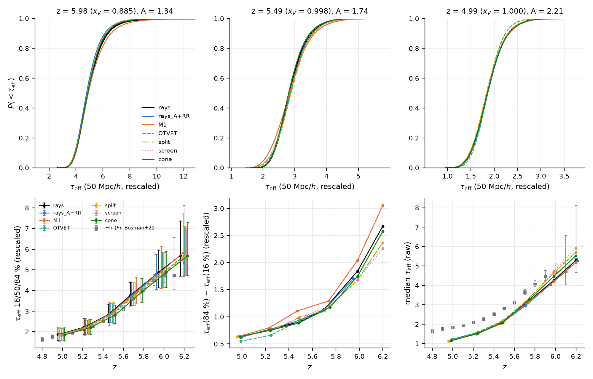
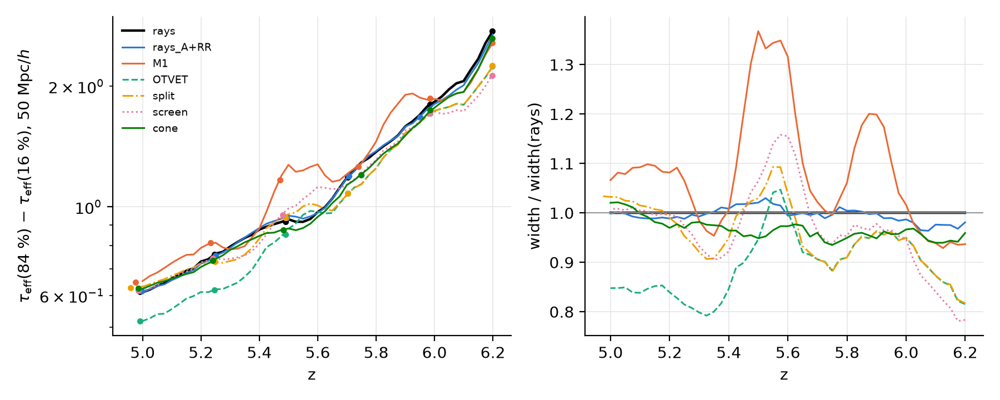
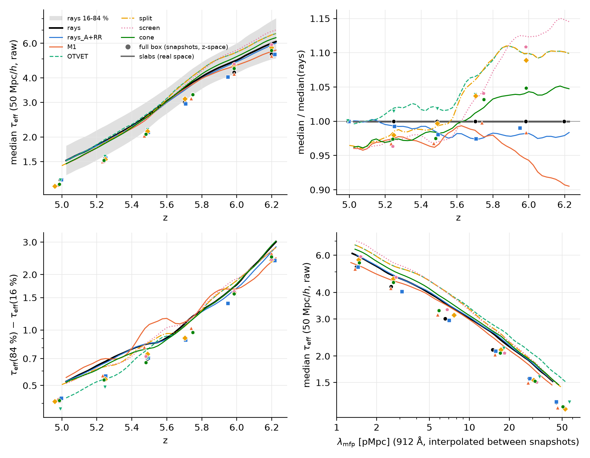
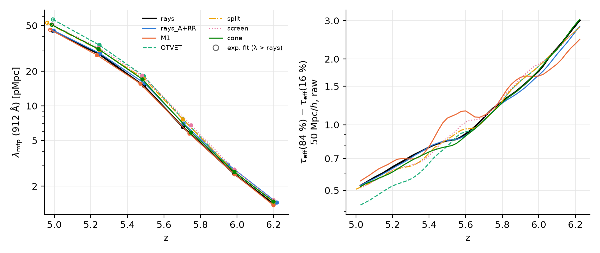
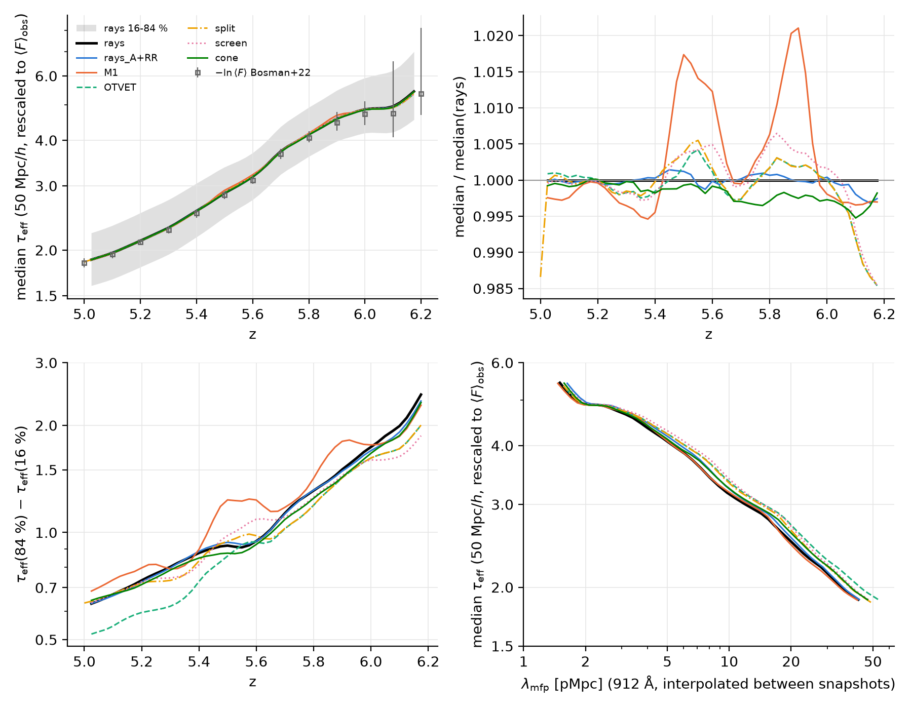
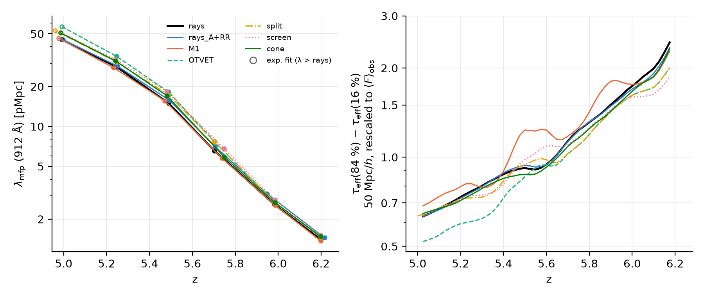
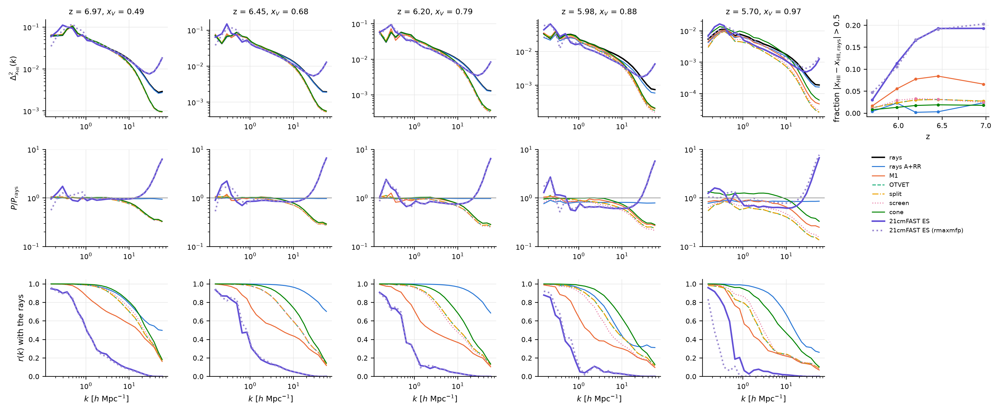
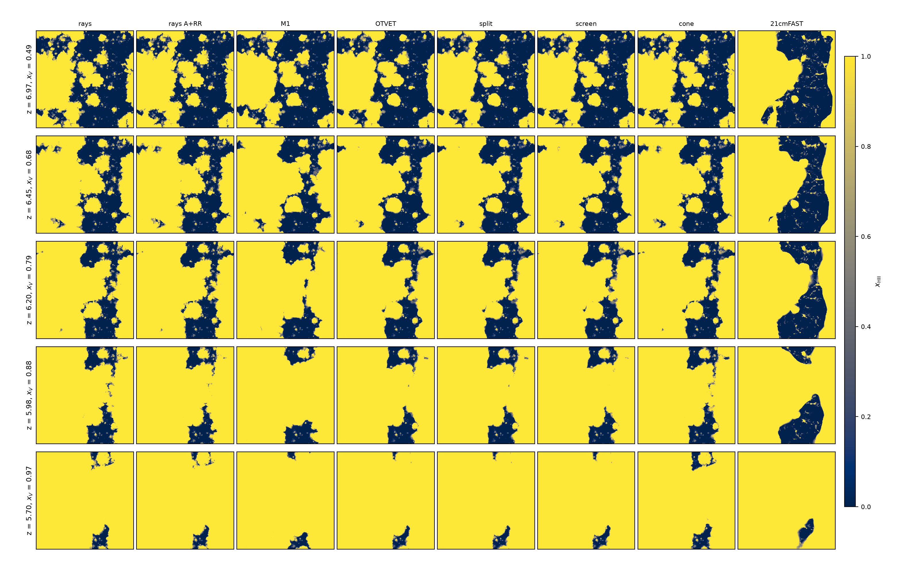

# τ_eff over 50 Mpc/h and 21cmFAST against the RT methods (the 512³ suite)

*Branch `taueff-21cmfast`, 2026-11-05/06, klone. Thread prompt of the RT-closure
paper: Figure 7 (the distribution of the Lyα effective optical depth in every
run) and Figure 8 (the 21cmFAST excursion set on the suite's own density
against the rays and the moment methods).* The runs are the uniform 512³ suite
of `docs/rt_suite_512.md` (40 Mpc/h, f6 = 0.11, the continuous ĉ schedule;
every parameter from the runs' `params.txt`: no cosmology keys, so the code's
defaults Ω_m = 0.27, Ω_b = 0.045, h = 0.70, σ_8 = 0.80, n_s = 0.96, which
`igm_stats.py` also uses). They were only read. Comparisons are at fixed z
(user decision); where a run's snapshot is off the reference's z, it is given.
All outputs are under `$RUNS/rt_closure_paper/` (`RUNS=/gscratch/astro/mcquinn/radhydro/runs`).

| tool | what |
|---|---|
| `tools/analysis/igm_stats.py --taueff 50` | the mean flux of every redshift-space Lyα skewer (box-length and 50 Mpc/h segments, raw and rescaled by A), per-skewer ⟨ρ⟩ and ⟨Γ⟩_ion, the same segments with a uniform Γ; `--lya-only`; the default output is unchanged |
| `tools/analysis/taueff_plot.py` | Figure 7, `taueff.txt` (every number), `taueff_diag.txt` (the uniform-Γ widths and the correlations) |
| `tools/analysis/taueff_slabs.py` | the real-space τ_eff from the movie slabs every Δz = 0.025 (A4), and its calibration on the snapshot cubes |
| `tools/analysis/excursion_set.py` | B1 (`run`), B2 (`standalone`), Figure 8 (`figure`); a numpy mirror of the criterion |
| `tools/hyak/taueff_21cmfast.slurm` | the phases (`PHASE=taueff, slabs, es, standalone, figures`) |

Tests (ctest label `analysis`, skipped without scipy, which CI lacks):
`igm_stats_selftest` (a synthetic snapshot: each box-length segment's flux is
exp(−τ_GP), each joined segment's the pixel-weighted mix of its two skewers,
the rescaled and uniform-Γ fluxes, the mean of the segments = ⟨F⟩) and
`excursion_set_selftest` (a spherical overdensity is ionised out to the radius
the criterion gives analytically, 8.27 cells against a grid ball of 8.21; with
py21cmfast importable, also 21cmFAST itself against the numpy mirror on a
sphere: identical in every cell).

## Part A: the τ_eff distribution over 50 Mpc/h segments

### A.1 Method

`igm_stats.py` builds 3 × 8192 skewers along the grid axes in redshift space
(Hubble flow plus the peculiar velocity of `Gas/u_gas`, the top-hat deposit
between the cell faces, thermal broadening; `docs/igm_diagnostics.md` §4).
With `--taueff 50` it keeps each skewer's mean flux, and forms:

* **box-length segments** (40 Mpc/h, one per skewer), and
* **50 Mpc/h segments**: each skewer joined to 10 Mpc/h (128 pixels) of
  another skewer, chosen at random (from any axis, never itself), from a
  random pixel on.

τ_eff = −ln⟨F⟩_segment, raw and with τ rescaled by the factor A that makes
⟨e^{−Aτ}⟩ over all pixels equal Bosman et al. 2022's mean flux at the
snapshot's z (`data/igm/igm_z5_6.txt`, interpolated; nan above z = 6.2, so
the case A + RR rays' z = 6.216 snapshot has no rescaled values).

**Caveats, for the paper.** The joined segment is not one physical
sightline: its last 10 Mpc/h are uncorrelated with its first 40. And the
box has no modes longer than 40 Mpc/h, so the fluctuations of Γ and density
on the scales that dominate the observed scatter (≳ 50 Mpc/h; the observed
islands and voids of Becker et al. 2015 are ~100 Mpc/h) are missing. **The
simulated scatter is a lower bound**, and the comparison here is between
the methods, at the same density field. The two segment lengths give
nearly the same percentiles (the box-length ones are 2–10 % wider at the
84 % point: `fig_box/`).

### A.2 Figure 7

*Top: the cumulative distribution of the rescaled τ_eff over 50 Mpc/h at
z ≈ 5.98, 5.49, 4.99. Bottom: the 16/50/84 % points of the rescaled τ_eff
against z (with −ln of Bosman+22's mean flux, which is not the median: by
construction the rescaled runs match it in ⟨F⟩); the 84−16 % width; the raw
median τ_eff.* Colours and line styles as in `rt_suite_figures.py`.
Numbers: `$RUNS/rt_closure_paper/taueff/fig/taueff.txt` (copy
`figures/taueff_21cmfast_fig7.txt`).

Rescaled τ_eff over 50 Mpc/h, median [16 %, 84 %] (a run's own z in
brackets where it differs from the column's by more than 0.02):

| run | z ≈ 6.20 | z ≈ 5.98 | z ≈ 5.70 | z ≈ 5.49 | z ≈ 5.25 | z ≈ 4.99 |
|---|---|---|---|---|---|---|
| rays | 5.70 [4.71, 7.37] | 4.88 [4.13, 5.97] | 3.75 [3.25, 4.39] | 2.83 [2.43, 3.34] | 2.22 [1.86, 2.64] | 1.86 [1.57, 2.19] |
| rays A + RR | – (6.22) | 4.78 [4.06, 5.77] (5.95) | 3.77 [3.27, 4.42] | 2.86 [2.44, 3.38] | 2.22 [1.87, 2.64] | 1.86 [1.57, 2.20] |
| M1 | 5.83 [4.67, 7.72] | 4.91 [4.10, 6.14] | 3.90 [3.35, 4.64] (5.74) | 2.83 [2.31, 3.42] | 2.19 [1.83, 2.63] | 1.84 [1.55, 2.19] |
| OTVET thin | 5.66 [4.73, 7.10] | 4.86 [4.15, 5.84] | 3.75 [3.27, 4.37] | 2.87 [2.43, 3.35] | 2.21 [1.90, 2.56] | 1.85 [1.60, 2.15] |
| OTVET split | 5.66 [4.74, 7.10] | 4.86 [4.15, 5.84] | 3.76 [3.27, 4.38] | 2.88 [2.42, 3.41] | 2.21 [1.87, 2.62] | 1.83 [1.54, 2.18] (4.96) |
| OTVET screen | 5.64 [4.74, 7.00] | 4.86 [4.15, 5.83] | 3.93 [3.41, 4.60] (5.75) | 2.84 [2.38, 3.36] | 2.20 [1.86, 2.61] | 1.85 [1.56, 2.19] |
| OTVET cone | 5.67 [4.72, 7.30] | 4.87 [4.14, 5.89] | 3.94 [3.41, 4.59] (5.75) | 2.81 [2.41, 3.30] | 2.21 [1.86, 2.61] | 1.85 [1.56, 2.20] |

A / ⟨F⟩_raw (all pixels):

| run | 6.20 | 5.98 | 5.70 | 5.49 | 5.25 | 4.99 |
|---|---|---|---|---|---|---|
| rays | 1.17 / 0.0068 | 1.34 / 0.0163 | 1.57 / 0.0516 | 1.74 / 0.1198 | 1.92 / 0.2112 | 2.21 / 0.2998 |
| rays A + RR | – / 0.0068 | 1.42 / 0.0199 | 1.65 / 0.0547 | 1.81 / 0.1239 | 1.95 / 0.2122 | 2.19 / 0.2976 |
| M1 | 1.29 / 0.0081 | 1.41 / 0.0176 | 1.57 / 0.0458 | 1.95 / 0.1385 | 2.06 / 0.2269 | 2.41 / 0.3201 |
| OTVET thin | 0.98 / 0.0046 | 1.10 / 0.0113 | 1.44 / 0.0459 | 1.70 / 0.1176 | 1.82 / 0.2057 | 2.15 / 0.2995 |
| OTVET split | 0.98 / 0.0046 | 1.10 / 0.0113 | 1.45 / 0.0460 | 1.79 / 0.1231 | 1.97 / 0.2170 | 2.43 / 0.3256 |
| OTVET screen | 0.91 / 0.0038 | 1.06 / 0.0105 | 1.42 / 0.0386 | 1.86 / 0.1313 | 2.04 / 0.2248 | 2.36 / 0.3157 |
| OTVET cone | 1.05 / 0.0054 | 1.20 / 0.0133 | 1.44 / 0.0395 | 1.81 / 0.1285 | 2.01 / 0.2213 | 2.38 / 0.3168 |

### A.3 The widths, and why they are not ordered as P_Γ

The 84−16 % width of the rescaled τ_eff over 50 Mpc/h, with the run's Γ and
with a uniform Γ (each ionised cell's x_HI, x_HI < 0.01, scaled by
Γ/median Γ_ion, as in photoionisation equilibrium; neutral cells
unchanged; A refitted), and over the box-length segments the correlation of
ln⟨ρ⟩ with ln⟨Γ⟩_ion and the rms of ln⟨Γ⟩_ion
(`taueff/fig/taueff_diag.txt`):

| run | width 6.20 | 5.98 | 5.49 | 5.25 | 4.99 | uniform Γ 6.20 | 5.98 | 4.99 | corr(ρ, Γ) 5.98 / 4.99 | rms ln Γ 5.98 / 4.99 |
|---|---|---|---|---|---|---|---|---|---|---|
| rays | 2.67 | 1.84 | 0.91 | 0.77 | 0.62 | 2.13 | 1.67 | 0.67 | 0.51 / 0.59 | 0.37 / 0.053 |
| rays A + RR | – | 1.70 (5.95) | 0.94 | 0.77 | 0.62 | – | 1.60 | 0.67 | 0.51 / 0.59 | 0.33 / 0.054 |
| M1 | **3.05** | **2.04** | **1.11** (5.47) | 0.80 | 0.64 | 2.25 | 1.71 | 0.66 | 0.39 / 0.42 | 0.36 / **0.026** |
| OTVET thin | 2.37 | 1.68 | 0.92 | **0.66** | **0.55** | 2.18 | 1.67 | 0.67 | 0.58 / 0.68 | 0.28 / **0.165** |
| OTVET split | 2.36 | 1.68 | 0.99 | 0.75 | 0.63 (4.96) | 2.18 | 1.67 | 0.67 | 0.58 / 0.67 | 0.28 / 0.054 |
| OTVET screen | 2.26 | 1.68 | 0.98 | 0.75 | 0.63 | 2.15 | 1.65 | 0.66 | 0.62 / 0.66 | 0.26 / 0.057 |
| OTVET cone | 2.57 | 1.75 | 0.88 | 0.75 | 0.64 | 2.16 | 1.67 | 0.66 | 0.57 / 0.70 | 0.37 / 0.042 |

* **The expectation of the prompt (thin OTVET broader than the rays, M1
  narrower) does not hold; the order is the reverse.** After overlap
  (z ≤ 5.25) thin OTVET is the narrowest (0.55 against the rays' 0.62 at
  z = 4.99, 0.66 against 0.77 at z = 5.25) and M1 the broadest by a little
  (0.64, 0.80); before overlap (z ≥ 5.5) M1 is clearly the broadest (3.05
  against 2.67 at z = 6.2, 2.04 against 1.84 at 5.98, 1.11 against 0.91 at
  5.47–5.49) and the OTVET family the narrowest (2.26–2.37 at z = 6.2).
* **With a uniform Γ every method has the same width** after overlap
  (0.66–0.67 at z = 4.99, 0.79–0.81 at 5.25, 0.98–1.03 at 5.49): the density,
  temperature and velocity fields give the same τ_eff scatter. The
  differences are all in Γ.
* **After overlap, the Γ fluctuations narrow the distribution**: on 40
  Mpc/h segments ⟨Γ⟩ is positively correlated with ⟨ρ⟩ (the sources sit in
  the overdensities; corr = 0.59 for the rays at z = 4.99), and τ ∝ ρ²/Γ,
  so a high-Γ segment is also a dense one and the two partly cancel. The
  real width is 0.62 against the uniform 0.67 for the rays. Thin OTVET has
  3× the rays' segment-scale Γ fluctuations (rms ln Γ 0.165 against 0.053:
  the known 11–14× excess of P_Γ, `docs/rt_suite_512.md` §6), even more
  tied to density (0.68): it cancels more and is the narrowest. M1 has half
  the rays' Γ fluctuations (0.026, its 25× deficit of large-scale P_Γ) and
  the weakest correlation (0.42): almost no cancellation, the uniform-Γ
  width. The attenuated tensors (split, screen, cone) have the rays' rms
  and correlation, and the rays' width to 0.01–0.02.
* **Before overlap, Γ broadens the distribution** (real width 2.67 against
  2.13 uniform for the rays at z = 6.2): segments that cross or end near
  the neutral islands have low ⟨Γ⟩_ion and high τ (corr(τ, ln Γ) = −0.4).
  The rms of ln Γ is about the same in all methods (0.26–0.37 at z = 5.98);
  what differs is its correlation with density, lowest in M1 (0.39 against
  0.51–0.62): M1's Γ is decoupled from the density on these scales (its
  fronts in the wrong places, r(k) = 0.57–0.86 at k = 1 h/Mpc), so it does
  not compensate the islands. M1's uniform-Γ width is also the largest
  (2.25 at z = 6.2): its neutral islands differ.
* **For the paper:** the τ_eff scatter at fixed ⟨F⟩ does not measure the Γ
  fluctuations alone; on the box's scales it measures their combination
  with the density fluctuations they are correlated with. A method with too
  much Γ power near the sources (thin OTVET) gives a *narrower*
  distribution, one with too little (M1) a broader one. The differences
  between methods are modest (thin OTVET 11–14 % narrower after overlap,
  M1 11–22 % broader before it; the cone within 5 % of the rays at every z,
  split and screen within 12 %), and probably smaller than what the box's
  missing large-scale power does to the comparison with the data.
* **Case A + RR** against case B (rays both): the same distribution to
  0.01–0.04 in every percentile at z ≤ 5.7.

### A.3b Raw τ_eff and the observed mean

Without rescaling, every run is too transparent (median raw τ_eff 1.1–1.2 at
z = 5 against −ln⟨F⟩_obs = 1.84; A = 1.06–2.43), as in
`docs/rt_suite_512.md` §7 (⟨F⟩ 1.9–2.1× Bosman+22 at z ≤ 5.5). At z = 6.2
the OTVET family's raw median τ_eff exceeds the rays' (5.5–5.9 against
5.3; OTVET, split and screen have A < 1 there): their ionised fraction is
higher but their bubbles' Γ lower (§5 of that report). M1's is 5.2.

### A.4 The observed distributions (open)

The repository has Bosman et al. 2022's mean transmission only
(`data/igm/igm_z5_6.txt`), not their τ_eff distributions. These were not
transcribed from memory; **the user is asked for the paper's table** (the
cumulative τ_eff distributions over 50 Mpc/h by redshift bin, with the
lower limits). Until then the methods are compared with each other and
with the observed mean (Figure 7, bottom left).

### A.5 Finer in z: the movie slabs

The movie slabs (`movie/frame_NNNNN_<field>.slab`, 8 cells through the box
centre normal to each axis, x_HI, T, ρ every Δz = 0.025, no velocities)
give 3 × 2 × 512 × 8 = 24 576 real-space skewers per frame along the
slabs' planes (`taueff_slabs.py`; thermal broadening only), 51–52 frames
per run between z = 6.25 and 4.95, segments and rescaling as in A.1.

**The real-space offset first** (`--calib`: the same slab skewers cut from
the snapshot cubes, real space against redshift space with the `Gas/u_gas`
velocities; `slabs/<run>_calib.txt`). The ratio of the 84−16 % widths,
redshift space / real space, is **1.03–1.08 at z ≥ 5.7** (real space 4–7 %
narrower: the peculiar velocities spread the absorption) and **0.98–1.02 at
z ≤ 5.5**; the medians differ by ≤ 0.03; the order of the methods is the
same in both. The slab skewers also see fewer independent structures than
the 3 × 8192 random skewers: their redshift-space widths differ from A.2's
by up to 6 % (0.519 against 0.550 for thin OTVET at z = 4.99), the same way
for every method. The curves below are the real-space widths times the
calibration ratio interpolated in z, per run; the ratios between methods
are the robust part.

*Left: the calibrated width of the rescaled τ_eff over 50 Mpc/h against z
(lines, every Δz = 0.025; dots: the redshift-space widths of the same slab
skewers at the snapshots). Right: the ratio to the rays.* Numbers:
`figures/taueff_21cmfast_slabs.txt`.

* The snapshot picture of A.3 holds between the snapshots: the cone and
  the case A + RR rays stay within 5 % of the rays from z = 6.2 to 5.0;
  thin OTVET is 15–20 % narrower at every z below 5.4.
* **The end of reionization is where the methods differ most**, and the
  snapshots at 5.70 and 5.49 straddle it: at z ≈ 5.45–5.6 every moment
  method is broader than the rays, M1 by up to 35 %, screen by 15 %,
  split and OTVET by 5–10 % (their last neutral islands survive longer,
  z99 = 5.60–5.68 against the rays' 5.58, `docs/rt_suite_512.md` §4, and a
  segment crossing one is opaque). M1 has a second excess, 20 %, at
  z ≈ 5.85–5.9, and its width stays 7–10 % above the rays' after overlap.
* Before z ≈ 6 the OTVET family is 5–20 % narrower than the rays, as in
  A.3.

### A.6 Raw τ_eff against z and against λ_mfp

The user's choice (2026-11-06): no observed distributions for now, and the
methods should be compared **at the same mean free path** rather than at
the same z. `taueff_z.py` draws the raw (unrescaled) slab τ_eff of A.5 with
no new computation. λ_mfp is the 912 Å mean free path from random starts
(`docs/igm_diagnostics.md`, `rt_methods_512/igm/*.json`), with ln λ
interpolated linearly in z between the 8 snapshots (Δz ≈ 0.25). At
z ≈ 5.0 the exponential fit from ionized starts stands in, because λ_e
exceeds the 40 pMpc rays there. The slab curves are smoothed with
[1, 2, 1]/4 over frames. The reason is that ρ and T in a slab change only at
hydro steps, which come about every second frame, so the raw curves step
in pairs. Two runs whose hydro steps fall on different frames then zigzag
by ±2 % against each other.

*(a) The median raw τ_eff over 50 Mpc/h against z; the shading is the
rays' 16–84 % band; circles are −ln⟨F⟩ of all pixels at the snapshots
(redshift space). (b) The median over the rays' median. (c) The 84−16 %
width (raw, real space). (d) The median against λ_mfp.* Numbers:
`figures/taueff_21cmfast_z.txt`.

| median τ_eff / rays | z 6.2 | 6.0 | 5.8 | 5.6 | 5.4 | 5.2 | 5.03 |
|---|---|---|---|---|---|---|---|
| (rays' median, λ_mfp in pMpc) | 6.00, 1.4 | 4.92, 2.4 | 4.05, 4.7 | 3.05, 9.8 | 2.28, 19 | 1.81, 31 | 1.52, 43 |
| A + RR, fixed z / fixed λ | 0.98 / – | 0.98 / 1.01 | 0.98 / 1.01 | 0.98 / 1.01 | 0.99 / 1.02 | 1.00 / 1.01 | 1.00 / 1.01 |
| M1 | 0.91 / 0.90 | 0.94 / 0.94 | 0.98 / 0.98 | 0.99 / 0.99 | 0.97 / 0.96 | 0.97 / 0.95 | 0.96 / – |
| OTVET (thin) | 1.10 / 1.11 | 1.10 / 1.12 | 1.09 / 1.15 | 1.03 / 1.13 | 1.02 / 1.13 | 1.01 / 1.12 | 1.00 / 1.11 |
| split | 1.10 / 1.11 | 1.10 / 1.12 | 1.09 / 1.14 | 1.02 / 1.11 | 0.99 / 1.06 | 0.98 / 1.03 | 0.96 / 1.01 |
| screen | 1.15 / – | 1.12 / 1.16 | 1.07 / 1.15 | 0.99 / 1.10 | 0.98 / 1.06 | 0.97 / 1.04 | 0.96 / 1.02 |
| cone | 1.05 / 1.06 | 1.04 / 1.06 | 1.03 / 1.05 | 1.00 / 1.03 | 0.98 / 1.04 | 0.97 / 1.03 | 0.96 / 1.02 |

("–": that λ lies outside the run's range.)

* **At fixed z** the medians agree within 5 % after z ≈ 5.6. Before that,
  the OTVET family is 10–15 % more opaque and M1 is 6–9 % more transparent
  at z ≥ 6.
* **At fixed λ_mfp** the late-time agreement goes away for the OTVET
  family. Thin OTVET is 11–15 % more opaque than the rays at every λ from 1.4
  to 43 pMpc, because its λ_mfp is 20–25 % longer at the same z and τ. Split
  and screen are 10–16 % more opaque for λ ≤ 10 pMpc and approach the rays
  (+1–4 %) as λ → 40 pMpc. The cone stays within +2–6 %, M1 within −2 to
  −10 %, and A + RR within 2 %. The cone is again the closest closure.
* `taueff_mfp_width.png` puts λ_mfp at the snapshots (left; open symbols:
  the exponential fit) beside the raw width (right):

  
* The ordering of the widths (c) is A.5's (raw here, uncalibrated): the
  rays, A + RR and the cone agree; M1 is broad at the end of reionization;
  thin OTVET is 15–20 % narrower after it.

**Normalised to the observed mean flux** (`taueff_z.py --norm`; the user,
2026-11-06). τ in each frame is multiplied by A so that the slab pixels' ⟨F⟩
equals Bosman+22's mean transmission (`data/igm/igm_z5_6.txt`, Table 4,
transcribed from the paper the user supplied on 2026-10-10). This only
works for z ≤ 6.2.

| width / rays (normalised, real space) | z 6.15 | 6.0 | 5.8 | 5.6 | 5.5 | 5.4 | 5.2 | 5.03 |
|---|---|---|---|---|---|---|---|---|
| (rays' width) | 2.26 | 1.74 | 1.31 | 0.95 | 0.92 | 0.88 | 0.73 | 0.63 |
| A + RR | 0.96 | 0.98 | 1.00 | 1.00 | 1.02 | 1.01 | 0.99 | 1.00 |
| M1 | 0.93 | 1.01 | 1.08 | 1.31 | 1.34 | 1.02 | 1.08 | 1.08 |
| OTVET (thin) | 0.84 | 0.93 | 0.91 | 0.99 | 0.94 | 0.83 | 0.81 | 0.82 |
| split | 0.84 | 0.93 | 0.91 | 1.04 | 1.03 | 0.95 | 0.98 | 1.02 |
| screen | 0.78 | 0.92 | 0.96 | 1.15 | 1.07 | 0.93 | 0.99 | 1.01 |
| cone | 0.94 | 0.96 | 0.95 | 0.98 | 0.95 | 0.97 | 0.97 | 1.02 |

* With the mean flux fixed, the medians agree within 2 %, so the
  comparison is in the widths alone.
* The ordering matches A.3 and A.5:
  * thin OTVET is 16–19 % narrower after z ≈ 5.4, and the whole OTVET
    family is 7–22 % narrower before z ≈ 5.8;
  * M1 is 31–34 % broader at the end of reionization (z ≈ 5.5–5.6) and
    8 % broader after it;
  * the cone stays within 6 % of the rays at every z, and A + RR within
    4 %.
* These widths are in real space and not calibrated (A.5: × 1.03–1.08 at
  z ≥ 5.7, × 0.98–1.02 after).

## Part B: 21cmFAST against the rays and the moment methods

### B.0 21cmFAST on klone

* **Version 4.3.1** (PyPI, the latest on 2026-11-05; conda-forge has only
  3.3.1), in its own conda env `$RADRAY_SW/conda-envs/21cmfast`: python 3.12,
  `gsl`, `fftw`, `c-compiler`, `pkg-config` from conda-forge, then
  `pip install 21cmFAST==4.3.1` (it builds CLASS, `classy` 3.3.4, too).
  PyPI and GitHub are reachable from klone through the proxy. The C source
  of the tag (`src/py21cmfast/src/*.c` from GitHub) and the docs are in
  `$RADRAY_SW/src/21cmFAST-src-4.3.1` and `21cmFAST-docs-4.3.1`. The
  single-field functions write no cache (`write=False` by default); the
  standalone run points `config["direc"]` at the output directory anyway,
  never at the default `~/21cmFAST-cache` in the 10 GB home.
* **An external density field is supported.** The documentation's FAQ
  (`docs/faqs/misc.rst`, v4.3.1) has two entries: "Can I inject my own
  initial conditions for the density field?"
  (`compute_initial_conditions(inputs=..., initial_density=...)`, a z = 0
  linear field on the high-resolution grid) and "Can I instantiate my own
  OutputStruct objects?" (`X.new(inputs=...)` then `X.set(name, value)`).
  B1 uses the second: a `PerturbedField` holding the suite's gas density
  at z. Two details the FAQ does not mention: `set()` leaves an array
  "initialized", not "computed", and `compute_ionization_field` refuses
  it, so the density is marked computed (`setattr(pf, "density",
  pf.arrays["density"].computed())`); and a `InitialConditions.new(inputs,
  dummy=True)` with the run's own inputs is passed (CONST-ION-EFF reads no
  IC array: `IonisationBox.c` touches `ini_boxes` only for the
  mass-dependent models' turnover masses).
* **The criterion** (21cmFAST 4.3.1, `SOURCE_MODEL = "CONST-ION-EFF"`, the
  `const-zeta` template): `IonisationBox.c` (`setup_radii`,
  `copy_filter_transform`, `calculate_conditional_nion`,
  `find_ionised_regions`), `hmf.c` (`nion_conditional_acg`,
  `fcoll_conditional_eps`), `filtering.c` (`real_tophat_filter`),
  `Constants.c` (δ_c = 1.686, l_factor = 0.620350491):
  - δ smoothed with a real-space top hat (k space) of radius R, from
    R_max = min(R_BUBBLE_MAX, l_factor L) down to R_min = max(R_BUBBLE_MIN,
    l_factor Δx) in factors of `DELTA_R_HII_FACTOR` = 1.1; the smallest R
    uses the unsmoothed δ; δ_R clipped to > −1;
  - f_coll(R) = erfc[(δ_c − δ_R)/D(z) / √(2(σ²(M_min) − σ²(M_R)))] (EPS,
    σ at z = 0, M_R the mass of the sphere R at the mean matter density);
  - n_ion = ζ f_coll(R) × (the factor that sets its box mean to ζ times
    the unconditional f_coll(> M_min) of the HMF, ST: `fix_mean`; 0.74–1.11
    at R_min, 1.03–1.19 at R_max here);
  - a cell is ionised if n_ion(R) > 1 on any R (the central-pixel flagging,
    `IONISE_ENTIRE_SPHERE = False`); otherwise x_HII = n_ion(R_min),
    clipped to [0, 1].
* **Settings** (all others the `const-zeta` template's):
  `HII_DIM = DIM = 512`, `BOX_LEN = 40/0.70 = 57.14` Mpc, the suite's
  cosmology (Ω_m 0.27, Ω_b 0.045, h 0.70, σ_8 0.80, n_s 0.96; 21cmFAST's EH
  transfer function, the ICs used EH without wiggles), `HMF = ST`,
  `HII_FILTER = spherical-tophat` (**the template sets `sharp-k`**; the
  top hat is the AstroOptions default and what the prompt asks for),
  `M_MIN_in_Mass = True` with **M_min = 1.28×10⁸ M☉** (the suite's smallest
  source halo, 20 particles of 6.4×10⁶ M☉), `R_BUBBLE_MIN = 0.095` Mpc (the
  radius of M_min ×1.01: 21cmFAST's EPS f_coll throws where σ(M_R) >
  σ(M_min), and the cell, l_factor Δx = 0.069 Mpc, is below it; the
  default `R_BUBBLE_MIN` is 0.62 Mpc), no recombinations, no spin
  temperature, no photon conservation (coeval boxes, no evolution needed).
* **The numpy mirror** (`excursion_set.excursion`) reproduces 21cmFAST: on
  the test sphere identically, on the 512³ fields 0.04–0.6 % of the cells
  differ in "ionised" and ζ by ≤ 0.8 % (21cmFAST interpolates n_ion in a
  table and uses an approximate erfc). It gives the starting ζ; three or
  four 21cmFAST calls by the secant method finish (15–25 min per z and
  R_max on 10 cores).

### B.1 The criterion on the suite's own density (Figure 8)

At each snapshot of the rays (z = 6.97, 6.45, 6.20, 5.98, 5.70), the gas
density ρ/⟨ρ⟩ − 1 of the case-B rays, ζ chosen so that the volume-weighted
x_HII equals the rays' (to ≤ 0.0016). Two R_max: 21cmFAST's default 15 Mpc,
and the rays' mean free path (ionised starts, the fit, `docs/rt_suite_512.md`
§7) in comoving Mpc, capped at l_factor L = 35.4 Mpc
(`$RUNS/rt_closure_paper/es/es_rmax15`, `es_rmaxmfp`).

| z | x_V (rays) | ζ, R_max = 15 Mpc | R_max = λ_mfp [cMpc] | ζ |
|---|---|---|---|---|
| 6.97 | 0.490 | 14.56 | 6.2 | 16.69 |
| 6.45 | 0.681 | 13.82 | 10.1 | 15.51 |
| 6.20 | 0.794 | 13.48 | 14.2 | 13.89 |
| 5.98 | 0.885 | 13.43 | 21.0 | 12.36 |
| 5.70 | 0.971 | 14.36 | 35.4 (cap) | 10.11 |

With R_max = 15 Mpc ζ is nearly constant (13.4–14.6), so one ζ would
reproduce the rays' x_V(z) from z = 7 to 5.7 to within a few per cent of
ionised volume; with the growing λ_mfp it falls from 16.7 to 10.1.

*Δ² of x_HII (the field itself), the ratio to the rays and r(k) with the
rays, at the five snapshots, every run and the excursion set (violet; dotted
with R_max = λ_mfp). Top right: the fraction of cells whose x_HII differs
from the rays' by more than 0.5.*

*x_HII in the 8-cell slab through the box centre (the slab of Figure 2),
rows the snapshots, columns the runs and the two excursion sets.*

The fraction of cells with |x_HII − x_HII,rays| > 0.5
(`es/fig/es_compare.txt`; the case A + RR rays' snapshots are at z = 6.92 and
5.95 for the first and fourth rows, which accounts for most of their 2 %):

| z | x_V | A + RR | M1 | OTVET | split | screen | cone | ES (15 Mpc) | ES (λ_mfp) |
|---|---|---|---|---|---|---|---|---|---|
| 6.97 | 0.49 | 0.024 | 0.066 | 0.028 | 0.027 | 0.025 | 0.018 | **0.193** | 0.203 |
| 6.45 | 0.68 | 0.003 | 0.084 | 0.031 | 0.031 | 0.032 | 0.019 | **0.193** | 0.191 |
| 6.20 | 0.79 | 0.002 | 0.078 | 0.030 | 0.030 | 0.033 | 0.018 | **0.166** | 0.167 |
| 5.98 | 0.88 | 0.023 | 0.056 | 0.024 | 0.024 | 0.029 | 0.013 | **0.114** | 0.105 |
| 5.70 | 0.97 | 0.004 | 0.017 | 0.012 | 0.012 | 0.011 | 0.008 | **0.030** | 0.047 |

P/P_rays / r(k) at three scales:

| z | k [h/Mpc] | M1 | OTVET | cone | ES (15 Mpc) | ES (λ_mfp) |
|---|---|---|---|---|---|---|
| 6.97 | 0.22 | 1.05 / 1.00 | 1.06 / 1.00 | 1.02 / 1.00 | 1.29 / 0.93 | 1.03 / 0.92 |
| 6.97 | 1.07 | 1.00 / 0.86 | 1.01 / 0.99 | 1.02 / 1.00 | 0.88 / **0.48** | 0.98 / 0.50 |
| 6.97 | 4.93 | 0.96 / 0.65 | 0.90 / 0.85 | 0.96 / 0.92 | 0.95 / **0.15** | 0.98 / 0.14 |
| 6.20 | 0.22 | 1.02 / 0.98 | 1.13 / 1.00 | 1.01 / 1.00 | 2.42 / 0.86 | 2.44 / 0.83 |
| 6.20 | 1.07 | 0.93 / 0.69 | 0.93 / 0.96 | 1.02 / 0.99 | 0.86 / **0.23** | 0.83 / 0.23 |
| 6.20 | 4.93 | 0.91 / 0.43 | 0.83 / 0.69 | 0.94 / 0.86 | 0.78 / 0.07 | 0.77 / 0.07 |
| 5.98 | 0.22 | 1.07 / 0.98 | 1.13 / 1.00 | 0.98 / 1.00 | 2.70 / 0.85 | 2.63 / 0.90 |
| 5.98 | 1.07 | 0.90 / 0.62 | 0.88 / 0.93 | 1.00 / 0.98 | 0.77 / **0.05** | 0.72 / 0.09 |
| 5.70 | 0.22 | 0.88 / 0.99 | 0.72 / 0.98 | 1.27 / 1.00 | 1.61 / 0.92 | 1.03 / 0.49 |
| 5.70 | 1.07 | 0.89 / 0.57 | 0.60 / 0.79 | 1.27 / 0.94 | 0.70 / 0.06 | 0.84 / 0.00 |

* **On the same density field and at the same x_V, the excursion set
  disagrees with the rays several times more than any moment method
  does.** 17–19 % of the cells differ by more than 0.5 in x_HII at
  x_V = 0.5–0.8 (M1, the worst moment method, 7–8 %; the OTVET family 3 %;
  the cone 2 %); r(k) with the rays is 0.85–0.93 at k = 0.2 h/Mpc but
  falls to 0.2–0.5 at k = 1 h/Mpc and to ≤ 0.15 at 5 h/Mpc, where M1
  keeps 0.43–0.65 and the cone 0.86–0.92. The maps show why: the
  criterion ionises the large-scale overdensity (the left half of the slab)
  as one region with a smooth edge and leaves the underdense half neutral
  as a single island, while the rays (and every moment method) carve
  separate HII regions around the sources in the underdense half; at
  z = 6.97 the criterion also ionises the top right of the slab, which
  is neutral in every RT run.
* **Its large-scale power is too high** once x_V ≳ 0.7: 1.9–2.7× the rays'
  at k = 0.2 h/Mpc at z = 6.45–5.98 (the moment methods 0.96–1.14×), the
  signature of bubbles tied to the largest overdensity. At k ≳ 10 h/Mpc
  it has up to 6× the rays' power, from the cell-scale partial ionisation
  (x_HII = ζ f_coll at R_min on the nonlinear δ) in the neutral regions.
* **R_max hardly matters** at x_V ≤ 0.9 (the two excursion sets are
  nearly identical in the maps, the spectra and the cell differences);
  only at x_V = 0.97 does the λ_mfp version (R_max = 35 Mpc, nearly the
  box) remove the last island the 15 Mpc version keeps, and its r(k) is
  then zero.
* **Caveats.** This applies 21cmFAST's criterion at 78 kpc/h to a
  nonlinear hydrodynamic density, far below the ~1 Mpc cells and the
  2LPT density it is built for (and down to R_min = 0.095 Mpc against
  its default 0.62 Mpc). The 40 Mpc/h box holds a few independent
  bubble-scale modes. The comparison is of the criterion with the same
  sources implied (f_coll above the suite's M_min), not of the suite's
  actual source catalogue; the optional variant on the sources'
  emissivity was not run (the suite writes no `RT/rt_grid` or `Luv.bin`,
  `data_files = gas`; `prompts/gamma_profiles.md` is not in this
  checkout).

### B.2 A standalone 21cmFAST run (statistics only)

21cmFAST 4.3.1 with its own initial conditions (`excursion_set.py
standalone`; `es/es_standalone`): the suite's cosmology and box, `DIM = 1024`
→ `HII_DIM = 512` (78 kpc/h, the suite's resolution; 107 s for the ICs on 10
cores, under 58 GB), seed 12345, the 2LPT density at each z, the criterion
and settings of B1 (R_max = 15 Mpc, M_min = 1.28×10⁸ M☉), ζ at each z
matched to the rays' x_V (a coeval box per z: no evolution is needed without
spin temperature and recombinations):

| z | x_V (rays) | ζ (B2) | ζ (B1, 15 Mpc) |
|---|---|---|---|
| 6.97 | 0.490 | 14.01 | 14.56 |
| 6.45 | 0.681 | 13.27 | 13.82 |
| 6.20 | 0.794 | 14.26 | 13.48 |
| 5.98 | 0.885 | 14.42 | 13.43 |
| 5.70 | 0.971 | 14.75 | 14.36 |

Its Δ² of x_HII is the grey dash-dotted curve of Figure 8 (spectra and ratio
only: it is another realisation, so r(k), the cell differences and the map
mean nothing). The x_V are matched at the same z, so this is also the
comparison at matched x_V with the suite's spectra
(`figures/rt_suite_512_pk.txt`).

* **ζ is the same within 7 %** on the suite's hydrodynamic density and on
  21cmFAST's own 2LPT density, and nearly constant in z (13.3–14.8): one
  ζ ≈ 14 reproduces the rays' x_V(z) between z = 7 and 5.7 with either
  field.
* **At k ≥ 1 h/Mpc the standalone run has 0.62–1.0× the rays' Δ²**, the
  same deficit as B1 on the suite's density (0.62–0.95×), from 1.0 at
  x_V = 0.5 to 0.6–0.9 at x_V ≥ 0.88; above k ≈ 10 h/Mpc both
  excursion sets have the cell-scale excess.
* **At k ≤ 0.5 h/Mpc the ratio scatters between 0.57 and 2.75 from bin
  to bin**: two realisations of a 40 Mpc/h box differ substantially at
  low k (a handful of modes per bin; the box holds ~2–3 bubble-scale
  wavelengths). The low-k excess of B1 (1.9–2.7× at k = 0.2 h/Mpc) is
  of the same size as this realisation scatter, but B1 shares the rays'
  density, so it is the criterion's.

## References (from memory; the user to verify)

arXiv, ADS and the journals are not reachable from klone. Only 21cmFAST's
own code and documentation (GitHub, tag v4.3.1) were read; every reference
below is from memory:

* Mesinger, Furlanetto & Cen 2011, MNRAS 411, 955: 21cmFAST.
* Murray, Greig, Mesinger et al. 2020, JOSS 5, 2582: 21cmFAST v3.
* Becker, Bolton, Madau et al. 2015, MNRAS 447, 3402: τ_eff over 50 Mpc/h,
  the z ≈ 5.7 trough.
* Bosman, Fan, Jiang et al. 2018, MNRAS 479, 1055, and Bosman, Davies,
  Becker et al. 2022, MNRAS 514, 55 (XQR-30): τ_eff distributions over
  50 Mpc/h (the 2022 mean flux is in `data/igm/igm_z5_6.txt`, transcribed
  from the paper).
