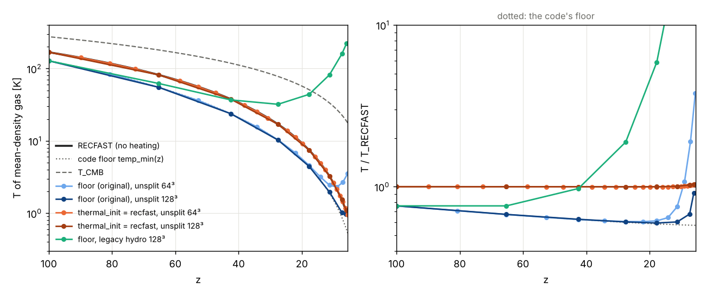

# The thermal history before heating: Compton coupling and the temperature floor

*2026-10-26.* The user asked whether the simulations reproduce the expected
temperature history before any preheating, Compton cooling off the CMB in
particular. **They do not.** Unheated gas follows the code's temperature
floor, an instantaneous decoupling at z ≈ 216. That is 0.76 of the RECFAST
temperature at the production start (z = 100) and 0.60 of it from z ≈ 30
on. The cause is two choices of the original (quirk **T1**,
`docs/port_notes.md` §5b):

* the initial temperature is the floor;
* neutral gas has no residual electrons, so it never couples to the CMB.

**Fixed behind `thermal_init = recfast`** (user decision 2026-10-26, §4).
The default `thermal_init = floor` keeps the original byte for byte.

## 1. What the code does

* **Floor.** `calc_sim_var` sets `temp_min` = T_CMB for 1+z > x and
  T_CMB₀(1+z)²/x below, with x = 10³(Ω_b h²)^0.4 = 217.45. This is
  instantaneous decoupling at z ≈ 216, after which the gas is adiabatic.
  `Tgas_min = temp_min/temp1_unit` (neutral μ) is then used in three
  places:
  * **The ICs:** the thermal energy is set to it (`read_init_conditions`),
    so a run at z_init = 100 starts at 127.8 K.
  * **The legacy PM step:** it clamps every cell's thermal energy
    (`pm.cpp`, `particle_mesh`). The unsplit path (`particle_mesh_unsplit`)
    does not; the unsplit hydro has its own floor of **1 K**
    (`hydro_unsplit.cpp`, `Tmin = 1/temp1_unit`).
  * **The RT cell physics:** `temp_min` floors every cell it processes.
* **Compton** (`coef_cool(14)`, exact, `docs/xray_heating.md` §0) acts only
  in cells that `radiative_physics` processes (ionised or with photons). The
  ICs are fully neutral, so there are no residual electrons
  (x_e ≈ 2–3×10⁻⁴ after recombination) and no coupling.

## 2. The reference

The reference is `data/thermal/recfast_sim_cosmology.txt`: CAMB 1.5.9 with
RECFAST for the simulation cosmology (Ω_m = 0.27, Ω_b = 0.045, h = 0.70,
T_CMB = 2.725 K, Y_He = 0.24), giving x_e(z) and T_gas(z) with no heating.
HyRec is not compiled into the CAMB wheel; RECFAST is accurate to well
under a per cent for T_gas at these redshifts.

| z | T_CMB | RECFAST T_gas | x_e | code floor | floor/RECFAST |
|---|---|---|---|---|---|
| 300 | 820 | 771 | 4.1×10⁻⁴ | 820 | 1.06 |
| 216 | 591 | 516 | 3.4×10⁻⁴ | 591 | 1.14 |
| 150 | 411 | 314 | 3.0×10⁻⁴ | 286 | 0.91 |
| 100 | 275 | 168 | 2.7×10⁻⁴ | 128 | 0.76 |
| 50 | 139 | 50.9 | 2.3×10⁻⁴ | 32.6 | 0.64 |
| 30 | 84.5 | 19.9 | 2.2×10⁻⁴ | 12.1 | 0.61 |
| 20 | 57.2 | 9.35 | 2.1×10⁻⁴ | 5.53 | 0.59 |
| 10 | 30.0 | 2.61 | — | 1.52 | 0.58 |

* Below z ≈ 30, T_gas ≈ 0.021 (1+z)² K. The floor is 0.0126 (1+z)² K.
* The residual electrons keep the gas partly coupled to the CMB down to
  z ~ 100 and heat it noticeably to z ~ 40.

**One-zone check** (`build/xray_bkg --zstart 100 --T0 … --xe0 …`, X-rays
negligible): the code's own Compton coefficient, RECFAST's T and x_e at
z = 100 and adiabatic expansion reproduce RECFAST to 1% at z = 20 (9.28
against 9.35 K). The deficit splits about evenly between its two causes.
At z = 20:

* the code as it is: 5.53 K;
* the right initial temperature, no Compton: 7.21 K;
* Compton with the residual electrons, the code's initial temperature:
  7.88 K;
* both: 9.28 K.

## 3. The simulations

Setup:

* no-source runs, `tools/analysis/thermal_history.py`;
* 10 h⁻¹ Mpc, 64³ and 128³ (the 128³ cells are those of 40 h⁻¹ Mpc at
  512³);
* Zel'dovich ICs at z = 100 (`make_ics.py --seed 7`), `zdata1 = 6` so
  the RT never starts;
* both hydro schemes.

The temperature is the median over cells with 0.9 < Δ < 1.1, taken from
`e_gas` for unsplit.

| z | RECFAST | unsplit 64³ | unsplit 128³ | legacy 64³ | legacy 128³ |
|---|---|---|---|---|---|
| 100 | 168 | 128 | 128 | 128 | 128 |
| 65 | 81.7 | 55.0 | 55.0 | 66.6 | 62.1 |
| 42 | 37.8 | 23.7 | 23.8 | 45.5 | 36.8 |
| 28 | 17.0 | 10.3 | 10.3 | 47.2 | 32.0 |
| 18 | 7.46 | 4.59 | 4.45 | 71.3 | 43.9 |
| 11 | 3.25 | 2.44 | 1.97 | 134 | 81.7 |
| 7 | 1.41 | 2.67 | 1.02 | 278 | 160 |

**Unsplit (the production scheme).** Mean-density gas follows the floor
curve to within 1–2% at both resolutions down to z ≈ 15: 0.60 of
RECFAST. Below that:

* at 64³ it warms numerically (2.7 K at z = 7);
* at 128³ it stays on the curve until the hydro's 1 K floor takes over
  at z ≈ 8. At z ≈ 6, 70% of the cells are at 1 K.

Voids cool adiabatically, about Δ^(2/3) below the mean, down to the
1 K floor.

**Legacy scheme.** The total-energy scheme heats the cold gas numerically,
the error `hydro_scheme = unsplit` was made to fix (`docs/hydro_unsplit.md`):

* mean-density gas reaches 30–50 K by z ≈ 30 and 160–280 K by z = 7, 100
  to 200× RECFAST;
* voids reach 80–480 K;
* the error falls with resolution, but slowly.

The legacy scheme cannot represent the unheated IGM at all.

**Consequences.**

* Before any heating, the production runs' cold IGM is 40% too cold at
  z ≲ 30. That changes the gas pressure, the Jeans and filtering scales
  of minihalo gas, and the gas clumping before reionization.
* For the C26-type turbulence runs (`docs/zoom_turbulence.md`), the
  unheated case is the point. Starting at z = 300 they would sit at T_CMB
  (6% too hot) until z ≈ 216, then follow the floor curve.
* Once X-ray heating (`docs/xray_heating.md`) or photo-heating takes over,
  the initial history is forgotten. In the one-zone model, with the
  default L_X/SFR, that happens from z ≈ 13.

## 4. The fix: `thermal_init = recfast` (implemented 2026-10-26)

User decisions (2026-10-26): a new key rather than `legacy_physics = 0`,
and a lower thermal floor.

| key | default | meaning |
|---|---|---|
| `thermal_init` | `floor` | `floor`: the original. `recfast`: RECFAST start + residual-electron Compton coupling |
| `thermal_floor` | 1 K (`floor`), 0.1 K (`recfast`) | the hydro's temperature floor, K |
| `dual_e_self` | 0 (`floor`), 1 (`recfast`) | the unsplit hydro's internal energy evolved as itself (`docs/hydro_unsplit.md` §7, U7; user decision 2026-10-27) |
| `recfast_table` | unset (the compiled table) | the RECFAST table of a non-original cosmology, `tools/thermal/make_recfast_table.py --out FILE --omegam .. --omegab .. --hubble0 ..` (2026-10-29) |

**What `recfast` does:**

1. **ICs at T_RECFAST(z_init).** `read_init_conditions` adds the thermal
   energy of that temperature instead of `Tgas_min`.
2. **Residual-electron Compton coupling, once per hydro step.**
   * `compton_residual_step` (`src/thermal_history.cpp`) runs after both
     hydro halves and before the RT, over the step's dt at its middle.
   * It is applied to every gas cell: T ← T_CMB + (T − T_CMB) e^(−Δt/t_C),
     with 1/t_C = (γ−1) C₁₄ n_e,add T_CMB⁴/(k n_tot).
   * C₁₄ is the cooling sum's own `coef_cool(14)`.
   * n_e,add = max(x_e,res n_H − n_e, 0) is only the part the cell's own
     electrons lack. The RT's cooling sum already applies Compton with
     those, in ionised and X-ray-ionised cells.
   * Thermal only: the ionisation state is unchanged, so the RT is
     unaffected. It updates u(5) and the dual-energy field.
3. **Floors** (`calc_sim_var`):
   * The hydro floor `thermal_floor` replaces the hard-coded 1 K of the
     legacy `check_temp`, the unsplit scheme and the AMReX hydro level.
   * The RT physics floor `temp_min` becomes `thermal_floor`, but stays
     at least 1 K with `legacy_physics = 1`. Its nearest-node rate table
     starts at 1 K and errors below 0.99 K. With `legacy_physics = 0` the
     interpolated rates take any temperature.
   * There is no ceiling at T_CMB above z ≈ 216.
   * `Tgas_min` (the legacy PM clamp) follows `temp_min`.

**The table.** x_e(z) and T(z) are compiled in (`src/recfast_table.inc`,
from `tools/thermal/make_recfast_table.py`: CAMB + RECFAST, no
reionization, z = 0–2000, the cosmology of `cosmo_parameters.f90`). A run
needs no data file. **Another cosmology** (the runtime cosmology,
`docs/production_run.md` §10) needs its own table: `make_recfast_table.py
--out FILE --omegam .. --omegab .. --hubble0 ..` writes it (Tcmb, YHe and
N_eff stay the code's) with a `# cosmology omegam=.. omegab=.. hubble0=..`
line, and `recfast_table = FILE` reads it. `radhydro` refuses
`thermal_init = recfast` when the table's cosmology is not the run's (to
1e-6 after real(4) rounding).

**Not supported:** `amrex_state = 1` (the gas lives on the levels between
steps) and refined hydro levels (`hydro_backend = amrex`, `amrex_max_level
> 0`) are refused: the Compton step acts on the host gas grid only.

### Results

Same no-source runs as §3, with `thermal_init = recfast`. These runs used
`thermal_floor = 0.01`; the mean-density results do not depend on it.

| z | RECFAST | recfast 64³ | recfast 128³ | floor 128³ |
|---|---|---|---|---|
| 100 | 168.1 | 168.1 | 168.1 | 127.8 |
| 65 | 81.7 | 81.7 | 81.7 | 55.0 |
| 42 | 37.8 | 37.7 | 37.7 | 23.8 |
| 28 | 17.0 | 16.9 | 16.9 | 10.3 |
| 18 | 7.46 | 7.44 | 7.46 | 4.45 |
| 11 | 3.25 | 3.26 | 3.27 | 1.97 |
| 7.3 | 1.51 | — | 1.55 | 1.02 |
| 6 | 1.05 | — | 1.09 | 0.97 (the 1 K floor) |

* Mean-density gas is on RECFAST to within 0.4% from z = 100 to z ≈ 11 at
  both resolutions.
* At z ≲ 8 it is 2–4% above, from the onset of non-linear compression.
* Voids now cool adiabatically below 1 K (0.6 K at Δ ≈ 0.35, z = 6); the
  old floor held them at 1 K.

### A numerical over-cooling in the unsplit hydro (fixed behind `dual_e_self = 1`, 2026-10-27)

Lowering the floor uncovers cells far colder than their adiabat. Their
fraction (T < 0.1 × T_ref(z) Δ^(2/3)) by run:

| run | z ≈ 28 | z ≈ 18 | z ≈ 11 | z ≈ 6–7 |
|---|---|---|---|---|
| floor ICs, no Compton, floor 0.01 K, 64³ | 6% | 14% | 14% | 10% |
| same, 128³ | 3% | 6% | 6% | 4–5% |
| `recfast`, 64³ | 0 | 0.2% | 1.7% | 3–5% |
| `recfast`, 128³ | 0 | 0.1% | 0.9% | 0.7–1% |

* The cells are mildly overdense (Δ ≈ 1.1–2) and highly supersonic
  (kinetic/thermal energy 10⁴–10⁷). They appear from z ≈ 40, once the gas
  is ~20 K.
* With the old 1 K floor they sat at 1 K, hidden. The unsplit hydro's
  "floors T" counter, in the millions, is the sign.
* The fraction falls with resolution. The Compton coupling suppresses it
  while it is strong (z ≳ 15).
* This is a defect of the dual-energy update in cold, supersonic flow,
  independent of `thermal_init`.

**Cause and fix** (2026-10-27; `docs/hydro_unsplit.md` §7, U7):

* **Cause.** In cells whose pressure comes from E − KE (η₁ < (E − KE)/E_nb
  < η₂), ρe was updated with the face values and pressure of E − KE, not
  with its own, so it random-walked: down to the floor (these cells) or
  up (numerical heating).
* **Fix.** `dual_e_self = 1` advects ρe with its own e/ρ and its own
  pressure there. The default (0) keeps today's results byte for byte.
* **Result.** In the runs above no cell is over-cooled at any redshift,
  at 64³ and 128³, with floor or `recfast` ICs:

| run | z ≈ 28 | z ≈ 18 | z ≈ 11 | z ≈ 7 |
|---|---|---|---|---|
| floor ICs, 64³, default → `dual_e_self = 1` | 5.1 % → 0 | 13.1 % → 0 | 12.9 % → 0 | 10.7 % → 0 |
| floor ICs, 128³ | 2.4 % → 0 | 5.5 % → 0 | 5.4 % → 0 | 4.6 % → 0 |
| `recfast`, 64³ | 0 → 0 | 0.2 % → 0 | 1.7 % → 0 | 3.2 % → 0 |
| `recfast`, 128³ | 0 → 0 | 0.1 % → 0 | 0.9 % → 0 | 1.0 % → 0 |

* **The 64³ warming of §3 was the same defect.** The default's
  mean-density gas warmed numerically at 64³ (2.7 K at z = 7). With the
  key it stays within 1.5 % of the floor curve at both resolutions to
  z ≈ 7.

`thermal_init = recfast` now turns `dual_e_self` on by default (user
decision 2026-10-27; an explicit `dual_e_self = 0` gives the earlier
`recfast` runs). The 0.1 K floor still bounds physical gas only: voids at
Δ ≈ 0.1 are about 0.2 K at z ≈ 6.

### Tests

* **`thermal_init`** (`tests/test_thermal.cpp`):
  * the table at its nodes, monotonic, T_CMB above z = 2000;
  * `calc_sim_var`'s floors: `Thydro_min` bit-identical to 1/temp1_unit
    by default, the recfast `temp_min`/`temp_max` in both `legacy_physics`
    modes;
  * `coef_cool(14)` = 4 a σ_T k/(m_e c);
  * the Compton step against the exact relaxation (to 10⁻⁴, with and
    without the dual-energy field);
  * an ionised cell untouched;
  * `recfast_table`: a file without its cosmology line or for another
    cosmology refused, the rows sorted and interpolated as the compiled
    table, the compiled table in use until a file is loaded.
* **`thermal_init_recfast`** (`tests/thermal_check.py`, the 32³ onthefly
  problem without RT):
  * 1 against 2 threads byte-identical;
  * `thermal_init = floor, thermal_floor = 1` byte-identical to no key;
  * mean-density gas within 1% of RECFAST (0.3% measured) and the original
    within 2% of the floor curve, at z ≥ 30.
* **`restart_smoke_thermal`**: a restart at step 13 is byte-identical.

## 6. Linear growth from MUSIC ICs (2026-10-29)

The check asked for with the MUSIC ICs (user, 2026-10-28: "Have we tested
linear growth for DM and gas with MUSIC ICs?"; set up after the runtime
cosmology, PR #8, reached `main`). `tools/hyak/linear_growth.slurm` makes and
runs it, `tools/analysis/linear_growth.py` compares:

* **Problem:** 0.25 Mpc/h, 128³ gas and dark matter, the C26 cosmology
  (Ωm 0.305, Ωb 0.048, h 0.68, σ8 0.82, ns 0.9667: the `planck_c26` preset),
  MUSIC from z = 300 with CAMB's separate CDM and baryon transfer functions
  at z = 300 (`c2_uniform.conf` at level 7, seed[10] = 2026 as the C1
  ladder), 1LPT; the production settings of `make_production.py
  --plane-parallel` (unsplit hydro, `legacy_physics = 0`) with the RT after
  the run (`plane_z_re = 6`); `thermal_init = recfast` with this
  cosmology's table; outputs at z = 100, 50, 30.
* **Measured:** P_cdm(k) and P_b(k) of the ICs and the outputs with one
  estimator (DM CIC deconvolved, gas cells), against CAMB's linear P_cdm and
  P_b at the same z (the run's cosmology, σ8 normalised at z = 0). G_c and
  G_b, the growth since z = 300 over CAMB's, use the same modes, so the
  box's cosmic variance cancels; R_bc = (P_b/P_c)_sim/(P_b/P_c)_CAMB tests
  the baryons' catch-up and their pressure suppression, independently of
  the ICs' normalisation. Linear theory holds where CAMB's Δ²_cdm ≪ 1.
* **Runs** (klone, 2026-10-29; `/gscratch/astro/mcquinn/radhydro/runs/linear_growth`;
  tables in `docs/data/linear_growth/`): `N128` (σ8 = 0.82), `N128_s8x0.1`
  (σ8 = 0.082, the same modes: every scale linear to z = 30, Δ²_cdm < 6e-4)
  and `N128_s8x0.1_ra0.01` (that with `ra_max = 0.01`: 228 steps instead of
  the default 24). 16 s each on 16 threads.
* **Results, the linear box** (`N128_s8x0.1`, `docs/figures/linear_growth_N128_s8x0.1.png`).
  CAMB's growth from z = 300 is ×7.3 (CDM) and ×27.6 (baryons, catching
  up) to z = 100, ×70.7 and ×427 to z = 30:

  | k [h/Mpc] | cells/λ | G_c z=100 | G_b z=100 | G_c z=30 | G_b z=30 | R_bc z=30 |
  |---|---|---|---|---|---|---|
  | 32 | 100 | 1.002 | 1.004 | 1.003 | 1.005 | 1.001 |
  | 56 | 56 | 1.008 | 1.018 | 1.025 | 1.042 | 1.017 |
  | 102 | 31 | 0.996 | 1.002 | 0.985 | 0.994 | 1.009 |
  | 202 | 16 | 0.994 | 1.021 | 0.987 | 1.023 | 1.035 |
  | 402 | 8 | 0.983 | 1.064 | 0.975 | 1.082 | 1.100 |
  | 805 | 4 | 0.867 | 0.896 | 0.724 | 0.675 | 0.901 |
  | 1608 | 2 | 0.514 | 0.181 | 0.205 | 0.080 | 0.370 |

  * **Linear growth, DM and gas, holds** to 1–3 % at ≥ 16 cells per
    wavelength (k ≤ 200 h/Mpc) at every output, including the baryons'
    catch-up from the MUSIC/CAMB baryon density and velocity ICs (a factor
    6 more growth than the CDM's to z = 30).
  * **The baryons grow 6–8 % (in power) more than CAMB's at 8 cells per
    wavelength** (k ≈ 400, near the baryon Jeans scale): R_bc = 1.06–1.10.
    Not the timestep (`ra_max = 0.01`: 1.063 for 1.082). Open: weaker
    pressure support than CAMB's baryons at that scale (the temperature
    perturbations under Compton coupling, or the hydro at 8 cells).
  * **At ≤ 4 cells per wavelength the grid damps the growth:** the DM
    by the PM force (CIC assignment and interpolation and the
    finite-difference gradient: G_c 0.72 at k_N/2 by z = 30), the gas more
    (G_b 0.68 at k_N/2, 0.08 at k_N). Not the timestep (the same to 1 % with
    10× smaller steps). The usual resolution limit of a PM + grid-hydro
    code; the gas's P(k) is converged only at ≳ 8 cells per wavelength.
* **The full-amplitude box** (`N128`, `docs/figures/linear_growth_N128.png`):
  as the linear one at z = 100 to ~5 % (Δ²_cdm ≈ 0.005 per ln k, but
  ∫Δ² dln k ≈ 0.02 over the box's nearly flat n_eff ≈ −3 spectrum), and
  20–40 % (CDM) and 25–75 % (gas) above linear at 200 < k < 900 h/Mpc by
  z = 30: the mode coupling of a box in which every scale goes nonlinear
  at once (the minihalo era), absent in the linear box with the same
  modes. A linear-growth check of this box therefore needs z ≳ 100 or a
  reduced amplitude, as here.
* **The ICs' amplitude:** P_sim/P_CAMB at z = 300 is 1.02–1.05 at the
  well-sampled k (MUSIC normalises σ8 today and the converter scales back
  with the code's all-matter growth, `tools/ics/music/README.md`, which
  exceeds the CDM's own growth while the baryons lag; a 1–2 % amplitude
  convention). The lowest bin (n = 1, 18 modes) is 2.1× CAMB in this seed
  in both species and grows linearly, i.e. the realisation.
* **The estimator against the code's `Pk/` output:** the gas the same to
  1 % from k ≈ 100 h/Mpc (the two lowest bins differ by 5–11 %: the
  binning); the DM within a few per cent to k_N/4, departing toward k_N
  (the deconvolution differs there).

