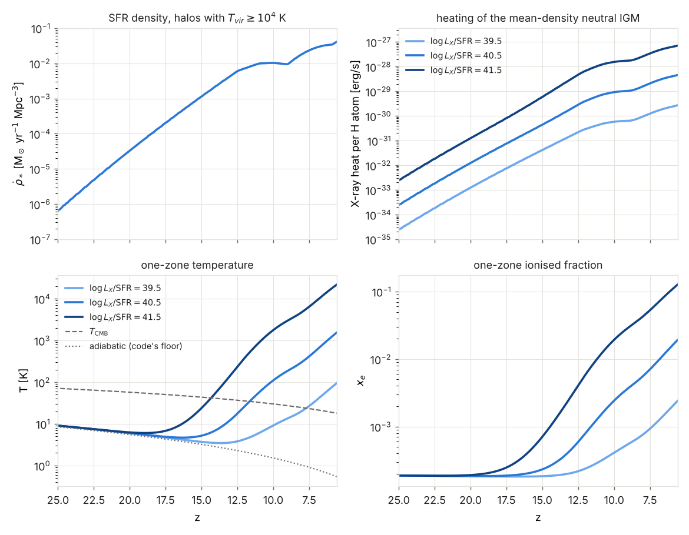

# X-ray preheating from the source model's star formation

*Status (2026-10-26):* a first, simple model behind `xray_heating = 1`
(default 0: the original, no X-rays). The emission parameters are
placeholders from memory until the user supplies the papers (§5). Serial RT
only (rays, M1, OTVET); the AMReX backends refuse it.

## 0. Compton cooling in the code (the question of 2026-10-26)

The code has Compton cooling **and** heating off the CMB, as in the
original: `coef_cool(14) = 4 a σ_T k/(m_e c)`, written as
`4 sS/c (8/3) 3.36e-24/(γ-1)` (`src/rt_rates.cpp`; checked numerically,
`docs/port_notes.md` §5a). The cooling sum adds
`coef_cool(14) n_e (T − T_CMB) T_CMB⁴` (`include/radray/kernels/rt_cell.hpp`),
so gas colder than the CMB is heated. The term is the same with
`legacy_physics = 0` and 1. Two limits, both the original's behaviour:

* **It acts only in cells the RT processes.** `radiative_physics` skips a cell
  that has no photons and `x_HI ≥ 0.99` (`cell_radiation_prep`), and with it
  every cooling and heating term. In practice Compton works on ionised gas,
  where it matters: the cooling time (3/2) n_tot m_e c/(4 σ_T a T_CMB⁴ n_e)
  ≈ 2×10⁸ yr ((1+z)/10)⁻⁴ for ionised H and He, a fraction of the Hubble
  time at z ≳ 7.
* **No residual electrons.** The initial conditions are fully neutral
  (`tools/ics/make_ics.py`), so neutral gas never couples to the CMB. Its
  temperature is held at the floor `temp_min = T_CMB(z) (1+z)/(1+z_dec)`,
  with 1+z_dec = 10³(Ω_b h²)^0.4 ≈ 217 (`calc_sim_var`). That is the
  adiabatic temperature after decoupling at z ≈ 216.

With `xray_heating = 1` every cell is processed (§2), so the X-ray electrons
also couple the neutral gas to the CMB through this same term.

## 1. The model

**Star formation.** The comoving SFR density of all halos above the
atomic-cooling threshold, in the whole universe, not only those the box
resolves:

ρ̇_*(z) = ∫ dn/dlnM · L_UV(M, z)/l_per_sfr dlnM, for M > M_min(z),

where:

* dn/dlnM is the Sheth–Tormen function refit to the FoF halos, the one the
  production source model was matched with: A = 0.3458, a = 0.6164,
  p = 0.3 (`data/hmf/st_fof_40mpc_1024.txt`, `xray_st`).
* L_UV(M, z) is the abundance-matched relation of the run
  (`sfr_model = abundance`, `am_*`; production
  `data/uv_lf/am_params_st_fof.txt`).
* l_per_sfr = 8×10²⁷ erg/s/Hz per M☉/yr is the source model's own
  conversion.
* M_min(z) is the mass where T_vir = `tvir_min` (10⁴ K), computed with the
  halo finder's definitions: Bryan & Norman overdensity, μ = 0.59
  (`halos.cpp`).

The emitting-halo cuts default to the source model's `tvir_min` and `m_min`
and can be set separately (`xray_tvir_min`, `xray_m_min`).

**Emission.** The comoving emissivity is ε_X(z) = (L_X/SFR) ρ̇_*(z), where
L_X is the luminosity in the band [e0, eband] = [0.5, 2] keV. The spectrum
is a power law L_E ∝ E^−α, with α = 1, from e0 to emax = 10 keV. Nothing is
emitted below e0, which stands for absorption in the host galaxy.

**Transfer.** The background is taken as homogeneous, so the mean specific
intensity is

J(E, z) = c/(4π) (1+z)³ ∫_z^zmax dz′/(H(z′)(1+z′)) ε_E(E(1+z′)/(1+z), z′) e^−τ,

with dτ/dln(1+z) = c/H Σ_j n̄_j,0 (1+z)³ x_j σ_j(E).

* The cross-sections σ_j are those of the RT (Verner et al. 1996, HI, HeI
  and HeII).
* The energy grid and the ln(1+z) grid share one step `xray_dlog` (0.005).
  A photon therefore redshifts by exactly one energy bin per redshift step,
  the ARES scheme of Mirocha (2014).
* Within each step e^−τ is integrated exactly for a linear τ, so the
  opaque limit conserves energy (§4).
* The emitted spectrum is averaged over each energy bin, so the band edges
  are not point-sampled.

The absorbers x_j (`xray_opacity`) can be:

* `box` (the default): the box's mass-weighted x_HI, x_HeI and x_HeII at
  the hydro step, applied at all earlier redshifts. This is stateless, so a
  restart reproduces the run. Photons absorbed within a short look-back
  dominate the heating, so the current fractions are the relevant ones.
* `neutral`: (1, 1, 0).
* `none`: no absorption (tests).

**Rates per atom** of species j = HI, HeI, HeII:

* the primary photoionisation rate Γ_j = 4π ∫ J/E σ_j dE;
* the photoelectron power φ_j = 4π ∫ J/E σ_j (E − I_j) dE.

**Cell physics** (`photo_gas_cell`, `rt_cell.hpp`). The photoelectron power
absorbed per volume, Σ_j n_j φ_j, is split with the Shull & van Steenberg
(1985) fractions at the cell's x = n_HII/n_H, using the fits as given by
Ricotti, Gnedin & Shull (2002), with x clamped to [10⁻⁴, 1]:

* f_heat goes into heat, as UV photo-heating does, with the updated
  densities.
* f_ion,HI and f_ion,HeI go into secondary ionisations of HI (at 13.6 eV
  each) and HeI (24.6 eV), with the densities at the start of the substep.

These rates add to the photoionisation rates of the implicit
ionisation-balance solve. The RT's photon limit does not cap them, since
the background is uniform.

## 2. Implementation

| piece | where |
|---|---|
| background, ρ̇_*, rates, parameters | `include/radray/xray_background.hpp`, `src/xray_background.cpp` (library `radray_halos`) |
| `MassFunction::dndlnM_sigma` | `mass_function.hpp/.cpp` (a split of `dndlnM`, bit-identical; σ(M) is tabulated once) |
| the X-ray terms of the cell physics | `PhysCtx::xray*`, `xray_secondary`, `photo_gas_cell` in `rt_cell.hpp` |
| the per-step rates; every cell processed | `Simulation::xray`, `xray_hook` (`simulation.hpp`), `radiative_transfer` and `radiative_physics_plane` (`rt_tools.cpp`) |
| the driver | `apps/radhydro.cpp`: parses `xray_*`, builds the background, writes `Log/xray.txt` |
| a standalone tool | `apps/xray_bkg.cpp`: the background and a one-zone thermal history without a simulation |
| the figure | `tools/analysis/plot_xray.py` |

* **When:** the rates are computed once per hydro step with RT, at the
  middle of the step's scale factor, before the RT substeps. Each row of
  `Log/xray.txt` holds: step, z, ρ̇_*, ε_X, the absorber fractions, Γ_j
  and φ_j. The cost is about 10 ms per step plus one O(N³) pass for the
  box fractions.
* **Every cell is processed** while `xray_heating = 1`, the neutral ones
  without photons included: the background reaches them. `calc_rt_1`
  zeroes `ngam` and `fgam` every substep, so the RT bookkeeping of these
  cells is unchanged (no photons, `fgam = 0`). Only their gas physics is
  new. This adds work in the early, mostly neutral steps.
* **Before the first source** there is no RT step (radhydro calls
  `radiative_transfer` only when the box has sources), so there is no X-ray
  heating either. The model would have some at those redshifts, but it is
  small (§3).
* **Default bit-identity:** with `xray_heating = 0` the X-ray terms are
  exactly zero and the gate is the original. The new additions add +0.0 or
  are skipped, so the fast suite's references are byte-identical.

### Parameters

| key | default | meaning |
|---|---|---|
| `xray_heating` | 0 | 1: the X-ray background (needs `sfr_model = abundance`) |
| `xray_log_lx_sfr` | 40.5 | log₁₀ L_X/SFR, erg s⁻¹ (M☉/yr)⁻¹, in [`xray_e0`, `xray_eband`] (**from memory**, §5) |
| `xray_e0`, `xray_eband`, `xray_emax` | 0.5, 2, 10 keV | lowest emitted energy, upper edge of the normalisation band, highest emitted energy |
| `xray_alpha` | 1 | energy index, L_E ∝ E^−α (**from memory**) |
| `xray_tvir_min`, `xray_m_min` | −1 | emitting-halo cuts (K, M☉); < 0: the source model's `tvir_min`, `m_min` |
| `xray_st` | 0.345835,0.616383,0.3 | Sheth–Tormen A,a,p (the production refit) |
| `xray_zmax` | 40 | no emission above |
| `xray_dlog` | 0.005 | step in ln E and ln(1+z) |
| `xray_opacity` | box | absorbers: box, neutral or none |

## 3. What the model predicts

`build/xray_bkg data/uv_lf/am_params_st_fof.txt [--set key=value]` evolves a
one-zone model of gas at the mean density outside the ionised regions:

* X-ray heating and HI ionisation (primary and secondary), case B
  recombination, Compton coupling (the code's coefficient) and adiabatic
  cooling;
* helium stays neutral;
* it starts at z = 40 with x_e = 2×10⁻⁴ (`--xe0`) at the code's
  adiabatic temperature.

The tool's output feeds `tools/analysis/plot_xray.py`:

Rates and ρ̇_* for the default parameters, neutral IGM:

| z | M_min [M☉] | ρ̇_* [M☉ yr⁻¹ Mpc⁻³] | ε_X(0.5–2 keV) [erg s⁻¹ Mpc⁻³] | Γ_HI [s⁻¹] | φ_HI [erg/s] |
|---|---|---|---|---|---|
| 15.9 | 4.6×10⁷ | 6.2×10⁻⁴ | 2.0×10³⁷ | 4.4×10⁻²² | 5.3×10⁻³¹ |
| 13.9 | 5.5×10⁷ | 2.4×10⁻³ | 7.7×10³⁷ | 1.7×10⁻²¹ | 2.0×10⁻³⁰ |
| 11.9 | 6.9×10⁷ | 7.4×10⁻³ | 2.3×10³⁸ | 5.6×10⁻²¹ | 6.7×10⁻³⁰ |
| 9.9 | 8.8×10⁷ | 1.0×10⁻² | 3.2×10³⁸ | 9.0×10⁻²¹ | 1.1×10⁻²⁹ |
| 7.9 | 1.2×10⁸ | 1.9×10⁻² | 6.1×10³⁸ | 1.4×10⁻²⁰ | 1.6×10⁻²⁹ |

One-zone temperature (x_e in brackets):

| z | log L_X/SFR = 39.5 | 40.5 (default) | 41.5 |
|---|---|---|---|
| 15.9 | 4.0 K | 4.7 K | 13 K |
| 13.9 | 3.5 K | 7.4 K | 62 K (0.0015) |
| 11.9 | 4.4 K | 29 K (0.0008) | 420 K (0.006) |
| 9.9 | 9.6 K | 120 K (0.003) | 1900 K (0.020) |
| 7.9 | 22 K (0.0008) | 330 K (0.006) | 5100 K (0.045) |

T_CMB is 46 K at z = 15.9 and 24 K at z = 7.9.

* With the default, the IGM passes T_CMB at z ≈ 11.5. It is ~100 K by
  z ≈ 10 and a few hundred K at z ≈ 8.
* The temperature floors that `docs/zoom_turbulence.md` WP5 and C26
  consider (100 K and 1000 K) fall inside the range spanned by
  log L_X/SFR = 40.5–41.5 at z ≲ 10.
* The kink of ρ̇_* at z ≈ 9–10 comes from the source model, not from this
  code. Its shape is fitted to z ≤ 9 and above that only a normalisation
  offset changes, piecewise linear through the knots at z = 10, 11 and
  12.5 (`docs/abundance_matching.md`).

## 4. Tests

* **`xray_background`** (`tests/test_xray.cpp`):
  * the parameter parsing; the refusal without `sfr_model = abundance`;
  * T_vir(M_min) = 10⁴ K with the halo finder's functions;
  * ρ̇_*: the table against the direct integral (2×10⁻³), and the direct
    integral against an independent one with `MassFunction::dndlnM`
    (5×10⁻³);
  * the optically thin J against a brute-force quadrature in z (10⁻²; it
    agrees to 2×10⁻⁴);
  * the opaque limit: the absorbed power equals the proper emissivity
    (2×10⁻²; it agrees to 3×10⁻³);
  * the Shull & van Steenberg fractions (limits, monotonic);
  * `photo_gas_cell`: bit-identical with zero X-ray rates, and in a
    neutral cell the heating and ionisation the rates imply, to 2×10⁻².
* **`xray_heating`** (`tests/xray_check.py`, the smoke problem, log
  L_X/SFR = 44 so that the tiny box at z = 30–20 heats measurably):
  * 1 against 2 threads, byte-identical;
  * `xray_heating = 0` byte-identical to a run without any `xray_*` key;
  * `Log/xray.txt` sane;
  * the neutral cells hotter and more ionised than without X-rays in every
    RT step.
* **`restart_smoke_xray`**: a restart at step 14 is byte-identical.

## 5. To confirm, and next steps

**Coefficients from memory (unconfirmed):**

* **L_X/SFR = 10^40.5 erg/s per M☉/yr in 0.5–2 keV, E_0 = 0.5 keV,
  α = 1.** These are the low-metallicity high-mass X-ray binary values used
  as defaults in 21cmFAST-type models (after Fragos et al. 2013 and Das
  et al. 2017). The often-quoted older normalisation is 3.4×10⁴⁰ f_X erg/s
  above 0.2 keV (Furlanetto 2006).
* **Shull & van Steenberg (1985) fits** (Ricotti, Gnedin & Shull 2002):
  * f_heat = 0.9971 [1 − (1 − x^0.2663)^1.3163];
  * f_ion,HI = 0.3908 (1 − x^0.4092)^1.7592;
  * f_ion,HeI = 0.0554 (1 − x^0.4614)^1.6660.

**To replace with the user's papers:** L_X/SFR and its metallicity or
redshift dependence, the spectrum (an HMXB spectrum with ISM absorption
instead of a sharp E_0, possibly a hot-ISM component), and the
secondary-electron fractions (Furlanetto & Stoever 2010 instead of
SvS85).

**Physics left out, in rough order of importance:**

1. **Fluctuations.** Soft X-rays (≲ 0.5 keV) have mean free paths of a
   few comoving Mpc at z ~ 10, less than the 40 h⁻¹ Mpc box. The real
   heating is patchier and stronger near the sources. Two remedies:
   * an X-ray group in the RT itself (the rays or M1, with the
     photoelectron energy split above), using the halos of the box,
     with the uniform background keeping only the hard part and the
     unresolved halos;
   * a smoothed-SFR-field approach as in 21cmFAST.
2. **The opacity history.** The current box fractions are applied to the
   whole look-back. A recorded history would need to be checkpointed.
3. **No heating before the first RT step**, i.e. before the box has a
   source (§2). This could be applied in a heating-only pass.
4. Minihalos and Pop III below 10⁴ K (`xray_tvir_min` lowers the cut, but
   L_UV(M) is then extrapolated); Lyman–Werner feedback.
5. Compton heating by X-rays, HeII secondary ionisations: small.
6. The X-ray ionisations are not in `rt_stat`'s `nion` count.
7. The AMReX backends (`rt_backend = amrex`, `amrex_state = 1`): the same
   kernel terms, plus the rates passed to the level and the gate.
